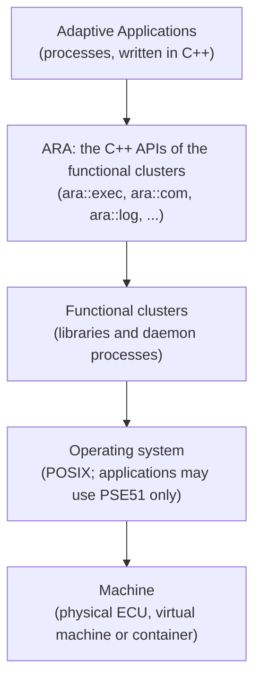
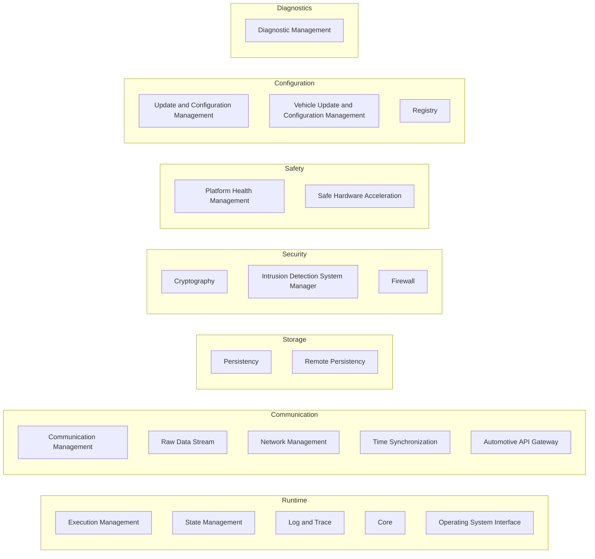
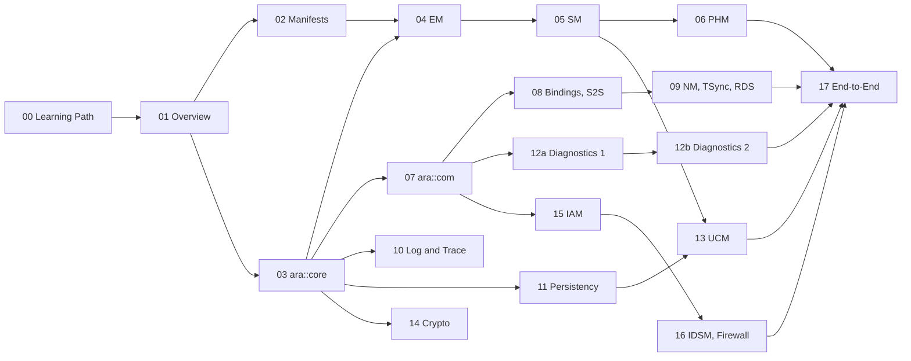
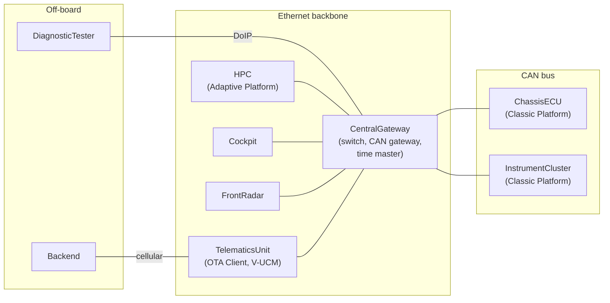
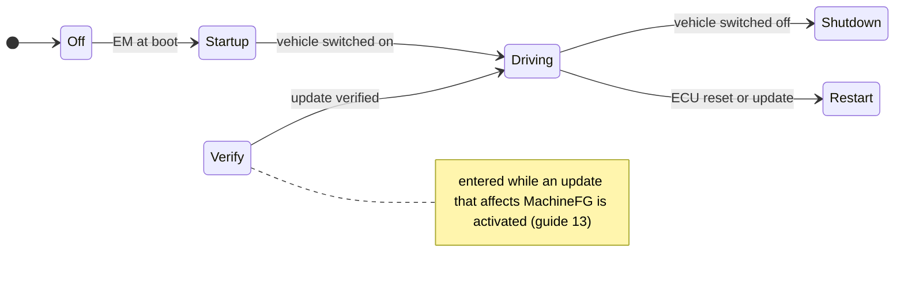
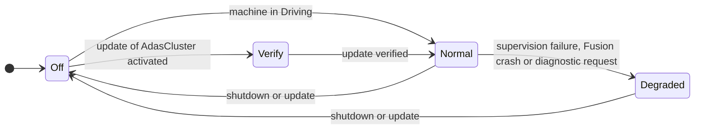
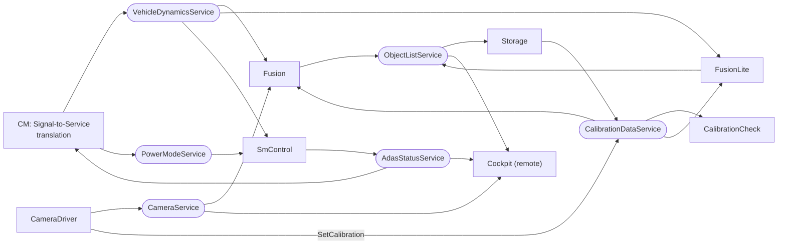
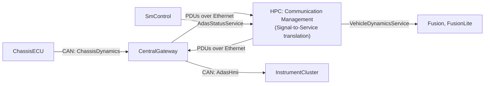

# AUTOSAR Adaptive Platform: Learning Path, Series Glossary and Running Example

<!-- markdownlint-disable MD013 MD033 -->

> **Source specification:** *Glossary* (`AUTOSAR_FO_TR_Glossary`), AUTOSAR Foundation **R25-11**, and *Explanation of Adaptive Platform Design* (`AUTOSAR_AP_EXP_PlatformDesign`), AUTOSAR Adaptive Platform **R25-11**. Also based on *Explanation of Adaptive Platform Software Architecture* (`AUTOSAR_AP_EXP_SWArchitecture`, Adaptive Platform R25-11).
>
> **Document type:** training material.
>
> **Author:** Hieu Do Minh/Claude
>
> **Version:** 1.0
>
> **Part of the series:** this guide is the entry point of the [AUTOSAR Adaptive Platform Training Guides](../README.md). Next: [01 Adaptive Platform Overview and Architecture](01_PlatformOverview.md).

## About This Guide

This guide is the hub of the training series on the AUTOSAR Adaptive Platform (AP). It does not explain a functional cluster. Instead, it tells you which guide to read, in which order, and how the guides are written. It also holds two things that all other guides share: the **series glossary** and the complete definition of the **running example**, an invented high-performance ECU called `HPC`. Every other guide shows its topic on this example and uses the terms as this guide defines them. Read this guide first, and come back to it whenever a guide mentions a term or a part of the example that you do not know.

### Who This Guide Is For

Everyone who reads the series, in particular:

- **Application developers** who write software that runs on the Adaptive Platform.
- **Integrators** who configure manifests, deploy software and debug ECUs.
- **Platform developers** who build or extend functional clusters.
- **Diagnostics and security engineers** who work on one specific area of the platform.

Assumed background: modern C++, plus basic Linux/POSIX knowledge. No prior AUTOSAR knowledge is needed. [Section 4.1](#41-prerequisites) lists the details.

### What You Will Get From This Guide

After reading this guide you will be able to:

1. Explain in a few sentences what the Adaptive Platform is and how the series covers it.
2. Find the guide that answers your question, and choose a reading path for your role.
3. Find an AUTOSAR specification and a requirement inside it.
4. Describe the `HPC` running example: its network, Function Groups, processes and services, and which guide details each part.
5. Look up a term or an acronym in the series glossary.

### How to Read This Guide

Read Chapters 1 to 5 once. Chapter 6, the running example, is a reference: skim it now and come back when a guide uses a part of it. The appendices are for lookup.

| Convention | Meaning |
| --- | --- |
| `[SWS_EM_01050]` | A requirement ID in an AUTOSAR specification. Search for it in the specification to read the exact normative text ([Section 5.1](#51-requirement-and-constraint-ids)). |
| **Note (implementation example)** | How a typical implementation *might* realize something. This is not mandated by AUTOSAR. |
| **Pitfall** | A common mistake seen in real projects. |
| **Key takeaways** | A short summary at the end of each chapter. |
| *illustrative* | A value of the running example that was invented for teaching, such as an IP address or a service ID. |
| Diagrams | Written in Mermaid. They render natively on GitHub and GitLab ([Section 4.2](#42-setting-up-a-reading-environment)). |

### The Running Example

All guides share one invented system: the high-performance ECU `HPC`, which runs an ADAS feature. [Chapter 6](#6-the-running-example-the-hpc-reference-system) defines it completely. [Appendix B](#appendix-b-running-example-quick-reference) lists all its names and values on one page.

## Table of Contents

- [AUTOSAR Adaptive Platform: Learning Path, Series Glossary and Running Example](#autosar-adaptive-platform-learning-path-series-glossary-and-running-example)
  - [About This Guide](#about-this-guide)
    - [Who This Guide Is For](#who-this-guide-is-for)
    - [What You Will Get From This Guide](#what-you-will-get-from-this-guide)
    - [How to Read This Guide](#how-to-read-this-guide)
    - [The Running Example](#the-running-example)
  - [Table of Contents](#table-of-contents)
  - [1. Welcome to the Series](#1-welcome-to-the-series)
    - [1.1 The Adaptive Platform in One Page](#11-the-adaptive-platform-in-one-page)
    - [1.2 What the Series Covers and What It Does Not](#12-what-the-series-covers-and-what-it-does-not)
    - [1.3 The Baseline Release R25-11](#13-the-baseline-release-r25-11)
  - [2. The Guide Catalog](#2-the-guide-catalog)
    - [2.1 All Guides at a Glance](#21-all-guides-at-a-glance)
    - [2.2 How Every Guide Is Built](#22-how-every-guide-is-built)
    - [2.3 Functional Clusters and Their Guides](#23-functional-clusters-and-their-guides)
    - [2.4 Topics Outside the Series](#24-topics-outside-the-series)
  - [3. Learning Paths](#3-learning-paths)
    - [3.1 The Full Path](#31-the-full-path)
    - [3.2 Application Developers](#32-application-developers)
    - [3.3 Integrators](#33-integrators)
    - [3.4 Platform Developers](#34-platform-developers)
    - [3.5 Diagnostics Engineers](#35-diagnostics-engineers)
    - [3.6 Security Engineers](#36-security-engineers)
    - [3.7 If You Know AUTOSAR Classic](#37-if-you-know-autosar-classic)
  - [4. Before You Start](#4-before-you-start)
    - [4.1 Prerequisites](#41-prerequisites)
    - [4.2 Setting Up a Reading Environment](#42-setting-up-a-reading-environment)
    - [4.3 Getting the AUTOSAR Specifications](#43-getting-the-autosar-specifications)
    - [4.4 How AUTOSAR Documents Are Named](#44-how-autosar-documents-are-named)
    - [4.5 Finding a Requirement in the Specification](#45-finding-a-requirement-in-the-specification)
  - [5. Series Conventions](#5-series-conventions)
    - [5.1 Requirement and Constraint IDs](#51-requirement-and-constraint-ids)
    - [5.2 Three Kinds of Statements](#52-three-kinds-of-statements)
    - [5.3 Boxes and Markers](#53-boxes-and-markers)
    - [5.4 Code, Manifests and Diagrams](#54-code-manifests-and-diagrams)
    - [5.5 Names and Typography](#55-names-and-typography)
    - [5.6 Links Between Guides](#56-links-between-guides)
  - [6. The Running Example: The HPC Reference System](#6-the-running-example-the-hpc-reference-system)
    - [6.1 Purpose and Rules](#61-purpose-and-rules)
    - [6.2 The Vehicle Context](#62-the-vehicle-context)
    - [6.3 The HPC Machine](#63-the-hpc-machine)
    - [6.4 Function Groups and States](#64-function-groups-and-states)
    - [6.5 Processes](#65-processes)
    - [6.6 Services and Their Consumers](#66-services-and-their-consumers)
    - [6.7 Network Deployment](#67-network-deployment)
    - [6.8 Classic ECUs and Signal-to-Service Translation](#68-classic-ecus-and-signal-to-service-translation)
    - [6.9 Persistent Data](#69-persistent-data)
    - [6.10 Diagnostics](#610-diagnostics)
    - [6.11 Software Updates](#611-software-updates)
    - [6.12 Security](#612-security)
    - [6.13 Safety](#613-safety)
    - [6.14 Time, Network Management and Logging](#614-time-network-management-and-logging)
    - [6.15 Scenario Index](#615-scenario-index)
  - [7. Summary](#7-summary)
    - [7.1 Summary](#71-summary)
  - [Appendix A. Series Glossary and Acronyms](#appendix-a-series-glossary-and-acronyms)
    - [A.1 Acronyms](#a1-acronyms)
    - [A.2 Glossary](#a2-glossary)
  - [Appendix B. Running Example Quick Reference](#appendix-b-running-example-quick-reference)
    - [B.1 Nodes and Addresses](#b1-nodes-and-addresses)
    - [B.2 Function Groups and Processes](#b2-function-groups-and-processes)
    - [B.3 Services, Signals and Streams](#b3-services-signals-and-streams)
    - [B.4 Data, Diagnostics and Updates](#b4-data-diagnostics-and-updates)
    - [B.5 Security, Safety, Time and Logging](#b5-security-safety-time-and-logging)
  - [Appendix C. References](#appendix-c-references)

---

## 1. Welcome to the Series

> **Why this matters:** The Adaptive Platform is large. The R25-11 release describes about twenty functional clusters, most of them in a specification of their own. This chapter gives you the one-page picture, tells you what the series covers, and explains why all guides use one release.

### 1.1 The Adaptive Platform in One Page

**Why a second platform?** Classic ECUs control electrical outputs based on input signals, and their software rarely changes during the life of a vehicle. The AUTOSAR **Classic Platform (CP)** is designed for these deeply embedded ECUs. Functions such as automated driving are different: they need much more computing power, they connect the vehicle to backend systems, and their software must be updated during the life of the vehicle. AUTOSAR therefore specifies a second software platform, the **Adaptive Platform (AP)**. It provides high-performance computing and communication, and it allows flexible software configuration, for example for over-the-air updates (*Platform Design*, Section 3.1).

Two technology trends drive the Adaptive Platform: **Ethernet**, which offers much more bandwidth than CAN, and **processors** with many cores, GPUs and hardware accelerators (*Platform Design*, Section 3.2). The following table summarizes the characteristics that result (*Platform Design*, Section 3.3).

| Characteristic | What it means for you |
| --- | --- |
| C++ | Applications are written in C++. |
| Service-oriented architecture (SOA) | Applications offer and use *services*. The code is the same whether the service runs on the same machine or on another one. |
| Parallel processing | The platform is designed for multi-core processors. |
| Existing standards | AP reuses existing standards, for example POSIX for the operating system, instead of inventing new ones. |
| Safety and security | Architecture, dedicated functional clusters and guidelines support safe and secure systems. |
| Planned dynamics | Software can be deployed incrementally during development. For production, the integrator can restrict the dynamic behavior, for example to a pre-determined service discovery or to authenticated code only. |
| Agile | The platform can be updated after deployment, which supports incremental development. |

**How it is built, in five sentences** (*Platform Design*, Sections 4.1 and 4.2):

1. **Adaptive Applications** run on top of the **AUTOSAR Runtime for Adaptive Applications (ARA)**, which is the set of C++ interfaces that the **functional clusters** of the platform provide.
2. Applications may use only ARA and the minimal real-time POSIX profile **PSE51** of the operating system. This keeps them portable and isolated from each other.
3. **Execution Management** starts and stops the processes of the platform and of the applications. **State Management** decides which ones should run.
4. Applications talk to each other only through **Communication Management**, the platform's service-oriented middleware.
5. The platform runs on a **Machine**, which can be a physical ECU, a virtual machine or a container. One Machine runs exactly one instance of the platform.

The following diagram shows these layers. [Guide 01](01_PlatformOverview.md#3-the-architecture-logical-view) explains them in detail.

The Adaptive Platform does not replace the Classic Platform. Both run side by side in the same vehicle and communicate, for example over SOME/IP, which both platforms support (*Platform Design*, Section 3.4). Signal-to-Service translation connects the signal-based Classic world to the service-oriented Adaptive world [EXT-001].

### 1.2 What the Series Covers and What It Does Not

The series covers the functional clusters that most AP projects use, one guide per cluster or topic. Each guide explains the concepts, the mechanisms, the configuration and the C++ API, and shows them on the running example.

The series does **not**:

- replace the specifications. Every normative statement points to a requirement ID, so that you can read the exact text. Where a guide and a specification differ, the specification applies.
- describe a particular vendor's product or tools. Where implementations differ, a **Note (implementation example)** box shows one typical approach.
- cover the Classic Platform, except where an Adaptive cluster interacts with it.
- make a system safe or secure by itself. Using the Adaptive Platform does not imply compliance with ISO 26262 (*Platform Design*, Section 17.1).

### 1.3 The Baseline Release R25-11

All guides are based on **one release: R25-11** of the Adaptive Platform and of the Foundation. AUTOSAR names releases by year and month; recent releases appeared every November (R22-11 to R25-11). Requirement IDs, API signatures and configuration attributes change between releases, so mixing releases leads to examples that do not compile and IDs that cannot be found.

The following changes of the last releases are useful to know when you read older material. They come from the change history of the *Platform Design* explanation. Each guide lists the changes of its own cluster in its appendix *Notable Changes in Recent Releases*.

| Release | Notable change described in *Platform Design* |
| --- | --- |
| R22-11 | Firewall added. State Management introduces the *StateMachine* concept. |
| R23-11 | Raw Data Stream described as its own topic, separate from Communication Management. |
| R24-11 | Automotive API Gateway added. Health Channels and System Health Management removed from Platform Health Management. |
| R25-11 | Remote Persistency, Sensor Interfaces and Safe Hardware Acceleration added. State Management, Update and Configuration Management, Diagnostics and Time Synchronization updated. |

> **Key takeaways**
>
> - The Adaptive Platform is AUTOSAR's platform for high-performance, service-oriented, updatable ECUs. It complements the Classic Platform.
> - Applications use only ARA and PSE51, talk only through Communication Management, and are started by Execution Management on the decision of State Management.
> - The series explains the specifications; it does not replace them.
> - All guides use release R25-11 only.

---

## 2. The Guide Catalog

> **Why this matters:** You rarely need all guides at once. This chapter tells you which guide answers which question, how every guide is structured, and which functional cluster each guide covers.

### 2.1 All Guides at a Glance

Read the guides in the order of their numbers, or follow a learning path from [Chapter 3](#3-learning-paths). Guides that are not yet published are listed with their planned file name.

| # | Guide | It answers the question | Main specifications | Status |
| --- | --- | --- | --- | --- |
| 00 | Learning Path, Series Glossary and Running Example | Where do I start, what does a term mean, and what is the `HPC`? | FO Glossary, AP EXP Platform Design | This guide |
| 01 | [Adaptive Platform Overview and Architecture](01_PlatformOverview.md) | How is the platform structured, and what does the operating system provide? | AP EXP Platform Design, AP EXP SW Architecture, AP SWS Operating System Interface | Available |
| 02 | [Manifests and Methodology](02_Manifests.md) | Who configures what, when, and in which manifest? | AP TPS Manifest Specification | Available |
| 03 | [`ara::core` and General Conventions](03_CoreAndGeneral.md) | How do the `ara::` APIs report errors, and how do I initialize the runtime? | AP SWS Core | Available |
| 04 | [Execution Management](04_ExecutionManagement.md) | Who starts and stops my process, and how do state transitions work? | AP SWS Execution Management | Available |
| 05 | [State Management](05_StateManagement.md) | Who decides which Function Group States are active? | AP SWS State Management | Available |
| 06 | [Platform Health Management](06_PlatformHealthManagement.md) | How is my process supervised, and what happens when it misbehaves? | AP SWS Platform Health Management | Available |
| 07 | Communication Management Part 1: `ara::com` Concepts and API (`07_CommunicationManagement.md`) | How do applications offer and use services in C++? | AP EXP ara::com API, AP SWS Communication Management | Planned |
| 08 | Communication Management Part 2: Network Bindings and Signal-to-Service Translation (`08_NetworkBindings.md`) | How do services travel over SOME/IP and DDS, and how do CAN signals become services? | AP SWS Communication Management, FO PRS SOME/IP, FO PRS SOME/IP Service Discovery, FO PRS E2E | Planned |
| 09 | Network Management, Time Synchronization and Raw Data Stream (`09_NM_TimeSync_RawDataStream.md`) | How are networks woken, clocks synchronized and raw sensor data streamed? | AP SWS Network Management, AP SWS Time Synchronization, AP SWS Raw Data Stream | Planned |
| 10 | Log and Trace (`10_LogAndTrace.md`) | How do I log, and how do I read a DLT trace? | AP SWS Log and Trace, FO PRS Log and Trace Protocol | Planned |
| 11 | Persistency (`11_Persistency.md`) | How do I keep data across power cycles and updates? | AP SWS Persistency | Planned |
| 12a | Diagnostics Part 1 (`12a_Diagnostics.md`) | How does a diagnostic tester talk to the `HPC`? | AP SWS Diagnostics | Planned |
| 12b | Diagnostics Part 2 (`12b_Diagnostics.md`) | How are faults detected, stored as DTCs and read out? | AP SWS Diagnostics | Planned |
| 13 | Update and Configuration Management (`13_UpdateAndConfigManagement.md`) | How is software installed, updated and rolled back? | AP SWS Update and Configuration Management | Planned |
| 14 | Cryptography (`14_Cryptography.md`) | How do I use keys, certificates and crypto primitives safely? | AP SWS Cryptography | Planned |
| 15 | Identity and Access Management (`15_IdentityAndAccessManagement.md`) | Who may use which service or platform interface? | AP SWS Identity and Access Management | Planned |
| 16 | Intrusion Detection System Manager and Firewall (`16_IDSM_Firewall.md`) | How are security events collected, and how is network traffic filtered? | AP SWS IDSM, AP SWS Firewall | Planned |
| 17 | End-to-End Integration: A Day in the Life of the HPC (`17_EndToEndIntegration.md`) | How do all clusters work together over a whole day? | All of the above | Planned |

The split between guides 12a and 12b is fixed when guide 12a is written. An optional collection of exercises may follow guide 17.

### 2.2 How Every Guide Is Built

Every cluster guide follows the same pattern, so that you always know where to look:

1. **About This Guide:** audience, learning objectives and the parts of the running example that the guide uses.
2. **Concept chapters:** what the cluster does and does not do, its vocabulary and its place in the architecture.
3. **Configuration Overview** (Chapter 4): where the configuration lives and how its elements relate.
4. **Mechanism chapters:** how the cluster behaves, with rules, requirement IDs, diagrams and worked examples.
5. **Configuration Reference:** the minimal configuration, every setting with its meaning, values, default and effect, and the complete configuration of the running example.
6. **API Reference:** the `ara::` C++ interface with usage examples.
7. **Practice:** reporting, an end-to-end walkthrough, best practices, pitfalls and troubleshooting.
8. **Summary and Self-Check Quiz**, with answers.
9. **Appendices:** glossary, cheat sheet, traceability to the specification, notable changes between releases, and references.

Guide 00 is a hub and follows only parts of this pattern. Guides 01 to 03 cover cross-cutting topics and adapt it.

### 2.3 Functional Clusters and Their Guides

A **functional cluster** is a logical group of platform functionality, such as Execution Management or Persistency. The *Software Architecture* explanation sorts the R25-11 clusters into seven categories (*SW Architecture*, Section 9.1):

The following table maps each cluster to its guide. The columns come from two explanatory documents:

- **Namespace** and **ARA group** follow the logical view of the platform (*Platform Design*, Figure 4.1). *Foundation* clusters provide the fundamental functions and are library-based: the application links a library that provides the API. *Platform Service* clusters are service-based: they offer their API as `ara::com` services (*Platform Design*, Section 4.2.2). *Vehicle Service* clusters provide vehicle-level functions.
- **Daemon-based** means that the cluster is intended to be implemented with its own daemon process. An implementation may deviate from this (*SW Architecture*, Table 9.1).

| Functional cluster | Namespace | Category | ARA group | Daemon-based | Guide |
| --- | --- | --- | --- | --- | --- |
| Execution Management | `ara::exec` | Runtime | Foundation | yes | [04](04_ExecutionManagement.md) |
| State Management | `ara::sm` | Runtime | Platform Service | yes | 05 |
| Log and Trace | `ara::log` | Runtime | Foundation | no | 10 |
| Core | `ara::core` | Runtime | Foundation | no | [03](03_CoreAndGeneral.md) |
| Operating System Interface | (POSIX PSE51, C++ standard library) | Runtime | Foundation | no | [01](01_PlatformOverview.md#7-the-operating-system-interface) |
| Communication Management | `ara::com` | Communication | Foundation | yes | 07, 08 |
| Raw Data Stream | `ara::rds` | Communication | Foundation | no | 09 |
| Network Management | `ara::nm` | Communication | Foundation | yes | 09 |
| Time Synchronization | `ara::tsync` | Communication | Foundation | yes | 09 |
| Automotive API Gateway | `ara::aag` | Communication | Vehicle Service | yes | not covered ([Section 2.4](#24-topics-outside-the-series)) |
| Persistency | `ara::per` | Storage | Foundation | no | 11 |
| Remote Persistency | `ara::rper` | Storage | Vehicle Service | yes | not covered |
| Cryptography | `ara::crypto` | Security | Foundation | yes | 14 |
| Intrusion Detection System Manager | `ara::idsm` | Security | Foundation | yes | 16 |
| Firewall | `ara::fw` | Security | Foundation | yes | 16 |
| Platform Health Management | `ara::phm` | Safety | Foundation | yes | [06](06_PlatformHealthManagement.md) |
| Safe Hardware Acceleration | `ara::shwa` | Safety | Foundation | no | not covered |
| Update and Configuration Management | `ara::ucm` | Configuration | Platform Service | yes | 13 |
| Vehicle Update and Configuration Management | `ara::vucm` | Configuration | Vehicle Service | yes | 13 (context only) |
| Registry | (internal, no public API) | Configuration | (not shown) | no | not covered |
| Diagnostic Management | `ara::diag` | Diagnostics | Foundation | yes | 12a, 12b |

[Guide 01, Chapter 5](01_PlatformOverview.md#5-the-functional-clusters-of-r25-11) describes each cluster in one paragraph, including the clusters that this series does not cover.

**Identity and Access Management (IAM)** does not appear in the table because the *Software Architecture* explanation does not list it as a building block. It is a framework that several clusters implement, built from a Policy Decision Point and Policy Enforcement Points (*Platform Design*, Chapter 14). Guide 15 covers it.

### 2.4 Topics Outside the Series

The following topics are part of R25-11 but have no guide of their own. [Guide 01, Chapter 5](01_PlatformOverview.md#5-the-functional-clusters-of-r25-11) summarizes them so that you know they exist.

| Topic | What it is | Where to read more |
| --- | --- | --- |
| Automotive API Gateway | Gives off-board and on-board clients access to selected vehicle data through the Vehicle Information Service Specification (VISS) and the Vehicle Signal Specification (VSS). | *Platform Design*, Chapter 22 |
| Remote Persistency | Shares data stored by Persistency between applications through services, on the same or on different machines. | *Platform Design*, Chapter 23 |
| Safe Hardware Acceleration | An API to run tasks on hardware accelerators, such as GPUs, with safety in mind. | *Platform Design*, Section 17.4 |
| Registry | An internal component that gives other clusters access to manifest information. It is not used by applications. | *SW Architecture*, Section 9.7.3 |
| Sensor Interfaces | Standardized service interfaces for sensor data according to ISO 23150. They are interfaces, not a cluster. | *Platform Design*, Chapter 24 |
| Vehicle Update and Configuration Management | Coordinates software updates across all ECUs of a vehicle. Guide 13 explains only how it uses UCM. | *Platform Design*, Section 13.5 |
| Classic Platform | The AUTOSAR platform for deeply embedded ECUs. | The CP standard at autosar.org [EXT-002] |

> **Key takeaways**
>
> - Every guide answers one main question. The catalog in [Section 2.1](#21-all-guides-at-a-glance) tells you which.
> - All cluster guides have the same structure, including two configuration chapters and an API chapter.
> - R25-11 has about twenty functional clusters in seven categories. The series covers those that most projects use.
> - IAM is a framework across clusters, not a single cluster.

---

## 3. Learning Paths

> **Why this matters:** The full series is long. If you have a specific role, a shorter path gets you productive faster. Each path below lists the guides in reading order and says how deeply to read them.

### 3.1 The Full Path

The full path reads the guides by number. The following diagram shows which guides build on which. An arrow from A to B means "read A before B".

In the role paths, **Read** means read the whole guide, **Skim** means read the concept chapters and the key takeaways, and **Optional** means read when you need it.

### 3.2 Application Developers

You write processes that offer and use services, log, store data and report their state.

| Guide | Depth | Why |
| --- | --- | --- |
| 00, 01 | Read | Orientation and architecture |
| [03](03_CoreAndGeneral.md) `ara::core` | Read | Error handling with `Result` and `Future` is used by every API |
| 07 `ara::com` | Read | Your main API: proxies, skeletons, events, methods, fields |
| 04 EM | Read Chapters 1, 2, 5 and 13 | How your process is started and stopped, and `ExecutionClient` |
| 10 Log and Trace | Read | Logging from day one |
| 11 Persistency | Read | Keeping data across power cycles |
| [06](06_PlatformHealthManagement.md#5-supervised-entities-and-checkpoints-in-practice) PHM | Skim | Supervision checkpoints in your code |
| 02 Manifests | Skim | What the integrator configures for you |
| 12a, 14, 15 | Optional | When your application provides diagnostic data, uses crypto or needs access rights |

### 3.3 Integrators

You configure manifests, deploy software, bring up ECUs and debug them.

| Guide | Depth | Why |
| --- | --- | --- |
| 00, 01 | Read | Orientation and architecture |
| 02 Manifests | Read | The basis of all configuration |
| 04 EM, [05](05_StateManagement.md#7-controller-and-agents) SM | Read | Startup, Function Groups and state transitions |
| 07, 08 | Read | Service deployment and network bindings |
| [06](06_PlatformHealthManagement.md#14-configuration-reference-what-to-configure) PHM | Read | Supervision and recovery |
| 13 UCM | Read | Installation and updates |
| 16 IDSM and Firewall | Read | Firewall rules and security events in the Machine Manifest |
| 10, 11, 12a, 12b, 14, 15 | Skim | The configuration chapters of each |
| 17 End-to-End | Read | How everything fits together |

### 3.4 Platform Developers

You build or extend a functional cluster, or write the project-specific State Management logic.

| Guide | Depth | Why |
| --- | --- | --- |
| 00, 01 | Read | Orientation and architecture |
| [03](03_CoreAndGeneral.md#12-general-rules-for-all-functional-clusters) `ara::core` | Read | Conventions every cluster API follows |
| 04 EM, [05](05_StateManagement.md) SM, [06](06_PlatformHealthManagement.md) PHM | Read | The lifecycle core that every cluster depends on |
| The guide of your cluster | Read | Your own area |
| 02 Manifests | Skim | How your cluster's configuration reaches you |
| 17 End-to-End | Read | The interactions between clusters |

### 3.5 Diagnostics Engineers

You define and test diagnostic services, DTCs and their data.

| Guide | Depth | Why |
| --- | --- | --- |
| 00, 01 | Read | Orientation and architecture |
| 02 Manifests | Skim | Where the diagnostic configuration lives |
| 07 `ara::com` | Skim | Diagnostic interfaces of applications use the same concepts |
| 12a, 12b Diagnostics | Read | Your main area |
| [05](05_StateManagement.md#112-diagnostics-ecu-reset-and-communication-control) SM | Skim | ECU reset and how State Management carries it out |
| 13 UCM | Skim | Updates through a diagnostic tester |
| 10 Log and Trace | Optional | Traces that support diagnostic analysis |

### 3.6 Security Engineers

You design the security concept of an Adaptive ECU: keys, access control, secure communication, intrusion detection and secure updates.

| Guide | Depth | Why |
| --- | --- | --- |
| 00, 01 | Read | Orientation and architecture |
| 04 EM, Chapter 12 | Read | Trusted Platform, launch modes and the integrity security event |
| 14 Cryptography | Read | Keys, certificates and the crypto API |
| 15 IAM | Read | Access rights of processes |
| 16 IDSM and Firewall | Read | Security events and network filtering |
| 08 Bindings | Read the secure communication parts | TLS and other protections of service communication |
| 13 UCM | Skim | Authenticity of update packages |

### 3.7 If You Know AUTOSAR Classic

Many concepts have a Classic counterpart, but the platform works differently. Applications are processes, not runnables; communication is service-oriented by default; configuration is deployed with the software in manifests and can change through updates; and the platform runs on a POSIX operating system. Read [guide 01](01_PlatformOverview.md#2-why-two-platforms-classic-and-adaptive) first; it compares both platforms. Do not assume that a familiar term means the same thing: look it up in [Appendix A](#appendix-a-series-glossary-and-acronyms).

> **Key takeaways**
>
> - The full path follows the guide numbers. Guides 00 to 03 are the foundation for everything else.
> - Each role path picks the guides that matter for that role and says how deeply to read them.
> - Readers with Classic experience should read guide 01 first and check familiar terms in the glossary.

---

## 4. Before You Start

> **Why this matters:** A few minutes of preparation save hours later: the right background knowledge, a viewer that renders the diagrams, and the specifications at hand to check what a guide says.

### 4.1 Prerequisites

| Area | What you should know | Where it is needed |
| --- | --- | --- |
| C++ | Classes, RAII, move semantics, templates, lambdas, smart pointers, `std::future`-style asynchronous results | All API chapters |
| Linux/POSIX | Processes, signals, threads, file systems, sockets | 01, 04, 11, 16 |
| Networking | Ethernet, IP, UDP, TCP, multicast | 07, 08, 09, 16 |
| CAN (optional) | Frames, signals, cyclic transmission | 08 (Signal-to-Service translation) |
| Diagnostics (optional) | The idea of UDS services, DIDs and DTCs | 12a, 12b |

### 4.2 Setting Up a Reading Environment

The guides are plain Markdown with Mermaid diagrams [EXT-003].

- **GitHub and GitLab** render the guides, including the diagrams, without any setup.
- **VS Code:** install the *Markdown Preview Mermaid Support* extension and open the Markdown preview.
- **Other editors:** use any Markdown viewer with Mermaid support, or paste a diagram into the Mermaid Live Editor at <https://mermaid.live>.

The quiz answers are in collapsible `
` blocks. Click a question to show its answer.

### 4.3 Getting the AUTOSAR Specifications

The guides cite the specifications but do not contain them. You can download them from <https://www.autosar.org/standards> [EXT-002]. Choose **Adaptive Platform** and **Foundation**, release **R25-11**. The files are provided for information; read the disclaimer and terms of use in each file [EXT-001].

### 4.4 How AUTOSAR Documents Are Named

Every AUTOSAR document has a name of the form `AUTOSAR_<standard>_<type>_<name>`, for example `AUTOSAR_AP_SWS_ExecutionManagement`. The *standard* is `AP` (Adaptive Platform), `CP` (Classic Platform) or `FO` (Foundation, the artifacts common to both platforms). The *type* tells you what kind of document it is:

| Type | Name | What it contains | Normative? |
| --- | --- | --- | --- |
| SWS | Software Specification | The behavior and API of one functional cluster. The main source of every cluster guide. | Yes |
| TPS | Template Specification | The meta-model, for example the *Manifest Specification* with all configuration elements. | Yes |
| PRS | Protocol Requirements Specification | A protocol on the wire, for example SOME/IP or DLT. | Yes |
| RS | Requirements Specification | The requirements that a cluster must fulfill, which the SWS refines. | Yes |
| EXP | Explanation | Background and design rationale, for example *Explanation of Adaptive Platform Design*. | No |
| TR | Technical Report | Reports such as the *Glossary* or a release overview. | No |

The guides rely on SWS, TPS and PRS for every normative statement, and on EXP and TR for explanations.

### 4.5 Finding a Requirement in the Specification

To read the exact text behind an ID such as `[SWS_EM_01050]`:

1. Find the document from the prefix: `SWS_EM` is the *Specification of Execution Management*, `TPS_MANI` the *Manifest Specification*, `constr_` a constraint, usually of a TPS.
2. Open the PDF and search for the ID. Each requirement is a short, numbered block of text.
3. If you cannot find it, check the change history appendix at the end of the specification. Requirements can be removed or replaced between releases.

> **Key takeaways**
>
> - You need modern C++ and basic Linux/POSIX knowledge. Networking helps for the communication guides.
> - GitHub, GitLab or VS Code with a Mermaid extension render the guides correctly.
> - Get the R25-11 specifications from autosar.org. SWS, TPS and PRS are normative; EXP and TR explain.
> - The prefix of a requirement ID tells you which document to search.

---

## 5. Series Conventions

> **Why this matters:** All guides use the same conventions. Once you know them, you can tell at a glance whether a statement is mandated by AUTOSAR, explained by it, or only a typical implementation.

### 5.1 Requirement and Constraint IDs

An ID in square brackets, such as `[SWS_EM_01050]`, points to a requirement or constraint in a specification. The guides cite IDs where they make a normative statement, at most a few in one place, and list the rest in the *Spec Traceability* appendix.

| Form | Example | Source |
| --- | --- | --- |
| `[SWS_<cluster>_<number>]` | `[SWS_EM_01050]` | Software Specification of a cluster |
| `[TPS_<template>_<number>]` | `[TPS_MANI_01041]` | Template Specification, for example the Manifest Specification |
| `[constr_<number>]` | `[constr_1688]` | Constraint on the meta-model |
| `[PRS_<protocol>_<number>]` | (in guides 08 and 10) | Protocol Requirements Specification |
| `[RS_<cluster>_<number>]` | (rare) | Requirements Specification |

### 5.2 Three Kinds of Statements

Every guide keeps three kinds of statements apart:

| Kind | How you recognize it | Example |
| --- | --- | --- |
| **Normative**: the specification requires it | A requirement ID, or "the specification requires" | "EM uses `Off` as the initial state of every Function Group [SWS_EM_01110]." |
| **Explanatory**: the specification explains it | A reference to an EXP or TR document or section | "AUTOSAR recommends a library-based design for clusters used only locally." |
| **Implementation example**: what implementations typically do | A **Note (implementation example)** box | "On Linux, EM can implement ResourceGroups with cgroups." |

If the specification is silent or ambiguous on a point, the guide says so explicitly instead of guessing.

### 5.3 Boxes and Markers

| Marker | Meaning |
| --- | --- |
| `> **Why this matters:**` | The first lines of every chapter: why you should read it. |
| `> **Key takeaways**` | The last lines of every chapter: three to six points to remember. |
| **In plain words** / **Formally** | A concept is first explained in everyday language, then defined precisely. |
| **Pitfall** | A common mistake, with its cause. |
| **Note (implementation example)** | Not mandated by AUTOSAR; one typical way to do it. |

### 5.4 Code, Manifests and Diagrams

- **Code** follows the R25-11 API: names, signatures and headers as in the specification. Examples are short and illustrative. Vendor headers may differ in detail.
- **Manifests** are AUTOSAR XML (ARXML) files. To keep examples readable, guides often show a *conceptual* view that starts with the comment `# Conceptual view ... NOT real ARXML syntax.` Real ARXML appears only where it follows the R25-11 XML Schema and the Manifest Specification, mainly in guide 02 ([complete configuration of the running example](02_Manifests.md#1216-the-running-example-complete-configuration)).
- **Diagrams** use Mermaid: sequence diagrams for interactions, state diagrams for states, and flowcharts for structure and decisions.

### 5.5 Names and Typography

- **Terms of the specification** keep their exact spelling and capitalization, for example *Function Group State*, *Modelled Process* or *Service Instance Manifest*. The guides do not introduce synonyms.
- **Code font** marks meta-model names (`StateDependentStartupConfig`), API names (`ara::exec::ExecutionClient`), file names and the names of the running example (`Fusion`, `ADAS.Normal`).
- **Process.** "Process" alone means the running OS process; "Modelled Process" means its description in the manifest (see the [EM guide, Section 2.1](04_ExecutionManagement.md#21-software-units-from-application-to-os-process)).
- **Running** has three meanings: the Execution State `kRunning`, the Process State *Running*, and possibly the name of a Function Group State. The running example therefore never uses "Running" as a state name (see the [EM guide, Section 2.3](04_ExecutionManagement.md#23-states)).
- **Illustrative values**, such as IP addresses, service IDs or diagnostic IDs of the running example, are invented for teaching and marked as such.

### 5.6 Links Between Guides

A guide does not repeat what another guide explains. It gives a two- or three-line recap and links to the section that owns the topic, for example "see the [EM guide, Chapter 8](04_ExecutionManagement.md#8-function-group-state-transitions-step-by-step)". Terms link to the glossary in this guide.

> **Key takeaways**
>
> - An ID in square brackets points to the exact normative text. Its prefix names the document.
> - Normative statements carry an ID, explanations cite an EXP or TR document, and implementation examples sit in a **Note** box.
> - Code is illustrative but follows the R25-11 API; conceptual manifests are marked as such.
> - Terms keep the specification's spelling; "Running" is never used as a state name.

---

## 6. The Running Example: The HPC Reference System

> **Why this matters:** Abstract concepts are easier to learn on a concrete system. All guides use the same invented ECU, so that what you learn in one guide connects to the next. This chapter is the master definition of that system. It stays skeletal on purpose: each element names the guide that explains it in detail.

### 6.1 Purpose and Rules

**In plain words:** `HPC` is a fictional high-performance ECU that runs a camera- and radar-based ADAS feature. It is small enough to keep in your head, but it touches every functional cluster of the series. It is not a real product.

The running example follows five rules:

1. **Names never change.** Once an element is defined here, no guide renames or contradicts it. Guides only add detail.
2. **New elements start here.** If a guide needs a new element, for example a new key or DTC, it is first added to this chapter.
3. **Owner guides hold the detail.** Each element names its owner guide. This chapter gives only what other guides need to refer to it.
4. **Illustrative values are marked.** IP addresses, ports, service IDs, CAN IDs, diagnostic IDs and similar values are invented for teaching. They are plausible, but they do not come from a real vehicle.
5. **Only `HPC` is detailed.** All other nodes of the vehicle are black boxes. Only their behavior on the network matters.

The Function Groups, the processes, their states and their Execution Dependencies were introduced by the [EM guide](04_ExecutionManagement.md#the-running-example). This chapter keeps them unchanged and adds everything else.

**The example as a model.** Guide 02 writes a part of the example as real ARXML ([Section 12.16](02_Manifests.md#1216-the-running-example-complete-configuration)). All its model elements live in the top-level package `/HPC`, in sub-packages named after the recommended package of each element kind, for example `/HPC/ServiceInterfaces`, `/HPC/Executables` and `/HPC/Processes`. Standardized data types, such as `uint8_t`, are taken from the package `/AUTOSAR/StdTypes` that AUTOSAR publishes. Guide 02 owns this package structure.

> **Note:** *HPC* is also the general AUTOSAR abbreviation for a *high performance computer*. In the series, `HPC` in code font always means the machine of the running example.

### 6.2 The Vehicle Context

The ADAS feature on `HPC` works like this. A front camera, attached to `HPC`, and the smart radar sensor `FrontRadar` observe the road. `HPC` combines their data with the vehicle speed, steering angle and yaw rate from the chassis, and computes a list of detected objects. The `Cockpit` computer shows the camera image and the objects to the driver, and the `InstrumentCluster` shows whether the ADAS feature is active. Software updates arrive over the air through the `TelematicsUnit`, and workshops connect a `DiagnosticTester`.

The following diagram shows the network topology.

| Node | Platform | Role in the example | IPv4 (illustrative) | Owner guides |
| --- | --- | --- | --- | --- |
| `HPC` | Adaptive Platform; the only node that is detailed | Runs the ADAS feature | `192.168.10.10` | all |
| `CentralGateway` | Classic Platform, black box | Ethernet switch; routes PDUs between the CAN bus and `HPC`; time master; sends `PowerMode`; access point for the `DiagnosticTester` | `192.168.10.1` | 08, 09, 12a |
| `ChassisECU` | Classic Platform, CAN | Sends `VehicleSpeed`, `SteeringAngle` and `YawRate` | (CAN only) | 08 |
| `InstrumentCluster` | Classic Platform, CAN | Shows `AdasStatus` to the driver | (CAN only) | 08 |
| `FrontRadar` | Smart sensor, not AUTOSAR | Streams raw radar detections to `HPC` | `192.168.10.30` | 09 |
| `Cockpit` | Black box; its platform is not specified | Shows the camera image, the detected objects and the ADAS status | `192.168.10.20` | 07, 08, 16 |
| `TelematicsUnit` | Adaptive Platform, black box | Hosts the OTA Client and Vehicle Update and Configuration Management (V-UCM); connects the vehicle to the `Backend` | `192.168.10.40` | 13 |
| `DiagnosticTester` | Off-board | Sends UDS requests over DoIP | (assigned when connected) | 12a, 12b |
| `Backend` | Off-board | Provides update packages; receives qualified security events | (off-board) | 13, 16 |

> **Note (simplification):** A real ADAS ECU also controls actuators, such as brakes and steering, and uses more sensors. The example leaves them out. Its final output is the object list.

### 6.3 The HPC Machine

| Aspect | Value | Owner guides |
| --- | --- | --- |
| Machine | `HPC`: one Machine, running one instance of the Adaptive Platform | [01](01_PlatformOverview.md#43-the-machine) |
| Hardware | A multi-core SoC (the processor `Soc` with the four cores `Core0` to `Core3`) with a Hardware Security Module (HSM), a hardware watchdog and flash memory for persistent data. No hypervisor. | [01](01_PlatformOverview.md#92-the-hpc-machine-layer-by-layer), [02](02_Manifests.md#76-worked-example-the-hpc-machine), 06, 11, 14 |
| Machine design | `HpcDesign`: the design-time description of `HPC` in the system, with its Ethernet connection to the backbone | [02](02_Manifests.md#72-machine-design), 08 |
| Operating system | A POSIX operating system. Implementation notes in the series assume Linux. | [01](01_PlatformOverview.md#7-the-operating-system-interface) |
| Network interface | One Ethernet interface on the backbone, `192.168.10.10/24` (illustrative) | 08, 16 |
| Trusted Platform | `strictMode`: software that fails the integrity check is not started | [04](04_ExecutionManagement.md#12-security-trusted-platform-and-iam) |
| ResourceGroups | `platform_rg` (20 % CPU, 512 MiB), `adas_rg` (60 % CPU, 2 GiB), `legacy_rg` (10 % CPU, 256 MiB) | [04](04_ExecutionManagement.md#1311-the-running-example-complete-configuration) |
| Diagnostic address | DoIP logical address `0x1010` (illustrative) for the whole machine | 12a |
| Log ECU ID | `HPC1` (illustrative) | 10 |

**Software Clusters.** A Software Cluster is the unit in which software is deployed and updated. Each Machine has exactly one Software Cluster with the category `PLATFORM_CORE`. It is expected to contain at least Execution Management, State Management and Update and Configuration Management, because these are needed to install any further software. A Function Group belongs to exactly one Software Cluster (*SW Architecture*, Sections 12.2 and 13.4). `HPC` has two Software Clusters:

| Software Cluster | Category | Version | Function Group | Contents | Owner guides |
| --- | --- | --- | --- | --- | --- |
| `HpcPlatformCore` | `PLATFORM_CORE` | 1.0.0 | `MachineFG` | The operating system, Execution Management, the processes `StateManager`, `SmControl`, `PlatformHealth` and `PowerControl`, the daemons of the other platform clusters, and the platform libraries | [02](02_Manifests.md#104-worked-example-adascluster-and-hpcplatformcore), 13 |
| `AdasCluster` | `APPLICATION_LAYER` | 1.0.0, later 1.1.0 ([Section 6.11](#611-software-updates)) | `ADAS` | The seven ADAS processes and their configuration | [02](02_Manifests.md#104-worked-example-adascluster-and-hpcplatformcore), 13 |

Each Software Cluster carries the ID of its vendor and is signed by that vendor: `HpcPlatformCore` has the vendor ID `0x1111` and is signed with `PlatformVendorCert`; `AdasCluster` has the vendor ID `0x1234` and is signed with `AdasSupplierCert` ([Section 6.12](#612-security)). Guide 02 shows both Software Clusters as ARXML.

**Platform daemons.** Besides `StateManager` and `PlatformHealth`, `HpcPlatformCore` contains the daemons of Communication Management, Diagnostic Management, Update and Configuration Management, Cryptography, the Intrusion Detection System Manager, the Firewall, Network Management and Time Synchronization. EM starts them in `MachineFG.Startup`. Their process names are vendor-specific, so the series calls them by their cluster, for example "the UCM daemon". Library-based clusters, such as Log and Trace, Persistency, Core and Raw Data Stream, run inside the processes that use them.

### 6.4 Function Groups and States

`HPC` has two Function Groups, both defined in the [EM guide](04_ExecutionManagement.md#73-machinefg-and-machine-states):

- **`MachineFG`** controls the machine lifecycle. States: `Off`, `Startup`, `Driving`, `Shutdown`, `Restart` and `Verify`. `Driving` is project-specific; the others are mandatory.
- **`ADAS`** controls the ADAS feature. States: `Off`, `Normal`, `Degraded` and `Verify`. The *Manifest Specification* requires a `Verify` state in every Function Group ([constr_10023]). State Management switches `ADAS` to `Verify` while an update of `AdasCluster` is activated; guide 13 decides which processes run in it.

The following diagrams show the main transitions. EM performs every transition; it initiates only `Off` → `Startup` itself. All other transitions are requested by State Management.

| Transition | Requested by State Management when ... | Owner guides |
| --- | --- | --- |
| `MachineFG`: `Off` → `Startup` | (not SM: EM performs it on its own at boot) | 04 |
| `MachineFG`: `Startup` → `Driving` | startup is complete and `PowerMode` reports that the vehicle is switched on | 05 |
| `ADAS`: `Off` → `Normal` | the machine is in `Driving`. SM also requests the partial network `AdasPn`. | [05](05_StateManagement.md#76-worked-example-hpccontroller-and-adasagent), 09 |
| `ADAS`: `Normal` → `Degraded` | PHM reports a supervision failure of `Fusion` or `CameraDriver`, EM reports that `Fusion` crashed (`ExecutionError` 42), or a diagnostic request asks for it through `SmControl` | 04, [05](05_StateManagement.md#87-worked-example-fusion-fails-and-adas-goes-to-degraded), 06, 12a |
| `ADAS`: `Degraded` → `Normal` | not during a drive. `ADAS` returns to `Normal` only when it is started again, at the next drive cycle through `Off`; this also restarts a failed `CameraDriver` | [05](05_StateManagement.md#88-worked-example-a-stuck-cameradriver) |
| `ADAS` → `Off`, then `MachineFG` → `Shutdown` | `PowerMode` reports that the vehicle is switched off | 04, [05](05_StateManagement.md#15-end-to-end-walkthrough-a-drive-cycle-of-the-hpc) |
| `MachineFG` → `Restart` | Diagnostic Management requests an ECU reset through `SmControl`, or UCM requests a machine reset | [05](05_StateManagement.md#112-diagnostics-ecu-reset-and-communication-control), 12a, 13 |
| `ADAS`: `Off` → `Verify` → `Normal` | UCM activates an update of `AdasCluster`: SM switches `ADAS` off, then to `Verify` to check the new software, and finally back to `Normal` (*Platform Design*, Figure 13.10) | [05](05_StateManagement.md#97-worked-example-updating-adascluster-to-110), 13 |
| `MachineFG` → `Verify` | UCM activates an update that affects `MachineFG`, that is, the `HpcPlatformCore` Software Cluster | 05, 13 |

**State Management design.** `HPC` uses the *StateMachine approach* of State Management ([guide 05, Section 1.4](05_StateManagement.md#14-two-ways-to-build-state-management)). The process `StateManager` runs two StateMachines; the project-specific application `SmControl` decides which transitions to request ([guide 05, Section 7.6](05_StateManagement.md#76-worked-example-hpccontroller-and-adasagent)). All values are illustrative.

| StateMachine | Role | Controls | StateMachine States (initial in bold) | Transition requests (value) | Error reactions |
| --- | --- | --- | --- | --- | --- |
| `HpcController` | Controller | `MachineFG`; starts and stops `AdasAgent` | **`Init`**, `Driving`, `Shutdown`, `Restart`, `PrepareUpdate`, `VerifyUpdate`, `PrepareRollback`, `AfterUpdate`, `ContinueUpdate`, `LeaveSuspend` | `Drive` (1), `PowerOff` (2), `Reset` (3) | `ANY` → `Restart` |
| `AdasAgent` | Agent | `ADAS` and the partial network `AdasPn` (network handle `AdasPnHandle`) | `Off`, **`Normal`**, `Degraded`, `PrepareUpdate`, `VerifyUpdate`, `PrepareRollback` | `Degrade` (10), from `Normal` only | 42 → `Degraded`; 1 → `Degraded`; `ANY` → `Off` |

The `Off` state of `AdasAgent` keeps `AdasPn` for an afterrun of 2 s before it releases it. `HPC` does not use Suspend-to-RAM; `LeaveSuspend` exists only because R25-11 requires it in every Controller ([guide 05, Section 10.8](05_StateManagement.md#108-what-hpc-does)). [Guide 05, Section 12.12](05_StateManagement.md#1212-the-running-example-complete-configuration) gives the complete configuration.

### 6.5 Processes

Ten processes come from the [EM guide](04_ExecutionManagement.md#the-running-example); guide 05 added the eleventh, `SmControl`. The executables marked with \* are named here for the first time. The role column adds what the other guides need.

| Process | Executable | Function Group States | ResourceGroup | Role | Owner guides |
| --- | --- | --- | --- | --- | --- |
| `StateManager` | `state_manager`\* | `MachineFG`: Startup, Driving, Shutdown, Restart, Verify | `platform_rg` | The State Management daemon. Runs the StateMachines `HpcController` and `AdasAgent` and provides their services, the `UpdateAllowedService` and the `UpdateRequest` service for UCM. | 04, [05](05_StateManagement.md#31-where-state-management-sits-in-the-platform) |
| `SmControl` | `sm_control`\* | `MachineFG`: Startup, Driving, Verify | `platform_rg` | The SMControlApplication with the project-specific logic: uses `PowerModeService` and `VehicleDynamicsService`, provides `AdasStatusService`, requests StateMachine transitions, decides whether an update is allowed, and implements the ECU reset for Diagnostic Management. | [05](05_StateManagement.md#26-smcontrolapplication), 08, 12a |
| `PlatformHealth` | `platform_health`\* | same as `StateManager` | `platform_rg` | The Platform Health Management daemon. Supervises `Fusion` and `CameraDriver` and triggers the watchdog. | 04, 06 |
| `PowerControl` | `power_control`\* | `MachineFG`: Shutdown, Restart | `platform_rg` | Powers off or reboots the machine. | 04, 05 |
| `Storage` | `storage` | `ADAS`: Normal, Degraded | `adas_rg` | The ADAS data store. Keeps the camera calibration, provides `CalibrationDataService`, and records object lists. | 04, 07, 11 |
| `CameraDriver` | `camera_driver`\* | `ADAS`: Normal, Degraded | `adas_rg` | Drives the front camera. Provides `CameraService`, time-stamps images, detects a blocked camera and runs the camera calibration routine. | 07, 09, 12a, 12b |
| `CalibrationCheck` | `calib_check` | `ADAS`: Normal | `adas_rg` | Self-terminating check at ADAS start: reads the calibration through `CalibrationDataService` and verifies that it is complete, plausible and authentic. | 04, 11, 14 |
| `LegacyLogger` | `legacy_logger` | `ADAS`: Normal, Degraded | `legacy_rg` | Third-party data logger. Non-reporting; cannot be modified. | 04 |
| `LoggerCompanion` | `logger_companion` | `ADAS`: Normal, Degraded | `adas_rg` | Companion process of `LegacyLogger`. | 04 |
| `Fusion` | `fusion` (version 1.0.0, later 1.1.0) | `ADAS`: Normal | `adas_rg` | Fuses camera images, radar detections and vehicle dynamics into an object list. Provides `ObjectListService` and a DID. Supervised by PHM. `processExecutionError` = 42, which is the application error `FusionFailed` of the error domain `AdasExecutionErrors`. | [02](02_Manifests.md#84-worked-example-the-processes-cameradriver-and-fusion), [03](03_CoreAndGeneral.md#16-end-to-end-walkthrough-a-day-of-error-handling-in-fusion), 04, 06, 07, 10, 11, 12a, 13 |
| `FusionLite` | `fusion_lite`\* | `ADAS`: Degraded | `adas_rg` | Reduced fallback that uses only the radar and vehicle dynamics, so it also works with a blocked camera. Provides a reduced `ObjectListService`. | 04, 06, 15 |

The Execution Dependencies are unchanged from the [EM guide](04_ExecutionManagement.md#65-dependencies-in-the-running-example): `CalibrationCheck` needs `Storage` *Running*; `LoggerCompanion` needs `LegacyLogger` *Running*; `Fusion` needs `CalibrationCheck` *Terminated* and `LoggerCompanion` *Running*; `FusionLite` needs `LoggerCompanion` *Running*.

**Software components and instance specifiers.** Guide 02 ([Section 5.5](02_Manifests.md#55-worked-example-cameradriver-and-fusion)) models the executables `camera_driver` and `fusion` with one software component each, `CameraDriverSwc` and `FusionSwc`, placed in the root prototype `Root` of the executable. Their ports for `CameraService` are `CameraPPort` (provided) and `CameraRPort` (required). The application code therefore identifies them with the instance specifiers `/camera_driver/Root/CameraPPort` and `/fusion/Root/CameraRPort`. For Platform Health Management, `FusionSwc` also has the R-port `FusionCyclePort` and `CameraDriverSwc` the R-port `ImageLoopPort`, typed by the Supervised Entity interfaces `FusionCycle` and `CameraImageLoop` ([Section 6.13](#613-safety)); their instance specifiers are `/fusion/Root/FusionCyclePort` and `/camera_driver/Root/ImageLoopPort`. Other executables are modeled in the same way when a guide needs them.

**State Management ports and process states.** The executable `state_manager` has, in its root prototype `Root`, the R-ports `MachineFgPort` and `AdasFgPort`, typed by the State Client interfaces `MachineFgStateClient` and `AdasStateClient`, so that the code uses the instance specifiers `/state_manager/Root/MachineFgPort` and `/state_manager/Root/AdasFgPort`. The Function Group Port Mappings `StateManagerToMachineFG` and `StateManagerToADAS` connect the two ports of the process `StateManager` to `MachineFG` and `ADAS` ([EM guide, Section 13.10](04_ExecutionManagement.md#1310-state-management-access-stateclientinterface-and-functiongroupportmapping)). The root prototype is typed by the component `StateManagerSwc`. For Platform Health Management, it also has the P-port `PhmRecoveryPort`, typed by the recovery notification interface `SupervisionRecovery`, and the R-port `HeartbeatPort`, typed by the Supervised Entity interface `StateManagerHeartbeat` ([Section 6.13](#613-safety)); the instance specifiers are `/state_manager/Root/PhmRecoveryPort` and `/state_manager/Root/HeartbeatPort`. For its StateMachines, `StateManagerSwc` has P-ports for the services of each StateMachine (`ControllerServicePort`, `AdasServicePort`, `ControllerStatePort`, `AdasStatePort`), for `UpdateAllowedService` (`UpdateAllowedPort`) and for `UpdateRequest` (`UpdateRequestPort`), and R-ports as inputs of its tables (`ControllerTriggerPort`, `AdasTriggerPort`, `ControllerErrorPort`, `AdasErrorPort`). `SmControl` is modeled by the component `SmControlSwc` in the root prototype `Root` of `sm_control`, with the ports `PowerModeRPort`, `VehicleDynamicsRPort`, `AdasStatusPPort`, `ControllerRequestRPort`, `AdasRequestRPort`, `AdasStateRPort`, `UpdateAllowedRPort` and `EcuResetPort` ([guide 05, Section 12.9](05_StateManagement.md#129-port-interfaces-and-ports)). The processes that others depend on (`Storage`, `CalibrationCheck`, `LegacyLogger`, `LoggerCompanion`) have a process state machine typed by the group `ProcessStates`, with the states `Running` and `Terminated` ([EM guide, Section 13.11](04_ExecutionManagement.md#1311-the-running-example-complete-configuration)).

> **Pitfall:** Service use is not an Execution Dependency. `Fusion` uses `CameraService`, but it has no Execution Dependency on `CameraDriver`. It waits for the service through Service Discovery, as the EM guide recommends ([EM guide, Section 6.6](04_ExecutionManagement.md#66-prefer-service-discovery-for-applications)).

### 6.6 Services and Their Consumers

| Service interface | Provider | Consumers | Elements | Owner guides |
| --- | --- | --- | --- | --- |
| `CameraService` | `CameraDriver` | `Fusion` (on `HPC`), `Cockpit` (remote) | event `Image`, method `SetExposureMode`, field `CameraStatus` | [02](02_Manifests.md#66-worked-example-cameraservice-as-arxml), 07, 08 |
| `ObjectListService` | `Fusion`; `FusionLite` with reduced content | `Storage` (on `HPC`), `Cockpit` (remote) | event `ObjectList` | 07, 08 |
| `CalibrationDataService` | `Storage` | read: `CalibrationCheck`, `Fusion`, `FusionLite`; write: `CameraDriver` | methods `GetCalibration`, `SetCalibration` | 07, 11, 15 |
| `VehicleDynamicsService` | Communication Management, by Signal-to-Service translation | `Fusion`, `FusionLite`, `SmControl` | events `VehicleSpeed`, `SteeringAngle`, `YawRate` | 08 |
| `PowerModeService` | Communication Management, by Signal-to-Service translation | `SmControl` | field `PowerMode` with the values `Off` and `On` | [05](05_StateManagement.md#55-worked-example-smcontrol-brings-hpc-from-startup-to-driving), 08 |
| `AdasStatusService` | `SmControl` | `InstrumentCluster` (through Signal-to-Service translation), `Cockpit` | field `AdasStatus` with the values `Off`, `Active`, `Degraded`, `Unavailable` | [05](05_StateManagement.md#137-example-the-main-loop-of-smcontrol), 08 |

**The `CameraService` contract** (detailed in [guide 02, Section 6.6](02_Manifests.md#66-worked-example-cameraservice-as-arxml)). Namespace `hpc::camera`, version 1.0. The event `Image` carries a `CameraImage`: `timestamp` (`uint64_t`), `width` and `height` (`uint16_t`) and `pixels` (a vector of `uint8_t`). The field `CameraStatus` has the type `CameraState` with the values `Ok`, `Blocked` and `NotAvailable`; it has a getter and a notifier but no setter, and its initial value is `NotAvailable`. The method `SetExposureMode(mode)` takes an `ExposureMode` with the values `Auto`, `Day` and `Night`, and can fail with the application error `ExposureModeNotSupported` (code 1 of the error domain `CameraErrors`). `Fusion` calls `SetExposureMode(Night)` when the camera image gets dark; if `CameraDriver` answers `ExposureModeNotSupported`, `Fusion` keeps the mode `Auto` ([guide 03, Section 9.7](03_CoreAndGeneral.md#97-worked-example-fusion-requests-the-night-exposure-mode)).

**Error domains.** Every error belongs to an error domain, and the identifier of each domain must be unique in the platform. Application domains use identifiers whose most significant bit is 0 ([guide 03, Section 7.4](03_CoreAndGeneral.md#74-error-domain-identifiers)). The example has three domains:

| Error domain | Identifier | Namespace | Errors (code) | How it is defined | Owner guides |
| --- | --- | --- | --- | --- | --- |
| `CameraErrors` | `0x1001` (4097) | `hpc::camera` | `ExposureModeNotSupported` (1) | Modeled; referenced by `SetExposureMode`, so its C++ code is generated | [02](02_Manifests.md#63-application-errors), [03](03_CoreAndGeneral.md#78-generated-error-domains), 07 |
| `AdasExecutionErrors` | `0x1002` (4098) | none | `FusionFailed` (42), `AdasStateTimeout` (60), `AdasTransitionRequestFailed` (61) | Modeled; 42 is the `processExecutionError` of `Fusion`; 60 and 61 are error codes of the State Management configuration | [02](02_Manifests.md#63-application-errors), 04, [05](05_StateManagement.md#81-where-errors-come-from) |
| `FusionErrors` | `0x1003` (4099) | `hpc::fusion` | `kInputTimeout` (1), `kCalibrationImplausible` (2) | Written by hand inside `Fusion`, not modeled; used only inside the process | [03](03_CoreAndGeneral.md#77-defining-a-new-error-domain) |

Three design decisions are worth knowing:

- **Shared data goes through a service.** Persistent data is private to one process (*Platform Design*, Section 10.1). `CalibrationCheck` and `Fusion` therefore cannot read data that another process stored. `Storage` owns the calibration and shares it through `CalibrationDataService`.
- **Two providers, never at the same time.** `Fusion` and `FusionLite` both provide `ObjectListService`, but they run in different `ADAS` states. Guides 07 and 08 show how this is deployed.
- **The ADAS status comes from `SmControl`**, which follows the `CurrentState` of the StateMachine `AdasAgent` in State Management.

Standardized platform services, such as the `PackageManagement` service of UCM or the services of State Management (`StateMachineService` and `StateMachineNotification` for each StateMachine, `UpdateAllowedService` and `UpdateRequest`), are used as the specifications define them. The running example does not redefine them.

The following diagram shows who provides and who uses which service.

### 6.7 Network Deployment

All values in this section are illustrative. The owner guides check them against the protocol specifications.

| Communication | Binding or protocol | Details (illustrative) | Owner guides |
| --- | --- | --- | --- |
| `CameraService` | SOME/IP over TCP, secured with TLS | Service ID `0x1001`, instance ID `0x0001`, TCP server port 30501 on `HPC`; method `SetExposureMode` `0x0001`, getter of `CameraStatus` `0x0002`, event `Image` `0x8001`, notifier of `CameraStatus` `0x8002`, event group `CameraEvents` 1 | [02](02_Manifests.md#96-worked-example-cameraservice-between-cameradriver-and-fusion), 08, 14 |
| `AdasStatusService` to `Cockpit` | SOME/IP | Service ID `0x1002`, instance ID `0x0001` | 08 |
| Service discovery for SOME/IP | SOME/IP-SD | UDP port 30490, multicast address `239.192.255.251` | 08 |
| `ObjectListService` | DDS | Domain ID 1, topic `AdasObjectList` | 08 |
| `CalibrationDataService` | Local IPC binding | Implementation-specific, only on `HPC` | 07, 08 |
| `VehicleDynamicsService`, `PowerModeService`, `AdasStatusService` to `InstrumentCluster` | Signal-based binding (Signal-to-Service translation) | See [Section 6.8](#68-classic-ecus-and-signal-to-service-translation) | 08 |
| Radar detections | Raw Data Stream over TCP | `FrontRadar` is the server at `192.168.10.30`, port 50001; `Fusion` or `FusionLite` connects as the client | 09 |
| Software updates | `PackageManagement` service of UCM, used by V-UCM on `TelematicsUnit` | Service deployment defined in guide 13 | 13 |
| Diagnostics | UDS over DoIP | DoIP port 13400; `HPC` logical address `0x1010`, tester logical address `0x0E80` | 12a |
| Network Management | UDP NM on the backbone | See [Section 6.14](#614-time-network-management-and-logging) | 09 |
| Time synchronization | gPTP (IEEE 802.1AS) on the backbone | `CentralGateway` is the time master | 09 |
| Logging | DLT to a log client on the network | ECU ID `HPC1` | 10 |

### 6.8 Classic ECUs and Signal-to-Service Translation

The Classic ECUs on the CAN bus exchange *signals*, not services. Signal-to-Service translation in Communication Management maps these signals to service elements on `HPC`, and back. The following diagram shows the path of the vehicle dynamics signals and of the ADAS status.

| Signals | Sender → receiver | PDU (CAN ID, cycle; illustrative) | Service on `HPC` |
| --- | --- | --- | --- |
| `VehicleSpeed`, `SteeringAngle`, `YawRate` | `ChassisECU` → `HPC` | `ChassisDynamics` (`0x101`, 10 ms) | `VehicleDynamicsService` |
| `PowerMode` | `CentralGateway` → `HPC` | `VehicleMode` (`0x120`, 100 ms) | `PowerModeService` |
| `AdasStatus` | `HPC` → `InstrumentCluster` | `AdasHmi` (`0x2A0`, 100 ms) | `AdasStatusService` |

The Adaptive Platform communicates over Ethernet at the data link layer (*Platform Design*, Section 8.1). `HPC` therefore has no CAN interface of its own: `CentralGateway` routes the PDUs between the CAN bus and `HPC`. Guide 08 explains how Communication Management receives these PDUs and maps them to services.

### 6.9 Persistent Data

| Storage | Kind | Owner process | Content | Notes | Owner guides |
| --- | --- | --- | --- | --- | --- |
| `CalibrationKvs` | Key-Value Storage | `Storage` | Key `CameraExtrinsics` (mounting angles and position of the camera) and key `RadarAlignment` (angular offset of the radar) | Protected by a message authentication code (MAC) with `CalibrationMacKey`. Changed only through `SetCalibration`. | 11, 14 |
| `Recordings` | File Storage | `Storage` | Recorded object lists, one file per recording | Limited by a quota; the oldest recording is deleted first | 11 |
| `FusionParams` | Key-Value Storage | `Fusion` | Key `TrackerTuning`: tuning parameters that `Fusion` learns while driving | Migrated by the update to `AdasCluster` 1.1.0, which changes the data type of `TrackerTuning` | 11, 13 |

### 6.10 Diagnostics

| Element | Value (illustrative) | Provider on `HPC` | Owner guides |
| --- | --- | --- | --- |
| Diagnostic address | DoIP logical address `0x1010`, one for the whole machine: both Software Clusters share one diagnostic configuration | Diagnostic Management | 12a |
| DID `0x0101` `FusionSoftwareVersion` | Read with the UDS service ReadDataByIdentifier | `Fusion` | 12a |
| Routine `0x0201` `CalibrateCamera` | Started with the UDS service RoutineControl. Measures the camera position and stores it with `SetCalibration`. | `CameraDriver` | 12a |
| ECU reset | The UDS service ECUReset (`0x11`). Diagnostic Management calls `ara::diag::EcuResetRequest`, which `SmControl` implements; `SmControl` requests `Reset` from `HpcController`, whose `Restart` state requests `MachineFG.Restart`. Guide 12a shows the Diagnostic Management side. | Diagnostic Management, `SmControl`, `StateManager` | [05](05_StateManagement.md#112-diagnostics-ecu-reset-and-communication-control), 12a |
| Diagnostic event `CameraBlocked` | Reported by the diagnostic monitor in `CameraDriver` when the camera image stays dark or frozen | `CameraDriver` | 12b |
| DTC `0x9A1011` | Stored when `CameraBlocked` fails; a snapshot record holds `VehicleSpeed` | Diagnostic Management | 12b |

> **Pitfall:** `Fusion` runs only in `ADAS.Normal`. When `ADAS` is `Off` or `Degraded`, nobody provides `FusionSoftwareVersion`. Guide 12a shows how Diagnostic Management answers in that case.

### 6.11 Software Updates

| Element | Value | Owner guides |
| --- | --- | --- |
| Installed software | `HpcPlatformCore` 1.0.0 and `AdasCluster` 1.0.0 | 13 |
| Update | A Software Package with `AdasCluster` 1.1.0. It contains `fusion` 1.1.0 and the new version of `FusionParams`. | 11, 13 |
| Package authenticity | The package is signed; UCM verifies it with `PackageVerificationKey` | 13, 14 |
| UCM client | V-UCM on `TelematicsUnit`, which receives the package from the `Backend` through the OTA Client | 13 |
| Activation | Through the `Verify` state of `ADAS`, the Function Group of `AdasCluster`, coordinated by UCM and State Management. `SmControl` allows an update session only while the vehicle stands still. | [05](05_StateManagement.md#97-worked-example-updating-adascluster-to-110), 13 |
| Rollback | If the verification fails, UCM rolls back to `AdasCluster` 1.0.0 | 13 |

The update follows the three phases of UCM: preparation (transfer and processing), activation, and cleanup (*Platform Design*, Section 13.4). Guide 13 tells the whole story.

### 6.12 Security

**Keys and certificates.** All keys are stored in the HSM.

| Name (illustrative) | Kind | Used by | Purpose | Owner guides |
| --- | --- | --- | --- | --- |
| `OemRootCa` | X.509 root certificate | Communication Management, UCM | Root of trust for all certificates | 14 |
| `HpcDeviceCert`, `HpcDeviceKey` | X.509 certificate and private key of `HPC` | Communication Management | TLS for the SOME/IP communication of `CameraService` with `Cockpit` | 08, 14 |
| `PackageVerificationKey` | Public key | UCM | Verifies the signature of Software Packages | 13, 14 |
| `CalibrationMacKey` | Symmetric key | `Storage` | MAC over `CalibrationKvs` | 11, 14 |
| `PlatformVendorCert`, `AdasSupplierCert` | X.509 certificates (ECC) of the vendors of `HpcPlatformCore` and `AdasCluster`, issued under `OemRootCa` | UCM | Vendor signature of each Software Cluster | [02](02_Manifests.md#104-worked-example-adascluster-and-hpcplatformcore), 13, 14 |

The trust chain of the boot process starts at a Trust Anchor in protected memory, as the [EM guide](04_ExecutionManagement.md#121-trusted-platform-basics) explains.

**Access rights.**

| Subject | Is allowed to | Enforced by | Owner guides |
| --- | --- | --- | --- |
| `Fusion` | Use `CameraService`. No other process on `HPC` may use it. | IAM | 15 |
| `CameraDriver` | Call `SetCalibration`. Other consumers may only call `GetCalibration`. | IAM | 15 |
| `StateManager` | Use `StateClient` for `MachineFG` and `ADAS` through the Function Group Port Mappings `StateManagerToMachineFG` and `StateManagerToADAS`. No other process may. | EM | [04](04_ExecutionManagement.md#126-function-group-access-control) |
| `SmControl` | Request transitions of `HpcController` and `AdasAgent` and set `UpdateAllowed`. No other process may. | IAM | [05](05_StateManagement.md#35-who-may-talk-to-state-management), 15 |

*Denial scenario (guide 15):* `FusionLite` is misconfigured and tries to subscribe to `CameraService`. IAM denies the access and a security event is reported.

**Security events.** Security sensors report events to the Intrusion Detection System Manager (IdsM), which qualifies them. Qualified events are stored on `HPC` or forwarded towards the `Backend`.

| Security event | Reported by | Occurs when | Owner guides |
| --- | --- | --- | --- |
| `SEV_EXEC_SW_COMPONENT_INTEGRITY_CHECK_FAILED` | Execution Management | An executable or manifest fails the integrity or authenticity check | 04, 16 |
| Access denied (name defined in the IAM specification) | IAM | `FusionLite` tries to use `CameraService` | 15, 16 |
| Packet dropped (name defined in the Firewall specification) | Firewall | A packet matches no allowing rule | 16 |

**Firewall.** The rules are configured in the Machine Manifest. By default, the firewall drops every packet. It allows only the flows of [Section 6.7](#67-network-deployment): DoIP from the tester, SOME/IP-SD, `CameraService` and `AdasStatusService` for `Cockpit`, DDS domain 1 for `Cockpit`, the UCM service for `TelematicsUnit`, the radar stream from `FrontRadar`, and Network Management. Guide 16 writes the rule set.

### 6.13 Safety

Platform Health Management supervises three processes. Each one reports the checkpoints of one Supervised Entity, and its supervisions form one Global Supervision. All values are illustrative.

| Supervised process | Supervised Entity: interface, namespace, checkpoints (ID) | Supervisions | Global Supervision, active in | Owner guides |
| --- | --- | --- | --- | --- |
| `Fusion` | `FusionCycle`, `hpc::fusion`: `CycleStart` (1), `InputsRead` (2), `ObjectsPublished` (3), `CycleEnd` (4) | Alive supervision of `CycleStart`: reference cycle 200 ms, 4 expected indications, margins 1 and 1, tolerance 1 failed cycle. Deadline `ComputeDeadline`: `InputsRead` to `ObjectsPublished` within 25 ms. Deadline `CycleDeadline`: `CycleStart` to `CycleEnd` within 45 ms. Logical supervision `CycleOrder`: `CycleStart`, `InputsRead`, `ObjectsPublished`, `CycleEnd`, or `CycleStart` directly to `CycleEnd` when a cycle is skipped. | `FusionSupervision`, in `ADAS.Normal` | [06](06_PlatformHealthManagement.md#1415-the-running-example-complete-configuration) |
| `CameraDriver` | `CameraImageLoop`, `hpc::camera`: `ImageCaptured` (1) | Alive supervision of the image loop (30 images per second): reference cycle 500 ms, 15 expected indications, margins 2 and 2, tolerance 2 failed cycles | `CameraDriverSupervision`, in `ADAS.Normal` and `ADAS.Degraded` | [06](06_PlatformHealthManagement.md#1415-the-running-example-complete-configuration) |
| `StateManager` | `StateManagerHeartbeat`, `hpc::sm`: `MainLoop` (1) | Alive supervision of the main loop (every 100 ms): reference cycle 1 s, 10 expected indications, margins 2 and 2, tolerance 1 failed cycle; `expiredSupervisionTolerance` 200 ms | `StateManagerSupervision`, in every `MachineFG` state except `Off` | [06](06_PlatformHealthManagement.md#1415-the-running-example-complete-configuration) |

The configuration is split into two PHM contributions. `AdasPhm` belongs to `AdasCluster`. It holds the supervisions of `Fusion` and `CameraDriver`, and it connects both Global Supervisions to the recovery notification `AdasRecovery` (timeout 6 s). The mapping `AdasRecoveryToStateManager` delivers that notification to the port `PhmRecoveryPort` of `StateManager`. `PlatformPhm` belongs to `HpcPlatformCore` and holds the supervision of `StateManager`. It has no recovery notification, because a failure of State Management ends in a watchdog reset. The mappings `AdasPhmToHpc` and `PlatformPhmToHpc` enable both contributions on `HPC`. In a real project, the platform vendor usually delivers the supervision of State Management.

When a supervision of `Fusion` or `CameraDriver` fails, Platform Health Management informs State Management, which switches `ADAS` to `Degraded` through the error reactions of `AdasAgent`. PHM passes the `processExecutionError` of the failed process: 42 for `Fusion`, and the default value 1 for `CameraDriver`, which has none. When `Fusion` terminates, EM informs PHM, because `Fusion` is supervised ([EM guide, Section 5.9](04_ExecutionManagement.md#59-synchronization-with-platform-health-management)). `PlatformHealth` also serves the hardware watchdog: if Execution Management or State Management fails, PHM lets the watchdog reset the machine (*Platform Design*, Section 17.3). Which communication is protected end-to-end (E2E) is decided in guide 08.

### 6.14 Time, Network Management and Logging

| Area | Element (illustrative) | Owner guides |
| --- | --- | --- |
| Time synchronization | Time base `VehicleTime`, synchronized with IEEE 802.1AS. `CentralGateway` is the time master; `HPC` follows it. `CameraDriver` time-stamps every image with `VehicleTime`, so that `Fusion` can align images and radar detections. | 09 |
| Network Management | Partial network `AdasPn`, with `HPC`, `FrontRadar` and `Cockpit`, controlled through the network handle `AdasPnHandle`. State Management requests it when `ADAS` leaves `Off` and releases it 2 s after `ADAS` has returned to `Off` (afterrun). | [05](05_StateManagement.md#63-network-handle-items-and-afterrun), 09 |
| Log and Trace | ECU ID `HPC1`. `Fusion`: application ID `FUSN`, contexts `MAIN` and `TRCK`. `CameraDriver`: application ID `CAMD`, contexts `MAIN` and `IMGS`. | 10 |

### 6.15 Scenario Index

Each guide tells one or more stories on the running example. Use this table to find them.

| Guide | Scenario on the running example |
| --- | --- |
| [01](01_PlatformOverview.md#9-the-running-example-on-the-architecture-map) | Map every node and process of `HPC` to the architecture and to the clusters it relies on |
| [02](02_Manifests.md#1216-the-running-example-complete-configuration) | The manifests of `CameraDriver`, `Fusion` and `CameraService` as real ARXML |
| [03](03_CoreAndGeneral.md#16-end-to-end-walkthrough-a-day-of-error-handling-in-fusion) | `Fusion` handles a failed service call with `Result` and `Future`; an application error, a late input and a configuration error that ends in a Violation |
| 04 | Startup, the `ADAS` transitions, the `Fusion` crash and shutdown ([EM guide, Chapter 16](04_ExecutionManagement.md#16-end-to-end-walkthrough-a-day-in-the-life-of-an-ecu)) |
| [05](05_StateManagement.md#15-end-to-end-walkthrough-a-drive-cycle-of-the-hpc) | `SmControl` brings `MachineFG` from `Startup` to `Driving`; `ADAS` from `Normal` to `Degraded` after a PHM report; a stuck `CameraDriver`; an ECU reset; the State Management side of the `AdasCluster` update |
| [06](06_PlatformHealthManagement.md#17-end-to-end-walkthrough-a-drive-under-supervision) | Supervision of `Fusion`, `CameraDriver` and `StateManager`; a failed supervision of `Fusion` leads to `ADAS.Degraded`, a hang of `StateManager` to a watchdog reset |
| 07 | Proxy and skeleton code for `CameraService`, `ObjectListService` and `CalibrationDataService` |
| 08 | `CameraService` over SOME/IP and `ObjectListService` over DDS to `Cockpit`; Signal-to-Service translation of the CAN signals |
| 09 | `AdasPn` woken by State Management; images time-stamped with `VehicleTime`; the radar raw data stream |
| 10 | Log IDs of `Fusion` and `CameraDriver`; a DLT trace of an `ADAS` transition |
| 11 | `CalibrationKvs`, `Recordings` and `FusionParams`, including the migration on update |
| 12a | The tester reads `FusionSoftwareVersion`, runs `CalibrateCamera` and requests an ECU reset |
| 12b | `CameraBlocked` matures into a DTC with a snapshot; the tester reads and clears it |
| 13 | The update of `AdasCluster` from 1.0.0 to 1.1.0, with activation through `Verify` and a rollback |
| 14 | `HpcDeviceCert` for TLS, `PackageVerificationKey` for updates, `CalibrationMacKey` for the MAC |
| 15 | Access rights of `Fusion`, `CameraDriver` and `StateManager`; the denied `FusionLite` |
| 16 | The integrity and access-denied events qualified by IdsM; the firewall rule set |
| 17 | A whole day of the `HPC`, using everything above |

> **Key takeaways**
>
> - `HPC` is the only detailed node. The other nodes are black boxes that give the example realistic network traffic.
> - `HPC` has two Software Clusters: `HpcPlatformCore` with `MachineFG`, and `AdasCluster` with `ADAS`.
> - The ten processes of the EM guide stay unchanged; guide 05 adds `SmControl`. Their roles now include services, storages, diagnostic functions and supervision.
> - Every element names its owner guide. Illustrative values are invented for teaching.
> - New elements are always added to this chapter first.

---

## 7. Summary

> **Why this matters:** This chapter collects the points of this guide that you will use in every other guide.

### 7.1 Summary

1. **The Adaptive Platform** is AUTOSAR's platform for high-performance, service-oriented and updatable ECUs. Applications use only ARA and PSE51 and communicate only through Communication Management.
2. **The series** has one guide per cluster or topic, all based on release R25-11 and all built the same way. The catalog in [Section 2.1](#21-all-guides-at-a-glance) and the learning paths in [Chapter 3](#3-learning-paths) tell you where to start.
3. **The conventions** separate normative statements (with a requirement ID), explanations (EXP and TR documents) and implementation examples (**Note** boxes). The specification always wins.
4. **The running example** `HPC` is defined in [Chapter 6](#6-the-running-example-the-hpc-reference-system). Its names never change, and each element names the guide that explains it.
5. **The series glossary** in [Appendix A](#appendix-a-series-glossary-and-acronyms) defines every term once, for all guides.

Continue with guide 01, [*Adaptive Platform Overview and Architecture*](01_PlatformOverview.md).

---

## Appendix A. Series Glossary and Acronyms

This appendix is the glossary of the whole series. Each guide's own glossary uses the same wording. The column *Explained in* names the guide, and where possible the section, that explains the term in detail. Definitions are based on the AUTOSAR *Glossary* (R25-11), the *Platform Design* and *Software Architecture* explanations, and the specifications of the clusters.

### A.1 Acronyms

| Acronym | Meaning |
| --- | --- |
| AA | Adaptive Application |
| AAG | Automotive API Gateway |
| ADL | Argument-dependent lookup: the C++ rule that finds a function in the namespaces of its arguments |
| AP | (AUTOSAR) Adaptive Platform |
| API | Application Programming Interface |
| APMC | Adaptive Platform Machine Configuration |
| ARA | AUTOSAR Runtime for Adaptive Applications: the set of programming interfaces available to Adaptive Applications |
| ARTI | AUTOSAR Run-Time Interface |
| ARXML | AUTOSAR XML, the file format of AUTOSAR models and manifests |
| ASIL | Automotive Safety Integrity Level (ISO 26262) |
| AUTOSAR | AUTomotive Open System ARchitecture |
| BSW | Basic Software (Classic Platform) |
| CAN | Controller Area Network |
| CM | Communication Management. (In the AUTOSAR *Glossary*, CM also stands for the Classic "Communication Module".) |
| CP | (AUTOSAR) Classic Platform |
| DDS | Data Distribution Service, a publish/subscribe middleware standard of the OMG |
| DID | Data Identifier, a UDS identifier for a data record |
| DLT | Diagnostic Log and Trace, the AUTOSAR log and trace protocol |
| DM | Diagnostic Management. (The AUTOSAR *Glossary* expands DM as "Diagnostic Manager".) |
| DoIP | Diagnostics over Internet Protocol (ISO 13400-2) |
| DTC | Diagnostic Trouble Code |
| DTLS | Datagram Transport Layer Security |
| E2E | End-to-End (protection of data exchange) |
| ECU | Electronic Control Unit |
| Elementary Supervision Status | The status of one alive, deadline or logical supervision: `kOK`, `kFAILED`, `kEXPIRED` or `kDEACTIVATED`. | [06, 9.1](06_PlatformHealthManagement.md#91-elementary-supervision-status) |
| EcuC | ECU Configuration (Classic Platform) |
| EM | Execution Management |
| EXP | Explanation (AUTOSAR document type) |
| FC | Functional Cluster |
| FFI | Freedom From Interference |
| FG | Function Group |
| FO | (AUTOSAR) Foundation |
| gPTP | generalized Precision Time Protocol (IEEE 802.1AS) |
| GST | Generic Structure Template |
| HPC | High performance computer. In code font, `HPC` is the machine of the running example. |
| HSM | Hardware Security Module |
| IAM | Identity and Access Management |
| IDB | Implementation-defined behavior |
| IdsM | Intrusion Detection System Manager |
| IdsR | Intrusion Detection System Reporter |
| I-PDU | Interaction Layer Protocol Data Unit |
| IFC | Inter-Functional-Cluster (interface) |
| IPC | Inter-Process Communication |
| LT | Log and Trace |
| MAC | Message Authentication Code; also Media Access Control (Ethernet). The context makes clear which one is meant. |
| MISRA | Motor Industry Software Reliability Association; here its C++:2023 coding guidelines |
| NM | Network Management |
| OEM | Original Equipment Manufacturer (the vehicle manufacturer) |
| OS | Operating System |
| OSEK | The automotive operating system standard on which the Classic OS is based (ISO 17356-3) |
| OSI | Operating System Interface (functional cluster). Not to be confused with the ISO OSI reference model of network layers. |
| OTA | Over-The-Air (software update) |
| PDP | Policy Decision Point |
| PDU | Protocol Data Unit |
| PEP | Policy Enforcement Point |
| PHM | Platform Health Management |
| PID | Process Identifier |
| PNC | Partial Network Cluster |
| POSIX | Portable Operating System Interface (IEEE Std 1003.1) |
| PRS | Protocol Requirements Specification (AUTOSAR document type) |
| PSE51 | The minimal real-time POSIX profile (IEEE Std 1003.13) that Adaptive Applications may use |
| QSEv | Qualified (onboard) Security Event |
| RDS | Raw Data Stream |
| RID | Routine Identifier, a UDS identifier for a routine |
| RS | Requirements Specification (AUTOSAR document type) |
| RTE | Runtime Environment (Classic Platform) |
| S2S | Signal-to-Service translation. (The AUTOSAR *Glossary* uses SST, Signal Service Translation.) |
| SD | Service Discovery |
| SEooC | Safety Element out of Context |
| SEv | (Onboard) Security Event |
| SHWA | Safe Hardware Acceleration |
| SM | State Management |
| SOA | Service-Oriented Architecture |
| SOC | Security Operations Center. (The AUTOSAR *Glossary* uses SOC for Service-Oriented Communication; the series does not.) |
| SOME/IP | Scalable service-Oriented MiddlewarE over IP |
| SOME/IP-SD | SOME/IP Service Discovery |
| SOVD | Service-Oriented Vehicle Diagnostics (ASAM) |
| SWC | Software Component |
| SWCL | Software Cluster |
| SWS | Software Specification (AUTOSAR document type) |
| TCP | Transmission Control Protocol |
| TLS | Transport Layer Security |
| TPS | Template Specification (AUTOSAR document type), for example the Manifest Specification |
| TR | Technical Report (AUTOSAR document type) |
| TSync | Time Synchronization. (The AUTOSAR *Glossary* uses TSY.) |
| UB | Undefined behavior |
| UCM | Update and Configuration Management |
| UDP | User Datagram Protocol |
| UDS | Unified Diagnostic Services (ISO 14229-1) |
| UTF-8 | The Unicode encoding used for all strings in ARA |
| UUID | Universally Unique Identifier, a 128-bit identifier |
| V-UCM | Vehicle Update and Configuration Management |
| VISS | Vehicle Information Service Specification (COVESA) |
| VSS | Vehicle Signal Specification (COVESA) |
| WCET | Worst-case execution time |
| XSD | XML Schema Definition |

### A.2 Glossary

| Term | Meaning | Explained in |
| --- | --- | --- |
| Abnormal Termination | A process ended with an exit status other than `0`, for example after a crash. | [04, 2.5](04_ExecutionManagement.md#25-termination-events) |
| AbortHandler | A function `void() noexcept` that `ara::core::Abort` calls, in reverse order of installation, before it ends the process | [03, 10.4](03_CoreAndGeneral.md#104-abort-handlers) |
| Access Control Decision | The yes-or-no answer whether a requested operation is permitted. It is based on the identity of the caller and the Access Control Policy. | 15 |
| Access Control Policy | A rule, bound to a target such as a service interface, that states which identity is needed to access it. | 15 |
| ActionList | The ordered list of ActionListItems that a StateMachine executes when it enters a StateMachine State (meta-class `StateManagementActionList`). | [05, 2.3](05_StateManagement.md#23-actionlist-and-actionlistitem) |
| ActionListItem | One action of an ActionList, for example a Function Group State request, SYNC, Sleep or the start of an Agent. | [05, 2.3](05_StateManagement.md#23-actionlist-and-actionlistitem) |
| Activation (update) | The critical phase of a software update in which the new software is switched on and can still be rolled back. | 13 |
| Active update session | The period from the accepted `RequestUpdateSession` to the end of `StopUpdateSession`, during which State Management supports UCM and keeps the machine available. | [05, 2.7](05_StateManagement.md#27-update-session-terms) |
| Adaptive Application | Software that delivers a function. It consists of one or more Executables. It uses only ARA and the POSIX profile PSE51, so that it can be deployed on any Adaptive Platform. | [04, 2.1](04_ExecutionManagement.md#21-software-units-from-application-to-os-process) |
| Adaptive Platform | AUTOSAR's software platform for high-performance ECUs with service-oriented communication and updatable software. The term means both the standard and an implementation of it. | [00, 1.1](#11-the-adaptive-platform-in-one-page), [01, 1.1](01_PlatformOverview.md#11-what-is-the-adaptive-platform) |
| Adaptive Platform Foundation | The part of the platform that provides the fundamental functions, such as Execution Management, Communication Management and Persistency, as library-based APIs. | [00, 2.3](#23-functional-clusters-and-their-guides), [01, 3.3](01_PlatformOverview.md#33-four-groups-of-functional-clusters) |
| Adaptive Platform Services | Standard platform services, such as UCM and State Management, that are provided as services over Communication Management. | [00, 2.3](#23-functional-clusters-and-their-guides), [01, 3.3](01_PlatformOverview.md#33-four-groups-of-functional-clusters) |
| Agent (State Management) | A StateMachine that the Controller starts and stops; it controls the Function Groups of one Software Cluster. | [05, 2.5](05_StateManagement.md#25-controller-and-agent) |
| Alive Indication | One report of a checkpoint that is used for alive supervision. | [06, 6.2](06_PlatformHealthManagement.md#62-the-algorithm-alive-counter-reference-cycle-and-margins) |
| Alive Supervision | A PHM supervision that counts the reports of a checkpoint in each reference cycle and checks them against an expected number with margins. | [06, 6](06_PlatformHealthManagement.md#6-alive-supervision) |
| APMC | The M1-based target-configuration model with a definition side and a value side that replaces manifest content step by step. | [02, 11.9](02_Manifests.md#119-looking-ahead-apmc) |
| Application Design | The design-related part of the model: data types, service interfaces, persistency interfaces and other interfaces that an application uses, independent of any deployment. | [02, 2.3](02_Manifests.md#23-the-kinds-of-manifest) |
| ARA | The AUTOSAR Runtime for Adaptive Applications: the standard C++ interfaces that the functional clusters provide to applications. | [00, 1.1](#11-the-adaptive-platform-in-one-page), [01, 3.2](01_PlatformOverview.md#32-ara-the-autosar-runtime-for-adaptive-applications) |
| ARElement | A model element that can be defined stand-alone in a package. | [02, 2.4](02_Manifests.md#24-design-elements-and-uploadable-elements) |
| ARPackage | A package of the model. It establishes a name space and is an open set: several files may contribute to it. | [02, 3.2](02_Manifests.md#32-packages-short-names-and-paths) |
| ARTI | The AUTOSAR Run-Time Interface between build tools and debugging and tracing tools. The OSI defines ARTI trace messages for processes and tasks. | [01, 7.10](01_PlatformOverview.md#710-os-tracing-with-arti) |
| `≪atpSplitable≫` | Stereotype of a property whose content may be spread over several files. | [02, 3.7](02_Manifests.md#37-many-files-one-model) |
| `≪atpUriDef≫` | Stereotype of a reference whose path carries the information, even if the target is not on the Machine. | [02, 1.2](02_Manifests.md#12-design-models-and-target-configuration), [02, 9.4](02_Manifests.md#94-from-port-to-instancespecifier) |
| Async-signal-safe | Safe to call from a POSIX signal handler. No ARA API is | [03, 12.7](03_CoreAndGeneral.md#127-async-signal-safety) |
| AUTOSAR XML (ARXML) | The XML format in which AUTOSAR models, including manifests, are exchanged. | [02, 3.1](02_Manifests.md#31-the-anatomy-of-an-arxml-file) |
| Authenticity | The property that data comes from the source it claims to come from. | 14 |
| Automotive API Gateway | The functional cluster that gives clients access to selected vehicle data through VISS and VSS. Not covered by the series. | [00, 2.4](#24-topics-outside-the-series) |
| Basic Software (BSW) | In the Classic Platform, the infrastructure software of an ECU below the RTE: services, ECU abstraction, microcontroller abstraction and complex drivers. | [01, 2.2](01_PlatformOverview.md#22-why-the-classic-design-fits-its-problem) |
| Certificate | An X.509 document that binds a public key to an identity and is signed by a certificate authority. | 14 |
| Checkpoint | A point in the control flow of a Supervised Entity where the activity is reported to PHM, so that PHM can supervise its timing and order. | [06, 2.1](06_PlatformHealthManagement.md#21-supervised-entity-checkpoint-and-supervised-entity-instance) |
| Class table | The table of the TPS that lists the attributes of a meta-class with type, multiplicity and kind. | [02, 3.8](02_Manifests.md#38-reading-a-class-table-of-the-tps) |
| Classic Platform | AUTOSAR's software platform for deeply embedded ECUs with high demands on predictability, safety and responsiveness. | [01, 2.1](01_PlatformOverview.md#21-the-problem-the-classic-platform-solves) |
| Client | A software entity that uses the services of a server. | 07 |
| Companion Process | A small reporting process that reports `kRunning` on behalf of a non-reporting process once that process is really usable. | [04, 5.4](04_ExecutionManagement.md#54-non-reporting-processes-and-the-companion-pattern) |
| Compositionality | The behavior of a component does not depend on the overall system load and configuration; an important property of deterministic systems. | [01, 2.3.1](01_PlatformOverview.md#231-what-determinism-means) |
| ComSpec | A qualification of the use of one element of an interface at one port, for example the initial value of a field. | [02, 5.2](02_Manifests.md#52-ports-how-software-talks-to-the-outside) |
| Configuration class | In the Classic Platform, the time at which a parameter is fixed: pre-compile time, link time or post-build time. | [01, 2.3.4](01_PlatformOverview.md#234-the-price-no-flexibility-after-build) |
| Constraint | A numbered rule on the meta-model, cited as `[constr_nnnn]`. It must hold from its imposition time on; a model that violates it at that point is invalid. | [00, 5.1](#51-requirement-and-constraint-ids), [02, 2.5](02_Manifests.md#25-constraints-and-imposition-times) |
| Context ID | The four-character Log and Trace identifier of a cluster's messages, for example `#COR` | [03, 12.5](03_CoreAndGeneral.md#125-logging-and-tracing-conventions) |
| Continuation | A callable registered with `Future::then` that runs when the result is ready | [03, 9.5](03_CoreAndGeneral.md#95-continuations-with-then) |
| Controller (State Management) | The one StateMachine that starts with State Management, controls `MachineFG` and starts and stops the Agents. | [05, 2.5](05_StateManagement.md#25-controller-and-agent) |
| Corruption | The corruption of a system resource, such as a stack overflow or a bit flip; non-recoverable | [03, 6.4](03_CoreAndGeneral.md#64-corruptions-and-failed-default-allocations) |
| CppImplementationDataType | A data type with its C++ binding; its category selects the C++ form. | [02, 6.4](02_Manifests.md#64-data-types) |
| CurrentState | The state a Function Group is in when a transition starts. | [04, 8.1](04_ExecutionManagement.md#81-vocabulary) |
| Daemon-based | A functional cluster that is intended to be implemented with its own daemon process. | [00, 2.3](#23-functional-clusters-and-their-guides), [01, 4.2](01_PlatformOverview.md#42-library-based-and-service-based-functional-clusters) |
| Data Identifier (DID) | A UDS identifier of a data record that a tester can read or write, such as a software version. | 12a |
| Deadline Supervision | A PHM supervision that checks that the time from a source to a target checkpoint lies between a minimum and a maximum. | [06, 7](06_PlatformHealthManagement.md#7-deadline-supervision) |
| Design model | Model content that describes the system across compute nodes and is exchanged between roles, often as a contract. | [02, 1.2](02_Manifests.md#12-design-models-and-target-configuration) |
| Determinism | The property that the same inputs always give the same outputs, within a known, bounded time, every time. | [01, 2.3.1](01_PlatformOverview.md#231-what-determinism-means) |
| Diagnostic Address | The address under which a diagnostic server is reached. A machine can have one for all Software Clusters or one per Software Cluster. | 12a |
| Diagnostic Event | The atomic unit of fault detection in Diagnostic Management. Its status reflects the latest result of a diagnostic monitor; one or more events make up a DTC. | 12b |
| Diagnostic Monitor | The logic, usually in an application, that tests for a fault and reports the result to a diagnostic event. | 12b |
| Diagnostic Trouble Code (DTC) | A code that identifies a detected fault in the vehicle. Diagnostic Management stores it together with snapshot and extended data. | 12b |
| E2E Protection | Safety mechanisms that detect corrupted, lost, repeated or delayed data between sender and receiver. An E2E profile defines the exact mechanism. | 08 |
| ECU | Electronic Control Unit: an embedded computer with at least one CPU and its peripherals in one housing, connected to vehicle networks, sensors and actuators. | [01, 2.1](01_PlatformOverview.md#21-the-problem-the-classic-platform-solves) |
| Error | The inability of an assumed-bug-free API function to fulfill its purpose; recoverable; returned in `Result` or `Future` | [03, 6.2](03_CoreAndGeneral.md#62-errors-are-returned-never-thrown) |
| Error code value | The integer part of an `ErrorCode`, from the enumeration of its domain | [03, 7.1](03_CoreAndGeneral.md#71-errorcode-value-domain-and-support-data) |
| Error domain | The context of a set of error codes: identifier, name, messages, exception type | [03, 7.3](03_CoreAndGeneral.md#73-errordomain-identity-name-and-message) |
| Error domain identifier | The unique 64-bit number that identifies an error domain | [03, 7.4](03_CoreAndGeneral.md#74-error-domain-identifiers) |
| ErrorRecoveryTable | The rules of a StateMachine that map an error code to the StateMachine State to enter; it must contain an `ANY` entry. | [05, 2.4](05_StateManagement.md#24-transitionrequesttable-and-errorrecoverytable) |
| Event (service element) | A message that a service provider sends to all subscribed consumers. | 07 |
| Event Memory | The part of Diagnostic Management that stores DTCs and their data. | 12b |
| Executable | A program file with exactly one `main()` function. | [04, 2.1](04_ExecutionManagement.md#21-software-units-from-application-to-os-process), [02, 5.3](02_Manifests.md#53-the-executable-and-its-root-prototype) |
| Execution Budget | In the Classic OS, the statically configured maximum execution time of a task or interrupt handler, enforced by timing protection. | [01, 2.3.2](01_PlatformOverview.md#232-how-the-classic-platform-achieves-it) |
| Execution Dependency | "Start me only after process X is *Running* (or has *Terminated*)." It controls order, not whether a process starts. | [04, 6](04_ExecutionManagement.md#6-execution-dependencies-startup-and-shutdown-ordering) |
| Execution Manifest | The configuration of an Executable's processes: states, arguments, scheduling, dependencies, timeouts and more. | [04, 4.1](04_ExecutionManagement.md#41-where-the-configuration-lives), [02, 8](02_Manifests.md#8-the-execution-manifest) |
| Execution State | The state of a process as seen by the process itself. The only reportable value is `kRunning`. | [04, 5.1](04_ExecutionManagement.md#51-two-views-of-a-process-execution-state-and-process-state) |
| ExecutionError | A number (`std::uint32_t`) that identifies why a process failed. It is configured per process, with the default `1`. | [04, 14.6](04_ExecutionManagement.md#146-executionerrorevent-and-executionerror) |
| ExecutionErrorEvent | The event that tells State Management which Function Group failed, together with its `ExecutionError`. | [04, 14.6](04_ExecutionManagement.md#146-executionerrorevent-and-executionerror) |
| Executor | An `ara::core` object that runs callables asynchronously in a thread-safe context | [03, 11.12](03_CoreAndGeneral.md#1112-executor) |
| Explicitly aborting an Operation | Immediately aborting an API call by calling `ara::core::Abort`, usually after a Violation | [03, 10.3](03_CoreAndGeneral.md#103-abort) |
| Failed Default Allocation | The default memory allocation of the framework cannot satisfy a request; handled like a Non-Standardized Violation | [03, 6.4](03_CoreAndGeneral.md#64-corruptions-and-failed-default-allocations) |
| Failure transparent | A function that always succeeds: no errors, `noexcept`, no `Result` or `Future` | [03, 2.5](03_CoreAndGeneral.md#25-thread-safety-and-recoverability) |
| Field | A service element that holds a value. Consumers can get it, set it and be notified when it changes. | 07 |
| File Storage | A Persistency storage location in which a process can create files, like a directory without subdirectories. | 11 |
| Firewall | The functional cluster that configures the filtering of network traffic according to rules from the Machine Manifest. | 16 |
| Forwarding header | `ara/core/core_fwd.h`, which declares most `ara::core` types without defining them | [03, 12.2](03_CoreAndGeneral.md#122-header-files) |
| Foundation | The AUTOSAR standard that holds what the Classic and the Adaptive Platform have in common, such as the protocols and the glossary. | [00, 4.4](#44-how-autosar-documents-are-named) |
| Foundation (standard) | The AUTOSAR standard that contains the artifacts common to the Classic and the Adaptive Platform, such as protocols and common requirements, to ensure interoperability. | [01, 1.2](01_PlatformOverview.md#12-three-autosar-standards-adaptive-classic-and-foundation) |
| Freedom From Interference | The guarantee that a faulty part of the system cannot disturb unrelated parts. | [04, 11.1](04_ExecutionManagement.md#111-why-resource-management-matters) |
| Function Group | A named group of processes that are switched on and off together. | [04, 7.2](04_ExecutionManagement.md#72-function-groups-and-function-group-states), [02, 7.5](02_Manifests.md#75-function-groups-and-their-states) |
| Function Group State | One mode of a Function Group, which defines the set of processes that run. | [04, 7.2](04_ExecutionManagement.md#72-function-groups-and-function-group-states) |
| FunctionGroupPortMapping | The manifest element that allows one State Management process to control one Function Group. | [04, 12.6](04_ExecutionManagement.md#126-function-group-access-control) |
| Functional Cluster | A logical group of platform functionality, such as Execution Management, with its own specification and API. | [00, 2.3](#23-functional-clusters-and-their-guides), [01, 5](01_PlatformOverview.md#5-the-functional-clusters-of-r25-11) |
| Global Supervision | A group of supervisions of processes of one Function Group, with one aggregated status. | [06, 9.4](06_PlatformHealthManagement.md#94-grouping-supervisions-into-global-supervisions) |
| Global Supervision Status | The worst of the Elementary Supervision Statuses of a Global Supervision; additionally `kSTOPPED`. | [06, 9.2](06_PlatformHealthManagement.md#92-global-supervision-status) |
| Graceful Degradation | Continuing to operate with reduced functionality when errors occur, instead of failing completely. In the running example, `ADAS.Degraded`. | 05, 06 |
| Health Monitoring | Supervision of the software behavior for correct timing and sequence; the Foundation concept shared by the Classic and the Adaptive Platform. | [06, 2.6](06_PlatformHealthManagement.md#26-health-monitoring-and-phm-who-specifies-what) |
| Hypervisor | Low-level software that runs several virtual machines on one physical machine. | [01, 4.3](01_PlatformOverview.md#43-the-machine) |
| Identity and Access Management | The framework that controls which Adaptive Applications may access which service interfaces and platform interfaces. | [00, 2.3](#23-functional-clusters-and-their-guides), 15 |
| Identity Information | The properties of an application on which access control decisions are based. | 15 |
| ImpactedByUpdate | The marking of a StateMachine whose Function Groups are being updated; it blocks transition requests and recovery. | [05, 2.7](05_StateManagement.md#27-update-session-terms) |
| Implementation-defined behavior | Behavior chosen and documented by the platform implementation; vendor-specific behavior is the same | [03, 2.4](03_CoreAndGeneral.md#24-undefined-implementation-defined-and-vendor-specific-behavior) |
| Imposition time | The point in the workflow at which a constraint must hold, for example `IT_BefAraApiGen` or `IT_Mani`. | [02, 2.5](02_Manifests.md#25-constraints-and-imposition-times) |
| Initial Process | A process with management rights, for example to determine the exit status, over all processes of the Adaptive Platform. The OS shall allow starting EM as the Initial Process. | [01, 7.4](01_PlatformOverview.md#74-processes-threads-and-isolation) |
| Initial State (StateMachine) | The StateMachine State that a StateMachine enters when it is started without a parameter (`ModeDeclarationGroup.initialMode`). | [05, 2.2](05_StateManagement.md#22-statemachine-statemachine-state-and-initial-state) |
| Instance reference | A reference that navigates from a base through context elements to a target in an instance tree. Written as `-IREF`. | [02, 2.2](02_Manifests.md#22-types-prototypes-and-instance-references), [02, 3.5](02_Manifests.md#35-instance-references--iref) |
| InstanceSpecifier | A path in the model that identifies a configured element, such as a port, from code. Example: `/fusion/Root/CameraRPort`. | [02, 9.4](02_Manifests.md#94-from-port-to-instancespecifier), [03, 11.11](03_CoreAndGeneral.md#1111-instancespecifier) |
| Integrity | The property that data has not been changed or destroyed in an unauthorized way. | 14 |
| Inter-Functional-Cluster (IFC) interface | An interface that one functional cluster provides to other clusters. Not part of ARA and not a formal requirement; described in an annex of the SWS. | [01, 6.2](01_PlatformOverview.md#62-how-clusters-talk-to-each-other) |
| Intrusion Detection System | The system that detects, records and reports security events. It consists of security sensors, the IdsM and the IdsR. | 16 |
| Intrusion Detection System Manager | The functional cluster that collects security events, qualifies them by rules, and stores or forwards the qualified events. | 16 |
| I-PDU | A protocol data unit that carries one or more signals between ECUs. | 08 |
| Key-Value Storage | A Persistency storage location that holds key-value pairs. | 11 |
| Language Binding | How a service is presented to the programmer, for example as generated C++ proxy and skeleton classes. | 07 |
| Library-based | A functional cluster whose interface library is linked into the application and communicates with the cluster directly. | [01, 4.2](01_PlatformOverview.md#42-library-based-and-service-based-functional-clusters) |
| Log and Trace | The functional cluster that lets applications and clusters send log messages to the network, a console or a file. | 10 |
| Logical Supervision | A PHM supervision that checks the order of checkpoints against a graph of allowed transitions. | [06, 8](06_PlatformHealthManagement.md#8-logical-supervision) |
| Machine | The environment one Adaptive Platform instance runs on: an ECU, a virtual machine or a container. | [04, 2.1](04_ExecutionManagement.md#21-software-units-from-application-to-os-process), [02, 7.3](02_Manifests.md#73-the-machine) |
| Machine Design | The design-time placeholder of an Adaptive Machine in the system, the counterpart of the Classic `EcuInstance`. | [02, 7.2](02_Manifests.md#72-machine-design) |
| Machine Manifest | The machine-wide configuration. | [04, 4.1](04_ExecutionManagement.md#41-where-the-configuration-lives), [02, 7](02_Manifests.md#7-system-design-machine-design-and-the-machine-manifest) |
| Machine State | A state of the Function Group `MachineFG`. | [04, 7.3](04_ExecutionManagement.md#73-machinefg-and-machine-states) |
| MachineFG | The mandatory Function Group that controls the machine lifecycle. | [04, 7.3](04_ExecutionManagement.md#73-machinefg-and-machine-states) |
| Manifest | A piece of AUTOSAR model that configures the platform or the software deployed on it, and that is installed together with that software. | [04, 2.2](04_ExecutionManagement.md#22-manifests), [02, 1.1](02_Manifests.md#11-what-is-a-manifest) |
| Message Authentication Code | A short value computed with a secret key that proves the integrity and authenticity of data. | 14 |
| Meta-model | The AUTOSAR vocabulary (M2) in which models (M1) are written; the XML Schema is generated from it. | [02, 2.1](02_Manifests.md#21-meta-levels-meta-model-model-and-xml-schema) |
| Method | A service element that a consumer calls and the provider executes, possibly returning a result. | 07 |
| Modeled message | A log message whose static parts are defined in the model, so that only the dynamic parts are sent ("non-verbose" in DLT). | 10 |
| Modelled Process | The manifest description of one way to run an Executable (the meta-class `Process`). | [04, 2.1](04_ExecutionManagement.md#21-software-units-from-application-to-os-process) |
| monitorMode | Trusted-platform mode in which failed checks are logged, but software is still launched. | [04, 12.3](04_ExecutionManagement.md#123-launch-behavior-modes) |
| Named constructor | A static `noexcept` function, usually `Create`, that constructs an object and returns a `Result` | [03, 10.2](03_CoreAndGeneral.md#102-building-without-exceptions) |
| Nested recovery | A new error reported for a StateMachine while its previous recovery is still in progress. | [05, 8.4](05_StateManagement.md#84-nested-recovery) |
| Network Binding | How a service is represented on a specific transport, for example SOME/IP or DDS: serialization and protocol. | 08 |
| No rollback semantics | A recoverability class: the failed call may have had side effects; invariants hold | [03, 6.6](03_CoreAndGeneral.md#66-recoverability-classes) |
| Non-modeled message | A log message that is built and sent completely at run time ("verbose" in DLT). | 10 |
| Non-reporting Process | A process that does not report its Execution State and is considered *Running* immediately after creation. | [04, 5.4](04_ExecutionManagement.md#54-non-reporting-processes-and-the-companion-pattern) |
| Non-Standardized Violation | A Violation specific to an implementation; ends with `Abort` or a non-`ara::core` exception | [03, 6.3](03_CoreAndGeneral.md#63-violations-fail-early) |
| Off (state) | The mandatory initial state of every Function Group. No processes run in it. | [04, 7.2](04_ExecutionManagement.md#72-function-groups-and-function-group-states) |
| Operating System Interface | The part of ARA that defines the operating system services available to Adaptive Applications (PSE51 and the C++ standard library), and the requirements on the operating system. | [01, 7](01_PlatformOverview.md#7-the-operating-system-interface) |
| Operation Cycle | A period, such as one drive cycle, that Diagnostic Management uses to evaluate and age DTCs. | 12b |
| OSEK OS | The event-triggered automotive operating system with fixed priority-based scheduling, standardized as ISO 17356-3, on which the Classic OS is based. | [01, 2.2](01_PlatformOverview.md#22-why-the-classic-design-fits-its-problem) |
| OTA Client | An Adaptive Application that connects the vehicle's update management to the backend. | 13 |
| Partial model | The content of one ARXML file; it shall validate against the schema but need not satisfy all constraints. | [02, 3.7](02_Manifests.md#37-many-files-one-model) |
| Partial Network | A subset of the nodes of a network that can be woken up and put to sleep independently of the rest. | 09 |
| Planned Dynamics | The principle that dynamic behavior is allowed during development but can be limited to defined ways for production. | [00, 1.1](#11-the-adaptive-platform-in-one-page), [01, 2.7](01_PlatformOverview.md#27-determinism-on-the-adaptive-platform) |
| Platform extension interface | A standardized interface through which the OEM extends the platform: a callout, a callback or a plugin. | [01, 3.5](01_PlatformOverview.md#35-standardized-and-non-standardized-parts) |
| PLATFORM_CORE | The category of the SoftwareCluster that carries `MachineFG`. There is exactly one per machine. | [04, 7.3](04_ExecutionManagement.md#73-machinefg-and-machine-states) |
| Policy Decision Point | The logic of IAM that decides whether a request is allowed. | 15 |
| Policy Enforcement Point | The logic of IAM that enforces the decision of the Policy Decision Point. | 15 |
| PortPrototype | A port of a software component, provided (`PPortPrototype`) or required (`RPortPrototype`), typed by a port interface. | [02, 5.2](02_Manifests.md#52-ports-how-software-talks-to-the-outside) |
| Pre-mapping | Loading a process completely before it runs, to avoid demand-loading delays. | [04, 11.4](04_ExecutionManagement.md#114-process-level-memory-settings) |
| Process | The running OS process that EM creates from a Modelled Process. | [04, 2.1](04_ExecutionManagement.md#21-software-units-from-application-to-os-process) |
| Process State | The state of a process as tracked by EM: `Idle`, `Starting`, `Running`, `Terminating`, `Terminated`. | [04, 5.1](04_ExecutionManagement.md#51-two-views-of-a-process-execution-state-and-process-state) |
| ProcessDesign | The design-time stand-in for a process that will be defined in the Execution Manifest. | [02, 5.4](02_Manifests.md#54-process-design-a-stand-in-for-a-future-process) |
| Processed Manifest | A manifest converted into a platform-specific format for fast reading at startup. | [04, 4.1](04_ExecutionManagement.md#41-where-the-configuration-lives), [02, 11.8](02_Manifests.md#118-how-the-platform-consumes-manifests-at-run-time) |
| Proxy (Service Proxy) | The generated class with which a consumer uses a service, as if it were a local object. | 07 |
| PSE51 | The minimal real-time POSIX profile. Adaptive Applications may use only this part of the OS API. | [01, 7.2](01_PlatformOverview.md#72-pse51-for-applications-full-posix-for-the-platform) |
| Qualified Security Event (QSEv) | A security event that the IdsM has filtered and qualified by its rules. | 16 |
| Raw Data Stream | Unstructured bytes exchanged with an external device, such as a sensor, over TCP, UDP or IEEE 1722. It is a functional cluster of its own, no longer part of Communication Management. | 09 |
| Rebind | The assignment behavior of `Optional<T&>` and `Result<T&>`: the object refers to the new target afterwards | [03, 11.5](03_CoreAndGeneral.md#115-optional-and-variant) |
| Recommended package | The package name that the meta-model proposes for an element kind, for example `ServiceInterfaces`. | [02, 3.2](02_Manifests.md#32-packages-short-names-and-paths) |
| Recovery notification | The call of State Management's `RecoveryHandler` when a Global Supervision expires, and its configuration. | [06, 12](06_PlatformHealthManagement.md#12-recovery-notifying-state-management) |
| Registry | An internal component that gives other clusters access to manifest information. Not used by applications. | [01, 5.7](01_PlatformOverview.md#57-configuration), [02, 11.8](02_Manifests.md#118-how-the-platform-consumes-manifests-at-run-time) |
| Reporting Process | A process that reports `kRunning` using `ExecutionClient`. This is the normal case. | [04, 2.4](04_ExecutionManagement.md#24-process-flavors) |
| RequestedState | The target state of a transition. | [04, 8.1](04_ExecutionManagement.md#81-vocabulary) |
| Requirement ID | The unique identifier of a requirement in a specification, such as `[SWS_EM_01050]`. | [00, 5.1](#51-requirement-and-constraint-ids) |
| ResourceGroup | A group of processes that share a CPU limit and a memory limit. | [04, 11.3](04_ExecutionManagement.md#113-resourcegroup-group-level-limits) |
| Response time | The time between a task becoming ready and generating its response, including all preemptions. | [01, 2.3.1](01_PlatformOverview.md#231-what-determinism-means) |
| Rollback | Returning to the previous software version after an update. | 13 |
| Rollback semantics | A recoverability class: the failed call has no negative side effects; retrying is safe | [03, 6.6](03_CoreAndGeneral.md#66-recoverability-classes) |
| RootSwComponentPrototype | The root of the component hierarchy inside an Executable; its short name is part of every `InstanceSpecifier`. | [02, 5.3](02_Manifests.md#53-the-executable-and-its-root-prototype) |
| Routine | A function in the ECU that a tester starts, stops or queries with the UDS service RoutineControl. | 12a |
| Runnable (Runnable Entity) | In the Classic Platform, a part of a software component that the RTE can start and that is executed in the context of an OS task. | [01, 2.3.2](01_PlatformOverview.md#232-how-the-classic-platform-achieves-it) |
| Runtime Environment (RTE) | In the Classic Platform, the generated layer between the application software components and the Basic Software. | [01, 2.2](01_PlatformOverview.md#22-why-the-classic-design-fits-its-problem) |
| S2R Hub | The part of State Management that asks the S2R Satellites to enter or leave Suspend Mode and then tells the OS to suspend. | [05, 2.8](05_StateManagement.md#28-suspend-to-ram-terms) |
| S2R Satellite | An object in an S2R-Aware application that registers with the S2R Hub and is notified before suspend and after wake-up. | [05, 2.8](05_StateManagement.md#28-suspend-to-ram-terms) |
| Safety Element out of Context (SEooC) | A safety element developed without a specific vehicle context, based on assumptions; at best, the architecture of the Adaptive Platform can be considered one. | [01, 8.3](01_PlatformOverview.md#83-safety) |
| ScheduleTable | In the Classic OS, a statically defined set of expiry points that activate tasks or set events at fixed offsets. | [01, 2.3.2](01_PlatformOverview.md#232-how-the-classic-platform-achieves-it) |
| Secure Channel | A communication channel that provides at least integrity and authenticity, and authenticates at least one side. | 08, 14 |
| Security Event | An event related to the security of the ECU that should be reported for later analysis. | 16 |
| Self-terminating Process | A process that is allowed to exit on its own, typically a one-shot job. | [04, 5.6](04_ExecutionManagement.md#56-self-terminating-processes) |
| Server | A software entity that provides services to clients. | 07 |
| Service | Functionality with a published interface and behavior that a provider offers to consumers. | 07 |
| Service Discovery | The Communication Management mechanism with which applications find each other's services. It is the preferred way to sequence applications. | [04, 6.6](04_ExecutionManagement.md#66-prefer-service-discovery-for-applications), 07 |
| Service Instance | One concrete provision of a service interface, with its own identity. | 07 |
| Service Instance Manifest | The configuration of how service-oriented communication is deployed on the network, including E2E, security and logging settings. | [04, 4.1](04_ExecutionManagement.md#41-where-the-configuration-lives), [02, 9](02_Manifests.md#9-the-service-instance-manifest-and-the-instancespecifier), 08 |
| Service Interface | The definition of a service: its events, methods and fields. | 07 |
| Service Registry | The part of Communication Management with which providers register their services and consumers find them. | 07 |
| Service-based | A functional cluster that offers its functions as services through Communication Management. | [01, 4.2](01_PlatformOverview.md#42-library-based-and-service-based-functional-clusters) |
| Service-Oriented Communication | Communication in which partners are not fixed at design time but are discovered and bound at run time. | 07 |
| ServiceInstanceToPortPrototypeMapping | The element that connects one port, in one process, to one service instance. | [02, 9.3](02_Manifests.md#93-connecting-a-port-to-a-service-instance) |
| ServiceInterfaceDeployment | The representation of a service interface on one transport, for example its SOME/IP IDs. | [02, 9.1](02_Manifests.md#91-service-interface-deployment) |
| Shared state | The object shared by a `Promise` and its `Future` that holds the value or error | [03, 9.1](03_CoreAndGeneral.md#91-future-and-promise-in-plain-words) |
| Short name | The identifier of a model element within its name space; a C identifier, unique case-insensitively. | [02, 3.2](02_Manifests.md#32-packages-short-names-and-paths) |
| Signal | A piece of data, such as the vehicle speed, that is exchanged in signal-based communication, typically in a PDU on CAN. | 08 |
| Signal-to-Service Translation | The standardized mapping between signal-based communication and service-oriented communication, in both directions. | 08 |
| Skeleton (Service Skeleton) | The generated base class from which a provider implements a service and connects it to Communication Management. | 07 |
| SMControlApplication | The project-specific application that decides which StateMachine transitions to request; it also decides whether an update is allowed. | [05, 2.6](05_StateManagement.md#26-smcontrolapplication) |
| Snapshot Record | Environmental data, such as the vehicle speed, that Diagnostic Management stores when a DTC occurs. | 12b |
| Software Cluster | The unit of deployment and update: a set of executables, manifests and data, which claims Function Groups. It is installed as one Software Package. The meta-class is `SoftwareCluster`. | [00, 6.3](#63-the-hpc-machine), [02, 10.2](02_Manifests.md#102-software-cluster-the-uploadable-unit), 13 |
| Software Cluster Design | The OEM's design-level contract for a Software Cluster (meta-class `SoftwareClusterDesign`). | [02, 10.1](02_Manifests.md#101-software-cluster-design-the-oems-contract) |
| Software Package | The unit that UCM installs: one Software Cluster plus the metadata to install it. It is digitally signed. | 13, [02, 10.3](02_Manifests.md#103-software-package-and-vehicle-package) |
| SOME/IP | An AUTOSAR protocol for service-oriented communication over IP, with its own service discovery (SOME/IP-SD). | 08 |
| SOVD | Service-Oriented Vehicle Diagnostics, an ASAM standard for diagnostics over web technologies. | 12b |
| Stack | An implementation of the Adaptive Platform standard by a platform vendor. | [01, 1.3](01_PlatformOverview.md#13-what-the-standard-defines-and-what-it-leaves-open) |
| Standardized M1 model | Model content published by AUTOSAR in the top-level package `AUTOSAR`, for example `/AUTOSAR/StdTypes`. | [02, 2.1](02_Manifests.md#21-meta-levels-meta-model-model-and-xml-schema) |
| Standardized Violation | A Violation defined by AUTOSAR, with a standardized DLT message | [03, 6.3](03_CoreAndGeneral.md#63-violations-fail-early) |
| StartupConfig | A reusable set of start parameters for a process. | [04, 13.5](04_ExecutionManagement.md#135-startupconfig) |
| StateClientInterface | The port interface of the R-port through which State Management controls one Function Group (status draft in R25-11). | [04, 13.10](04_ExecutionManagement.md#1310-state-management-access-stateclientinterface-and-functiongroupportmapping) |
| StateDependentStartupConfig | Links a process to a `StartupConfig` for a set of Function Group States, with dependencies and resources. | [04, 13.4](04_ExecutionManagement.md#134-statedependentstartupconfig-and-executiondependency), [02, 8.2](02_Manifests.md#82-state-dependent-startup-configuration) |
| StateMachine State | A state of a State Management StateMachine (a `ModeDeclaration`); entering it executes its ActionList. Not the same as a Function Group State. | [05, 2.2](05_StateManagement.md#22-statemachine-statemachine-state-and-initial-state) |
| State Management | The functional cluster that decides which Function Group States are requested. | [04, 7.4](04_ExecutionManagement.md#74-division-of-responsibilities-sm-decides-em-executes), [05, 1.1](05_StateManagement.md#11-what-is-state-management) |
| StateMachine (State Management) | A configurable state machine of State Management that covers standard cases with little code. A project-specific application requests its transitions. | [05, 2.2](05_StateManagement.md#22-statemachine-statemachine-state-and-initial-state) |
| strictMode | Trusted-platform mode in which software that fails a check is never launched. | [04, 12.3](04_ExecutionManagement.md#123-launch-behavior-modes) |
| Supervised Entity | A whole or a part of a software component type that is supervised; a collection of checkpoints. | [06, 2.1](06_PlatformHealthManagement.md#21-supervised-entity-checkpoint-and-supervised-entity-instance) |
| Supervised Entity Instance | One occurrence of a Supervised Entity, identified by its port in an executable and its process. | [06, 5.5](06_PlatformHealthManagement.md#55-multiple-instances-of-a-supervised-entity) |
| Supervised Process | A process that PHM supervises. EM informs PHM about its lifecycle. | [04, 5.9](04_ExecutionManagement.md#59-synchronization-with-platform-health-management) |
| Supervision Mode | A state of the machine or a Function Group in which supervisions are performed with a specific set of parameters. | [06, 11](06_PlatformHealthManagement.md#11-supervision-modes-and-function-group-state-changes) |
| Support data value | Optional vendor-specific data inside an `ErrorCode`; ignored by comparisons | [03, 7.1](03_CoreAndGeneral.md#71-errorcode-value-domain-and-support-data) |
| Suspend-to-RAM (S2R) | A low-power mode in which RAM keeps the system state while most of the machine is powered down, for a fast wake-up. | [05, 2.8](05_StateManagement.md#28-suspend-to-ram-terms) |
| Target configuration | Model content whose scope is mostly local to one compute node, usually created during integration. Formerly called "deployment". | [02, 1.2](02_Manifests.md#12-design-models-and-target-configuration) |
| Task (OS) | The smallest schedulable unit managed by the operating system; a thread in POSIX terms. | [01, 7.10](01_PlatformOverview.md#710-os-tracing-with-arti) |
| Termination handler | The callback that `ExecutionClient` invokes, in a background thread, when `SIGTERM` arrives. | [04, 5.5](04_ExecutionManagement.md#55-terminating-a-process) |
| Thread-safe | Callable concurrently on the same object by several threads without synchronization by the caller | [03, 12.6](03_CoreAndGeneral.md#126-thread-safety) |
| Time Base | A synchronized time, such as `VehicleTime`, that Time Synchronization offers to applications. | 09 |
| Timing protection | In the Classic OS, the run-time enforcement of statically configured execution budgets, lock budgets and minimum inter-arrival times. | [01, 2.3.2](01_PlatformOverview.md#232-how-the-classic-platform-achieves-it) |
| TransitionRequestTable | The rules of a StateMachine that map a requested value and the current StateMachine State to the next StateMachine State. | [05, 2.4](05_StateManagement.md#24-transitionrequesttable-and-errorrecoverytable) |
| Trust Anchor | The root of trust, for example a public key in protected memory, from which all authenticity checks derive. | [04, 12.1](04_ExecutionManagement.md#121-trusted-platform-basics) |
| Trusted Platform | A platform on which only software of verified integrity and authenticity runs. | [04, 12.1](04_ExecutionManagement.md#121-trusted-platform-basics) |
| UDS | Unified Diagnostic Services, the diagnostic protocol of ISO 14229 that testers use. | 12a |
| Undefined behavior | No guarantees at all, as in the C++ standard; not detected, unlike a Violation | [03, 2.4](03_CoreAndGeneral.md#24-undefined-implementation-defined-and-vendor-specific-behavior) |
| Undefined Function Group State | A Function Group state that is not one of the modelled states: during a transition, after a failed transition, or after a crash. | [04, 10.3](04_ExecutionManagement.md#103-undefined-function-group-state) |
| Unexpected Termination | A process ended without a justified reason, for example without being asked to, or before it reported `kRunning`. | [04, 2.5](04_ExecutionManagement.md#25-termination-events) |
| Unrecoverable State | EM's last resort: pre-cleanup, then terminate all processes, then post-cleanup. | [04, 10.4](04_ExecutionManagement.md#104-unrecoverable-state) |
| Update session | The period, granted by State Management, during which UCM may change the software of the machine. | 13 |
| Uploadable element | An element derived from `UploadablePackageElement`, which is uploaded to the Machine as part of a Software Cluster. | [02, 2.4](02_Manifests.md#24-design-elements-and-uploadable-elements) |
| Vehicle Package | A package, assembled by the OEM backend, that describes an update campaign across several ECUs. V-UCM processes it. | 13 |
| Vehicle Services | Functional clusters that provide vehicle-level functions: V-UCM, the Automotive API Gateway and Remote Persistency. | [01, 3.3](01_PlatformOverview.md#33-four-groups-of-functional-clusters) |
| Vehicle State Manager | An OEM-specific application that controls the vehicle-level state and interacts with V-UCM during updates. | 13 |
| Vehicle Update and Configuration Management | The functional cluster that coordinates software updates across all ECUs of a vehicle. | [00, 2.4](#24-topics-outside-the-series), 13 |
| Vendor-specific error | An error that an implementation returns in addition to the specified ones, in a vendor-specific domain | [03, 7.6](03_CoreAndGeneral.md#76-vendor-specific-errors) |
| Violation | A broken API contract, for example two `ExecutionClient` objects. It is logged, and the offending process is terminated. | [04, 10.1](04_ExecutionManagement.md#101-errors-and-violations), [03, 6.3](03_CoreAndGeneral.md#63-violations-fail-early) |
| Violation message | The standardized fatal DLT message of a Standardized Violation | [03, 15.3](03_CoreAndGeneral.md#153-violation-messages) |
| Watchdog | A hardware or software timer that resets the system if it is not triggered in time. PHM triggers it. | [06, 13](06_PlatformHealthManagement.md#13-the-hardware-watchdog-and-critical-failures) |
| Worst-case execution time (WCET) | The longest possible execution time of a task or interrupt handler. | [01, 2.3.1](01_PlatformOverview.md#231-what-determinism-means) |

---

## Appendix B. Running Example Quick Reference

All values are illustrative. [Chapter 6](#6-the-running-example-the-hpc-reference-system) explains them.

### B.1 Nodes and Addresses

| Node | Address | Notes |
| --- | --- | --- |
| `HPC` | `192.168.10.10`; DoIP `0x1010`; log ECU ID `HPC1` | Adaptive Platform; Software Clusters `HpcPlatformCore` 1.0.0, `AdasCluster` 1.0.0 |
| `CentralGateway` | `192.168.10.1` | Classic; switch, CAN gateway, time master |
| `Cockpit` | `192.168.10.20` | Consumes `CameraService`, `ObjectListService`, `AdasStatusService` |
| `FrontRadar` | `192.168.10.30`, TCP 50001 | Raw radar detections |
| `TelematicsUnit` | `192.168.10.40` | OTA Client, V-UCM |
| `ChassisECU`, `InstrumentCluster` | CAN only | Classic |
| `DiagnosticTester` | DoIP tester address `0x0E80` | Off-board |

### B.2 Function Groups and Processes

| Function Group | States | Processes |
| --- | --- | --- |
| `MachineFG` | `Off`, `Startup`, `Driving`, `Shutdown`, `Restart`, `Verify` | `StateManager`, `SmControl`, `PlatformHealth`, `PowerControl` |
| `ADAS` | `Off`, `Normal`, `Degraded`, `Verify` | `Storage`, `CameraDriver`, `CalibrationCheck` (Normal), `LegacyLogger`, `LoggerCompanion`, `Fusion` (Normal), `FusionLite` (Degraded) |

### B.3 Services, Signals and Streams

| Element | Provider → consumers | Binding and IDs |
| --- | --- | --- |
| `CameraService` | `CameraDriver` → `Fusion`, `Cockpit` | SOME/IP `0x1001`/`0x0001`, TCP port 30501, TLS; namespace `hpc::camera`, version 1.0 |
| `AdasStatusService` | `SmControl` → `InstrumentCluster`, `Cockpit` | S2S (`AdasHmi`, `0x2A0`); SOME/IP `0x1002`/`0x0001` |
| `ObjectListService` | `Fusion` or `FusionLite` → `Storage`, `Cockpit` | DDS domain 1, topic `AdasObjectList` |
| `CalibrationDataService` | `Storage` → `CalibrationCheck`, `Fusion`, `FusionLite`; written by `CameraDriver` | Local IPC |
| `VehicleDynamicsService` | S2S → `Fusion`, `FusionLite`, `SmControl` | `ChassisDynamics` (`0x101`, 10 ms) |
| `PowerModeService` | S2S → `SmControl` | `VehicleMode` (`0x120`, 100 ms); values `Off`, `On` |
| SOME/IP-SD | all SOME/IP nodes | UDP 30490, `239.192.255.251` |
| Radar stream | `FrontRadar` → `Fusion`, `FusionLite` | Raw Data Stream, TCP 50001 |

### B.4 Data, Diagnostics and Updates

| Area | Elements |
| --- | --- |
| Persistency | `Storage`: `CalibrationKvs` (`CameraExtrinsics`, `RadarAlignment`), `Recordings`. `Fusion`: `FusionParams` (`TrackerTuning`) |
| Error domains | `CameraErrors` `0x1001` (`ExposureModeNotSupported` 1); `AdasExecutionErrors` `0x1002` (`FusionFailed` 42, `AdasStateTimeout` 60, `AdasTransitionRequestFailed` 61); `FusionErrors` `0x1003`, hand-written in `Fusion` (`kInputTimeout` 1, `kCalibrationImplausible` 2) |
| Diagnostics | DID `0x0101` `FusionSoftwareVersion`; routine `0x0201` `CalibrateCamera`; ECU reset (`0x11`); event `CameraBlocked` → DTC `0x9A1011`, snapshot `VehicleSpeed` |
| Update | `AdasCluster` 1.0.0 → 1.1.0 (`fusion` 1.1.0, migration of `FusionParams`); activation through `ADAS.Verify`; rollback to 1.0.0. Vendor IDs `0x1111` (`HpcPlatformCore`) and `0x1234` (`AdasCluster`) |

### B.5 Security, Safety, Time and Logging

| Area | Elements |
| --- | --- |
| Keys and certificates | `OemRootCa`, `HpcDeviceCert` and `HpcDeviceKey`, `PackageVerificationKey`, `CalibrationMacKey` (in the HSM); vendor certificates `PlatformVendorCert`, `AdasSupplierCert` |
| Access rights | Only `Fusion` uses `CameraService`; only `CameraDriver` calls `SetCalibration`; only `StateManager` uses `StateClient`; only `SmControl` requests StateMachine transitions; `FusionLite` is denied |
| State Management | StateMachine approach: `HpcController` (Controller, `MachineFG`) and `AdasAgent` (Agent, `ADAS`, `AdasPnHandle`), run by `StateManager`; transitions requested by `SmControl` |
| Security events | EM integrity check failed, IAM access denied, firewall packet dropped → IdsM |
| Supervision | `Fusion` (`FusionCycle`): 50 ms cycle, checkpoints `CycleStart`, `InputsRead`, `ObjectsPublished`, `CycleEnd`, alive, deadline and logical supervision; `CameraDriver` (`CameraImageLoop`): `ImageCaptured`, alive supervision; `StateManager` (`StateManagerHeartbeat`): `MainLoop`, alive supervision; recovery notification `AdasRecovery` to `StateManager` |
| Time and NM | Time base `VehicleTime` (gPTP, master `CentralGateway`); partial network `AdasPn` |
| Log IDs | `Fusion`: `FUSN` (`MAIN`, `TRCK`); `CameraDriver`: `CAMD` (`MAIN`, `IMGS`) |

---

## Appendix C. References

**AUTOSAR documents (R25-11):**

- *Glossary* (`AUTOSAR_FO_TR_Glossary`), Foundation
- *Explanation of Adaptive Platform Design* (`AUTOSAR_AP_EXP_PlatformDesign`), Adaptive Platform
- *Explanation of Adaptive Platform Software Architecture* (`AUTOSAR_AP_EXP_SWArchitecture`), Adaptive Platform
- *Specification of Execution Management* (`AUTOSAR_AP_SWS_ExecutionManagement`), Adaptive Platform, through the [EM guide](04_ExecutionManagement.md)

**Other sources:**

- [EXT-001] *AUTOSAR Adaptive Platform*, AUTOSAR. <https://www.autosar.org/standards/adaptive-platform> (accessed 2026-10-25)
- [EXT-002] *Standards of AUTOSAR*, AUTOSAR. <https://www.autosar.org/standards> (accessed 2026-10-25)
- [EXT-003] *Mermaid: Diagramming and charting tool*, Mermaid project. <https://mermaid.js.org/> (accessed 2026-10-25)

---

*End of guide 00. For normative details, always refer to the AUTOSAR specifications of release R25-11.*
