# AUTOSAR Adaptive Platform: Overview and Architecture Training Guide

<!-- markdownlint-disable MD013 MD033 -->

> **Source specification:** *Explanation of Adaptive Platform Design* (`AUTOSAR_AP_EXP_PlatformDesign`), *Explanation of Adaptive Platform Software Architecture* (`AUTOSAR_AP_EXP_SWArchitecture`) and *Specification of Operating System Interface* (`AUTOSAR_AP_SWS_OperatingSystemInterface`), AUTOSAR Adaptive Platform **R25-11**. Also based on *Adaptive Platform Release Overview* (`AUTOSAR_AP_TR_ReleaseOverview`, Adaptive Platform R25-11), *Layered Software Architecture* (`AUTOSAR_CP_EXP_LayeredSoftwareArchitecture`) and *Specification of Operating System* (`AUTOSAR_CP_SWS_OS`), both Classic Platform R25-11, and the *Glossary* (`AUTOSAR_FO_TR_Glossary`, Foundation R25-11).
>
> **Document type:** training material.
>
> **Author:** Hieu Do Minh/Claude
>
> **Version:** 1.0 (draft, pending review)
>
> **Part of the series:** [AUTOSAR Adaptive Platform Training Guides](00_LearningPath.md). Previous: [00 Learning Path, Series Glossary and Running Example](00_LearningPath.md). Next: [02 Manifests and Methodology](02_Manifests.md).

## About This Guide

This guide gives you the big picture of the AUTOSAR Adaptive Platform (AP). It explains why AUTOSAR created a second platform next to the Classic Platform (CP), why each platform fits its own problem, and why time-critical control loops still run on Classic ECUs. It then walks through the architecture of the Adaptive Platform: the applications, the AUTOSAR Runtime for Adaptive Applications (ARA), the functional clusters and the operating system underneath. You get a one-paragraph summary of every functional cluster of release R25-11 and learn how the clusters work together. One chapter covers the *Operating System Interface*, the part of the standard that says what an Adaptive Application may expect from the operating system. Finally, the guide places every node and process of the `HPC` running example on the architecture map. After this guide you can place every later guide of the series on that map.

### Who This Guide Is For

- **Everyone who reads the series.** Later guides assume the vocabulary and the map of this guide.
- **Architects** who decide which function runs on a Classic ECU and which on an Adaptive ECU.
- **Application developers** who need to know what they may use: ARA, the C++ standard library and the POSIX PSE51 profile.
- **Integrators** who bring up an Adaptive ECU and need to know which platform process does what.
- **Platform developers** who build or extend a functional cluster and need the interfaces between clusters.
- **Engineers with Classic Platform experience** who want to know what carries over and what does not.

Assumed background: modern C++, plus basic Linux/POSIX knowledge. Read [guide 00](00_LearningPath.md) first, at least its Chapters 1 and 6.

### Learning Objectives

After working through this guide you will be able to:

1. Explain which problem each AUTOSAR platform solves and why each design fits its problem.
2. Explain what determinism means, how the Classic Platform achieves it, and why hard real-time control loops stay on Classic ECUs.
3. Draw the logical architecture of the Adaptive Platform: Adaptive Applications, ARA, functional clusters, operating system and Machine.
4. Distinguish standardized from implementation-specific parts, and library-based from service-based clusters.
5. Name every functional cluster of R25-11, its category and its purpose, and find the guide that covers it.
6. Describe how the clusters interact, in particular Execution Management, State Management and Platform Health Management during startup.
7. State what the Operating System Interface requires (PSE51, the C++ standard library, processes, scheduling, resource groups) and what it leaves open.
8. Place every node and process of the `HPC` running example on the architecture map.

### How to Read This Guide

Chapters 1 and 2 give the background: what the platform is and why it exists. Chapters 3 to 6 describe the architecture. Chapter 7 covers the Operating System Interface; it replaces the API chapter of the other guides, because the Operating System Interface defines no `ara::` API. Chapter 8 previews development, safety and security, which later guides treat in depth. Chapter 9 maps the running example onto the architecture. Chapters 10 and 11 are for practice and self-check, and the appendices are for lookup.

This guide has no configuration chapters. It is an overview: [Section 8.2](#82-manifests-in-one-table) points to [guide 02](02_Manifests.md) and to the *Configuration Reference* chapter of each cluster guide.

| Convention | Meaning |
| --- | --- |
| `[SWS_OSI_01001]` | A requirement of the *Operating System Interface* specification. Search for it in the specification to read the exact normative text. |
| `[SWS_Os_00064]` | A requirement of the Classic Platform *Specification of Operating System*. Used only in Chapter 2. |
| (*Platform Design*, Section 4.2) | A section of an explanatory document. Explanatory documents (EXP) and technical reports (TR) have no requirement IDs. They explain the standard; they do not mandate anything. |
| *Classic OS*, *Layered Software Architecture* | Short names of the two Classic Platform documents in the header. Slides of the *Layered Software Architecture* are cited by their title. |
| **Note (implementation example)** | How a typical implementation, often on Linux, *might* realize something. This is not mandated by AUTOSAR. |
| **Pitfall** | A common mistake seen in real projects. |
| **Key takeaways** | A short summary at the end of each chapter. |
| Diagrams | Written in Mermaid. They render natively on GitHub and GitLab. In VS Code, install the *Markdown Preview Mermaid Support* extension. |

### The Running Example

All guides share the invented high-performance ECU `HPC`, defined in [guide 00, Chapter 6](00_LearningPath.md#6-the-running-example-the-hpc-reference-system). `HPC` runs an ADAS feature: it fuses images of a front camera, detections of the smart radar `FrontRadar` and vehicle dynamics signals from the `ChassisECU` into a list of detected objects. It sits on an Ethernet backbone together with `Cockpit`, `FrontRadar`, `TelematicsUnit` and `CentralGateway`, which connects the Classic ECUs `ChassisECU` and `InstrumentCluster` on the CAN bus.

This guide uses the whole example but adds **no new elements**. It explains why each node runs the platform it runs ([Section 9.1](#91-which-platform-runs-on-which-node-and-why)), shows the `HPC` Machine layer by layer ([Section 9.2](#92-the-hpc-machine-layer-by-layer)), lists which functional clusters each process relies on ([Section 9.3](#93-which-clusters-each-process-relies-on)) and follows one fusion cycle through the platform ([Section 9.4](#94-walkthrough-one-fusion-cycle-through-the-platform)).

## Table of Contents

- [AUTOSAR Adaptive Platform: Overview and Architecture Training Guide](#autosar-adaptive-platform-overview-and-architecture-training-guide)
  - [About This Guide](#about-this-guide)
    - [Who This Guide Is For](#who-this-guide-is-for)
    - [Learning Objectives](#learning-objectives)
    - [How to Read This Guide](#how-to-read-this-guide)
    - [The Running Example](#the-running-example)
  - [Table of Contents](#table-of-contents)
  - [1. Introduction to the Adaptive Platform](#1-introduction-to-the-adaptive-platform)
    - [1.1 What Is the Adaptive Platform?](#11-what-is-the-adaptive-platform)
    - [1.2 Three AUTOSAR Standards: Adaptive, Classic and Foundation](#12-three-autosar-standards-adaptive-classic-and-foundation)
    - [1.3 What the Standard Defines and What It Leaves Open](#13-what-the-standard-defines-and-what-it-leaves-open)
    - [1.4 Releases and Maturity](#14-releases-and-maturity)
    - [1.5 Analogies: A Middleware on a POSIX Operating System](#15-analogies-a-middleware-on-a-posix-operating-system)
  - [2. Why Two Platforms: Classic and Adaptive](#2-why-two-platforms-classic-and-adaptive)
    - [2.1 The Problem the Classic Platform Solves](#21-the-problem-the-classic-platform-solves)
    - [2.2 Why the Classic Design Fits Its Problem](#22-why-the-classic-design-fits-its-problem)
    - [2.3 Determinism: The Key Property of Classic ECUs](#23-determinism-the-key-property-of-classic-ecus)
      - [2.3.1 What Determinism Means](#231-what-determinism-means)
      - [2.3.2 How the Classic Platform Achieves It](#232-how-the-classic-platform-achieves-it)
      - [2.3.3 What Determinism Enables](#233-what-determinism-enables)
      - [2.3.4 The Price: No Flexibility After Build](#234-the-price-no-flexibility-after-build)
    - [2.4 The Problem the Adaptive Platform Solves](#24-the-problem-the-adaptive-platform-solves)
    - [2.5 Two Technology Drivers: Ethernet and Many-Core Processors](#25-two-technology-drivers-ethernet-and-many-core-processors)
    - [2.6 Why the Adaptive Design Fits Its Problem](#26-why-the-adaptive-design-fits-its-problem)
    - [2.7 Determinism on the Adaptive Platform](#27-determinism-on-the-adaptive-platform)
    - [2.8 The Limits of Each Platform Outside Its Problem](#28-the-limits-of-each-platform-outside-its-problem)
    - [2.9 Classic and Adaptive at a Glance](#29-classic-and-adaptive-at-a-glance)
    - [2.10 Where Each Platform Fits in a Vehicle](#210-where-each-platform-fits-in-a-vehicle)
  - [3. The Architecture: Logical View](#3-the-architecture-logical-view)
    - [3.1 The Layers at a Glance](#31-the-layers-at-a-glance)
    - [3.2 ARA: The AUTOSAR Runtime for Adaptive Applications](#32-ara-the-autosar-runtime-for-adaptive-applications)
    - [3.3 Four Groups of Functional Clusters](#33-four-groups-of-functional-clusters)
    - [3.4 Adaptive Applications, Executables and Processes](#34-adaptive-applications-executables-and-processes)
    - [3.5 Standardized and Non-standardized Parts](#35-standardized-and-non-standardized-parts)
    - [3.6 Portability: What Stays the Same Across Stacks](#36-portability-what-stays-the-same-across-stacks)
  - [4. The Architecture: Physical View and Deployment](#4-the-architecture-physical-view-and-deployment)
    - [4.1 Everything Is a Process](#41-everything-is-a-process)
    - [4.2 Library-based and Service-based Functional Clusters](#42-library-based-and-service-based-functional-clusters)
    - [4.3 The Machine](#43-the-machine)
    - [4.4 Software Clusters and Software Packages](#44-software-clusters-and-software-packages)
    - [4.5 The Adaptive Platform in Its System Context](#45-the-adaptive-platform-in-its-system-context)
  - [5. The Functional Clusters of R25-11](#5-the-functional-clusters-of-r25-11)
    - [5.1 How to Read the Cluster Map](#51-how-to-read-the-cluster-map)
    - [5.2 Runtime](#52-runtime)
    - [5.3 Communication](#53-communication)
    - [5.4 Storage](#54-storage)
    - [5.5 Security](#55-security)
    - [5.6 Safety](#56-safety)
    - [5.7 Configuration](#57-configuration)
    - [5.8 Diagnostics](#58-diagnostics)
    - [5.9 Other R25-11 Content Without a Functional Cluster](#59-other-r25-11-content-without-a-functional-cluster)
    - [5.10 Protocols, Safety and Security Features per Cluster](#510-protocols-safety-and-security-features-per-cluster)
  - [6. How Functional Clusters Work Together](#6-how-functional-clusters-work-together)
    - [6.1 Applications Talk Only Through Communication Management](#61-applications-talk-only-through-communication-management)
    - [6.2 How Clusters Talk to Each Other](#62-how-clusters-talk-to-each-other)
    - [6.3 The Hub Interfaces](#63-the-hub-interfaces)
    - [6.4 The Lifecycle Core: EM, SM and PHM](#64-the-lifecycle-core-em-sm-and-phm)
    - [6.5 Walkthrough: The Platform Starts and Stops](#65-walkthrough-the-platform-starts-and-stops)
    - [6.6 Communication Protocols Used by the Platform](#66-communication-protocols-used-by-the-platform)
    - [6.7 Patterns You Will Meet in Every Guide](#67-patterns-you-will-meet-in-every-guide)
  - [7. The Operating System Interface](#7-the-operating-system-interface)
    - [7.1 What the Adaptive Platform Requires from the Operating System](#71-what-the-adaptive-platform-requires-from-the-operating-system)
    - [7.2 PSE51 for Applications, Full POSIX for the Platform](#72-pse51-for-applications-full-posix-for-the-platform)
    - [7.3 C++ and Its Standard Library](#73-c-and-its-standard-library)
    - [7.4 Processes, Threads and Isolation](#74-processes-threads-and-isolation)
    - [7.5 Shared Objects](#75-shared-objects)
    - [7.6 Scheduling Policies](#76-scheduling-policies)
    - [7.7 Time-Triggered Execution](#77-time-triggered-execution)
    - [7.8 Resource Control with ResourceGroups](#78-resource-control-with-resourcegroups)
    - [7.9 Devices, Networking, Startup and Shutdown](#79-devices-networking-startup-and-shutdown)
    - [7.10 OS Tracing with ARTI](#710-os-tracing-with-arti)
    - [7.11 What the OSI Does Not Define](#711-what-the-osi-does-not-define)
  - [8. Development, Safety and Security at a Glance](#8-development-safety-and-security-at-a-glance)
    - [8.1 From Service Definition to Running Process](#81-from-service-definition-to-running-process)
    - [8.2 Manifests in One Table](#82-manifests-in-one-table)
    - [8.3 Safety](#83-safety)
    - [8.4 Security](#84-security)
    - [8.5 Software Updates Over the Air](#85-software-updates-over-the-air)
  - [9. The Running Example on the Architecture Map](#9-the-running-example-on-the-architecture-map)
    - [9.1 Which Platform Runs on Which Node, and Why](#91-which-platform-runs-on-which-node-and-why)
    - [9.2 The HPC Machine, Layer by Layer](#92-the-hpc-machine-layer-by-layer)
    - [9.3 Which Clusters Each Process Relies On](#93-which-clusters-each-process-relies-on)
    - [9.4 Walkthrough: One Fusion Cycle Through the Platform](#94-walkthrough-one-fusion-cycle-through-the-platform)
  - [10. Best Practices, Pitfalls and Troubleshooting](#10-best-practices-pitfalls-and-troubleshooting)
    - [10.1 Best Practices](#101-best-practices)
    - [10.2 Common Pitfalls](#102-common-pitfalls)
    - [10.3 Troubleshooting Guide](#103-troubleshooting-guide)
  - [11. Summary and Self-Check Quiz](#11-summary-and-self-check-quiz)
    - [11.1 Summary](#111-summary)
    - [11.2 Self-Check Quiz](#112-self-check-quiz)
  - [Appendix A. Glossary and Acronyms](#appendix-a-glossary-and-acronyms)
    - [A.1 Acronyms](#a1-acronyms)
    - [A.2 Glossary](#a2-glossary)
  - [Appendix B. Quick Reference Cheat Sheet](#appendix-b-quick-reference-cheat-sheet)
    - [B.1 Classic and Adaptive in One Table](#b1-classic-and-adaptive-in-one-table)
    - [B.2 Functional Clusters at a Glance](#b2-functional-clusters-at-a-glance)
    - [B.3 OSI Requirements at a Glance](#b3-osi-requirements-at-a-glance)
    - [B.4 ARTI Message IDs at a Glance](#b4-arti-message-ids-at-a-glance)
  - [Appendix C. Spec Traceability](#appendix-c-spec-traceability)
  - [Appendix D. Notable Changes in Recent Releases](#appendix-d-notable-changes-in-recent-releases)
  - [Appendix E. References](#appendix-e-references)

---

## 1. Introduction to the Adaptive Platform

> **Why this matters:** Every later guide explains one part of the Adaptive Platform. This chapter gives you the frame around them: what the platform is, which other AUTOSAR standards exist next to it, what the standard fixes and what it leaves to the vendor of your platform implementation.

### 1.1 What Is the Adaptive Platform?

**In plain words:** The Adaptive Platform is a standardized software platform for powerful in-vehicle computers. It sits between a POSIX operating system and your C++ applications. It starts and supervises the applications, connects them through services, offers common platform functions such as logging, storage and diagnostics, and lets you update the software during the life of the vehicle.

**Formally:** The *Release Overview* describes the Adaptive Platform as "AUTOSAR's solution for high-performance computing ECUs to build safety-related systems for use cases such as highly automated and autonomous driving" (*Release Overview*, Section 1.3.3.1). It is the standardized platform for microprocessor-based ECUs that support use cases like highly automated driving and high-speed on-board and off-board communication (*Release Overview*, Section 1.5). The standard defines the runtime system architecture, what makes up a platform, which functions and interfaces it provides, and the machine-readable models that are used to develop a system with it (*Platform Design*, Section 3.5).

| What the Adaptive Platform provides | What it means in practice | Details in |
| --- | --- | --- |
| A runtime for applications | A standard set of C++ APIs (ARA), plus the C++ standard library and the POSIX PSE51 profile of the operating system | [Chapter 3](#3-the-architecture-logical-view), [Chapter 7](#7-the-operating-system-interface) |
| Lifecycle control | Execution Management starts and stops processes; State Management decides which ones should run | [Section 6.4](#64-the-lifecycle-core-em-sm-and-phm) |
| Service-oriented communication | Communication Management connects applications, locally and across the network, with the same application code | [Section 6.1](#61-applications-talk-only-through-communication-management) |
| Platform functions | Persistency, logging, diagnostics, cryptography, time, network management, updates and more, one functional cluster each | [Chapter 5](#5-the-functional-clusters-of-r25-11) |
| Safety and security mechanisms | Supervision, end-to-end protection, trusted platform, access control, intrusion detection, firewall | [Chapter 8](#8-development-safety-and-security-at-a-glance) |
| Requirements on the operating system | What any POSIX operating system must offer to host the platform | [Chapter 7](#7-the-operating-system-interface) |
| Models and manifests | ARXML descriptions of services, applications and machines, deployed together with the software | [Sections 8.1 and 8.2](#81-from-service-definition-to-running-process) |

### 1.2 Three AUTOSAR Standards: Adaptive, Classic and Foundation

AUTOSAR publishes three standards (*Release Overview*, Section 1.3.3):

| Standard | Abbreviation | Purpose, as stated by the *Release Overview* |
| --- | --- | --- |
| Adaptive Platform | AP | AUTOSAR's solution for high-performance computing ECUs, to build safety-related systems for use cases such as highly automated and autonomous driving. |
| Classic Platform | CP | AUTOSAR's solution for embedded systems with hard real-time and safety constraints. |
| Foundation | FO | Enforces interoperability between the AUTOSAR platforms. It contains the generic artifacts that are common to AP and CP, to ensure compatibility between Classic and Adaptive Platform and between non-AUTOSAR and AUTOSAR platforms. |

Each release of the Classic and the Adaptive Platform relies on a dedicated release of the Foundation. AP R25-11 depends on Foundation R25-11, which defines protocols that the Adaptive Platform implements, contains the project objectives and common requirements, and holds specification parts that apply to both platforms (*Release Overview*, Sections 1.3.4 and 1.3.5). Since R19-11, AUTOSAR releases all three standards together, once a year (*Release Overview*, Section 1.5.2). The following diagram shows the dependency.

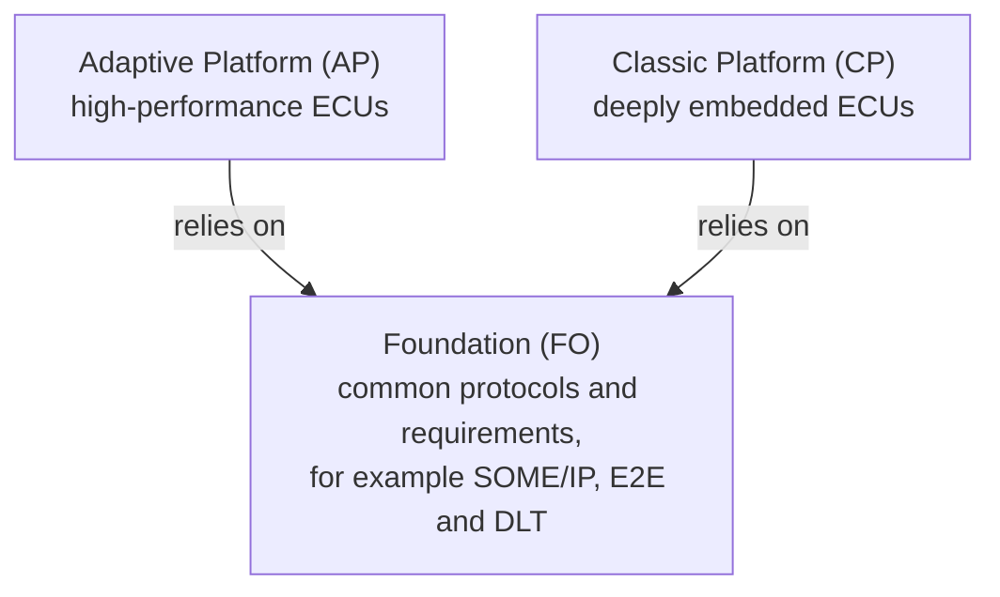

> **Pitfall: two meanings of "Foundation".** The **Foundation standard** (FO) is the common base of both platforms. The **Adaptive Platform Foundation** is a group of functional clusters *inside* the Adaptive Platform, such as Execution Management or Persistency ([Section 3.3](#33-four-groups-of-functional-clusters)). Always say which one you mean.

### 1.3 What the Standard Defines and What It Leaves Open

The Adaptive Platform is a standard, not a product. In a project you use an implementation of it, usually called a *stack*, from a platform vendor. Knowing where the standard stops tells you which behavior you can rely on in every stack.

- **Functional clusters instead of modules.** Based on its experience with the Classic Platform, AUTOSAR decided to specify *functional clusters* for the Adaptive Platform instead of a specific software architecture, so that implementers have options to find efficient solutions (*Release Overview*, Section 1.5.1). The Classic Platform, in contrast, specifies a detailed layered software architecture that imposes many constraints on its implementations (*SW Architecture*, Section 5).
- **Only external interfaces are standardized.** Interfaces that applications use, and interfaces that extend the platform, are standardized. The internal interfaces between the building blocks of the platform are not (*SW Architecture*, Section 5.1). As a consequence, it may not be possible to combine functional clusters from different stack vendors.
- **The documented design is an example.** The *SW Architecture* describes the original architectural design, as an example of how an implementation should work internally. A vendor is free to choose another design as long as it complies with the binding standard (*SW Architecture*, Section 1).

| Standardized (binding in every stack) | Left to the implementation |
| --- | --- |
| The C++ APIs of the functional clusters (ARA) | The internal interfaces between functional clusters |
| The behavior required by the SWS documents | How many processes implement a cluster, and how they communicate internally |
| The manifest meta-model (*Manifest Specification*) | The format of the processed manifests that the platform reads at run time |
| The network protocols (PRS documents of the Foundation) | The choice of the operating system, as long as it meets the Operating System Interface |
| The operating system interface for applications: PSE51 and the C++ standard library | The operating system interfaces that Execution Management uses to create processes (*OSI*, Chapter 1) |
| The service interfaces through which UCM installs and activates Software Packages | The format of the Software Package itself (*Platform Design*, Section 13.3.1) |

The kinds of AUTOSAR documents (RS, SWS, TPS, PRS, EXP, TR) and their weight are explained in [guide 00, Section 4.4](00_LearningPath.md#44-how-autosar-documents-are-named) and [Section 5.2](00_LearningPath.md#52-three-kinds-of-statements). This guide relies mostly on explanatory documents, so most of its statements explain the standard; the requirement IDs come from the *Operating System Interface* and, in Chapter 2, from the Classic Platform *Specification of Operating System*.

### 1.4 Releases and Maturity

- **Release names.** AUTOSAR names releases `Ryy-mm` after the year and month of publication. R25-11 is the November 2025 release. Internally it carries the release number R4.11.0 and uses the AUTOSAR XML schema `AUTOSAR_00054`. R25-11 is a minor release (*Release Overview*, Sections 1.4.3 to 1.4.5).
- **Life cycle of the platform.** The Adaptive Platform is in the life-cycle state *Evolution*: users get a backward-compatibility guarantee for certain parts of the specifications. Which parts is marked by the life-cycle state of each requirement (*Release Overview*, Section 1.5.2).
- **Life cycle of a requirement.** *VALID* is the default. *DRAFT* marks a newly introduced, still experimental item that may change without a backward-compatibility guarantee. *OBSOLETE* marks an item that may be removed in a following release without further notice (*Release Overview*, Section 1.4.2). For example, the OS trace messages of [Section 7.10](#710-os-tracing-with-arti) are DRAFT ([SWS_OSI_02003]).
- **Stabilization.** AUTOSAR declared R24-11 a stabilization release, to get a stable and consistent set of APIs for production-grade applications. The remaining issues of that stabilization were solved in R25-11 (*Release Overview*, Section 1.5.3).
- **C++17.** The minimum C++ version of the AUTOSAR code base is now C++17, to align with MISRA C++:2023 and because some OS suppliers deprecate C++14. A move to C++20 is being evaluated (*Release Overview*, Section 1.5.4).

[Guide 00, Section 1.3](00_LearningPath.md#13-the-baseline-release-r25-11) explains why the whole series uses R25-11 only.

> **Pitfall:** Training material and code examples from older releases are still in circulation. Typical traps are the `DeterministicClient` API of Execution Management, which was removed in R24-11 ([EM guide, Appendix D](04_ExecutionManagement.md#appendix-d-notable-changes-in-recent-releases)), and C++14-era code. Check the release on the title page of every document you use.

### 1.5 Analogies: A Middleware on a POSIX Operating System

The *SW Architecture* calls the Adaptive Platform "conceptually a middleware" between the Adaptive Applications and the operating system (*SW Architecture*, Chapter 7). If you know Linux, the following mapping helps. It is approximate.

| On a Linux system you know | Adaptive Platform counterpart | Where the analogy breaks down |
| --- | --- | --- |
| systemd starts and stops services | Execution Management starts and stops processes; State Management decides which ones should run | The decision logic is a separate cluster, and processes are grouped by Function Group States ([EM guide, Section 1.3](04_ExecutionManagement.md#13-analogies-systemd-and-autosar-classic)) |
| D-Bus or a DDS middleware | Communication Management (`ara::com`) | Proxies and skeletons are generated from ARXML service descriptions; the same code works locally and across the network |
| journald or syslog | Log and Trace (`ara::log`) | Messages use the DLT protocol; *modeled* messages keep their static text in the model and send only the arguments |
| dpkg or YUM | Update and Configuration Management | The *Platform Design* itself makes this comparison, and adds safe and secure activation and rollback (*Platform Design*, Section 13.1) |
| A watchdog daemon | Platform Health Management | It supervises checkpoints inside applications, not only whether a process is alive |
| Configuration files in `/etc` | Manifests | A standardized meta-model, deployed with the software, and checked for integrity on a trusted platform |

> **Key takeaways**
>
> - The Adaptive Platform is AUTOSAR's standard for high-performance ECUs: a middleware with C++ APIs on top of a POSIX operating system.
> - AUTOSAR has three standards: Adaptive Platform, Classic Platform and Foundation, the common base of both platforms.
> - The standard fixes the APIs, the behavior, the models and the protocols. Internal interfaces and the internal design are left to the stack vendor.
> - R25-11 is a minor release in the Evolution state; requirements are VALID, DRAFT or OBSOLETE; the minimum C++ version is C++17.

---

## 2. Why Two Platforms: Classic and Adaptive

> **Why this matters:** Many decisions in an Adaptive project only make sense if you know what the Classic Platform does well and why AUTOSAR did not simply extend it. This chapter states the problem each platform solves, shows why each design fits its problem, and explains *determinism*, the property that keeps control loops on Classic ECUs.

### 2.1 The Problem the Classic Platform Solves

**In plain words:** A Classic ECU is a small, dedicated controller. It reads sensors and messages from other ECUs, computes, and drives actuators, again and again, always on time.

**Formally:** Traditional ECUs implement functions that replace or augment electromechanical systems. Their software controls electrical output signals based on input signals and on information from other ECUs on the vehicle network. Much of the control software is designed and implemented for the target vehicle and does not change significantly during the lifetime of the vehicle (*Platform Design*, Section 3.1; *SW Architecture*, Chapter 4). The Classic Platform is "AUTOSAR's solution for embedded systems with hard real-time and safety constraints" (*Release Overview*, Section 1.3.3.2).

The *Layered Software Architecture* lists the properties of such ECUs (slide "Introduction – Scope and Extensibility"):

- strong interaction with hardware: sensors and actuators;
- connection to vehicle networks such as CAN, LIN, FlexRay or Ethernet;
- microcontrollers, typically 16 or 32 bit, with limited computing power and memory;
- real-time behavior;
- program execution from internal or external flash memory.

In the AUTOSAR sense, a Classic ECU is one microcontroller with its peripherals, its software and its configuration (same slide). The *Glossary* states it briefly: Classic AUTOSAR is intended for microcontroller-based embedded systems (*Glossary*, entry *Microcontroller*). Typical examples are engine control, brakes, airbags and body control. The Classic *Specification of Operating System* names body, chassis and powertrain ECUs as its immediate domain (*Classic OS*, Section 4.7).

In the running example, `ChassisECU` and `InstrumentCluster` are such Classic ECUs on the CAN bus.

### 2.2 Why the Classic Design Fits Its Problem

Each design choice of the Classic Platform answers a requirement of the problem. The following table shows the cause and effect.

| Requirement of the problem | Design choice of the Classic Platform | Source |
| --- | --- | --- |
| Run on a small microcontroller with little memory | A statically configured and scaled operating system that is "hostable on low-end controllers and without external resources". Only the configured functionality is compiled in. | *Classic OS*, Chapter 1; *Layered Software Architecture*, slide "Configuration – Pre-compile time (1)" |
| Predictable real-time behavior | An operating system based on OSEK OS, with fixed priority-based scheduling. It is "amenable to reasoning of real-time performance". Its API is backward compatible with OSEK OS ([SWS_Os_00001]). | *Classic OS*, Chapter 1 and Section 7.1.1; [EXT-005] |
| Software that is made for one vehicle and rarely changes | Everything is configured before the ECU runs: at pre-compile time, link time or post-build time. Generators produce code and data from the configuration. | *Layered Software Architecture*, slide "Configuration – Overview" |
| Exchange signals with other ECUs over CAN, LIN and FlexRay | A signal- and PDU-based communication stack. It gives the application a uniform interface to the vehicle network and hides protocol and message properties from it. | *Layered Software Architecture*, slides "Communication Services – General" and "Communication Stack – General" |
| Application software that does not depend on the hardware | A layered architecture of application layer, Runtime Environment (RTE) and Basic Software (BSW), which is further divided into services, ECU abstraction, microcontroller abstraction and complex drivers. Further layers cannot be added. | *Layered Software Architecture*, slides "Overview of Software Layers" and "Introduction – Scope and Extensibility" |
| Safety | Memory protection and timing protection in the operating system | *Classic OS*, Section 7.7 |

The Classic Platform is not limited to classic buses. It also supports Ethernet and SOME/IP, and it can translate between signals and services (*Platform Design*, Section 3.4; *Layered Software Architecture*, change history of R19-11). But it was designed and optimized for the legacy communication technologies (*Platform Design*, Section 3.2).

### 2.3 Determinism: The Key Property of Classic ECUs

The most important property of a Classic ECU is not speed. It is predictability.

#### 2.3.1 What Determinism Means

**In plain words:** A deterministic system gives the same outputs for the same inputs, and it delivers every result within a known, bounded time, every time. Determinism is about predictability, not about average speed. A function that usually takes 1 ms but sometimes 50 ms is fast on average, and still not deterministic.

**More precisely:** For real-time software, two kinds of predictability matter:

- **Functional:** the same inputs and the same state always give the same outputs.
- **Temporal:** every task finishes within a known bound. Its *worst-case response time* is known and lies below its deadline.

The Classic *Specification of Operating System* defines the timing terms that this needs (*Classic OS*, Section 2.1):

| Term | Meaning |
| --- | --- |
| Worst-case execution time (WCET) | The longest possible execution time of a task or interrupt handler. |
| Response time | The time between a task becoming ready to execute and generating its response, including all preemptions. |
| Deadline | The time by which a task must reach a certain point, relative to the stimulus that activated it. |

The *Glossary* adds a related property, **compositionality**: the behavior of a component does not depend on the overall system load and configuration. A new component can be added without changing the behavior of the existing ones. The *Glossary* calls it "an important property of deterministic systems" (*Glossary*, entry *Compositionality*).

*Example:* a brake control loop with a 10 ms period must read the wheel speeds, compute and write the actuator command within those 10 ms, in every period. A late result can be as harmful as a wrong one.

#### 2.3.2 How the Classic Platform Achieves It

On a Classic ECU, everything that matters for timing is decided **before the ECU runs**:

- **Tasks and runnables.** The *runnables*, the executable parts of the software components, are mapped to operating system tasks. The mapping also covers OS-Applications, partitions and cores (*Layered Software Architecture*, slide "Integration and Runtime Aspects – Mapping of Runnables"). The Basic Software scheduler and the RTE are generated together, from one central schedule that the integrator configures (slides "Integration and Runtime Aspects – Scheduling: General Architectural Aspects" and "... Basic Scheduling Concepts of the BSW").
- **Priorities.** The operating system uses fixed priority-based scheduling, inherited from OSEK OS (*Classic OS*, Section 7.1.1).
- **Cores.** The scheduler does not assign tasks dynamically to cores. Each task is bound to one core (*Classic OS*, Sections 4.5.3 and 7.9).
- **Memory.** The operating system provides no services for dynamic memory management (*Classic OS*, Section 4.6.3). Code, data and stacks are laid out in memory sections at build time.
- **Communication.** Signals, the PDUs that carry them, and their transmission are configured statically, for example in the routing tables of the PDU router (*Layered Software Architecture*, slide "Configuration – Variants").
- **Time-triggered activation.** A *ScheduleTable* is a statically defined set of *expiry points*. Each expiry point activates tasks or sets events at a fixed offset from the start of the table ([SWS_Os_00401], [SWS_Os_00404]). A counter drives the table, which can be synchronized with a global time, for example with the time of a time-triggered network such as FlexRay (*Classic OS*, Sections 7.3.1 and 7.4).
- **Timing protection.** Whether a task meets its deadline in a fixed-priority preemptive operating system depends on three factors: the execution times, the blocking times caused by locked resources or disabled interrupts, and the rate at which tasks and interrupts arrive. The operating system enforces a statically configured bound on each of them: the *Execution Budget* ([SWS_Os_00064]), the *Lock Budget* ([SWS_Os_00033]) and the *Time Frame*, the minimum time between two arrivals ([SWS_Os_00465]). A faulty task therefore cannot make a correct task miss its deadline (*Classic OS*, Section 7.7.2.1).
- **Memory protection.** OS-Applications get their own data sections and stacks, protected by the memory protection unit (*Classic OS*, Section 7.7.1).
- **Predictable networks.** Periodic CAN messages have fixed identifiers that act as priorities on the bus, so their worst-case response times can be analyzed before production [EXT-008]. FlexRay is time-triggered and offers "deterministic data that arrives in a predictable time frame" in the static part of its communication cycle (*Glossary*, entry *FlexRay*).

The following diagram summarizes this build-time approach. Nothing that affects timing is decided at run time.

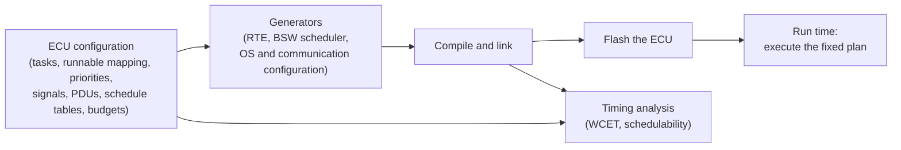

#### 2.3.3 What Determinism Enables

- **Timing analysis before production.** WCET analysis computes upper bounds for the execution times of tasks; such bounds are needed to validate hard real-time systems [EXT-007]. With the WCETs, priorities and periods known, a *schedulability analysis* checks that every task meets its deadline. The same kind of analysis exists for CAN messages [EXT-008]. Together they give the *end-to-end* timing from sensor to actuator.
- **Closed control loops with fixed periods.** Periodic tasks and ScheduleTables run the control algorithm at exactly the period that the control design assumes.
- **Evidence for functional safety.** Safety standards such as ISO 26262 [EXT-006] ask for *freedom from interference*: a fault in one part of the system must not make another part fail (*Glossary*, entry *Freedom from Interference*). Static configuration, timing protection and memory protection make this evidence feasible for timing and memory.

#### 2.3.4 The Price: No Flexibility After Build

- **Every change means rebuild and reflash.** Pre-compile configuration requires recompiling the module. Even post-build configuration only exchanges data whose structure is fixed, loaded into a reloadable memory segment, for example by reflashing in the production line (*Layered Software Architecture*, slides "Configuration – Pre-compile time (1)" and "Configuration – Post-build time (1)").
- **Resources are reserved for the worst case.** The schedule must hold even when every task takes its WCET.
- **A static plan uses modern processors poorly.** The Classic Platform was originally designed for a single-core microcontroller. The increasing number of cores overwhelms its design, and heterogeneous computing with GPUs and accelerators is far beyond its scope (*Platform Design*, Section 3.2). Caches, pipelines and branch prediction, the features that make processors fast, also make WCET analysis much harder [EXT-007].

### 2.4 The Problem the Adaptive Platform Solves

**In plain words:** New vehicle functions, such as automated driving, need a powerful computer that runs large, complex software, talks to the outside world, and is updated again and again.

**Formally:** Functions such as highly automated driving introduce complex software that demands a lot of computing resources and must fulfill strict safety, integrity and security requirements. This software performs, for example, environment perception and behavior planning, and integrates the vehicle with external backend and infrastructure systems. It must be updated during the life of the vehicle, because external systems evolve, functions are improved or added, or security problems are found. The Classic Platform cannot fulfill these needs, so AUTOSAR specifies a second platform (*Platform Design*, Section 3.1; *SW Architecture*, Chapter 4). The Adaptive Platform mainly provides high-performance computing and communication mechanisms and a flexible software configuration, for example to support software updates over the air. Classic features, such as access to electrical signals and automotive-specific buses, can be integrated into the Adaptive Platform but are not the focus of its standardization (*Platform Design*, Section 3.1).

In the running example, `HPC` is such an ECU: it fuses camera, radar and vehicle dynamics data, offers the result as services to `Cockpit`, and receives software updates over the air through `TelematicsUnit`.

### 2.5 Two Technology Drivers: Ethernet and Many-Core Processors

The *Platform Design* names two groups of technology drivers (*Platform Design*, Section 3.2):

- **Ethernet.** In-vehicle bandwidth needs keep growing. Ethernet offers much higher bandwidth than CAN and, with switched networks, transfers long messages and point-to-point communication efficiently. The Classic Platform supports Ethernet, but it is designed and optimized for the legacy technologies, and it is difficult for it to fully benefit from Ethernet.
- **Processors.** Many-core processors with tens to hundreds of cores, general-purpose GPUs, FPGAs and dedicated accelerators offer orders of magnitude more performance than conventional microcontrollers. Processor frequency cannot grow endlessly, so performance scales only through parallel execution on many cores. The best performance per watt comes from a mix of different computing resources, called *heterogeneous computing*.

The two drivers reinforce each other: on a many-core chip, the processing elements communicate through on-chip interconnects that are orders of magnitude faster than communication between ECUs. This calls for a platform that scales with the system requirements (*Platform Design*, Section 3.2).

### 2.6 Why the Adaptive Design Fits Its Problem

The characteristics of the Adaptive Platform follow from the problem and from the technology drivers (*Platform Design*, Section 3.3). The following table shows which requirement each characteristic answers.

| Requirement of the problem | Characteristic of the Adaptive Platform | How it answers the requirement |
| --- | --- | --- |
| Complex, performance-critical algorithms; fast development | **C++** | C++ is the language of choice for new algorithms in performance-critical software. Compared with C it has a safer programming model, and certified compilers produce highly optimized code (*Platform Design*, Section 3.3.1; *SW Architecture*, Section 8.4.1). |
| Functions distributed over several computers; scalable compute allocation | **Service-oriented architecture (SOA)** | A system is a set of services. A service may run on the same ECU as its user or on another one, and the application code is the same in both cases (*Platform Design*, Section 3.3.2). Message-based communication benefits from fast Ethernet. |
| Many-core and heterogeneous processors | **Parallel processing** | Services used by different applications run in parallel, so the architecture can scale with the hardware (*Platform Design*, Section 3.3.3). The design includes APIs for hardware acceleration (*SW Architecture*, Section 8.4.2). |
| Fast development of the platform itself; access to existing ecosystems | **Reuse of existing standards** | The platform builds on POSIX and on the C++ standard instead of inventing new interfaces (*Platform Design*, Section 3.3.4). |
| Safety and security, possibly at the highest level | **Safety and security by architecture** | Distributed computing makes components more independent and free from unintended interference. Dedicated functional clusters and guidelines, such as C++ coding guidelines, support safe and secure systems (*Platform Design*, Section 3.3.5). |
| Short development cycles, but also safety qualification of the product | **Planned dynamics** | Dynamic deployment during development; for production, the integrator limits the dynamic behavior ([Section 2.7](#27-determinism-on-the-adaptive-platform)). |
| Updates and new functions after deployment | **Agile** | The architecture can be scaled incrementally and updated after deployment (*Platform Design*, Section 3.3.7). |
| Very different hardware and efficient implementations | **Functional clusters instead of modules** | The standard fixes functions and interfaces, not the internal architecture (*Release Overview*, Section 1.5.1). |

### 2.7 Determinism on the Adaptive Platform

**In plain words:** The Adaptive Platform gives up the "everything is fixed at build time" guarantee in exchange for flexibility. It lets the integrator take back control over the dynamic behavior for the production system.

- **Planned dynamics.** During development, applications can be deployed incrementally while resources and communication are managed dynamically. For product delivery, the integrator can carefully limit the dynamic behavior to reduce the risk of unwanted effects and to allow safety qualification. Constraints in the Execution Manifest limit the dynamic behavior of an application. At run time, resources and communication paths can then be allocated only in defined ways, within configured ranges (*Platform Design*, Section 3.3.6; *SW Architecture*, Section 8.6).
- **Examples of restrictions for production** (*Platform Design*, Section 3.3.6):
  - pre-determined service discovery;
  - dynamic memory allocation only during the startup phase;
  - a fair scheduling policy in addition to priority-based scheduling;
  - fixed allocation of processes to CPU cores;
  - access to pre-existing files only;
  - constraints on the use of platform APIs by applications;
  - execution of authenticated code only.
- **Mechanisms in R25-11.** The operating system groups processes into *ResourceGroups* with CPU-time and memory limits ([SWS_OSI_02000], [SWS_OSI_02001], [SWS_OSI_02002]). Execution Management configures the scheduling policy, the priority, the core affinity and pre-mapped memory of each process ([EM guide, Chapter 11](04_ExecutionManagement.md#11-resource-management)). It distinguishes *deterministic subsystems*, whose computing time is guaranteed, from *best-effort subsystems* ([EM guide, Section 11.5](04_ExecutionManagement.md#115-cpu-core-affinity-and-scheduling)). Platform Health Management detects timing faults at run time, with alive, deadline and logical supervision, and triggers a recovery (*Platform Design*, Section 17.3). This is *detect and react*, not *prevent by construction*.
- **What is no longer there.** R25-11 has no API for deterministic execution. The `DeterministicClient` of Execution Management, with its activation cycles and worker pools, was removed in R24-11 ([EM guide, Appendix D](04_ExecutionManagement.md#appendix-d-notable-changes-in-recent-releases)); its description had already left the *Platform Design* in R23-11.

The *Operating System Interface* states the limit itself: the standard POSIX scheduling policies "may not guarantee proper execution for all real-time scenarios" (*OSI*, Section 7.1.3). The Adaptive Platform therefore offers bounded and configurable resource usage, but not a statically analyzed schedule of the whole system. **Hard real-time control loops with fixed periods and strict deadlines stay on Classic ECUs.** The *Platform Design* shows exactly this split: planning on the Adaptive Platform, trajectory control with its safety function on the Classic Platform ([Section 2.10](#210-where-each-platform-fits-in-a-vehicle)).

> **Pitfall:** "We use `SCHED_FIFO`, so the application is deterministic." A real-time scheduling policy only decides *which* ready thread runs. It gives no upper bound on execution times, which on a complex processor with caches and shared memory depend on everything else that runs [EXT-007].

### 2.8 The Limits of Each Platform Outside Its Problem

Each platform is weak exactly where the other one is strong.

| The Classic Platform outside its problem | Why |
| --- | --- |
| High-bandwidth Ethernet communication | Optimized for CAN, LIN and FlexRay; hard to fully benefit from Ethernet (*Platform Design*, Section 3.2). |
| Many-core processors, GPUs and accelerators | Originally designed for a single-core microcontroller; tasks are bound statically to cores; heterogeneous computing is beyond its scope (*Platform Design*, Section 3.2; *Classic OS*, Section 4.5.3). |
| Frequent updates and new functions in the field | Every change requires regeneration, rebuild and reflashing ([Section 2.3.4](#234-the-price-no-flexibility-after-build)). |

| The Adaptive Platform outside its problem | Why |
| --- | --- |
| A small ECU with hard real-time control loops, such as a brake actuator controller | It needs a microprocessor with a POSIX operating system. Planned dynamics bound the timing but do not fix it, R25-11 has no deterministic execution API, and complex processors are hard to analyze for WCET ([Section 2.7](#27-determinism-on-the-adaptive-platform), [EXT-007]). |
| Direct access to electrical signals and to automotive buses | Not in the focus of its standardization (*Platform Design*, Section 3.1). Its communication is based on Ethernet at the data link layer; CAN XL is supported only to tunnel Ethernet frames (*Platform Design*, Section 8.1). |

### 2.9 Classic and Adaptive at a Glance

The following table summarizes the differences. [Appendix B.1](#b1-classic-and-adaptive-in-one-table) repeats it for lookup.

| Aspect | Classic Platform | Adaptive Platform |
| --- | --- | --- |
| Target ECU | Deeply embedded ECU on a microcontroller (typically 16 or 32 bit) with sensors and actuators | High-performance ECU on a microprocessor, often many-core, with accelerators |
| Typical functions | Engine, brakes, airbag, body control | Automated driving (perception, planning), connectivity, central computing |
| Standardization approach | Detailed layered architecture of Basic Software modules | Functional clusters with standardized APIs; internal design free |
| Programming language | C (the OS API consists of C functions and macros, *Classic OS*, Section 4.6.2) | C++ (C++17 minimum) |
| Operating system | AUTOSAR OS, based on OSEK OS, part of the standard | Any POSIX operating system that meets the Operating System Interface; not specified by AUTOSAR |
| Unit of execution | Runnables mapped statically to tasks | Processes created from Executables, with threads |
| Scheduling | Fixed-priority preemptive, ScheduleTables, tasks bound to cores | POSIX policies `SCHED_FIFO`, `SCHED_RR`, `SCHED_OTHER`, configured per process; the OS schedules |
| Memory | No dynamic memory management by the OS; layout fixed at build time | A virtual address space per process; dynamic allocation possible, limited by ResourceGroups and planned dynamics |
| Configuration | Before the ECU runs: pre-compile, link or post-build time; generated code | Manifests deployed with the software; processed at integration or installation; can change with an update |
| Communication | Signals and PDUs on CAN, LIN, FlexRay and Ethernet; SOME/IP also supported | Services (`ara::com`) over Ethernet: SOME/IP, DDS, local IPC; Signal-to-Service translation for signals |
| Communication paths | Fixed at configuration time | Configured at design time, startup or run time (service discovery) |
| Software update | Reflash the ECU | Install, update and remove Software Clusters at run time (UCM); vehicle-wide over the air (V-UCM) |
| **Determinism** | **Full static determinism: timing analyzed before production (WCET, schedulability) and enforced by timing protection** | **Planned dynamics: bounded by configuration (resource groups, scheduling, supervision); no deterministic execution API in R25-11** |
| Isolation | OS-Applications with memory and timing protection | Processes in separate address spaces; ResourceGroups for CPU and memory |
| Typical place in the vehicle | Sensors, actuators and control | Computing and connectivity centers |

### 2.10 Where Each Platform Fits in a Vehicle

The Adaptive Platform does **not** replace the Classic Platform or non-AUTOSAR platforms, such as infotainment systems built on commercial off-the-shelf software. It interacts with them and with external backend systems and road-side infrastructure to form one integrated system (*Platform Design*, Section 3.4). The bridges between the worlds are:

- **Common protocols.** The Classic Platform already includes SOME/IP, which the Adaptive Platform supports as well (*Platform Design*, Section 3.4). Both rely on the protocols of the Foundation.
- **Signal-to-Service translation.** Signals sent by Classic ECUs, for example over CAN, can be translated into `ara::com` services that are reachable over Ethernet (*SW Architecture*, Section 7.3.5).
- **One system model.** The AUTOSAR methodology supports a *System Design* that describes the software components of both platforms in one model, including a mapping of signals to services (*Platform Design*, Section 4.4).

The *Platform Design* shows a typical split of an automated driving function (*Platform Design*, Figure 3.2). Classic ECUs provide the inputs from the sensors and from car-to-car and car-to-infrastructure communication. The Adaptive Platform performs the perception of the environment, of the driver state and of the vehicle state, builds an environment model and plans maneuvers and trajectories. The planned trajectory goes back to a Classic ECU, which performs the trajectory control together with a safety function that also reads the inertial sensors directly. The following diagram applies this split to the running example. `HPC` stops at the object list; actuators are not part of the example ([guide 00, Section 6.2](00_LearningPath.md#62-the-vehicle-context)).

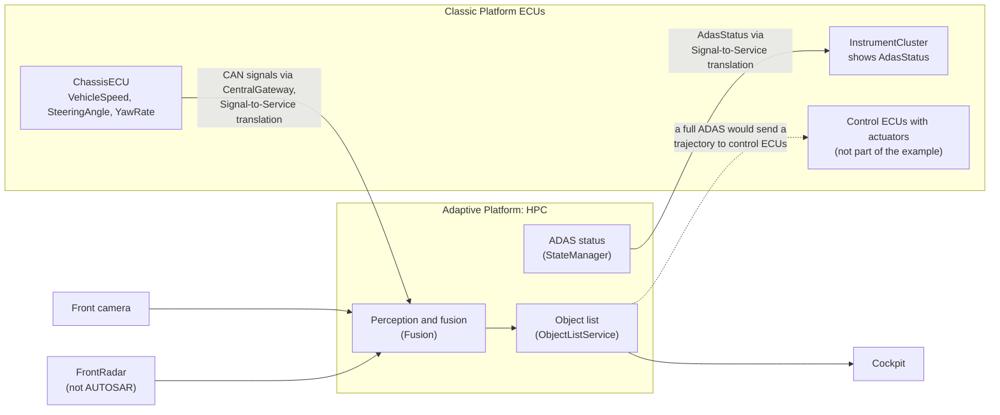

> **Key takeaways**
>
> - The Classic Platform serves deeply embedded control ECUs: small microcontrollers, signals on classic buses, hard real-time and safety constraints, software that rarely changes.
> - Its key property is **determinism**: everything that affects timing is decided before the ECU runs, analyzed before production and enforced at run time by timing and memory protection.
> - The price of determinism is no flexibility after build and a poor fit for Ethernet bandwidth, many-core processors and frequent updates.
> - The Adaptive Platform serves high-performance ECUs. C++, SOA, parallel processing, POSIX, safety and security by architecture, planned dynamics and updatability answer its problem.
> - The Adaptive Platform bounds its dynamic behavior but has no deterministic execution API in R25-11, so hard real-time control loops stay on Classic ECUs. Both platforms work together in one vehicle.

---

## 3. The Architecture: Logical View

> **Why this matters:** The logical view is the map that every later guide refers to. It shows which parts an application sees, which parts the platform provides, and where the operating system begins. Once you know the map, you can tell for every API whether it is standardized, which cluster owns it and how portable your code is.

### 3.1 The Layers at a Glance

The *Platform Design* shows the logical architecture of the Adaptive Platform in its Figure 4.1. The following diagram redraws it. Adaptive Applications run on top of ARA. ARA consists of the interfaces of the functional clusters, grouped into four groups, plus the Operating System Interface. Underneath is the base software, a POSIX operating system, which runs on a Machine.

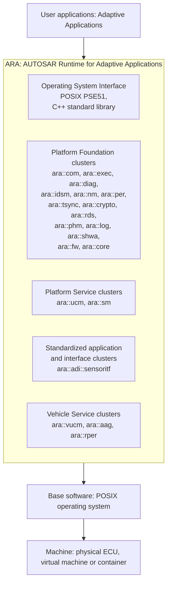

The *Platform Design* warns that its figure contains functional clusters that are not part of the current release, to give a better idea of the overall structure, and that new clusters may be added in future releases (*Platform Design*, Section 4.1.1). It does not say which ones. This guide therefore takes the list of R25-11 clusters from the building blocks of the *SW Architecture* ([Section 5.1](#51-how-to-read-the-cluster-map)).

### 3.2 ARA: The AUTOSAR Runtime for Adaptive Applications

**In plain words:** ARA is everything an Adaptive Application is allowed to call: the C++ APIs of the functional clusters, the C++ standard library and a minimal part of POSIX.

**Formally:** Adaptive Applications run on top of the AUTOSAR Runtime for Adaptive Applications (ARA). ARA consists of the application interfaces that the functional clusters provide (*Platform Design*, Section 4.1.1). Each cluster has its own C++ namespace, such as `ara::exec` or `ara::com`. The C++ standard library is also part of ARA. For the operating system, Adaptive Applications are restricted by definition to the PSE51 interface, a single-process profile of the POSIX standard (*Platform Design*, Section 4.1.3; [Chapter 7](#7-the-operating-system-interface)).

Three properties of ARA matter for application developers:

- **One look for all clusters.** From the application's point of view, the interfaces of all clusters look alike: they are specified C++ interfaces. There are differences under the hood, for example whether a call stays in the process or goes to a daemon ([Section 4.2](#42-library-based-and-service-based-functional-clusters)), but the application does not see them (*Platform Design*, Section 4.1.1).
- **ARA is the boundary, not the implementation.** Underneath ARA, including inside the ARA libraries that run in the application process, an implementation may use any other interface it needs (*Platform Design*, Section 4.1.1).
- **ARA must be initialized.** An application calls `ara::core::Initialize()` inside `main()` before it uses other ARA APIs, and `ara::core::Deinitialize()` before it returns (*Platform Design*, Section 18.4). Guide 03 (`03_CoreAndGeneral.md`, planned) explains the rules.

The specified language binding is C++. The R25-11 release also contains an explanatory document on ARA applications in Rust (`AUTOSAR_AP_EXP_ARARustApplications`, *Release Overview*, Chapter 3). This series covers the C++ binding only.

### 3.3 Four Groups of Functional Clusters

A **functional cluster** (FC) is a logical group of platform functionality with its own specification and API ([guide 00, Appendix A](00_LearningPath.md#appendix-a-series-glossary-and-acronyms)). The *Platform Design* sorts the clusters into four groups (*Platform Design*, Section 4.1.1 and Figure 4.1):

| Group | Meaning | R25-11 members in the logical view | How applications use them |
| --- | --- | --- | --- |
| Adaptive Platform Foundation | The fundamental functions of the platform | Communication Management, Execution Management, Diagnostic Management, Intrusion Detection System Manager, Network Management, Persistency, Time Synchronization, Cryptography, Raw Data Stream, Platform Health Management, Log and Trace, Safe Hardware Acceleration, Firewall, Core | Through a library that is linked into the application ("library-based", [Section 4.2](#42-library-based-and-service-based-functional-clusters)) |
| Adaptive Platform Services | The platform standard services | Update and Configuration Management, State Management | As `ara::com` services ("service-based") |
| Standardized Application/Interfaces | Applications or interfaces that the Adaptive Platform standardizes | Sensor Interfaces | As `ara::com` service interfaces that applications provide and use ([Section 5.9](#59-other-r25-11-content-without-a-functional-cluster)) |
| Vehicle Services | Services that provide vehicle-level functions | Vehicle Update and Configuration Management, Automotive API Gateway, Remote Persistency | As services; the Automotive API Gateway also serves clients outside the vehicle |

Any Adaptive Application can also provide services to other applications (*Platform Design*, Section 4.1.1). The platform's own services and the services of applications use the same mechanism, Communication Management.

### 3.4 Adaptive Applications, Executables and Processes

An **Adaptive Application** is a piece of software that delivers a function. It consists of one or more **Executables**, program files with one entry point. Execution Management creates **processes** from them, as described by **Modelled Processes** in the manifest. One Executable may be started as several processes, and the processes of one application may run on one Machine or be distributed over several Machines (*Platform Design*, Sections 4.2.1 and 6.2). The [EM guide, Section 2.1](04_ExecutionManagement.md#21-software-units-from-application-to-os-process) explains these units in detail.

Not every application is a portable Adaptive Application. The *Platform Design* distinguishes four kinds, depending on whether the software runs at user level or at platform level, and whether it is specific to an operating system or hardware or fully compliant with AUTOSAR (*Platform Design*, Section 4.1.4, Figure 4.5):

| | Specific to the OS or hardware | Fully AUTOSAR compliant |
| --- | --- | --- |
| **User level** | Non-portable user application, for example a hardware-dependent one | Portable **Adaptive Application** |
| **Platform level** | Typical functional cluster application | Reusable platform application |

All of them, including the functional clusters, are applications from the point of view of Execution Management, and EM launches them all in the same way. The only exception is EM itself (*Platform Design*, Section 4.1.4).

In the model, an application is an `AdaptiveApplicationSwComponentType` with ports. A port typed by a service interface either provides a service instance (`PPortPrototype`) or requires one (`RPortPrototype`). The same service interface can be provided by several ports as different service instances, and one service instance can have many consumers. AUTOSAR standardizes this model, but not a C++ component framework for implementing it (*SW Architecture*, Section 13.15). Guides 02 ([Chapter 5](02_Manifests.md#5-application-design-components-ports-and-executables)) and 07 cover the model and the generated code.

*Example:* `Fusion` is a process created from the Executable `fusion`. Its application provides `ObjectListService` and requires `CameraService`, `VehicleDynamicsService` and `CalibrationDataService` ([guide 00, Section 6.6](00_LearningPath.md#66-services-and-their-consumers)).

### 3.5 Standardized and Non-standardized Parts

The *SW Architecture* marks every interface with a stereotype that says who may use it and who provides it (*SW Architecture*, Section 8.3):

| Kind of interface | Stereotype | Who uses it, who provides it | Example |
| --- | --- | --- | --- |
| Public API | `aapAPI` | May be used by Adaptive Applications and by functional clusters | `ExecutionClient`, `Logger` |
| Native interface | `aapNativeInterface` | Defined in the programming language of the stack (C++) | `ExecutionClient`, `StateClient` |
| Port interface | `aapPortInterface` | Relates to an element of the manifest through an `InstanceSpecifier`; may be generated by the stack tooling | `FunctionGroup` |
| `ara::com` service interface | `aapAraComServiceInterface` | Defined in the manifest; the tooling generates proxies and skeletons | `PackageManagement` of UCM (public API); `UpdateRequest` of State Management (internal, used by UCM) |
| Internal interface | `aapInternal` | Used only by functional clusters; realized by the stack, the middleware, drivers or the OS | Multi-Process System Interface, TCP/IP stack |
| Platform extension interface | `aapPlatformExtension` | Used only by functional clusters; realized by third parties, for example the OEM | Freshness Value Manager of Communication Management |

Two rules follow:

- **Non-standard interfaces are allowed below ARA.** Software that is not an Adaptive Application, and the functional clusters, may use any non-standard interface, as long as it does not conflict with standard platform functions and meets the project's safety and security requirements. Unless it is a purely application-local runtime library, such use should be kept minimal, because it reduces portability to other stacks (*Platform Design*, Section 4.1.6).
- **Extensions use defined patterns.** When it is easier for the OEM to provide code than to configure a generic behavior, the platform offers *platform extension interfaces* of three types: a **callout** (a function or class with a standardized name that the OEM implements, linked statically), a **callback** (registered at run time) and a **plugin** (an implementation of an abstract class, selected at run time, preferably registered through the manifest). Examples are the Freshness Value Manager callout in Communication Management, the UDS transport protocol plugins in Diagnostic Management and the crypto provider plugins in Cryptography (*SW Architecture*, Section 8.5.5).

### 3.6 Portability: What Stays the Same Across Stacks

The main promise of the standard to application developers is **source-code portability**:

- An application that is based entirely on the Adaptive Platform, without custom extensions, shall be portable to another stack of the same release without changes to its source code (*SW Architecture*, Section 6.1.3). The underlying requirement is "Source Code Portability Support" [RS_AP_00111], which the Operating System Interface helps to fulfill through PSE51 and the C++ standard library ([SWS_OSI_01001], [SWS_OSI_01002]).
- A stack shall explicitly document the restrictions on application development that go beyond the standard (*SW Architecture*, Section 6.1.2).
- Standardized network bindings make compiled services of different implementations compatible on the network (*Platform Design*, Section 8.3).

What is **not** portable: binaries (each stack and target needs its own build), the use of vendor extensions or internal interfaces, and the combination of clusters from different vendors (*SW Architecture*, Section 5.1).

> **Pitfall:** "It compiles on the vendor's PC simulation, so it is portable." A stack may accept more than the standard requires, for example full POSIX instead of PSE51, or vendor-specific helper headers. Check your code against ARA, the C++ standard library and PSE51, and read the stack's documented restrictions.

[Chapter 7](#7-the-operating-system-interface) describes in detail what PSE51 and the C++ standard library offer.

> **Key takeaways**
>
> - Adaptive Applications run on ARA: the C++ APIs of the functional clusters, the C++ standard library and the POSIX PSE51 profile.
> - The clusters form four groups: Platform Foundation (library-based), Platform Services and Vehicle Services (service-based), and standardized application interfaces.
> - Every application, including the functional clusters, is started by Execution Management, except EM itself.
> - Public APIs are standardized; internal interfaces are not. Platform extensions (callout, callback, plugin) are the defined way for the OEM to add code.
> - Applications that use only ARA are source-code portable between stacks of the same release; binaries and vendor extensions are not.

---

## 4. The Architecture: Physical View and Deployment

> **Why this matters:** The logical view tells you *what* exists. The physical view tells you what *runs* where: which processes exist on the Machine, how a call reaches a cluster, and how software is packaged and installed. This is the view you need when you bring up or debug an ECU.

The *Platform Design* notes that most of its physical view is for illustration only, because the internals of the platform are implementation-defined. Formal requirements are stated explicitly where they exist (*Platform Design*, Section 4.2).

### 4.1 Everything Is a Process

The operating system of the Adaptive Platform must provide multi-process POSIX capabilities (*Platform Design*, Section 4.2.1). On top of it, everything is a process:

- Each Adaptive Application is implemented as one or more independent processes, each with its own logical memory space and namespace.
- Functional clusters are typically implemented as processes too, as a single process or several.
- The platform services and the services of applications are processes as well.
- Every process can be single-threaded or multi-threaded.

From the operating system's point of view, the platform and the applications are just a set of processes with threads. There is no difference between them, although an implementation may add some partitioning (*Platform Design*, Section 4.2.1). The difference lies in the interfaces they may use: Adaptive Applications are restricted to PSE51 and may not use inter-process communication (IPC) directly. They communicate only through ARA. Functional clusters may use any service of the operating system (*Platform Design*, Section 4.2.1).

### 4.2 Library-based and Service-based Functional Clusters

A functional cluster and an application usually live in different processes, so they need IPC. The *Platform Design* describes two designs (*Platform Design*, Section 4.2.2):

- **Library-based:** the cluster provides an interface library that is linked into the application. The library performs the IPC to the cluster's process directly.
- **Service-based:** the cluster's process offers its functions through Communication Management. The application links a generated proxy library, and Communication Management coordinates the IPC between the application and the server process. Whether the application talks only to Communication Management or also directly to the server is implementation-defined.

The guideline: a cluster that is used only locally, within one platform instance, fits the library-based design, which is simpler and can be more efficient. A cluster that is used from other platform instances fits the service-based design, because Communication Management makes the location transparent. Clusters of the Adaptive Platform Foundation are library-based; Adaptive Platform Services are service-based. A cluster may also have no process at all and run entirely as a library in the application process, as long as it fulfills its RS and SWS; the interaction is then a normal function call (*Platform Design*, Section 4.2.2).

The *SW Architecture* adds whether a cluster is **daemon-based**, that is, intended to be implemented with its own daemon process. Implementations may deviate (*SW Architecture*, Chapter 9). Log and Trace, Core, Operating System Interface, Raw Data Stream, Persistency, Safe Hardware Acceleration and the Registry are not daemon-based; all other clusters are ([Section 5.1](#51-how-to-read-the-cluster-map)). The following diagram contrasts the two designs.

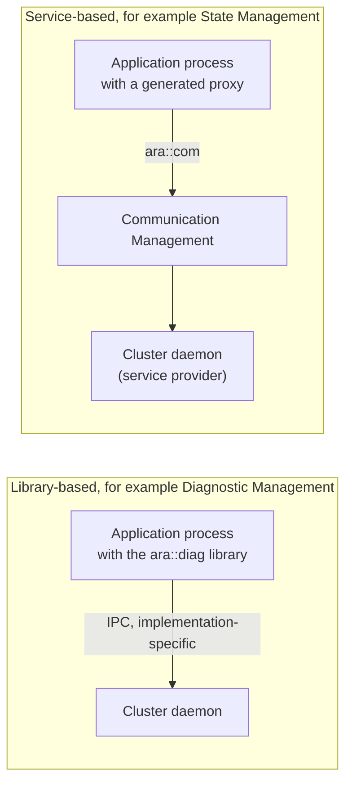

> **Note:** "Library-based" does not mean "no daemon". Diagnostic Management is library-based in the logical view (Platform Foundation) but daemon-based in the *SW Architecture*: the library in the application talks to the daemon. Persistency, in contrast, is library-based and not daemon-based.

### 4.3 The Machine

The Adaptive Platform regards the hardware it runs on as a **Machine**, to get a consistent view regardless of the virtualization technology that may be used. A Machine can be a real physical machine, a fully virtualized machine, a para-virtualized operating system, an OS-level container or any other virtualized environment (*Platform Design*, Section 4.2.4; *SW Architecture*, Section 13.5).

- One piece of hardware can host one or more Machines.
- **Exactly one instance of the Adaptive Platform runs on a Machine.**
- Usually the hardware is a single chip that hosts one or several Machines. Several chips can also form one Machine, if the implementation allows it.

*Example:* `HPC` is one Machine on a multi-core SoC, without a hypervisor ([guide 00, Section 6.3](00_LearningPath.md#63-the-hpc-machine)).

### 4.4 Software Clusters and Software Packages

Software is installed on a Machine in **Software Packages**. A Software Package is a digitally signed package that Update and Configuration Management installs or removes. It contains exactly one **Software Cluster** (*SW Architecture*, Section 13.1). A Software Cluster groups Executables, the Modelled Processes and their Function Groups:

- A Function Group and its entities belong to exactly one Software Cluster. Function Groups that span several Software Clusters are invalid (*SW Architecture*, Section 13.4).
- A Software Cluster may depend on other Software Clusters, expressed by version constraints.
- A Software Cluster is only a deployment concept. **It is not a run-time entity.** At run time, Execution Management and the other clusters merge the configurations of all installed Software Packages (*SW Architecture*, Section 13.4).

Each Software Cluster has a category, with these rules (*SW Architecture*, Section 12.2):

| Category | Number per Machine | Contents | May depend on | Can be removed |
| --- | --- | --- | --- | --- |
| `PLATFORM_CORE` | Exactly one | The core components of the platform vendor and the machine vendor: operating system, device drivers and the required functional clusters. At least Execution Management, State Management and Update and Configuration Management are assumed, because they are needed to install anything else. | Nothing: it is self-contained | No |
| `PLATFORM` | Any number | Optional functional clusters | The `PLATFORM_CORE` cluster | Yes |
| `APPLICATION_LAYER` | Any number | Application components | Clusters of any category | Yes |

The platform packages contain all functional cluster daemons together with their configuration, for example their startup configuration. Applications therefore do not have to configure the platform (*SW Architecture*, Section 12.2). For the same reason, processes of functional clusters should only appear in `PLATFORM_CORE` or `PLATFORM` clusters, so that application clusters stay independent of the platform (*SW Architecture*, Section 13.4).

The following diagram shows the two Software Clusters of `HPC` ([guide 00, Section 6.3](00_LearningPath.md#63-the-hpc-machine)). `HPC` has no `PLATFORM` cluster: all platform daemons are part of the platform core.

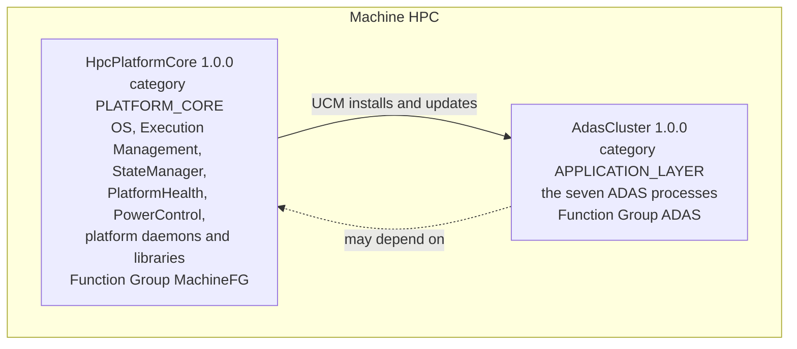

### 4.5 The Adaptive Platform in Its System Context

The *SW Architecture* places the platform between three kinds of partners (*SW Architecture*, Chapter 7):

- **Above:** the Adaptive Applications, which use the interfaces of the functional clusters.
- **Below:** the dependencies of the platform. The **operating system** controls processes and threads, provides IPC, network interfaces with TCP/IP and access to non-volatile storage. A **watchdog** supervises the platform. A **crypto provider** implements cryptographic routines and hash functions (*SW Architecture*, Section 7.2).
- **Outside:** the external systems that communicate with the platform or with its applications (*SW Architecture*, Section 7.3).

The platform uses the operating system through internal interfaces: the *Multi-Process System Interface* (used by Execution Management to start and control processes), the *TCP/IP stack*, the *non-volatile storage* and the *Single-Process POSIX API* (*SW Architecture*, Figure 7.1). The following diagram shows the context, with the counterparts from the running example.

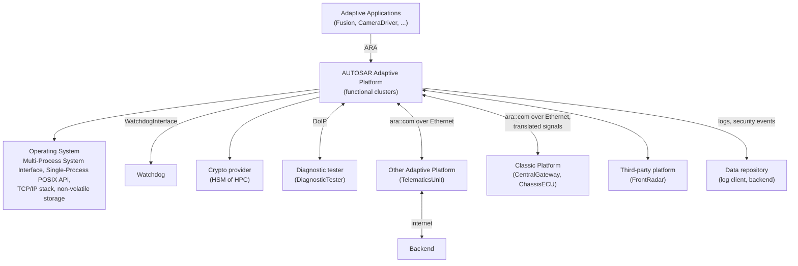

| External system | What it is | In the running example |
| --- | --- | --- |
| Diagnostic tester | A physical or virtual device outside the vehicle network that requests diagnostic services, for example UDS requests to Diagnostic Management | `DiagnosticTester` over DoIP |
| Backend | A node reachable over TCP/IP with a public or private IP address, for example an OEM cloud service | `Backend`, reached through `TelematicsUnit` |
| Ad-hoc endpoint | A node that communicates over wireless links in regional proximity, such as road-side infrastructure | Not used |
| Adaptive Platform | Another Adaptive Machine, for example Vehicle UCM talking to the UCM instances in the vehicle | `TelematicsUnit` |
| Classic Platform | A Classic ECU, for example one that translates CAN signals into `ara::com` services | `CentralGateway`, `ChassisECU`, `InstrumentCluster` |
| Third-party platform | A non-AUTOSAR platform. A gateway function to map protocols has not been specified yet. | `FrontRadar` (smart sensor); `Cockpit`, whose platform is not specified |
| Data repository | Stores data generated in the platform, such as log events or security events | The DLT log client; the `Backend` for qualified security events |

> **Key takeaways**
>
> - On the operating system, the platform and the applications are just processes with threads. Applications are restricted to PSE51 and ARA; functional clusters may use the full OS.
> - Library-based clusters are reached through a linked library, service-based clusters through Communication Management. "Daemon-based" says whether the cluster is intended to have its own daemon.
> - A Machine is physical or virtual hardware with exactly one instance of the Adaptive Platform.
> - Software is installed as signed Software Packages, each containing one Software Cluster. Every Machine has exactly one `PLATFORM_CORE` cluster with at least EM, SM and UCM.
> - The platform depends on an operating system, a watchdog and a crypto provider, and talks to testers, backends, other Adaptive and Classic ECUs, third-party platforms and data repositories.

---

## 5. The Functional Clusters of R25-11

> **Why this matters:** Every later guide covers one or a few functional clusters. This chapter gives you one paragraph per cluster of R25-11, including those that this series does not cover, so that you know what exists, what each cluster is responsible for and where to read more.

### 5.1 How to Read the Cluster Map

Three documents classify the functional clusters in different ways. Do not mix them up:

- **Categories** (*SW Architecture*, Section 9.1): seven groups from a user's point of view: Runtime, Communication, Storage, Security, Safety, Configuration and Diagnostics. Sections 5.2 to 5.8 follow these categories.
- **ARA groups** (*Platform Design*, Figure 4.1): Platform Foundation, Platform Services, Standardized Application/Interfaces and Vehicle Services ([Section 3.3](#33-four-groups-of-functional-clusters)).
- **Document clusters** (*Release Overview*, Chapter 3): AdaptiveFoundation, AdaptiveServices, General, MethodologyAndTemplates and ReleaseDocumentation. They group *documents*, not functional clusters. For example, the documents of Safe Hardware Acceleration belong to AdaptiveServices, although the logical view shows the cluster in the Platform Foundation.

The list of clusters in this chapter is the list of building blocks in the *SW Architecture* (Chapter 9), which is up to date for R25-11. Identity and Access Management is not a building block: it is a framework that several clusters implement ([Section 5.5](#55-security)). The following table is the master map. The columns *Namespace* and *ARA group* come from the logical view, *Category* and *Daemon-based* from the *SW Architecture*. It matches the table in [guide 00, Section 2.3](00_LearningPath.md#23-functional-clusters-and-their-guides).

| Functional cluster | Short name | Namespace | Category | ARA group | Daemon-based | Guide |
| --- | --- | --- | --- | --- | --- | --- |
| [Execution Management](#52-runtime) | exec | `ara::exec` | Runtime | Foundation | yes | [04](04_ExecutionManagement.md) |
| [State Management](#52-runtime) | sm | `ara::sm` | Runtime | Platform Service | yes | 05 |
| [Log and Trace](#52-runtime) | log | `ara::log` | Runtime | Foundation | no | 10 |
| [Core](#52-runtime) | core | `ara::core` | Runtime | Foundation | no | 03 |
| [Operating System Interface](#52-runtime) | n/a | POSIX PSE51, C++ standard library | Runtime | Foundation | no | 01 ([Chapter 7](#7-the-operating-system-interface)) |
| [Communication Management](#53-communication) | com | `ara::com` | Communication | Foundation | yes | 07, 08 |
| [Raw Data Stream](#53-communication) | rds | `ara::rds` | Communication | Foundation | no | 09 |
| [Network Management](#53-communication) | nm | `ara::nm` | Communication | Foundation | yes | 09 |
| [Time Synchronization](#53-communication) | tsync | `ara::tsync` | Communication | Foundation | yes | 09 |
| [Automotive API Gateway](#53-communication) | aag | `ara::aag` | Communication | Vehicle Service | yes | not covered |
| [Persistency](#54-storage) | per | `ara::per` | Storage | Foundation | no | 11 |
| [Remote Persistency](#54-storage) | rper | `ara::rper` | Storage | Vehicle Service | yes | not covered |
| [Cryptography](#55-security) | crypto | `ara::crypto` | Security | Foundation | yes | 14 |
| [Intrusion Detection System Manager](#55-security) | idsm | `ara::idsm` | Security | Foundation | yes | 16 |
| [Firewall](#55-security) | fw | `ara::fw` | Security | Foundation | yes | 16 |
| [Platform Health Management](#56-safety) | phm | `ara::phm` | Safety | Foundation | yes | 06 |
| [Safe Hardware Acceleration](#56-safety) | shwa | `ara::shwa` | Safety | Foundation | no | not covered |
| [Update and Configuration Management](#57-configuration) | ucm | `ara::ucm` | Configuration | Platform Service | yes | 13 |
| [Vehicle Update and Configuration Management](#57-configuration) | vucm | `ara::vucm` | Configuration | Vehicle Service | yes | 13 (context only) |
| [Registry](#57-configuration) | n/a | (internal, no public API) | Configuration | (not shown) | no | not covered |
| [Diagnostic Management](#58-diagnostics) | diag | `ara::diag` | Diagnostics | Foundation | yes | 12a, 12b |

Guide numbers without a link refer to guides that are planned; [guide 00, Section 2.1](00_LearningPath.md#21-all-guides-at-a-glance) lists their file names. Each paragraph below starts with the responsibility as the *SW Architecture* states it and ends with the guide and the role in the running example.

### 5.2 Runtime

**Execution Management (EM).** EM controls the processes of the platform and of the Adaptive Applications: it starts, configures and stops them as configured in Function Group States, using the interfaces of the operating system. It limits their resource consumption with the ResourceGroups of the operating system. EM is the entry point of the platform: the operating system starts it during boot, and EM then controls the startup and shutdown of the platform. Optionally it continues the chain of trust from a Trust Anchor and refuses to start software whose integrity or authenticity cannot be verified (*SW Architecture*, Section 9.2.1). EM does not schedule threads at run time; the operating system does (*Platform Design*, Section 6.3). Every process reports its state to EM with `ExecutionClient`; State Management requests state changes with `StateClient`. *Running example:* EM starts every process of `HPC`. Guide: [04](04_ExecutionManagement.md).

**State Management (SM).** SM determines the desired target state of the platform, that is, the set of active Function Group States, from application-specific inputs, and delegates the switching to EM (*SW Architecture*, Section 9.2.2). SM is unique: it is not entirely part of a stack, because its logic is largely project-specific and is usually completed by the system integrator. It sets Function Group States, requests the activation and deactivation of (partial) networks, shuts down or restarts the machine, recovers from errors reported by PHM or EM, prepares and verifies Software Clusters for UCM, and, new in R25-11, coordinates applications before Suspend-to-RAM (*Platform Design*, Chapter 7; *Release Overview*, Section 2.1.1.2). An optional, configurable *StateMachine* concept covers standard use cases, driven by a project-specific *SMControlApplication*. Access to SM must be secured, for example by IAM, and PHM supervises it. *Running example:* the process `StateManager`. Guide: 05.

**Log and Trace (LT).** Log and Trace builds and logs messages of different severities. Applications can be configured to forward them to various sinks: the network, a serial bus, the console or non-volatile storage (*SW Architecture*, Section 9.2.3). It uses the AUTOSAR Log and Trace protocol (DLT), which adds information such as an ECU ID. *Non-modeled* (verbose) messages carry all their parts; *modeled* (non-verbose) messages keep their static parts in the model and are meant for timing-related analysis and production (*Platform Design*, Chapter 16). *Running example:* ECU ID `HPC1`; `Fusion` logs with application ID `FUSN`. Guide: 10.

**Core.** Core provides the initialization and de-initialization of ARA (`ara::core::Initialize()` and `Deinitialize()`) and the termination of processes (*SW Architecture*, Section 9.2.4). It also defines the common types that other clusters use in their APIs: `ErrorCode`, `Result`, `Future` and `Promise` for error handling without C++ exceptions, which ASIL-certified compilers often do not support, container types with their own memory allocation behavior, and memory resources (*Platform Design*, Chapter 18). Core neither provides interfaces to other clusters nor requires any. *Running example:* every `HPC` process that uses ARA. Guide: 03.

**Operating System Interface (OSI).** The OSI provides the services that multi-threaded real-time applications use through the POSIX PSE51 profile, plus the C++ standard library. It does not provide any means to start or control processes; that is EM's job, through implementation-specific interfaces. A typical stack does not provide an actual implementation of the OSI, because the standard libraries of the language and the operating system already provide everything (*SW Architecture*, Section 9.2.5). [Chapter 7](#7-the-operating-system-interface) covers it.

### 5.3 Communication

**Communication Management (CM).** CM is responsible for all levels of service-oriented communication between applications: within a process, between processes and between Machines, including Classic Platforms and third-party platforms. Communication paths can be established at design time, startup or run time. CM consists of a generic part for brokering and configuration, plus generated *skeletons* for service providers and *proxies* for service consumers (*SW Architecture*, Section 9.3.1). A service consists of *events*, *methods* and *fields*. Providers register their services at a *Service Registry*, and consumers find them by *service discovery*. The *language binding* defines how services appear in C++; the *network binding* defines how their data is serialized on the network. CM supports SOME/IP, DDS, IPC and signal-based network bindings (*Platform Design*, Chapter 8). At the data link layer, CM communication is based on Ethernet; CAN XL can be used only by tunneling Ethernet frames (*Platform Design*, Section 8.1). *Running example:* all six services of `HPC`, including the Signal-to-Service translation of the CAN signals. Guides: 07 (concepts and API) and 08 (network bindings and Signal-to-Service translation).

**Raw Data Stream (RDS).** RDS is responsible for raw communication between applications in a distributed environment (*SW Architecture*, Section 9.3.2). It offers standalone APIs (`ara::rds`) for raw binary data streams with external ECUs, for example sensors or audio and video sources: as a TCP byte stream or a UDP datagram stream at the network layer, or as an IEEE 1722 stream at the data link layer. RDS provides no end-to-end protection, so a safety-related application must analyze the possible communication faults itself (*Platform Design*, Chapter 21). *Running example:* the radar detections that `FrontRadar` streams over TCP to `Fusion` or `FusionLite`. Guide: 09.

**Network Management (NM).** NM requests and queries the state of logical network handles, which can be mapped to physical or partial networks (*SW Architecture*, Section 9.3.3). The AUTOSAR NM algorithm is decentralized: each node sends periodic NM messages as long as it needs the network, and all nodes go to sleep together when no NM messages are received any more. With partial networking, an ECU can ignore NM messages for partial networks that do not concern it. NM is controlled by State Management, which coordinates networks with Function Group States (*Platform Design*, Chapter 12). *Running example:* the partial network `AdasPn`. Guide: 09.

**Time Synchronization (TSync).** TSync provides synchronized time information to distributed applications. This is essential when events across a distributed system must be correlated or triggered at an accurate time (*SW Architecture*, Section 9.3.4). Applications access *Time Base Resources* that are synchronized with time bases on other nodes, based on IEEE 802.1AS. Each time value carries information on how current and how trustworthy it is (*Platform Design*, Chapter 11). *Running example:* the time base `VehicleTime`, mastered by `CentralGateway`. Guide: 09.

**Automotive API Gateway (AAG).** The gateway lets on-board and off-board clients get, set and subscribe to selected vehicle data. Its external interface follows the *Vehicle Information Service Specification* (VISS), and its data model the *Vehicle Signal Specification* (VSS). It maps this external interface to vehicle-internal `ara::com` services and handles the transport, the security and the access control of the external interface (*SW Architecture*, Section 9.3.5; *Platform Design*, Chapter 22). Not covered by this series and not used by the running example.

### 5.4 Storage

**Persistency.** Persistency stores data in the non-volatile memory of a Machine, so that it survives boot and ignition cycles. It offers *Key-Value Storages* and *File Storages*. Persistent data is always private to one process: there is deliberately no way to share data between processes through Persistency, to avoid a second communication path besides Communication Management. Threads of the same process may access a storage concurrently. Persistency can protect the integrity of the data with CRCs, hash values and redundant copies, offers *safe storage*, quotas, encryption and authentication with a message authentication code, and supports the update of storages when software is updated (*SW Architecture*, Section 9.4.1; *Platform Design*, Chapter 10). *Running example:* `CalibrationKvs` and `Recordings` of `Storage`, and `FusionParams` of `Fusion`. Guide: 11.

**Remote Persistency.** New in R25-11. Remote Persistency shares data managed by Persistency between applications on the same or on different Machines, through `ara::com` services, for example configuration settings. It is typically implemented as a daemon that uses one internal Key-Value Storage per provided service interface; access is mediated by IAM (*Platform Design*, Chapter 23). In R25-11 its service interface is preliminary, and it does not support File Storages (*Release Overview*, Section 4.1). Not covered by this series.

### 5.5 Security

**Cryptography.** Cryptography provides cryptographic routines for confidentiality and integrity, for example hashes, plus auxiliary functions such as key management and random number generation. It is designed to encapsulate security-sensitive operations in a separate component such as a Hardware Security Module (HSM). Keys can be restricted to particular usages, such as decrypt-only, or to individual applications (*SW Architecture*, Section 9.5.1). An X.509 certificate management provider (`ara::crypto::x509`) parses, verifies and stores certificates and handles revocation lists (*Platform Design*, Chapter 15). R25-11 reworked the APIs for simpler use, standardized algorithm identifiers and fewer dynamic memory allocations (*Release Overview*, Section 2.1.1.5). *Running example:* the keys and certificates of `HPC`, stored in its HSM. Guide: 14.

**Intrusion Detection System Manager (IdsM).** IdsM receives *security events* from security sensors in functional clusters and applications, optionally with context data. It qualifies them according to configurable rules into *qualified security events*, which are stored on the ECU or forwarded towards a security operations center in the backend (*SW Architecture*, Section 9.5.2; *Platform Design*, Chapter 19). *Running example:* the integrity event of EM and the access-denied event of IAM. Guide: 16.

**Firewall.** The Firewall filters Ethernet traffic. Each rule consists of a pattern and an action, such as allow or block; if no rule matches, a default action applies. The rules are configured in the Machine Manifest. The Firewall cluster is a management cluster: it reads the rules and configures the underlying firewall engine, which typically sits in the TCP/IP stack or below. It supports stateless and stateful inspection and deep packet inspection, firewall states such as driving, parking or diagnostic session, and reports blocked messages as security events to IdsM (*SW Architecture*, Section 9.5.3; *Platform Design*, Chapter 20). In R25-11 it does not support activating or deactivating rules at run time or OEM-defined security events (*Release Overview*, Section 4.4). *Running example:* the default-drop rule set of `HPC`. Guide: 16.

**Identity and Access Management (IAM).** IAM is not a cluster of its own but a framework for access control. It controls the requests of Adaptive Applications to service interfaces, to functional clusters of the Platform Foundation and to related modeled resources. A *Policy Decision Point* (PDP) decides whether a subject may access a resource; a *Policy Enforcement Point* (PEP) enforces that decision. IAM separates privileges, protects against privilege escalation and lets integrators verify the access rights at deployment (*Platform Design*, Chapter 14). The *SW Architecture* removed IAM as a functional cluster in R23-11. *Running example:* the access rights of `Fusion`, `CameraDriver` and `StateManager`. Guide: 15.

### 5.6 Safety

**Platform Health Management (PHM).** PHM supervises processes in safety-critical setups with three kinds of supervision, based on *checkpoints* that the supervised software reports: *alive supervision* (not too often, not too rarely), *deadline supervision* (steps within a minimum and maximum time) and *logical supervision* (the control flow matches the designed control flow). It reports failures to State Management. PHM also controls the hardware watchdog, which in turn supervises PHM. Because State Management and Execution Management must always work, PHM always supervises them, and a supervision failure in either of them is recovered by a reset of the Machine (*SW Architecture*, Section 9.6.1; *Platform Design*, Section 17.3). *Running example:* the process `PlatformHealth`, which supervises `Fusion` and `CameraDriver`. Guide: 06.

**Safe Hardware Acceleration (SHWA).** SHWA offers a mechanism to use hardware accelerators for tasks that can run in parallel (*SW Architecture*, Section 9.6.2). Its API (`ara::shwa`) selects a suitable accelerator, allocates data buffers on it, and collects and schedules tasks; it covers data management, task execution, and device management and monitoring. The vendor implements it with the tools, libraries and drivers of the accelerator (*Platform Design*, Section 17.4). Its software specification is new in R25-11, and the concept is still in the life-cycle state *draft* (*Release Overview*, Sections 2.1.1.1 and 2.1.2). Not covered by this series.

### 5.7 Configuration

**Update and Configuration Management (UCM).** UCM updates, installs, removes and keeps a record of the software on an Adaptive Machine in a safe and secure way (*SW Architecture*, Section 9.7.1). The *Platform Design* compares it to package managers such as dpkg or YUM. UCM works at the granularity of Software Clusters: each Software Package addresses exactly one Software Cluster and says whether it is added, updated or removed. An update has three phases: preparation (transfer and processing), activation (which can be rolled back), and cleanup. UCM offers its functions as an `ara::com` service. It has no separate configuration interface: even a single configuration change needs a new Software Package, so calibration and variant coding are not supported (*Platform Design*, Chapter 13). *Running example:* the update of `AdasCluster` from 1.0.0 to 1.1.0. Guide: 13.

**Vehicle Update and Configuration Management (V-UCM).** V-UCM does the same for a whole vehicle: it updates software over the air or through a diagnostic tester, and coordinates and distributes the packages among the UCMs in the vehicle. It is the standardized UCM client. OEM-specific parts are pushed into applications: an *OTA Client* connects V-UCM to the backend, a *Vehicle State Manager* computes whether the vehicle is in a safe state for the update, the driver is asked for consent, and a *Flashing Adapter* updates Classic ECUs through diagnostics (*SW Architecture*, Section 9.7.2; *Platform Design*, Section 13.5). *Running example:* V-UCM runs on `TelematicsUnit`. Guide 13 covers it only as the client of UCM.

**Registry.** The Registry is an internal component of the platform that gives other clusters access to the information stored in the manifests. It is not a standardized functional cluster and is not used by applications (*SW Architecture*, Section 9.7.3). Almost every daemon-based cluster reads its configuration through it ([Section 6.3](#63-the-hub-interfaces)). Not covered by this series.

### 5.8 Diagnostics

**Diagnostic Management (DM).** DM handles the diagnostic events of the processes on the Machine and stores them, with their associated data, persistently. It gives external diagnostic clients access to diagnostic data through standardized protocols: ISO 14229-5 (UDS on IP), based on ISO 14229-1 (UDS) and ISO 13400-2 (DoIP) (*SW Architecture*, Section 9.8.1). Its configuration is based on the Diagnostic Extract Template of the Classic Platform. DM has a *diagnostic communication* part, the diagnostic server, comparable to the DCM of the Classic Platform, and an *event memory* part, comparable to the DEM, which manages Diagnostic Trouble Codes (DTCs). It dispatches requests, for example to read a data identifier or to run a routine, to the diagnostic ports of the applications. Besides UDS, DM supports Service-Oriented Vehicle Diagnostics (SOVD); R25-11 adopted ASAM SOVD 1.1 / ISO 17978-3. A Machine can use one diagnostic address per Software Cluster, a single address for the whole Machine, or something in between (*Platform Design*, Chapter 9). *Running example:* one diagnostic address `0x1010` for all of `HPC`. Guides: 12a and 12b.

### 5.9 Other R25-11 Content Without a Functional Cluster

R25-11 contains more than the clusters above. The following topics have no functional cluster of their own:

| Topic | What it is | Source |
| --- | --- | --- |
| Sensor Interfaces | Standardized `ara::com` service interfaces for sensor data according to ISO 23150: object-level interfaces for camera, lidar, radar and ultrasonic sensors, sensor-specific detection interfaces, and supportive interfaces for performance and health. A non-platform service provides them. A *capability vector* tells consumers which optional elements a provider sends. Namespace `ara::adi::sensoritf`. | *Platform Design*, Chapter 24 |
| Hardware Test Manager (HTM) | A new component for standardized hardware tests, for example of DSPs, GPUs and NPUs. In R25-11 only its requirements exist (`AUTOSAR_AP_RS_HWTestManager`); there is no software specification yet. | *Release Overview*, Section 2.1.1.3 |
| Explanatory documents and guidelines | For example guidelines for using platform interfaces, for parallel processing, and for IPsec and MACsec, a technical report on DDS security integration, a technical report on the OS tracing interface, and an explanation of ARA applications in Rust | *Release Overview*, Chapter 3 |
| Machine configuration | A template and a model of machine configuration parameters (`AUTOSAR_AP_TPS_MachineConfiguration`, `AUTOSAR_AP_MOD_MachineConfigurationParameters`, the latter new in R25-11) | *Release Overview*, Chapter 3 |

The running example does not use Sensor Interfaces: `FrontRadar` is a non-AUTOSAR smart sensor that streams raw data through Raw Data Stream.

### 5.10 Protocols, Safety and Security Features per Cluster

The *Platform Design* summarizes which protocols, safety features and security features each cluster contributes (*Platform Design*, Section 4.1.2, Tables 4.1 to 4.3 and Figures 4.2 to 4.4). The following table merges them. A dash means that the table names nothing for this cluster.

| Functional cluster | Supported protocols | Safety features | Security features |
| --- | --- | --- | --- |
| Communication Management | SOME/IP with service discovery, Signal-to-Service (S2S), DDS, zero-copy IPC | Safe end-to-end (E2E) communication | SecOC, (D)TLS, IPsec, MACsec |
| Execution Management | – | Trusted Platform ("authentic" boot), ResourceGroups | Trusted Platform |
| Diagnostic Management | DoIP, UDS, SOVD (the figure also shows HTTP/REST) | – | SecurityAccess (UDS 0x27), Authentication (UDS 0x29), Authorization (SOVD) |
| Intrusion Detection System Manager | IDS protocol | – | Intrusion detection monitoring and reporting |
| Network Management | UDP NM | – | – |
| Time Synchronization | gPTP (IEEE 802.1AS, profiled by AUTOSAR) | Safe time | Secure time (authenticated time synchronization) |
| Raw Data Stream | TCP and UDP for IPv4 and IPv6 | – | – |
| Log and Trace | DLT | – | Authenticated services for logging |
| Persistency | – | Safe storage | Secure storage (confidentiality, authenticity) |
| Update and Configuration Management | – | Safe update | Secure update (confidentiality, authenticity, downgrade protection) |
| Vehicle Update and Configuration Management | – | – | Secure update (confidentiality, authenticity, downgrade protection) |
| State Management | – | Coordination of degradation | – |
| Platform Health Management | – | Alive, deadline and logical supervision; watchdog | – |
| Core | – | Exception-less API design | – |
| Safe Hardware Acceleration | – | Exception-less API design | – |
| Cryptography | – | – | Certificate and key management, access to crypto primitives, access to secure hardware (TPM, HSM, TEE) |
| Firewall | – | – | Filtering of inbound messages based on rules |
| Sensor Interfaces | ISO 23150 | – | – |
| Automotive API Gateway | VISS (shown in the figure only) | – | – |

> **Key takeaways**
>
> - R25-11 has 21 building blocks in seven categories. Remote Persistency and Safe Hardware Acceleration are the newest.
> - Most clusters are daemon-based. Log and Trace, Core, OSI, Raw Data Stream, Persistency, Safe Hardware Acceleration and the Registry are not.
> - IAM is a framework, Sensor Interfaces are service interfaces, the Registry is internal, and the Hardware Test Manager exists only as requirements in R25-11.
> - The series covers every cluster that most projects use. Automotive API Gateway, Remote Persistency, Safe Hardware Acceleration and the Registry are not covered.

---

## 6. How Functional Clusters Work Together

> **Why this matters:** No cluster works alone. Starting the machine involves the operating system, Execution Management, State Management and Platform Health Management; almost every daemon logs, reads its configuration and reports its state. Knowing these relations helps you read the later guides, and it tells you where to look when one part of the platform does not come up.

### 6.1 Applications Talk Only Through Communication Management

PSE51 offers no services for inter-process communication between applications, so there is no direct interface between Adaptive Applications. **Communication Management is the only explicit interface between them.** It provides service-oriented communication within a Machine and between Machines, transparently for the applications, and routes requests and replies wherever the service and its clients are deployed (*Platform Design*, Section 4.1.5). Other ARA interfaces may cause interactions between applications internally, for example two applications that use the same platform service, but this is a by-product of their functions and not a communication interface.

> **Note:** The two explanatory documents phrase PSE51 differently. The *Platform Design* says that PSE51 services do not include IPC (*Platform Design*, Section 4.1.5). The *SW Architecture* lists asynchronous signals and message passing among the PSE51 services (*SW Architecture*, Section 9.2.5). The rule for applications is the same in both: Adaptive Application processes may not use IPC directly and communicate only through ARA (*Platform Design*, Section 4.2.1).

This rule is why Persistency keeps data private to one process: a shared storage would be a second communication path besides Communication Management (*Platform Design*, Section 10.1). In the running example, `Storage` therefore shares the camera calibration through `CalibrationDataService` instead of a shared file ([guide 00, Section 6.6](00_LearningPath.md#66-services-and-their-consumers)).

### 6.2 How Clusters Talk to Each Other

Functional clusters are not bound to ARA. They may interact in implementation-specific ways, and they may use the public ARA interfaces of other clusters. A typical model is that a cluster offers implementation-specific, protected methods to the other clusters (*Platform Design*, Section 4.2.3).

Since release 18-03, the specifications describe **Inter-Functional-Cluster (IFC) interfaces**: the interfaces that a cluster provides to other clusters. They are not part of ARA and are not formal requirements on implementations. They clarify the interaction between clusters and are described in an annex of the respective SWS (*Platform Design*, Section 4.2.3). The *SW Architecture* likewise lists, for every cluster, the interfaces it provides and requires, and stresses that these dependencies are recommendations: an implementation may define its own internal interfaces (*SW Architecture*, Sections 8.2 and 9). The [EM guide, Section 3.4](04_ExecutionManagement.md#34-interaction-map) shows an example: the notifications from EM to PHM are real interactions, but their signatures are vendor-specific.

### 6.3 The Hub Interfaces

A few interfaces are used by almost every daemon-based cluster. Once you know them, the interaction diagrams of all later guides look familiar. The following table collects them from the provided and required interfaces in the *SW Architecture* (Tables 9.2 to 9.34).

| Interface | Provider | Used by (functional clusters) | Purpose |
| --- | --- | --- | --- |
| `ExecutionClient` | Execution Management | Automotive API Gateway, Communication Management, Cryptography, Diagnostic Management, Firewall, IdsM, Network Management, PHM, State Management, Time Synchronization, UCM, V-UCM, and every reporting application | Report the execution state of the own process |
| `Logger` | Log and Trace | Automotive API Gateway, Communication Management, Diagnostic Management, Execution Management, IdsM, Network Management, Persistency, PHM, Raw Data Stream, State Management, Time Synchronization, UCM, V-UCM | Log standardized messages |
| `ManifestAccessor` | Registry | Communication Management, Cryptography, Diagnostic Management, Execution Management, Log and Trace, Network Management, Persistency, PHM, Raw Data Stream, Time Synchronization, UCM, V-UCM | Read the cluster's own configuration from the manifests |
| `CryptoStack` | Cryptography | Communication Management, Diagnostic Management, IdsM, Persistency, Raw Data Stream, Time Synchronization, UCM, V-UCM | Encrypted connections, checksums and MACs, signatures, keys |
| `KeyValueStorage`, `FileStorage` | Persistency | Diagnostic Management, Remote Persistency, State Management, Time Synchronization, UCM, V-UCM | Store internal state and files persistently |
| `SupervisedEntity` | Platform Health Management | Diagnostic Management, Execution Management, State Management, Time Synchronization, UCM | Let PHM supervise the cluster's own process |
| `EventReporter` | IdsM | Communication Management, Diagnostic Management, Firewall | Report security events |
| `SynchronizedTimeBaseConsumer` | Time Synchronization | IdsM, Log and Trace, Raw Data Stream, UCM, V-UCM | Time stamps from the synchronized time base |

The following diagram shows the same relations from the point of view of one typical daemon-based cluster.

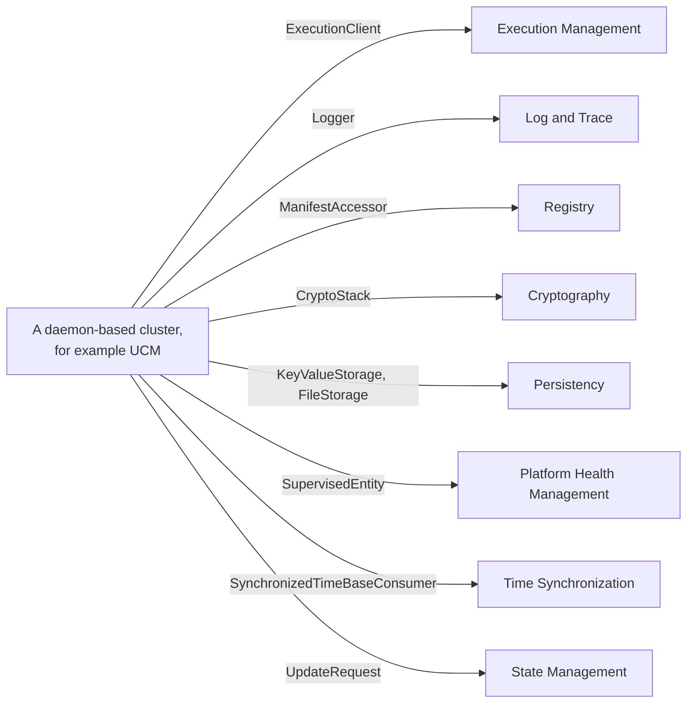

Four more interfaces connect specific pairs (*SW Architecture*, Tables 9.4, 9.12, 9.25 and 9.29): UCM uses the `UpdateRequest` service of State Management during an update; State Management uses `NetworkHandle` of Network Management to request networks; PHM uses `RecoveryAction`, which State Management implements, to trigger recovery; and V-UCM uses the `PackageManagement` service of UCM.

### 6.4 The Lifecycle Core: EM, SM and PHM

Three clusters form the core of the platform's lifecycle. The *Platform Design* calls them highly safety-relevant and inter-dependent (*Platform Design*, Section 17.3):

- **State Management decides.** It determines which Function Group States should be active and requests them from EM with `StateClient` (*Platform Design*, Section 4.1.4).
- **Execution Management executes.** It starts and stops processes and reports the result, as well as unexpected terminations, back to State Management ([EM guide, Section 7.4](04_ExecutionManagement.md#74-division-of-responsibilities-sm-decides-em-executes)).
- **Platform Health Management supervises.** It supervises the applications and reports failures to State Management through `RecoveryAction`. It always supervises EM and SM themselves. Because the normal recovery path runs through EM and SM, a failure in one of them is recovered by a reset of the Machine through the watchdog. PHM serves the hardware watchdog, which in turn supervises PHM (*SW Architecture*, Section 9.6.1; *Platform Design*, Section 17.3).

The following diagram shows these relations.

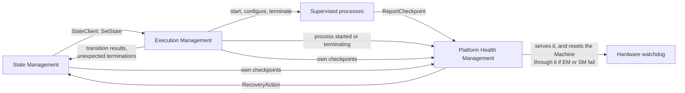

When EM changes a Function Group State, it notifies PHM just before it terminates a supervised process, so that PHM stops supervising it and State Management receives no false supervision failures. When a newly started process reports `kRunning`, EM notifies PHM to start its alive supervision; deadline and logical supervision start with the first reported checkpoint (*SW Architecture*, Section 11.1.1.3). Guides 04, 05 and 06 explain each side in detail.

### 6.5 Walkthrough: The Platform Starts and Stops

The *SW Architecture* describes how the platform starts (*SW Architecture*, Section 11.1.1.1). The following sequence applies it to `HPC`; the startup of `HPC` is described from EM's side in [EM guide, Section 9.2](04_ExecutionManagement.md#92-machine-startup-step-by-step).

1. The operating system initializes in an implementation-specific way, including drivers and low-level services. The platform requires the **watchdog to be enabled before the platform starts**, for example by the bootloader or the operating system.
2. The operating system starts **Execution Management as the first process of the platform** ([SWS_OSI_01040]).
3. EM activates the Machine State `Startup`, that is, `MachineFG.Startup`. This starts the processes configured for it. **State Management must be part of `Startup`**; PHM and application processes may be part of it too. On `HPC`, EM starts `StateManager`, `PlatformHealth` and the daemons of the other platform clusters in `Startup` ([guide 00, Section 6.3](00_LearningPath.md#63-the-hpc-machine)).
4. Every started process calls `ara::core::Initialize()` and reports `kRunning` to EM.
5. PHM starts to serve the watchdog. **The time between enabling the watchdog and the start of PHM must be shorter than the watchdog timeout.** The integrator must ensure this.
6. When `Startup` has been reached, State Management takes over and determines the next Function Group States. On `HPC`, `StateManager` requests `MachineFG.Driving` when `PowerMode` reports that the vehicle is switched on, and then `ADAS.Normal`.

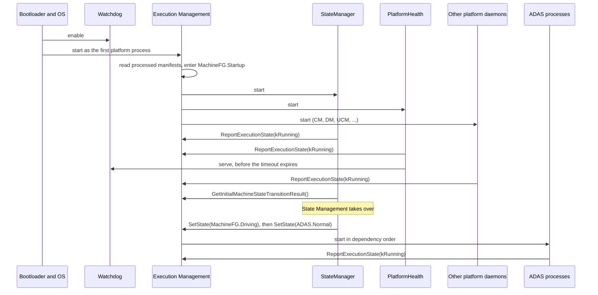

**Shutdown** works the other way around (*SW Architecture*, Section 11.1.1.2). State Management requests the Machine State `Shutdown`. The *SW Architecture* assumes that only EM, State Management and an application that asks the operating system to shut down run in this state. That application is specific to the operating system or the project, and is usually not an Adaptive Application; keeping it outside EM keeps project-specific functionality out of EM. EM terminates the other processes in an orderly way, including PHM, and starts the shutdown application. The operating system then terminates the remaining processes and shuts the Machine down in an implementation-specific way. On `HPC`, the shutdown application is `PowerControl`. Unlike the scenario in the *SW Architecture*, `HPC` also keeps `PlatformHealth` configured for `Shutdown`, so that the watchdog is served until the machine powers off ([guide 00, Section 6.5](00_LearningPath.md#65-processes)); the scenario is an example, not a rule.

### 6.6 Communication Protocols Used by the Platform

The *SW Architecture* lists the protocols that are relevant for the Adaptive Platform, ordered by the layers of the ISO OSI model (*SW Architecture*, Section 13.14). It classifies each protocol:

- **native:** specified especially for AUTOSAR, with an AUTOSAR protocol specification;
- **adapted:** a third-party protocol that AUTOSAR modifies or extends;
- **supported:** a third-party protocol used in its native form and referred to by requirements or by the manifest;
- **external standard:** not part of any AUTOSAR specification item, but useful together with AUTOSAR functions.

A protocol in the list is not mandatory for every Machine; that depends on the project.

| Layer | Protocol | AUTOSAR context | Used for |
| --- | --- | --- | --- |
| Lower layers | Ethernet | supported | Prerequisite for service-oriented communication |
| Lower layers | Ethernet over CAN XL | supported | Tunneling Ethernet frames over CAN XL |
| Lower layers | MACsec | supported | Cryptographic protection of Ethernet frames (IEEE 802.1AE) |
| Lower layers | Time synchronization protocol | adapted: derived from IEEE 802.1AS | Synchronizing time bases |
| Network and transport | IPv4 (with ARP, ICMPv4), IPv6 (with NDP, ICMPv6), TCP, UDP | supported | IP communication |
| Network and transport | IPsec (with IKEv2) | supported | Protection of IP datagrams |
| Application | SOME/IP, SOME/IP Service Discovery | native | Service-oriented communication over IP, and service discovery |
| Application | Signal-to-Service (S2S) | native | Sharing signal-based data as services; the signal payload is carried in a SOME/IP message |
| Application | UDP NM | native | Network management |
| Application | DLT | native | Log and trace data |
| Application | SecOC | native | Authenticity and freshness of PDU-based communication |
| Application | IDS protocol | native | Propagation of qualified security events |
| Application | E2E | native | End-to-end protection of safety-related data |
| Application | DDS | supported | Data-centric middleware; an alternative to SOME/IP |
| Application | DoIP | supported | Transport of UDS messages over IP |
| Application | TLS, DTLS | supported | Security for TCP-based and UDP-based communication, for example with SOME/IP or DDS |
| Application | DHCPv6, DNS | supported | Network configuration and name resolution |
| Application | DHCPv4, mDNS, IPC, OAuth 2.0, HTTP and HTTPS, VISS | external standard | For example IPC within a Machine, and HTTP, OAuth and mDNS around SOVD |

For applications, the entry points to these protocols are the communication APIs of ARA (*SW Architecture*, Section 13.14.4): `ara::com` for service-oriented communication with the SOME/IP, DDS and signal-based bindings, `ara::rds` for raw data, `ara::adi::sensoritf` for sensor interfaces, SOVD as part of `ara::diag`, and `ara::aag` for the Automotive API. In the running example, `CameraService` uses SOME/IP over TCP with TLS, `ObjectListService` uses DDS, diagnostics use DoIP, and the CAN signals arrive through Signal-to-Service translation ([guide 00, Section 6.7](00_LearningPath.md#67-network-deployment)).

### 6.7 Patterns You Will Meet in Every Guide

The *SW Architecture* defines a few patterns that recur across the clusters. Knowing them makes every API easier to read.

| Pattern | What it is | Where you meet it |
| --- | --- | --- |
| Offer and StopOffer | A callback is invoked only between `Offer()` and `StopOffer()`. This decouples the lifetime of an object from the time in which it handles asynchronous callbacks and avoids races during construction. `StopOffer()` blocks until a running callback has finished (*SW Architecture*, Section 8.5.6). | Skeletons of `ara::com` services, many interfaces of Diagnostic Management, `RecoveryAction` of PHM |
| `InstanceSpecifier` and port interfaces | An API object refers to an element of the manifest by its path, so that the same code can be deployed with different configurations (*SW Architecture*, Section 8.3). | `FunctionGroup`, proxies and skeletons, Persistency storages |
| Errors, Violations, Corruptions | An *Error* is a recoverable failure of an API call and must be handled by the application. A *Violation* (failed pre- or post-condition, for example an `InstanceSpecifier` that does not exist in the manifest) and a *Corruption* (for example a stack overflow or a memory bit flip) are not recoverable and terminate the process. A *failed default allocation* means that the default memory allocation could not be satisfied (*SW Architecture*, Section 13.12). | Every API; guide 03 |
| Initialize and Deinitialize | `ara::core::Initialize()` inside `main()` before other ARA calls, `ara::core::Deinitialize()` before leaving `main()` (*Platform Design*, Section 18.4). | Every application; guide 03 |
| Platform extensions | Callouts, callbacks and plugins that the OEM implements ([Section 3.5](#35-standardized-and-non-standardized-parts)). | Communication Management, Diagnostic Management, Cryptography |

> **Key takeaways**
>
> - Applications communicate only through Communication Management; there is no direct IPC between Adaptive Applications.
> - Clusters interact through implementation-specific interfaces. The interface lists in the SWS annexes and in the *SW Architecture* are recommendations.
> - `ExecutionClient`, `Logger`, `ManifestAccessor`, `CryptoStack`, Persistency and `SupervisedEntity` are used by almost every daemon-based cluster.
> - State Management decides, Execution Management executes, Platform Health Management supervises both; a failure of EM or SM leads to a Machine reset through the watchdog.
> - At startup, the watchdog is enabled first, the OS starts EM, EM enters `Startup` with State Management, and PHM must serve the watchdog before its timeout.

---

## 7. The Operating System Interface

> **Why this matters:** The Adaptive Platform does not come with its own operating system. It runs on a POSIX operating system chosen by the project, and it restricts what applications may use from it. Many portability and integration problems come down to this boundary: an application that calls `fork()`, a thread that runs with the wrong policy, or a resource limit that the operating system cannot enforce. The Operating System Interface defines no `ara::` API, so this chapter takes the place of the API chapter of the other guides.

### 7.1 What the Adaptive Platform Requires from the Operating System

**In plain words:** AUTOSAR does not specify a new operating system. It specifies what an Adaptive Application may use from the operating system, and a few capabilities that the operating system must offer so that the platform can manage processes and resources.

**Formally:** The Adaptive Platform defines an execution context and a programming interface for Adaptive Applications. The interfaces of the *Operating System Interface* (OSI) are part of ARA. The operating system may provide further interfaces, such as the creation of processes, which Execution Management needs to start applications. Those interfaces are not part of ARA; they are platform-implementation dependent (*OSI*, Chapter 1). The operating system is responsible for the run-time scheduling, the resource management, including policing memory and time constraints, and the inter-process communication of all applications. It works together with Execution Management, which uses it to start and stop applications (*Platform Design*, Section 5.1).

The OSI has two kinds of content:

- **What applications may use:** the POSIX PSE51 profile for C ([SWS_OSI_01001]) and the C++ standard library ([SWS_OSI_01002]).
- **What the operating system must support:** starting EM as the first process, multiple processes and threads, process isolation, core binding, scheduling policies and resource groups ([Sections 7.4 to 7.8](#74-processes-threads-and-isolation)). Applications may not have the rights to use or configure these capabilities directly (*OSI*, Section 7.1.1); EM configures them from the manifests.

The following diagram shows who uses which part of the operating system.

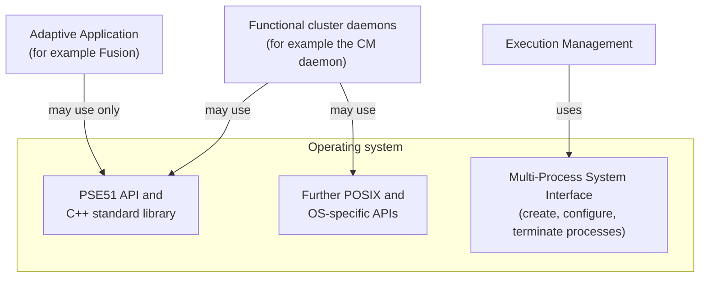

| Party | Responsibility | Source |
| --- | --- | --- |
| Operating system | Schedules threads, enforces memory and CPU limits, isolates processes, provides IPC, networking and storage | *Platform Design*, Section 5.1; *SW Architecture*, Section 7.2.2 |
| Execution Management | Starts and terminates processes, and configures the operating system for each process: scheduling policy and priority of the main thread, core affinity, ResourceGroup, arguments and environment | [EM guide, Chapter 11](04_ExecutionManagement.md#11-resource-management) |
| Operating System Interface (the specification) | Defines what applications may use and what the operating system must support | *OSI*, Chapters 7 and 8 |
| Adaptive Application | Uses only PSE51, the C++ standard library and ARA; configures the threads that it creates itself | *Platform Design*, Section 4.1.3; [EM guide, Section 11.5](04_ExecutionManagement.md#115-cpu-core-affinity-and-scheduling) |

### 7.2 PSE51 for Applications, Full POSIX for the Platform

**PSE51** is the smallest of the realtime profiles that IEEE Std 1003.13-2003, *Standardized Application Environment Profile (AEP), POSIX Realtime and Embedded Application Support*, defines [EXT-004]. The standard is inactive today, but the OSI still refers to it. The OSI shall provide the operating system functions through the PSE51 interface according to IEEE 1003.13-2003 ([SWS_OSI_01001]). PSE51 requires the C99 language standard (*OSI*, Section 8.1.1).

The *SW Architecture* summarizes what PSE51 contains (*SW Architecture*, Section 9.2.5):

- threads that can run in parallel on multi-core processors, with control of their properties such as stack memory and scheduling;
- primitives for access to shared resources, such as semaphores and memory locking;
- asynchronous real-time signals and message passing;
- high-resolution timers and clocks for precise real-time behavior;
- some input and output functions, but **no file system API**;
- **no means to start or control processes.** Processes are entirely controlled by EM, through implementation-specific interfaces.

The restriction applies to Adaptive Applications only:

- **Adaptive Applications** may use PSE51 as their operating system interface. Platform-specific applications may use full POSIX (*OSI*, Section 8.1.1).
- **Functional clusters** are not restricted. The implementations of the Platform Foundation and of the Platform Services may use further POSIX calls and even OS-specific APIs; their use is left to the implementer and is not standardized (*OSI*, Section 8.1.1; *Platform Design*, Section 5.2).
- If an application needs more features, they are taken from the POSIX standard and not newly specified, wherever possible (*Platform Design*, Section 5.2).

**Why PSE51?** It offers portability of Adaptive Applications and enables freedom from interference between applications (*Platform Design*, Section 4.1.3). PSE51 is a single-process profile: it gives an application no means to start or control processes, so process control stays with Execution Management.

> **Note (implementation example):** A general-purpose operating system such as Linux with glibc offers full POSIX to every process. Nothing in the C library stops an Adaptive Application from calling `fork()` or opening a socket to another application. The PSE51 restriction is a rule of the platform. Projects enforce it with code reviews and static analysis, and the operating system can enforce parts of it, for example by forbidding a process to create other processes ([Section 7.4](#74-processes-threads-and-isolation)).

### 7.3 C++ and Its Standard Library

The operating system shall provide an implementation of the C++ standard library, in library and header form ([SWS_OSI_01002]). The required version of the C++ standard is set by the general requirement "Compatibility with the ISO 14882 C++ standard" [RS_AP_00114]. In R25-11 this is C++17 (*Release Overview*, Section 1.5.4; the OSI was "Updated to C++17" in R25-11).

- **The C++ standard library is part of ARA.** It covers most PSE51 functions through C++ interfaces, for example the thread support library and the input/output library (*OSI*, Section 8.1.2; *Platform Design*, Section 4.1.3).
- **Some PSE51 functions have no C++ counterpart,** for example setting the scheduling policy of a thread. Applications then need the PSE51 C interface in addition to the C++ library (*OSI*, Section 8.1.2).
- **Do not mix the two threading interfaces needlessly.** The *Platform Design* recommends not to mix the C++ threading interface with the native PSE51 threading interface, to avoid complications, and accepts the combined use where the C++ library is not sufficient (*Platform Design*, Section 4.1.3). [Section 7.6](#76-scheduling-policies) shows a typical case.
- **Environment variables in static initializers.** `getenv()` should return valid values as soon as non-OS functions can be called, in particular from C++ static initializer code ([SWS_OSI_01015]). EM passes the environment variables configured in the manifests ([EM guide, Section 5.8](04_ExecutionManagement.md#58-signal-mask-arguments-and-environment-variables)).

> **Note (implementation example):** On a typical Linux system, `g++` links the C++ library `libstdc++`, which itself depends on `glibc`, the C library that implements the POSIX functions, partly by calling the Linux kernel (*OSI*, Sections 8.1.1 and 8.1.2).

### 7.4 Processes, Threads and Isolation

A process provides at least an entry point (`main()`) for its first thread, its own memory context with code, data and heap, some level of memory protection so that invalid accesses are detected, and operating system descriptors for the resources it uses (*OSI*, Section 7.1.2). The OSI requires the following from the operating system. The last column shows how each capability appears in the running example.

| Requirement | The operating system shall ... | In the running example |
| --- | --- | --- |
| [SWS_OSI_01040] | allow starting Execution Management as the *Initial Process* of the platform, that is, a process with management rights, for example to determine the exit status, over all processes of the platform (*OSI*, Chapter 2) | The OS of `HPC` starts EM, and EM starts every other process |
| [SWS_OSI_01008] | support multiple processes | Ten processes plus the platform daemons |
| [SWS_OSI_01006] | allow multiple threads in a process; on a multi-core processor, threads of one process may run in parallel | `Fusion` can run worker threads ([Section 7.6](#76-scheduling-policies)) |
| [SWS_OSI_01009] | isolate the processes from one another, so that an invalid memory access is detected | A crash of `Fusion` cannot corrupt `Storage`; EM reports the crash ([EM guide, Section 5.7](04_ExecutionManagement.md#57-crashes-outside-a-state-transition)) |
| [SWS_OSI_01010] | execute each process in a dedicated address space | `Fusion` and `FusionLite` have separate address spaces |
| [SWS_OSI_01014] | allow configuring a process so that it cannot create other processes | `permissionToCreateChildProcess` is `false` for `Fusion` ([EM guide, Section 13.11](04_ExecutionManagement.md#1311-the-running-example-complete-configuration)) |
| [SWS_OSI_01012] | provide mechanisms to bind processes to CPU cores; EM uses them ([SWS_EM_02104]) | Core affinity through `shallRunOn` or `shallNotRunOn` ([EM guide, Section 11.5](04_ExecutionManagement.md#115-cpu-core-affinity-and-scheduling)) |

With virtual memory, each process has its own logical address space. Several instances of the same Executable may share the physical pages of their code and read-only data, while their writable data lives in separate physical pages (*OSI*, Section 7.1.2; *Platform Design*, Section 5.4). The *Platform Design* names the reason for the multi-process design: freedom from interference between functional clusters and applications (*Platform Design*, Section 5.4).

### 7.5 Shared Objects

Shared objects (also called shared libraries or DLLs) hold code and data that several processes can use; their code and read-only data are usually present in memory only once. There are two ways to use them (*OSI*, Section 7.1.2):

- **Implicit loading:** the Executable is linked against the shared object at build time, and the loader of the operating system maps it when the process starts. The operating system **shall** support this ([SWS_OSI_01013]). It saves space and makes it easy to deploy fixes in shared code.
- **Explicit loading:** the process itself opens a shared object at run time, typically with `dlopen()`, `dlsym()` and `dlclose()`, for example to load plugins. The OSI does **not** require this.

For safety, security or other reasons, an Executable may also be fully statically linked and use no shared objects at all (*OSI*, Section 7.1.2). This has a consequence for platform extensions: a plugin that is configured as a dynamic library requires an operating system with dynamic library support and cannot be used with statically linked binaries (*SW Architecture*, Section 8.5.5.3.7.3).

### 7.6 Scheduling Policies

Scheduling has several goals that conflict with each other: throughput, responsiveness, fairness, and the ordered activation of jobs according to a policy such as priority or deadline. Every scheduler is a compromise (*OSI*, Section 7.1.3). The operating system shall support three policies of the POSIX standard ([SWS_OSI_01003]):

| Group | Policy | Meaning |
| --- | --- | --- |
| Fair scheduling | `SCHED_OTHER` | Time-sharing policy for threads without real-time requirements |
| Real-time scheduling | `SCHED_FIFO` | Fixed priorities; within one priority, first in, first out |
| Real-time scheduling | `SCHED_RR` | Fixed priorities; within one priority, round robin with a time slice |

These default policies may not guarantee proper execution for all real-time scenarios. Further policies may be provided, for example `SCHED_DEADLINE` (earliest deadline first), which is not a POSIX policy (*OSI*, Section 7.1.3). Such policies are allowed, but they may not be portable across implementations (*Platform Design*, Section 5.3).

> **Note:** The *Platform Design* lists only `SCHED_FIFO` and `SCHED_RR` as the standard policies (*Platform Design*, Section 5.3). The *Operating System Interface* also requires `SCHED_OTHER` ([SWS_OSI_01003]). The SWS is normative, so all three must be supported.

Execution Management sets the scheduling policy and priority of the **main thread** of a process from the manifest. Threads that the process creates itself are its own responsibility ([EM guide, Section 11.5](04_ExecutionManagement.md#115-cpu-core-affinity-and-scheduling)). The C++ standard library cannot set a scheduling policy, so this is where an application combines the C++ and the PSE51 interfaces ([Section 7.3](#73-c-and-its-standard-library)).

The following example shows a worker thread that runs the 50 ms fusion cycle of `Fusion`. The manifest of `Fusion` gives its main thread `SCHED_FIFO` with priority 40 ([EM guide, Section 13.11](04_ExecutionManagement.md#1311-the-running-example-complete-configuration)). The example is illustrative: initialization, termination handling, logging and error handling are shortened, and vendor headers may differ in detail.

```cpp
// Illustrative example: a worker thread of Fusion for its 50 ms fusion cycle.
// ara::core::Initialize(), ExecutionClient and the termination handler are
// omitted; see guides 03 and 04.
#include <atomic>
#include <chrono>
#include <thread>
#include <pthread.h>  // PSE51 C interface: thread scheduling
#include <sched.h>    // PSE51 C interface: SCHED_FIFO, sched_param

std::atomic<bool> gRunning{true};  // cleared by the termination handler (guide 04)

void RunFusionCycle();  // read inputs, fuse, publish ObjectListService (guide 07)

void FusionLoop()
{
    using namespace std::chrono_literals;
    constexpr auto kPeriod = 50ms;
    auto next = std::chrono::steady_clock::now();
    while (gRunning.load()) {
        RunFusionCycle();
        next += kPeriod;
        // C++ standard library: wakes up no earlier than 'next'. How much later
        // depends on the OS, the scheduling policy and the load.
        std::this_thread::sleep_until(next);
    }
}

int main()
{
    // EM has configured this main thread from the manifest:
    // schedulingPolicy SCHED_FIFO, schedulingPriority 40.
    std::thread worker{FusionLoop};  // C++ standard library

    // The C++ library has no API for scheduling policies, so use PSE51.
    // On POSIX systems, native_handle() returns the pthread_t of the thread.
    sched_param param{};
    param.sched_priority = 35;  // illustrative: below the main thread
    if (pthread_setschedparam(worker.native_handle(), SCHED_FIFO, &param) != 0) {
        // Report the problem, for example with ara::log (guide 10).
    }

    worker.join();
    return 0;
}
```

Two points are worth noting. First, the worker's policy is set explicitly, so the code does not depend on which scheduling attributes a new thread inherits on a particular operating system. Second, `sleep_until()` gives a lower bound on the wake-up time, not an upper bound. The loop is periodic, but not deterministic in the sense of [Section 2.3](#23-determinism-the-key-property-of-classic-ecus); PHM's deadline supervision of the cycle detects when it runs late ([guide 00, Section 6.13](00_LearningPath.md#613-safety)).

> **Note (implementation example):** On Linux, `SCHED_FIFO` and `SCHED_RR` use static priorities from 1 (low) to 99 (high); `SCHED_OTHER` is the standard time-sharing scheduler and uses static priority 0. `SCHED_DEADLINE`, available since Linux 3.14, implements global earliest-deadline-first scheduling with a constant bandwidth server. Unprivileged threads can raise their real-time priority only up to the `RLIMIT_RTPRIO` limit; `CAP_SYS_NICE` lifts this restriction. By default, Linux also reserves 5 % of each second for non-real-time threads (`sched_rt_runtime_us` = 950000 of `sched_rt_period_us` = 1000000) [EXT-009]. Real-time projects check these settings during integration.

### 7.7 Time-Triggered Execution

The OSI describes periodic processing, but defines no requirement for it (*OSI*, Section 7.1.4):

- PSE51 provides timers, for example `timer_settime()`, together with POSIX signals. Signals are sometimes discouraged in safety-critical applications, because they disrupt the execution flow.
- In C++, `std::future::wait_until()` can be used for periodic processing; Time Synchronization can be combined with `std::future` to generate events.
- Both APIs only offer single-shot, relative alarms. Efficient, low-overhead periodic processing needs recurring or absolute alarms, so these APIs may be extended in the future.

There is no counterpart of the Classic ScheduleTable ([Section 2.3.2](#232-how-the-classic-platform-achieves-it)) in the OSI. Periodic activation is a matter of application code, such as the loop in [Section 7.6](#76-scheduling-policies), and its timing quality depends on the operating system and its configuration.

### 7.8 Resource Control with ResourceGroups

Applications are expected to behave correctly, but intentional or unintentional misbehavior must be contained for the stability of the system. At the same time, some dynamic behavior must be allowed. The OSI therefore lets processes be grouped so that they share memory, CPU time and other resources (*OSI*, Section 7.1.6):

- **Number of groups.** The operating system shall support at least 8 groups of processes ([SWS_OSI_02000]). Depending on the operating system, the number of usable ResourceGroups may vary; with OS-level containers, some operating systems allow as little as one.
- **Memory.** The operating system shall support groups of processes that may allocate memory dynamically up to a configured limit ([SWS_OSI_02001]). The limit covers the code and read-only data of the Executable, its modifiable data, the thread stacks, the heap, the kernel memory used for the process (for example thread control blocks and page table entries), shared memory between processes of the same group and shared objects loaded by processes of the same group. Whether shared memory and shared objects used *across* groups and memory-mapped files count is implementation-specific.
- **CPU time.** The operating system shall support groups of processes that may use at most a configured amount of CPU time over a defined period ([SWS_OSI_02002]). The algorithm is not specified. Examples are fixed periodic time windows similar to ARINC 653, a quota that is replenished each period, or usage accounting over past periods with thresholds. Giving idle time to a group that is over its limit is a valid optimization, but not a requirement.

The OSI mentions one manifest element, `ResourceGroup`, aggregated by `OsModuleInstantiation.resourceGroup`. Its attribute `cpuUsage` (`PositiveInteger`, multiplicity 0..1) is the CPU limit in percent of the total CPU capacity of the Machine; `memUsage` (`PositiveInteger`, 0..1) is the memory limit in bytes (*OSI*, Appendix A). The OSI defines no default values and no constraints for them (*OSI*, Chapter 10). `HPC` uses three groups: `platform_rg` (20 % CPU, 512 MiB), `adas_rg` (60 %, 2 GiB) and `legacy_rg` (10 %, 256 MiB) ([guide 00, Section 6.3](00_LearningPath.md#63-the-hpc-machine)). The [EM guide, Section 11.3](04_ExecutionManagement.md#113-resourcegroup-group-level-limits) explains how EM assigns processes to these groups, and [Section 11.7](04_ExecutionManagement.md#117-mapping-to-os-mechanisms) shows how Linux control groups can implement them [EXT-010].

### 7.9 Devices, Networking, Startup and Shutdown

- **Devices.** The OSI shall support device access as defined in PSE51 (*OSI*, Section 7.1.5). Device management is largely OS-specific. There is no plan to standardize the APIs of device drivers; instead, the Platform Foundation prefers services that expose the main system functions, and higher-level driver functions may be standardized as platform services (*Platform Design*, Section 5.6).
- **Networking.** Ethernet is expected to be the main connection between Machines and to sensors, so the operating system is expected to provide a TCP/IP and UDP/IP networking stack. Applications use it through Communication Management; the Platform Foundation adds features such as VLAN and IPsec (*Platform Design*, Section 5.7).
- **Startup.** The startup of the operating system is implementation-specific. It includes OS-related middleware, device drivers and low-level services, and the start of Execution Management. EM is expected to start early, ideally as the first process; other system services, for example a file system service that is not part of the kernel, may start before it or in parallel (*OSI*, Section 7.2.1). The watchdog must be enabled before the platform starts ([Section 6.5](#65-walkthrough-the-platform-starts-and-stops)).
- **Shutdown.** The shutdown is implementation-specific too. It may flush middleware buffers, shut down peripherals and, depending on the configuration, turn off the whole system (*OSI*, Section 7.2.2).

### 7.10 OS Tracing with ARTI

To understand, verify and visualize the timing behavior of the operating system, the OSI defines trace messages for processes and tasks (*OSI*, Section 7.3.2). They belong to ARTI, the *AUTOSAR Run-Time Interface* between build tools and debugging and tracing tools (*Glossary*, entry *ARTI*). ARTI uses a two-level model: a **Task** is the smallest schedulable unit managed by the operating system (a thread, in POSIX terms), and a **Process** holds one or more tasks (*OSI*, Section 7.3.2.1; *Glossary*, entries *Task* and *Process*).

The operating system provides its trace information in different ways, for example as kernel trace buffers or hooks. This information must be turned into *modeled* messages and sent through `ara::log`. One way is a separate application, an *OS/ara::log adapter*, that reads the OS trace buffers and translates them; sending the messages can also be delegated to another functional cluster (*OSI*, Section 7.3.2.1). When tracing starts, the OSI logs an `OsProcessInfo` message for every existing process and an `OsTaskInfo` message for every existing task, so that later IDs can be interpreted ([SWS_OSI_10100]). The order of the messages is deliberately weakly defined; tools must accept any order that describes a coherent view of the system.

The trace events of a task follow the minimal state machine below (*OSI*, Section 7.3.2.2, Figure 7.3). An operating system that does not distinguish *Ready* from *Waiting* must at least trace the switches between *Ready* and *Running*.

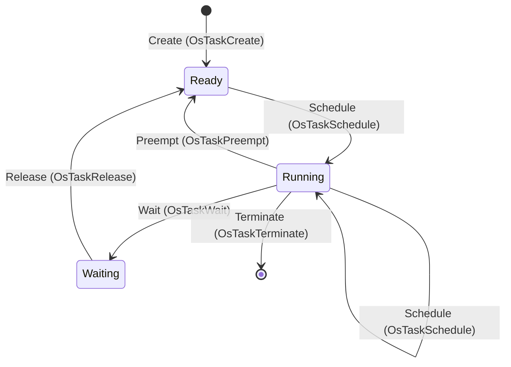

If tracing is desired, the OSI shall log a modeled message for each of the following events ([SWS_OSI_10102] to [SWS_OSI_10108] for tasks, [SWS_OSI_10110] to [SWS_OSI_10113] for processes). All messages have the status DRAFT, the message type *Info* / `DLT_TRACE_STATE`, and a time stamp in the natural format of the operating system where applicable.

| Message | Message ID | Logged when | Requirement |
| --- | --- | --- | --- |
| `OsProcessCreate` | `0x8000e000` | A process is created (with its PID and the PID of its parent) | [SWS_OSI_02003] |
| `OsProcessDestroy` | `0x8000e001` | A process ends | [SWS_OSI_02004] |
| `OsProcessInfo` | `0x8000e002` | Tracing starts: one per existing process, with the short-name path of its Modelled Process | [SWS_OSI_02005] |
| `OsProcessRename` | `0x8000e003` | A process is renamed | [SWS_OSI_02006] |
| `OsProcessSwitch` | `0x8000e004` | The operating system switches to another process | [SWS_OSI_02007] |
| `OsTaskCreate` | `0x8000e005` | A task is created | [SWS_OSI_02008] |
| `OsTaskTerminate` | `0x8000e006` | A task exits | [SWS_OSI_02009] |
| `OsTaskInfo` | `0x8000e007` | Tracing starts: one per existing task | [SWS_OSI_02010] |
| `OsTaskPreempt` | `0x8000e008` | A task leaves *Running* and enters *Ready* | [SWS_OSI_02011] |
| `OsTaskRelease` | `0x8000e009` | A task leaves *Waiting* | [SWS_OSI_02012] |
| `OsTaskRename` | `0x8000e00a` | A task is renamed | [SWS_OSI_02013] |
| `OsTaskSchedule` | `0x8000e00b` | A task is scheduled and enters *Running* | [SWS_OSI_02014] |
| `OsTaskWait` | `0x8000e00c` | A task enters *Waiting* | [SWS_OSI_02015] |

`OsProcessInfo` links an operating system PID to a Modelled Process of the manifest. This lets a trace tool show, for example, that PID 1234 is the process `Fusion` of the running example. Guide 10 explains how modeled messages are logged and read.

### 7.11 What the OSI Does Not Define

The OSI is a short specification. Knowing what it leaves out prevents you from searching for things that do not exist:

| Not defined by the OSI | Where it comes from instead |
| --- | --- |
| An `ara::` API ("This functional cluster does not define any APIs", *OSI*, Chapter 8) | PSE51 and the C++ standard library |
| Service interfaces | – (*OSI*, Chapter 9) |
| Security events, violation messages, production errors | – (*OSI*, Sections 7.3.1, 7.3.3 and 7.3.4) |
| Default values and semantic constraints of configuration | – (*OSI*, Chapter 10); the `ResourceGroup` element is owned by the [EM guide, Chapter 11](04_ExecutionManagement.md#11-resource-management) |
| Demands on the base software, platform extension interfaces | – (*OSI*, Appendices B and C) |
| How processes are created and controlled | Execution Management, through implementation-specific OS interfaces |
| Recurring or absolute timers | Not yet specified ([Section 7.7](#77-time-triggered-execution)) |

> **Key takeaways**
>
> - AUTOSAR specifies no operating system. The OSI defines what Adaptive Applications may use: PSE51 and the C++17 standard library.
> - Functional clusters may use full POSIX and OS-specific APIs; applications may not, which keeps them portable and free from interference.
> - The operating system must start EM as the Initial Process, isolate processes in their own address spaces, support threads, core binding, three scheduling policies and at least 8 ResourceGroups for memory and CPU time.
> - EM configures the main thread from the manifest; threads created by the application are configured by the application, which needs the PSE51 interface for that.
> - The OSI defines DRAFT ARTI trace messages for processes and tasks, but no API, no security events and no configuration defaults.

---

## 8. Development, Safety and Security at a Glance

> **Why this matters:** Three topics cut across all clusters: how software and its configuration get onto the Machine, how the platform supports safety, and how it supports security. Later guides treat each of them in depth. This chapter gives you the overview, so that you know which guide to open.

### 8.1 From Service Definition to Running Process

The Adaptive Platform standardizes the work products and tasks of development, so that applications can be developed independently, by different teams, and still fit together (*Platform Design*, Section 4.3). The following diagram follows the workflow of the *Platform Design* (Figure 4.6), from the definition of a service to a running process.

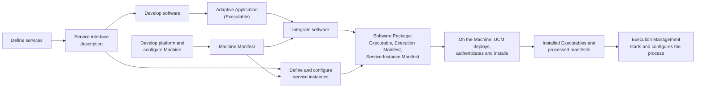

The important idea is that **configuration travels with the software**. The Executable is packaged together with its manifests, installed by UCM, and processed on the Machine into a format that EM and the other clusters read at run time ([EM guide, Section 2.2](04_ExecutionManagement.md#22-manifests)). The [Manifests guide](02_Manifests.md) explains the manifests and the methodology in detail; its [Chapter 11](02_Manifests.md#11-the-methodology-from-design-to-a-running-machine) covers the methodology.

### 8.2 Manifests in One Table

A **manifest** is a piece of AUTOSAR model description that configures an Adaptive Platform product and is uploaded to it, potentially together with binary files. Not every ARXML file of a project is a manifest, because a vehicle project also covers Classic ECUs. Manifest content is relevant in very different phases of a project, so the *Platform Design* divides it into an application design and three kinds of manifests, usually stored in different files (*Platform Design*, Sections 4.4 to 4.8; *SW Architecture*, Sections 13.6 to 13.10):

| Kind | What it describes | Delivered with | Examples of content |
| --- | --- | --- | --- |
| Application Design | All design-related aspects of application software, independent of a deployment | Not necessarily deployed to the Machine | Data types, service interfaces, persistency interfaces, access to crypto, PHM and time bases, serialization properties, client and server capabilities, grouping of applications |
| Execution Manifest | How an application is deployed and started | The Executable | Startup configuration (options, access roles, dependency on Machine and Function Group States), ResourceGroup assignment |
| Service Instance Manifest | How service-oriented communication is configured for the transport protocol | The Executable that uses the communication | Service interface deployment, service instance deployment, E2E protection, security protection, Log and Trace |
| Machine Manifest | The configuration of the Machine itself, without applications | The software that establishes the platform instance | Network connection, service discovery, Machine States and Function Groups, configuration of the cluster implementations, crypto, PHM, Time Synchronization, available hardware resources |

Each functional cluster reads its part of this configuration. That is why every cluster guide of this series has a *Configuration Overview* chapter and a *Configuration Reference* chapter, which list each element and attribute that the cluster reads, with its meaning and its effect at run time. The [EM guide, Chapters 4](04_ExecutionManagement.md#4-configuration-overview) and [13](04_ExecutionManagement.md#13-configuration-reference-what-to-configure) are the first example.

### 8.3 Safety

The Adaptive Platform supports the development of safety-related systems, but it does not make a system safe by itself:

- **Status of the platform.** AUTOSAR provides a safety overview (`AUTOSAR_FO_EXP_SafetyOverview`) and safety requirements (`AUTOSAR_FO_RS_Safety`). The use of the Adaptive Platform does not imply ISO 26262 compliance, and it is still possible to build unsafe systems with it. In the best case, its architecture can only be considered a *Safety Element out of Context* (SEooC) (*Platform Design*, Section 17.1).
- **Freedom from interference.** Processes run in separate address spaces, and ResourceGroups limit their CPU time and memory, so that a misbehaving application has a limited ability to affect others (*Platform Design*, Sections 5.4 and 6.4).
- **Supervision.** Platform Health Management supervises the applications and the platform and coordinates recovery with State Management ([Section 6.4](#64-the-lifecycle-core-em-sm-and-phm)).
- **End-to-end protection.** E2E checks whether data changed during transmission, whether messages were lost or repeated, and how reliable the communication channel is. It works between all combinations of Adaptive and Classic instances. It detects faults and reports them, but does not react to them; that is the application's job. In R25-11 it supports events, methods and fields with limitations (*Platform Design*, Section 17.2).
- **Safety features per cluster** are listed in [Section 5.10](#510-protocols-safety-and-security-features-per-cluster).

Guides: 04 (resource management), 06 (supervision), 08 (E2E) and 17 (integration).

### 8.4 Security

- **Trusted Platform.** The code executed on the platform must be unaltered (integrity) and of legitimate origin (authenticity). A *Trust Anchor*, often a public key in non-modifiable memory or in an HSM, starts a *chain of trust*: each step of the boot process authenticates the next one, the operating system launches EM only after its authenticity has been verified, and EM then authenticates the Adaptive Applications before launching them (*Platform Design*, Section 6.5; *SW Architecture*, Section 13.13). `HPC` runs in `strictMode`, so software that fails the check is not started ([EM guide, Chapter 12](04_ExecutionManagement.md#12-security-trusted-platform-and-iam)).
- **Access control.** IAM decides and enforces which application may use which service interface or platform resource ([Section 5.5](#55-security)).
- **Secure communication.** SecOC, (D)TLS, IPsec and MACsec protect the communication ([Section 6.6](#66-communication-protocols-used-by-the-platform)).
- **Keys and certificates.** Cryptography encapsulates keys, ideally in an HSM.
- **Detection and filtering.** Security sensors report events to IdsM; the Firewall filters network traffic.
- **Security features per cluster** are listed in [Section 5.10](#510-protocols-safety-and-security-features-per-cluster).

Guides: 04 (Trusted Platform), 08 (secure communication), 14 (Cryptography), 15 (IAM) and 16 (IdsM and Firewall).

### 8.5 Software Updates Over the Air

One declared goal of the Adaptive Platform is the flexible update of software and its configuration over the air (*Platform Design*, Section 13.1). UCM installs, updates and removes Software Clusters on one Machine, in three phases: preparation, activation and cleanup. During activation it coordinates with State Management through the `UpdateRequest` service, verifies the new software, and can roll back to the previous version (*Platform Design*, Sections 13.4 and 13.9). V-UCM coordinates an update campaign across the whole vehicle and distributes the packages to the UCMs; an OTA Client connects it to the backend (*Platform Design*, Section 13.5; *SW Architecture*, Section 12.1). UCM and V-UCM authenticate every package, and IAM ensures that only legitimate clients use their services (*Platform Design*, Sections 13.7 and 13.8).

*Running example:* V-UCM on `TelematicsUnit` brings `AdasCluster` 1.1.0 to `HPC`; UCM activates it through the `Verify` state of the Function Group `ADAS` and rolls back if the verification fails ([guide 00, Section 6.11](00_LearningPath.md#611-software-updates)). Guide 13 tells the whole story.

> **Key takeaways**
>
> - Configuration travels with the software: Executables are packaged with their manifests, installed by UCM and processed on the Machine.
> - Application Design, Execution Manifest, Service Instance Manifest and Machine Manifest describe different aspects in different phases; every cluster guide explains its part of them.
> - The platform supports safety (isolation, supervision, E2E) but is at best a Safety Element out of Context; it does not make a system ISO 26262 compliant.
> - Security rests on the chain of trust, access control, secure communication, protected keys, intrusion detection and filtering.
> - UCM updates one Machine in three phases with rollback; V-UCM coordinates updates across the vehicle.

---

## 9. The Running Example on the Architecture Map

> **Why this matters:** The running example connects all guides. This chapter places every node and process of `HPC` on the architecture map of this guide, so that you can follow later guides that zoom into one part of it.

### 9.1 Which Platform Runs on Which Node, and Why

The following table applies the reasoning of [Chapter 2](#2-why-two-platforms-classic-and-adaptive) to the nodes of the running example ([guide 00, Section 6.2](00_LearningPath.md#62-the-vehicle-context)).

| Node | Platform | Why this platform fits |
| --- | --- | --- |
| `HPC` | Adaptive Platform | Sensor fusion needs computing power and parallelism ([Section 2.5](#25-two-technology-drivers-ethernet-and-many-core-processors)); its results are services for other ECUs over Ethernet; its software is updated over the air ([Section 2.6](#26-why-the-adaptive-design-fits-its-problem)). |
| `TelematicsUnit` | Adaptive Platform | Hosts V-UCM and the OTA Client and connects the vehicle to the `Backend`: update coordination and backend connectivity are Adaptive functions ([Section 5.7](#57-configuration)). |
| `ChassisECU` | Classic Platform | Chassis control on a microcontroller, with signals on CAN and deterministic timing ([Section 2.3](#23-determinism-the-key-property-of-classic-ecus)). |
| `InstrumentCluster` | Classic Platform | Receives the ADAS status as a CAN signal and shows it. |
| `CentralGateway` | Classic Platform | Switch, CAN gateway and time master. Routing PDUs between the CAN bus and the Ethernet backbone is a classic gateway function of the Classic communication stack. |
| `FrontRadar` | Not AUTOSAR (smart sensor) | A third-party platform; `HPC` receives its raw detections through Raw Data Stream ([Section 5.3](#53-communication)). |
| `Cockpit` | Not specified | Infotainment systems are often non-AUTOSAR platforms, which the Adaptive Platform interacts with ([Section 2.10](#210-where-each-platform-fits-in-a-vehicle)). |
| `DiagnosticTester`, `Backend` | Off-board | External systems of the platform ([Section 4.5](#45-the-adaptive-platform-in-its-system-context)). |

### 9.2 The `HPC` Machine, Layer by Layer

The following diagram shows `HPC` on the layers of [Chapter 3](#3-the-architecture-logical-view) and [Chapter 4](#4-the-architecture-physical-view-and-deployment). EM is the first platform process; the platform daemons and the applications are processes that EM starts; library-based clusters run inside the processes that use them ([guide 00, Section 6.3](00_LearningPath.md#63-the-hpc-machine)).

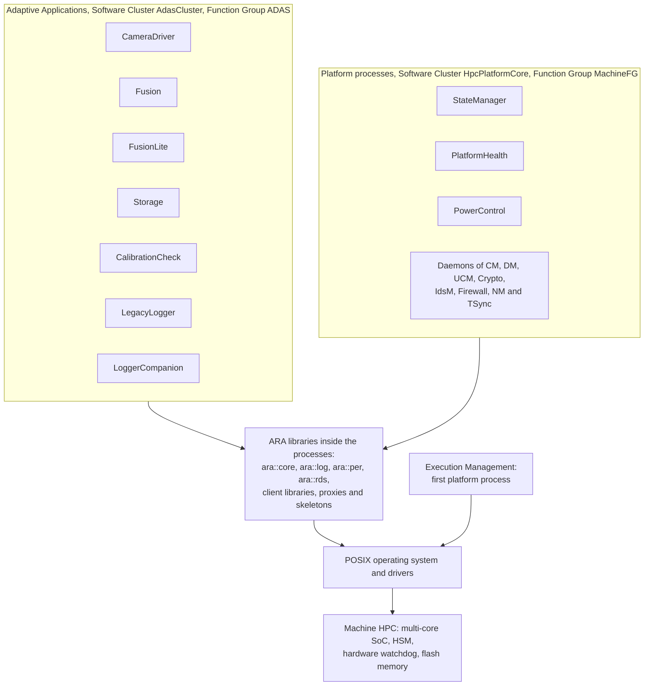

All application processes belong to the Software Cluster `AdasCluster` and run in states of the Function Group `ADAS`. The platform processes belong to `HpcPlatformCore` and run in states of `MachineFG`. `LegacyLogger` is a third-party binary that cannot be modified and does not report its execution state ([guide 00, Section 6.5](00_LearningPath.md#65-processes)).

### 9.3 Which Clusters Each Process Relies On

The following matrix shows which functional clusters each process of `HPC` uses directly. It is derived from the roles in [guide 00, Chapter 6](00_LearningPath.md#6-the-running-example-the-hpc-reference-system); the owner guides give the details. Every process that uses ARA also uses Core, to initialize the runtime, and in practice every process logs; the column *Log* only marks the log IDs that guide 00 defines.

| Process | EM | CM | Log | Per | PHM | Crypto | Diag | RDS | TSync | Other | Owner guides |
| --- | --- | --- | --- | --- | --- | --- | --- | --- | --- | --- | --- |
| `StateManager` | reports state; uses `StateClient` | uses `PowerModeService`, provides `AdasStatusService` | | | supervised by PHM; receives its recovery requests | | | | | requests `AdasPn` from NM | 04, 05 |
| `PlatformHealth` | reports state | | | | is PHM | | | | | serves the hardware watchdog | 04, 06 |
| `PowerControl` | started in `Shutdown` and `Restart` | | | | | | | | | powers off or reboots through the OS | 04, 05 |
| `Storage` | reports state | provides `CalibrationDataService`, uses `ObjectListService` | | `CalibrationKvs`, `Recordings` | | MAC with `CalibrationMacKey` | | | | | 04, 07, 11 |
| `CameraDriver` | reports state | provides `CameraService`, calls `SetCalibration` | `CAMD` | | supervised (alive) | | routine `CalibrateCamera`, monitor `CameraBlocked` | | time-stamps images with `VehicleTime` | | 07, 09, 12a, 12b |
| `CalibrationCheck` | reports state; self-terminating | calls `GetCalibration` | | | | checks authenticity | | | | | 04, 11, 14 |
| `LegacyLogger` | started; non-reporting | | | | | | | | | third-party binary | 04 |
| `LoggerCompanion` | reports state once `LegacyLogger` is ready (companion) | | | | | | | | | | 04 |
| `Fusion` | reports state | uses `CameraService`, `VehicleDynamicsService`, `CalibrationDataService`; provides `ObjectListService` | `FUSN` | `FusionParams` | supervised (alive, deadline, logical) | | DID `FusionSoftwareVersion` | radar stream (client) | | | 03, 04, 06, 07, 10, 11, 12a, 13 |
| `FusionLite` | reports state | uses `VehicleDynamicsService`, `CalibrationDataService`; provides a reduced `ObjectListService` | | | | | | radar stream (client) | | | 04, 06, 15 |
| Platform daemons | report state | CM daemon: all bindings, (D)TLS with `HpcDeviceCert` | | | | UCM: `PackageVerificationKey` | DM daemon: DoIP, address `0x1010` | | TSync daemon: follows `VehicleTime` | IdsM, Firewall, NM | 08 to 16 |

Read the matrix by column to see the reach of a cluster: Communication Management touches almost every process, while Raw Data Stream is used only by the two fusion processes.

### 9.4 Walkthrough: One Fusion Cycle Through the Platform

The following sequence shows one 50 ms cycle of `Fusion` in `ADAS.Normal`, with the clusters that each step uses. Checkpoint names and the ordering are illustrative ([guide 00, Section 6.13](00_LearningPath.md#613-safety)).

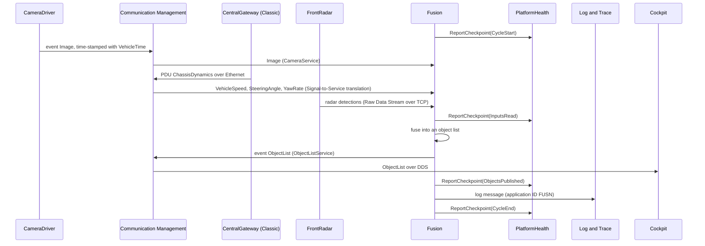

| Step | What happens | Clusters involved | Guide |
| --- | --- | --- | --- |
| Checkpoints | `Fusion` reports checkpoints; PHM checks that the cycle is alive, on time and in the right order | Platform Health Management | 06 |
| Camera image | `CameraDriver` sends the image as an event; Communication Management delivers it locally | Communication Management, Time Synchronization (time stamp) | 07, 09 |
| Vehicle dynamics | The CAN signals of `ChassisECU` reach `HPC` as PDUs through `CentralGateway` and are translated into events of `VehicleDynamicsService` | Communication Management (Signal-to-Service translation) | 08 |
| Radar | `Fusion` reads the raw detections from its TCP connection to `FrontRadar` | Raw Data Stream | 09 |
| Object list | `Fusion` sends the object list; Communication Management delivers it to `Storage` locally and to `Cockpit` over DDS | Communication Management | 07, 08 |
| Logging | `Fusion` logs a message that a DLT client can read | Log and Trace | 10 |
| Underneath | The operating system schedules the threads of all processes within their ResourceGroups; EM is not involved during the cycle | Operating System Interface | [Chapter 7](#7-the-operating-system-interface) |

> **Key takeaways**
>
> - `HPC` and `TelematicsUnit` run the Adaptive Platform; the control and gateway ECUs run the Classic Platform; `FrontRadar` and `Cockpit` are third-party platforms.
> - On `HPC`, EM starts the platform processes of `HpcPlatformCore` and the applications of `AdasCluster`; library-based clusters run inside these processes.
> - Communication Management connects almost every process; Persistency, PHM, Diagnostic Management, Raw Data Stream and Time Synchronization serve specific ones.
> - A single fusion cycle touches five clusters and the operating system, but not Execution Management.

---

## 10. Best Practices, Pitfalls and Troubleshooting

> **Why this matters:** Most architecture-level problems in Adaptive projects are not bugs in a single cluster. They come from a function placed on the wrong platform, an application that uses more of the operating system than it may, or an integration step that ignores how the platform starts. This chapter collects the lessons of the previous chapters in a form you can use in reviews.

### 10.1 Best Practices

**For architects:**

1. **Choose the platform per function.** Put closed control loops with hard deadlines on Classic ECUs. Put computation-heavy, connected and frequently updated functions on Adaptive ECUs ([Sections 2.7 and 2.8](#27-determinism-on-the-adaptive-platform)).
2. **Plan the dynamics early.** Decide which dynamic behavior the production system may keep, for example pre-determined service discovery or memory allocation only at startup, and express it in the manifests ([Section 2.7](#27-determinism-on-the-adaptive-platform)).
3. **Connect the worlds with standard means.** Use SOME/IP and Signal-to-Service translation at the boundary between Classic and Adaptive ECUs instead of custom gateways ([Section 2.10](#210-where-each-platform-fits-in-a-vehicle)).
4. **Budget resources per ResourceGroup** and keep third-party or less trusted software in a group of its own, as `HPC` does with `legacy_rg` ([Section 7.8](#78-resource-control-with-resourcegroups)).

**For application developers:**

1. **Use only ARA, the C++17 standard library and PSE51.** Check the stack's documented restrictions ([Sections 3.6](#36-portability-what-stays-the-same-across-stacks) and [7.2](#72-pse51-for-applications-full-posix-for-the-platform)).
2. **Talk to other applications only through `ara::com`** ([Section 6.1](#61-applications-talk-only-through-communication-management)).
3. **Configure the threads you create.** EM configures only the main thread ([Section 7.6](#76-scheduling-policies)).
4. **Keep code and manifest consistent.** An `InstanceSpecifier` that does not exist in the manifest is a Violation, which terminates the process ([Section 6.7](#67-patterns-you-will-meet-in-every-guide)).

**For integrators:**

1. **Use one release** for specifications, tools and stack ([Section 1.4](#14-releases-and-maturity)).
2. **Check the watchdog timing at startup:** PHM must serve the watchdog before its timeout expires ([Section 6.5](#65-walkthrough-the-platform-starts-and-stops)).
3. **Keep the Software Clusters clean:** platform daemons in `PLATFORM_CORE` or `PLATFORM` clusters, applications in `APPLICATION_LAYER` clusters ([Section 4.4](#44-software-clusters-and-software-packages)).
4. **Check the real-time settings of the operating system,** such as limits for real-time priorities and the share of CPU time reserved for non-real-time threads ([Section 7.6](#76-scheduling-policies)).

### 10.2 Common Pitfalls

| Pitfall | Why it is a problem | Source |
| --- | --- | --- |
| An Adaptive Application calls `fork()`, `system()` or `exec()` | Process creation is outside PSE51 and belongs to EM. The operating system can forbid it for a process, and the configuration does so by default. | [Section 7.4](#74-processes-threads-and-isolation), [SWS_OSI_01014] |
| Two applications exchange data through shared memory, pipes, files or sockets | Communication Management is the only explicit interface between applications. Direct IPC also bypasses the access control, E2E protection and deployment configuration of `ara::com`. | [Section 6.1](#61-applications-talk-only-through-communication-management) |
| Code relies on `SCHED_DEADLINE` or another non-POSIX scheduling policy | Only `SCHED_OTHER`, `SCHED_FIFO` and `SCHED_RR` are required; other policies may not be portable. | [Section 7.6](#76-scheduling-policies) |
| The manifest sets `SCHED_FIFO`, and worker threads are assumed to be configured too | EM configures only the main thread; the process configures its own threads. | [Section 7.6](#76-scheduling-policies) |
| A component relies on an internal interface between two clusters of one vendor | Internal interfaces are not standardized and differ between stacks. | [Section 1.3](#13-what-the-standard-defines-and-what-it-leaves-open) |
| Old material with `DeterministicClient` is used | The API was removed in R24-11. | [Section 2.7](#27-determinism-on-the-adaptive-platform) |
| Specifications, tools and stack of different releases are mixed | Requirement IDs, APIs and attributes change between releases. | [Section 1.4](#14-releases-and-maturity) |
| Classic-style timing guarantees are expected from an Adaptive ECU | Planned dynamics bound the behavior but do not give a statically analyzed schedule. | [Section 2.7](#27-determinism-on-the-adaptive-platform) |
| "Foundation" is used without saying which one | The Foundation standard and the Adaptive Platform Foundation are different things. | [Section 1.2](#12-three-autosar-standards-adaptive-classic-and-foundation) |
| A cluster shown in the logical view is assumed to be in the release | The figure includes clusters that are not part of the current release. | [Section 3.1](#31-the-layers-at-a-glance) |

### 10.3 Troubleshooting Guide

| Symptom | Likely cause | What to check |
| --- | --- | --- |
| The application builds for the PC simulation but not for the target | It uses POSIX or OS-specific functions outside PSE51, or vendor-specific headers | Includes and calls against PSE51 and the C++17 standard library; the stack's documented restrictions ([Section 7.2](#72-pse51-for-applications-full-posix-for-the-platform)) |
| Starting a helper program fails with a permission error | The process is not permitted to create child processes ([SWS_OSI_01014]) | Model the helper as its own Modelled Process that EM starts ([Section 7.4](#74-processes-threads-and-isolation)) |
| The Machine resets during startup, before State Management logs anything | The watchdog expires before PHM serves it | Time from enabling the watchdog to PHM reporting `kRunning`; watchdog timeout; content of `MachineFG.Startup` ([Section 6.5](#65-walkthrough-the-platform-starts-and-stops)) |
| The Machine resets later, without an application error | PHM detected a supervision failure of EM or State Management | PHM log messages; supervision configuration of the EM and SM processes ([Section 6.4](#64-the-lifecycle-core-em-sm-and-phm)) |
| A `SCHED_FIFO` thread still misses its deadline | Other real-time threads with higher priority, the CPU limit of its ResourceGroup, or OS limits on real-time threads | Thread priorities, `cpuUsage` of the ResourceGroup, real-time settings of the OS, PHM deadline supervision reports ([Sections 7.6 and 7.8](#76-scheduling-policies)) |
| A process hits its memory limit although its own heap is small | The ResourceGroup limit covers all processes of the group, including stacks, kernel resources and shared memory within the group ([SWS_OSI_02001]) | Memory accounting of the whole group ([Section 7.8](#78-resource-control-with-resourcegroups)) |
| An application does not find a service on another Machine | Missing or inconsistent deployment: network binding, service instance configuration or firewall rules | Service Instance Manifest (guides 07 and 08), firewall rules (guide 16) |
| A trace shows PIDs but no process names | No `OsProcessInfo` messages were logged at the start of tracing, or the trace tool lacks the model | OS tracing configuration and the modeled messages ([Section 7.10](#710-os-tracing-with-arti)) |
| Clusters from two vendors do not work together | Internal interfaces are not standardized | Use the platform clusters of one stack vendor ([Section 1.3](#13-what-the-standard-defines-and-what-it-leaves-open)) |

> **Key takeaways**
>
> - Choose the platform per function and plan the production dynamics early.
> - Applications use only ARA, C++17 and PSE51, communicate only through `ara::com` and configure their own threads.
> - Integrators use one release, check the watchdog timing at startup and keep platform and application Software Clusters apart.
> - Many surprises at run time are ResourceGroup and scheduling effects; check the configuration of the group and of the operating system.

---

## 11. Summary and Self-Check Quiz

### 11.1 Summary

1. **Two platforms, two problems.** The Classic Platform serves deeply embedded control ECUs with hard real-time constraints; the Adaptive Platform serves high-performance ECUs with complex, connected and updatable software. Both work together in one vehicle, on the common base of the Foundation standard.
2. **Determinism.** The Classic Platform decides everything that affects timing before the ECU runs, analyzes it before production and enforces it with timing and memory protection. The Adaptive Platform trades this for flexibility and limits its dynamics through planned dynamics, resource groups and supervision. Hard real-time loops stay on Classic ECUs.
3. **Logical view.** Adaptive Applications run on ARA: the C++ APIs of the functional clusters, the C++17 standard library and PSE51. The clusters form the Platform Foundation, the Platform Services, standardized application interfaces and the Vehicle Services.
4. **Physical view.** On the operating system, everything is a process. Library-based clusters are reached through linked libraries, service-based clusters through Communication Management. One Machine runs exactly one platform instance, and software is installed as Software Packages with one Software Cluster each.
5. **Clusters.** R25-11 has 21 building blocks in seven categories, plus the IAM framework and the Sensor Interfaces. The series covers all clusters that most projects use.
6. **Interaction.** Applications communicate only through Communication Management. Clusters interact through implementation-specific interfaces; `ExecutionClient`, `Logger`, the manifest access, Cryptography, Persistency and PHM supervision are used by almost all daemons. State Management decides, Execution Management executes, Platform Health Management supervises.
7. **Operating System Interface.** AUTOSAR specifies no operating system. The OSI requires processes with isolated address spaces, threads, core binding, three scheduling policies, at least 8 ResourceGroups, EM as the Initial Process, and DRAFT ARTI trace messages, but no API of its own.
8. **Cross-cutting topics.** Configuration travels with the software in manifests; safety and security rest on isolation, supervision, E2E, the chain of trust, access control and protected keys; UCM and V-UCM update the software over the air.

Continue with [guide 02, *Manifests and Methodology*](02_Manifests.md), or with the [EM guide](04_ExecutionManagement.md).

### 11.2 Self-Check Quiz

Try to answer each question first, then expand the answer.

<details>
<summary>1. Which problem does the Classic Platform solve, and why does static configuration fit it?</summary>

It serves deeply embedded ECUs that control electrical outputs based on input signals, under hard real-time and safety constraints, on resource-limited microcontrollers, with software that rarely changes in the life of the vehicle. Because the software is made for one vehicle and changes rarely, everything can be decided before the ECU runs, which gives a small footprint and predictable timing ([Sections 2.1](#21-the-problem-the-classic-platform-solves) and [2.2](#22-why-the-classic-design-fits-its-problem)).

</details>

<details>
<summary>2. What does determinism mean, and why is a fast average execution time not enough?</summary>

The same inputs always give the same outputs, and every result arrives within a known, bounded time, every time. A function that is fast on average can still be late now and then; for a control loop, a late result can be as harmful as a wrong one ([Section 2.3.1](#231-what-determinism-means)).

</details>

<details>
<summary>3. Name four mechanisms of the Classic Platform that make its timing predictable.</summary>

For example: static mapping of runnables to tasks with a generated schedule; fixed priority-based scheduling; tasks statically bound to cores; no dynamic memory management by the OS; ScheduleTables for time-triggered activation; timing protection with execution budgets, lock budgets and time frames; periodic CAN messages and time-triggered FlexRay ([Section 2.3.2](#232-how-the-classic-platform-achieves-it)).

</details>

<details>
<summary>4. What does the Adaptive Platform offer instead of full static determinism?</summary>

Planned dynamics: the integrator limits the dynamic behavior for production, within configured ranges. ResourceGroups bound CPU time and memory, EM configures scheduling and core affinity, and PHM detects timing faults at run time. R25-11 has no deterministic execution API; `DeterministicClient` was removed in R24-11 ([Section 2.7](#27-determinism-on-the-adaptive-platform)).

</details>

<details>
<summary>5. Scenario: an architect proposes to move a 5 ms brake control loop onto HPC to save an ECU. What do you answer?</summary>

Keep it on a Classic ECU. The Adaptive Platform bounds but does not statically guarantee timing, has no deterministic execution API, and its complex processors are hard to analyze for WCET. Hard real-time control loops are exactly the Classic Platform's problem; the *Platform Design* itself puts trajectory control with its safety function on the Classic side ([Sections 2.7](#27-determinism-on-the-adaptive-platform), [2.8](#28-the-limits-of-each-platform-outside-its-problem) and [2.10](#210-where-each-platform-fits-in-a-vehicle)).

</details>

<details>
<summary>6. Which two technology drivers led to the Adaptive Platform?</summary>

Ethernet, with much higher bandwidth than CAN and switched networks, and processors: many-core processors, GPUs, FPGAs and accelerators, used together as heterogeneous computing ([Section 2.5](#25-two-technology-drivers-ethernet-and-many-core-processors)).

</details>

<details>
<summary>7. What is ARA, and what may an Adaptive Application use?</summary>

ARA, the AUTOSAR Runtime for Adaptive Applications, consists of the application interfaces of the functional clusters. An Adaptive Application may use ARA, the C++ standard library (part of ARA) and, for the operating system, only the PSE51 profile ([Section 3.2](#32-ara-the-autosar-runtime-for-adaptive-applications)).

</details>

<details>
<summary>8. "This cluster belongs to the Foundation." What are the two possible meanings?</summary>

The Foundation *standard* (FO), the common base of the Classic and the Adaptive Platform, or the *Adaptive Platform Foundation*, the group of fundamental functional clusters inside the Adaptive Platform ([Sections 1.2](#12-three-autosar-standards-adaptive-classic-and-foundation) and [3.3](#33-four-groups-of-functional-clusters)).

</details>

<details>
<summary>9. What is the difference between a library-based and a service-based cluster? Can a library-based cluster have a daemon?</summary>

A library-based cluster provides a library that is linked into the application and performs the communication with the cluster directly. A service-based cluster offers its functions through Communication Management, and the application uses a generated proxy. Yes: Diagnostic Management, for example, belongs to the Platform Foundation and is daemon-based ([Section 4.2](#42-library-based-and-service-based-functional-clusters)).

</details>

<details>
<summary>10. How many platform instances run on a Machine, and what can a Machine be?</summary>

Exactly one. A Machine can be a physical machine, a fully virtualized machine, a para-virtualized OS, an OS-level container or another virtualized environment ([Section 4.3](#43-the-machine)).

</details>

<details>
<summary>11. Which Software Cluster category must every Machine have, what does it contain, and is a Software Cluster a run-time entity?</summary>

Exactly one `PLATFORM_CORE` cluster with the operating system, the drivers and the required clusters, at least EM, State Management and UCM. It cannot be removed and has no dependencies. A Software Cluster is a deployment concept only, not a run-time entity ([Section 4.4](#44-software-clusters-and-software-packages)).

</details>

<details>
<summary>12. Scenario: the developer of CalibrationCheck wants to read the camera calibration directly from the storage file of Storage. Why is this not possible, and what is the right way?</summary>

Persistent data is private to one process, and applications may not use IPC directly: Communication Management is the only explicit interface between applications. `Storage` therefore offers the calibration through `CalibrationDataService`, and `CalibrationCheck` calls `GetCalibration` ([Sections 6.1](#61-applications-talk-only-through-communication-management) and [5.4](#54-storage)).

</details>

<details>
<summary>13. Who decides the Function Group States, who executes the transitions, who supervises, and what happens if Execution Management fails?</summary>

State Management decides, Execution Management executes, Platform Health Management supervises the applications and also EM and SM. A failure of EM or SM is recovered by a reset of the Machine through the watchdog, because the normal recovery path through EM and SM is no longer reliable ([Section 6.4](#64-the-lifecycle-core-em-sm-and-phm)).

</details>

<details>
<summary>14. Scenario: HPC resets about two seconds after power-on, before StateManager logs anything. What do you check first?</summary>

The watchdog timing. The watchdog is enabled before the platform starts, and PHM must serve it before its timeout. Check the time from enabling the watchdog to the start of `PlatformHealth`, the watchdog timeout, and what EM starts in `MachineFG.Startup` before PHM ([Section 6.5](#65-walkthrough-the-platform-starts-and-stops)).

</details>

<details>
<summary>15. Which scheduling policies must the operating system support, and how does a worker thread of Fusion get SCHED_FIFO?</summary>

`SCHED_OTHER`, `SCHED_FIFO` and `SCHED_RR` ([SWS_OSI_01003]). EM configures only the main thread from the manifest. `Fusion` sets the policy of its worker thread itself, with the PSE51 function `pthread_setschedparam()` on the thread's native handle, because the C++ standard library has no API for scheduling policies ([Section 7.6](#76-scheduling-policies)).

</details>

<details>
<summary>16. What does the memory limit of a ResourceGroup include?</summary>

The code, read-only and modifiable data of the Executables, thread stacks, heap, the kernel memory used for the processes, and shared memory and shared objects used within the group. Whether memory shared across groups and memory-mapped files count is implementation-specific ([Section 7.8](#78-resource-control-with-resourcegroups), [SWS_OSI_02001]).

</details>

<details>
<summary>17. Which functional clusters of R25-11 are not daemon-based?</summary>

Log and Trace, Core, Operating System Interface, Raw Data Stream, Persistency, Safe Hardware Acceleration and the Registry ([Section 5.1](#51-how-to-read-the-cluster-map)).

</details>

<details>
<summary>18. What is the OsProcessInfo message for?</summary>

When OS tracing starts, the OSI logs one `OsProcessInfo` message per existing process. It links the OS process ID to the Modelled Process of the manifest, so that a trace tool can show process names and interpret the later trace events ([SWS_OSI_10100], [Section 7.10](#710-os-tracing-with-arti)).

</details>

<details>
<summary>19. On which platform do CentralGateway and FrontRadar run, in which Software Cluster is PlatformHealth, and which clusters does one cycle of Fusion use?</summary>

`CentralGateway` runs the Classic Platform; `FrontRadar` is a non-AUTOSAR smart sensor, that is, a third-party platform ([Section 9.1](#91-which-platform-runs-on-which-node-and-why)). `PlatformHealth` belongs to `HpcPlatformCore`, the `PLATFORM_CORE` cluster ([Section 9.2](#92-the-hpc-machine-layer-by-layer)). One fusion cycle uses Communication Management (camera image, Signal-to-Service translation, object list), Raw Data Stream (radar), Time Synchronization (image time stamps), Platform Health Management (checkpoints) and Log and Trace, on top of the operating system ([Section 9.4](#94-walkthrough-one-fusion-cycle-through-the-platform)).

</details>

---

## Appendix A. Glossary and Acronyms

### A.1 Acronyms

| Acronym | Meaning |
| --- | --- |
| AA | Adaptive Application |
| AAG | Automotive API Gateway |
| AP | (AUTOSAR) Adaptive Platform |
| ARA | AUTOSAR Runtime for Adaptive Applications |
| ARTI | AUTOSAR Run-Time Interface |
| ARXML | AUTOSAR XML, the file format of AUTOSAR models and manifests |
| BSW | Basic Software (Classic Platform) |
| CAN | Controller Area Network |
| CM | Communication Management |
| CP | (AUTOSAR) Classic Platform |
| DDS | Data Distribution Service |
| DLT | Diagnostic Log and Trace, the AUTOSAR log and trace protocol |
| DM | Diagnostic Management |
| DoIP | Diagnostics over Internet Protocol (ISO 13400-2) |
| E2E | End-to-end (protection) |
| ECU | Electronic Control Unit |
| EM | Execution Management |
| EXP | Explanatory document (AUTOSAR document type) |
| FC | Functional cluster |
| FFI | Freedom From Interference |
| FO | (AUTOSAR) Foundation |
| HSM | Hardware Security Module |
| IAM | Identity and Access Management |
| IdsM | Intrusion Detection System Manager |
| IFC | Inter-Functional-Cluster (interface) |
| IPC | Inter-process communication |
| LT | Log and Trace |
| NM | Network Management |
| OSEK | The automotive operating system standard on which the Classic OS is based (ISO 17356-3) |
| OSI | Operating System Interface (in this guide). Not to be confused with the ISO OSI reference model of network layers. |
| OTA | Over the air |
| PDP | Policy Decision Point |
| PDU | Protocol Data Unit |
| PEP | Policy Enforcement Point |
| PHM | Platform Health Management |
| PSE51 | The minimal real-time POSIX profile of IEEE 1003.13 |
| RDS | Raw Data Stream |
| RTE | Runtime Environment (Classic Platform) |
| SEooC | Safety Element out of Context |
| SHWA | Safe Hardware Acceleration |
| SM | State Management |
| SOA | Service-oriented architecture |
| SOME/IP | Scalable service-Oriented MiddlewarE over IP |
| SOVD | Service-Oriented Vehicle Diagnostics |
| SWS | Software Specification (AUTOSAR document type) |
| TR | Technical report (AUTOSAR document type) |
| TSync | Time Synchronization |
| UCM | Update and Configuration Management |
| V-UCM | Vehicle Update and Configuration Management |
| VISS | Vehicle Information Service Specification |
| VSS | Vehicle Signal Specification |
| WCET | Worst-case execution time |

### A.2 Glossary

| Term | Meaning | Explained in |
| --- | --- | --- |
| Adaptive Application | Software that delivers a function. It consists of one or more Executables. It uses only ARA and the POSIX profile PSE51, so that it can be deployed on any Adaptive Platform. | [3.4](#34-adaptive-applications-executables-and-processes) |
| Adaptive Platform | AUTOSAR's software platform for high-performance ECUs with service-oriented communication and updatable software. The term means both the standard and an implementation of it. | [1.1](#11-what-is-the-adaptive-platform) |
| Adaptive Platform Foundation | The part of the platform that provides the fundamental functions, such as Execution Management, Communication Management and Persistency, as library-based APIs. | [3.3](#33-four-groups-of-functional-clusters) |
| Adaptive Platform Services | Standard platform services, such as UCM and State Management, that are provided as services over Communication Management. | [3.3](#33-four-groups-of-functional-clusters) |
| ARA | The AUTOSAR Runtime for Adaptive Applications: the standard C++ interfaces that the functional clusters provide to applications. | [3.2](#32-ara-the-autosar-runtime-for-adaptive-applications) |
| ARTI | The AUTOSAR Run-Time Interface between build tools and debugging and tracing tools. The OSI defines ARTI trace messages for processes and tasks. | [7.10](#710-os-tracing-with-arti) |
| Basic Software (BSW) | In the Classic Platform, the infrastructure software of an ECU below the RTE: services, ECU abstraction, microcontroller abstraction and complex drivers. | [2.2](#22-why-the-classic-design-fits-its-problem) |
| Classic Platform | AUTOSAR's software platform for deeply embedded ECUs with high demands on predictability, safety and responsiveness. | [2.1](#21-the-problem-the-classic-platform-solves) |
| Compositionality | The behavior of a component does not depend on the overall system load and configuration; an important property of deterministic systems. | [2.3.1](#231-what-determinism-means) |
| Configuration class | In the Classic Platform, the time at which a parameter is fixed: pre-compile time, link time or post-build time. | [2.3.4](#234-the-price-no-flexibility-after-build) |
| Daemon-based | A functional cluster that is intended to be implemented with its own daemon process. | [4.2](#42-library-based-and-service-based-functional-clusters) |
| Determinism | The property that the same inputs always give the same outputs, within a known, bounded time, every time. | [2.3.1](#231-what-determinism-means) |
| Execution Budget | In the Classic OS, the statically configured maximum execution time of a task or interrupt handler, enforced by timing protection. | [2.3.2](#232-how-the-classic-platform-achieves-it) |
| Foundation (standard) | The AUTOSAR standard that contains the artifacts common to the Classic and the Adaptive Platform, such as protocols and common requirements, to ensure interoperability. | [1.2](#12-three-autosar-standards-adaptive-classic-and-foundation) |
| Freedom From Interference | The guarantee that a faulty part of the system cannot disturb unrelated parts. | [2.3.3](#233-what-determinism-enables), [8.3](#83-safety) |
| Functional Cluster | A logical group of platform functionality, such as Execution Management, with its own specification and API. | [3.3](#33-four-groups-of-functional-clusters), [Chapter 5](#5-the-functional-clusters-of-r25-11) |
| Initial Process | A process with management rights, for example to determine the exit status, over all processes of the Adaptive Platform. The OS shall allow starting EM as the Initial Process. | [7.4](#74-processes-threads-and-isolation) |
| Inter-Functional-Cluster (IFC) interface | An interface that one functional cluster provides to other clusters. Not part of ARA and not a formal requirement; described in an annex of the SWS. | [6.2](#62-how-clusters-talk-to-each-other) |
| Library-based | A functional cluster whose interface library is linked into the application and communicates with the cluster directly. | [4.2](#42-library-based-and-service-based-functional-clusters) |
| Machine | The environment one Adaptive Platform instance runs on: an ECU, a virtual machine or a container. | [4.3](#43-the-machine) |
| Manifest | A piece of AUTOSAR model that configures the platform or the software deployed on it, and that is installed together with that software. | [8.2](#82-manifests-in-one-table) |
| OSEK OS | The event-triggered automotive operating system with fixed priority-based scheduling, standardized as ISO 17356-3, on which the Classic OS is based. | [2.2](#22-why-the-classic-design-fits-its-problem) |
| Operating System Interface | The part of ARA that defines the operating system services available to Adaptive Applications (PSE51 and the C++ standard library), and the requirements on the operating system. | [Chapter 7](#7-the-operating-system-interface) |
| Planned Dynamics | The principle that dynamic behavior is allowed during development but can be limited to defined ways for production. | [2.7](#27-determinism-on-the-adaptive-platform) |
| Platform extension interface | A standardized interface through which the OEM extends the platform: a callout, a callback or a plugin. | [3.5](#35-standardized-and-non-standardized-parts) |
| PSE51 | The minimal real-time POSIX profile. Adaptive Applications may use only this part of the OS API. | [7.2](#72-pse51-for-applications-full-posix-for-the-platform) |
| Registry | An internal component that gives other clusters access to manifest information. Not used by applications. | [5.7](#57-configuration) |
| ResourceGroup | A group of processes that share a CPU limit and a memory limit. | [7.8](#78-resource-control-with-resourcegroups) |
| Response time | The time between a task becoming ready and generating its response, including all preemptions. | [2.3.1](#231-what-determinism-means) |
| Runnable (Runnable Entity) | In the Classic Platform, a part of a software component that the RTE can start and that is executed in the context of an OS task. | [2.3.2](#232-how-the-classic-platform-achieves-it) |
| Runtime Environment (RTE) | In the Classic Platform, the generated layer between the application software components and the Basic Software. | [2.2](#22-why-the-classic-design-fits-its-problem) |
| Safety Element out of Context (SEooC) | A safety element developed without a specific vehicle context, based on assumptions; at best, the architecture of the Adaptive Platform can be considered one. | [8.3](#83-safety) |
| ScheduleTable | In the Classic OS, a statically defined set of expiry points that activate tasks or set events at fixed offsets. | [2.3.2](#232-how-the-classic-platform-achieves-it) |
| Service-based | A functional cluster that offers its functions as services through Communication Management. | [4.2](#42-library-based-and-service-based-functional-clusters) |
| Software Cluster | The unit of deployment and update: a set of executables, manifests and data, which claims Function Groups. It is installed as one Software Package. The meta-class is `SoftwareCluster`. | [4.4](#44-software-clusters-and-software-packages) |
| Software Package | The unit that UCM installs: one Software Cluster plus the metadata to install it. It is digitally signed. | [4.4](#44-software-clusters-and-software-packages) |
| Stack | An implementation of the Adaptive Platform standard by a platform vendor. | [1.3](#13-what-the-standard-defines-and-what-it-leaves-open) |
| Task (OS) | The smallest schedulable unit managed by the operating system; a thread in POSIX terms. | [7.10](#710-os-tracing-with-arti) |
| Timing protection | In the Classic OS, the run-time enforcement of statically configured execution budgets, lock budgets and minimum inter-arrival times. | [2.3.2](#232-how-the-classic-platform-achieves-it) |
| Trusted Platform | A platform on which only software of verified integrity and authenticity runs. | [8.4](#84-security) |
| Vehicle Services | Functional clusters that provide vehicle-level functions: V-UCM, the Automotive API Gateway and Remote Persistency. | [3.3](#33-four-groups-of-functional-clusters) |
| Worst-case execution time (WCET) | The longest possible execution time of a task or interrupt handler. | [2.3.1](#231-what-determinism-means) |

## Appendix B. Quick Reference Cheat Sheet

### B.1 Classic and Adaptive in One Table

| Aspect | Classic Platform | Adaptive Platform |
| --- | --- | --- |
| Problem | Deeply embedded control, hard real-time, rarely changed | High-performance computing, connected, updated over the lifetime |
| Hardware | Microcontroller | Microprocessor, many-core, accelerators |
| Language | C | C++17 |
| Operating system | AUTOSAR OS (OSEK-based), part of the standard | Any POSIX OS that meets the OSI |
| Execution | Runnables in statically mapped tasks | Processes and threads |
| Configuration | Before run time; generated code | Manifests deployed with the software |
| Communication | Signals and PDUs; SOME/IP also supported | Services (`ara::com`); Signal-to-Service translation |
| Updates | Reflash | UCM and V-UCM, at run time and over the air |
| Determinism | Full static determinism | Planned dynamics; no deterministic execution API |

### B.2 Functional Clusters at a Glance

| Category | Clusters (daemon-based in bold) | Guides |
| --- | --- | --- |
| Runtime | **Execution Management**, **State Management**, Log and Trace, Core, Operating System Interface | 04, 05, 10, 03, 01 |
| Communication | **Communication Management**, Raw Data Stream, **Network Management**, **Time Synchronization**, **Automotive API Gateway** | 07, 08, 09; AAG not covered |
| Storage | Persistency, **Remote Persistency** | 11; Remote Persistency not covered |
| Security | **Cryptography**, **Intrusion Detection System Manager**, **Firewall**; IAM as a framework | 14, 16, 15 |
| Safety | **Platform Health Management**, Safe Hardware Acceleration | 06; SHWA not covered |
| Configuration | **Update and Configuration Management**, **Vehicle Update and Configuration Management**, Registry | 13; Registry not covered |
| Diagnostics | **Diagnostic Management** | 12a, 12b |

### B.3 OSI Requirements at a Glance

| ID | Short content |
| --- | --- |
| [SWS_OSI_01001] | PSE51 interface according to IEEE 1003.13-2003 |
| [SWS_OSI_01002] | C++ standard library in library and header form |
| [SWS_OSI_01015] | `getenv()` valid from C++ static initializers |
| [SWS_OSI_01040] | Start EM as the Initial Process |
| [SWS_OSI_01006] | Multiple threads per process |
| [SWS_OSI_01008] | Multiple processes |
| [SWS_OSI_01009] | Isolation of processes |
| [SWS_OSI_01010] | Dedicated address space per process |
| [SWS_OSI_01012] | Binding processes to CPU cores |
| [SWS_OSI_01013] | Implicit loading of shared objects |
| [SWS_OSI_01014] | A process can be forbidden to create processes |
| [SWS_OSI_01003] | Scheduling policies `SCHED_OTHER`, `SCHED_FIFO`, `SCHED_RR` |
| [SWS_OSI_02000] | At least 8 groups of processes |
| [SWS_OSI_02001] | Memory limits per group |
| [SWS_OSI_02002] | CPU time limits per group |
| [SWS_OSI_10100] | Log `OsProcessInfo` and `OsTaskInfo` when tracing starts |

### B.4 ARTI Message IDs at a Glance

| ID | Message | ID | Message |
| --- | --- | --- | --- |
| `0x8000e000` | `OsProcessCreate` | `0x8000e007` | `OsTaskInfo` |
| `0x8000e001` | `OsProcessDestroy` | `0x8000e008` | `OsTaskPreempt` |
| `0x8000e002` | `OsProcessInfo` | `0x8000e009` | `OsTaskRelease` |
| `0x8000e003` | `OsProcessRename` | `0x8000e00a` | `OsTaskRename` |
| `0x8000e004` | `OsProcessSwitch` | `0x8000e00b` | `OsTaskSchedule` |
| `0x8000e005` | `OsTaskCreate` | `0x8000e00c` | `OsTaskWait` |
| `0x8000e006` | `OsTaskTerminate` | | |

## Appendix C. Spec Traceability

Use this table to find the normative or explanatory text (R25-11) for each topic of this guide.

| Topic | Guide | Specification section | Key requirement IDs |
| --- | --- | --- | --- |
| AUTOSAR standards, releases, life cycle | [1.2](#12-three-autosar-standards-adaptive-classic-and-foundation), [1.4](#14-releases-and-maturity) | *Release Overview* 1.3 to 1.5 | – |
| Scope of the standard, internal interfaces | [1.3](#13-what-the-standard-defines-and-what-it-leaves-open) | *Platform Design* 3.5; *SW Architecture* 1, 5; *Release Overview* 1.5.1 | – |
| Problem and design of the Classic Platform | [2.1](#21-the-problem-the-classic-platform-solves), [2.2](#22-why-the-classic-design-fits-its-problem) | *Platform Design* 3.1; *Layered Software Architecture* (Introduction, Overview of Software Layers, Configuration, Communication Services); *Classic OS* 1, 7.1.1 | [SWS_Os_00001] |
| Determinism of the Classic Platform | [2.3](#23-determinism-the-key-property-of-classic-ecus) | *Classic OS* 2.1, 4.5.3, 4.6.3, 7.3, 7.7; *Layered Software Architecture* (Integration and Runtime Aspects); *Glossary* (Compositionality, FlexRay) | [SWS_Os_00401], [SWS_Os_00404], [SWS_Os_00064], [SWS_Os_00033], [SWS_Os_00465] |
| Problem, drivers and characteristics of the Adaptive Platform | [2.4](#24-the-problem-the-adaptive-platform-solves) to [2.6](#26-why-the-adaptive-design-fits-its-problem) | *Platform Design* 3.1 to 3.3; *SW Architecture* 4, 8.4 | – |
| Planned dynamics | [2.7](#27-determinism-on-the-adaptive-platform) | *Platform Design* 3.3.6; *SW Architecture* 8.6; *OSI* 7.1.3 | [SWS_OSI_02000] to [SWS_OSI_02002] |
| Coexistence of the platforms | [2.10](#210-where-each-platform-fits-in-a-vehicle) | *Platform Design* 3.4, 4.4; *SW Architecture* 7.3.5 | – |
| Logical view, ARA, cluster groups | [3.1](#31-the-layers-at-a-glance) to [3.4](#34-adaptive-applications-executables-and-processes) | *Platform Design* 4.1; *SW Architecture* 13.15 | – |
| Interface kinds, platform extensions, portability | [3.5](#35-standardized-and-non-standardized-parts), [3.6](#36-portability-what-stays-the-same-across-stacks) | *Platform Design* 4.1.6; *SW Architecture* 6.1, 8.3, 8.5.5 | [RS_AP_00111] |
| Physical view, Machine, Software Clusters | [Chapter 4](#4-the-architecture-physical-view-and-deployment) | *Platform Design* 4.2; *SW Architecture* 7, 12, 13.1 to 13.5 | – |
| Functional clusters | [Chapter 5](#5-the-functional-clusters-of-r25-11) | *SW Architecture* 9; *Platform Design* 4.1.2, 6 to 24; *Release Overview* 2, 4 | – |
| Interaction between clusters, startup | [Chapter 6](#6-how-functional-clusters-work-together) | *Platform Design* 4.1.4, 4.1.5, 4.2.3, 17.3; *SW Architecture* 8.5.6, 9, 11.1, 13.12, 13.14 | [SWS_OSI_01040] |
| OS requirements and PSE51 | [7.1](#71-what-the-adaptive-platform-requires-from-the-operating-system) to [7.3](#73-c-and-its-standard-library) | *OSI* 1, 7.1.1, 8; *Platform Design* 4.1.3, 5.1, 5.2; *SW Architecture* 9.2.5 | [SWS_OSI_01001], [SWS_OSI_01002], [SWS_OSI_01015], [RS_AP_00114] |
| Processes, threads, shared objects | [7.4](#74-processes-threads-and-isolation), [7.5](#75-shared-objects) | *OSI* 7.1.2 | [SWS_OSI_01040], [SWS_OSI_01006], [SWS_OSI_01008], [SWS_OSI_01009], [SWS_OSI_01010], [SWS_OSI_01012], [SWS_OSI_01013], [SWS_OSI_01014] |
| Scheduling and time-triggered execution | [7.6](#76-scheduling-policies), [7.7](#77-time-triggered-execution) | *OSI* 7.1.3, 7.1.4; *Platform Design* 5.3 | [SWS_OSI_01003] |
| Resource control | [7.8](#78-resource-control-with-resourcegroups) | *OSI* 7.1.6, Appendix A | [SWS_OSI_02000], [SWS_OSI_02001], [SWS_OSI_02002] |
| Devices, networking, OS lifecycle | [7.9](#79-devices-networking-startup-and-shutdown) | *OSI* 7.1.5, 7.2; *Platform Design* 5.6, 5.7 | – |
| OS tracing | [7.10](#710-os-tracing-with-arti) | *OSI* 7.3.2 | [SWS_OSI_10100] to [SWS_OSI_10113], [SWS_OSI_02003] to [SWS_OSI_02015] |
| What the OSI does not define | [7.11](#711-what-the-osi-does-not-define) | *OSI* 7.3, 8, 9, 10, Appendices B and C | – |
| Workflow and manifests | [8.1](#81-from-service-definition-to-running-process), [8.2](#82-manifests-in-one-table) | *Platform Design* 4.3 to 4.8; *SW Architecture* 13.6 to 13.10 | – |
| Safety, security, updates | [8.3](#83-safety) to [8.5](#85-software-updates-over-the-air) | *Platform Design* 6.5, 13, 14, 17; *SW Architecture* 12.1, 13.13 | – |
| Running example | [Chapter 9](#9-the-running-example-on-the-architecture-map) | Guide 00, Chapter 6 | – |

## Appendix D. Notable Changes in Recent Releases

This summary is based on the change histories of the *Operating System Interface*, the *Platform Design* and the *SW Architecture*, and on the *Release Overview*. It lists only the changes that matter most when you read material from older releases.

| Release | Change | Source |
| --- | --- | --- |
| R22-11 | Firewall added as a functional cluster; *StateMachine* concept in State Management; first use-case view in the *SW Architecture*. | *Platform Design*, *SW Architecture* change history |
| R23-11 | Raw Data Stream separated from Communication Management; Vehicle UCM and Raw Data Stream added as building blocks; IAM removed as a building block of the *SW Architecture*; the obsolete *Recovery Action* and *Deterministic Client* descriptions removed from the EM chapter of the *Platform Design*; ARTI tracing interface and its log messages added to the OSI. | *Platform Design*, *SW Architecture*, *OSI* change history; [SWS_OSI_02003] to [SWS_OSI_02015] added |
| R24-11 | Automotive API Gateway added; Health Channels and System Health Management removed from PHM; ARTI tracing extended in the OSI; R24-11 declared a stabilization release; `DeterministicClient` removed from Execution Management. | *Platform Design*, *SW Architecture*, *OSI* change history; *Release Overview* 1.5.3; [EM guide, Appendix D](04_ExecutionManagement.md#appendix-d-notable-changes-in-recent-releases) |
| R25-11 | Remote Persistency and Safe Hardware Acceleration added as functional clusters, with new SWS documents; Sensor Interfaces introduced in the *Platform Design*; Suspend-to-RAM in State Management; requirements for a Hardware Test Manager; Crypto rework; minimum C++ version raised to C++17, and the OSI updated to C++17; AP RS ManifestSpecification and AP RS IdentityAndAccessManagement removed. | *Release Overview* 1.5.4, 2.1, 2.2; *OSI* change history |

## Appendix E. References

**AUTOSAR documents (R25-11):**

- *Explanation of Adaptive Platform Design* (`AUTOSAR_AP_EXP_PlatformDesign`), Adaptive Platform
- *Explanation of Adaptive Platform Software Architecture* (`AUTOSAR_AP_EXP_SWArchitecture`), Adaptive Platform
- *Specification of Operating System Interface* (`AUTOSAR_AP_SWS_OperatingSystemInterface`), Adaptive Platform
- *Adaptive Platform Release Overview* (`AUTOSAR_AP_TR_ReleaseOverview`), Adaptive Platform
- *Layered Software Architecture* (`AUTOSAR_CP_EXP_LayeredSoftwareArchitecture`), Classic Platform
- *Specification of Operating System* (`AUTOSAR_CP_SWS_OS`), Classic Platform
- *Glossary* (`AUTOSAR_FO_TR_Glossary`), Foundation
- *Specification of Execution Management* (`AUTOSAR_AP_SWS_ExecutionManagement`), Adaptive Platform, through the [EM guide](04_ExecutionManagement.md)

**Other sources:**

- [EXT-001] *AUTOSAR Adaptive Platform*, AUTOSAR. <https://www.autosar.org/standards/adaptive-platform> (accessed 2026-10-25)
- [EXT-002] *Standards of AUTOSAR*, AUTOSAR. <https://www.autosar.org/standards> (accessed 2026-10-25)
- [EXT-004] *IEEE Std 1003.13-2003: Standardized Application Environment Profile (AEP), POSIX Realtime and Embedded Application Support*, IEEE Standards Association (status: inactive-reserved since 2021-03-25). <https://standards.ieee.org/ieee/1003.13/3322/> (accessed 2026-10-25)
- [EXT-005] *ISO 17356-3:2005 Road vehicles – Open interface for embedded automotive applications – Part 3: OSEK/VDX Operating System (OS)*, ISO. <https://www.iso.org/standard/40079.html> (accessed 2026-10-25)
- [EXT-006] *ISO 26262-6:2018 Road vehicles – Functional safety – Part 6: Product development at the software level*, ISO. <https://www.iso.org/standard/68388.html> (accessed 2026-10-25)
- [EXT-007] R. Wilhelm et al., *The worst-case execution-time problem: overview of methods and survey of tools*, ACM Transactions on Embedded Computing Systems 7(3), 2008. <https://doi.org/10.1145/1347375.1347389> (accessed 2026-10-25)
- [EXT-008] R. I. Davis, A. Burns, R. J. Bril, J. J. Lukkien, *Controller Area Network (CAN) schedulability analysis: Refuted, revisited and revised*, Real-Time Systems 35(3), 2007. <https://doi.org/10.1007/s11241-007-9012-7> (accessed 2026-10-25)
- [EXT-009] *sched(7): overview of CPU scheduling*, Linux man-pages project. <https://man7.org/linux/man-pages/man7/sched.7.html> (accessed 2026-10-25)
- [EXT-010] *Control Group v2*, Linux kernel documentation. <https://docs.kernel.org/admin-guide/cgroup-v2.html> (accessed 2026-10-25)

---

*End of the training guide. For normative details, always refer to `AUTOSAR_AP_SWS_OperatingSystemInterface` (R25-11) and to the explanatory documents `AUTOSAR_AP_EXP_PlatformDesign` and `AUTOSAR_AP_EXP_SWArchitecture`.*
