# AUTOSAR Adaptive Platform: Manifests and Methodology Training Guide

<!-- markdownlint-disable MD013 MD033 -->

> **Source specification:** *Specification of Manifest* (`AUTOSAR_AP_TPS_ManifestSpecification`), AUTOSAR Adaptive Platform **R25-11**. Also based on *Methodology for Adaptive Platform* (`AUTOSAR_AP_TR_Methodology`), *Adaptive Platform Machine Configuration* (`AUTOSAR_AP_TPS_MachineConfiguration`) and *Specification of Adaptive Platform Core* (`AUTOSAR_AP_SWS_Core`), Adaptive Platform R25-11, and on *Generic Structure Template* (`AUTOSAR_FO_TPS_GenericStructureTemplate`), *ARXML Serialization Rules* (`AUTOSAR_FO_TPS_ARXMLSerializationRules`), *XML Schema Production Rules* (`AUTOSAR_FO_TPS_XMLSchemaProductionRules`), the XML Schema `AUTOSAR_00054.xsd` (`AUTOSAR_FO_MMOD_XMLSchema`) and the *Standardized M1 Models used for the Definition of AUTOSAR* (`AUTOSAR_FO_MOD_GeneralDefinitions`), Foundation R25-11.
>
> **Document type:** training material.
>
> **Author:** Hieu Do Minh/Claude
>
> **Version:** 1.0 (draft, pending review)
>
> **Part of the series:** [AUTOSAR Adaptive Platform Training Guides](00_LearningPath.md). Previous: [01 Adaptive Platform Overview and Architecture](01_PlatformOverview.md). Next: [03 `ara::core` and General Conventions](03_CoreAndGeneral.md).

## About This Guide

The Adaptive Platform knows nothing about your system until you describe it. Which processes exist, in which Function Group States they run, which services they offer and use, on which port and with which IDs, and which files form an installable package: all of this is written down as a *model* in the AUTOSAR XML format (ARXML). The parts of that model that travel with the software onto the Machine are called **manifests**. This guide teaches you to read and write them. It explains the ARXML basics that you need to read a real file, the kinds of manifests and who writes each one, the core model elements that every later guide uses, and the methodology that leads from a system design to a software package installed on a Machine. Many integration problems, such as "my process does not start", "my proxy never finds the service" or "the tool rejects my model", come down to a manifest. Unlike the other guides of the series, this guide shows real ARXML: a part of the `HPC` running example is modeled completely and validated against the R25-11 XML Schema.

### Who This Guide Is For

- **Application developers** who need to know what their component, ports and Executable look like in the model, and how the `InstanceSpecifier` in their code relates to it.
- **Integrators** who write Execution Manifests, Service Instance Manifests and Machine Manifests, and who build Software Clusters.
- **Platform developers** who read the configuration of their functional cluster from the model.
- **Tool and model engineers** who generate, convert or check ARXML.

Assumed background: modern C++ and basic XML. Read [guide 00](00_LearningPath.md) (at least Chapters 1 and 6) and [guide 01](01_PlatformOverview.md) first. The [EM guide](04_ExecutionManagement.md) explains the behavior behind the Execution Manifest; this guide explains its structure.

### Learning Objectives

After working through this guide you will be able to:

1. Explain what a manifest is, and how design models differ from target configuration.
2. Read a real ARXML file: packages, short names, references and instance references.
3. Name the kinds of manifests, what each one contains, who writes it and when.
4. Model the core elements of an Adaptive system: software component, port, Executable, Process, Machine, Function Group, service interface with its deployment, and Software Cluster.
5. Explain how an `InstanceSpecifier` in the application code is resolved through the manifest.
6. Describe the methodology from the system design to a software package that is installed on a Machine.
7. Validate ARXML, and distinguish schema errors from constraint violations.
8. Explain where *Adaptive Platform Machine Configuration* (APMC), the newer approach to target configuration, fits in.

### How to Read This Guide

Chapters 1 and 2 introduce the concepts and the vocabulary. Chapter 3 teaches you to read ARXML; keep it at hand while you read the examples. Chapter 4 gives the big picture of the configuration. Chapters 5 to 10 walk through the model elements in the order in which a project creates them, each with a worked example on `HPC`. Chapter 11 describes the methodology. Chapter 12 is the reference: every element and attribute that this guide covers, the minimal configuration and the complete ARXML of the example. Chapter 13 shows where the application code meets the model, and Chapters 14 and 15 are practical. The appendices are for lookup.

| Convention | Meaning |
| --- | --- |
| `[TPS_MANI_01000]`, `[constr_1688]` | A requirement or a constraint of the *Manifest Specification* (the TPS). Search for it in the specification to read the exact normative text. |
| `[TPS_GST_00169]`, `[TPS_ASR_00012]`, `[TPS_XMLSPR_00030]` | A requirement of the *Generic Structure Template*, the *ARXML Serialization Rules* or the *XML Schema Production Rules* (Foundation). |
| `[SWS_CORE_10200]` | A requirement of the *Specification of Adaptive Platform Core*. |
| `[TR_AMETH_00004]` | An item of the *Methodology for Adaptive Platform*. It is a technical report (TR): it explains the methodology, but it does not mandate it. |
| `[AP_TPS_APMC_01000]` | A requirement of *Adaptive Platform Machine Configuration*. |
| `ServiceInterface`, `Process` | A meta-class of the AUTOSAR meta-model. The text uses the meta-class name; the ARXML uses the XML name (`SERVICE-INTERFACE`, `PROCESS`, see [Section 3.3](#33-from-meta-model-names-to-xml-tags)). |
| `/HPC/Processes/Fusion` | The absolute path of a model element of the running example ([Section 3.2](#32-packages-short-names-and-paths)). |
| **Note (implementation example)** | How a typical implementation or tool *might* do something. This is not mandated by AUTOSAR. |
| **Pitfall** | A common mistake seen in real projects. |
| **Key takeaways** | A short summary at the end of each chapter. |
| Diagrams | Written in Mermaid. They render natively on GitHub and GitLab. In VS Code, install the *Markdown Preview Mermaid Support* extension. |

All ARXML in this guide is real ARXML. Each fragment is an excerpt of the complete model of [Section 12.16](#1216-the-running-example-complete-configuration). The complete model validates against the R25-11 XML Schema `AUTOSAR_00054.xsd`, all its references resolve, and it satisfies the constraints that this guide discusses. Simplifications, such as left-out processes, are stated in the text.

### The Running Example

This guide models a small but complete part of `HPC`, the running example of the series ([guide 00, Chapter 6](00_LearningPath.md#6-the-running-example-the-hpc-reference-system)): the service `CameraService`, the process `CameraDriver` that provides it, the process `Fusion` that uses it, the Machine `HPC` with its Function Groups `MachineFG` and `ADAS`, and the two Software Clusters `HpcPlatformCore` and `AdasCluster`. The other processes and services of `HPC` are modeled in the same way; their owner guides add them when they need them.

The model adds the following details to the running example. They are part of the master definition in guide 00.

| Element | Value (illustrative) | Defined in guide 00 |
| --- | --- | --- |
| Package structure | Top-level package `/HPC`, with sub-packages named after the recommended package of each element kind; standard types from `/AUTOSAR/StdTypes` | [Section 6.1](00_LearningPath.md#61-purpose-and-rules) |
| `CameraService` contract | Namespace `hpc::camera`, version 1.0; event `Image` (`CameraImage`), field `CameraStatus` (`CameraState`: `Ok`, `Blocked`, `NotAvailable`; getter and notifier; initial value `NotAvailable`), method `SetExposureMode(mode)` (`ExposureMode`: `Auto`, `Day`, `Night`) with the error `ExposureModeNotSupported` | [Section 6.6](00_LearningPath.md#66-services-and-their-consumers) |
| SOME/IP IDs of `CameraService` | Service `0x1001`, instance `0x0001`, method `0x0001`, getter `0x0002`, event 1 and notifier 2 (`0x8001` and `0x8002` on the wire), event group `CameraEvents` 1; TCP port 30501 | [Section 6.7](00_LearningPath.md#67-network-deployment) |
| Software components | `CameraDriverSwc` with the P-port `CameraPPort`, `FusionSwc` with the R-port `CameraRPort`; root prototype `Root`; instance specifiers `/camera_driver/Root/CameraPPort` and `/fusion/Root/CameraRPort` | [Section 6.5](00_LearningPath.md#65-processes) |
| Execution error of `Fusion` | `processExecutionError` 42 is the application error `FusionFailed` of the error domain `AdasExecutionErrors` | [Section 6.5](00_LearningPath.md#65-processes) |
| Hardware and machine design | Processor `Soc` with four cores `Core0` to `Core3`; machine design `HpcDesign` | [Section 6.3](00_LearningPath.md#63-the-hpc-machine) |
| `ADAS.Verify` | The `Verify` state of `ADAS`, used while an update of `AdasCluster` is activated | [Section 6.4](00_LearningPath.md#64-function-groups-and-states) |
| Software Cluster identity | Vendor IDs `0x1111` (`HpcPlatformCore`) and `0x1234` (`AdasCluster`); vendor certificates `PlatformVendorCert` and `AdasSupplierCert` | [Sections 6.3](00_LearningPath.md#63-the-hpc-machine) and [6.12](00_LearningPath.md#612-security) |

## Table of Contents

- [AUTOSAR Adaptive Platform: Manifests and Methodology Training Guide](#autosar-adaptive-platform-manifests-and-methodology-training-guide)
  - [About This Guide](#about-this-guide)
    - [Who This Guide Is For](#who-this-guide-is-for)
    - [Learning Objectives](#learning-objectives)
    - [How to Read This Guide](#how-to-read-this-guide)
    - [The Running Example](#the-running-example)
  - [Table of Contents](#table-of-contents)
  - [1. Introduction to Manifests and Methodology](#1-introduction-to-manifests-and-methodology)
    - [1.1 What Is a Manifest?](#11-what-is-a-manifest)
    - [1.2 Design Models and Target Configuration](#12-design-models-and-target-configuration)
    - [1.3 What Manifests Are Not](#13-what-manifests-are-not)
    - [1.4 Analogies](#14-analogies)
    - [1.5 The Documents Behind This Guide](#15-the-documents-behind-this-guide)
  - [2. Core Concepts and Terminology](#2-core-concepts-and-terminology)
    - [2.1 Meta-Levels: Meta-Model, Model and XML Schema](#21-meta-levels-meta-model-model-and-xml-schema)
    - [2.2 Types, Prototypes and Instance References](#22-types-prototypes-and-instance-references)
    - [2.3 The Kinds of Manifest](#23-the-kinds-of-manifest)
    - [2.4 Design Elements and Uploadable Elements](#24-design-elements-and-uploadable-elements)
    - [2.5 Constraints and Imposition Times](#25-constraints-and-imposition-times)
    - [2.6 Other Key Terms](#26-other-key-terms)
  - [3. Reading ARXML](#3-reading-arxml)
    - [3.1 The Anatomy of an ARXML File](#31-the-anatomy-of-an-arxml-file)
    - [3.2 Packages, Short Names and Paths](#32-packages-short-names-and-paths)
    - [3.3 From Meta-Model Names to XML Tags](#33-from-meta-model-names-to-xml-tags)
    - [3.4 References: `-REF`, `-TREF` and `DEST`](#34-references--ref--tref-and-dest)
    - [3.5 Instance References: `-IREF`](#35-instance-references--iref)
    - [3.6 Variants and Conditional Wrappers](#36-variants-and-conditional-wrappers)
    - [3.7 Many Files, One Model](#37-many-files-one-model)
    - [3.8 Reading a Class Table of the TPS](#38-reading-a-class-table-of-the-tps)
    - [3.9 Validating ARXML](#39-validating-arxml)
  - [4. Configuration Overview](#4-configuration-overview)
    - [4.1 Where the Configuration Lives](#41-where-the-configuration-lives)
    - [4.2 How the Elements Relate](#42-how-the-elements-relate)
  - [5. Application Design: Components, Ports and Executables](#5-application-design-components-ports-and-executables)
    - [5.1 Adaptive Application Software Components](#51-adaptive-application-software-components)
    - [5.2 Ports: How Software Talks to the Outside](#52-ports-how-software-talks-to-the-outside)
    - [5.3 The Executable and Its Root Prototype](#53-the-executable-and-its-root-prototype)
    - [5.4 Process Design: A Stand-In for a Future Process](#54-process-design-a-stand-in-for-a-future-process)
    - [5.5 Worked Example: `CameraDriver` and `Fusion`](#55-worked-example-cameradriver-and-fusion)
  - [6. Service Interfaces and Data Types](#6-service-interfaces-and-data-types)
    - [6.1 Events, Methods, Fields and Triggers](#61-events-methods-fields-and-triggers)
    - [6.2 Namespaces and Versions](#62-namespaces-and-versions)
    - [6.3 Application Errors](#63-application-errors)
    - [6.4 Data Types](#64-data-types)
    - [6.5 Interfaces to Functional Clusters](#65-interfaces-to-functional-clusters)
    - [6.6 Worked Example: `CameraService` as ARXML](#66-worked-example-cameraservice-as-arxml)
  - [7. System Design, Machine Design and the Machine Manifest](#7-system-design-machine-design-and-the-machine-manifest)
    - [7.1 The System and Its Extracts](#71-the-system-and-its-extracts)
    - [7.2 Machine Design](#72-machine-design)
    - [7.3 The Machine](#73-the-machine)
    - [7.4 Platform Module Instantiations](#74-platform-module-instantiations)
    - [7.5 Function Groups and Their States](#75-function-groups-and-their-states)
    - [7.6 Worked Example: The `HPC` Machine](#76-worked-example-the-hpc-machine)
  - [8. The Execution Manifest](#8-the-execution-manifest)
    - [8.1 Process: From Executable to OS Process](#81-process-from-executable-to-os-process)
    - [8.2 State-Dependent Startup Configuration](#82-state-dependent-startup-configuration)
    - [8.3 Mapping Processes to the Machine](#83-mapping-processes-to-the-machine)
    - [8.4 Worked Example: The Processes `CameraDriver` and `Fusion`](#84-worked-example-the-processes-cameradriver-and-fusion)
  - [9. The Service Instance Manifest and the InstanceSpecifier](#9-the-service-instance-manifest-and-the-instancespecifier)
    - [9.1 Service Interface Deployment](#91-service-interface-deployment)
    - [9.2 Provided and Required Service Instances](#92-provided-and-required-service-instances)
    - [9.3 Connecting a Port to a Service Instance](#93-connecting-a-port-to-a-service-instance)
    - [9.4 From Port to InstanceSpecifier](#94-from-port-to-instancespecifier)
    - [9.5 Mapping Service Instances to the Machine](#95-mapping-service-instances-to-the-machine)
    - [9.6 Worked Example: `CameraService` Between `CameraDriver` and `Fusion`](#96-worked-example-cameraservice-between-cameradriver-and-fusion)
  - [10. Software Clusters and Software Packages](#10-software-clusters-and-software-packages)
    - [10.1 Software Cluster Design: The OEM's Contract](#101-software-cluster-design-the-oems-contract)
    - [10.2 Software Cluster: The Uploadable Unit](#102-software-cluster-the-uploadable-unit)
    - [10.3 Software Package and Vehicle Package](#103-software-package-and-vehicle-package)
    - [10.4 Worked Example: `AdasCluster` and `HpcPlatformCore`](#104-worked-example-adascluster-and-hpcplatformcore)
  - [11. The Methodology: From Design to a Running Machine](#11-the-methodology-from-design-to-a-running-machine)
    - [11.1 Roles and Work Products](#111-roles-and-work-products)
    - [11.2 The Methodology at a Glance](#112-the-methodology-at-a-glance)
    - [11.3 Top-Down and Bottom-Up](#113-top-down-and-bottom-up)
    - [11.4 Design: System, Service Interfaces, Applications and the Machine](#114-design-system-service-interfaces-applications-and-the-machine)
    - [11.5 Implementation and Code Generation](#115-implementation-and-code-generation)
    - [11.6 Software Cluster Integration](#116-software-cluster-integration)
    - [11.7 Packaging and Deployment](#117-packaging-and-deployment)
    - [11.8 How the Platform Consumes Manifests at Run Time](#118-how-the-platform-consumes-manifests-at-run-time)
    - [11.9 Looking Ahead: APMC](#119-looking-ahead-apmc)
  - [12. Configuration Reference: What to Configure](#12-configuration-reference-what-to-configure)
    - [12.1 Minimal Configuration](#121-minimal-configuration)
    - [12.2 AdaptiveApplicationSwComponentType and PortPrototype](#122-adaptiveapplicationswcomponenttype-and-portprototype)
    - [12.3 Executable and RootSwComponentPrototype](#123-executable-and-rootswcomponentprototype)
    - [12.4 ServiceInterface and Its Elements](#124-serviceinterface-and-its-elements)
    - [12.5 CppImplementationDataType](#125-cppimplementationdatatype)
    - [12.6 ApApplicationError and ApApplicationErrorDomain](#126-apapplicationerror-and-apapplicationerrordomain)
    - [12.7 ProcessDesign and ProcessDesignToMachineDesignMapping](#127-processdesign-and-processdesigntomachinedesignmapping)
    - [12.8 MachineDesign, EthernetCommunicationConnector and ApApplicationEndpoint](#128-machinedesign-ethernetcommunicationconnector-and-apapplicationendpoint)
    - [12.9 Machine](#129-machine)
    - [12.10 FunctionGroupSet, ModeDeclarationGroup and ModeDeclaration](#1210-functiongroupset-modedeclarationgroup-and-modedeclaration)
    - [12.11 Process, StateDependentStartupConfig and StartupConfig](#1211-process-statedependentstartupconfig-and-startupconfig)
    - [12.12 ProcessToMachineMapping](#1212-processtomachinemapping)
    - [12.13 ServiceInterfaceDeployment and Service Instances](#1213-serviceinterfacedeployment-and-service-instances)
    - [12.14 ServiceInstanceToPortPrototypeMapping and ServiceInstanceToMachineMapping](#1214-serviceinstancetoportprototypemapping-and-serviceinstancetomachinemapping)
    - [12.15 SoftwareClusterDesign and SoftwareCluster](#1215-softwareclusterdesign-and-softwarecluster)
    - [12.16 The Running Example: Complete Configuration](#1216-the-running-example-complete-configuration)
  - [13. Where Code Meets the Manifest](#13-where-code-meets-the-manifest)
    - [13.1 What the Generator Takes From the Model](#131-what-the-generator-takes-from-the-model)
    - [13.2 The InstanceSpecifier in Code](#132-the-instancespecifier-in-code)
    - [13.3 What the Application Never Sees](#133-what-the-application-never-sees)
  - [14. End-to-End Walkthrough: The Life of `CameraService`'s Configuration](#14-end-to-end-walkthrough-the-life-of-cameraservices-configuration)
  - [15. Best Practices, Pitfalls and Troubleshooting](#15-best-practices-pitfalls-and-troubleshooting)
    - [15.1 Best Practices](#151-best-practices)
    - [15.2 Common Pitfalls](#152-common-pitfalls)
    - [15.3 Troubleshooting Guide](#153-troubleshooting-guide)
  - [16. Summary and Self-Check Quiz](#16-summary-and-self-check-quiz)
    - [16.1 Summary](#161-summary)
    - [16.2 Self-Check Quiz](#162-self-check-quiz)
  - [Appendix A. Glossary and Acronyms](#appendix-a-glossary-and-acronyms)
    - [A.1 Acronyms](#a1-acronyms)
    - [A.2 Glossary](#a2-glossary)
  - [Appendix B. Quick Reference Cheat Sheet](#appendix-b-quick-reference-cheat-sheet)
  - [Appendix C. Spec Traceability](#appendix-c-spec-traceability)
  - [Appendix D. Notable Changes in Recent Releases](#appendix-d-notable-changes-in-recent-releases)
  - [Appendix E. References](#appendix-e-references)

---

## 1. Introduction to Manifests and Methodology

> **Why this matters:** Every functional cluster of the Adaptive Platform behaves as its configuration tells it to. That configuration is not hidden in code: it is a model that is written by several people at different times, exchanged as ARXML, and installed on the Machine together with the software. If you know what a manifest is, where it comes from and what it is *not*, you know where to look when the platform does something unexpected.

### 1.1 What Is a Manifest?

**In plain words:** a manifest is configuration data, written in AUTOSAR XML, that is installed on the Machine together with the software it describes and that tells the platform how to run and connect that software.

**Formally:** a *Manifest* is a piece of AUTOSAR model description that is created to support the configuration of an Adaptive Platform product, and that is uploaded to the product, potentially together with other artifacts, such as binary files, that contain the executable code to which the manifest applies ([TPS_MANI_01000]). The standardized serialization format is ARXML, so manifest content can be validated against the AUTOSAR XML Schema ([TPS_MANI_01020]). On the Machine itself, the platform supplier may use any format, as long as the content and the semantics of the original ARXML are fully preserved ([TPS_MANI_01021]).

Three consequences are worth remembering from the start:

- **A manifest is not one file.** Manifest content may be distributed over several files according to the rules of the *Generic Structure Template* (TPS, Section 2.3). A typical delivery contains one binary and several ARXML files ([Section 3.7](#37-many-files-one-model)).
- **Manifests exist only on the Adaptive Platform.** There is no use case to port the concept to the Classic Platform (TPS, Section 2.2).
- **Not every ARXML file is a manifest.** A vehicle project also describes Classic ECUs and the vehicle network. Only the content that configures an Adaptive Platform product and is uploaded to it is manifest content (TPS, Section 2.4).

The following table shows what the platform learns from its manifests and which guide explains it.

| The platform learns ... | From | Details in |
| --- | --- | --- |
| which processes exist, when they run and with which arguments, priorities and limits | the Execution Manifest | [Chapter 8](#8-the-execution-manifest), [EM guide](04_ExecutionManagement.md#4-configuration-overview) |
| how each service is offered and found on the network, with which IDs and ports | the Service Instance Manifest | [Chapter 9](#9-the-service-instance-manifest-and-the-instancespecifier), [guide 07](07_CommunicationManagement.md#6-service-discovery-offering-and-finding-services), [guide 08a](08a_NetworkBindings.md) |
| how the Machine itself is configured: timeouts, resource groups, processors, platform modules | the Machine Manifest | [Chapter 7](#7-system-design-machine-design-and-the-machine-manifest), the cluster guides |
| which files form one installable unit, and in which version | the Software Distribution content | [Chapter 10](#10-software-clusters-and-software-packages), guide 13 |

### 1.2 Design Models and Target Configuration

**In plain words:** an AUTOSAR project produces two kinds of model. A *design* model describes what the system must do and how its parts talk to each other; different companies exchange it as a contract. A *target configuration* describes how one particular Machine is set up; the integrator creates it.

**Formally:** the *Manifest Specification* contains both design and target-configuration model elements; no element belongs to both groups, but target-configuration elements often need design elements to make sense (TPS, Section 2.1.2). The *Adaptive Platform Machine Configuration* specification gives a rough criterion (APMC, Section 2.1):

- A **design** element is typically created in a system designer role, usually by the OEM. It contributes to making the overall system work, beyond a single compute node, and it is exchanged between roles. Examples are the baud rate of a network, a CAN ID, or an application interface that acts as a contract between the application layer and the functional clusters. Many design elements cannot be changed during target configuration without breaking the system.
- A **target-configuration** element has a scope that is mostly local to one compute node. It is usually created during integration.

The TPS once called the second group "deployment". The text now says "target configuration" because "deployment" has too many meanings. The meta-classes were *not* renamed, so you still meet names such as `ServiceInterfaceDeployment` (TPS, Section 2.1.1).

The following diagram shows the two kinds of model and the direction of the references between them.

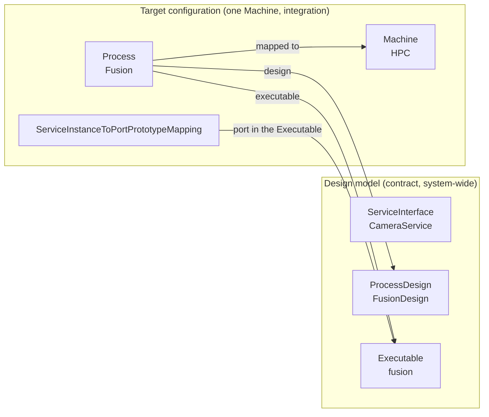

Three rules govern this relation:

1. **References point from target configuration to design, never the other way** (TPS, Section 3.2.6). A `Process` references its `Executable`, so the design stays independent of any particular target configuration, while the target configuration is bound to one design ([TPS_MANI_01011]).
2. **Design references need not resolve on the Machine.** The meta-model contains references from manifest elements to design elements for the sake of clarity, but the referenced content does not have to be resolvable on the target (TPS, Section 2.3).
3. **Sometimes the reference itself is the information.** References marked with the stereotype `≪atpUriDef≫` carry their meaning in their *path*, even if the target is not available on the Machine. The platform software derives the value of an `InstanceSpecifier` from such a reference; this is "a very important mechanism for the platform software to interact with the application layer" (TPS, Section 2.1.3). [Section 9.4](#94-from-port-to-instancespecifier) explains it.

### 1.3 What Manifests Are Not

| A manifest is not ... | Instead |
| --- | --- |
| an API. Applications do not read their manifests. | Applications use the `ara::` APIs. They name their ports with an `InstanceSpecifier`, and the functional clusters resolve it with the manifest ([Chapter 13](#13-where-code-meets-the-manifest)). |
| one file | The model is split into many files. Each file is a partial model, and the files are merged into one model ([Section 3.7](#37-many-files-one-model)). |
| the format that the platform reads at run time | Each implementation converts the ARXML into its own format, preserving the content ([TPS_MANI_01021]). The [EM guide](04_ExecutionManagement.md#22-manifests) calls the result *Processed Manifests*. |
| a description of behavior | The specifications of the functional clusters define what a cluster *does* with a setting. The TPS defines only what can be configured. |
| checked completely by the XML Schema | The schema checks the syntax. The constraints of the TPS are checked by tools at defined points of the workflow ([Section 3.9](#39-validating-arxml)). |
| used on the Classic Platform | Classic ECUs are configured with the ECU Configuration (EcuC). Both platforms share the system design ([Section 7.1](#71-the-system-and-its-extracts)). |

### 1.4 Analogies

**A Linux package with its unit file.** A Linux distribution ships a program as a package: the binary, a *systemd* unit file that says how to start it, and configuration files. The Adaptive Platform does something similar. A Software Cluster contains Executables, the Execution Manifest says how to start them, and the Service Instance Manifest says how they communicate. The analogy breaks in three places. First, manifests are typed model data: elements reference each other by path across files, and a tool can check them against the meta-model. Second, parts of the model exist *before* the code: C++ headers are generated from the service interfaces ([Section 11.5](#115-implementation-and-code-generation)). Third, the format on the Machine is not standardized at all.

**The Classic Platform ECU extract.** On the Classic Platform, the system description is cut down to an ECU extract, and the ECU Configuration (EcuC) configures the basic software, much of it at build time. The Adaptive Platform reuses the system description and its extracts ([Section 7.1](#71-the-system-and-its-extracts)), but it configures the Machine through manifests that can be replaced after the build: "the behavior of an Adaptive Software can be changed by replacing manifest files only" ([TR_AMETH_00251]). APMC, the newer target-configuration approach, deliberately resembles EcuC ([Section 11.9](#119-looking-ahead-apmc)).

### 1.5 The Documents Behind This Guide

Several AUTOSAR documents work together. The following table tells you which one answers which question.

| Document | Short name in this guide | It answers ... |
| --- | --- | --- |
| *Specification of Manifest* (`AUTOSAR_AP_TPS_ManifestSpecification`), 1,226 pages | TPS | Which model elements exist, which attributes they have, and which constraints apply. The normative source of this guide and of every *Configuration Reference* chapter of the series. |
| *Methodology for Adaptive Platform* (`AUTOSAR_AP_TR_Methodology`) | Methodology TR | Who creates which work product in which step. Explanatory. |
| *Adaptive Platform Machine Configuration* (`AUTOSAR_AP_TPS_MachineConfiguration`) | APMC | How the newer, M1-based target configuration is structured ([Section 11.9](#119-looking-ahead-apmc)). |
| *Generic Structure Template* (`AUTOSAR_FO_TPS_GenericStructureTemplate`) | GST | Packages, short names, references, instance references, variants and splitting into files. |
| *ARXML Serialization Rules* (`AUTOSAR_FO_TPS_ARXMLSerializationRules`) | Serialization Rules | How an ARXML file must look: encoding, namespace, schema location, formatting. |
| *XML Schema Production Rules* (`AUTOSAR_FO_TPS_XMLSchemaProductionRules`) | Schema Production Rules | How the XML tags are derived from the meta-model names. |
| XML Schema `AUTOSAR_00054.xsd` (`AUTOSAR_FO_MMOD_XMLSchema`) | XSD | Which XML is syntactically valid in R25-11. |
| *Standardized M1 Models used for the Definition of AUTOSAR* (`AUTOSAR_FO_MOD_GeneralDefinitions`) | Standardized models | Ready-made model content, for example the C++ standard types and the states of `MachineFG`. |
| *Specification of Adaptive Platform Core* (`AUTOSAR_AP_SWS_Core`) | SWS Core | The `ara::core::InstanceSpecifier` class ([Section 13.2](#132-the-instancespecifier-in-code)); [guide 03](03_CoreAndGeneral.md) covers the rest. |

> **Note:** The specifications of the functional clusters (SWS) say how a cluster *uses* a setting. For example, the TPS defines the attribute `StartupConfig.schedulingPolicy`, while the *Specification of Execution Management* says what EM does with it. The *Configuration Reference* chapter of each cluster guide combines both.

> **Key takeaways**
>
> - A manifest is model content that configures an Adaptive Platform product and is uploaded to it together with the software ([TPS_MANI_01000]). It is written in ARXML and may be split over many files.
> - Design models are contracts between companies; target configuration describes one Machine. References point from target configuration to design.
> - The format on the Machine is implementation-specific; only the content and the semantics are preserved.
> - Applications never read manifests. They name their ports, and the platform resolves the names with the manifests.
> - The TPS is the normative source. The Methodology TR explains the workflow; the Foundation documents explain ARXML.

---

## 2. Core Concepts and Terminology

> **Why this matters:** The TPS reuses the vocabulary of the AUTOSAR meta-model, which can feel abstract: meta-classes, prototypes, instance references, imposition times. This chapter explains these words once, with examples from `HPC`, so that the following chapters can use them freely.

### 2.1 Meta-Levels: Meta-Model, Model and XML Schema

**In plain words:** the AUTOSAR *meta-model* is the grammar; your *model* is a text written in that grammar. The grammar says "a service interface has events, fields and methods". Your model says "`CameraService` has the event `Image`".

**Formally:** the GST distinguishes five meta-levels (GST, Section 2.2). The three that matter here are:

| Level | What it contains | Example from `HPC` |
| --- | --- | --- |
| M2: AUTOSAR meta-model | The vocabulary: meta-classes such as `ServiceInterface`, `Executable` and `Process`, their attributes and their relations. Defined in UML; the XML Schema is generated from it. | `ServiceInterface` has the aggregations `event`, `field`, `method` and `trigger`. |
| M1: AUTOSAR model | Your model, built by AUTOSAR developers. It can be represented in several formats; ARXML is the standardized one. | `/HPC/ServiceInterfaces/CameraService` with the event `Image`. |
| M0: AUTOSAR objects | The system at work, on a real Machine. | The running process `Fusion` that receives images. |

The serialization follows the same split. The M2 meta-model is serialized as the XML Schema, and an M1 model is serialized as ARXML that validates against that schema (APMC, Section 2.2). The following diagram shows the levels, and it also shows APMC, which uses *two* M1 models (APMC, Figures 2.1 to 2.3).

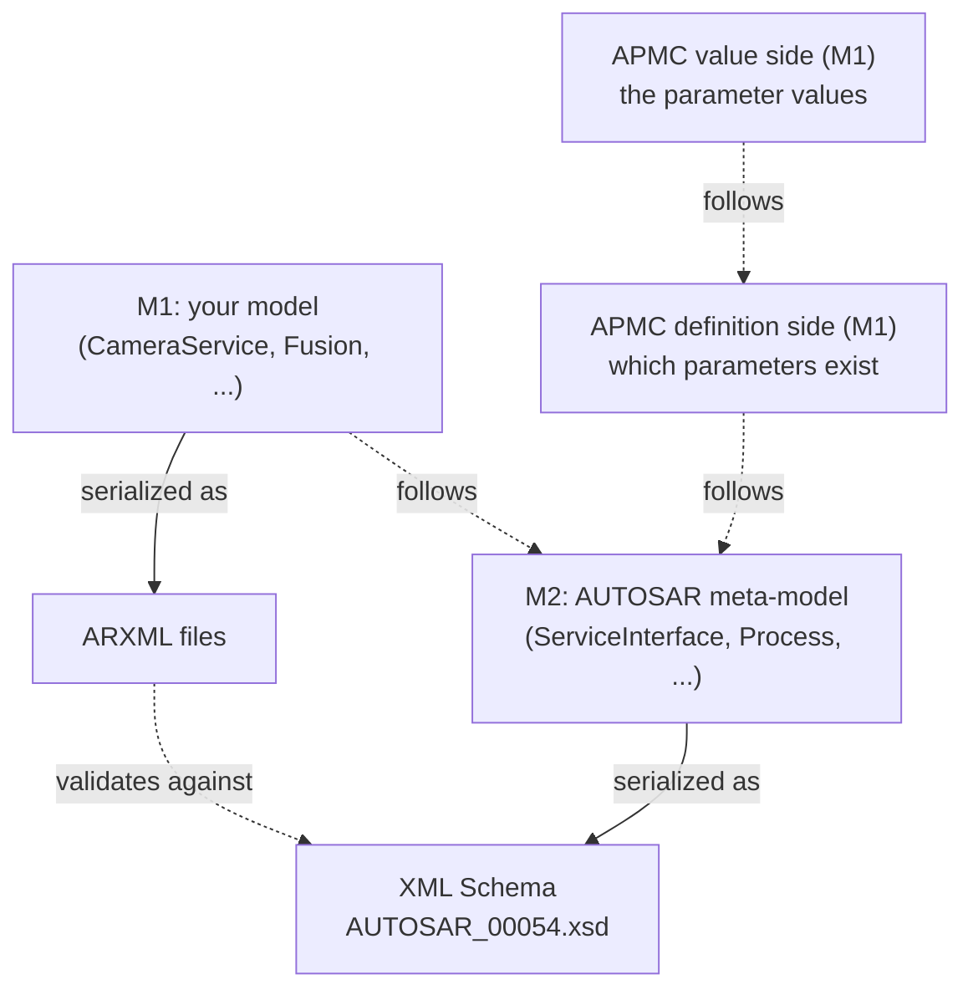

AUTOSAR itself also publishes M1 models: the *Standardized M1 Models*. Two of them are used in this guide. `/AUTOSAR/StdTypes` defines the C++ standard types such as `uint8_t`, and `/AUTOSAR/GenDef/MachineFunctionGroupStates/MachineFG_States` defines the mandatory states of `MachineFG`. Standardized model elements live in a top-level package called `AUTOSAR`; your own elements must not ([TPS_GST_00080]).

### 2.2 Types, Prototypes and Instance References

**In plain words:** a *type* is a reusable definition, like a C++ class. A *prototype* is the use of a type in a particular place, like a member variable of that class type. An *instance reference* points to one specific use, by giving the path to it.

AUTOSAR applies this pattern everywhere. The following table shows the pairs that this guide uses.

| Type | Prototype | Example from `HPC` |
| --- | --- | --- |
| `SwComponentType`, for example `AdaptiveApplicationSwComponentType` | `SwComponentPrototype`, `RootSwComponentPrototype` | `FusionSwc` is used as the root prototype `Root` of the Executable `fusion`. |
| `PortInterface`, for example `ServiceInterface` | `PortPrototype` (`PPortPrototype`, `RPortPrototype`) | `CameraService` types the port `CameraRPort` of `FusionSwc`. |
| `ModeDeclarationGroup` | `ModeDeclarationGroupPrototype` | `ADAS_States` types the Function Group `ADAS`. |
| `CppImplementationDataType` | `VariableDataPrototype`, `Field`, `ArgumentDataPrototype` | `CameraImage` types the event `Image`. |

**Formally:** an instance reference is an M1 element that defines a navigation within future M0 instance trees: it starts at a *base*, follows an ordered list of *context* elements, and ends at a *target* ([TPS_GST_00160], [TPS_GST_00161], [TPS_GST_00162]). Instance references are needed whenever the same type is used in several places and a configuration applies to only one of them.

The following diagram shows the type-prototype pattern on `Fusion` and the instance reference that identifies its port.

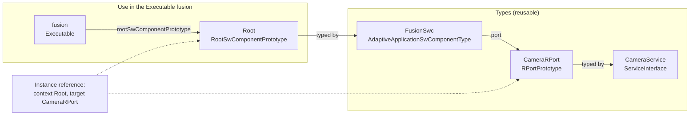

### 2.3 The Kinds of Manifest

Manifest content is relevant in very different phases of a project, so the TPS divides it into five partitions (TPS, Section 2.5). They are usually stored in different files, but this is not a binding rule.

| Kind | What it describes | Bundled with | Chapter |
| --- | --- | --- | --- |
| **Execution Manifest** | The target-configuration information of an application: its processes and how they are started | The executable code | [8](#8-the-execution-manifest) |
| **Service Instance Manifest** | How service-oriented communication is configured for the underlying transport protocols | The executable code that uses the communication | [9](#9-the-service-instance-manifest-and-the-instancespecifier) |
| **Machine Manifest** | The configuration of the Machine itself, without applications | The software that establishes the platform instance | [7](#7-system-design-machine-design-and-the-machine-manifest) |
| **Raw Data Stream Manifest** | Client and server of raw data streams | The software that uses the stream | guide 09 |
| **Software Distribution** | Packaging and logistics: Software Clusters and Software Packages | The uploadable package | [10](#10-software-clusters-and-software-packages) |

*Platform Design* (Section 4.4), and therefore [guide 01, Section 8.2](01_PlatformOverview.md#82-manifests-in-one-table), presents a shorter view: the *Application Design* plus three kinds of manifest (Execution, Service Instance and Machine). Both views fit together. The Application Design is design content that is not necessarily deployed to the Machine, so the TPS does not count it as a manifest; and the TPS adds the Raw Data Stream Manifest and the Software Distribution. The TPS is the normative view.

The following diagram shows which manifest travels with which software.

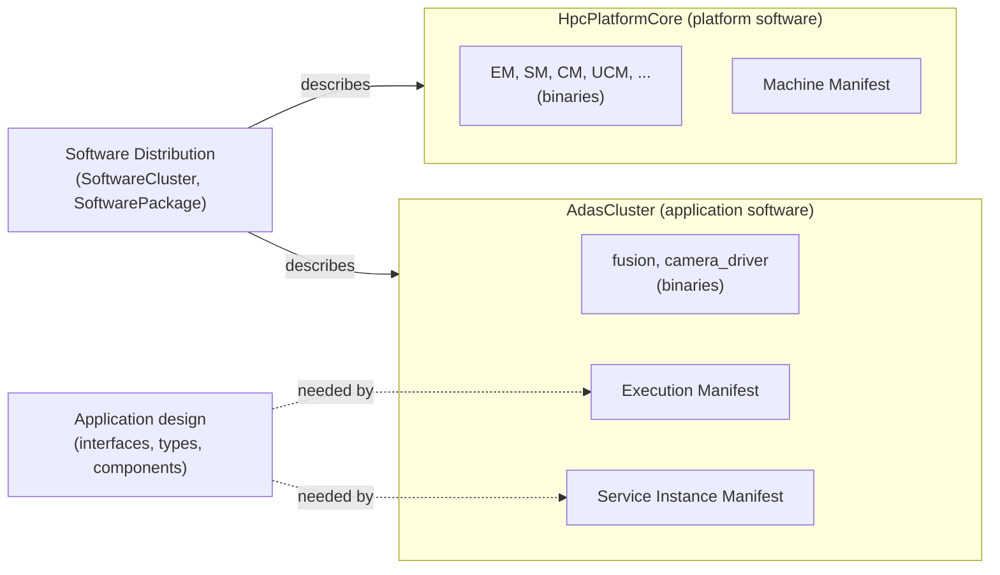

### 2.4 Design Elements and Uploadable Elements

Some design elements must be present on the Machine, because the target configuration cannot be interpreted without them. The meta-model marks every element that belongs to an uploadable package by deriving it from the abstract meta-class `UploadablePackageElement` ([TPS_MANI_01109]), which has two branches:

- `UploadableDeploymentElement`: target-configuration content that is uploaded and needed for configuration on the platform ([TPS_MANI_01413]), for example `Process`, `StartupConfig`, `Machine`, `ProcessToMachineMappingSet` and `SoftwareCluster`.
- `UploadableDesignElement`: design content that is uploaded because the target configuration depends on it ([TPS_MANI_01414]), for example `Executable`, `ModeDeclarationGroup`, `FunctionGroupSet`, `MachineDesign`, `ServiceInterfaceDeployment`, the service instances and the service instance mappings.

A design element does not become target configuration just because it is uploaded (TPS, Section 2.1.2). And not every element that a package needs is uploadable: `ServiceInterface`, the data types and the software component types are plain `ARElement`s. A Software Cluster refers to them through a separate reference ([Section 10.2](#102-software-cluster-the-uploadable-unit)).

### 2.5 Constraints and Imposition Times

The TPS restricts the meta-model with numbered constraints, for example [constr_1673]: "for any given `Field`, all of the attributes `hasGetter`, `hasSetter` and `hasNotifier` shall exist and at least one of the attributes shall be set to true". Tool makers are encouraged to report the constraint ID in their error messages (TPS, Section 1.3).

Constraints are **not** enforceable at every moment. While a model is being developed, it is legitimately incomplete. Each constraint therefore names its *imposition time*: the point in the workflow at which it must hold (TPS, Appendix A.2).

| Imposition time | The constraint must hold when ... |
| --- | --- |
| `IT_SysDes` | the system design is completed |
| `IT_MachDes` | the machine design is completed |
| `IT_SubSysDes` | the sub-system design (for example a Software Cluster Design) is completed |
| `IT_ProDes` | a `ProcessDesign` is completed |
| `IT_DiagDes` | the diagnostic design is completed |
| `IT_GraDes` | a `GrantDesign` (access rights) is completed |
| `IT_BefAraApiGen` | a software component is ready for the generation of the `ara::` header files |
| `IT_Mani` | the manifest is complete, so that the installation on a target can start |

For example, [constr_1673] about fields applies at `IT_BefAraApiGen`, because the generator needs to know which accessors to create. The rule that every process is mapped to a Machine ([constr_5004]) applies only at `IT_Mani`.

### 2.6 Other Key Terms

| Term | Meaning |
| --- | --- |
| **ARXML** | AUTOSAR XML, the standardized serialization format of AUTOSAR models. Files use the extension `.arxml` ([TPS_ASR_00002]). |
| **Partial model** | The content of one ARXML file. It need not satisfy all constraints, but it shall validate against the XML Schema ([TPS_GST_00423]). |
| **Splitable** | A property of the meta-model (stereotype `≪atpSplitable≫`) whose content may be spread over several files ([Section 3.7](#37-many-files-one-model)). |
| **InstanceSpecifier** | A shortened, "stringified" form of an instance reference (Methodology TR, Table 1.2). In C++, `ara::core::InstanceSpecifier` wraps the path of a `PortPrototype` in an Executable ([Section 9.4](#94-from-port-to-instancespecifier)). |
| **Software Cluster** | The uploadable software package in terms of the model: all software and configuration for a given purpose ([TPS_MANI_01110]). |
| **Software Package** | The logistics wrapper around a Software Cluster that UCM installs ([TPS_MANI_01221]). |
| **APMC** | *Adaptive Platform Machine Configuration*: the M1-based target-configuration model that replaces manifest content step by step ([Section 11.9](#119-looking-ahead-apmc)). |
| **Category** | An attribute of every `Identifiable` that specializes its meaning with a keyword, for example `APPLICATION_LEVEL` for an Executable ([TPS_GST_00102]). |
| **Recommended package** | The package name that the meta-model proposes for each kind of element, for example `ServiceInterfaces` ([Section 3.2](#32-packages-short-names-and-paths)). |

> **Key takeaways**
>
> - The meta-model (M2) is the grammar; your model (M1) is written in it; the Machine runs the M0 objects. The XML Schema is generated from M2, and your ARXML validates against it.
> - Types are reusable; prototypes use them in a context; instance references point to one particular use.
> - The TPS knows five kinds of manifest: Execution, Service Instance, Machine, Raw Data Stream, and Software Distribution.
> - Elements derived from `UploadablePackageElement` go onto the Machine; some design elements are among them.
> - Constraints have imposition times. A model may be incomplete until the next checkpoint.

---

## 3. Reading ARXML

> **Why this matters:** Every tool shows you its own view of the model, but sooner or later you will open an ARXML file: to review a delivery, to understand a tool error, or to compare two versions. ARXML is verbose but regular. Once you know a handful of rules, you can read any file. This chapter teaches those rules on the files of the running example.

### 3.1 The Anatomy of an ARXML File

Every ARXML file has the same top-level structure: the root element `AUTOSAR` contains packages, and packages contain elements ([TPS_GST_00077]). The following file is the smallest useful one: it contains the Machine `HPC` in the package `/HPC/Machines`. The XML comments are added for this guide; tools may drop comments ([TPS_ASR_00009]).

```xml
<?xml version="1.0" encoding="UTF-8"?>
<!-- Namespace and schema location: mandatory (TPS_ASR_00011 .. 00013) -->
<AUTOSAR xmlns="http://autosar.org/schema/r4.0" xmlns:xsi="http://www.w3.org/2001/XMLSchema-instance" xsi:schemaLocation="http://autosar.org/schema/r4.0 AUTOSAR_00054.xsd">
  <AR-PACKAGES>
    <AR-PACKAGE>
      <SHORT-NAME>HPC</SHORT-NAME>             <!-- top-level package /HPC -->
      <AR-PACKAGES>
        <AR-PACKAGE>
          <SHORT-NAME>Machines</SHORT-NAME>    <!-- sub-package /HPC/Machines -->
          <ELEMENTS>
            <MACHINE>
              <SHORT-NAME>HPC</SHORT-NAME>     <!-- element /HPC/Machines/HPC -->
              <TRUSTED-PLATFORM-EXECUTABLE-LAUNCH-BEHAVIOR>STRICT-MODE</TRUSTED-PLATFORM-EXECUTABLE-LAUNCH-BEHAVIOR>
            </MACHINE>
          </ELEMENTS>
        </AR-PACKAGE>
      </AR-PACKAGES>
    </AR-PACKAGE>
  </AR-PACKAGES>
</AUTOSAR>
```

The following diagram shows the same tree in a general form.

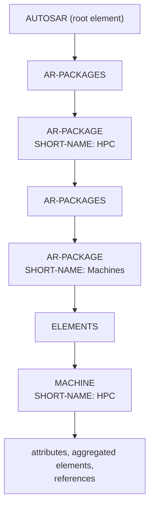

The *ARXML Serialization Rules* fix the outer frame:

| Rule | Requirement |
| --- | --- |
| UTF-8, declared in the XML declaration, no byte order mark; XML version 1.0 | [TPS_ASR_00004], [TPS_ASR_00005], [TPS_ASR_00006], [TPS_ASR_00008] |
| The AUTOSAR namespace is `http://autosar.org/schema/r<major>.<minor>`. It stays the same as long as the schema remains backward compatible, which is why R25-11 still uses `r4.0`. It is the default namespace, without a prefix. | [TPS_ASR_00011], [TPS_ASR_00017] |
| `xsi:schemaLocation` is mandatory. Its hint is the file name `AUTOSAR_{number}.xsd`, without a path. For R25-11 the number is `00054`. | [TPS_ASR_00012], [TPS_ASR_00013] |
| No other namespaces than AUTOSAR and XML Schema Instance | [TPS_ASR_00018] |
| Formatting: two spaces per level, one element per line, attributes sorted; empty elements as start and end tag, never `<X/>`; no empty wrappers such as an empty `<AR-PACKAGES>` | [TPS_ASR_00019], [TPS_ASR_00015], [TPS_ASR_00016] |

> **Note:** The schema number tells you the release of a file at a glance: `AUTOSAR_00053.xsd` is R24-11, `AUTOSAR_00054.xsd` is R25-11 (readme of the XML Schema package). Before you mix files, check this number.

### 3.2 Packages, Short Names and Paths

**Packages.** An `ARPackage` organizes the model, establishes a name space and is the basis for relative references ([TPS_GST_00092]). Packages can be nested to any depth, and they are *open sets*: several files may contribute elements to the same package (GST, Table 4.1).

**Recommended packages.** Every element kind that can live in a package has a recommended package name, shown as the tag `atp.recommendedPackage` in the class tables of the TPS, for example `ServiceInterfaces`, `Executables`, `Processes` or `Machines`. AUTOSAR uses these names for its own models ([TPS_GST_00081], [TPS_GST_00085]). The running example follows the same convention below its top-level package `/HPC`, so that you can guess where to find an element.

**Short names.** Every `Referrable` has a `shortName`, which identifies it within its nearest enclosing `Identifiable` ([TPS_GST_00097]). A short name is an identifier in the sense of C: it matches the pattern `[a-zA-Z][a-zA-Z0-9_]*` (GST, Table 4.5). Short names are case sensitive, but their uniqueness is checked *case-insensitively* ([TPS_GST_00021], [constr_2508]).

> **Pitfall:** The executable of `Fusion` is called `fusion`, and the process is called `Fusion`. Both names are fine, but only because they live in different packages: `/HPC/Executables/fusion` and `/HPC/Processes/Fusion`. In the same package, the two names would clash, because `fusion` and `Fusion` are the same name for the uniqueness check ([constr_2508]).

**Paths.** An absolute short-name path is formed by prepending a slash to the short name of each element on the containment chain from the root, and concatenating them ([TPS_GST_00169]). Elements without a short name, such as a `StateDependentStartupConfig`, do not contribute to the path. Examples from `HPC`:

| Path | Element |
| --- | --- |
| `/HPC/ServiceInterfaces/CameraService` | the service interface |
| `/HPC/ServiceInterfaces/CameraService/Image` | its event |
| `/HPC/AdaptiveApplicationSwComponentTypes/FusionSwc/CameraRPort` | the R-port of `FusionSwc` |
| `/HPC/Executables/fusion/Root` | the root prototype inside the Executable `fusion` |
| `/HPC/Machines/HPC/Os/adas_rg` | the ResourceGroup `adas_rg` inside the OS module of the Machine |
| `/AUTOSAR/StdTypes/uint8_t` | a standardized data type |

### 3.3 From Meta-Model Names to XML Tags

The XML Schema is generated from the meta-model by fixed rules. If you know them, you can translate every class table of the TPS into XML.

1. **Names.** XML names are written in upper case. A new token starts at every upper-case letter or digit, adjacent single letters and adjacent digits are joined, and the tokens are joined with hyphens ([TPS_XMLSPR_00030]). `ServiceInterface` becomes `SERVICE-INTERFACE`, `ApApplicationError` becomes `AP-APPLICATION-ERROR`, `e2eEventProtectionProps` becomes `E-2-E-EVENT-PROTECTION-PROPS`.
2. **Plurals.** A collection is wrapped in an element whose name is the plural, formed by appending `S` ([TPS_XMLSPR_00031]). This produces some odd names, such as `IMPLEMENTATION-PROPSS` or `EXECUTION-DEPENDENCYS`.
3. **Enumeration literals** follow the same naming rule. The meta-model literal `strictMode` is written `STRICT-MODE`, `reportsExecutionState` is written `REPORTS-EXECUTION-STATE`, and `x509` is written `X-509`.
4. **Roles and types.** An aggregated element normally appears as a wrapper named after its *role* containing an element named after its *type*: `<PORTS><R-PORT-PROTOTYPE>...`. When the type is fixed, the role element is the only one. For example, the getter of a field deployment is the element `<GET>`, whose type is `SomeipMethodDeployment`.
5. **Order.** Elements appear in a fixed order: by default alphabetically, overridden by the tag `xml.sequenceOffset` of the meta-model ([TPS_XMLSPR_00032]); attributes inherited from base classes come first ([TPS_XMLSPR_00033]). The `SHORT-NAME` therefore always comes first, and in a `SERVICE-INTERFACE` the `MAJOR-VERSION` comes before the `EVENTS`.

Values of the primitive types are written as plain text. A `TimeValue` is a number of seconds, such as `0.5`. A `PositiveInteger` may be written in decimal or hexadecimal, such as `4097` or `0x1001`. A `StrongRevisionLabelString` follows the pattern of semantic versioning, such as `1.0.0` (TPS, Table 16.5).

### 3.4 References: `-REF`, `-TREF` and `DEST`

A reference between elements is an XML element whose name ends in `-REF` or `-TREF` ([TPS_XMLSPR_00034]). Its content is the path of the target, and its attribute `DEST` names the meta-class of the target as an XML name:

```xml
<PROCESS-REF DEST="PROCESS">/HPC/Processes/Fusion</PROCESS-REF>
<TYPE-TREF DEST="STD-CPP-IMPLEMENTATION-DATA-TYPE">/HPC/CppImplementationDataTypes/CameraImage</TYPE-TREF>
```

- **`-REF`** is an ordinary reference. A reference with an upper multiplicity greater than 1 is wrapped in a plural element ending in `-REFS` ([TPS_XMLSPR_00043]), for example `<EXECUTABLE-REFS><EXECUTABLE-REF ...>`.
- **`-TREF`** is a *type reference*: the reference from a prototype to its type, stereotyped `≪isOfType≫` in the meta-model ([TPS_XMLSPR_00045]).
- **`DEST`** names the *type* of the target, not the XML element in which the target is written. A field notifier is written as `<NOTIFIER>`, but a reference to it says `DEST="SOMEIP-EVENT-DEPLOYMENT"`.

All references in this guide use absolute paths. The GST also allows relative paths: a package defines a `ReferenceBase` with a `shortLabel`, and a reference with the attribute `BASE` is resolved relative to it, so that a part of the model can be moved without changing the references ([TPS_GST_00170], [TPS_GST_00171]). Tools use this mainly when they move or exchange model parts.

### 3.5 Instance References: `-IREF`

An instance reference ([Section 2.2](#22-types-prototypes-and-instance-references)) is written as an element whose name ends in `-IREF`. It contains one reference per *context* element and, as its last element, the reference to the *target* ([TPS_XMLSPR_00044]). Two instance references occur in every Adaptive model.

The **Function Group State** of a process: the context is the Function Group (a `ModeDeclarationGroupPrototype`), and the target is the state (a `ModeDeclaration`):

```xml
<FUNCTION-GROUP-STATE-IREF>
  <CONTEXT-MODE-DECLARATION-GROUP-PROTOTYPE-REF DEST="MODE-DECLARATION-GROUP-PROTOTYPE">/HPC/FunctionGroupSets/AdasFunctionGroups/ADAS</CONTEXT-MODE-DECLARATION-GROUP-PROTOTYPE-REF>
  <TARGET-MODE-DECLARATION-REF DEST="MODE-DECLARATION">/HPC/ModeDeclarationGroups/ADAS_States/Normal</TARGET-MODE-DECLARATION-REF>
</FUNCTION-GROUP-STATE-IREF>
```

The **port of an Executable**: the context is the root prototype of the Executable (plus further component prototypes, if compositions are used), and the target is the port of the component type:

```xml
<PORT-PROTOTYPE-IREF>
  <CONTEXT-ROOT-SW-COMPONENT-PROTOTYPE-REF DEST="ROOT-SW-COMPONENT-PROTOTYPE">/HPC/Executables/fusion/Root</CONTEXT-ROOT-SW-COMPONENT-PROTOTYPE-REF>
  <TARGET-PORT-PROTOTYPE-REF DEST="R-PORT-PROTOTYPE">/HPC/AdaptiveApplicationSwComponentTypes/FusionSwc/CameraRPort</TARGET-PORT-PROTOTYPE-REF>
</PORT-PROTOTYPE-IREF>
```

Notice that the target path, `/HPC/AdaptiveApplicationSwComponentTypes/FusionSwc/CameraRPort`, names the port *in the type*. Only together with the context does it identify the port *of this Executable*. This is the information from which the `InstanceSpecifier` `/fusion/Root/CameraRPort` is built ([Section 9.4](#94-from-port-to-instancespecifier)).

### 3.6 Variants and Conditional Wrappers

Many meta-classes that the Adaptive Platform shares with the Classic Platform support variants: their content is wrapped in a `...-VARIANTS` element that contains one or more `...-CONDITIONAL` elements, each of which can carry a variation point (GST, Chapter 7). Even without variants, the wrappers must be written. You meet them, for example, in `SwDataDefProps` and in the Ethernet cluster of the system design:

```xml
<SW-DATA-DEF-PROPS>
  <SW-DATA-DEF-PROPS-VARIANTS>
    <SW-DATA-DEF-PROPS-CONDITIONAL>
      <COMPU-METHOD-REF DEST="COMPU-METHOD">/HPC/CompuMethods/ExposureMode_Values</COMPU-METHOD-REF>
    </SW-DATA-DEF-PROPS-CONDITIONAL>
  </SW-DATA-DEF-PROPS-VARIANTS>
</SW-DATA-DEF-PROPS>
```

On the Adaptive Platform, the variant mechanisms of the Classic Platform apply only to items shared with it. Design items have a latest binding time of code generation or pre-compile time, and manifest content can vary after the build simply by replacing manifest files ([TR_AMETH_00251]). The running example uses no variants.

### 3.7 Many Files, One Model

One file for a whole ECU project would be huge, and many people would edit it at the same time. AUTOSAR therefore lets you split a model into files. The GST lists the reasons: different competencies, different times at which information is available, stepwise refinement by different people, generated content, different update rates, the work split and IP protection between OEM and supplier, and translation (GST, Section 8.1).

The rules are:

- **Each file is a partial model.** It need not satisfy all constraints, but it shall validate against the XML Schema ([TPS_GST_00423]).
- **By default, an element and its content stay in one file** ([constr_2524]). Only properties marked `≪atpSplitable≫` may be spread over several files; elements with the same identity are then merged, and different elements are collected ([TPS_GST_00414], [TPS_GST_00415]). `ARPackage.element` is splitable, which is why packages are open sets. `Machine.environmentVariable` is splitable too, so that several partial models can contribute environment variables (TPS, Section 11.2).
- **The merged model must satisfy the meta-model**, according to the imposition times of its constraints ([constr_2502]).

The running example is split along the kinds of model and manifest, so that each file has one owner:

| File | Content | Typical owner |
| --- | --- | --- |
| `01_ServiceInterfaces.arxml` | Data types, CompuMethods, application errors, `CameraService` | OEM (service design) |
| `02_ApplicationDesign.arxml` | Software component types, Executables, ProcessDesigns | Application developer |
| `03_SystemDesign.arxml` | Ethernet cluster, `MachineDesign`, system extract | OEM (communication design) |
| `04_MachineManifest.arxml` | `MachineFG` states, Machine `HPC` | Integrator of the platform |
| `05_ExecutionManifest.arxml` | `ADAS` states, StartupConfigs, Processes, process-to-machine mappings | Integrator of `AdasCluster` |
| `06_ServiceInstanceManifest.arxml` | SOME/IP deployment, service instances, mappings | Integrator of `AdasCluster` |
| `07_SoftwareClusters.arxml` | Software Cluster Design, Software Clusters, vendor certificates | OEM and integrators |

### 3.8 Reading a Class Table of the TPS

The TPS documents every meta-class in a *class table*. The header gives the class name, its package in the meta-model, a note, its base classes and the classes that aggregate it. The body has one row per attribute (TPS, Section 1.3):

| Column | Meaning |
| --- | --- |
| Attribute | The role name, for example `reportingBehavior`. Its XML name follows [Section 3.3](#33-from-meta-model-names-to-xml-tags): `REPORTING-BEHAVIOR`. |
| Type | The type, for example `ExecutionStateReportingBehaviorEnum`. |
| Mult. | The multiplicity, for example `0..1` or `*`. Many attributes are `0..1` in the meta-model and are made mandatory by a constraint, such as [constr_10170] for `Machine.trustedPlatformExecutableLaunchBehavior`. |
| Kind | `attr`: a primitive attribute; `aggr`: an aggregated element; `ref`: a reference (`-REF`); `tref`: a type reference (`-TREF`); `iref`: an instance reference (`-IREF`). |
| Note | The description, plus stereotypes such as `atpSplitable` or `atpUriDef` and tags such as `atp.Status=candidate`. |

Tables marked "This Class is only used by the AUTOSAR Adaptive Platform" belong to the Adaptive Platform. Classes without this mark are shared with the Classic Platform, and their notes sometimes mention Classic details; the TPS asks you to take those "with a grain of salt" (TPS, Section 1.1.1).

### 3.9 Validating ARXML

There are two levels of validation, and they find different errors:

| Level | What it checks | What it does not check |
| --- | --- | --- |
| **XML Schema** | Element names, nesting and order, the syntax of values (for example the short-name pattern and enumeration literals) | Whether references resolve, whether `DEST` is correct, multiplicities, and the constraints of the TPS. By default, *all* XML elements are optional in the schema ([TPS_XMLSPR_00028]). |
| **Model checks of a tool** | References, multiplicities, the constraints of the TPS at their imposition time | Nothing that the tool vendor did not implement |

> **Pitfall:** The R25-11 schema still contains elements that were removed from the meta-model, so that old files remain readable. They are tagged `atp.Status="removed"` in the schema, for example `BUILD-TYPE` in an `EXECUTABLE` or `INSTALLATION-BEHAVIOR` in a `SOFTWARE-CLUSTER` (which moved to the Software Cluster Design). A file that uses them validates against the schema, but it uses attributes that no longer exist. The class tables of the TPS are the reference for which attributes exist.

> **Note (implementation example):** Authoring tools usually run both levels of validation. The Artop platform of AUTOSAR, on which several Eclipse-based tools are built, implements the meta-model with XSD-compliant ARXML serialization and rule-based validation; it is available to AUTOSAR partners [EXT-011]. For a quick syntax check without a tool, the `xmllint` program of the libxml2 project validates a file against the schema [EXT-013]:
>
> ```sh
> xmllint --noout --schema AUTOSAR_00054.xsd 05_ExecutionManifest.arxml
> ```
>
> The schema check takes a fraction of a second. It finds a misspelled tag or a short name with a hyphen, but not a reference to a process that does not exist.

> **Key takeaways**
>
> - An ARXML file is a tree: `AUTOSAR` → packages → elements. The namespace is `r4.0`; the schema hint names the release (`AUTOSAR_00054.xsd` for R25-11).
> - Elements are identified by absolute short-name paths. Short names are C identifiers and must be unique case-insensitively within their name space.
> - XML names follow fixed rules: upper case, hyphens, plural wrappers, and enumeration literals such as `STRICT-MODE`.
> - References end in `-REF` (ordinary), `-TREF` (type) or `-IREF` (instance); `DEST` names the meta-class of the target.
> - A model is split into partial models, one per file; each must validate against the schema, and the merged model must satisfy the constraints.
> - Schema validation checks syntax only. References and constraints need a model checker.

---

## 4. Configuration Overview

> **Why this matters:** The configuration of an Adaptive system is spread over many elements, written by different roles at different times. Before the following chapters look at each element, this chapter gives you the map: which model or manifest holds what, who writes it, and how the elements reference each other. [Chapter 12](#12-configuration-reference-what-to-configure) lists every setting in detail.

### 4.1 Where the Configuration Lives

The following table assigns the core elements to the models and manifests, to the role that typically creates them, and to the step of the methodology ([Chapter 11](#11-the-methodology-from-design-to-a-running-machine)). The roles come from the Methodology TR; real projects may distribute the work differently.

| Model or manifest | Typically configured by | Methodology step | Main elements |
| --- | --- | --- | --- |
| Service interface design | OEM or service designer | Service Interface Design | `ServiceInterface`, `CppImplementationDataType`, `ApplicationDataType`, `CompuMethod`, `ApApplicationError` |
| Application design | Application developer, often a Tier 1 supplier | Application Design | `AdaptiveApplicationSwComponentType`, `PortPrototype`, `Executable`, `ProcessDesign` |
| System and machine design | OEM communication designer, or Tier 1 integrator | System Design, Machine Design | `System`, `EthernetCluster`, `NetworkEndpoint`, `MachineDesign` |
| Software cluster design | OEM, refined by the supplier | Software Cluster Design | `SoftwareClusterDesign`, first service instances and their mapping to ports |
| Machine Manifest | Tier 1 integrator of the Machine | Machine Manifest, Configure Platform Modules | `Machine`, module instantiations, `ResourceGroup`, `Processor`, the states of `MachineFG` |
| Execution Manifest | Integrator of a Software Cluster | Software Cluster Integration: Define Execution Manifest | `FunctionGroupSet`, `ModeDeclarationGroup`, `StartupConfig`, `Process`, `ProcessToMachineMapping` |
| Service Instance Manifest | Software cluster responsible, finalized by the integrator | Software Cluster Design, then Integration: Create or Finalize Service Instance Manifest | `ServiceInterfaceDeployment`, service instances, `ServiceInstanceToPortPrototypeMapping`, `ServiceInstanceToMachineMapping` |
| Software Distribution | Integrator, OEM | Software Cluster Integration, Software Packaging | `SoftwareCluster`, `SoftwarePackage` |

### 4.2 How the Elements Relate

The following class diagram shows the core elements and the references between them. An arrow points in the direction of the reference, from the element that holds it.

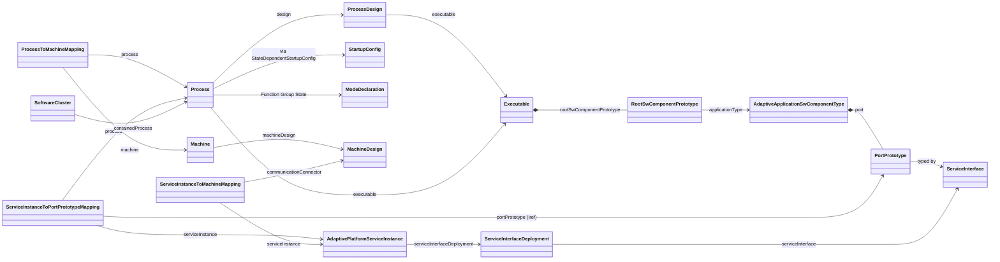

Read the diagram as three chains that meet at the port:

1. **The software chain** (application design). A component type has ports, each typed by an interface. An Executable contains a root prototype of a component type. This chain says *what the software can do*.
2. **The execution chain** (Execution Manifest). A `Process` runs an `Executable` in certain Function Group States with a `StartupConfig`, and is mapped to a `Machine`. This chain says *when and how the software runs*.
3. **The communication chain** (Service Instance Manifest). A `ServiceInstanceToPortPrototypeMapping` connects one port, in one process, to one service instance; the service instance refers to a deployment of the interface on a transport; the instance is mapped to a network connector of the Machine. This chain says *how the software is reached*.

The `SoftwareCluster` finally collects the elements of all three chains into one uploadable unit ([Chapter 10](#10-software-clusters-and-software-packages)).

> **Key takeaways**
>
> - The configuration is spread over the service interface design, the application design, the system and machine design, the three manifests and the software distribution.
> - The OEM typically owns the contracts (interfaces, system design, software cluster design); suppliers own the applications; integrators own the manifests.
> - Three chains meet at the port: the software chain, the execution chain and the communication chain.

---

## 5. Application Design: Components, Ports and Executables

> **Why this matters:** On the Adaptive Platform, the model of an application is thin: a component with ports, placed in an Executable. But this thin model carries the most important identity in the system, the path of each port, which the application code uses to reach its services. If the component or port names change, the code and the manifests no longer match.

### 5.1 Adaptive Application Software Components

**In plain words:** a software component is a named piece of application software together with its communication endpoints. On the Adaptive Platform it says *what* the software offers and needs, not *how* it is implemented.

**Formally:** application software on the Adaptive Platform is represented by an `AdaptiveApplicationSwComponentType` (TPS, Section 3.2.1). Hierarchies are built with `CompositionSwComponentType`s, whose `SwComponentPrototype`s are typed by other component types. Inside an Executable, only these two kinds of component types are allowed, which locks out the component kinds of the Classic Platform ([constr_1492]).

Two differences from the Classic Platform are worth knowing:

- **The internal behavior is minimal.** An `AdaptiveSwcInternalBehavior` holds only service dependencies; there are no runnables or events as on the Classic Platform (TPS, Table 3.2).
- **The component structure does not dictate the code.** Because components have no internal structure in the model, "there is no real motivation to implement software-components separately from each other"; it would even be possible, though not encouraged, to implement all components of an Executable in its `main()` function (TPS, Section 3.2.2.3).

### 5.2 Ports: How Software Talks to the Outside

A `PortPrototype` is the formal anchor of an interaction with the outside of a component, whether with another application or with a functional cluster (TPS, Section 3.2.4).

| Rule | Requirement |
| --- | --- |
| A provided service is a `PPortPrototype` typed by a `ServiceInterface`. | [TPS_MANI_01039] |
| A required service is an `RPortPrototype` typed by a `ServiceInterface`. | [TPS_MANI_01040] |
| A `ServiceInterface` must not type a `PRPortPrototype` (a port that is both provided and required). | [constr_1473] |
| A `ServiceInterface` types ports only of components used in an Executable. | [constr_1483] |

Because the opposite end of a service is found at run time by service discovery, it is not known in advance. The model therefore has, in general, no assembly connectors between the ports of different applications (TPS, Section 3.2.4.1). The connection is made indirectly: both ports are mapped to service instances of the same service interface ([Chapter 9](#9-the-service-instance-manifest-and-the-instancespecifier)).

Ports are not only for services. A port typed by a functional-cluster interface, for example a `PersistencyKeyValueStorageInterface`, connects the component to a functional cluster ([Section 6.5](#65-interfaces-to-functional-clusters)).

Two kinds of further qualification can be attached to a port:

- **Port prototype props.** An `RPortPrototype` may carry `RPortPrototypeProps.searchIntention` with the value `searchForAllInstances` or `searchForSpecificInstance`. It records the developer's intention; it creates no binding contract, because the actual search behavior is defined in the Service Instance Manifest ([TPS_MANI_01057]).
- **ComSpecs.** A `ComSpec` qualifies the use of one element of the interface at one port. The Adaptive Platform supports only a limited selection of ComSpec attributes ([TPS_MANI_01053]). One of them you need in almost every model: a provided port with a field has a `FieldSenderComSpec`, whose `initValue` sets the value of the field before the service is offered ([TPS_MANI_03212]); if the ComSpec exists, the initial value must exist ([constr_10152]). The other ComSpec attributes, for example for E2E protection and for the declared intent to use an element, are covered in guides 07, 08 and 15.

### 5.3 The Executable and Its Root Prototype

An `Executable` represents an executable program in the model (TPS, Section 3.2.2). It is a design element: it describes the program, not how it is started.

| Attribute | Purpose |
| --- | --- |
| `category` | `APPLICATION_LEVEL` for software above the middleware, `PLATFORM_LEVEL` for software at the level of the middleware, such as a functional cluster ([constr_1605]) |
| `reportingBehavior` | Whether the processes of the Executable report their Execution State to EM. If absent, they report ([TPS_MANI_01279]). See the [EM guide](04_ExecutionManagement.md#24-process-flavors). |
| `rootSwComponentPrototype` | The root of the component hierarchy of the Executable ([TPS_MANI_01010]). Optional, for platform modules that use no service-oriented communication ([TPS_MANI_03056]). |
| `version` | The version of the program, as a semantic version such as `1.0.0` |
| `minimumTimerGranularity` | The minimum timer resolution that the program requires |
| `suspendToRamAwareness` | New in R25-11 (status DRAFT): whether the program tolerates, prepares for, or does not support suspend-to-RAM ([TPS_MANI_01513]) |
| `implementationProps` | Build-time properties of platform-level Executables, for example of a Log and Trace implementation ([TPS_MANI_01370], [constr_10113]) |

The root prototype matters more than it seems. The Executable *aggregates* a `RootSwComponentPrototype` instead of referencing a component type directly, so that instance references into the component hierarchy of this Executable become possible (TPS, Table 3.3). Its short name is the second element of every `InstanceSpecifier` of the Executable ([Section 9.4](#94-from-port-to-instancespecifier)).

### 5.4 Process Design: A Stand-In for a Future Process

Some design work needs to refer to a process before the process exists. A diagnostic mapping, for example, must say which instance of an Executable provides a data identifier, but the `Process` is only created later, in the Execution Manifest. The `ProcessDesign` stands in for the future process at design time ([TPS_MANI_01228]):

- A `ProcessDesign` references one `Executable` ([constr_3731]).
- The integrator later lets the real `Process` reference its `ProcessDesign` in the role `design`. Each `ProcessDesign` is referenced by one `Process` only ([constr_1550]), and the `Process` must run the same `Executable` ([constr_1693]).
- A `ProcessDesignToMachineDesignMapping` can pre-allocate a `ProcessDesign` to a `MachineDesign`, and, new in R25-11, restrict it to processor cores with `shallRunOn` or `shallNotRunOn` ([TPS_MANI_01229], [TPS_MANI_01477]). The integrator may overrule this in the target configuration (TPS, Table 7.57).

### 5.5 Worked Example: `CameraDriver` and `Fusion`

`FusionSwc` requires `CameraService` through the R-port `CameraRPort`; it intends to search for one specific instance. The Executable `fusion` places `FusionSwc` in its root prototype `Root`, and `FusionDesign` is the design-time stand-in of the future process `Fusion`.

```xml
<ADAPTIVE-APPLICATION-SW-COMPONENT-TYPE>
  <SHORT-NAME>FusionSwc</SHORT-NAME>
  <PORTS>
    <R-PORT-PROTOTYPE>
      <SHORT-NAME>CameraRPort</SHORT-NAME>
      <PORT-PROTOTYPE-PROPS>
        <R-PORT-PROTOTYPE-PROPS>
          <SEARCH-INTENTION>SEARCH-FOR-SPECIFIC-INSTANCE</SEARCH-INTENTION>
        </R-PORT-PROTOTYPE-PROPS>
      </PORT-PROTOTYPE-PROPS>
      <REQUIRED-INTERFACE-TREF DEST="SERVICE-INTERFACE">/HPC/ServiceInterfaces/CameraService</REQUIRED-INTERFACE-TREF>
    </R-PORT-PROTOTYPE>
  </PORTS>
</ADAPTIVE-APPLICATION-SW-COMPONENT-TYPE>
<!-- in the package /HPC/Executables -->
<EXECUTABLE>
  <SHORT-NAME>fusion</SHORT-NAME>
  <CATEGORY>APPLICATION_LEVEL</CATEGORY>
  <REPORTING-BEHAVIOR>REPORTS-EXECUTION-STATE</REPORTING-BEHAVIOR>
  <ROOT-SW-COMPONENT-PROTOTYPE>
    <SHORT-NAME>Root</SHORT-NAME>
    <APPLICATION-TYPE-TREF DEST="ADAPTIVE-APPLICATION-SW-COMPONENT-TYPE">/HPC/AdaptiveApplicationSwComponentTypes/FusionSwc</APPLICATION-TYPE-TREF>
  </ROOT-SW-COMPONENT-PROTOTYPE>
  <VERSION>1.0.0</VERSION>
</EXECUTABLE>
<!-- in the package /HPC/ProcessDesigns -->
<PROCESS-DESIGN>
  <SHORT-NAME>FusionDesign</SHORT-NAME>
  <EXECUTABLE-REFS>
    <EXECUTABLE-REF DEST="EXECUTABLE">/HPC/Executables/fusion</EXECUTABLE-REF>
  </EXECUTABLE-REFS>
</PROCESS-DESIGN>
```

`CameraDriverSwc` provides `CameraService` through the P-port `CameraPPort`. Because the interface contains the field `CameraStatus`, the port has a `FieldSenderComSpec` with the initial value `2`, which is `NotAvailable` in the enumeration `CameraState` ([Section 6.4](#64-data-types)):

```xml
<P-PORT-PROTOTYPE>
  <SHORT-NAME>CameraPPort</SHORT-NAME>
  <PROVIDED-COM-SPECS>
    <FIELD-SENDER-COM-SPEC>
      <DATA-ELEMENT-REF DEST="FIELD">/HPC/ServiceInterfaces/CameraService/CameraStatus</DATA-ELEMENT-REF>
      <INIT-VALUE>
        <NUMERICAL-VALUE-SPECIFICATION>
          <VALUE>2</VALUE>
        </NUMERICAL-VALUE-SPECIFICATION>
      </INIT-VALUE>
    </FIELD-SENDER-COM-SPEC>
  </PROVIDED-COM-SPECS>
  <PROVIDED-INTERFACE-TREF DEST="SERVICE-INTERFACE">/HPC/ServiceInterfaces/CameraService</PROVIDED-INTERFACE-TREF>
</P-PORT-PROTOTYPE>
```

The Executable `camera_driver` and `CameraDriverDesign` follow the same pattern as `fusion` and `FusionDesign`.

> **Note:** The real `FusionSwc` needs more ports: for `VehicleDynamicsService`, `CalibrationDataService`, the provided `ObjectListService`, its persistent storage `FusionParams` and its supervision by PHM. Their owner guides add them. Each new port adds one `InstanceSpecifier` to the Executable `fusion`.

> **Key takeaways**
>
> - Adaptive software is modeled as `AdaptiveApplicationSwComponentType`s with ports; compositions can nest them.
> - A P-port provides and an R-port requires a service interface. There are no PR-ports for services and, in general, no connectors: service discovery connects the ends at run time.
> - An `Executable` aggregates a root prototype; its short name becomes part of every `InstanceSpecifier` of the Executable.
> - A `ProcessDesign` lets design work refer to a process that will only exist in the Execution Manifest.

---

## 6. Service Interfaces and Data Types

> **Why this matters:** The service interface is the contract between provider and consumer, and often between OEM and supplier. The C++ proxies and skeletons are generated from it, and its deployment on the network is derived from it. A careless change to a service interface therefore breaks code, manifests and the communication with other ECUs at the same time.

### 6.1 Events, Methods, Fields and Triggers

A `ServiceInterface` is a `PortInterface` that mixes four kinds of element ([TPS_MANI_01001]):

| Element | In plain words | Formally | Example in `CameraService` |
| --- | --- | --- | --- |
| **Event** (`VariableDataPrototype` in the role `event`) | The server sends an update whenever it decides to; a client sees a value only by receiving an update. | [TPS_MANI_01033]. An event has no initial value ([constr_1494]). | `Image` |
| **Method** (`ClientServerOperation` in the role `method`) | A function that the server executes on request of a client. | [TPS_MANI_01035]. Arguments are ordered `ArgumentDataPrototype`s with a direction (`in`, `out`, `inout`); optional arguments are not supported (TPS, Section 4.2.1). | `SetExposureMode` |
| **Field** (`Field` in the role `field`) | A value that the server holds at any time. Clients can get it, set it, and be notified of changes; a new subscriber receives the current value immediately. | [TPS_MANI_01034]. `hasGetter`, `hasSetter` and `hasNotifier` shall all exist, and at least one shall be `true` ([constr_1673]). | `CameraStatus` (getter and notifier) |
| **Trigger** (`Trigger` in the role `trigger`) | An event without data, at which the consumer reacts. Triggers are queued and processed first in, first out. | [TPS_MANI_03291] | (none) |

A method can be declared *fire and forget* by setting `fireAndForget` to `true`: the client then expects no response at all ([TPS_MANI_01064], [TPS_MANI_03118]). Such a method must have no `out` or `inout` arguments and must not reference application errors ([constr_3374], [constr_3375]). If the attribute is absent, the method is a normal method ([TPS_MANI_03119]).

As far as the application is concerned, the **service interface is the atomic unit of service discovery** ([TPS_MANI_01007]): an application finds, and subscribes to, instances of a whole service interface. An empty service interface is valid; its mere offer can signal something, for example that an ECU is ready to be diagnosed (TPS, Section 4.2.1).

### 6.2 Namespaces and Versions

**Namespaces.** The code generated for a service interface is placed in a namespace, so that the names of different interfaces do not clash. The namespace is part of the interface itself, as an ordered list of `SymbolProps` in the role `namespace` ([TPS_MANI_01004], [TPS_MANI_01005]); the order of the fragments is kept in the code ([TPS_MANI_01006]). It is deliberately not derived from the package structure, so that the same interface produces the same code in projects with different package structures (TPS, Section 4.2.7). `CameraService` has the fragments `hpc` and `camera`, so its code lives in `hpc::camera`.

**Versions.** `majorVersion` and `minorVersion` describe the version of the service contract. The major version is increased for backward-incompatible changes, and the minor version for compatible ones ([TPS_MANI_03616]). AUTOSAR defines no formal criteria for compatibility; the service designer decides. Different versions of an interface are different `ServiceInterface`s, with different short names or packages; a `ServiceInterfacePedigree` can collect them. If one Executable uses several versions, they should use different namespaces (TPS, Section 4.2.6). On the network, each transport layer has its own compatibility rules, and the contract version is mapped to a version of each deployment ([TPS_MANI_03617], [Section 9.1](#91-service-interface-deployment)).

### 6.3 Application Errors

On the Adaptive Platform, the errors that a method can raise are defined globally, not inside the interface, so that any interface can reuse them:

- An `ApApplicationError` defines one error with an `errorCode` and a reference to its `errorDomain` ([TPS_MANI_01190]). Both must exist ([constr_10132], [constr_1625]).
- An `ApApplicationErrorDomain` defines the domain with a `value` and, optionally, a namespace ([TPS_MANI_01192], [constr_10133]).
- A method lists its possible errors in `possibleApError`, or refers to a reusable `ApApplicationErrorSet` in `possibleApErrorSet` ([TPS_MANI_01191], [TPS_MANI_01198]).

Within one domain, the short names and the error codes of the errors must be unique ([constr_1664], [constr_1665]), because the C++ binding turns them into the enumerators of an enumeration of the domain. Within one method, no two referenced domains may share a domain value ([constr_10574]). If the service is used by a Classic Platform ECU over SOME/IP, error codes are limited to 1 to 63 and must be unique within the method ([constr_3772], [constr_3773]), because the Classic `Std_ReturnType` reserves only six bits for errors.

The value of an error domain is a `PositiveUnlimitedInteger`. Its range is given by [constr_2637] of the *Generic Structure Template* ([TPS_MANI_01863]): from 0 to 18446744073709551615 (`0xffffffffffffffff`), that is, any unsigned 64-bit value. The running example uses small illustrative values; [guide 03, Chapter 7](03_CoreAndGeneral.md#7-errorcode-and-errordomain) explains the error domains of `ara::core`.

Application errors have a second use: a `StartupConfig` can reference one in the role `processExecutionError`, to tell State Management which error a failing process represents (status DRAFT, TPS, Table 10.4). That is how `Fusion` reports the value 42 in the [EM guide](04_ExecutionManagement.md#1311-the-running-example-complete-configuration).

### 6.4 Data Types

**In plain words:** AUTOSAR describes data on two levels. An *application data type* describes what the data means, for example a speed with a unit and a range. A *C++ implementation data type* describes how the data is represented in C++, for example a `std::uint16_t` or a vector.

**Formally:** the full modeling of `ApplicationDataType`s of the Classic Platform can be used on the Adaptive Platform (TPS, Section 3.3.2). For the language binding, the Adaptive Platform does not use the C-oriented `ImplementationDataType` of the Classic Platform, but the abstract `CppImplementationDataType` ([TPS_MANI_01166]) with two concrete forms:

- `StdCppImplementationDataType` maps to the C++ standard library and the corresponding `ara::core` types ([TPS_MANI_03197]). Primitive types, strings, structures and type aliases can only be modeled with it.
- `CustomCppImplementationDataType` maps to a custom class declared in the configured `headerFile` ([TPS_MANI_03198]).

The `category` of a C++ implementation data type selects its kind ([constr_1578]):

| Category | C++ binding | Content | Requirement |
| --- | --- | --- | --- |
| `VALUE` | A fundamental type such as `std::uint8_t` or `bool` | A single value | [TPS_MANI_03192] |
| `TYPE_REFERENCE` | A type alias | `typeReference` to another C++ implementation data type | [TPS_MANI_03193] |
| `STRUCTURE` | A `struct` | Ordered `subElement`s; member name = short name, member type = `typeReference` | [TPS_MANI_03180], [TPS_MANI_03181] |
| `ARRAY` | `ara::core::Array` | One `templateArgument` (element type) and the `arraySize` | [TPS_MANI_03170], [TPS_MANI_03172] |
| `VECTOR` | `ara::core::Vector` | One `templateArgument` (element type), optionally a second one for an allocator | [TPS_MANI_03175], [constr_3434] |
| `ASSOCIATIVE_MAP` | `ara::core::Map` | Template arguments for key and value | [TPS_MANI_03184], [TPS_MANI_03185] |
| `STRING` | `ara::core::String` | No element type | [TPS_MANI_03179] |
| `VARIANT` | `ara::core::Variant` | One template argument per alternative | [TPS_MANI_03190] |

Three further rules are often needed:

- **Enumerations** have no category of their own. An enumeration is a `TYPE_REFERENCE` to a `VALUE` type, with a `CompuMethod` of category `TEXTTABLE` that assigns a label to each value ([TPS_MANI_03187]). Bit fields use a `CompuMethod` of category `BITFIELD_TEXTTABLE` ([TPS_MANI_03202]).
- **Standard types are not modeled by you.** AUTOSAR publishes them in the package `/AUTOSAR/StdTypes` of the standardized models: `bool`, `float`, `double` and the fixed-width integer types `int8_t` to `uint64_t`. The integer types carry the `headerFile` `cstdint` ([TPS_MANI_01309]); a `VALUE` type has no namespace of its own, because `std` is assumed ([constr_3443]).
- **Generation is controlled by `typeEmitter`.** With the value `TYPE_EMITTER_ARA`, the `ara` generator generates the type definition; with any other value, it silently does not ([TPS_MANI_01176], [TPS_MANI_01177]). `headerFile` and `typeEmitter` exclude each other ([constr_1743]).

> **Note:** The TPS reserves the `typeEmitter` value `FUNDAMENTAL_TYPE` for `bool`, `float` and `double` ([TPS_MANI_01176]). The standardized model `/AUTOSAR/StdTypes` of R25-11 uses the value `FundamentalType` for these three types. Reference the standardized types rather than copying them, and expect your tool to accept the spelling of the standardized model.

**Do I need application data types?** Not necessarily. C++ implementation data types are required only from the step of generating the service header files; before that, a service interface may be described with application data types alone ([TPS_MANI_03223]). A project that uses application data types maps them to C++ implementation data types with a `DataTypeMappingSet`. This mapping is attached *outside* the interface, through a `PortInterfaceToDataTypeMapping`, so that a stable interface need not change when the mapping changes (TPS, Section 4.2.9; [constr_1507]). Compatibility rules ensure that the two levels fit, for example that a fixed-size application array maps to an `ARRAY` and a variable-size one to a `VECTOR` ([constr_5037], [constr_5038]). The running example types `CameraService` directly with C++ implementation data types, which keeps it short.

### 6.5 Interfaces to Functional Clusters

Applications also use ports to reach functional clusters. For this purpose the TPS defines further subclasses of `PortInterface`. The application declares an R-port or a P-port typed by one of them, and the target configuration of the cluster maps the port to a cluster resource. The application code names the port with its `InstanceSpecifier`, exactly as for services ([Section 9.4](#94-from-port-to-instancespecifier)).

| Port interface (examples) | Purpose | TPS section | Owner guide |
| --- | --- | --- | --- |
| `StateClientInterface`, `StateManagementPortInterface` subclasses | State Management requests and notifications | 4.5 | 04, 05 |
| `PhmSupervisedEntityInterface` | Supervision checkpoints of a process | 4.8 | 06 |
| `LogAndTraceInterface` | Modeled log messages | 4.13 | 10 |
| `PersistencyKeyValueStorageInterface`, `PersistencyFileStorageInterface` | Key-value storages and file storages | 4.6 | 11 |
| `DiagnosticDataIdentifierInterface`, `DiagnosticRoutineInterface`, `DiagnosticMonitorInterface` and others | Diagnostic data, routines and events | 4.9 | 12a, 12b |
| `CryptoKeySlotInterface`, `CryptoCertificateInterface`, `CryptoProviderInterface` | Access to keys, certificates and crypto providers | 4.10 | 14 |
| `SecurityEventReportInterface` | Reporting of security events | 4.12 | 16 |
| `FirewallStateSwitchInterface` | Switching firewall states | 4.14 | 16 |
| `SynchronizedTimeBaseConsumerInterface`, `SynchronizedTimeBaseProviderInterface` | Time bases | 4.7 | 09 |
| `NetworkManagementPortInterface` | Network management | 4.15 | 09 |
| `RawDataStreamClientInterface`, `RawDataStreamServerInterface` | Raw data streams | 4.11 | 09 |
| `SuspendToRamSatelliteInterface`, `SuspendToRamHubInterface` | Suspend-to-RAM (new in R25-11) | 4.16 | 05 |

### 6.6 Worked Example: `CameraService` as ARXML

The contract of `CameraService` ([guide 00, Section 6.6](00_LearningPath.md#66-services-and-their-consumers)) needs four data types: the structure `CameraImage`, the vector `PixelVector` for its pixels, and the two enumerations `ExposureMode` and `CameraState`. All four are placed in the namespace `hpc::camera`; the following excerpt shows the namespace once. The integer types come from `/AUTOSAR/StdTypes`.

```xml
<STD-CPP-IMPLEMENTATION-DATA-TYPE>
  <SHORT-NAME>PixelVector</SHORT-NAME>
  <CATEGORY>VECTOR</CATEGORY>
  <NAMESPACES>
    <SYMBOL-PROPS>
      <SHORT-NAME>Ns1</SHORT-NAME>
      <SYMBOL>hpc</SYMBOL>
    </SYMBOL-PROPS>
    <SYMBOL-PROPS>
      <SHORT-NAME>Ns2</SHORT-NAME>
      <SYMBOL>camera</SYMBOL>
    </SYMBOL-PROPS>
  </NAMESPACES>
  <TEMPLATE-ARGUMENTS>
    <CPP-TEMPLATE-ARGUMENT>
      <TEMPLATE-TYPE-REF DEST="STD-CPP-IMPLEMENTATION-DATA-TYPE">/AUTOSAR/StdTypes/uint8_t</TEMPLATE-TYPE-REF>
    </CPP-TEMPLATE-ARGUMENT>
  </TEMPLATE-ARGUMENTS>
  <TYPE-EMITTER>TYPE_EMITTER_ARA</TYPE-EMITTER>
</STD-CPP-IMPLEMENTATION-DATA-TYPE>
<STD-CPP-IMPLEMENTATION-DATA-TYPE>
  <SHORT-NAME>CameraImage</SHORT-NAME>
  <CATEGORY>STRUCTURE</CATEGORY>
  <!-- NAMESPACES as above -->
  <SUB-ELEMENTS>
    <CPP-IMPLEMENTATION-DATA-TYPE-ELEMENT>
      <SHORT-NAME>timestamp</SHORT-NAME>
      <TYPE-REFERENCE>
        <TYPE-REFERENCE-REF DEST="STD-CPP-IMPLEMENTATION-DATA-TYPE">/AUTOSAR/StdTypes/uint64_t</TYPE-REFERENCE-REF>
      </TYPE-REFERENCE>
    </CPP-IMPLEMENTATION-DATA-TYPE-ELEMENT>
    <!-- width and height: uint16_t, written in the same way -->
    <CPP-IMPLEMENTATION-DATA-TYPE-ELEMENT>
      <SHORT-NAME>pixels</SHORT-NAME>
      <TYPE-REFERENCE>
        <TYPE-REFERENCE-REF DEST="STD-CPP-IMPLEMENTATION-DATA-TYPE">/HPC/CppImplementationDataTypes/PixelVector</TYPE-REFERENCE-REF>
      </TYPE-REFERENCE>
    </CPP-IMPLEMENTATION-DATA-TYPE-ELEMENT>
  </SUB-ELEMENTS>
  <TYPE-EMITTER>TYPE_EMITTER_ARA</TYPE-EMITTER>
</STD-CPP-IMPLEMENTATION-DATA-TYPE>
```

An enumeration is a type reference to `uint8_t` plus a `CompuMethod` of category `TEXTTABLE`. Each `COMPU-SCALE` maps one value to one label:

```xml
<STD-CPP-IMPLEMENTATION-DATA-TYPE>
  <SHORT-NAME>ExposureMode</SHORT-NAME>
  <CATEGORY>TYPE_REFERENCE</CATEGORY>
  <SW-DATA-DEF-PROPS>
    <SW-DATA-DEF-PROPS-VARIANTS>
      <SW-DATA-DEF-PROPS-CONDITIONAL>
        <COMPU-METHOD-REF DEST="COMPU-METHOD">/HPC/CompuMethods/ExposureMode_Values</COMPU-METHOD-REF>
      </SW-DATA-DEF-PROPS-CONDITIONAL>
    </SW-DATA-DEF-PROPS-VARIANTS>
  </SW-DATA-DEF-PROPS>
  <!-- NAMESPACES as above -->
  <TYPE-EMITTER>TYPE_EMITTER_ARA</TYPE-EMITTER>
  <TYPE-REFERENCE-REF DEST="STD-CPP-IMPLEMENTATION-DATA-TYPE">/AUTOSAR/StdTypes/uint8_t</TYPE-REFERENCE-REF>
</STD-CPP-IMPLEMENTATION-DATA-TYPE>
<!-- in the package /HPC/CompuMethods -->
<COMPU-METHOD>
  <SHORT-NAME>ExposureMode_Values</SHORT-NAME>
  <CATEGORY>TEXTTABLE</CATEGORY>
  <COMPU-INTERNAL-TO-PHYS>
    <COMPU-SCALES>
      <COMPU-SCALE>
        <LOWER-LIMIT INTERVAL-TYPE="CLOSED">0</LOWER-LIMIT>
        <UPPER-LIMIT INTERVAL-TYPE="CLOSED">0</UPPER-LIMIT>
        <COMPU-CONST>
          <VT>Auto</VT>
        </COMPU-CONST>
      </COMPU-SCALE>
      <!-- 1: Day, 2: Night, written in the same way -->
    </COMPU-SCALES>
  </COMPU-INTERNAL-TO-PHYS>
</COMPU-METHOD>
```

The error of `SetExposureMode` belongs to the domain `CameraErrors`:

```xml
<AP-APPLICATION-ERROR-DOMAIN>
  <SHORT-NAME>CameraErrors</SHORT-NAME>
  <!-- NAMESPACES as above -->
  <VALUE>4097</VALUE>
</AP-APPLICATION-ERROR-DOMAIN>
<!-- in the package /HPC/ApplicationErrors -->
<AP-APPLICATION-ERROR>
  <SHORT-NAME>ExposureModeNotSupported</SHORT-NAME>
  <ERROR-CODE>1</ERROR-CODE>
  <ERROR-DOMAIN-REF DEST="AP-APPLICATION-ERROR-DOMAIN">/HPC/ApplicationErrorDomains/CameraErrors</ERROR-DOMAIN-REF>
</AP-APPLICATION-ERROR>
```

Finally, the interface itself, with its namespace, version and three elements:

```xml
<SERVICE-INTERFACE>
  <SHORT-NAME>CameraService</SHORT-NAME>
  <NAMESPACES>
    <SYMBOL-PROPS>
      <SHORT-NAME>Ns1</SHORT-NAME>
      <SYMBOL>hpc</SYMBOL>
    </SYMBOL-PROPS>
    <SYMBOL-PROPS>
      <SHORT-NAME>Ns2</SHORT-NAME>
      <SYMBOL>camera</SYMBOL>
    </SYMBOL-PROPS>
  </NAMESPACES>
  <MAJOR-VERSION>1</MAJOR-VERSION>
  <MINOR-VERSION>0</MINOR-VERSION>
  <EVENTS>
    <VARIABLE-DATA-PROTOTYPE>
      <SHORT-NAME>Image</SHORT-NAME>
      <TYPE-TREF DEST="STD-CPP-IMPLEMENTATION-DATA-TYPE">/HPC/CppImplementationDataTypes/CameraImage</TYPE-TREF>
    </VARIABLE-DATA-PROTOTYPE>
  </EVENTS>
  <FIELDS>
    <FIELD>
      <SHORT-NAME>CameraStatus</SHORT-NAME>
      <TYPE-TREF DEST="STD-CPP-IMPLEMENTATION-DATA-TYPE">/HPC/CppImplementationDataTypes/CameraState</TYPE-TREF>
      <HAS-GETTER>true</HAS-GETTER>
      <HAS-NOTIFIER>true</HAS-NOTIFIER>
      <HAS-SETTER>false</HAS-SETTER>
    </FIELD>
  </FIELDS>
  <METHODS>
    <CLIENT-SERVER-OPERATION>
      <SHORT-NAME>SetExposureMode</SHORT-NAME>
      <ARGUMENTS>
        <ARGUMENT-DATA-PROTOTYPE>
          <SHORT-NAME>mode</SHORT-NAME>
          <TYPE-TREF DEST="STD-CPP-IMPLEMENTATION-DATA-TYPE">/HPC/CppImplementationDataTypes/ExposureMode</TYPE-TREF>
          <DIRECTION>IN</DIRECTION>
        </ARGUMENT-DATA-PROTOTYPE>
      </ARGUMENTS>
      <POSSIBLE-AP-ERROR-REFS>
        <POSSIBLE-AP-ERROR-REF DEST="AP-APPLICATION-ERROR">/HPC/ApplicationErrors/ExposureModeNotSupported</POSSIBLE-AP-ERROR-REF>
      </POSSIBLE-AP-ERROR-REFS>
    </CLIENT-SERVER-OPERATION>
  </METHODS>
</SERVICE-INTERFACE>
```

Notice the details that the constraints require: the field has all three `HAS-...` attributes ([constr_1673]); the event has no initial value ([constr_1494]); the error has a code and a domain ([constr_10132], [constr_1625]). The short names of the `SYMBOL-PROPS` (`Ns1`, `Ns2`) are only identifiers; the namespace in the code comes from the `SYMBOL`s.

> **Note (implementation example):** From these types, a generator could emit C++ declarations like the following sketch. The member names are the short names of the sub-elements ([TPS_MANI_03181]), and a `VECTOR` maps to `ara::core::Vector` ([TPS_MANI_03175]). The exact form of the generated code, including the form of enumerations, is defined by the language binding of Communication Management ([guide 07, Section 5.5](07_CommunicationManagement.md#55-data-types)) and may differ in your tool.
>
> ```cpp
> // Illustrative sketch of generated code. Not normative.
> #include <cstdint>
> #include "ara/core/vector.h"
>
> namespace hpc {
> namespace camera {
>
> using PixelVector = ara::core::Vector<std::uint8_t>;
>
> struct CameraImage {
>     std::uint64_t timestamp;
>     std::uint16_t width;
>     std::uint16_t height;
>     PixelVector pixels;
> };
>
> }  // namespace camera
> }  // namespace hpc
> ```

> **Key takeaways**
>
> - A service interface mixes events, methods, fields and triggers. It is the atomic unit of service discovery.
> - Fields need all three `has...` attributes, and a provided field needs an initial value at the port.
> - The namespace of the generated code is part of the interface; the version follows semantic versioning, decided by the service designer.
> - Application errors are global elements, grouped in domains; their names and codes become a C++ enumeration.
> - C++ implementation data types select their C++ form by category; enumerations are type references with a `TEXTTABLE` CompuMethod; standard types come from `/AUTOSAR/StdTypes`.
> - Ports typed by functional-cluster interfaces connect applications to the platform services in the same way as service ports.

---

## 7. System Design, Machine Design and the Machine Manifest

> **Why this matters:** Before any application can be integrated, the Machine must exist in the model: its place in the vehicle network, its processors, its resource groups and its Function Groups. The Execution Manifest and the Service Instance Manifest reference these elements, so mistakes here propagate into every application.

### 7.1 The System and Its Extracts

A vehicle contains Classic ECUs and Adaptive Machines, so its system design must cover both. AUTOSAR uses the existing meta-class `System` as the top-level element of the system description for both platforms (TPS, Section 7.1). For the Adaptive Platform, the TPS standardizes two categories of `System` ([TPS_MANI_01274]):

| Category | Meaning |
| --- | --- |
| `SYSTEM_DESIGN_DESCRIPTION` | The system description with the design artifacts for the Adaptive and the Classic Platform |
| `MACHINE_DESIGN_EXTRACT` | The extract with the design artifacts for a single Adaptive Machine. It may reference only communication clusters, machine designs, global time domains and network management configurations ([constr_3421]). |

A typical workflow is that the OEM strips everything that does not concern one Machine from the system design and hands the extract to the supplier who develops that Machine (TPS, Section 7.1), just as the Classic Platform uses ECU extracts.

The communication designer describes the network: Ethernet clusters, their physical channels (VLANs) and the network endpoints with their IP addresses. The canonical way to give a Machine an IP address is a `NetworkEndpoint`, referenced from the Ethernet connector of its `MachineDesign` (TPS, Section 7.2.1). The `Machine` meta-class itself is not meant for system design (TPS, Section 7.2). [Guide 08a](08a_NetworkBindings.md) covers the network topology in detail.

### 7.2 Machine Design

**In plain words:** the `MachineDesign` is the placeholder for an Adaptive ECU in the system design, created early, before anybody writes a manifest. It is the Adaptive counterpart of the Classic `EcuInstance` (TPS, Section 6.1).

Because the Adaptive Platform communicates over Ethernet, designing the communication of a Machine mainly means specifying its IP addresses and its service discovery configuration (TPS, Section 6.1). The main content of a `MachineDesign` is:

- `communicationConnector`: the connections to the network, typically an `EthernetCommunicationConnector`, which references its unicast `NetworkEndpoint`s and aggregates the `ApApplicationEndpoint`s. An `ApApplicationEndpoint` defines a UDP or TCP port; together with the network endpoint it forms a socket ([TPS_MANI_03280]). The port number `0` asks the middleware for an ephemeral port ([TPS_MANI_03227]).
- `serviceDiscoveryConfig`: the SOME/IP service discovery settings per connector, such as the multicast address and the port (TPS, Section 6.5).
- `processor`: processors and cores known at design time, so that design-level core affinity can refer to them ([Section 5.4](#54-process-design-a-stand-in-for-a-future-process)).
- further settings, for example the partial network timers, the access control mode, and the design of the DoIP functional cluster (guide 12a).

According to the Methodology TR, the communication structure of a prospective Machine is designed first, either by the OEM's communication designer or by a Tier 1 integrator on the basis of the network endpoints that the OEM shares. The result is the `MachineDesign`. The configuration of the Machine for a real ECU follows as the second step, in the Machine Manifest ([TR_AMETH_00003], [TR_AMETH_00021]).

### 7.3 The Machine

**In plain words:** the `Machine` is the target configuration of one instance of the Adaptive Platform, with its operating system, on a physical or virtual ECU (TPS, Section 11.1). Its purpose is to provide the machine-specific configuration settings ([TPS_MANI_03035]).

| Attribute | Purpose | Rule |
| --- | --- | --- |
| `machineDesign` | The `MachineDesign` that this Machine implements. Everything defined there applies to the Machine as well. | Shall exist ([constr_10169]) |
| `trustedPlatformExecutableLaunchBehavior` | `strictMode`, `monitorMode` or `noTrustedPlatformSupport` ([TPS_MANI_01273]). See the [EM guide](04_ExecutionManagement.md#123-launch-behavior-modes). | Shall exist ([constr_10170]) |
| `defaultApplicationTimeout` | The default start-up timeout (`enterTimeoutValue`) and termination timeout (`exitTimeoutValue`) of applications, in seconds ([TPS_MANI_01412], [TPS_MANI_03151]) | Both values shall exist ([constr_10430], [constr_10431], [constr_10432]) |
| `environmentVariable` | Environment variables for all processes of the Machine ([TPS_MANI_01208]). The aggregation is splitable, so several partial models can contribute. | |
| `processor` | The processors, each with its cores; `coreId` is unique per processor ([constr_1549]) | At least one ([constr_10171]) |
| `moduleInstantiation` | The configuration of the platform modules on this Machine ([Section 7.4](#74-platform-module-instantiations)) | |
| `secureCommunicationDeployment` | The assignment of secure communication settings to crypto resources | Guide 14 |

### 7.4 Platform Module Instantiations

The functional clusters of the platform are configured through `Machine.moduleInstantiation`, which collects subclasses of `AdaptiveModuleInstantiation`. This one modeling approach serves two purposes: it carries the attributes of a platform module, and it allows the module's executable to be started as a process (TPS, Chapter 12).

- **The operating system.** `OsModuleInstantiation` collects the settings of the OS ([TPS_MANI_03098]), above all the `ResourceGroup`s. A ResourceGroup limits the CPU usage (in percent of the total CPU capacity of the Machine) and the memory (in bytes) of a group of processes; on Linux, such groups correspond for example to control groups (TPS, Section 12.1). There is always at least one ResourceGroup ([constr_1661]), because every startup configuration of a process must reference one. The OS module is the only module that cannot be mapped to a `Process`.
- **The other platform modules.** Each module has its own subclass of `NonOsModuleInstantiation`, for example `CmModuleInstantiation`, `LogAndTraceInstantiation`, `NmInstantiation`, `CryptoModuleInstantiation`, `TimeSyncModuleInstantiation`, `UcmModuleInstantiation`, `StateManagementModuleInstantiation`, `DoIpInstantiation` or `AdaptiveFirewallModuleInstantiation`. If an implementation runs the module as its own process, the `ProcessToMachineMapping` of that process references the instantiation, and the Executable must have the category `PLATFORM_LEVEL` ([constr_1490]). If the module is a library, the instantiation only carries configuration values. `GenericModuleInstantiation` covers modules that AUTOSAR does not standardize ([TPS_MANI_03096]).
- **Distributed configuration.** Some clusters have no central configuration entity; their configuration is the sum of many contributions, for example the persistency deployments of the applications (TPS, Section 12.1).

Each cluster guide explains its own instantiation. Be aware that for two clusters the canonical target configuration has already moved to APMC in R25-11: Persistency and Update and Configuration Management ([Section 11.9](#119-looking-ahead-apmc)).

### 7.5 Function Groups and Their States

**In plain words:** a Function Group is a named state machine that switches a set of processes on and off together ([EM guide, Section 7.2](04_ExecutionManagement.md#72-function-groups-and-function-group-states)). In the model it is built from the same mode constructs that the Classic Platform uses for modes.

**Formally:**

- A **Function Group** is a `ModeDeclarationGroupPrototype` aggregated by a `FunctionGroupSet` in the role `functionGroup`. It is typed by a reusable `ModeDeclarationGroup`, which contains the states and designates the initial one ([TPS_MANI_03145]).
- A **Function Group State** is a `ModeDeclaration` of that group, identified by its short name ([TPS_MANI_03194]).
- Every Function Group has a state `Off`, which is also the initial mode ([TPS_MANI_03195]), and a state `Verify` ([constr_10023]).
- A Function Group is claimed by at most one Software Cluster ([constr_1786]).
- Execution Management requires exactly one Function Group named `MachineFG` per Machine, with the mandatory states `Off`, `Verify`, `Startup`, `Shutdown` and `Restart` ([SWS_EM_CONSTR_02556]); further Machine States are project-specific.

AUTOSAR publishes the mandatory states of `MachineFG` as the standardized model `/AUTOSAR/GenDef/MachineFunctionGroupStates/MachineFG_States`; the EM specification refers to it to clarify the required content of the group. The specifications do not say how a project combines this standardized group with its own states, such as `Driving`. In addition, the standardized group of R25-11 has no initial mode, although [TPS_MANI_03195] requires `Off` to be the initial mode. The running example therefore defines its own group `/HPC/ModeDeclarationGroups/MachineFG_States`, with all mandatory states, the project state `Driving` and the initial mode `Off`.

> **Pitfall:** It is easy to forget the `Verify` state in an application Function Group such as `ADAS`, because Execution Management names `Verify` only for `MachineFG`. The *Manifest Specification* requires it for every Function Group ([constr_10023]), and State Management uses it while an update of the Function Group's Software Cluster is activated (*Platform Design*, Figure 13.10).

### 7.6 Worked Example: The `HPC` Machine

The OEM's communication designer gives `HPC` its address on the backbone and its service discovery settings. The connector also carries the two TCP endpoints that `CameraService` needs ([Section 9.5](#95-mapping-service-instances-to-the-machine)):

```xml
<MACHINE-DESIGN>
  <SHORT-NAME>HpcDesign</SHORT-NAME>
  <COMMUNICATION-CONNECTORS>
    <ETHERNET-COMMUNICATION-CONNECTOR>
      <SHORT-NAME>BackboneConnector</SHORT-NAME>
      <AP-APPLICATION-ENDPOINTS>
        <AP-APPLICATION-ENDPOINT>
          <SHORT-NAME>CameraServiceServerTcp</SHORT-NAME>
          <TP-CONFIGURATION>
            <TCP-TP>
              <TCP-TP-PORT>
                <PORT-NUMBER>30501</PORT-NUMBER>
              </TCP-TP-PORT>
            </TCP-TP>
          </TP-CONFIGURATION>
        </AP-APPLICATION-ENDPOINT>
        <!-- CameraServiceClientTcp: the same with PORT-NUMBER 0 (ephemeral port) -->
      </AP-APPLICATION-ENDPOINTS>
      <UNICAST-NETWORK-ENDPOINT-REFS>
        <UNICAST-NETWORK-ENDPOINT-REF DEST="NETWORK-ENDPOINT">/HPC/Topology/Backbone/BackboneChannel/HpcUnicast</UNICAST-NETWORK-ENDPOINT-REF>
      </UNICAST-NETWORK-ENDPOINT-REFS>
    </ETHERNET-COMMUNICATION-CONNECTOR>
  </COMMUNICATION-CONNECTORS>
  <SERVICE-DISCOVERY-CONFIGS>
    <SOMEIP-SERVICE-DISCOVERY>
      <MULTICAST-SD-IP-ADDRESS-REF DEST="NETWORK-ENDPOINT">/HPC/Topology/Backbone/BackboneChannel/SdMulticast</MULTICAST-SD-IP-ADDRESS-REF>
      <SOMEIP-SERVICE-DISCOVERY-PORT>30490</SOMEIP-SERVICE-DISCOVERY-PORT>
    </SOMEIP-SERVICE-DISCOVERY>
  </SERVICE-DISCOVERY-CONFIGS>
</MACHINE-DESIGN>
```

The network endpoint `HpcUnicast` (`192.168.10.10/24`) and the SD multicast endpoint (`239.192.255.251`) live in the Ethernet cluster `/HPC/Topology/Backbone`, and the system extract `/HPC/Systems/HpcMachineDesignExtract` of category `MACHINE_DESIGN_EXTRACT` references the cluster and the machine design ([Section 12.16](#1216-the-running-example-complete-configuration)).

The platform integrator writes the Machine Manifest. The values come from the [EM guide, Section 13.11](04_ExecutionManagement.md#1311-the-running-example-complete-configuration) and from [guide 00, Section 6.3](00_LearningPath.md#63-the-hpc-machine):

```xml
<MACHINE>
  <SHORT-NAME>HPC</SHORT-NAME>
  <DEFAULT-APPLICATION-TIMEOUT>
    <ENTER-TIMEOUT-VALUE>2.0</ENTER-TIMEOUT-VALUE>
    <EXIT-TIMEOUT-VALUE>1.0</EXIT-TIMEOUT-VALUE>
  </DEFAULT-APPLICATION-TIMEOUT>
  <ENVIRONMENT-VARIABLES>
    <TAG-WITH-OPTIONAL-VALUE>
      <KEY>LOG_LEVEL</KEY>
      <VALUE>info</VALUE>
    </TAG-WITH-OPTIONAL-VALUE>
    <TAG-WITH-OPTIONAL-VALUE>
      <KEY>TZ</KEY>
      <VALUE>UTC</VALUE>
    </TAG-WITH-OPTIONAL-VALUE>
  </ENVIRONMENT-VARIABLES>
  <MACHINE-DESIGN-REF DEST="MACHINE-DESIGN">/HPC/MachineDesigns/HpcDesign</MACHINE-DESIGN-REF>
  <MODULE-INSTANTIATIONS>
    <OS-MODULE-INSTANTIATION>
      <SHORT-NAME>Os</SHORT-NAME>
      <RESOURCE-GROUPS>
        <RESOURCE-GROUP>
          <SHORT-NAME>platform_rg</SHORT-NAME>
          <CPU-USAGE>20</CPU-USAGE>
          <MEM-USAGE>536870912</MEM-USAGE>
        </RESOURCE-GROUP>
        <RESOURCE-GROUP>
          <SHORT-NAME>adas_rg</SHORT-NAME>
          <CPU-USAGE>60</CPU-USAGE>
          <MEM-USAGE>2147483648</MEM-USAGE>
        </RESOURCE-GROUP>
        <RESOURCE-GROUP>
          <SHORT-NAME>legacy_rg</SHORT-NAME>
          <CPU-USAGE>10</CPU-USAGE>
          <MEM-USAGE>268435456</MEM-USAGE>
        </RESOURCE-GROUP>
      </RESOURCE-GROUPS>
    </OS-MODULE-INSTANTIATION>
  </MODULE-INSTANTIATIONS>
  <PROCESSORS>
    <PROCESSOR>
      <SHORT-NAME>Soc</SHORT-NAME>
      <CORES>
        <PROCESSOR-CORE>
          <SHORT-NAME>Core0</SHORT-NAME>
          <CORE-ID>0</CORE-ID>
        </PROCESSOR-CORE>
        <!-- Core1, Core2 and Core3 with CORE-ID 1, 2 and 3 -->
      </CORES>
    </PROCESSOR>
  </PROCESSORS>
  <TRUSTED-PLATFORM-EXECUTABLE-LAUNCH-BEHAVIOR>STRICT-MODE</TRUSTED-PLATFORM-EXECUTABLE-LAUNCH-BEHAVIOR>
</MACHINE>
```

Notice the paths that the processes will use: the ResourceGroup `adas_rg` is `/HPC/Machines/HPC/Os/adas_rg`, because it lives inside the OS module of the Machine.

The Machine Manifest also defines `MachineFG`. The group of states lists the mandatory states and the project state `Driving`; the `FunctionGroupSet` turns it into the Function Group:

```xml
<MODE-DECLARATION-GROUP>
  <SHORT-NAME>MachineFG_States</SHORT-NAME>
  <INITIAL-MODE-REF DEST="MODE-DECLARATION">/HPC/ModeDeclarationGroups/MachineFG_States/Off</INITIAL-MODE-REF>
  <MODE-DECLARATIONS>
    <MODE-DECLARATION>
      <SHORT-NAME>Off</SHORT-NAME>
    </MODE-DECLARATION>
    <!-- Startup, Driving, Shutdown, Restart and Verify, written in the same way -->
  </MODE-DECLARATIONS>
</MODE-DECLARATION-GROUP>
<!-- in the package /HPC/FunctionGroupSets -->
<FUNCTION-GROUP-SET>
  <SHORT-NAME>MachineFunctionGroups</SHORT-NAME>
  <FUNCTION-GROUPS>
    <MODE-DECLARATION-GROUP-PROTOTYPE>
      <SHORT-NAME>MachineFG</SHORT-NAME>
      <TYPE-TREF DEST="MODE-DECLARATION-GROUP">/HPC/ModeDeclarationGroups/MachineFG_States</TYPE-TREF>
    </MODE-DECLARATION-GROUP-PROTOTYPE>
  </FUNCTION-GROUPS>
</FUNCTION-GROUP-SET>
```

The following class diagram summarizes the elements of this chapter.

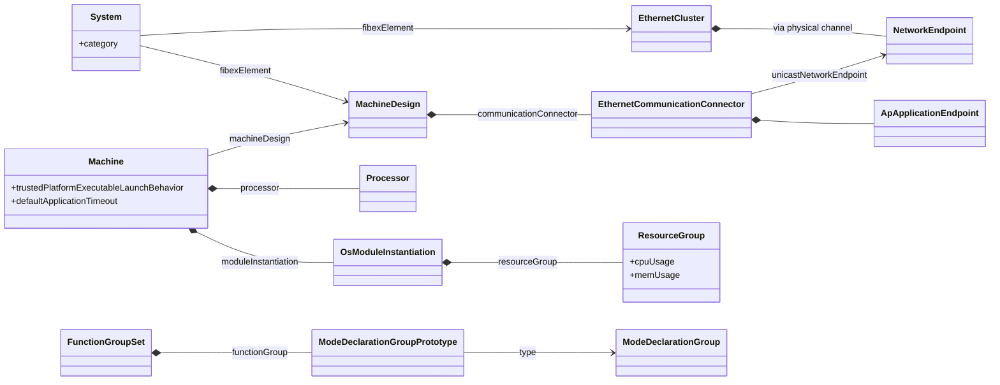

> **Key takeaways**
>
> - The `System` (category `SYSTEM_DESIGN_DESCRIPTION` or `MACHINE_DESIGN_EXTRACT`) and the `MachineDesign` describe the Machine at design time; the `Machine` is its target configuration.
> - The `MachineDesign` carries the network connection: connectors, network endpoints, application endpoints (ports) and service discovery.
> - The `Machine` must reference its design, define the trusted-platform mode, the default timeouts and at least one processor.
> - Platform modules are configured through module instantiations; the OS module holds the ResourceGroups.
> - A Function Group is a `ModeDeclarationGroupPrototype` in a `FunctionGroupSet`. Every Function Group needs `Off` (initial) and `Verify`.

---

## 8. The Execution Manifest

> **Why this matters:** The Execution Manifest turns an Executable into running processes. The [EM guide](04_ExecutionManagement.md) explains what Execution Management *does* with each setting; this chapter shows how the settings are *modeled*, so that you can read and write them as ARXML.

### 8.1 Process: From Executable to OS Process

**In plain words:** a `Process` says: "run this Executable, on this Machine, in these Function Group States, with this configuration". The unit of target configuration on the Adaptive Platform is a binary that becomes a POSIX process at run time (TPS, Section 10.2).

**Formally:** the top-level element of the Execution Manifest is the `Process` (TPS, Section 10.2). It references its `Executable` ([TPS_MANI_01011]), at most one ([constr_3732]). The direction of this reference keeps the design independent of the target configuration. Several processes may reference the same Executable, to run it several times with different configurations ([TR_AMETH_00024]), on the same Machine or on several Machines (*Platform Design*, Section 4.6); each such process typically gets its own ARXML file (TPS, Figure 10.2). A `Process`, unlike its `StartupConfig`s, is not designed for reuse on different Machines ([TPS_MANI_01308]).

| Attribute | Purpose | Details in |
| --- | --- | --- |
| `executable` | The Executable that the process runs (stereotype `≪atpUriDef≫`) | [Section 8.4](#84-worked-example-the-processes-cameradriver-and-fusion) |
| `design` | The `ProcessDesign` that stood in for this process at design time | [Section 5.4](#54-process-design-a-stand-in-for-a-future-process) |
| `stateDependentStartupConfig` | The startup configurations, each for a set of Function Group States | [Section 8.2](#82-state-dependent-startup-configuration) |
| `numberOfRestartAttempts` | How often a failed start is retried | [EM guide, Section 13.3](04_ExecutionManagement.md#133-process) |
| `preMapping` | Whether the Executable is preloaded into memory | EM guide |
| `functionClusterAffiliation` | The functional cluster the process belongs to; standardized values `STATE_MANAGEMENT` and `PLATFORM_HEALTH_MANAGEMENT` ([TPS_MANI_01337]) | EM guide, guides 05 and 06 |
| `processStateMachine` | The process states (`Running`, `Terminated`) that other processes can depend on; the supported states are standardized by EM | [EM guide, Chapter 6](04_ExecutionManagement.md#6-execution-dependencies-startup-and-shutdown-ordering) |

### 8.2 State-Dependent Startup Configuration

The startup behavior is modeled by `StateDependentStartupConfig`s aggregated by the process ([TPS_MANI_01012]). Each one says: if the controlling Function Group is in *one of these* states, start the process with *this* `StartupConfig` ([TPS_MANI_01013], [TPS_MANI_01046]). It also references the `ResourceGroup` and may carry Execution Dependencies and resource consumption limits.

The states are referenced through an instance reference, because a state (`ModeDeclaration`) belongs to a reusable group and is identified only together with the Function Group that uses the group ([Section 3.5](#35-instance-references--iref)). Because these references point into one Machine's Function Groups, the Execution Manifest is specific to the Machine on which the binary is deployed (TPS, Section 10.3.1).

The model enforces the structural rules that the [EM guide](04_ExecutionManagement.md#42-how-the-elements-relate) relies on:

| Rule | Constraint |
| --- | --- |
| Every startup configuration references at least one Function Group State. | [constr_3423] |
| All states referenced by one process belong to the same Function Group. | [constr_1688] |
| No two startup configurations of one process reference the same state. | [constr_3396] |
| No startup configuration references the state `Off`. | [constr_3424] |
| Every startup configuration references a ResourceGroup and a `StartupConfig`. | [constr_10175], [constr_10176] |
| On each Machine, some process runs in `Shutdown` and some process runs in `Restart`. | [constr_1618], [constr_1619] |

The `StartupConfig` itself is a separate, reusable element (recommended package `StartupConfigs`). It holds the arguments, the environment variables, the scheduling policy and priority, the timeouts, the termination behavior, the permission to create child processes and the execution error. The [EM guide, Section 13.5](04_ExecutionManagement.md#135-startupconfig) explains each of them; [Section 12.11](#1211-process-statedependentstartupconfig-and-startupconfig) lists them with their XML names.

### 8.3 Mapping Processes to the Machine

Each process must be mapped to exactly one Machine by a `ProcessToMachineMapping`, and this mapping is part of the Execution Manifest ([TPS_MANI_03147], [constr_5004], [constr_1553]). It may seem redundant, because the manifest is uploaded to the Machine anyway, but it is useful for processing the model; and since the Execution Manifest is created on the basis of an existing Machine Manifest, the link can always be made (TPS, Section 11.3.1). The mappings are collected in a `ProcessToMachineMappingSet`.

The mapping can also restrict the cores on which the process runs, with `shallRunOn` or `shallNotRunOn` (never both, [TPS_MANI_03148], [constr_1677]); it can override a design-level affinity of the `ProcessDesignToMachineDesignMapping`, if the project allows this (TPS, Section 11.3.2). For a platform module, it references the module instantiation ([Section 7.4](#74-platform-module-instantiations)).

### 8.4 Worked Example: The Processes `CameraDriver` and `Fusion`

The Function Group `ADAS` belongs to `AdasCluster`, so its states are defined in the Execution Manifest of that cluster. Following [Section 7.5](#75-function-groups-and-their-states), `ADAS_States` has the states `Off` (initial), `Normal`, `Degraded` and `Verify`:

```xml
<MODE-DECLARATION-GROUP>
  <SHORT-NAME>ADAS_States</SHORT-NAME>
  <INITIAL-MODE-REF DEST="MODE-DECLARATION">/HPC/ModeDeclarationGroups/ADAS_States/Off</INITIAL-MODE-REF>
  <MODE-DECLARATIONS>
    <MODE-DECLARATION>
      <SHORT-NAME>Off</SHORT-NAME>
    </MODE-DECLARATION>
    <MODE-DECLARATION>
      <SHORT-NAME>Normal</SHORT-NAME>
    </MODE-DECLARATION>
    <MODE-DECLARATION>
      <SHORT-NAME>Degraded</SHORT-NAME>
    </MODE-DECLARATION>
    <MODE-DECLARATION>
      <SHORT-NAME>Verify</SHORT-NAME>
    </MODE-DECLARATION>
  </MODE-DECLARATIONS>
</MODE-DECLARATION-GROUP>
<!-- in the package /HPC/FunctionGroupSets -->
<FUNCTION-GROUP-SET>
  <SHORT-NAME>AdasFunctionGroups</SHORT-NAME>
  <FUNCTION-GROUPS>
    <MODE-DECLARATION-GROUP-PROTOTYPE>
      <SHORT-NAME>ADAS</SHORT-NAME>
      <TYPE-TREF DEST="MODE-DECLARATION-GROUP">/HPC/ModeDeclarationGroups/ADAS_States</TYPE-TREF>
    </MODE-DECLARATION-GROUP-PROTOTYPE>
  </FUNCTION-GROUPS>
</FUNCTION-GROUP-SET>
```

The [EM guide, Section 13.11](04_ExecutionManagement.md#1311-the-running-example-complete-configuration) shows `Fusion` as a conceptual view. Here is the real ARXML of its startup configuration and process:

```xml
<STARTUP-CONFIG>
  <SHORT-NAME>fusion_cfg</SHORT-NAME>
  <ENVIRONMENT-VARIABLES>
    <TAG-WITH-OPTIONAL-VALUE>
      <KEY>LOG_LEVEL</KEY>
      <VALUE>debug</VALUE>
    </TAG-WITH-OPTIONAL-VALUE>
  </ENVIRONMENT-VARIABLES>
  <PERMISSION-TO-CREATE-CHILD-PROCESS>false</PERMISSION-TO-CREATE-CHILD-PROCESS>
  <PROCESS-ARGUMENTS>
    <PROCESS-ARGUMENT>
      <ARGUMENT>--mode</ARGUMENT>
    </PROCESS-ARGUMENT>
    <PROCESS-ARGUMENT>
      <ARGUMENT>full</ARGUMENT>
    </PROCESS-ARGUMENT>
  </PROCESS-ARGUMENTS>
  <PROCESS-EXECUTION-ERROR-REF DEST="AP-APPLICATION-ERROR">/HPC/ApplicationErrors/FusionFailed</PROCESS-EXECUTION-ERROR-REF>
  <SCHEDULING-POLICY>SCHED_FIFO</SCHEDULING-POLICY>
  <SCHEDULING-PRIORITY>40</SCHEDULING-PRIORITY>
  <TERMINATION-BEHAVIOR>PROCESS-IS-NOT-SELF-TERMINATING</TERMINATION-BEHAVIOR>
  <TIMEOUT>
    <ENTER-TIMEOUT-VALUE>3.0</ENTER-TIMEOUT-VALUE>
    <EXIT-TIMEOUT-VALUE>0.5</EXIT-TIMEOUT-VALUE>
  </TIMEOUT>
</STARTUP-CONFIG>
<!-- in the package /HPC/Processes -->
<PROCESS>
  <SHORT-NAME>Fusion</SHORT-NAME>
  <DESIGN-REF DEST="PROCESS-DESIGN">/HPC/ProcessDesigns/FusionDesign</DESIGN-REF>
  <EXECUTABLE-REFS>
    <EXECUTABLE-REF DEST="EXECUTABLE">/HPC/Executables/fusion</EXECUTABLE-REF>
  </EXECUTABLE-REFS>
  <NUMBER-OF-RESTART-ATTEMPTS>1</NUMBER-OF-RESTART-ATTEMPTS>
  <STATE-DEPENDENT-STARTUP-CONFIGS>
    <STATE-DEPENDENT-STARTUP-CONFIG>
      <FUNCTION-GROUP-STATE-IREFS>
        <FUNCTION-GROUP-STATE-IREF>
          <CONTEXT-MODE-DECLARATION-GROUP-PROTOTYPE-REF DEST="MODE-DECLARATION-GROUP-PROTOTYPE">/HPC/FunctionGroupSets/AdasFunctionGroups/ADAS</CONTEXT-MODE-DECLARATION-GROUP-PROTOTYPE-REF>
          <TARGET-MODE-DECLARATION-REF DEST="MODE-DECLARATION">/HPC/ModeDeclarationGroups/ADAS_States/Normal</TARGET-MODE-DECLARATION-REF>
        </FUNCTION-GROUP-STATE-IREF>
      </FUNCTION-GROUP-STATE-IREFS>
      <RESOURCE-CONSUMPTION>
        <SHORT-NAME>FusionMemory</SHORT-NAME>
        <MEMORY-USAGES>
          <MEMORY-USAGE>
            <SHORT-NAME>Limit</SHORT-NAME>
            <MEMORY-CONSUMPTION>1073741824</MEMORY-CONSUMPTION>
          </MEMORY-USAGE>
        </MEMORY-USAGES>
      </RESOURCE-CONSUMPTION>
      <RESOURCE-GROUP-REF DEST="RESOURCE-GROUP">/HPC/Machines/HPC/Os/adas_rg</RESOURCE-GROUP-REF>
      <STARTUP-CONFIG-REF DEST="STARTUP-CONFIG">/HPC/StartupConfigs/fusion_cfg</STARTUP-CONFIG-REF>
    </STATE-DEPENDENT-STARTUP-CONFIG>
  </STATE-DEPENDENT-STARTUP-CONFIGS>
</PROCESS>
```

`CameraDriver` runs in `Normal` *and* `Degraded` with one shared startup configuration, so its `STATE-DEPENDENT-STARTUP-CONFIG` contains two `FUNCTION-GROUP-STATE-IREF`s. That is how it keeps running when `ADAS` switches between the two states ([EM guide, Section 13.11](04_ExecutionManagement.md#1311-the-running-example-complete-configuration)). Both processes are mapped to `HPC`:

```xml
<PROCESS-TO-MACHINE-MAPPING-SET>
  <SHORT-NAME>AdasProcessesOnHpc</SHORT-NAME>
  <PROCESS-TO-MACHINE-MAPPINGS>
    <PROCESS-TO-MACHINE-MAPPING>
      <SHORT-NAME>CameraDriverOnHpc</SHORT-NAME>
      <MACHINE-REF DEST="MACHINE">/HPC/Machines/HPC</MACHINE-REF>
      <PROCESS-REF DEST="PROCESS">/HPC/Processes/CameraDriver</PROCESS-REF>
    </PROCESS-TO-MACHINE-MAPPING>
    <!-- FusionOnHpc: the same for /HPC/Processes/Fusion -->
  </PROCESS-TO-MACHINE-MAPPINGS>
</PROCESS-TO-MACHINE-MAPPING-SET>
```

The following table maps the keys of the conceptual view in the EM guide to the real model:

| Conceptual key (EM guide) | ARXML element |
| --- | --- |
| `executable: fusion` | `PROCESS/EXECUTABLE-REFS/EXECUTABLE-REF` |
| `numberOfRestartAttempts: 1` | `PROCESS/NUMBER-OF-RESTART-ATTEMPTS` |
| `functionGroupState: [ ADAS.Normal ]` | `STATE-DEPENDENT-STARTUP-CONFIG/FUNCTION-GROUP-STATE-IREFS/FUNCTION-GROUP-STATE-IREF` |
| `resourceGroup: adas_rg` | `STATE-DEPENDENT-STARTUP-CONFIG/RESOURCE-GROUP-REF` |
| `resourceConsumption: { memoryUsage: ... }` | `RESOURCE-CONSUMPTION/MEMORY-USAGES/MEMORY-USAGE/MEMORY-CONSUMPTION` (in bytes) |
| `startupConfig: fusion_cfg` | `STATE-DEPENDENT-STARTUP-CONFIG/STARTUP-CONFIG-REF` |
| `processArgument`, `environmentVariable`, `schedulingPolicy`, ... | Children of `STARTUP-CONFIG` |
| `timeout: { enter: 3s, exit: 500ms }` | `STARTUP-CONFIG/TIMEOUT/ENTER-TIMEOUT-VALUE` and `EXIT-TIMEOUT-VALUE`, in seconds |
| `processExecutionError: 42` | `STARTUP-CONFIG/PROCESS-EXECUTION-ERROR-REF` to the `AP-APPLICATION-ERROR` `FusionFailed` with `ERROR-CODE` 42 |

> **Note (simplification):** The real `Fusion` also has two Execution Dependencies: `CalibrationCheck` *Terminated* and `LoggerCompanion` *Running* ([EM guide, Section 6.5](04_ExecutionManagement.md#65-dependencies-in-the-running-example)). An `EXECUTION-DEPENDENCY` references, with the instance reference `PROCESS-STATE-IREF`, a process state in the `processStateMachine` of the other process. Because this guide does not model `CalibrationCheck` and `LoggerCompanion`, the dependencies are left out.

> **Key takeaways**
>
> - A `Process` runs one `Executable`; several processes may run the same Executable with different configurations.
> - `StateDependentStartupConfig`s bind a reusable `StartupConfig` and a ResourceGroup to a set of states of one Function Group; the states are referenced by instance references.
> - The constraints of the model mirror the rules of EM: at least one state, never `Off`, one Function Group per process, no state twice.
> - Every process is mapped to exactly one Machine in the Execution Manifest itself.

---

## 9. The Service Instance Manifest and the InstanceSpecifier

> **Why this matters:** The application code says "give me a `CameraService` on my port `CameraRPort`". It says nothing about service IDs, instance IDs, transport protocols or ports. All of this lives in the Service Instance Manifest. When a proxy never finds its service, the cause is usually a mismatch in this chain.

### 9.1 Service Interface Deployment

**In plain words:** a service interface deployment says how a service interface looks on one transport: for SOME/IP, its service ID, the IDs of its methods and events, and its event groups. Provider and consumers must use the same deployment.

**Formally:** a `ServiceInterfaceDeployment` maps a `ServiceInterface` to a middleware transport layer ([TPS_MANI_03036]). The concrete subclasses are `SomeipServiceInterfaceDeployment`, `DdsServiceInterfaceDeployment` and `UserDefinedServiceInterfaceDeployment`. A deployment holds one element deployment per event, field and method of the interface. With the exception of DDS, it must cover *all* elements of the interface ([constr_10029]); a partial deployment is not supported.

For SOME/IP, the deployment assigns the service identifier `serviceInterfaceId` ([TPS_MANI_03040]), defines the event groups that clients subscribe to ([TPS_MANI_03041]) and the SOME/IP version ([TPS_MANI_03042]). It is the common configuration set that is shared between the server and all clients (TPS, Section 13.2.1). The contract version of the interface is mapped to a version of each deployment, and different deployments of the same interface may use different version numbers ([TPS_MANI_03617]).

The methodology assigns the deployment to the software cluster responsible: the SOME/IP service ID must be unambiguous in the system, and the method IDs, event IDs and event groups unambiguous within the deployment ([TR_AMETH_00027]). [Guide 08a](08a_NetworkBindings.md) explains all SOME/IP and DDS attributes.

### 9.2 Provided and Required Service Instances

An `AdaptivePlatformServiceInstance` makes the functionality of a service interface available on the platform. There may be several instances of the same interface, for different purposes or users (TPS, Section 13.3).

- A `ProvidedApServiceInstance` represents a provider that offers the service with particular properties.
- A `RequiredApServiceInstance` represents a client that observes the offers and chooses a provider.

Both are abstract. Their transport-specific subclasses are `ProvidedSomeipServiceInstance` and `RequiredSomeipServiceInstance`, the corresponding DDS classes, and user-defined classes. Every instance references the `ServiceInterfaceDeployment` that identifies its interface; it can also carry E2E protection and secure communication settings (TPS, Table 13.28; guides 08 and 14). For SOME/IP, a provided instance has a `serviceInstanceId`; a required instance has a `requiredServiceInstanceId` and a `requiredMinorVersion` (TPS, Section 13.3.1).

Service instances are `ARElement`s: they live in packages and can be used in several manifests (TPS, Section 13.3). The methodology lets the software cluster responsible define them during the design, and the integrator finalize their IDs according to the service topology of the system ([TR_AMETH_00005], [TR_AMETH_00028]).

### 9.3 Connecting a Port to a Service Instance

The decisive link is the `ServiceInstanceToPortPrototypeMapping`. It assigns a service instance to a port of a component, so that it defines how that port is represented in the middleware ([TPS_MANI_03000]). In the words of the TPS, the "outside" appearance of a port, from the middleware's point of view, is the service instance.

| Attribute | Meaning |
| --- | --- |
| `portPrototype` | The port, as an instance reference in the Executable (`PortPrototypeInExecutableInstanceRef`, stereotype `≪atpUriDef≫`) |
| `process` | The `Process` in which the mapping applies. Used when the Software Cluster is integrated ([TPS_MANI_01317]). |
| `processDesign` | The `ProcessDesign`, for a pre-assignment at design time ([TPS_MANI_01316]). If both exist, `process` wins: the integrator may overrule the designer. |
| `serviceInstance` | The provided or required service instance |

The `process` reference matters when an Executable runs in several processes: the same port then exists in each process, and each process can be mapped to a different service instance. A port may also be mapped to several service instances, for example to offer the same service on two VLANs (TPS, Figure 13.3). This mapping "decouples the service implementation from its configuration and allows the run-time tailoring of deployed Adaptive Software to a concrete service topology" ([TR_AMETH_00033]).

The following diagram shows the complete chain for the consumer `Fusion`.

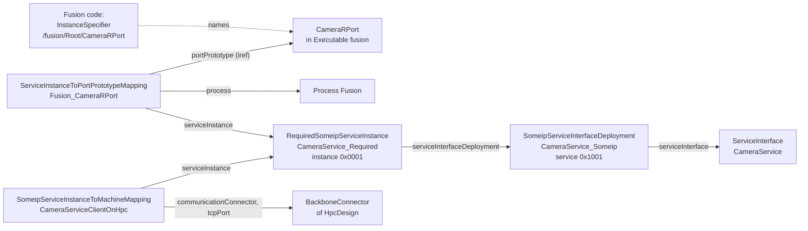

### 9.4 From Port to InstanceSpecifier

**In plain words:** an `InstanceSpecifier` is the name of a port, written as a path. The application code uses it to tell a functional cluster *which* of its ports it means; the cluster looks the path up in the manifest.

**Formally:** an `ara::core::InstanceSpecifier` is a type wrapper for the string representation of a valid meta-model path to a `PortPrototype` (SWS Core, Section 7.4.1.1). For application interaction, the string starts with `/` and lists the short names from the Executable, through the root prototype and any further component prototypes, to the port ([SWS_CORE_10200]):

```text
/Executable.shortName/RootSwComponentPrototype.shortName[/SwComponentPrototype.shortName ...]/PortPrototype.shortName
```

The `InstanceSpecifier` is a "stringified" form of the instance reference (Methodology TR, Table 1.2): it contains exactly the base and the contexts and target of the `PortPrototypeInExecutableInstanceRef`. If you know the model structure, you can construct one from the other (TPS, Appendix B.5.1). For `HPC`:

| Port | Instance reference | `InstanceSpecifier` |
| --- | --- | --- |
| P-port of `CameraDriver` | base `camera_driver`, context `Root`, target `CameraPPort` | `/camera_driver/Root/CameraPPort` |
| R-port of `Fusion` | base `fusion`, context `Root`, target `CameraRPort` | `/fusion/Root/CameraRPort` |

The path contains no package names and no process name. Two consequences follow:

- **The `≪atpUriDef≫` stereotype.** The reference `portPrototype` of the mapping is decorated with `≪atpUriDef≫` (TPS, Table 13.32): its *path* is the information. The platform software can derive the value of an `InstanceSpecifier` from it, even if the referenced design elements are not available on the Machine (TPS, Sections 2.1.3 and 2.3).
- **The specifier names no process.** It identifies the port of the Executable. If the Executable runs in several processes, the `process` reference of each mapping says for which process the mapping applies ([Section 9.3](#93-connecting-a-port-to-a-service-instance)).

> **Note:** The informative example of the TPS (Appendix B.5.1, Figure B.33) writes the specifier without the leading slash, as `Exe/Root/C1/C2/RP`. The normative format of R25-11 is the one of [SWS_CORE_10200], with the leading slash.

Functional clusters also interact with each other, where no port exists. Then the specifier is the path of a `FunctionalClusterInteractsWithFunctionalClusterMapping`, for example the mapping that tells Communication Management which crypto key slot protects an event ([SWS_CORE_10203], [TPS_MANI_03268]). APMC calls this pattern a *FunctionalClusterEndpointSpecifier*, to avoid confusion with the true `InstanceSpecifier`, which is a path through an instance tree ([AP_TPS_APMC_01039]).

When a specifier cannot be resolved in the model in the context of the Executable, or refers to something other than a port, the platform reports the violation `InstanceSpecifierMappingIntegrityViolation`; when a constructor is called with a specifier that is already in use in the process, it reports `InstanceSpecifierAlreadyInUseViolation` ([SWS_CORE_13003], [SWS_CORE_13006], both status DRAFT).

### 9.5 Mapping Service Instances to the Machine

A `ServiceInstanceToMachineMapping` assigns one or several service instances to a communication connector of a `MachineDesign` ([TPS_MANI_03001]). This gives a "black box" view of the Machine: all information that the communication needs, without any assumption about the application software. For SOME/IP, the subclass `SomeipServiceInstanceToMachineMapping` references the connector, the service instances and the `ApApplicationEndpoint`s that provide the TCP port and the UDP port. For a provided instance, the port is sent in the service offer and serves method calls and unicast events; for a required instance, it is sent in the subscription and used for the client side ([TPS_MANI_03292], [TPS_MANI_03293]).

> **Pitfall:** One TCP endpoint cannot serve a provided and a required service instance at the same time, because the POSIX socket API does not allow two TCP sockets to be bound to the same local address and port ([constr_3487]). `HPC` both provides and consumes `CameraService`, so it uses two endpoints: `CameraServiceServerTcp` with port 30501 for the provider, and `CameraServiceClientTcp` with port `0`, an ephemeral port, for the consumer ([TPS_MANI_03227]).

### 9.6 Worked Example: `CameraService` Between `CameraDriver` and `Fusion`

The SOME/IP deployment of `CameraService` covers its three elements: the event `Image`, the field `CameraStatus` with its getter and notifier, and the method `SetExposureMode`. The event group `CameraEvents` contains the event and the notifier. The event IDs in the manifest are 1 and 2, because an event ID must lie between 0 and 32767 ([constr_3408]); on the wire, SOME/IP adds `0x8000` to mark a message as an event, so they appear as `0x8001` and `0x8002` ([SWS_CM_10291]).

```xml
<SOMEIP-SERVICE-INTERFACE-DEPLOYMENT>
  <SHORT-NAME>CameraService_Someip</SHORT-NAME>
  <EVENT-DEPLOYMENTS>
    <SOMEIP-EVENT-DEPLOYMENT>
      <SHORT-NAME>Image</SHORT-NAME>
      <EVENT-REF DEST="VARIABLE-DATA-PROTOTYPE">/HPC/ServiceInterfaces/CameraService/Image</EVENT-REF>
      <EVENT-ID>1</EVENT-ID>
      <TRANSPORT-PROTOCOL>TCP</TRANSPORT-PROTOCOL>
    </SOMEIP-EVENT-DEPLOYMENT>
  </EVENT-DEPLOYMENTS>
  <FIELD-DEPLOYMENTS>
    <SOMEIP-FIELD-DEPLOYMENT>
      <SHORT-NAME>CameraStatus</SHORT-NAME>
      <FIELD-REF DEST="FIELD">/HPC/ServiceInterfaces/CameraService/CameraStatus</FIELD-REF>
      <GET>
        <SHORT-NAME>Get</SHORT-NAME>
        <METHOD-ID>0x0002</METHOD-ID>
        <TRANSPORT-PROTOCOL>TCP</TRANSPORT-PROTOCOL>
      </GET>
      <NOTIFIER>
        <SHORT-NAME>Notifier</SHORT-NAME>
        <EVENT-ID>2</EVENT-ID>
        <TRANSPORT-PROTOCOL>TCP</TRANSPORT-PROTOCOL>
      </NOTIFIER>
    </SOMEIP-FIELD-DEPLOYMENT>
  </FIELD-DEPLOYMENTS>
  <METHOD-DEPLOYMENTS>
    <SOMEIP-METHOD-DEPLOYMENT>
      <SHORT-NAME>SetExposureMode</SHORT-NAME>
      <METHOD-REF DEST="CLIENT-SERVER-OPERATION">/HPC/ServiceInterfaces/CameraService/SetExposureMode</METHOD-REF>
      <METHOD-ID>0x0001</METHOD-ID>
      <TRANSPORT-PROTOCOL>TCP</TRANSPORT-PROTOCOL>
    </SOMEIP-METHOD-DEPLOYMENT>
  </METHOD-DEPLOYMENTS>
  <SERVICE-INTERFACE-REF DEST="SERVICE-INTERFACE">/HPC/ServiceInterfaces/CameraService</SERVICE-INTERFACE-REF>
  <EVENT-GROUPS>
    <SOMEIP-EVENT-GROUP>
      <SHORT-NAME>CameraEvents</SHORT-NAME>
      <EVENT-GROUP-ID>1</EVENT-GROUP-ID>
      <EVENT-REFS>
        <EVENT-REF DEST="SOMEIP-EVENT-DEPLOYMENT">/HPC/ServiceInterfaceDeployments/CameraService_Someip/Image</EVENT-REF>
        <EVENT-REF DEST="SOMEIP-EVENT-DEPLOYMENT">/HPC/ServiceInterfaceDeployments/CameraService_Someip/CameraStatus/Notifier</EVENT-REF>
      </EVENT-REFS>
    </SOMEIP-EVENT-GROUP>
  </EVENT-GROUPS>
  <SERVICE-INTERFACE-ID>0x1001</SERVICE-INTERFACE-ID>
  <SERVICE-INTERFACE-VERSION>
    <MAJOR-VERSION>1</MAJOR-VERSION>
    <MINOR-VERSION>0</MINOR-VERSION>
  </SERVICE-INTERFACE-VERSION>
</SOMEIP-SERVICE-INTERFACE-DEPLOYMENT>
```

The provider side and the consumer side each have a service instance; both reference the same deployment:

```xml
<PROVIDED-SOMEIP-SERVICE-INSTANCE>
  <SHORT-NAME>CameraService_Provided</SHORT-NAME>
  <SERVICE-INTERFACE-DEPLOYMENT-REF DEST="SOMEIP-SERVICE-INTERFACE-DEPLOYMENT">/HPC/ServiceInterfaceDeployments/CameraService_Someip</SERVICE-INTERFACE-DEPLOYMENT-REF>
  <PROVIDED-EVENT-GROUPS>
    <SOMEIP-PROVIDED-EVENT-GROUP>
      <SHORT-NAME>CameraEvents</SHORT-NAME>
      <EVENT-GROUP-REF DEST="SOMEIP-EVENT-GROUP">/HPC/ServiceInterfaceDeployments/CameraService_Someip/CameraEvents</EVENT-GROUP-REF>
      <MULTICAST-THRESHOLD>0</MULTICAST-THRESHOLD>
    </SOMEIP-PROVIDED-EVENT-GROUP>
  </PROVIDED-EVENT-GROUPS>
  <SD-SERVER-CONFIG-REF DEST="SOMEIP-SD-SERVER-SERVICE-INSTANCE-CONFIG">/HPC/SomeipSdTimingConfigs/CameraServiceSdServer</SD-SERVER-CONFIG-REF>
  <SERVICE-INSTANCE-ID>0x0001</SERVICE-INSTANCE-ID>
</PROVIDED-SOMEIP-SERVICE-INSTANCE>
<REQUIRED-SOMEIP-SERVICE-INSTANCE>
  <SHORT-NAME>CameraService_Required</SHORT-NAME>
  <SERVICE-INTERFACE-DEPLOYMENT-REF DEST="SOMEIP-SERVICE-INTERFACE-DEPLOYMENT">/HPC/ServiceInterfaceDeployments/CameraService_Someip</SERVICE-INTERFACE-DEPLOYMENT-REF>
  <REQUIRED-EVENT-GROUPS>
    <SOMEIP-REQUIRED-EVENT-GROUP>
      <SHORT-NAME>CameraEvents</SHORT-NAME>
      <EVENT-GROUP-REF DEST="SOMEIP-EVENT-GROUP">/HPC/ServiceInterfaceDeployments/CameraService_Someip/CameraEvents</EVENT-GROUP-REF>
      <SD-CLIENT-EVENT-GROUP-TIMING-CONFIG-REF DEST="SOMEIP-SD-CLIENT-EVENT-GROUP-TIMING-CONFIG">/HPC/SomeipSdTimingConfigs/CameraEventsSdClient</SD-CLIENT-EVENT-GROUP-TIMING-CONFIG-REF>
    </SOMEIP-REQUIRED-EVENT-GROUP>
  </REQUIRED-EVENT-GROUPS>
  <REQUIRED-MINOR-VERSION>0</REQUIRED-MINOR-VERSION>
  <REQUIRED-SERVICE-INSTANCE-ID>0x0001</REQUIRED-SERVICE-INSTANCE-ID>
  <SD-CLIENT-CONFIG-REF DEST="SOMEIP-SD-CLIENT-SERVICE-INSTANCE-CONFIG">/HPC/SomeipSdTimingConfigs/CameraServiceSdClient</SD-CLIENT-CONFIG-REF>
</REQUIRED-SOMEIP-SERVICE-INSTANCE>
```

Each instance references a configuration of the service discovery timing in the package `/HPC/SomeipSdTimingConfigs`: the server timing of the offers, the client timing of the find messages, and the timing of the event group subscription. These references are mandatory ([constr_10218], [constr_10221], [constr_10222]), and so is the `multicastThreshold` of a provided event group ([constr_10220]). The value `0` used here means that no multicast is configured; a multicast address and port are required only for other values ([constr_5332]).

The mappings connect the ports of the two processes to the instances, and the instances to the Machine. The mappings for `CameraDriver` are written in the same way.

```xml
<SERVICE-INSTANCE-TO-PORT-PROTOTYPE-MAPPING>
  <SHORT-NAME>Fusion_CameraRPort</SHORT-NAME>
  <PORT-PROTOTYPE-IREF>
    <CONTEXT-ROOT-SW-COMPONENT-PROTOTYPE-REF DEST="ROOT-SW-COMPONENT-PROTOTYPE">/HPC/Executables/fusion/Root</CONTEXT-ROOT-SW-COMPONENT-PROTOTYPE-REF>
    <TARGET-PORT-PROTOTYPE-REF DEST="R-PORT-PROTOTYPE">/HPC/AdaptiveApplicationSwComponentTypes/FusionSwc/CameraRPort</TARGET-PORT-PROTOTYPE-REF>
  </PORT-PROTOTYPE-IREF>
  <PROCESS-REF DEST="PROCESS">/HPC/Processes/Fusion</PROCESS-REF>
  <SERVICE-INSTANCE-REF DEST="REQUIRED-SOMEIP-SERVICE-INSTANCE">/HPC/ServiceInstances/CameraService_Required</SERVICE-INSTANCE-REF>
</SERVICE-INSTANCE-TO-PORT-PROTOTYPE-MAPPING>
<!-- in the package /HPC/ServiceInstanceToMachineMappings -->
<SOMEIP-SERVICE-INSTANCE-TO-MACHINE-MAPPING>
  <SHORT-NAME>CameraServiceClientOnHpc</SHORT-NAME>
  <COMMUNICATION-CONNECTOR-REF DEST="ETHERNET-COMMUNICATION-CONNECTOR">/HPC/MachineDesigns/HpcDesign/BackboneConnector</COMMUNICATION-CONNECTOR-REF>
  <SERVICE-INSTANCE-REFS>
    <SERVICE-INSTANCE-REF DEST="REQUIRED-SOMEIP-SERVICE-INSTANCE">/HPC/ServiceInstances/CameraService_Required</SERVICE-INSTANCE-REF>
  </SERVICE-INSTANCE-REFS>
  <TCP-PORT-REF DEST="AP-APPLICATION-ENDPOINT">/HPC/MachineDesigns/HpcDesign/BackboneConnector/CameraServiceClientTcp</TCP-PORT-REF>
</SOMEIP-SERVICE-INSTANCE-TO-MACHINE-MAPPING>
```

> **Note:** The guide models `Fusion` as a SOME/IP client of `CameraService`, although provider and consumer run on the same Machine. Whether a local consumer uses the SOME/IP instance or a local binding is decided in [guide 08a](08a_NetworkBindings.md). The transport protocol TCP, the event and method IDs and the service discovery timing are illustrative; [guide 08a](08a_NetworkBindings.md) owns them.

The following sequence diagram shows, conceptually, how this configuration is used when `Fusion` starts to look for the service. The exact API and the behavior of Communication Management are the topic of [guide 07](07_CommunicationManagement.md#69-worked-example-fusion-finds-cameraservice) and [guide 08a](08a_NetworkBindings.md).

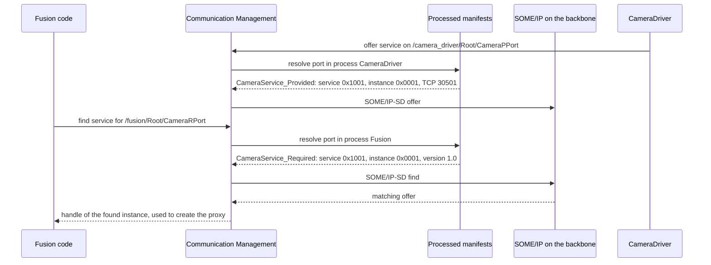

> **Key takeaways**
>
> - A `ServiceInterfaceDeployment` defines how an interface looks on one transport and is shared by provider and consumers; except for DDS, it covers all elements of the interface.
> - Provided and required service instances reference the deployment and carry the instance-specific IDs.
> - `ServiceInstanceToPortPrototypeMapping` connects one port, in one process, to one service instance; `ServiceInstanceToMachineMapping` connects the instance to the network connector and its ports.
> - The `InstanceSpecifier` is the path `/Executable/Root/.../Port`; it is the stringified instance reference of the port.
> - A TCP endpoint serves either provided or required instances, not both.

---

## 10. Software Clusters and Software Packages

> **Why this matters:** On the Adaptive Platform, software is installed, updated and removed in the field, one Software Cluster at a time. The Software Cluster defines what belongs together: its processes, its Function Groups and every model element that its manifests need. If an element is missing from the cluster, the installed software is incomplete.

### 10.1 Software Cluster Design: The OEM's Contract

**In plain words:** before a supplier develops a driving function, the OEM writes down what it must provide and require. The `SoftwareClusterDesign` is that contract; the integrator later derives the real `SoftwareCluster` from it.

**Formally:** a `SoftwareClusterDesign` is the formalized response to requirements formulated by an OEM, enriched as the development progresses; it imposes a contract on the downstream processing ([TPS_MANI_01112]). It "claims" its content by references rather than aggregation, which makes the later derivation of the `SoftwareCluster` easy (TPS, Section 8.2):

- `containedProcess` references the `ProcessDesign`s of the executable software ([TPS_MANI_01211]).
- `requiredARElement` and `requiredDesignElement` reference further elements that the cluster needs ([TPS_MANI_01119]).
- `intendedTargetMachine` references, at most once, the `MachineDesign` for which the cluster is developed ([TPS_MANI_01117], [constr_3727]).
- `installationBehavior` says whether a derived cluster `canBeRemoved` or `cannotBeRemoved` from the Machine ([TPS_MANI_01410]). For category `PLATFORM_CORE` it must be `cannotBeRemoved` ([constr_10410]).
- `dependsOn` and `conflictsTo` formulate dependencies on other Software Clusters. In R25-11, such dependencies are modeled only on the design level ([TPS_MANI_01480], [TPS_MANI_01482]).
- The diagnostic contribution and the DoIP logical address are also assigned here, typically by the OEM ([TPS_MANI_01118], [TPS_MANI_01465]).

The TPS standardizes three categories for both `SoftwareClusterDesign` and `SoftwareCluster` ([TPS_MANI_01331]):

| Category | Meaning |
| --- | --- |
| `PLATFORM_CORE` | Platform software, such as bootloader, OS and Adaptive Platform modules. Cannot be removed by UCM, but can be updated. |
| `PLATFORM` | Parts of the platform software that can be installed, removed and updated, for example the configuration of functional clusters |
| `APPLICATION_LAYER` | A driving-relevant function on application level, for example a lane keeping assistant. Can be installed, removed and updated. |

The conversion of a `SoftwareClusterDesign` into a `SoftwareCluster` is not formalized by AUTOSAR; a tool does it at the discretion of the integrator (TPS, Section 8.2). The design itself is not uploaded to the Machine (Methodology TR, Section 2.9.1).

### 10.2 Software Cluster: The Uploadable Unit

A `SoftwareCluster` represents an uploadable software package ([TPS_MANI_01110]): all software and configuration for a given purpose. It is the root of the package content, and it refers to its content in four ways:

| Reference | Targets | Rule |
| --- | --- | --- |
| `containedProcess` | The `Process`es, and through them the Executables ([TPS_MANI_01115]) | All on the same Machine ([constr_1536]) |
| `containedPackageElement` | Elements derived from `UploadablePackageElement`: Executables, StartupConfigs, mapping sets, deployments, service instances, mappings, certificates, ... | Mandatory for uploadable elements ([TPS_MANI_01116]) |
| `containedARElement` | Other `ARElement`s that complete the cluster: service interfaces, data types, CompuMethods, application errors, component types | Not for other Software Clusters ([constr_1566]) |
| `claimedFunctionGroup` | The Function Groups that the cluster reserves for itself | Each claimed by at most one cluster ([constr_1786]); the cluster's processes use only claimed Function Groups ([constr_1787]) |

The cluster also identifies itself:

- `version`, a complete semantic version with major, minor and patch version ([TPS_MANI_01213], [constr_1747]), which shall exist ([constr_10234]);
- `vendorId`, the vendor's ID in the AUTOSAR vendor list ([constr_10235]);
- `vendorSignature`, a `CryptoServiceCertificate` that represents the vendor's signature ([TPS_MANI_01218], [constr_10233]);
- optionally `license`, `releaseNotes`, `typeApproval`, the referenced designs (several are allowed, for example one of the OEM and one of the supplier), `moduleInstantiation`s that the cluster needs, artifact checksums and artifact locators ([TPS_MANI_01219], [TPS_MANI_01220], [TPS_MANI_01202], [TPS_MANI_01345], [TPS_MANI_01381]).

On each Machine, exactly one Software Cluster of category `PLATFORM_CORE` is deployed ([constr_1788]). This is required for methodology reasons even if the Machine does not use the AUTOSAR UCM; in that case, a single `PLATFORM_CORE` cluster may contain all software of the Machine (TPS, Section 16.3.1).

### 10.3 Software Package and Vehicle Package

A Software Cluster alone cannot be installed. It is wrapped in a `SoftwarePackage`, which handles the *logistics* of the installation, while the Software Cluster describes the *structure* of the software ([TPS_MANI_01221]). The package says, for example, which action to take (`install`, `update`, `remove` or `updateConfiguration`), what to do after the installation (`reboot`, `restartApplication` or `nothing`), and who packaged and signed it ([TPS_MANI_01222], [TPS_MANI_01223]). The Methodology TR shows the result as nested manifests, each with its own signature: the Software Cluster manifest inside the Software Package manifest (Methodology TR, Figure 2.32). The format of the package and the update strategy, complete or delta, are implementation-specific ([TR_AMETH_00222]).

A `VehiclePackage` describes an update campaign across several UCMs ([TPS_MANI_01290]). Guide 13 explains packages, campaigns and their processing.

The following diagram shows the nesting for the update of `AdasCluster` described in [guide 00, Section 6.11](00_LearningPath.md#611-software-updates).

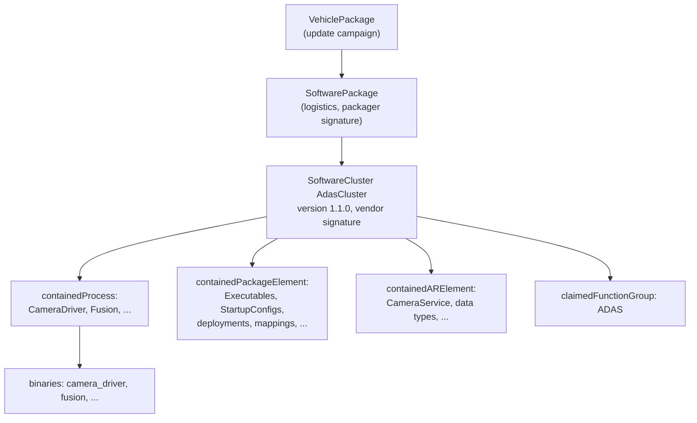

### 10.4 Worked Example: `AdasCluster` and `HpcPlatformCore`

The OEM describes the ADAS function with a Software Cluster Design:

```xml
<SOFTWARE-CLUSTER-DESIGN>
  <SHORT-NAME>AdasClusterDesign</SHORT-NAME>
  <CATEGORY>APPLICATION_LAYER</CATEGORY>
  <CONTAINED-PROCESS-REFS>
    <CONTAINED-PROCESS-REF DEST="PROCESS-DESIGN">/HPC/ProcessDesigns/CameraDriverDesign</CONTAINED-PROCESS-REF>
    <CONTAINED-PROCESS-REF DEST="PROCESS-DESIGN">/HPC/ProcessDesigns/FusionDesign</CONTAINED-PROCESS-REF>
  </CONTAINED-PROCESS-REFS>
  <INSTALLATION-BEHAVIOR>CAN-BE-REMOVED</INSTALLATION-BEHAVIOR>
  <INTENDED-TARGET-MACHINE-REFS>
    <INTENDED-TARGET-MACHINE-REF DEST="MACHINE-DESIGN">/HPC/MachineDesigns/HpcDesign</INTENDED-TARGET-MACHINE-REF>
  </INTENDED-TARGET-MACHINE-REFS>
  <REQUIRED-AR-ELEMENT-REFS>
    <REQUIRED-AR-ELEMENT-REF DEST="SERVICE-INTERFACE">/HPC/ServiceInterfaces/CameraService</REQUIRED-AR-ELEMENT-REF>
  </REQUIRED-AR-ELEMENT-REFS>
</SOFTWARE-CLUSTER-DESIGN>
```

The integrator derives the `SoftwareCluster`. The excerpt shows one reference of each kind; the complete list in [Section 12.16](#1216-the-running-example-complete-configuration) has 13 contained AR elements and 18 contained package elements.

```xml
<SOFTWARE-CLUSTER>
  <SHORT-NAME>AdasCluster</SHORT-NAME>
  <CATEGORY>APPLICATION_LAYER</CATEGORY>
  <CLAIMED-FUNCTION-GROUP-REFS>
    <CLAIMED-FUNCTION-GROUP-REF DEST="MODE-DECLARATION-GROUP-PROTOTYPE">/HPC/FunctionGroupSets/AdasFunctionGroups/ADAS</CLAIMED-FUNCTION-GROUP-REF>
  </CLAIMED-FUNCTION-GROUP-REFS>
  <CONTAINED-AR-ELEMENT-REFS>
    <CONTAINED-AR-ELEMENT-REF DEST="SERVICE-INTERFACE">/HPC/ServiceInterfaces/CameraService</CONTAINED-AR-ELEMENT-REF>
    <!-- data types, CompuMethods, application errors and domains, component types -->
  </CONTAINED-AR-ELEMENT-REFS>
  <CONTAINED-PACKAGE-ELEMENT-REFS>
    <CONTAINED-PACKAGE-ELEMENT-REF DEST="EXECUTABLE">/HPC/Executables/fusion</CONTAINED-PACKAGE-ELEMENT-REF>
    <!-- the other Executable, ADAS_States, AdasFunctionGroups, StartupConfigs,
         the process-to-machine mappings, the deployment, the SD timing configurations,
         the service instances, the port and machine mappings, and the vendor certificate -->
  </CONTAINED-PACKAGE-ELEMENT-REFS>
  <CONTAINED-PROCESS-REFS>
    <CONTAINED-PROCESS-REF DEST="PROCESS">/HPC/Processes/CameraDriver</CONTAINED-PROCESS-REF>
    <CONTAINED-PROCESS-REF DEST="PROCESS">/HPC/Processes/Fusion</CONTAINED-PROCESS-REF>
  </CONTAINED-PROCESS-REFS>
  <DESIGN-REFS>
    <DESIGN-REF DEST="SOFTWARE-CLUSTER-DESIGN">/HPC/SoftwareClusterDesigns/AdasClusterDesign</DESIGN-REF>
  </DESIGN-REFS>
  <VENDOR-ID>4660</VENDOR-ID>
  <VENDOR-SIGNATURE-REF DEST="CRYPTO-SERVICE-CERTIFICATE">/HPC/CryptoServiceCertificates/AdasSupplierCert</VENDOR-SIGNATURE-REF>
  <VERSION>1.0.0</VERSION>
</SOFTWARE-CLUSTER>
```

`4660` is the vendor ID `0x1234`. `HpcPlatformCore`, of category `PLATFORM_CORE`, claims `MachineFG` and contains the `Machine`, the `MachineDesign`, `MachineFG_States` and `MachineFunctionGroups`. The processes of the platform, such as `StateManager`, are not modeled in this guide. They are needed for the constraints that apply to the whole Machine, for example that some process runs in `Shutdown` and in `Restart` ([constr_1618], [constr_1619]).

> **Key takeaways**
>
> - The OEM's `SoftwareClusterDesign` is a contract: processes (as `ProcessDesign`s), required elements, target machine, installation behavior and dependencies.
> - The `SoftwareCluster` is the uploadable unit: contained processes, contained package elements, contained AR elements and claimed Function Groups, with version, vendor ID and vendor signature.
> - Exactly one `PLATFORM_CORE` cluster per Machine; a Function Group is claimed by at most one cluster.
> - A `SoftwarePackage` wraps a Software Cluster for the logistics of installation; its format is implementation-specific.

---

## 11. The Methodology: From Design to a Running Machine

> **Why this matters:** The model of an Adaptive system is written by many hands: the OEM, its suppliers and the integrators. The methodology says who creates which work product, from which inputs, and in which order. If you know it, you know whom to ask about a value in a manifest, and why some values cannot simply be changed during integration.

### 11.1 Roles and Work Products

The *Methodology for Adaptive Platform* describes the main aspects of building an Adaptive system: use cases, tasks and work products, and how they relate. It does not describe a complete process, and it does not prescribe a precise order of activities; iterations are possible ([TR_AMETH_00100]). Tasks take work products as input and produce new work products ([TR_AMETH_00101]). A work product is an artifact or a deliverable of the kind AUTOSAR XML, source code, object code, executable, text or custom ([TR_AMETH_00102]). Many of its items have the status DRAFT.

The following table summarizes the roles that the Methodology TR names and the manifest content that results from their work.

| Role | Typical company | Main work products | Resulting model content |
| --- | --- | --- | --- |
| E/E system architect, software architect | OEM | High-level architecture: function architecture, vehicle software and hardware architecture | Partly non-AUTOSAR documents; the vehicle software architecture assigns functions to Adaptive and Classic software components ([TR_AMETH_00201], [TR_AMETH_00202]) |
| Communication designer | OEM | System topology description: networks, network endpoints, service topology | `System`, `EthernetCluster`, `NetworkEndpoint`, first `MachineDesign` |
| Service designer | OEM or supplier | Service interface description, data types | `ServiceInterface`, data types, application errors |
| Software cluster responsible | OEM, refined by the supplier | Software cluster design description, service deployment and service instance descriptions | `SoftwareClusterDesign`, `ServiceInterfaceDeployment`, service instances |
| Application developer | Supplier ("software development organization") | Application design description, source or object code | Component types, ports, `Executable`, `ProcessDesign` |
| ECU hardware provider | Supplier | ECU resource description ([TR_AMETH_00019]) | Input to the Machine Manifest |
| Integrator | Tier 1 supplier | Machine Manifest, platform module configuration, Execution Manifest, Service Instance Manifest, software cluster description | `Machine`, module instantiations, `Process`, `StartupConfig`, mappings, `SoftwareCluster` |
| Back-end operator | OEM | Software packages and update campaigns ([TR_AMETH_00224]) | `SoftwarePackage`, `VehiclePackage` |

### 11.2 The Methodology at a Glance

The Methodology TR groups its content into method content packages (Methodology TR, Figure 2.1). The following diagram shows them; an arrow means "depends on the results of".

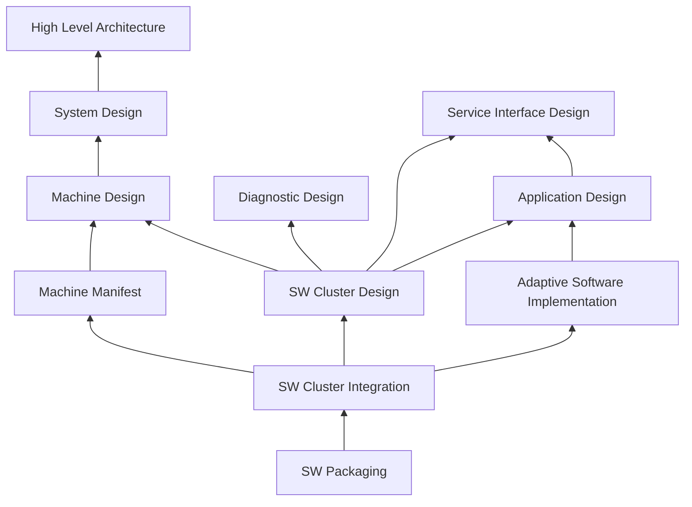

The development is structured into the domains analysis, architecture and design, system development, software development, and integration and deployment ([TR_AMETH_00200]). The two-phase approach of the Classic Platform methodology, with its interaction between OEM and suppliers, applies by analogy ([TR_AMETH_00204]).

### 11.3 Top-Down and Bottom-Up

The Methodology TR describes two directions of work (Methodology TR, Table 1.2):

- **Top-down:** from the abstract to the concrete, for example system → software cluster → binary → software component. The OEM designs the system and the software cluster designs first; the suppliers implement against them.
- **Bottom-up:** from the concrete to the abstract, for example software component → binary → software cluster → system. Existing components and applications are assembled into clusters and systems.

On `HPC`, the top-down path means: the OEM defines `CameraService`, the system topology and `AdasClusterDesign` with the endpoints of the cluster; the supplier then designs `CameraDriverSwc` and `FusionSwc` to implement exactly these endpoints. In the top-down scenario, the application design can start only when the software cluster design has specified the communication endpoints (Methodology TR, Section 2.9.4). The bottom-up path means: `CameraDriver` is reused from an earlier project, and the cluster design and the service instances are derived from its existing ports (Methodology TR, Section 2.9.5).

### 11.4 Design: System, Service Interfaces, Applications and the Machine

**System design.** The system design consists of the system topology description (network endpoints and the service topology: which service instances exist and on which Machine), the initial software cluster design descriptions, the global time description, the network management description and the signal-to-service translation description (Methodology TR, Section 2.2). On the Adaptive Platform, grouping software components into software clusters is mandatory, because components are integrated into Executables that are deployed to a Machine (Methodology TR, Section 2.1.2).

**Service interface design.** All service interfaces used by Adaptive software are defined with their events, methods and fields; they are the basis for header generation, so their namespaces influence the generated code ([TR_AMETH_00008]). Fine-grained interfaces can be aggregated into coarse-grained ones for network communication, to reduce the bus load ([TR_AMETH_00009]; TPS, Section 4.3). The data types include the C++ implementation data types ([TR_AMETH_00007]).

**Application design.** The application developer designs the software components with their ports, places them in Executables, defines a `ProcessDesign` per foreseen process, and describes the interaction of the ports with applications and with functional clusters ([TR_AMETH_00010], [TR_AMETH_00011]). Platform-level Executables may also be implemented without a component model ([TR_AMETH_00035]).

**Machine design and Machine Manifest.** The communication structure of the Machine comes first, as the `MachineDesign`; the integrator then writes the Machine Manifest for the real ECU hardware ([TR_AMETH_00003]; [Section 7.2](#72-machine-design)).

**Software cluster design.** The design of a software cluster usually starts with its provided and required service instances. A *black box* of the cluster lists one delegation port per service instance, before the application design exists. When the Executables and process designs are known, the service instances are mapped to their ports (Methodology TR, Section 2.9.2). The SOME/IP service ID must be unambiguous in the system, and each instance ID unambiguous for its service ID ([TR_AMETH_00027], [TR_AMETH_00005]).

### 11.5 Implementation and Code Generation

The C++ header files for the service interfaces are generated independently of any particular software component and its ports: proxies for required ports and skeletons for provided ports ([TR_AMETH_00012]). This is why the constraints with the imposition time `IT_BefAraApiGen` ([Section 2.5](#25-constraints-and-imposition-times)) must hold before the developer starts to implement: the generator needs a consistent interface.

The developer implements the component against the generated headers ([TR_AMETH_00013]). Two delivery models exist. If the integrator hands over the build configuration in advance, the developer builds against it and delivers object code ([TR_AMETH_00014]). Otherwise the developer delivers source code, and the integrator compiles it ([TR_AMETH_00015]). Every Executable, including those of platform modules, needs a `main` function and, later, an Execution Manifest ([TR_AMETH_00020]).

During integration, the integrator generates further glue code: the serialization code according to the serialization properties, and the implementation of proxies and skeletons ([TR_AMETH_00016], [TR_AMETH_00017], [TR_AMETH_00018]). The signatures of proxies and skeletons are fixed before development; their implementation may follow later.

> **Note (implementation example):** Authoring tools usually combine modeling, validation and generation. For example, Vector describes its DaVinci Developer Adaptive as a tool to "design, configure and manage AUTOSAR Adaptive applications in a single environment", which can also create Adaptive manifests and use the generators of its platform implementation to validate configurations and generate code [EXT-012]. Other vendors offer comparable tools; their workflows and file layouts differ.

### 11.6 Software Cluster Integration

*Integration and deployment* means all activities that are necessary to make designated software run on a specific Machine (Methodology TR, Section 2.10). For a software cluster, the integrator:

1. **builds the software** for the target: binds the delivered source or object code with the glue code into Executables ([TR_AMETH_00205], [TR_AMETH_00018]). This step does not instantiate the Executables; that is done by the Execution Manifest.
2. **defines the Execution Manifest**: the `Process`es with their startup configurations, Function Groups and dependencies, and their mapping to the Machine ([TR_AMETH_00004], [TR_AMETH_00022], [TR_AMETH_00026], [TR_AMETH_00216]).
3. **configures the platform modules**, if the cluster contains platform software: COM, Crypto, DoIP, time synchronization, Log and Trace, IAM, IDS, NM, OS, Persistency, PHM and UCM. These configurations go into the Machine Manifest (Methodology TR, Section 2.10.3).
4. **creates or finalizes the Service Instance Manifest**: finalizes the service instance IDs according to the service topology of the system, and adds the real `Process` to each service instance mapping ([TR_AMETH_00028], [TR_AMETH_00029], [TR_AMETH_00033]).
5. **integrates diagnostics**: maps the diagnostic elements to ports and to the processes or process designs ([TR_AMETH_00213]).

The Methodology TR marks its chapters on software cluster integration and packaging as not yet fully elaborated (Methodology TR, Section 1.6).

### 11.7 Packaging and Deployment

A Software Cluster is wrapped into a Software Package, together with its binaries ([TR_AMETH_00006], [TR_AMETH_00206]). The installation instructions per Software Cluster, such as add, update or remove, are part of the package description ([TR_AMETH_00221]). The packages are stored on an OEM back-end and provided to the Machines in the field ([TR_AMETH_00224], [TR_AMETH_00225]). AUTOSAR does not specify the format of the package or whether updates are complete or delta updates ([TR_AMETH_00222]).

Before any package can be installed, the Machine must be set up initially: the operating system and the platform modules, at least UCM and the modules it depends on, are installed with their Machine Manifest, Execution Manifests and Service Instance Manifests ([TR_AMETH_00031]). From then on, UCM installs further software as packages ([Section 10.3](#103-software-package-and-vehicle-package), guide 13).

### 11.8 How the Platform Consumes Manifests at Run Time

The ARXML stays in the development world. On the Machine, each platform implementation uses its own format, which must preserve the content and semantics of the ARXML ([TPS_MANI_01021]). The [EM guide](04_ExecutionManagement.md#41-where-the-configuration-lives) calls the result *Processed Manifests*: the conversion happens off-board at integration or deployment time, or on the Machine by UCM at installation time, and, if a Trusted Platform is configured, EM checks their integrity and authenticity before it uses them ([EM guide, Section 12.2](04_ExecutionManagement.md#122-what-em-verifies-and-why)).

The functional clusters read their configuration through the *Registry*, an internal component of the platform, with its native interface `ManifestAccessor` (*SW Architecture*, Section 9.7.3; [guide 01, Section 5.7](01_PlatformOverview.md#57-configuration)). The interface is not standardized in detail. The required-interface tables of the *SW Architecture* show what each cluster reads, for example:

| Cluster | Reads from the manifests (*SW Architecture*, Chapter 9) |
| --- | --- |
| Execution Management | The configuration of Function Groups and processes |
| Communication Management | Service information |
| Log and Trace | Information about modeled messages |
| Network Management | Its network handles |
| Time Synchronization | Time base resources with their providers and consumers |
| Diagnostic Management | Its configuration |

APMC adds a principle for the future target configuration: parts of the *design* model are expected to be available on the target as well, usually converted into a machine-specific format; for example, a service interface can configure an Adaptive service directly, so its content need not be copied into the configuration (APMC, Section 2.1.2).

After an update, the platform's configuration must stay consistent. UCM can therefore request a reset of the Machine from State Management; otherwise the manifests must be reparsed after the activation (*Platform Design*, Section 13.9).

### 11.9 Looking Ahead: APMC

The TPS states that its manifest content "will be replaced step-by-step" by a target-configuration model based on APMC (TPS, Chapter 1). APMC was introduced in R24-11.

**In plain words:** instead of one meta-class per configuration setting in the AUTOSAR meta-model (M2), APMC defines each functional cluster's settings as a model (M1), like the ECU Configuration of the Classic Platform. A *definition side* says which containers, parameters and references exist; a *value side* holds the values and follows the structure of the definition ([AP_TPS_APMC_01000]).

**Formally:**

- The root of the definition side is an `ApmcFunctionalClusterDef`, which contains containers (`ApmcParamConfContainerDef`, `ApmcChoiceContainerDef`), parameters (`ApmcParameterDef` subclasses) and references (`ApmcReferenceDef` subclasses) ([AP_TPS_APMC_01001], [AP_TPS_APMC_01006], [AP_TPS_APMC_01008], [AP_TPS_APMC_01009]). Multiplicities are defined on the elements themselves ([AP_TPS_APMC_01003]).
- The root of the value side is an `ApmcFunctionalClusterValue`, with `ApmcContainerValue`s and parameter and reference values; every value references its definition ([AP_TPS_APMC_01010], [AP_TPS_APMC_01000]).
- An `ApmcFunctionalClusterDef` has the category `STANDARDIZED_CLUSTER_DEFINITION` (released by AUTOSAR) or `VENDOR_SPECIFIC_CLUSTER_DEFINITION` (a vendor's refinement with additional containers, parameters or references) ([AP_TPS_APMC_01038]).
- The APMC collections and definitions are `UploadablePackageElement`s, so a Software Cluster can contain them (TPS, Table 16.1).

The benefits that APMC names are a much simpler model structure, the ability to define default values, terminology specific to each functional cluster, arbitrary multiplicities, changes without a change of the XML Schema, vendor extensions as first-class citizens, and a clear separation between design workflow and configuration workflow (APMC, Section 2.3). APMC also describes how much of the design is copied into the configuration: nothing, everything, or a part, with flat references or instance references into the remaining design (APMC, Section 2.4).

**Status in R25-11.** For two functional clusters, APMC is already the canonical target configuration: Persistency and Update and Configuration Management. Their parameters are documented in Chapter 10.1 of their specifications; the M2 description in the TPS is still provided but may be discontinued (TPS, Sections 12.2 and 12.8). The TPS Appendix I describes how the APMC parameters of Persistency map to the manifest meta-classes. Guides 11 and 13 explain these configurations. All other clusters are configured through the meta-model as described in this guide.

> **Key takeaways**
>
> - The Methodology TR defines tasks and work products, not a complete process. Many items are DRAFT.
> - The OEM owns the system design, the service interfaces and the software cluster designs; suppliers implement; integrators write the manifests.
> - Headers are generated from the service interfaces before implementation; glue code is generated during integration.
> - Integration produces the Execution Manifest, the platform module configuration and the final Service Instance Manifest; packaging wraps the Software Cluster for UCM.
> - On the Machine, clusters read processed manifests through the Registry; the format is implementation-specific.
> - APMC is the future of target configuration; in R25-11 it is canonical for Persistency and UCM.

---

## 12. Configuration Reference: What to Configure

> **Why this matters:** Many integration problems are configuration problems: a missing reference, a wrong literal, a state without `Verify`, a port mapped to no service instance. This chapter lists everything that this guide covers: the minimal configuration, every element with its attributes, and the complete, validated model of the running example. For the elements whose behavior other guides own, it lists the attributes and links to the owner guide.

The tables use these columns. *Type and values* gives the meta-model type and, for enumerations, the literals as written in the meta-model (in ARXML they are written as described in [Section 3.3](#33-from-meta-model-names-to-xml-tags)). *Mult.* is the multiplicity of the class table. *Default* is the behavior when the attribute is absent, **only if the specifications state it**; otherwise it says "not specified". *Rules* lists the constraints, with their imposition time where it matters.

### 12.1 Minimal Configuration

The following checklist produces the model of this guide. Each step names the element, the file of [Section 12.16](#1216-the-running-example-complete-configuration) in which it lives, and whether it is mandatory.

1. **Standard types** (mandatory): reference `/AUTOSAR/StdTypes`; do not redefine `uint8_t` and the other standard types.
2. **Data types** (mandatory, `01`): a `StdCppImplementationDataType` for every type used by the interface; enumerations as `TYPE_REFERENCE` with a `TEXTTABLE` `CompuMethod`. Application data types are optional.
3. **Application errors** (mandatory if a method raises errors, `01`): an `ApApplicationErrorDomain` with `value`, and `ApApplicationError`s with `errorCode` and `errorDomain`.
4. **Service interface** (mandatory, `01`): `ServiceInterface` with namespace, version, events, fields (all three `has...` attributes) and methods.
5. **Component types and ports** (mandatory, `02`): `AdaptiveApplicationSwComponentType`s with P-ports and R-ports typed by the interface; for a provided field, a `FieldSenderComSpec` with `initValue` (recommended).
6. **Executables** (mandatory, `02`): `category`, `version`, and a `rootSwComponentPrototype` typed by the component type.
7. **Process designs** (optional, `02`): one `ProcessDesign` per foreseen process, if design-level elements, such as a Software Cluster Design, must refer to processes.
8. **Network and machine design** (mandatory, `03`): a `NetworkEndpoint` with the IP address of the Machine; a `MachineDesign` with an `EthernetCommunicationConnector`, its `ApApplicationEndpoint`s and the SOME/IP service discovery configuration. A `System` of category `MACHINE_DESIGN_EXTRACT` is optional.
9. **Machine** (mandatory, `04`): `machineDesign`, `trustedPlatformExecutableLaunchBehavior`, `defaultApplicationTimeout` with both values, at least one `Processor`, and an `OsModuleInstantiation` with at least one `ResourceGroup`.
10. **Function Groups** (mandatory, `04` and `05`): `MachineFG` with its mandatory states; every Function Group with `Off` as initial mode and with `Verify`.
11. **Processes** (mandatory, `05`): `StartupConfig`s; `Process`es with `executable` and `StateDependentStartupConfig`s (states, ResourceGroup, StartupConfig); one `ProcessToMachineMapping` per process.
12. **Service instances** (mandatory for SOME/IP, `06`): a `SomeipServiceInterfaceDeployment` covering all elements; provided and required instances with their IDs, event groups and service discovery configurations; a `ServiceInstanceToPortPrototypeMapping` per port and process; a `SomeipServiceInstanceToMachineMapping` with the connector and the ports.
13. **Software Clusters** (mandatory, `07`): exactly one `PLATFORM_CORE` cluster per Machine; every cluster with `version`, `vendorId`, `vendorSignature`, its claimed Function Groups, contained processes, contained package elements and contained AR elements. A `SoftwareClusterDesign` is optional, unless dependencies between clusters are needed.
14. **Validation** (mandatory): validate each file against the XML Schema, and check the merged model with your tool at `IT_BefAraApiGen` (before generating headers) and at `IT_Mani` (before installation).

### 12.2 AdaptiveApplicationSwComponentType and PortPrototype

**Purpose:** a piece of Adaptive application software and its communication endpoints. **Lives in:** application design. **Configured by:** application developer. **Spec:** TPS 3.2.1, 3.2.4, 3.2.5; Tables 3.1, 3.6, E.104, E.115.

| Element.attribute | Meaning | Type and values | Mult. | Default | Rules | Effect at run time |
| --- | --- | --- | --- | --- | --- | --- |
| `AdaptiveApplicationSwComponentType.port` (inherited from `SwComponentType`) | The ports of the component | `PortPrototype` (`PPortPrototype`, `RPortPrototype`) | `*` | not specified | No `PRPortPrototype` typed by a `ServiceInterface` ([constr_1473]) | Each port becomes one `InstanceSpecifier` per Executable ([Section 9.4](#94-from-port-to-instancespecifier)) |
| `AdaptiveApplicationSwComponentType.internalBehavior` | Minimal internal behavior | `AdaptiveSwcInternalBehavior` with `serviceDependency` | `0..1` | not specified | | None in this guide |
| `CompositionSwComponentType.component` | Nested component prototypes | `SwComponentPrototype` | `*` | not specified | Only composition or Adaptive component types inside an Executable ([constr_1492]) | Adds a level to the `InstanceSpecifier` |
| `PPortPrototype.providedInterface` | The interface the port provides | `PortInterface`, for example `ServiceInterface` (tref) | `0..1` | not specified | [TPS_MANI_01039]; a `ServiceInterface` only for Adaptive components ([constr_1483]) | Skeleton side of the service |
| `RPortPrototype.requiredInterface` | The interface the port requires | `PortInterface` (tref) | `0..1` | not specified | [TPS_MANI_01040] | Proxy side of the service |
| `PortPrototype.portPrototypeProps` | Further qualification of a port | `RPortPrototypeProps` | `0..1` | not specified | Only for components in an Executable ([constr_3642]); `RPortPrototypeProps` only in R-ports ([constr_3359]) | None directly |
| `RPortPrototypeProps.searchIntention` | Whether the developer intends to search for one instance or for all | `searchForAllInstances`, `searchForSpecificInstance` | `0..1` | not specified | Not binding ([TPS_MANI_01057]) | The real search is configured in the Service Instance Manifest |
| `FieldSenderComSpec.initValue` (in `PPortPrototype.providedComSpec`) | The value of a field before the service is offered | `ValueSpecification` | `0..1` | not specified | Shall exist if the ComSpec exists ([constr_10152], `IT_BefAraApiGen`) | Can be used to set the field value before the offer ([TPS_MANI_03212]); [guide 07, Section 9.2](07_CommunicationManagement.md#92-the-value-before-the-offer) |

### 12.3 Executable and RootSwComponentPrototype

**Purpose:** the executable program and the root of its component hierarchy. **Lives in:** application design (uploadable design element). **Configured by:** application developer. **Spec:** TPS 3.2.2; Tables 3.3, 3.5.

| Attribute | Meaning | Type and values | Mult. | Default | Rules | Effect at run time |
| --- | --- | --- | --- | --- | --- | --- |
| `category` | Application or platform software | `APPLICATION_LEVEL`, `PLATFORM_LEVEL` (standardized) | `0..1` | not specified | [constr_1605]; `PLATFORM_LEVEL` required for module processes ([constr_1490]) | Marks platform modules |
| `reportingBehavior` | Whether processes report their Execution State | `reportsExecutionState`, `doesNotReportExecutionState` | `0..1` | Reports ([TPS_MANI_01279]) | | [EM guide, Section 2.4](04_ExecutionManagement.md#24-process-flavors) |
| `rootSwComponentPrototype` | Root of the component hierarchy | `RootSwComponentPrototype` | `0..1` | not specified | Optional for platform modules without service-oriented communication ([TPS_MANI_03056]) | Its short name is the second element of every `InstanceSpecifier` |
| `RootSwComponentPrototype.applicationType` | The component type of the root | `SwComponentType` (tref) | `0..1` | not specified | Only composition or Adaptive component types ([constr_1492]) | |
| `version` | Version of the program | `StrongRevisionLabelString`, for example `1.0.0` | `0..1` | not specified | | Used for updates and diagnostics (guides 12a, 13) |
| `minimumTimerGranularity` | Minimum timer resolution required | `TimeValue` (seconds) | `0..1` | not specified | | Not specified by the TPS; the OS side is described by `OsModuleInstantiation.supportedTimerGranularity` |
| `suspendToRamAwareness` | Behavior during suspend-to-RAM (candidate, DRAFT) | `suspendToRamTolerant`, `suspendToRamAware`, `suspendToRamNotSupported` | `0..1` | not specified | [TPS_MANI_01513] | Guide 05 |
| `implementationProps` | Build-time properties of platform-level Executables | `ExecutableLoggingImplementationProps` | `*` | not specified | Only for `PLATFORM_LEVEL` ([constr_10113]) | Guide 10 |

### 12.4 ServiceInterface and Its Elements

**Purpose:** the contract of a service. **Lives in:** service interface design. **Configured by:** service designer. **Spec:** TPS 4.2; Tables 4.1 to 4.5, 4.7, E.14.

| Element.attribute | Meaning | Type and values | Mult. | Default | Rules | Effect at run time |
| --- | --- | --- | --- | --- | --- | --- |
| `ServiceInterface.namespace` | Namespace of the generated code, in order | `SymbolProps` with `symbol` (`CIdentifier`) | `*` | not specified | Order is significant ([TPS_MANI_01006]) | C++ namespace of proxies, skeletons and types |
| `ServiceInterface.majorVersion`, `minorVersion` | Version of the service contract | `PositiveInteger` | `0..1` each | not specified | Semantic versioning ([TPS_MANI_03616]) | Mapped to a version per deployment ([TPS_MANI_03617]) |
| `ServiceInterface.event` | Events | `VariableDataPrototype` | `*` | not specified | No `initValue` ([constr_1494]) | Event of proxy and skeleton ([guide 07](07_CommunicationManagement.md#7-events-and-triggers)) |
| `ServiceInterface.field` | Fields | `Field` | `*` | not specified | | Field of proxy and skeleton |
| `Field.hasGetter`, `hasSetter`, `hasNotifier` | Which accessors exist | `Boolean` | `0..1` each | not specified | All three shall exist, at least one `true` ([constr_1673], [constr_10129], [constr_10130], [constr_10131]) | Which methods and notifications are generated |
| `ServiceInterface.method` | Methods | `ClientServerOperation` | `*` | not specified | | Method of proxy and skeleton |
| `ClientServerOperation.argument` | Arguments, in order | `ArgumentDataPrototype` with `direction` `in`, `out`, `inout` | `*` | not specified | No optional arguments | Signature of the method |
| `ClientServerOperation.fireAndForget` | No response expected | `Boolean` | `0..1` | Not fire and forget ([TPS_MANI_03119]) | No `out`/`inout` arguments, no errors ([constr_3374], [constr_3375]) | One-way call |
| `ClientServerOperation.possibleApError`, `possibleApErrorSet` | Errors the method can raise | `ApApplicationError`, `ApApplicationErrorSet` (ref) | `*` | not specified | Unique domain values per method ([constr_10574]) | Errors returned through `ara::core` ([guide 03, 7.8](03_CoreAndGeneral.md#78-generated-error-domains)) |
| `ServiceInterface.trigger` | Triggers (events without data) | `Trigger` | `*` | not specified | | Queued, processed first in, first out |
| `VariableDataPrototype.type`, `Field.type`, `ArgumentDataPrototype.type` (`TYPE-TREF`) | The data type of an event, field or argument | `AutosarDataType`, for example `CppImplementationDataType` (tref) | `0..1` | not specified | C++ types required from header generation ([TPS_MANI_03223]) | Type in the generated code |

### 12.5 CppImplementationDataType

**Purpose:** a data type with its C++ binding. **Lives in:** service interface design. **Configured by:** service designer. **Spec:** TPS 3.3.3; Tables 3.45 to 3.50.

| Attribute | Meaning | Type and values | Mult. | Default | Rules | Effect at run time |
| --- | --- | --- | --- | --- | --- | --- |
| `category` | Kind of type | `VALUE`, `TYPE_REFERENCE`, `STRUCTURE`, `ARRAY`, `VECTOR`, `ASSOCIATIVE_MAP`, `STRING`, `VARIANT` | `0..1` | not specified | [constr_1578]; existence of other attributes per category ([constr_10417]) | C++ form ([Section 6.4](#64-data-types)) |
| `subElement` | Members of a structure, in order | `CppImplementationDataTypeElement` with `typeReference` and `isOptional` | `*` | not specified | `1..*` for `STRUCTURE` ([constr_10417]) | Members of the `struct` ([TPS_MANI_03181]) |
| `templateArgument` | Element, key or value types, in order | `CppTemplateArgument` with `templateType`, `allocator`, `category`, `inplace` | `*` | not specified | `VECTOR`: 1 or 2 ([constr_3434]); `ARRAY`: 1 ([constr_3433]) | Template arguments |
| `typeReference` | The aliased type | `CppImplementationDataType` (ref) | `0..1` | not specified | Required for `TYPE_REFERENCE` ([constr_10417]) | Type alias |
| `arraySize` | Size of an array, maximum size of a vector with allocator | `PositiveInteger` | `0..1` | not specified | [TPS_MANI_03172], [TPS_MANI_03186] | Array size |
| `namespace` | Namespace of the type | `SymbolProps` | `*` | not specified | Not for `VALUE` ([constr_3443]) | C++ namespace |
| `headerFile` | Header that declares the type | `String`, for example `cstdint` | `0..1` | not specified | Exclusive with `typeEmitter` ([constr_1743]) | `#include` |
| `typeEmitter` | Who generates the type | `NameToken`; reserved `TYPE_EMITTER_ARA`, `FUNDAMENTAL_TYPE` | `0..1` | not specified | [TPS_MANI_01176], [TPS_MANI_01177] | `TYPE_EMITTER_ARA`: the `ara` generator generates the type |
| `swDataDefProps.compuMethod` | Labels of an enumeration or bit field | `CompuMethod` of category `TEXTTABLE` or `BITFIELD_TEXTTABLE` | `0..1` | not specified | [constr_10566] | Enumerators ([guide 07, Section 5.5](07_CommunicationManagement.md#55-data-types)) |

### 12.6 ApApplicationError and ApApplicationErrorDomain

**Purpose:** the errors of methods and the domains they belong to. **Lives in:** service interface design. **Configured by:** service designer. **Spec:** TPS 4.2.8; Tables 4.9 to 4.11.

| Element.attribute | Meaning | Type and values | Mult. | Default | Rules | Effect at run time |
| --- | --- | --- | --- | --- | --- | --- |
| `ApApplicationError.errorCode` | Code of the error in its domain | `Integer` | `0..1` | not specified | Shall exist ([constr_10132]); unique in the domain ([constr_1665]); 1 to 63 for Classic interoperability ([constr_3772]) | Value of the generated enumerator |
| `ApApplicationError.errorDomain` | The domain | `ApApplicationErrorDomain` (ref) | `0..1` | not specified | Shall exist ([constr_1625]); short names unique per domain ([constr_1664]) | |
| `ApApplicationErrorDomain.value` | Identifier of the domain | `PositiveUnlimitedInteger` | `0..1` | not specified | Shall exist ([constr_10133]); 0 to `0xffffffffffffffff` ([TPS_MANI_01863], [constr_2637]) | Identifies the error domain in `ara::core` ([guide 03, 7.4](03_CoreAndGeneral.md#74-error-domain-identifiers)) |
| `ApApplicationErrorDomain.namespace` | Namespace of the domain's code | `SymbolProps` | `*` | not specified | | C++ namespace |
| `ApApplicationErrorSet.apApplicationError` | A reusable group of errors | `ApApplicationError` (ref) | `*` | not specified | [TPS_MANI_01198] | Same as listing the errors |

### 12.7 ProcessDesign and ProcessDesignToMachineDesignMapping

**Purpose:** the design-time stand-in of a process, and its pre-allocation to a machine design. **Lives in:** application design, system design. **Configured by:** application developer, system designer. **Spec:** TPS 3.2.6, 7.6; Tables 3.35, 7.57.

| Element.attribute | Meaning | Type and values | Mult. | Default | Rules | Effect at run time |
| --- | --- | --- | --- | --- | --- | --- |
| `ProcessDesign.executable` | The Executable of the future process | `Executable` (ref) | `*` | not specified | At most one ([constr_3731]); each `ProcessDesign` referenced by one `Process` ([constr_1550]) | None; resolved through `Process.design` |
| `ProcessDesignToMachineDesignMapping.processDesign`, `machineDesign` | Pre-allocation of a process design to a machine design | (ref) | `0..1` each | not specified | Both shall exist ([constr_10154], [constr_10657]) | May be overruled by `ProcessToMachineMapping` |
| `ProcessDesignToMachineDesignMapping.shallRunOn`, `shallNotRunOn` | Design-level core affinity (new in R25-11) | `ProcessorCore` (ref) | `*` each | not specified | Cores of the referenced machine design and of one processor; only one of the two ([constr_10659] to [constr_10662]) | Core affinity, unless overruled |

### 12.8 MachineDesign, EthernetCommunicationConnector and ApApplicationEndpoint

**Purpose:** the design-time description of a Machine and its network connection. **Lives in:** system design. **Configured by:** OEM communication designer or Tier 1 integrator. **Spec:** TPS 6, 7.2.1, 13.1; Tables 6.8, 13.1, 13.37. [Guide 08a](08a_NetworkBindings.md) covers all network attributes.

| Element.attribute | Meaning | Type and values | Mult. | Default | Rules | Effect at run time |
| --- | --- | --- | --- | --- | --- | --- |
| `MachineDesign.communicationConnector` | Network connections | `EthernetCommunicationConnector` | `*` | not specified | | Interfaces used by Communication Management |
| `MachineDesign.serviceDiscoveryConfig` | SOME/IP service discovery per connector | `SomeipServiceDiscovery` with `multicastSdIpAddress` and `someipServiceDiscoveryPort` | `*` | not specified | Port shall exist ([constr_10167]) | Address and port of SOME/IP-SD |
| `MachineDesign.processor` | Processors known at design time | `Processor` | `*` | not specified | | Targets of design-level core affinity |
| `EthernetCommunicationConnector.unicastNetworkEndpoint` | The IP address of the Machine on this connector | `NetworkEndpoint` (ref) | `*` | not specified | At most one ([constr_3721]); one IPv4 or IPv6 unicast address ([constr_3288]) | Local address of sockets |
| `EthernetCommunicationConnector.apApplicationEndpoint` | UDP and TCP ports | `ApApplicationEndpoint` with `tpConfiguration` (`TcpTp` or `UdpTp` with `TpPort.portNumber`) | `*` | not specified | Port `0`: ephemeral ([TPS_MANI_03227]) | Local port of sockets ([TPS_MANI_03280]) |

### 12.9 Machine

**Purpose:** the target configuration of one platform instance. **Lives in:** Machine Manifest. **Configured by:** integrator of the Machine. **Spec:** TPS 11, 12.1; Tables 6.1, 6.2, 11.1, 11.7, 12.3, 12.6.

| Element.attribute | Meaning | Type and values | Mult. | Default | Rules | Effect at run time |
| --- | --- | --- | --- | --- | --- | --- |
| `Machine.machineDesign` | The design that the Machine implements | `MachineDesign` (ref) | `0..1` | not specified | Shall exist ([constr_10169]) | Network settings of the design apply |
| `Machine.trustedPlatformExecutableLaunchBehavior` | How a failed authentication affects launching | `strictMode`, `monitorMode`, `noTrustedPlatformSupport` | `0..1` | not specified | Shall exist ([constr_10170]) | [EM guide, Section 12.3](04_ExecutionManagement.md#123-launch-behavior-modes) |
| `Machine.defaultApplicationTimeout` | Default start-up and termination timeout | `EnterExitTimeout` with `enterTimeoutValue`, `exitTimeoutValue` (`TimeValue`, seconds) | `0..1` | not specified | Both values shall exist ([constr_10430] to [constr_10432]) | Used when a `StartupConfig` defines no timeout ([EM guide, Section 13.5](04_ExecutionManagement.md#135-startupconfig)) |
| `Machine.environmentVariable` | Machine-wide environment variables | `TagWithOptionalValue` with `key`, `value` | `*` | not specified | Splitable | Environment of all processes; process values win (EM guide) |
| `Machine.processor` | Processors of the Machine | `Processor` with `core` (`ProcessorCore` with `coreId`) | `*` | not specified | At least one ([constr_10171]); `core` shall exist ([constr_10172]); `coreId` shall exist and be unique per processor ([constr_10173], [constr_1549]) | Targets of core affinity |
| `Machine.moduleInstantiation` | Platform module configuration | `AdaptiveModuleInstantiation` subclasses | `*` | not specified | | Cluster guides |
| `OsModuleInstantiation.resourceGroup` | Resource groups | `ResourceGroup` with `cpuUsage` (percent), `memUsage` (bytes) | `*` | not specified | At least one ([constr_1661]) | Limits of the group ([EM guide, Chapter 11](04_ExecutionManagement.md#11-resource-management)) |
| `OsModuleInstantiation.supportedTimerGranularity` | Timer granularity that the OS supports (one tick) | `TimeValue` | `0..1` | not specified | | Not specified by the TPS |
| `Machine.secureCommunicationDeployment` | Secure communication settings | `TlsDeployment`, `SecOcDeployment` | `*` | not specified | | Guide 14 |

### 12.10 FunctionGroupSet, ModeDeclarationGroup and ModeDeclaration

**Purpose:** Function Groups and their states. **Lives in:** Machine Manifest (`MachineFG`) and Execution Manifest (application Function Groups). **Configured by:** integrator. **Spec:** TPS 10.4; Tables 10.9 to 10.12.

| Element.attribute | Meaning | Type and values | Mult. | Default | Rules | Effect at run time |
| --- | --- | --- | --- | --- | --- | --- |
| `FunctionGroupSet.functionGroup` | The Function Groups | `ModeDeclarationGroupPrototype` with `type` (tref) | `*` | not specified | Claimed by at most one Software Cluster ([constr_1786]); exactly one `MachineFG` per Machine ([SWS_EM_CONSTR_02556]) | State machines controlled by State Management and EM |
| `ModeDeclarationGroup.modeDeclaration` | The states | `ModeDeclaration` | `*` | not specified | `Off` ([TPS_MANI_03195]) and `Verify` ([constr_10023]) mandatory | The states that `SetState` can request ([EM guide, Section 14.4](04_ExecutionManagement.md#144-functiongroup-and-functiongroupstate)) |
| `ModeDeclarationGroup.initialMode` | The initial state | `ModeDeclaration` (ref) | `0..1` | not specified | Shall be `Off` ([TPS_MANI_03195]) | State of the Function Group before the first transition |
| `ModeDeclaration.value` | Numeric value of a state | `PositiveInteger` | `0..1` | not specified | | Not used by this guide |

### 12.11 Process, StateDependentStartupConfig and StartupConfig

**Purpose:** how an Executable is started. **Lives in:** Execution Manifest. **Configured by:** integrator. **Spec:** TPS 10.2, 10.3; Tables 10.1, 10.3 to 10.7. The [EM guide, Chapter 13](04_ExecutionManagement.md#13-configuration-reference-what-to-configure) gives the meaning, the behavior when an attribute is absent and the run-time effect of every attribute; this table gives the model structure.

| Element.attribute | XML element | Type and values | Mult. | Rules |
| --- | --- | --- | --- | --- |
| `Process.executable` | `EXECUTABLE-REFS/EXECUTABLE-REF` | `Executable` (ref, `≪atpUriDef≫`) | `*` | At most one ([constr_3732]) |
| `Process.design` | `DESIGN-REF` | `ProcessDesign` (ref) | `0..1` | Same Executable ([constr_1693]) |
| `Process.functionClusterAffiliation` | `FUNCTION-CLUSTER-AFFILIATION` | `String`; standardized `STATE_MANAGEMENT`, `PLATFORM_HEALTH_MANAGEMENT` | `0..1` | [TPS_MANI_01337] |
| `Process.numberOfRestartAttempts` | `NUMBER-OF-RESTART-ATTEMPTS` | `PositiveInteger` | `0..1` | `0` or absent: start once (TPS, Table 10.1) |
| `Process.preMapping` | `PRE-MAPPING` | `Boolean` | `0..1` | |
| `Process.processStateMachine` | `PROCESS-STATE-MACHINE` | `ModeDeclarationGroupPrototype` | `0..1` | States standardized by EM |
| `Process.stateDependentStartupConfig` | `STATE-DEPENDENT-STARTUP-CONFIGS` | `StateDependentStartupConfig` | `*` | [constr_3396], [constr_1688] |
| `StateDependentStartupConfig.functionGroupState` | `FUNCTION-GROUP-STATE-IREFS` | `ModeDeclaration` (iref) | `*` | At least one ([constr_3423]); never `Off` ([constr_3424]) |
| `StateDependentStartupConfig.resourceGroup` | `RESOURCE-GROUP-REF` | `ResourceGroup` (ref) | `0..1` | Shall exist ([constr_10175]) |
| `StateDependentStartupConfig.startupConfig` | `STARTUP-CONFIG-REF` | `StartupConfig` (ref) | `0..1` | Shall exist ([constr_10176]) |
| `StateDependentStartupConfig.executionDependency` | `EXECUTION-DEPENDENCYS` | `ExecutionDependency` with `processState` (iref) | `*` | [constr_1689], [constr_10411] |
| `StateDependentStartupConfig.resourceConsumption` | `RESOURCE-CONSUMPTION` | `ResourceConsumption` with `memoryUsage` (`MemoryUsage.memoryConsumption`, bytes) | `0..1` | [TPS_MANI_01269] |
| `StartupConfig.processArgument` | `PROCESS-ARGUMENTS` | `ProcessArgument` with `argument` (ordered) | `*` | `argument` shall exist ([constr_1769]) |
| `StartupConfig.environmentVariable` | `ENVIRONMENT-VARIABLES` | `TagWithOptionalValue` | `*` | [TPS_MANI_01209] |
| `StartupConfig.schedulingPolicy`, `schedulingPriority` | `SCHEDULING-POLICY`, `SCHEDULING-PRIORITY` | `String` (`SCHED_FIFO`, `SCHED_RR`, `SCHED_OTHER`), `Integer` | `0..1` each | [TPS_MANI_01328], [constr_1692] |
| `StartupConfig.terminationBehavior` | `TERMINATION-BEHAVIOR` | `processIsNotSelfTerminating`, `processIsSelfTerminating` | `0..1` | [TPS_MANI_01334] |
| `StartupConfig.timeout` | `TIMEOUT` | `EnterExitTimeout` (seconds) | `0..1` | [TPS_MANI_01277], [TPS_MANI_01278] |
| `StartupConfig.permissionToCreateChildProcess` | `PERMISSION-TO-CREATE-CHILD-PROCESS` | `Boolean` | `0..1` | |
| `StartupConfig.processExecutionError` | `PROCESS-EXECUTION-ERROR-REF` | `ApApplicationError` (ref, status draft) | `0..1` | |

### 12.12 ProcessToMachineMapping

**Purpose:** the assignment of a process to its Machine. **Lives in:** Execution Manifest. **Configured by:** integrator. **Spec:** TPS 11.3; Tables 11.4, 11.5.

| Element.attribute | Meaning | Type and values | Mult. | Default | Rules | Effect at run time |
| --- | --- | --- | --- | --- | --- | --- |
| `ProcessToMachineMappingSet.processToMachineMapping` | The mappings | `ProcessToMachineMapping` | `*` | not specified | | |
| `ProcessToMachineMapping.process`, `machine` | The process and its Machine | (ref) | `0..1` each | not specified | Both shall exist ([constr_10174], [constr_10658]); each process mapped once ([constr_1553], [constr_5004]) | The Machine on which EM starts the process |
| `ProcessToMachineMapping.shallRunOn`, `shallNotRunOn` | Core affinity | `ProcessorCore` (ref) | `*` each | All cores (EM guide) | Cores of the referenced Machine and one processor; only one of the two ([constr_3393], [constr_1676], [constr_1677]) | [EM guide, Section 11.5](04_ExecutionManagement.md#115-cpu-core-affinity-and-scheduling) |
| `ProcessToMachineMapping.nonOsModuleInstantiation` | The platform module that the process implements | `NonOsModuleInstantiation` (ref) | `0..1` | not specified | Executable `PLATFORM_LEVEL` ([constr_1490]) | Cluster guides |
| `ProcessToMachineMapping.persistencyCentralStorageURI` | Central place for the process's storage information | `UriString` | `0..1` | not specified | Shall exist if the process uses Persistency ([constr_10090]) | Guide 11 |
| `ProcessToMachineMapping.design` | The design-level mapping | `ProcessDesignToMachineDesignMapping` (ref) | `0..1` | not specified | | |

### 12.13 ServiceInterfaceDeployment and Service Instances

**Purpose:** the transport-specific representation of a service interface and its instances. **Lives in:** Service Instance Manifest. **Configured by:** software cluster responsible, finalized by the integrator. **Spec:** TPS 13.2, 13.3; Tables 13.6 to 13.11, 13.28 to 13.30, 13.34, 13.49. [Guide 08a](08a_NetworkBindings.md) covers the SOME/IP and DDS attributes.

| Element.attribute | Meaning | Type and values | Mult. | Default | Rules | Effect at run time |
| --- | --- | --- | --- | --- | --- | --- |
| `ServiceInterfaceDeployment.serviceInterface` | The deployed interface | `ServiceInterface` (ref, `≪atpUriDef≫`) | `0..1` | not specified | All elements deployed, except for DDS ([constr_10029]) | |
| `ServiceInterfaceDeployment.eventDeployment`, `fieldDeployment`, `methodDeployment` | One deployment per element | `ServiceEventDeployment`, `ServiceFieldDeployment`, `ServiceMethodDeployment` subclasses | `*` each | not specified | Elements of the same interface ([constr_3300], [constr_3301], [constr_3302]) | IDs and transport per element |
| `ServiceInterfaceDeploymentElement.minimumSendInterval` | Minimum time between two transmissions | `TimeValue` (seconds) | `0..1` | `0`, which means no minimum ([SWS_CM_00139]; TPS, Section 13.2) | 0 to 10 s ([constr_10655]) | Rate limit in `ara::com` |
| `SomeipServiceInterfaceDeployment.serviceInterfaceId`, `serviceInterfaceVersion`, `eventGroup` | SOME/IP service ID, version and event groups | `PositiveInteger`, `SomeipServiceVersion`, `SomeipEventGroup` | `0..1`, `0..1`, `*` | not specified | ID and version shall exist ([constr_10212], [constr_10213]) | [Guide 08a](08a_NetworkBindings.md) |
| `AdaptivePlatformServiceInstance.serviceInterfaceDeployment` | The deployment the instance uses | `ServiceInterfaceDeployment` (ref) | `0..1` | not specified | | |
| `AdaptivePlatformServiceInstance.e2eEventProtectionProps`, `e2eMethodProtectionProps`, `secureComConfig` | E2E protection and secure communication | (aggr) | `*` each | not specified | | Guides 08, 14 |
| `ProvidedSomeipServiceInstance.serviceInstanceId`, `sdServerConfig`, `providedEventGroup` | Instance ID, SD server timing, event groups | `PositiveInteger`, `SomeipSdServerServiceInstanceConfig` (ref), `SomeipProvidedEventGroup` | `0..1`, `0..1`, `*` | not specified | ID and SD config shall exist ([constr_10219], [constr_10218]); ID 0 to 65534 ([constr_1770]); `multicastThreshold` shall exist ([constr_10220]) | Offer on the network |
| `RequiredSomeipServiceInstance.requiredServiceInstanceId`, `requiredMinorVersion`, `sdClientConfig`, `requiredEventGroup` | Searched instance and version, SD client timing, event groups | `AnyServiceInstanceId`, `AnyVersionString` (a number or `ANY`), (ref), `SomeipRequiredEventGroup` | `0..1`, `0..1`, `0..1`, `*` | not specified | SD config shall exist ([constr_10221]); event group timing shall exist ([constr_10222]) | Find and subscribe |

### 12.14 ServiceInstanceToPortPrototypeMapping and ServiceInstanceToMachineMapping

**Purpose:** connect a port to a service instance, and the instance to the Machine. **Lives in:** Service Instance Manifest. **Configured by:** software cluster responsible, finalized by the integrator. **Spec:** TPS 13.3; Tables 13.31, 13.32.

| Element.attribute | Meaning | Type and values | Mult. | Default | Rules | Effect at run time |
| --- | --- | --- | --- | --- | --- | --- |
| `ServiceInstanceToPortPrototypeMapping.portPrototype` | The port in the Executable | `PortPrototype` (iref `PortPrototypeInExecutableInstanceRef`, `≪atpUriDef≫`) | `0..1` | not specified | | Resolves the `InstanceSpecifier` of the port |
| `ServiceInstanceToPortPrototypeMapping.serviceInstance` | The service instance of the port | `AdaptivePlatformServiceInstance` (ref) | `0..1` | not specified | | Which instance the proxy or skeleton uses |
| `ServiceInstanceToPortPrototypeMapping.process` | The process in which the mapping applies | `Process` (ref) | `0..1` | not specified | At integration ([TPS_MANI_01317]); wins over `processDesign` | Different instances per process |
| `ServiceInstanceToPortPrototypeMapping.processDesign` | Design-level pre-assignment | `ProcessDesign` (ref) | `0..1` | not specified | Design only ([TPS_MANI_01316]) | |
| `ServiceInstanceToMachineMapping.communicationConnector` | The connector of the Machine | `CommunicationConnector` (ref) | `0..1` | not specified | | Network interface and local address |
| `ServiceInstanceToMachineMapping.serviceInstance` | The mapped instances | `AdaptivePlatformServiceInstance` (ref) | `*` | not specified | | |
| `SomeipServiceInstanceToMachineMapping.tcpPort`, `udpPort` | Local ports | `ApApplicationEndpoint` (ref) | `0..1` each | not specified | A TCP endpoint serves provided or required instances, not both ([constr_3487]); one address family ([constr_5155]); a TCP method deployment needs a `tcpPort` ([constr_3310]) | Ports in SD offers and subscriptions ([TPS_MANI_03292], [TPS_MANI_03293]) |
| `ServiceInstanceToMachineMapping.secureComPropsForTcp`, `secureComPropsForUdp`, `secOcComPropsForMulticast` | Security of the endpoints | (ref) | `0..1`, `0..1`, `*` | not specified | | Guide 14 |

### 12.15 SoftwareClusterDesign and SoftwareCluster

**Purpose:** the OEM's contract for an uploadable unit, and the uploadable unit itself. **Lives in:** software cluster design, Software Distribution. **Configured by:** OEM, integrator. **Spec:** TPS 8, 16; Tables 8.1, 8.2, 16.4, 16.5.

| Element.attribute | Meaning | Type and values | Mult. | Default | Rules | Effect at run time |
| --- | --- | --- | --- | --- | --- | --- |
| `category` (both) | Kind of cluster | `PLATFORM_CORE`, `PLATFORM`, `APPLICATION_LAYER`; custom values with a prefix | `0..1` | not specified | [TPS_MANI_01331]; exactly one `PLATFORM_CORE` per Machine ([constr_1788]) | `PLATFORM_CORE` cannot be removed by UCM |
| `SoftwareClusterDesign.containedProcess` | The processes of the design | `ProcessDesign` (ref) | `*` | not specified | [TPS_MANI_01211] | |
| `SoftwareClusterDesign.installationBehavior` | Whether derived clusters can be removed | `canBeRemoved`, `cannotBeRemoved` | `0..1` | not specified | Shall be `cannotBeRemoved` for `PLATFORM_CORE` ([constr_10410]) | UCM accepts or rejects removal (guide 13) |
| `SoftwareClusterDesign.intendedTargetMachine` | Target machine design | `MachineDesign` (ref, `≪atpUriDef≫`) | `*` | not specified | At most one ([constr_3727]) | |
| `SoftwareClusterDesign.dependsOn`, `conflictsTo` | Dependencies on other clusters | `SoftwareClusterDependencyFormula` | `0..1` each | not specified | Design level only in R25-11 ([TPS_MANI_01480], [TPS_MANI_01482]) | Checked at installation (guide 13) |
| `SoftwareClusterDesign.requiredARElement`, `requiredDesignElement` | Required elements | (ref) | `*` each | not specified | No other cluster designs or clusters ([constr_1560]) | |
| `SoftwareCluster.containedProcess` | The processes | `Process` (ref) | `*` | not specified | All on one Machine ([constr_1536]); only claimed Function Groups ([constr_1787]) | Installed and started on the Machine |
| `SoftwareCluster.containedPackageElement` | Uploadable elements | `UploadablePackageElement` (ref) | `*` | not specified | Mandatory reference for uploadable elements ([TPS_MANI_01116]) | Installed with the cluster |
| `SoftwareCluster.containedARElement` | Other elements | `ARElement` (ref) | `*` | not specified | No clusters or cluster designs ([constr_1566]) | Installed with the cluster |
| `SoftwareCluster.claimedFunctionGroup` | Reserved Function Groups | `ModeDeclarationGroupPrototype` (ref) | `*` | not specified | At most one cluster per Function Group ([constr_1786]) | |
| `SoftwareCluster.version` | Version of the cluster | `StrongRevisionLabelString` | `0..1` | not specified | Shall exist ([constr_10234]); major, minor, patch ([constr_1747]) | Compared by UCM (guide 13) |
| `SoftwareCluster.vendorId` | Vendor ID from the AUTOSAR vendor list | `PositiveInteger` | `0..1` | not specified | Shall exist ([constr_10235]) | |
| `SoftwareCluster.vendorSignature` | Certificate of the vendor's signature | `CryptoServiceCertificate` (ref) | `0..1` | not specified | Shall exist ([constr_10233]) | Authenticity check (guides 13, 14) |
| `SoftwareCluster.design` | The applied cluster designs | `SoftwareClusterDesign` (ref, `≪atpUriDef≫`) | `*` | not specified | Contract of [TPS_MANI_01112] | |
| `SoftwareCluster.moduleInstantiation`, `license`, `releaseNotes`, `typeApproval`, `artifactChecksum`, `artifactLocator`, `diagnosticDeploymentProps` | Further content | (various) | various | not specified | [TPS_MANI_01202], [TPS_MANI_01219], [TPS_MANI_01220], [TPS_MANI_01345], [TPS_MANI_01381] | Guides 12a, 13 |

### 12.16 The Running Example: Complete Configuration

The following seven files are the complete model of this guide. They are split by owner as described in [Section 3.7](#37-many-files-one-model) and contain 1044 lines in total. Each file validates against `AUTOSAR_00054.xsd`. Merged with the standardized package `/AUTOSAR/StdTypes`, all references resolve to elements of the `DEST` type, and the model satisfies the constraints cited in this guide, except those that need the parts of `HPC` that are not modeled here ([Section 10.4](#104-worked-example-adascluster-and-hpcplatformcore)). Open a file to see its content.

<details>
<summary><code>01_ServiceInterfaces.arxml</code>: data types, CompuMethods, application errors and `CameraService`</summary>

```xml
<?xml version="1.0" encoding="UTF-8"?>
<AUTOSAR xmlns="http://autosar.org/schema/r4.0" xmlns:xsi="http://www.w3.org/2001/XMLSchema-instance" xsi:schemaLocation="http://autosar.org/schema/r4.0 AUTOSAR_00054.xsd">
  <AR-PACKAGES>
    <AR-PACKAGE>
      <SHORT-NAME>HPC</SHORT-NAME>
      <AR-PACKAGES>
        <AR-PACKAGE>
          <SHORT-NAME>CompuMethods</SHORT-NAME>
          <ELEMENTS>
            <COMPU-METHOD>
              <SHORT-NAME>ExposureMode_Values</SHORT-NAME>
              <CATEGORY>TEXTTABLE</CATEGORY>
              <COMPU-INTERNAL-TO-PHYS>
                <COMPU-SCALES>
                  <COMPU-SCALE>
                    <LOWER-LIMIT INTERVAL-TYPE="CLOSED">0</LOWER-LIMIT>
                    <UPPER-LIMIT INTERVAL-TYPE="CLOSED">0</UPPER-LIMIT>
                    <COMPU-CONST>
                      <VT>Auto</VT>
                    </COMPU-CONST>
                  </COMPU-SCALE>
                  <COMPU-SCALE>
                    <LOWER-LIMIT INTERVAL-TYPE="CLOSED">1</LOWER-LIMIT>
                    <UPPER-LIMIT INTERVAL-TYPE="CLOSED">1</UPPER-LIMIT>
                    <COMPU-CONST>
                      <VT>Day</VT>
                    </COMPU-CONST>
                  </COMPU-SCALE>
                  <COMPU-SCALE>
                    <LOWER-LIMIT INTERVAL-TYPE="CLOSED">2</LOWER-LIMIT>
                    <UPPER-LIMIT INTERVAL-TYPE="CLOSED">2</UPPER-LIMIT>
                    <COMPU-CONST>
                      <VT>Night</VT>
                    </COMPU-CONST>
                  </COMPU-SCALE>
                </COMPU-SCALES>
              </COMPU-INTERNAL-TO-PHYS>
            </COMPU-METHOD>
            <COMPU-METHOD>
              <SHORT-NAME>CameraState_Values</SHORT-NAME>
              <CATEGORY>TEXTTABLE</CATEGORY>
              <COMPU-INTERNAL-TO-PHYS>
                <COMPU-SCALES>
                  <COMPU-SCALE>
                    <LOWER-LIMIT INTERVAL-TYPE="CLOSED">0</LOWER-LIMIT>
                    <UPPER-LIMIT INTERVAL-TYPE="CLOSED">0</UPPER-LIMIT>
                    <COMPU-CONST>
                      <VT>Ok</VT>
                    </COMPU-CONST>
                  </COMPU-SCALE>
                  <COMPU-SCALE>
                    <LOWER-LIMIT INTERVAL-TYPE="CLOSED">1</LOWER-LIMIT>
                    <UPPER-LIMIT INTERVAL-TYPE="CLOSED">1</UPPER-LIMIT>
                    <COMPU-CONST>
                      <VT>Blocked</VT>
                    </COMPU-CONST>
                  </COMPU-SCALE>
                  <COMPU-SCALE>
                    <LOWER-LIMIT INTERVAL-TYPE="CLOSED">2</LOWER-LIMIT>
                    <UPPER-LIMIT INTERVAL-TYPE="CLOSED">2</UPPER-LIMIT>
                    <COMPU-CONST>
                      <VT>NotAvailable</VT>
                    </COMPU-CONST>
                  </COMPU-SCALE>
                </COMPU-SCALES>
              </COMPU-INTERNAL-TO-PHYS>
            </COMPU-METHOD>
          </ELEMENTS>
        </AR-PACKAGE>
        <AR-PACKAGE>
          <SHORT-NAME>CppImplementationDataTypes</SHORT-NAME>
          <ELEMENTS>
            <STD-CPP-IMPLEMENTATION-DATA-TYPE>
              <SHORT-NAME>PixelVector</SHORT-NAME>
              <CATEGORY>VECTOR</CATEGORY>
              <NAMESPACES>
                <SYMBOL-PROPS>
                  <SHORT-NAME>Ns1</SHORT-NAME>
                  <SYMBOL>hpc</SYMBOL>
                </SYMBOL-PROPS>
                <SYMBOL-PROPS>
                  <SHORT-NAME>Ns2</SHORT-NAME>
                  <SYMBOL>camera</SYMBOL>
                </SYMBOL-PROPS>
              </NAMESPACES>
              <TEMPLATE-ARGUMENTS>
                <CPP-TEMPLATE-ARGUMENT>
                  <TEMPLATE-TYPE-REF DEST="STD-CPP-IMPLEMENTATION-DATA-TYPE">/AUTOSAR/StdTypes/uint8_t</TEMPLATE-TYPE-REF>
                </CPP-TEMPLATE-ARGUMENT>
              </TEMPLATE-ARGUMENTS>
              <TYPE-EMITTER>TYPE_EMITTER_ARA</TYPE-EMITTER>
            </STD-CPP-IMPLEMENTATION-DATA-TYPE>
            <STD-CPP-IMPLEMENTATION-DATA-TYPE>
              <SHORT-NAME>CameraImage</SHORT-NAME>
              <CATEGORY>STRUCTURE</CATEGORY>
              <NAMESPACES>
                <SYMBOL-PROPS>
                  <SHORT-NAME>Ns1</SHORT-NAME>
                  <SYMBOL>hpc</SYMBOL>
                </SYMBOL-PROPS>
                <SYMBOL-PROPS>
                  <SHORT-NAME>Ns2</SHORT-NAME>
                  <SYMBOL>camera</SYMBOL>
                </SYMBOL-PROPS>
              </NAMESPACES>
              <SUB-ELEMENTS>
                <CPP-IMPLEMENTATION-DATA-TYPE-ELEMENT>
                  <SHORT-NAME>timestamp</SHORT-NAME>
                  <TYPE-REFERENCE>
                    <TYPE-REFERENCE-REF DEST="STD-CPP-IMPLEMENTATION-DATA-TYPE">/AUTOSAR/StdTypes/uint64_t</TYPE-REFERENCE-REF>
                  </TYPE-REFERENCE>
                </CPP-IMPLEMENTATION-DATA-TYPE-ELEMENT>
                <CPP-IMPLEMENTATION-DATA-TYPE-ELEMENT>
                  <SHORT-NAME>width</SHORT-NAME>
                  <TYPE-REFERENCE>
                    <TYPE-REFERENCE-REF DEST="STD-CPP-IMPLEMENTATION-DATA-TYPE">/AUTOSAR/StdTypes/uint16_t</TYPE-REFERENCE-REF>
                  </TYPE-REFERENCE>
                </CPP-IMPLEMENTATION-DATA-TYPE-ELEMENT>
                <CPP-IMPLEMENTATION-DATA-TYPE-ELEMENT>
                  <SHORT-NAME>height</SHORT-NAME>
                  <TYPE-REFERENCE>
                    <TYPE-REFERENCE-REF DEST="STD-CPP-IMPLEMENTATION-DATA-TYPE">/AUTOSAR/StdTypes/uint16_t</TYPE-REFERENCE-REF>
                  </TYPE-REFERENCE>
                </CPP-IMPLEMENTATION-DATA-TYPE-ELEMENT>
                <CPP-IMPLEMENTATION-DATA-TYPE-ELEMENT>
                  <SHORT-NAME>pixels</SHORT-NAME>
                  <TYPE-REFERENCE>
                    <TYPE-REFERENCE-REF DEST="STD-CPP-IMPLEMENTATION-DATA-TYPE">/HPC/CppImplementationDataTypes/PixelVector</TYPE-REFERENCE-REF>
                  </TYPE-REFERENCE>
                </CPP-IMPLEMENTATION-DATA-TYPE-ELEMENT>
              </SUB-ELEMENTS>
              <TYPE-EMITTER>TYPE_EMITTER_ARA</TYPE-EMITTER>
            </STD-CPP-IMPLEMENTATION-DATA-TYPE>
            <STD-CPP-IMPLEMENTATION-DATA-TYPE>
              <SHORT-NAME>ExposureMode</SHORT-NAME>
              <CATEGORY>TYPE_REFERENCE</CATEGORY>
              <SW-DATA-DEF-PROPS>
                <SW-DATA-DEF-PROPS-VARIANTS>
                  <SW-DATA-DEF-PROPS-CONDITIONAL>
                    <COMPU-METHOD-REF DEST="COMPU-METHOD">/HPC/CompuMethods/ExposureMode_Values</COMPU-METHOD-REF>
                  </SW-DATA-DEF-PROPS-CONDITIONAL>
                </SW-DATA-DEF-PROPS-VARIANTS>
              </SW-DATA-DEF-PROPS>
              <NAMESPACES>
                <SYMBOL-PROPS>
                  <SHORT-NAME>Ns1</SHORT-NAME>
                  <SYMBOL>hpc</SYMBOL>
                </SYMBOL-PROPS>
                <SYMBOL-PROPS>
                  <SHORT-NAME>Ns2</SHORT-NAME>
                  <SYMBOL>camera</SYMBOL>
                </SYMBOL-PROPS>
              </NAMESPACES>
              <TYPE-EMITTER>TYPE_EMITTER_ARA</TYPE-EMITTER>
              <TYPE-REFERENCE-REF DEST="STD-CPP-IMPLEMENTATION-DATA-TYPE">/AUTOSAR/StdTypes/uint8_t</TYPE-REFERENCE-REF>
            </STD-CPP-IMPLEMENTATION-DATA-TYPE>
            <STD-CPP-IMPLEMENTATION-DATA-TYPE>
              <SHORT-NAME>CameraState</SHORT-NAME>
              <CATEGORY>TYPE_REFERENCE</CATEGORY>
              <SW-DATA-DEF-PROPS>
                <SW-DATA-DEF-PROPS-VARIANTS>
                  <SW-DATA-DEF-PROPS-CONDITIONAL>
                    <COMPU-METHOD-REF DEST="COMPU-METHOD">/HPC/CompuMethods/CameraState_Values</COMPU-METHOD-REF>
                  </SW-DATA-DEF-PROPS-CONDITIONAL>
                </SW-DATA-DEF-PROPS-VARIANTS>
              </SW-DATA-DEF-PROPS>
              <NAMESPACES>
                <SYMBOL-PROPS>
                  <SHORT-NAME>Ns1</SHORT-NAME>
                  <SYMBOL>hpc</SYMBOL>
                </SYMBOL-PROPS>
                <SYMBOL-PROPS>
                  <SHORT-NAME>Ns2</SHORT-NAME>
                  <SYMBOL>camera</SYMBOL>
                </SYMBOL-PROPS>
              </NAMESPACES>
              <TYPE-EMITTER>TYPE_EMITTER_ARA</TYPE-EMITTER>
              <TYPE-REFERENCE-REF DEST="STD-CPP-IMPLEMENTATION-DATA-TYPE">/AUTOSAR/StdTypes/uint8_t</TYPE-REFERENCE-REF>
            </STD-CPP-IMPLEMENTATION-DATA-TYPE>
          </ELEMENTS>
        </AR-PACKAGE>
        <AR-PACKAGE>
          <SHORT-NAME>ApplicationErrorDomains</SHORT-NAME>
          <ELEMENTS>
            <AP-APPLICATION-ERROR-DOMAIN>
              <SHORT-NAME>CameraErrors</SHORT-NAME>
              <NAMESPACES>
                <SYMBOL-PROPS>
                  <SHORT-NAME>Ns1</SHORT-NAME>
                  <SYMBOL>hpc</SYMBOL>
                </SYMBOL-PROPS>
                <SYMBOL-PROPS>
                  <SHORT-NAME>Ns2</SHORT-NAME>
                  <SYMBOL>camera</SYMBOL>
                </SYMBOL-PROPS>
              </NAMESPACES>
              <VALUE>4097</VALUE>
            </AP-APPLICATION-ERROR-DOMAIN>
            <AP-APPLICATION-ERROR-DOMAIN>
              <SHORT-NAME>AdasExecutionErrors</SHORT-NAME>
              <VALUE>4098</VALUE>
            </AP-APPLICATION-ERROR-DOMAIN>
          </ELEMENTS>
        </AR-PACKAGE>
        <AR-PACKAGE>
          <SHORT-NAME>ApplicationErrors</SHORT-NAME>
          <ELEMENTS>
            <AP-APPLICATION-ERROR>
              <SHORT-NAME>ExposureModeNotSupported</SHORT-NAME>
              <ERROR-CODE>1</ERROR-CODE>
              <ERROR-DOMAIN-REF DEST="AP-APPLICATION-ERROR-DOMAIN">/HPC/ApplicationErrorDomains/CameraErrors</ERROR-DOMAIN-REF>
            </AP-APPLICATION-ERROR>
            <AP-APPLICATION-ERROR>
              <SHORT-NAME>FusionFailed</SHORT-NAME>
              <ERROR-CODE>42</ERROR-CODE>
              <ERROR-DOMAIN-REF DEST="AP-APPLICATION-ERROR-DOMAIN">/HPC/ApplicationErrorDomains/AdasExecutionErrors</ERROR-DOMAIN-REF>
            </AP-APPLICATION-ERROR>
          </ELEMENTS>
        </AR-PACKAGE>
        <AR-PACKAGE>
          <SHORT-NAME>ServiceInterfaces</SHORT-NAME>
          <ELEMENTS>
            <SERVICE-INTERFACE>
              <SHORT-NAME>CameraService</SHORT-NAME>
              <NAMESPACES>
                <SYMBOL-PROPS>
                  <SHORT-NAME>Ns1</SHORT-NAME>
                  <SYMBOL>hpc</SYMBOL>
                </SYMBOL-PROPS>
                <SYMBOL-PROPS>
                  <SHORT-NAME>Ns2</SHORT-NAME>
                  <SYMBOL>camera</SYMBOL>
                </SYMBOL-PROPS>
              </NAMESPACES>
              <MAJOR-VERSION>1</MAJOR-VERSION>
              <MINOR-VERSION>0</MINOR-VERSION>
              <EVENTS>
                <VARIABLE-DATA-PROTOTYPE>
                  <SHORT-NAME>Image</SHORT-NAME>
                  <TYPE-TREF DEST="STD-CPP-IMPLEMENTATION-DATA-TYPE">/HPC/CppImplementationDataTypes/CameraImage</TYPE-TREF>
                </VARIABLE-DATA-PROTOTYPE>
              </EVENTS>
              <FIELDS>
                <FIELD>
                  <SHORT-NAME>CameraStatus</SHORT-NAME>
                  <TYPE-TREF DEST="STD-CPP-IMPLEMENTATION-DATA-TYPE">/HPC/CppImplementationDataTypes/CameraState</TYPE-TREF>
                  <HAS-GETTER>true</HAS-GETTER>
                  <HAS-NOTIFIER>true</HAS-NOTIFIER>
                  <HAS-SETTER>false</HAS-SETTER>
                </FIELD>
              </FIELDS>
              <METHODS>
                <CLIENT-SERVER-OPERATION>
                  <SHORT-NAME>SetExposureMode</SHORT-NAME>
                  <ARGUMENTS>
                    <ARGUMENT-DATA-PROTOTYPE>
                      <SHORT-NAME>mode</SHORT-NAME>
                      <TYPE-TREF DEST="STD-CPP-IMPLEMENTATION-DATA-TYPE">/HPC/CppImplementationDataTypes/ExposureMode</TYPE-TREF>
                      <DIRECTION>IN</DIRECTION>
                    </ARGUMENT-DATA-PROTOTYPE>
                  </ARGUMENTS>
                  <POSSIBLE-AP-ERROR-REFS>
                    <POSSIBLE-AP-ERROR-REF DEST="AP-APPLICATION-ERROR">/HPC/ApplicationErrors/ExposureModeNotSupported</POSSIBLE-AP-ERROR-REF>
                  </POSSIBLE-AP-ERROR-REFS>
                </CLIENT-SERVER-OPERATION>
              </METHODS>
            </SERVICE-INTERFACE>
          </ELEMENTS>
        </AR-PACKAGE>
      </AR-PACKAGES>
    </AR-PACKAGE>
  </AR-PACKAGES>
</AUTOSAR>
```

</details>

<details>
<summary><code>02_ApplicationDesign.arxml</code>: component types, Executables and ProcessDesigns</summary>

```xml
<?xml version="1.0" encoding="UTF-8"?>
<AUTOSAR xmlns="http://autosar.org/schema/r4.0" xmlns:xsi="http://www.w3.org/2001/XMLSchema-instance" xsi:schemaLocation="http://autosar.org/schema/r4.0 AUTOSAR_00054.xsd">
  <AR-PACKAGES>
    <AR-PACKAGE>
      <SHORT-NAME>HPC</SHORT-NAME>
      <AR-PACKAGES>
        <AR-PACKAGE>
          <SHORT-NAME>AdaptiveApplicationSwComponentTypes</SHORT-NAME>
          <ELEMENTS>
            <ADAPTIVE-APPLICATION-SW-COMPONENT-TYPE>
              <SHORT-NAME>CameraDriverSwc</SHORT-NAME>
              <PORTS>
                <P-PORT-PROTOTYPE>
                  <SHORT-NAME>CameraPPort</SHORT-NAME>
                  <PROVIDED-COM-SPECS>
                    <FIELD-SENDER-COM-SPEC>
                      <DATA-ELEMENT-REF DEST="FIELD">/HPC/ServiceInterfaces/CameraService/CameraStatus</DATA-ELEMENT-REF>
                      <INIT-VALUE>
                        <NUMERICAL-VALUE-SPECIFICATION>
                          <VALUE>2</VALUE>
                        </NUMERICAL-VALUE-SPECIFICATION>
                      </INIT-VALUE>
                    </FIELD-SENDER-COM-SPEC>
                  </PROVIDED-COM-SPECS>
                  <PROVIDED-INTERFACE-TREF DEST="SERVICE-INTERFACE">/HPC/ServiceInterfaces/CameraService</PROVIDED-INTERFACE-TREF>
                </P-PORT-PROTOTYPE>
              </PORTS>
            </ADAPTIVE-APPLICATION-SW-COMPONENT-TYPE>
            <ADAPTIVE-APPLICATION-SW-COMPONENT-TYPE>
              <SHORT-NAME>FusionSwc</SHORT-NAME>
              <PORTS>
                <R-PORT-PROTOTYPE>
                  <SHORT-NAME>CameraRPort</SHORT-NAME>
                  <PORT-PROTOTYPE-PROPS>
                    <R-PORT-PROTOTYPE-PROPS>
                      <SEARCH-INTENTION>SEARCH-FOR-SPECIFIC-INSTANCE</SEARCH-INTENTION>
                    </R-PORT-PROTOTYPE-PROPS>
                  </PORT-PROTOTYPE-PROPS>
                  <REQUIRED-INTERFACE-TREF DEST="SERVICE-INTERFACE">/HPC/ServiceInterfaces/CameraService</REQUIRED-INTERFACE-TREF>
                </R-PORT-PROTOTYPE>
              </PORTS>
            </ADAPTIVE-APPLICATION-SW-COMPONENT-TYPE>
          </ELEMENTS>
        </AR-PACKAGE>
        <AR-PACKAGE>
          <SHORT-NAME>Executables</SHORT-NAME>
          <ELEMENTS>
            <EXECUTABLE>
              <SHORT-NAME>camera_driver</SHORT-NAME>
              <CATEGORY>APPLICATION_LEVEL</CATEGORY>
              <REPORTING-BEHAVIOR>REPORTS-EXECUTION-STATE</REPORTING-BEHAVIOR>
              <ROOT-SW-COMPONENT-PROTOTYPE>
                <SHORT-NAME>Root</SHORT-NAME>
                <APPLICATION-TYPE-TREF DEST="ADAPTIVE-APPLICATION-SW-COMPONENT-TYPE">/HPC/AdaptiveApplicationSwComponentTypes/CameraDriverSwc</APPLICATION-TYPE-TREF>
              </ROOT-SW-COMPONENT-PROTOTYPE>
              <VERSION>1.0.0</VERSION>
            </EXECUTABLE>
            <EXECUTABLE>
              <SHORT-NAME>fusion</SHORT-NAME>
              <CATEGORY>APPLICATION_LEVEL</CATEGORY>
              <REPORTING-BEHAVIOR>REPORTS-EXECUTION-STATE</REPORTING-BEHAVIOR>
              <ROOT-SW-COMPONENT-PROTOTYPE>
                <SHORT-NAME>Root</SHORT-NAME>
                <APPLICATION-TYPE-TREF DEST="ADAPTIVE-APPLICATION-SW-COMPONENT-TYPE">/HPC/AdaptiveApplicationSwComponentTypes/FusionSwc</APPLICATION-TYPE-TREF>
              </ROOT-SW-COMPONENT-PROTOTYPE>
              <VERSION>1.0.0</VERSION>
            </EXECUTABLE>
          </ELEMENTS>
        </AR-PACKAGE>
        <AR-PACKAGE>
          <SHORT-NAME>ProcessDesigns</SHORT-NAME>
          <ELEMENTS>
            <PROCESS-DESIGN>
              <SHORT-NAME>CameraDriverDesign</SHORT-NAME>
              <EXECUTABLE-REFS>
                <EXECUTABLE-REF DEST="EXECUTABLE">/HPC/Executables/camera_driver</EXECUTABLE-REF>
              </EXECUTABLE-REFS>
            </PROCESS-DESIGN>
            <PROCESS-DESIGN>
              <SHORT-NAME>FusionDesign</SHORT-NAME>
              <EXECUTABLE-REFS>
                <EXECUTABLE-REF DEST="EXECUTABLE">/HPC/Executables/fusion</EXECUTABLE-REF>
              </EXECUTABLE-REFS>
            </PROCESS-DESIGN>
          </ELEMENTS>
        </AR-PACKAGE>
      </AR-PACKAGES>
    </AR-PACKAGE>
  </AR-PACKAGES>
</AUTOSAR>
```

</details>

<details>
<summary><code>03_SystemDesign.arxml</code>: Ethernet cluster, `HpcDesign` and the system extract</summary>

```xml
<?xml version="1.0" encoding="UTF-8"?>
<AUTOSAR xmlns="http://autosar.org/schema/r4.0" xmlns:xsi="http://www.w3.org/2001/XMLSchema-instance" xsi:schemaLocation="http://autosar.org/schema/r4.0 AUTOSAR_00054.xsd">
  <AR-PACKAGES>
    <AR-PACKAGE>
      <SHORT-NAME>HPC</SHORT-NAME>
      <AR-PACKAGES>
        <AR-PACKAGE>
          <SHORT-NAME>Topology</SHORT-NAME>
          <ELEMENTS>
            <ETHERNET-CLUSTER>
              <SHORT-NAME>Backbone</SHORT-NAME>
              <ETHERNET-CLUSTER-VARIANTS>
                <ETHERNET-CLUSTER-CONDITIONAL>
                  <PHYSICAL-CHANNELS>
                    <ETHERNET-PHYSICAL-CHANNEL>
                      <SHORT-NAME>BackboneChannel</SHORT-NAME>
                      <NETWORK-ENDPOINTS>
                        <NETWORK-ENDPOINT>
                          <SHORT-NAME>HpcUnicast</SHORT-NAME>
                          <NETWORK-ENDPOINT-ADDRESSES>
                            <IPV-4-CONFIGURATION>
                              <IPV-4-ADDRESS>192.168.10.10</IPV-4-ADDRESS>
                              <IPV-4-ADDRESS-SOURCE>FIXED</IPV-4-ADDRESS-SOURCE>
                              <NETWORK-MASK>255.255.255.0</NETWORK-MASK>
                            </IPV-4-CONFIGURATION>
                          </NETWORK-ENDPOINT-ADDRESSES>
                        </NETWORK-ENDPOINT>
                        <NETWORK-ENDPOINT>
                          <SHORT-NAME>SdMulticast</SHORT-NAME>
                          <NETWORK-ENDPOINT-ADDRESSES>
                            <IPV-4-CONFIGURATION>
                              <IPV-4-ADDRESS>239.192.255.251</IPV-4-ADDRESS>
                              <IPV-4-ADDRESS-SOURCE>FIXED</IPV-4-ADDRESS-SOURCE>
                            </IPV-4-CONFIGURATION>
                          </NETWORK-ENDPOINT-ADDRESSES>
                        </NETWORK-ENDPOINT>
                      </NETWORK-ENDPOINTS>
                    </ETHERNET-PHYSICAL-CHANNEL>
                  </PHYSICAL-CHANNELS>
                </ETHERNET-CLUSTER-CONDITIONAL>
              </ETHERNET-CLUSTER-VARIANTS>
            </ETHERNET-CLUSTER>
          </ELEMENTS>
        </AR-PACKAGE>
        <AR-PACKAGE>
          <SHORT-NAME>MachineDesigns</SHORT-NAME>
          <ELEMENTS>
            <MACHINE-DESIGN>
              <SHORT-NAME>HpcDesign</SHORT-NAME>
              <COMMUNICATION-CONNECTORS>
                <ETHERNET-COMMUNICATION-CONNECTOR>
                  <SHORT-NAME>BackboneConnector</SHORT-NAME>
                  <AP-APPLICATION-ENDPOINTS>
                    <AP-APPLICATION-ENDPOINT>
                      <SHORT-NAME>CameraServiceServerTcp</SHORT-NAME>
                      <TP-CONFIGURATION>
                        <TCP-TP>
                          <TCP-TP-PORT>
                            <PORT-NUMBER>30501</PORT-NUMBER>
                          </TCP-TP-PORT>
                        </TCP-TP>
                      </TP-CONFIGURATION>
                    </AP-APPLICATION-ENDPOINT>
                    <AP-APPLICATION-ENDPOINT>
                      <SHORT-NAME>CameraServiceClientTcp</SHORT-NAME>
                      <TP-CONFIGURATION>
                        <TCP-TP>
                          <TCP-TP-PORT>
                            <PORT-NUMBER>0</PORT-NUMBER>
                          </TCP-TP-PORT>
                        </TCP-TP>
                      </TP-CONFIGURATION>
                    </AP-APPLICATION-ENDPOINT>
                  </AP-APPLICATION-ENDPOINTS>
                  <UNICAST-NETWORK-ENDPOINT-REFS>
                    <UNICAST-NETWORK-ENDPOINT-REF DEST="NETWORK-ENDPOINT">/HPC/Topology/Backbone/BackboneChannel/HpcUnicast</UNICAST-NETWORK-ENDPOINT-REF>
                  </UNICAST-NETWORK-ENDPOINT-REFS>
                </ETHERNET-COMMUNICATION-CONNECTOR>
              </COMMUNICATION-CONNECTORS>
              <SERVICE-DISCOVERY-CONFIGS>
                <SOMEIP-SERVICE-DISCOVERY>
                  <MULTICAST-SD-IP-ADDRESS-REF DEST="NETWORK-ENDPOINT">/HPC/Topology/Backbone/BackboneChannel/SdMulticast</MULTICAST-SD-IP-ADDRESS-REF>
                  <SOMEIP-SERVICE-DISCOVERY-PORT>30490</SOMEIP-SERVICE-DISCOVERY-PORT>
                </SOMEIP-SERVICE-DISCOVERY>
              </SERVICE-DISCOVERY-CONFIGS>
            </MACHINE-DESIGN>
          </ELEMENTS>
        </AR-PACKAGE>
        <AR-PACKAGE>
          <SHORT-NAME>Systems</SHORT-NAME>
          <ELEMENTS>
            <SYSTEM>
              <SHORT-NAME>HpcMachineDesignExtract</SHORT-NAME>
              <CATEGORY>MACHINE_DESIGN_EXTRACT</CATEGORY>
              <FIBEX-ELEMENTS>
                <FIBEX-ELEMENT-REF-CONDITIONAL>
                  <FIBEX-ELEMENT-REF DEST="ETHERNET-CLUSTER">/HPC/Topology/Backbone</FIBEX-ELEMENT-REF>
                </FIBEX-ELEMENT-REF-CONDITIONAL>
                <FIBEX-ELEMENT-REF-CONDITIONAL>
                  <FIBEX-ELEMENT-REF DEST="MACHINE-DESIGN">/HPC/MachineDesigns/HpcDesign</FIBEX-ELEMENT-REF>
                </FIBEX-ELEMENT-REF-CONDITIONAL>
              </FIBEX-ELEMENTS>
            </SYSTEM>
          </ELEMENTS>
        </AR-PACKAGE>
      </AR-PACKAGES>
    </AR-PACKAGE>
  </AR-PACKAGES>
</AUTOSAR>
```

</details>

<details>
<summary><code>04_MachineManifest.arxml</code>: `MachineFG` and the Machine `HPC`</summary>

```xml
<?xml version="1.0" encoding="UTF-8"?>
<AUTOSAR xmlns="http://autosar.org/schema/r4.0" xmlns:xsi="http://www.w3.org/2001/XMLSchema-instance" xsi:schemaLocation="http://autosar.org/schema/r4.0 AUTOSAR_00054.xsd">
  <AR-PACKAGES>
    <AR-PACKAGE>
      <SHORT-NAME>HPC</SHORT-NAME>
      <AR-PACKAGES>
        <AR-PACKAGE>
          <SHORT-NAME>ModeDeclarationGroups</SHORT-NAME>
          <ELEMENTS>
            <MODE-DECLARATION-GROUP>
              <SHORT-NAME>MachineFG_States</SHORT-NAME>
              <INITIAL-MODE-REF DEST="MODE-DECLARATION">/HPC/ModeDeclarationGroups/MachineFG_States/Off</INITIAL-MODE-REF>
              <MODE-DECLARATIONS>
                <MODE-DECLARATION>
                  <SHORT-NAME>Off</SHORT-NAME>
                </MODE-DECLARATION>
                <MODE-DECLARATION>
                  <SHORT-NAME>Startup</SHORT-NAME>
                </MODE-DECLARATION>
                <MODE-DECLARATION>
                  <SHORT-NAME>Driving</SHORT-NAME>
                </MODE-DECLARATION>
                <MODE-DECLARATION>
                  <SHORT-NAME>Shutdown</SHORT-NAME>
                </MODE-DECLARATION>
                <MODE-DECLARATION>
                  <SHORT-NAME>Restart</SHORT-NAME>
                </MODE-DECLARATION>
                <MODE-DECLARATION>
                  <SHORT-NAME>Verify</SHORT-NAME>
                </MODE-DECLARATION>
              </MODE-DECLARATIONS>
            </MODE-DECLARATION-GROUP>
          </ELEMENTS>
        </AR-PACKAGE>
        <AR-PACKAGE>
          <SHORT-NAME>FunctionGroupSets</SHORT-NAME>
          <ELEMENTS>
            <FUNCTION-GROUP-SET>
              <SHORT-NAME>MachineFunctionGroups</SHORT-NAME>
              <FUNCTION-GROUPS>
                <MODE-DECLARATION-GROUP-PROTOTYPE>
                  <SHORT-NAME>MachineFG</SHORT-NAME>
                  <TYPE-TREF DEST="MODE-DECLARATION-GROUP">/HPC/ModeDeclarationGroups/MachineFG_States</TYPE-TREF>
                </MODE-DECLARATION-GROUP-PROTOTYPE>
              </FUNCTION-GROUPS>
            </FUNCTION-GROUP-SET>
          </ELEMENTS>
        </AR-PACKAGE>
        <AR-PACKAGE>
          <SHORT-NAME>Machines</SHORT-NAME>
          <ELEMENTS>
            <MACHINE>
              <SHORT-NAME>HPC</SHORT-NAME>
              <DEFAULT-APPLICATION-TIMEOUT>
                <ENTER-TIMEOUT-VALUE>2.0</ENTER-TIMEOUT-VALUE>
                <EXIT-TIMEOUT-VALUE>1.0</EXIT-TIMEOUT-VALUE>
              </DEFAULT-APPLICATION-TIMEOUT>
              <ENVIRONMENT-VARIABLES>
                <TAG-WITH-OPTIONAL-VALUE>
                  <KEY>LOG_LEVEL</KEY>
                  <VALUE>info</VALUE>
                </TAG-WITH-OPTIONAL-VALUE>
                <TAG-WITH-OPTIONAL-VALUE>
                  <KEY>TZ</KEY>
                  <VALUE>UTC</VALUE>
                </TAG-WITH-OPTIONAL-VALUE>
              </ENVIRONMENT-VARIABLES>
              <MACHINE-DESIGN-REF DEST="MACHINE-DESIGN">/HPC/MachineDesigns/HpcDesign</MACHINE-DESIGN-REF>
              <MODULE-INSTANTIATIONS>
                <OS-MODULE-INSTANTIATION>
                  <SHORT-NAME>Os</SHORT-NAME>
                  <RESOURCE-GROUPS>
                    <RESOURCE-GROUP>
                      <SHORT-NAME>platform_rg</SHORT-NAME>
                      <CPU-USAGE>20</CPU-USAGE>
                      <MEM-USAGE>536870912</MEM-USAGE>
                    </RESOURCE-GROUP>
                    <RESOURCE-GROUP>
                      <SHORT-NAME>adas_rg</SHORT-NAME>
                      <CPU-USAGE>60</CPU-USAGE>
                      <MEM-USAGE>2147483648</MEM-USAGE>
                    </RESOURCE-GROUP>
                    <RESOURCE-GROUP>
                      <SHORT-NAME>legacy_rg</SHORT-NAME>
                      <CPU-USAGE>10</CPU-USAGE>
                      <MEM-USAGE>268435456</MEM-USAGE>
                    </RESOURCE-GROUP>
                  </RESOURCE-GROUPS>
                </OS-MODULE-INSTANTIATION>
              </MODULE-INSTANTIATIONS>
              <PROCESSORS>
                <PROCESSOR>
                  <SHORT-NAME>Soc</SHORT-NAME>
                  <CORES>
                    <PROCESSOR-CORE>
                      <SHORT-NAME>Core0</SHORT-NAME>
                      <CORE-ID>0</CORE-ID>
                    </PROCESSOR-CORE>
                    <PROCESSOR-CORE>
                      <SHORT-NAME>Core1</SHORT-NAME>
                      <CORE-ID>1</CORE-ID>
                    </PROCESSOR-CORE>
                    <PROCESSOR-CORE>
                      <SHORT-NAME>Core2</SHORT-NAME>
                      <CORE-ID>2</CORE-ID>
                    </PROCESSOR-CORE>
                    <PROCESSOR-CORE>
                      <SHORT-NAME>Core3</SHORT-NAME>
                      <CORE-ID>3</CORE-ID>
                    </PROCESSOR-CORE>
                  </CORES>
                </PROCESSOR>
              </PROCESSORS>
              <TRUSTED-PLATFORM-EXECUTABLE-LAUNCH-BEHAVIOR>STRICT-MODE</TRUSTED-PLATFORM-EXECUTABLE-LAUNCH-BEHAVIOR>
            </MACHINE>
          </ELEMENTS>
        </AR-PACKAGE>
      </AR-PACKAGES>
    </AR-PACKAGE>
  </AR-PACKAGES>
</AUTOSAR>
```

</details>

<details>
<summary><code>05_ExecutionManifest.arxml</code>: `ADAS`, StartupConfigs, Processes and their mapping to `HPC`</summary>

```xml
<?xml version="1.0" encoding="UTF-8"?>
<AUTOSAR xmlns="http://autosar.org/schema/r4.0" xmlns:xsi="http://www.w3.org/2001/XMLSchema-instance" xsi:schemaLocation="http://autosar.org/schema/r4.0 AUTOSAR_00054.xsd">
  <AR-PACKAGES>
    <AR-PACKAGE>
      <SHORT-NAME>HPC</SHORT-NAME>
      <AR-PACKAGES>
        <AR-PACKAGE>
          <SHORT-NAME>ModeDeclarationGroups</SHORT-NAME>
          <ELEMENTS>
            <MODE-DECLARATION-GROUP>
              <SHORT-NAME>ADAS_States</SHORT-NAME>
              <INITIAL-MODE-REF DEST="MODE-DECLARATION">/HPC/ModeDeclarationGroups/ADAS_States/Off</INITIAL-MODE-REF>
              <MODE-DECLARATIONS>
                <MODE-DECLARATION>
                  <SHORT-NAME>Off</SHORT-NAME>
                </MODE-DECLARATION>
                <MODE-DECLARATION>
                  <SHORT-NAME>Normal</SHORT-NAME>
                </MODE-DECLARATION>
                <MODE-DECLARATION>
                  <SHORT-NAME>Degraded</SHORT-NAME>
                </MODE-DECLARATION>
                <MODE-DECLARATION>
                  <SHORT-NAME>Verify</SHORT-NAME>
                </MODE-DECLARATION>
              </MODE-DECLARATIONS>
            </MODE-DECLARATION-GROUP>
          </ELEMENTS>
        </AR-PACKAGE>
        <AR-PACKAGE>
          <SHORT-NAME>FunctionGroupSets</SHORT-NAME>
          <ELEMENTS>
            <FUNCTION-GROUP-SET>
              <SHORT-NAME>AdasFunctionGroups</SHORT-NAME>
              <FUNCTION-GROUPS>
                <MODE-DECLARATION-GROUP-PROTOTYPE>
                  <SHORT-NAME>ADAS</SHORT-NAME>
                  <TYPE-TREF DEST="MODE-DECLARATION-GROUP">/HPC/ModeDeclarationGroups/ADAS_States</TYPE-TREF>
                </MODE-DECLARATION-GROUP-PROTOTYPE>
              </FUNCTION-GROUPS>
            </FUNCTION-GROUP-SET>
          </ELEMENTS>
        </AR-PACKAGE>
        <AR-PACKAGE>
          <SHORT-NAME>StartupConfigs</SHORT-NAME>
          <ELEMENTS>
            <STARTUP-CONFIG>
              <SHORT-NAME>camera_driver_cfg</SHORT-NAME>
              <TERMINATION-BEHAVIOR>PROCESS-IS-NOT-SELF-TERMINATING</TERMINATION-BEHAVIOR>
            </STARTUP-CONFIG>
            <STARTUP-CONFIG>
              <SHORT-NAME>fusion_cfg</SHORT-NAME>
              <ENVIRONMENT-VARIABLES>
                <TAG-WITH-OPTIONAL-VALUE>
                  <KEY>LOG_LEVEL</KEY>
                  <VALUE>debug</VALUE>
                </TAG-WITH-OPTIONAL-VALUE>
              </ENVIRONMENT-VARIABLES>
              <PERMISSION-TO-CREATE-CHILD-PROCESS>false</PERMISSION-TO-CREATE-CHILD-PROCESS>
              <PROCESS-ARGUMENTS>
                <PROCESS-ARGUMENT>
                  <ARGUMENT>--mode</ARGUMENT>
                </PROCESS-ARGUMENT>
                <PROCESS-ARGUMENT>
                  <ARGUMENT>full</ARGUMENT>
                </PROCESS-ARGUMENT>
              </PROCESS-ARGUMENTS>
              <PROCESS-EXECUTION-ERROR-REF DEST="AP-APPLICATION-ERROR">/HPC/ApplicationErrors/FusionFailed</PROCESS-EXECUTION-ERROR-REF>
              <SCHEDULING-POLICY>SCHED_FIFO</SCHEDULING-POLICY>
              <SCHEDULING-PRIORITY>40</SCHEDULING-PRIORITY>
              <TERMINATION-BEHAVIOR>PROCESS-IS-NOT-SELF-TERMINATING</TERMINATION-BEHAVIOR>
              <TIMEOUT>
                <ENTER-TIMEOUT-VALUE>3.0</ENTER-TIMEOUT-VALUE>
                <EXIT-TIMEOUT-VALUE>0.5</EXIT-TIMEOUT-VALUE>
              </TIMEOUT>
            </STARTUP-CONFIG>
          </ELEMENTS>
        </AR-PACKAGE>
        <AR-PACKAGE>
          <SHORT-NAME>Processes</SHORT-NAME>
          <ELEMENTS>
            <PROCESS>
              <SHORT-NAME>CameraDriver</SHORT-NAME>
              <DESIGN-REF DEST="PROCESS-DESIGN">/HPC/ProcessDesigns/CameraDriverDesign</DESIGN-REF>
              <EXECUTABLE-REFS>
                <EXECUTABLE-REF DEST="EXECUTABLE">/HPC/Executables/camera_driver</EXECUTABLE-REF>
              </EXECUTABLE-REFS>
              <STATE-DEPENDENT-STARTUP-CONFIGS>
                <STATE-DEPENDENT-STARTUP-CONFIG>
                  <FUNCTION-GROUP-STATE-IREFS>
                    <FUNCTION-GROUP-STATE-IREF>
                      <CONTEXT-MODE-DECLARATION-GROUP-PROTOTYPE-REF DEST="MODE-DECLARATION-GROUP-PROTOTYPE">/HPC/FunctionGroupSets/AdasFunctionGroups/ADAS</CONTEXT-MODE-DECLARATION-GROUP-PROTOTYPE-REF>
                      <TARGET-MODE-DECLARATION-REF DEST="MODE-DECLARATION">/HPC/ModeDeclarationGroups/ADAS_States/Normal</TARGET-MODE-DECLARATION-REF>
                    </FUNCTION-GROUP-STATE-IREF>
                    <FUNCTION-GROUP-STATE-IREF>
                      <CONTEXT-MODE-DECLARATION-GROUP-PROTOTYPE-REF DEST="MODE-DECLARATION-GROUP-PROTOTYPE">/HPC/FunctionGroupSets/AdasFunctionGroups/ADAS</CONTEXT-MODE-DECLARATION-GROUP-PROTOTYPE-REF>
                      <TARGET-MODE-DECLARATION-REF DEST="MODE-DECLARATION">/HPC/ModeDeclarationGroups/ADAS_States/Degraded</TARGET-MODE-DECLARATION-REF>
                    </FUNCTION-GROUP-STATE-IREF>
                  </FUNCTION-GROUP-STATE-IREFS>
                  <RESOURCE-GROUP-REF DEST="RESOURCE-GROUP">/HPC/Machines/HPC/Os/adas_rg</RESOURCE-GROUP-REF>
                  <STARTUP-CONFIG-REF DEST="STARTUP-CONFIG">/HPC/StartupConfigs/camera_driver_cfg</STARTUP-CONFIG-REF>
                </STATE-DEPENDENT-STARTUP-CONFIG>
              </STATE-DEPENDENT-STARTUP-CONFIGS>
            </PROCESS>
            <PROCESS>
              <SHORT-NAME>Fusion</SHORT-NAME>
              <DESIGN-REF DEST="PROCESS-DESIGN">/HPC/ProcessDesigns/FusionDesign</DESIGN-REF>
              <EXECUTABLE-REFS>
                <EXECUTABLE-REF DEST="EXECUTABLE">/HPC/Executables/fusion</EXECUTABLE-REF>
              </EXECUTABLE-REFS>
              <NUMBER-OF-RESTART-ATTEMPTS>1</NUMBER-OF-RESTART-ATTEMPTS>
              <STATE-DEPENDENT-STARTUP-CONFIGS>
                <STATE-DEPENDENT-STARTUP-CONFIG>
                  <FUNCTION-GROUP-STATE-IREFS>
                    <FUNCTION-GROUP-STATE-IREF>
                      <CONTEXT-MODE-DECLARATION-GROUP-PROTOTYPE-REF DEST="MODE-DECLARATION-GROUP-PROTOTYPE">/HPC/FunctionGroupSets/AdasFunctionGroups/ADAS</CONTEXT-MODE-DECLARATION-GROUP-PROTOTYPE-REF>
                      <TARGET-MODE-DECLARATION-REF DEST="MODE-DECLARATION">/HPC/ModeDeclarationGroups/ADAS_States/Normal</TARGET-MODE-DECLARATION-REF>
                    </FUNCTION-GROUP-STATE-IREF>
                  </FUNCTION-GROUP-STATE-IREFS>
                  <RESOURCE-CONSUMPTION>
                    <SHORT-NAME>FusionMemory</SHORT-NAME>
                    <MEMORY-USAGES>
                      <MEMORY-USAGE>
                        <SHORT-NAME>Limit</SHORT-NAME>
                        <MEMORY-CONSUMPTION>1073741824</MEMORY-CONSUMPTION>
                      </MEMORY-USAGE>
                    </MEMORY-USAGES>
                  </RESOURCE-CONSUMPTION>
                  <RESOURCE-GROUP-REF DEST="RESOURCE-GROUP">/HPC/Machines/HPC/Os/adas_rg</RESOURCE-GROUP-REF>
                  <STARTUP-CONFIG-REF DEST="STARTUP-CONFIG">/HPC/StartupConfigs/fusion_cfg</STARTUP-CONFIG-REF>
                </STATE-DEPENDENT-STARTUP-CONFIG>
              </STATE-DEPENDENT-STARTUP-CONFIGS>
            </PROCESS>
          </ELEMENTS>
        </AR-PACKAGE>
        <AR-PACKAGE>
          <SHORT-NAME>ProcessToMachineMappings</SHORT-NAME>
          <ELEMENTS>
            <PROCESS-TO-MACHINE-MAPPING-SET>
              <SHORT-NAME>AdasProcessesOnHpc</SHORT-NAME>
              <PROCESS-TO-MACHINE-MAPPINGS>
                <PROCESS-TO-MACHINE-MAPPING>
                  <SHORT-NAME>CameraDriverOnHpc</SHORT-NAME>
                  <MACHINE-REF DEST="MACHINE">/HPC/Machines/HPC</MACHINE-REF>
                  <PROCESS-REF DEST="PROCESS">/HPC/Processes/CameraDriver</PROCESS-REF>
                </PROCESS-TO-MACHINE-MAPPING>
                <PROCESS-TO-MACHINE-MAPPING>
                  <SHORT-NAME>FusionOnHpc</SHORT-NAME>
                  <MACHINE-REF DEST="MACHINE">/HPC/Machines/HPC</MACHINE-REF>
                  <PROCESS-REF DEST="PROCESS">/HPC/Processes/Fusion</PROCESS-REF>
                </PROCESS-TO-MACHINE-MAPPING>
              </PROCESS-TO-MACHINE-MAPPINGS>
            </PROCESS-TO-MACHINE-MAPPING-SET>
          </ELEMENTS>
        </AR-PACKAGE>
      </AR-PACKAGES>
    </AR-PACKAGE>
  </AR-PACKAGES>
</AUTOSAR>
```

</details>

<details>
<summary><code>06_ServiceInstanceManifest.arxml</code>: SOME/IP deployment, service discovery timing, service instances and mappings</summary>

```xml
<?xml version="1.0" encoding="UTF-8"?>
<AUTOSAR xmlns="http://autosar.org/schema/r4.0" xmlns:xsi="http://www.w3.org/2001/XMLSchema-instance" xsi:schemaLocation="http://autosar.org/schema/r4.0 AUTOSAR_00054.xsd">
  <AR-PACKAGES>
    <AR-PACKAGE>
      <SHORT-NAME>HPC</SHORT-NAME>
      <AR-PACKAGES>
        <AR-PACKAGE>
          <SHORT-NAME>ServiceInterfaceDeployments</SHORT-NAME>
          <ELEMENTS>
            <SOMEIP-SERVICE-INTERFACE-DEPLOYMENT>
              <SHORT-NAME>CameraService_Someip</SHORT-NAME>
              <EVENT-DEPLOYMENTS>
                <SOMEIP-EVENT-DEPLOYMENT>
                  <SHORT-NAME>Image</SHORT-NAME>
                  <EVENT-REF DEST="VARIABLE-DATA-PROTOTYPE">/HPC/ServiceInterfaces/CameraService/Image</EVENT-REF>
                  <EVENT-ID>1</EVENT-ID>
                  <TRANSPORT-PROTOCOL>TCP</TRANSPORT-PROTOCOL>
                </SOMEIP-EVENT-DEPLOYMENT>
              </EVENT-DEPLOYMENTS>
              <FIELD-DEPLOYMENTS>
                <SOMEIP-FIELD-DEPLOYMENT>
                  <SHORT-NAME>CameraStatus</SHORT-NAME>
                  <FIELD-REF DEST="FIELD">/HPC/ServiceInterfaces/CameraService/CameraStatus</FIELD-REF>
                  <GET>
                    <SHORT-NAME>Get</SHORT-NAME>
                    <METHOD-ID>0x0002</METHOD-ID>
                    <TRANSPORT-PROTOCOL>TCP</TRANSPORT-PROTOCOL>
                  </GET>
                  <NOTIFIER>
                    <SHORT-NAME>Notifier</SHORT-NAME>
                    <EVENT-ID>2</EVENT-ID>
                    <TRANSPORT-PROTOCOL>TCP</TRANSPORT-PROTOCOL>
                  </NOTIFIER>
                </SOMEIP-FIELD-DEPLOYMENT>
              </FIELD-DEPLOYMENTS>
              <METHOD-DEPLOYMENTS>
                <SOMEIP-METHOD-DEPLOYMENT>
                  <SHORT-NAME>SetExposureMode</SHORT-NAME>
                  <METHOD-REF DEST="CLIENT-SERVER-OPERATION">/HPC/ServiceInterfaces/CameraService/SetExposureMode</METHOD-REF>
                  <METHOD-ID>0x0001</METHOD-ID>
                  <TRANSPORT-PROTOCOL>TCP</TRANSPORT-PROTOCOL>
                </SOMEIP-METHOD-DEPLOYMENT>
              </METHOD-DEPLOYMENTS>
              <SERVICE-INTERFACE-REF DEST="SERVICE-INTERFACE">/HPC/ServiceInterfaces/CameraService</SERVICE-INTERFACE-REF>
              <EVENT-GROUPS>
                <SOMEIP-EVENT-GROUP>
                  <SHORT-NAME>CameraEvents</SHORT-NAME>
                  <EVENT-GROUP-ID>1</EVENT-GROUP-ID>
                  <EVENT-REFS>
                    <EVENT-REF DEST="SOMEIP-EVENT-DEPLOYMENT">/HPC/ServiceInterfaceDeployments/CameraService_Someip/Image</EVENT-REF>
                    <EVENT-REF DEST="SOMEIP-EVENT-DEPLOYMENT">/HPC/ServiceInterfaceDeployments/CameraService_Someip/CameraStatus/Notifier</EVENT-REF>
                  </EVENT-REFS>
                </SOMEIP-EVENT-GROUP>
              </EVENT-GROUPS>
              <SERVICE-INTERFACE-ID>0x1001</SERVICE-INTERFACE-ID>
              <SERVICE-INTERFACE-VERSION>
                <MAJOR-VERSION>1</MAJOR-VERSION>
                <MINOR-VERSION>0</MINOR-VERSION>
              </SERVICE-INTERFACE-VERSION>
            </SOMEIP-SERVICE-INTERFACE-DEPLOYMENT>
          </ELEMENTS>
        </AR-PACKAGE>
        <AR-PACKAGE>
          <SHORT-NAME>SomeipSdTimingConfigs</SHORT-NAME>
          <ELEMENTS>
            <SOMEIP-SD-SERVER-SERVICE-INSTANCE-CONFIG>
              <SHORT-NAME>CameraServiceSdServer</SHORT-NAME>
              <INITIAL-OFFER-BEHAVIOR>
                <INITIAL-DELAY-MAX-VALUE>0.1</INITIAL-DELAY-MAX-VALUE>
                <INITIAL-DELAY-MIN-VALUE>0.01</INITIAL-DELAY-MIN-VALUE>
                <INITIAL-REPETITIONS-BASE-DELAY>0.05</INITIAL-REPETITIONS-BASE-DELAY>
                <INITIAL-REPETITIONS-MAX>3</INITIAL-REPETITIONS-MAX>
              </INITIAL-OFFER-BEHAVIOR>
              <OFFER-CYCLIC-DELAY>1.0</OFFER-CYCLIC-DELAY>
              <SERVICE-OFFER-TIME-TO-LIVE>3</SERVICE-OFFER-TIME-TO-LIVE>
            </SOMEIP-SD-SERVER-SERVICE-INSTANCE-CONFIG>
            <SOMEIP-SD-CLIENT-SERVICE-INSTANCE-CONFIG>
              <SHORT-NAME>CameraServiceSdClient</SHORT-NAME>
              <INITIAL-FIND-BEHAVIOR>
                <INITIAL-DELAY-MAX-VALUE>0.1</INITIAL-DELAY-MAX-VALUE>
                <INITIAL-DELAY-MIN-VALUE>0.01</INITIAL-DELAY-MIN-VALUE>
                <INITIAL-REPETITIONS-BASE-DELAY>0.05</INITIAL-REPETITIONS-BASE-DELAY>
                <INITIAL-REPETITIONS-MAX>3</INITIAL-REPETITIONS-MAX>
              </INITIAL-FIND-BEHAVIOR>
              <SERVICE-FIND-TIME-TO-LIVE>3</SERVICE-FIND-TIME-TO-LIVE>
            </SOMEIP-SD-CLIENT-SERVICE-INSTANCE-CONFIG>
            <SOMEIP-SD-CLIENT-EVENT-GROUP-TIMING-CONFIG>
              <SHORT-NAME>CameraEventsSdClient</SHORT-NAME>
              <TIME-TO-LIVE>3</TIME-TO-LIVE>
            </SOMEIP-SD-CLIENT-EVENT-GROUP-TIMING-CONFIG>
          </ELEMENTS>
        </AR-PACKAGE>
        <AR-PACKAGE>
          <SHORT-NAME>ServiceInstances</SHORT-NAME>
          <ELEMENTS>
            <PROVIDED-SOMEIP-SERVICE-INSTANCE>
              <SHORT-NAME>CameraService_Provided</SHORT-NAME>
              <SERVICE-INTERFACE-DEPLOYMENT-REF DEST="SOMEIP-SERVICE-INTERFACE-DEPLOYMENT">/HPC/ServiceInterfaceDeployments/CameraService_Someip</SERVICE-INTERFACE-DEPLOYMENT-REF>
              <PROVIDED-EVENT-GROUPS>
                <SOMEIP-PROVIDED-EVENT-GROUP>
                  <SHORT-NAME>CameraEvents</SHORT-NAME>
                  <EVENT-GROUP-REF DEST="SOMEIP-EVENT-GROUP">/HPC/ServiceInterfaceDeployments/CameraService_Someip/CameraEvents</EVENT-GROUP-REF>
                  <MULTICAST-THRESHOLD>0</MULTICAST-THRESHOLD>
                </SOMEIP-PROVIDED-EVENT-GROUP>
              </PROVIDED-EVENT-GROUPS>
              <SD-SERVER-CONFIG-REF DEST="SOMEIP-SD-SERVER-SERVICE-INSTANCE-CONFIG">/HPC/SomeipSdTimingConfigs/CameraServiceSdServer</SD-SERVER-CONFIG-REF>
              <SERVICE-INSTANCE-ID>0x0001</SERVICE-INSTANCE-ID>
            </PROVIDED-SOMEIP-SERVICE-INSTANCE>
            <REQUIRED-SOMEIP-SERVICE-INSTANCE>
              <SHORT-NAME>CameraService_Required</SHORT-NAME>
              <SERVICE-INTERFACE-DEPLOYMENT-REF DEST="SOMEIP-SERVICE-INTERFACE-DEPLOYMENT">/HPC/ServiceInterfaceDeployments/CameraService_Someip</SERVICE-INTERFACE-DEPLOYMENT-REF>
              <REQUIRED-EVENT-GROUPS>
                <SOMEIP-REQUIRED-EVENT-GROUP>
                  <SHORT-NAME>CameraEvents</SHORT-NAME>
                  <EVENT-GROUP-REF DEST="SOMEIP-EVENT-GROUP">/HPC/ServiceInterfaceDeployments/CameraService_Someip/CameraEvents</EVENT-GROUP-REF>
                  <SD-CLIENT-EVENT-GROUP-TIMING-CONFIG-REF DEST="SOMEIP-SD-CLIENT-EVENT-GROUP-TIMING-CONFIG">/HPC/SomeipSdTimingConfigs/CameraEventsSdClient</SD-CLIENT-EVENT-GROUP-TIMING-CONFIG-REF>
                </SOMEIP-REQUIRED-EVENT-GROUP>
              </REQUIRED-EVENT-GROUPS>
              <REQUIRED-MINOR-VERSION>0</REQUIRED-MINOR-VERSION>
              <REQUIRED-SERVICE-INSTANCE-ID>0x0001</REQUIRED-SERVICE-INSTANCE-ID>
              <SD-CLIENT-CONFIG-REF DEST="SOMEIP-SD-CLIENT-SERVICE-INSTANCE-CONFIG">/HPC/SomeipSdTimingConfigs/CameraServiceSdClient</SD-CLIENT-CONFIG-REF>
            </REQUIRED-SOMEIP-SERVICE-INSTANCE>
          </ELEMENTS>
        </AR-PACKAGE>
        <AR-PACKAGE>
          <SHORT-NAME>ServiceInstanceToPortPrototypeMappings</SHORT-NAME>
          <ELEMENTS>
            <SERVICE-INSTANCE-TO-PORT-PROTOTYPE-MAPPING>
              <SHORT-NAME>CameraDriver_CameraPPort</SHORT-NAME>
              <PORT-PROTOTYPE-IREF>
                <CONTEXT-ROOT-SW-COMPONENT-PROTOTYPE-REF DEST="ROOT-SW-COMPONENT-PROTOTYPE">/HPC/Executables/camera_driver/Root</CONTEXT-ROOT-SW-COMPONENT-PROTOTYPE-REF>
                <TARGET-PORT-PROTOTYPE-REF DEST="P-PORT-PROTOTYPE">/HPC/AdaptiveApplicationSwComponentTypes/CameraDriverSwc/CameraPPort</TARGET-PORT-PROTOTYPE-REF>
              </PORT-PROTOTYPE-IREF>
              <PROCESS-REF DEST="PROCESS">/HPC/Processes/CameraDriver</PROCESS-REF>
              <SERVICE-INSTANCE-REF DEST="PROVIDED-SOMEIP-SERVICE-INSTANCE">/HPC/ServiceInstances/CameraService_Provided</SERVICE-INSTANCE-REF>
            </SERVICE-INSTANCE-TO-PORT-PROTOTYPE-MAPPING>
            <SERVICE-INSTANCE-TO-PORT-PROTOTYPE-MAPPING>
              <SHORT-NAME>Fusion_CameraRPort</SHORT-NAME>
              <PORT-PROTOTYPE-IREF>
                <CONTEXT-ROOT-SW-COMPONENT-PROTOTYPE-REF DEST="ROOT-SW-COMPONENT-PROTOTYPE">/HPC/Executables/fusion/Root</CONTEXT-ROOT-SW-COMPONENT-PROTOTYPE-REF>
                <TARGET-PORT-PROTOTYPE-REF DEST="R-PORT-PROTOTYPE">/HPC/AdaptiveApplicationSwComponentTypes/FusionSwc/CameraRPort</TARGET-PORT-PROTOTYPE-REF>
              </PORT-PROTOTYPE-IREF>
              <PROCESS-REF DEST="PROCESS">/HPC/Processes/Fusion</PROCESS-REF>
              <SERVICE-INSTANCE-REF DEST="REQUIRED-SOMEIP-SERVICE-INSTANCE">/HPC/ServiceInstances/CameraService_Required</SERVICE-INSTANCE-REF>
            </SERVICE-INSTANCE-TO-PORT-PROTOTYPE-MAPPING>
          </ELEMENTS>
        </AR-PACKAGE>
        <AR-PACKAGE>
          <SHORT-NAME>ServiceInstanceToMachineMappings</SHORT-NAME>
          <ELEMENTS>
            <SOMEIP-SERVICE-INSTANCE-TO-MACHINE-MAPPING>
              <SHORT-NAME>CameraServiceServerOnHpc</SHORT-NAME>
              <COMMUNICATION-CONNECTOR-REF DEST="ETHERNET-COMMUNICATION-CONNECTOR">/HPC/MachineDesigns/HpcDesign/BackboneConnector</COMMUNICATION-CONNECTOR-REF>
              <SERVICE-INSTANCE-REFS>
                <SERVICE-INSTANCE-REF DEST="PROVIDED-SOMEIP-SERVICE-INSTANCE">/HPC/ServiceInstances/CameraService_Provided</SERVICE-INSTANCE-REF>
              </SERVICE-INSTANCE-REFS>
              <TCP-PORT-REF DEST="AP-APPLICATION-ENDPOINT">/HPC/MachineDesigns/HpcDesign/BackboneConnector/CameraServiceServerTcp</TCP-PORT-REF>
            </SOMEIP-SERVICE-INSTANCE-TO-MACHINE-MAPPING>
            <SOMEIP-SERVICE-INSTANCE-TO-MACHINE-MAPPING>
              <SHORT-NAME>CameraServiceClientOnHpc</SHORT-NAME>
              <COMMUNICATION-CONNECTOR-REF DEST="ETHERNET-COMMUNICATION-CONNECTOR">/HPC/MachineDesigns/HpcDesign/BackboneConnector</COMMUNICATION-CONNECTOR-REF>
              <SERVICE-INSTANCE-REFS>
                <SERVICE-INSTANCE-REF DEST="REQUIRED-SOMEIP-SERVICE-INSTANCE">/HPC/ServiceInstances/CameraService_Required</SERVICE-INSTANCE-REF>
              </SERVICE-INSTANCE-REFS>
              <TCP-PORT-REF DEST="AP-APPLICATION-ENDPOINT">/HPC/MachineDesigns/HpcDesign/BackboneConnector/CameraServiceClientTcp</TCP-PORT-REF>
            </SOMEIP-SERVICE-INSTANCE-TO-MACHINE-MAPPING>
          </ELEMENTS>
        </AR-PACKAGE>
      </AR-PACKAGES>
    </AR-PACKAGE>
  </AR-PACKAGES>
</AUTOSAR>
```

</details>

<details>
<summary><code>07_SoftwareClusters.arxml</code>: certificates, `AdasClusterDesign`, `AdasCluster` and `HpcPlatformCore`</summary>

```xml
<?xml version="1.0" encoding="UTF-8"?>
<AUTOSAR xmlns="http://autosar.org/schema/r4.0" xmlns:xsi="http://www.w3.org/2001/XMLSchema-instance" xsi:schemaLocation="http://autosar.org/schema/r4.0 AUTOSAR_00054.xsd">
  <AR-PACKAGES>
    <AR-PACKAGE>
      <SHORT-NAME>HPC</SHORT-NAME>
      <AR-PACKAGES>
        <AR-PACKAGE>
          <SHORT-NAME>CryptoServiceCertificates</SHORT-NAME>
          <ELEMENTS>
            <CRYPTO-SERVICE-CERTIFICATE>
              <SHORT-NAME>AdasSupplierCert</SHORT-NAME>
              <ALGORITHM-FAMILY>ECC</ALGORITHM-FAMILY>
              <FORMAT>X-509</FORMAT>
            </CRYPTO-SERVICE-CERTIFICATE>
            <CRYPTO-SERVICE-CERTIFICATE>
              <SHORT-NAME>PlatformVendorCert</SHORT-NAME>
              <ALGORITHM-FAMILY>ECC</ALGORITHM-FAMILY>
              <FORMAT>X-509</FORMAT>
            </CRYPTO-SERVICE-CERTIFICATE>
          </ELEMENTS>
        </AR-PACKAGE>
        <AR-PACKAGE>
          <SHORT-NAME>SoftwareClusterDesigns</SHORT-NAME>
          <ELEMENTS>
            <SOFTWARE-CLUSTER-DESIGN>
              <SHORT-NAME>AdasClusterDesign</SHORT-NAME>
              <CATEGORY>APPLICATION_LAYER</CATEGORY>
              <CONTAINED-PROCESS-REFS>
                <CONTAINED-PROCESS-REF DEST="PROCESS-DESIGN">/HPC/ProcessDesigns/CameraDriverDesign</CONTAINED-PROCESS-REF>
                <CONTAINED-PROCESS-REF DEST="PROCESS-DESIGN">/HPC/ProcessDesigns/FusionDesign</CONTAINED-PROCESS-REF>
              </CONTAINED-PROCESS-REFS>
              <INSTALLATION-BEHAVIOR>CAN-BE-REMOVED</INSTALLATION-BEHAVIOR>
              <INTENDED-TARGET-MACHINE-REFS>
                <INTENDED-TARGET-MACHINE-REF DEST="MACHINE-DESIGN">/HPC/MachineDesigns/HpcDesign</INTENDED-TARGET-MACHINE-REF>
              </INTENDED-TARGET-MACHINE-REFS>
              <REQUIRED-AR-ELEMENT-REFS>
                <REQUIRED-AR-ELEMENT-REF DEST="SERVICE-INTERFACE">/HPC/ServiceInterfaces/CameraService</REQUIRED-AR-ELEMENT-REF>
              </REQUIRED-AR-ELEMENT-REFS>
            </SOFTWARE-CLUSTER-DESIGN>
          </ELEMENTS>
        </AR-PACKAGE>
        <AR-PACKAGE>
          <SHORT-NAME>SoftwareClusters</SHORT-NAME>
          <ELEMENTS>
            <SOFTWARE-CLUSTER>
              <SHORT-NAME>AdasCluster</SHORT-NAME>
              <CATEGORY>APPLICATION_LAYER</CATEGORY>
              <CLAIMED-FUNCTION-GROUP-REFS>
                <CLAIMED-FUNCTION-GROUP-REF DEST="MODE-DECLARATION-GROUP-PROTOTYPE">/HPC/FunctionGroupSets/AdasFunctionGroups/ADAS</CLAIMED-FUNCTION-GROUP-REF>
              </CLAIMED-FUNCTION-GROUP-REFS>
              <CONTAINED-AR-ELEMENT-REFS>
                <CONTAINED-AR-ELEMENT-REF DEST="SERVICE-INTERFACE">/HPC/ServiceInterfaces/CameraService</CONTAINED-AR-ELEMENT-REF>
                <CONTAINED-AR-ELEMENT-REF DEST="STD-CPP-IMPLEMENTATION-DATA-TYPE">/HPC/CppImplementationDataTypes/CameraImage</CONTAINED-AR-ELEMENT-REF>
                <CONTAINED-AR-ELEMENT-REF DEST="STD-CPP-IMPLEMENTATION-DATA-TYPE">/HPC/CppImplementationDataTypes/PixelVector</CONTAINED-AR-ELEMENT-REF>
                <CONTAINED-AR-ELEMENT-REF DEST="STD-CPP-IMPLEMENTATION-DATA-TYPE">/HPC/CppImplementationDataTypes/ExposureMode</CONTAINED-AR-ELEMENT-REF>
                <CONTAINED-AR-ELEMENT-REF DEST="STD-CPP-IMPLEMENTATION-DATA-TYPE">/HPC/CppImplementationDataTypes/CameraState</CONTAINED-AR-ELEMENT-REF>
                <CONTAINED-AR-ELEMENT-REF DEST="COMPU-METHOD">/HPC/CompuMethods/ExposureMode_Values</CONTAINED-AR-ELEMENT-REF>
                <CONTAINED-AR-ELEMENT-REF DEST="COMPU-METHOD">/HPC/CompuMethods/CameraState_Values</CONTAINED-AR-ELEMENT-REF>
                <CONTAINED-AR-ELEMENT-REF DEST="AP-APPLICATION-ERROR">/HPC/ApplicationErrors/ExposureModeNotSupported</CONTAINED-AR-ELEMENT-REF>
                <CONTAINED-AR-ELEMENT-REF DEST="AP-APPLICATION-ERROR">/HPC/ApplicationErrors/FusionFailed</CONTAINED-AR-ELEMENT-REF>
                <CONTAINED-AR-ELEMENT-REF DEST="AP-APPLICATION-ERROR-DOMAIN">/HPC/ApplicationErrorDomains/CameraErrors</CONTAINED-AR-ELEMENT-REF>
                <CONTAINED-AR-ELEMENT-REF DEST="AP-APPLICATION-ERROR-DOMAIN">/HPC/ApplicationErrorDomains/AdasExecutionErrors</CONTAINED-AR-ELEMENT-REF>
                <CONTAINED-AR-ELEMENT-REF DEST="ADAPTIVE-APPLICATION-SW-COMPONENT-TYPE">/HPC/AdaptiveApplicationSwComponentTypes/CameraDriverSwc</CONTAINED-AR-ELEMENT-REF>
                <CONTAINED-AR-ELEMENT-REF DEST="ADAPTIVE-APPLICATION-SW-COMPONENT-TYPE">/HPC/AdaptiveApplicationSwComponentTypes/FusionSwc</CONTAINED-AR-ELEMENT-REF>
              </CONTAINED-AR-ELEMENT-REFS>
              <CONTAINED-PACKAGE-ELEMENT-REFS>
                <CONTAINED-PACKAGE-ELEMENT-REF DEST="EXECUTABLE">/HPC/Executables/camera_driver</CONTAINED-PACKAGE-ELEMENT-REF>
                <CONTAINED-PACKAGE-ELEMENT-REF DEST="EXECUTABLE">/HPC/Executables/fusion</CONTAINED-PACKAGE-ELEMENT-REF>
                <CONTAINED-PACKAGE-ELEMENT-REF DEST="MODE-DECLARATION-GROUP">/HPC/ModeDeclarationGroups/ADAS_States</CONTAINED-PACKAGE-ELEMENT-REF>
                <CONTAINED-PACKAGE-ELEMENT-REF DEST="FUNCTION-GROUP-SET">/HPC/FunctionGroupSets/AdasFunctionGroups</CONTAINED-PACKAGE-ELEMENT-REF>
                <CONTAINED-PACKAGE-ELEMENT-REF DEST="STARTUP-CONFIG">/HPC/StartupConfigs/camera_driver_cfg</CONTAINED-PACKAGE-ELEMENT-REF>
                <CONTAINED-PACKAGE-ELEMENT-REF DEST="STARTUP-CONFIG">/HPC/StartupConfigs/fusion_cfg</CONTAINED-PACKAGE-ELEMENT-REF>
                <CONTAINED-PACKAGE-ELEMENT-REF DEST="PROCESS-TO-MACHINE-MAPPING-SET">/HPC/ProcessToMachineMappings/AdasProcessesOnHpc</CONTAINED-PACKAGE-ELEMENT-REF>
                <CONTAINED-PACKAGE-ELEMENT-REF DEST="SOMEIP-SERVICE-INTERFACE-DEPLOYMENT">/HPC/ServiceInterfaceDeployments/CameraService_Someip</CONTAINED-PACKAGE-ELEMENT-REF>
                <CONTAINED-PACKAGE-ELEMENT-REF DEST="SOMEIP-SD-SERVER-SERVICE-INSTANCE-CONFIG">/HPC/SomeipSdTimingConfigs/CameraServiceSdServer</CONTAINED-PACKAGE-ELEMENT-REF>
                <CONTAINED-PACKAGE-ELEMENT-REF DEST="SOMEIP-SD-CLIENT-SERVICE-INSTANCE-CONFIG">/HPC/SomeipSdTimingConfigs/CameraServiceSdClient</CONTAINED-PACKAGE-ELEMENT-REF>
                <CONTAINED-PACKAGE-ELEMENT-REF DEST="SOMEIP-SD-CLIENT-EVENT-GROUP-TIMING-CONFIG">/HPC/SomeipSdTimingConfigs/CameraEventsSdClient</CONTAINED-PACKAGE-ELEMENT-REF>
                <CONTAINED-PACKAGE-ELEMENT-REF DEST="PROVIDED-SOMEIP-SERVICE-INSTANCE">/HPC/ServiceInstances/CameraService_Provided</CONTAINED-PACKAGE-ELEMENT-REF>
                <CONTAINED-PACKAGE-ELEMENT-REF DEST="REQUIRED-SOMEIP-SERVICE-INSTANCE">/HPC/ServiceInstances/CameraService_Required</CONTAINED-PACKAGE-ELEMENT-REF>
                <CONTAINED-PACKAGE-ELEMENT-REF DEST="SERVICE-INSTANCE-TO-PORT-PROTOTYPE-MAPPING">/HPC/ServiceInstanceToPortPrototypeMappings/CameraDriver_CameraPPort</CONTAINED-PACKAGE-ELEMENT-REF>
                <CONTAINED-PACKAGE-ELEMENT-REF DEST="SERVICE-INSTANCE-TO-PORT-PROTOTYPE-MAPPING">/HPC/ServiceInstanceToPortPrototypeMappings/Fusion_CameraRPort</CONTAINED-PACKAGE-ELEMENT-REF>
                <CONTAINED-PACKAGE-ELEMENT-REF DEST="SOMEIP-SERVICE-INSTANCE-TO-MACHINE-MAPPING">/HPC/ServiceInstanceToMachineMappings/CameraServiceServerOnHpc</CONTAINED-PACKAGE-ELEMENT-REF>
                <CONTAINED-PACKAGE-ELEMENT-REF DEST="SOMEIP-SERVICE-INSTANCE-TO-MACHINE-MAPPING">/HPC/ServiceInstanceToMachineMappings/CameraServiceClientOnHpc</CONTAINED-PACKAGE-ELEMENT-REF>
                <CONTAINED-PACKAGE-ELEMENT-REF DEST="CRYPTO-SERVICE-CERTIFICATE">/HPC/CryptoServiceCertificates/AdasSupplierCert</CONTAINED-PACKAGE-ELEMENT-REF>
              </CONTAINED-PACKAGE-ELEMENT-REFS>
              <CONTAINED-PROCESS-REFS>
                <CONTAINED-PROCESS-REF DEST="PROCESS">/HPC/Processes/CameraDriver</CONTAINED-PROCESS-REF>
                <CONTAINED-PROCESS-REF DEST="PROCESS">/HPC/Processes/Fusion</CONTAINED-PROCESS-REF>
              </CONTAINED-PROCESS-REFS>
              <DESIGN-REFS>
                <DESIGN-REF DEST="SOFTWARE-CLUSTER-DESIGN">/HPC/SoftwareClusterDesigns/AdasClusterDesign</DESIGN-REF>
              </DESIGN-REFS>
              <VENDOR-ID>4660</VENDOR-ID>
              <VENDOR-SIGNATURE-REF DEST="CRYPTO-SERVICE-CERTIFICATE">/HPC/CryptoServiceCertificates/AdasSupplierCert</VENDOR-SIGNATURE-REF>
              <VERSION>1.0.0</VERSION>
            </SOFTWARE-CLUSTER>
            <SOFTWARE-CLUSTER>
              <SHORT-NAME>HpcPlatformCore</SHORT-NAME>
              <CATEGORY>PLATFORM_CORE</CATEGORY>
              <CLAIMED-FUNCTION-GROUP-REFS>
                <CLAIMED-FUNCTION-GROUP-REF DEST="MODE-DECLARATION-GROUP-PROTOTYPE">/HPC/FunctionGroupSets/MachineFunctionGroups/MachineFG</CLAIMED-FUNCTION-GROUP-REF>
              </CLAIMED-FUNCTION-GROUP-REFS>
              <CONTAINED-PACKAGE-ELEMENT-REFS>
                <CONTAINED-PACKAGE-ELEMENT-REF DEST="MACHINE">/HPC/Machines/HPC</CONTAINED-PACKAGE-ELEMENT-REF>
                <CONTAINED-PACKAGE-ELEMENT-REF DEST="MACHINE-DESIGN">/HPC/MachineDesigns/HpcDesign</CONTAINED-PACKAGE-ELEMENT-REF>
                <CONTAINED-PACKAGE-ELEMENT-REF DEST="MODE-DECLARATION-GROUP">/HPC/ModeDeclarationGroups/MachineFG_States</CONTAINED-PACKAGE-ELEMENT-REF>
                <CONTAINED-PACKAGE-ELEMENT-REF DEST="FUNCTION-GROUP-SET">/HPC/FunctionGroupSets/MachineFunctionGroups</CONTAINED-PACKAGE-ELEMENT-REF>
                <CONTAINED-PACKAGE-ELEMENT-REF DEST="CRYPTO-SERVICE-CERTIFICATE">/HPC/CryptoServiceCertificates/PlatformVendorCert</CONTAINED-PACKAGE-ELEMENT-REF>
              </CONTAINED-PACKAGE-ELEMENT-REFS>
              <VENDOR-ID>4369</VENDOR-ID>
              <VENDOR-SIGNATURE-REF DEST="CRYPTO-SERVICE-CERTIFICATE">/HPC/CryptoServiceCertificates/PlatformVendorCert</VENDOR-SIGNATURE-REF>
              <VERSION>1.0.0</VERSION>
            </SOFTWARE-CLUSTER>
          </ELEMENTS>
        </AR-PACKAGE>
      </AR-PACKAGES>
    </AR-PACKAGE>
  </AR-PACKAGES>
</AUTOSAR>
```

</details>


The following table shows where the values of this model are used later in the series.

| Value in the model | Used by | Explained in |
| --- | --- | --- |
| Instance specifiers `/camera_driver/Root/CameraPPort` and `/fusion/Root/CameraRPort` | The code of `CameraDriver` and `Fusion`, Communication Management | 07 |
| Namespace `hpc::camera`, the types `CameraImage`, `PixelVector`, `ExposureMode`, `CameraState`, the initial value `NotAvailable` | Generated proxies and skeletons | 07 |
| Error `ExposureModeNotSupported` in domain `CameraErrors` | The result of `SetExposureMode` in `ara::core` | [03](03_CoreAndGeneral.md#97-worked-example-fusion-requests-the-night-exposure-mode), 07 |
| Service ID `0x1001`, instance ID `0x0001`, method and event IDs, event group `CameraEvents`, TCP 30501, SD timing | SOME/IP and SOME/IP-SD on the backbone | 08 |
| `HpcUnicast`, `SdMulticast`, `BackboneConnector` | Network configuration, firewall rules | 08, 16 |
| States of `MachineFG` and `ADAS`, including `Verify` | State Management, EM, UCM | 04, 05, 13 |
| StartupConfigs, ResourceGroups, `numberOfRestartAttempts`, memory limit | Execution Management | 04 |
| `FusionFailed` (42) | EM reports it to State Management | 04, 05 |
| Processor `Soc` and its cores | Core affinity | 04 |
| `timestamp` of `CameraImage` | Time stamps with `VehicleTime` | 09 |
| `version` of `fusion` (1.0.0, later 1.1.0) | DID `FusionSoftwareVersion`, the update | 12a, 13 |
| `AdasClusterDesign`, `AdasCluster`, `HpcPlatformCore`: categories, versions, vendor IDs, vendor certificates | UCM, package verification | 13, 14 |
| Strict mode of the trusted platform | EM, IdsM | 04, 16 |

> **Key takeaways**
>
> - Follow the minimal configuration checklist; most mistakes are missing mandatory references, such as the ResourceGroup of a startup configuration or the service discovery configuration of a service instance.
> - Many attributes are `0..1` in the class table and made mandatory by a constraint; the tables of this chapter list these constraints.
> - Defaults exist only where the specifications state them, for example for `reportingBehavior`, `fireAndForget` and `numberOfRestartAttempts`.
> - The behavior behind the Execution Manifest is explained in the EM guide, the behavior behind the Service Instance Manifest in [guide 07](07_CommunicationManagement.md) and [guide 08a](08a_NetworkBindings.md).
> - The complete model of `CameraService`, `CameraDriver`, `Fusion`, `HPC` and the two Software Clusters is about 1,000 lines of validated ARXML.

---

## 13. Where Code Meets the Manifest

> **Why this matters:** The TPS defines no C++ API, so this guide has no API reference. But the model and the code touch in two places: the generator turns the design model into C++ declarations, and the application names its ports with `InstanceSpecifier` strings that must match the model exactly. A typo in either place is found only at build time or at run time.

### 13.1 What the Generator Takes From the Model

The C++ headers of a service interface are generated before the implementation starts ([Section 11.5](#115-implementation-and-code-generation)). The following table shows which model elements end up in the code.

| Model element | Appears in the code as | Rule |
| --- | --- | --- |
| `ServiceInterface` with its `namespace` | Proxy and skeleton classes in that namespace, for example `hpc::camera` | [TPS_MANI_01004], [TPS_MANI_01006] |
| `event`, `method`, `field` with `hasGetter`, `hasSetter`, `hasNotifier` | Members of proxy and skeleton | [Guide 07, Chapter 5](07_CommunicationManagement.md#5-from-service-interface-to-generated-code) |
| `CppImplementationDataType` with `typeEmitter` `TYPE_EMITTER_ARA` | A generated type definition | [TPS_MANI_01177] |
| `CppImplementationDataType` with a `headerFile` | An `#include` of an existing declaration, for example `<cstdint>` | [TPS_MANI_01309] |
| `ApApplicationError` and `ApApplicationErrorDomain` | An enumeration of the errors of the domain, with the short names and codes of the errors | Rationale of [constr_1664], [constr_1665] |
| Short names of the Executable, the root prototype and the ports | The `InstanceSpecifier` strings in the code | [SWS_CORE_10200] |

The software component types themselves need not appear in the code: the TPS notes that all components of an Executable may even be implemented in one `main()` function (TPS, Section 3.2.2.3). What the code needs from the application design are the names along the path of each port.

### 13.2 The InstanceSpecifier in Code

The class `ara::core::InstanceSpecifier` represents an AUTOSAR instance specifier, "basically an AUTOSAR shortName path wrapper" ([SWS_CORE_08001]). [Guide 03](03_CoreAndGeneral.md#1111-instancespecifier) covers `ara::core` in general; the following table lists the parts of the class that matter here.

| Member (header `ara/core/instance_specifier.h`) | Purpose | Requirement |
| --- | --- | --- |
| `explicit InstanceSpecifier (ara::core::StringView qualifiedShortName) noexcept(false);` | Constructs from the path. Throws `ara::core::CoreException` with `CoreErrc::kInvalidMetaModelPath` or `CoreErrc::kInvalidMetaModelShortname`. | [SWS_CORE_08021] |
| `static ara::core::Result< InstanceSpecifier > Create (ara::core::StringView qualifiedShortName) noexcept;` | Constructs without exceptions; returns the same errors in the `Result` | [SWS_CORE_08032] |
| `ara::core::StringView ToString () const noexcept;` | Returns the path | [SWS_CORE_08041] |
| `operator==`, `operator!=`, `operator<` | Compare specifiers, for example as keys of a map | [SWS_CORE_08042], [SWS_CORE_08044], [SWS_CORE_08046] |

Both forms of construction must exist ([SWS_CORE_10202]), and both must reject paths that are syntactically invalid ([SWS_CORE_10201]). Whether a syntactically valid path matches the model shows only when a functional cluster uses the specifier: if it cannot be resolved in the context of the Executable, or if it refers to something other than a port, the platform reports `InstanceSpecifierMappingIntegrityViolation` ([SWS_CORE_13003]).

The following example creates the specifier of the R-port `CameraRPort` of `Fusion`. It is illustrative; check your vendor's headers for details.

```cpp
// Illustrative example: the InstanceSpecifier of CameraRPort in the Executable fusion.
#include "ara/core/initialization.h"
#include "ara/core/instance_specifier.h"

#include <cstdlib>

int main(int argc, char* argv[]) {
    // InstanceSpecifier may be used only after the initialization of ARA;
    // it is not among the types listed in SWS_CORE_15002.
    if (!ara::core::Initialize(argc, argv).HasValue()) {
        return EXIT_FAILURE;
    }

    // "/" + Executable + "/" + root prototype + "/" + port (SWS_CORE_10200).
    auto specifier = ara::core::InstanceSpecifier::Create("/fusion/Root/CameraRPort");
    if (!specifier.HasValue()) {
        // The path is not syntactically valid (SWS_CORE_10201).
        static_cast<void>(ara::core::Deinitialize());
        return EXIT_FAILURE;
    }

    // Pass specifier.Value() to the find function of the generated CameraService
    // proxy (guide 07). Communication Management resolves it with the mapping
    // Fusion_CameraRPort of the Service Instance Manifest (Section 9.3).

    return ara::core::Deinitialize().HasValue() ? EXIT_SUCCESS : EXIT_FAILURE;
}
```

> **Pitfall:** The specifier starts with the short name of the *Executable* (`fusion`), not of the `Process` (`Fusion`), and it includes the root prototype (`Root`). `Fusion/CameraRPort` and `fusion/Root/CameraRPort` (without the leading slash) do not match [SWS_CORE_10200].

### 13.3 What the Application Never Sees

| Not in the application code | Where it is configured |
| --- | --- |
| Service IDs, instance IDs, versions on the network, event groups | Service Instance Manifest ([Chapter 9](#9-the-service-instance-manifest-and-the-instancespecifier)) |
| IP addresses, ports, service discovery timing | Machine design and Service Instance Manifest ([Sections 7.2](#72-machine-design) and [9.5](#95-mapping-service-instances-to-the-machine)) |
| In which Function Group States the process runs, its arguments, priorities, timeouts and limits | Execution Manifest ([Chapter 8](#8-the-execution-manifest)) |
| Which other processes run on the Machine | Execution Manifests of other Software Clusters |
| The Software Cluster that contains the process, and its version | Software Distribution ([Chapter 10](#10-software-clusters-and-software-packages)) |

This separation is the point of the whole approach: the same binary can run in different deployments, and the behavior of Adaptive software can be changed by replacing manifest files only ([TR_AMETH_00251]). A new build is needed only when the design changes, for example the service interface.

> **Key takeaways**
>
> - The generator takes the namespaces, the data types, the errors and the elements of each service interface from the model.
> - `ara::core::InstanceSpecifier` wraps the path `/Executable/Root/.../Port`; it can be constructed with or without exceptions, and both check the syntax only.
> - An unresolvable specifier is reported as `InstanceSpecifierMappingIntegrityViolation`.
> - IDs, addresses, ports, states and limits are configuration, not code.

---

## 14. End-to-End Walkthrough: The Life of `CameraService`'s Configuration

> **Why this matters:** The previous chapters looked at one element at a time. This chapter follows the configuration of `CameraService` from the first design decision to the running Machine, so that you see which role adds which piece, and in which order.

The following table lists the steps. Each step adds model content; the last column says where this guide explains it.

| Step | Role | What is added | Section |
| --- | --- | --- | --- |
| 1. System design | OEM communication designer | Network endpoint `HpcUnicast` of `HPC`, the service topology (`CameraService` provided on `HPC`, consumed on `HPC` and by `Cockpit`), the machine design `HpcDesign`, the extract `HpcMachineDesignExtract` | [7.1](#71-the-system-and-its-extracts), [7.2](#72-machine-design) |
| 2. Service interface design | OEM service designer | `CameraService` with its types, enumerations and error | [6.6](#66-worked-example-cameraservice-as-arxml) |
| 3. Software cluster design | OEM | `AdasClusterDesign`: process designs, the target machine, the required interface; first service instances | [10.1](#101-software-cluster-design-the-oems-contract) |
| 4. Application design | Supplier | `CameraDriverSwc`, `FusionSwc`, the Executables `camera_driver` and `fusion`, `CameraDriverDesign`, `FusionDesign` | [5.5](#55-worked-example-cameradriver-and-fusion) |
| 5. Header generation and implementation | Supplier | Proxies, skeletons and types in `hpc::camera`; the code with the instance specifiers | [11.5](#115-implementation-and-code-generation), [13.2](#132-the-instancespecifier-in-code) |
| 6. Machine Manifest | Platform integrator | The Machine `HPC`, its ResourceGroups, processors and `MachineFG` | [7.6](#76-worked-example-the-hpc-machine) |
| 7. Integration of `AdasCluster` | Integrator | `ADAS` with its states, StartupConfigs, `CameraDriver` and `Fusion`, their mapping to `HPC`; the final IDs and the processes in the service instance mappings | [8.4](#84-worked-example-the-processes-cameradriver-and-fusion), [9.6](#96-worked-example-cameraservice-between-cameradriver-and-fusion) |
| 8. Packaging | Integrator, OEM | `AdasCluster` 1.0.0, signed with `AdasSupplierCert`, inside a Software Package | [10.4](#104-worked-example-adascluster-and-hpcplatformcore) |
| 9. Installation and start | UCM, EM, CM | UCM installs the package and the processed manifests; EM starts the processes when `ADAS` enters `Normal`; CM resolves the instance specifiers | [11.8](#118-how-the-platform-consumes-manifests-at-run-time) |

The following sequence diagram shows the hand-overs between the roles and the platform.

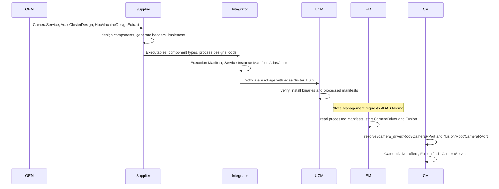

Later, the update of `AdasCluster` to 1.1.0 ([guide 00, Section 6.11](00_LearningPath.md#611-software-updates)) repeats steps 7 to 9 with a new Software Package. During its activation, State Management switches `ADAS` to `Off`, then to `Verify` and back to `Normal`, and the manifests are reparsed, unless the Machine is reset (*Platform Design*, Section 13.9 and Figure 13.10). Guide 13 tells this story.

> **Key takeaways**
>
> - The OEM provides the contracts (interface, system, cluster design), the supplier the software, the integrator the manifests and the Software Cluster.
> - Each step adds model content; nothing is lost on the way from the design to the Machine.
> - At run time, EM reads the Execution Manifest and CM reads the Service Instance Manifest, both as processed manifests.

---

## 15. Best Practices, Pitfalls and Troubleshooting

> **Why this matters:** Most manifest problems are not deep. They are typos, missing references and mismatches between files owned by different people. This chapter collects the rules that prevent them and a table that helps you find them.

### 15.1 Best Practices

1. **Own one top-level package.** Put all project elements under one top-level package, such as `/HPC`, never under `/AUTOSAR` ([TPS_GST_00080]), and use the recommended package names below it.
2. **Split files by owner and by kind of manifest.** One owner per file avoids merge conflicts; keep design and target configuration apart ([Section 3.7](#37-many-files-one-model)).
3. **Reference standardized elements instead of copying them**, for example `/AUTOSAR/StdTypes/uint8_t`.
4. **Treat short names as an API.** The short names of Executables, root prototypes and ports are part of the instance specifiers in the code. Renaming them breaks the code.
5. **Give every interface and type a namespace, and version interfaces semantically.** An incompatible change gets a new major version, which is a new `ServiceInterface` ([TPS_MANI_03616]).
6. **Keep the reference direction.** Target configuration references design, never the other way round.
7. **Check the schema number of every delivery.** `AUTOSAR_00054.xsd` means R25-11; do not mix releases.
8. **Validate early and at the right time.** Validate each file against the schema when it is written; run the model checks of your tool before generating headers (`IT_BefAraApiGen`) and before installation (`IT_Mani`).
9. **Read the class table, not only the schema.** The schema contains removed elements and makes everything optional; the TPS tells you what exists and what is required.

### 15.2 Common Pitfalls

1. **Case-insensitive name clashes.** `fusion` and `Fusion` in the same package are the same name for the uniqueness check ([constr_2508]).
2. **Meta-model spelling in ARXML.** Writing `strictMode` instead of `STRICT-MODE`, or `processIsSelfTerminating` instead of `PROCESS-IS-SELF-TERMINATING`: the schema rejects it ([Section 3.3](#33-from-meta-model-names-to-xml-tags)).
3. **`DEST` names the role instead of the type**, for example `DEST="NOTIFIER"` instead of `DEST="SOMEIP-EVENT-DEPLOYMENT"`.
4. **Removed attributes.** `INSTALLATION-BEHAVIOR` in a `SOFTWARE-CLUSTER` or `BUILD-TYPE` in an `EXECUTABLE` validate against the schema but no longer exist in the meta-model ([Section 3.9](#39-validating-arxml)).
5. **A Function Group without `Verify`, or without `Off` as initial mode** ([constr_10023], [TPS_MANI_03195]).
6. **Incomplete fields.** A field without one of the three `has...` attributes ([constr_1673]), or a `FieldSenderComSpec` without `initValue` ([constr_10152]).
7. **Incomplete startup configurations.** A `StateDependentStartupConfig` without ResourceGroup or StartupConfig ([constr_10175], [constr_10176]), two configurations for the same state ([constr_3396]), or a reference to `Off` ([constr_3424]).
8. **A port without a service instance**, or an instance specifier in the code that does not match the model ([Section 13.2](#132-the-instancespecifier-in-code)).
9. **One TCP endpoint for a provided and a required instance** ([constr_3487]).
10. **Missing service discovery configuration** of a SOME/IP service instance ([constr_10218], [constr_10221], [constr_10222]).
11. **A deployment that covers only part of the interface** ([constr_10029]).
12. **An uploadable element referenced through `containedARElement`** instead of `containedPackageElement` ([TPS_MANI_01116]).
13. **A process outside its Software Cluster's Function Groups** ([constr_1787]), or a Function Group claimed by two clusters ([constr_1786]).

### 15.3 Troubleshooting Guide

| Symptom | Likely cause | What to check |
| --- | --- | --- |
| The tool reports "element not expected" | Wrong tag name, wrong order, or a meta-model literal instead of the XML literal | The XML names and the order rules ([Section 3.3](#33-from-meta-model-names-to-xml-tags)); validate with the schema |
| The tool reports an unresolved reference | A typo in the path, a missing file, or a wrong `DEST` | The absolute path ([Section 3.2](#32-packages-short-names-and-paths)); whether the file with the target is part of the merged model |
| A file from a supplier does not load | Different release | The schema number in `xsi:schemaLocation` |
| The header generation fails or produces unexpected names | A constraint at `IT_BefAraApiGen` is violated, or a namespace is missing | Fields, data type categories, error domains ([Chapter 6](#6-service-interfaces-and-data-types)) |
| A process never starts | It references no state of the active Function Group, or it is not mapped to the Machine | `FUNCTION-GROUP-STATE-IREF`s and the `PROCESS-TO-MACHINE-MAPPING` ([Chapter 8](#8-the-execution-manifest)); the [EM guide](04_ExecutionManagement.md#173-troubleshooting-guide) |
| `InstanceSpecifierMappingIntegrityViolation` at run time | The specifier string does not match the model, or the port has no mapping for this process | The path in the code against the Executable, root prototype and port names; the `PROCESS-REF` of the mapping ([Section 9.3](#93-connecting-a-port-to-a-service-instance)) |
| A proxy never finds its service | Different deployments, IDs or versions on the two sides, or no machine mapping | Service ID, instance ID, major and minor version, event groups, `SERVICE-INSTANCE-TO-MACHINE-MAPPING` ([Section 9.6](#96-worked-example-cameraservice-between-cameradriver-and-fusion)); [guide 08a](08a_NetworkBindings.md) |
| UCM rejects a package | Missing version, vendor ID or signature, or a Function Group claimed twice | The `SOFTWARE-CLUSTER` attributes ([Section 10.2](#102-software-cluster-the-uploadable-unit)); guide 13 |

> **Key takeaways**
>
> - Own one top-level package, split files by owner, and reference standardized elements.
> - Short names along the path of a port are an API: keep them stable.
> - Most errors are spelling errors, missing mandatory references or mismatches between files.
> - Validate against the schema early, and run the model checks at the imposition times.

---

## 16. Summary and Self-Check Quiz

### 16.1 Summary

1. **A manifest is model content that travels with the software.** It configures an Adaptive Platform product and is uploaded to it ([TPS_MANI_01000]). It is written in ARXML, may be split over many files, and is converted into an implementation-specific format on the Machine ([TPS_MANI_01021]).
2. **Design and target configuration are different models.** Design models are contracts between roles; target configuration describes one Machine. References point from target configuration to design.
3. **ARXML is regular.** Packages contain elements; elements are identified by short-name paths; references end in `-REF`, `-TREF` or `-IREF`, and `DEST` names the meta-class. The XML Schema checks syntax only; constraints are checked at their imposition times.
4. **The core elements form three chains.** Component, port and Executable (software); Process, startup configuration, Function Group and Machine (execution); deployment, service instance and mappings (communication). They meet at the port.
5. **The port path is the `InstanceSpecifier`.** `/Executable/Root/.../Port` names the port in code; the `ServiceInstanceToPortPrototypeMapping` connects it, per process, to a service instance.
6. **The Software Cluster is the uploadable unit.** It contains processes, uploadable elements and other elements, claims Function Groups, and carries a version, a vendor ID and a signature. A Software Package wraps it for installation.
7. **The methodology distributes the work.** The OEM designs systems, interfaces and software cluster designs; suppliers implement; integrators write the manifests; UCM installs packages.
8. **APMC is the future of target configuration.** In R25-11 it is canonical for Persistency and UCM.

### 16.2 Self-Check Quiz

Try to answer each question first, then expand the answer.

<details>
<summary>1. What is a manifest, and is the ARXML file what the platform reads at run time?</summary>

A manifest is a piece of AUTOSAR model that configures an Adaptive Platform product and is uploaded to it together with the software ([TPS_MANI_01000]). Its standardized format is ARXML ([TPS_MANI_01020]), but on the Machine the platform may use any format that preserves the content and semantics ([TPS_MANI_01021]), for example the Processed Manifests of the EM guide. See [Section 1.1](#11-what-is-a-manifest).

</details>

<details>
<summary>2. A `Process` references its `Executable`. Why not the other way round?</summary>

References point from target configuration to design. This keeps the design independent of any deployment, while the target configuration is bound to one design ([TPS_MANI_01011]). The same Executable can then run in several processes and on several Machines. See [Section 1.2](#12-design-models-and-target-configuration).

</details>

<details>
<summary>3. Name the five kinds of manifest of the TPS. Why does guide 01 show only three?</summary>

Execution Manifest, Service Instance Manifest, Machine Manifest, Raw Data Stream Manifest and Software Distribution (TPS, Section 2.5). Guide 01 follows *Platform Design*, which shows the Application Design plus the first three; the Application Design is design content and not a manifest in the sense of the TPS. See [Section 2.3](#23-the-kinds-of-manifest).

</details>

<details>
<summary>4. A tool reports that <code>/HPC/Processes/fusion</code> and <code>/HPC/Processes/Fusion</code> clash. Why?</summary>

Short names are case sensitive, but their uniqueness within a name space is checked case-insensitively ([TPS_GST_00021], [constr_2508]). Keep the Executable `fusion` and the Process `Fusion` in different packages, as the running example does. See [Section 3.2](#32-packages-short-names-and-paths).

</details>

<details>
<summary>5. You write <code>&lt;TRUSTED-PLATFORM-EXECUTABLE-LAUNCH-BEHAVIOR&gt;strictMode&lt;/TRUSTED-PLATFORM-EXECUTABLE-LAUNCH-BEHAVIOR&gt;</code>. What happens?</summary>

The file does not validate against the schema. Enumeration literals follow the XML naming rules, so the literal `strictMode` is written `STRICT-MODE` ([TPS_XMLSPR_00030]). See [Section 3.3](#33-from-meta-model-names-to-xml-tags).

</details>

<details>
<summary>6. What does <code>DEST="SOMEIP-EVENT-DEPLOYMENT"</code> mean in a reference to <code>.../CameraStatus/Notifier</code>, although the target is written as <code>&lt;NOTIFIER&gt;</code>?</summary>

`DEST` names the meta-class of the target. The notifier of a field deployment is written under its role name `NOTIFIER`, but its type is `SomeipEventDeployment`. See [Section 3.4](#34-references--ref--tref-and-dest).

</details>

<details>
<summary>7. All files of a delivery validate against <code>AUTOSAR_00054.xsd</code>. Is the model correct?</summary>

Not necessarily. The schema checks syntax only: all elements are optional in the schema ([TPS_XMLSPR_00028]), references are not resolved, the constraints of the TPS are not checked, and removed elements are still accepted. A model checker must check references and constraints at their imposition times. See [Section 3.9](#39-validating-arxml).

</details>

<details>
<summary>8. Why is there no connector between the ports of <code>CameraDriverSwc</code> and <code>FusionSwc</code>?</summary>

The opposite end of a service is found at run time by service discovery, so it is not known in advance (TPS, Section 3.2.4.1). Both ports are mapped to service instances of the same service interface instead. See [Section 5.2](#52-ports-how-software-talks-to-the-outside).

</details>

<details>
<summary>9. What is a <code>ProcessDesign</code> for?</summary>

It stands in for a `Process` at design time, when the process does not yet exist, for example in diagnostic mappings or in a Software Cluster Design ([TPS_MANI_01228]). The real `Process` later references it in the role `design`; each `ProcessDesign` is used by one process only ([constr_1550]). See [Section 5.4](#54-process-design-a-stand-in-for-a-future-process).

</details>

<details>
<summary>10. The field <code>CameraStatus</code> has a getter and a notifier but no setter. What must the model contain?</summary>

All three attributes `hasGetter = true`, `hasNotifier = true` and `hasSetter = false` ([constr_1673]). The provided port has a `FieldSenderComSpec` with an `initValue`, here `NotAvailable` ([constr_10152]). See [Sections 6.1](#61-events-methods-fields-and-triggers) and [5.5](#55-worked-example-cameradriver-and-fusion).

</details>

<details>
<summary>11. How is the enumeration <code>ExposureMode</code> modeled?</summary>

As a `StdCppImplementationDataType` of category `TYPE_REFERENCE` to `/AUTOSAR/StdTypes/uint8_t`, with a `CompuMethod` of category `TEXTTABLE` that maps the values 0, 1 and 2 to the labels `Auto`, `Day` and `Night` ([TPS_MANI_03187]). See [Section 6.4](#64-data-types).

</details>

<details>
<summary>12. Why does the Function Group <code>ADAS</code> have a state <code>Verify</code>?</summary>

The TPS requires a `Verify` state in every Function Group ([constr_10023]), and State Management uses it while an update of the Function Group's Software Cluster is activated (*Platform Design*, Figure 13.10). See [Section 7.5](#75-function-groups-and-their-states).

</details>

<details>
<summary>13. <code>CameraDriver</code> keeps running when <code>ADAS</code> switches from <code>Normal</code> to <code>Degraded</code>. How is this modeled?</summary>

Its single `StateDependentStartupConfig` references both states with two `FUNCTION-GROUP-STATE-IREF`s; the states are or-ed ([TPS_MANI_01046]). See [Section 8.4](#84-worked-example-the-processes-cameradriver-and-fusion) and the [EM guide](04_ExecutionManagement.md#1311-the-running-example-complete-configuration).

</details>

<details>
<summary>14. What is the <code>InstanceSpecifier</code> of the camera port of <code>Fusion</code>, and how is it derived?</summary>

`/fusion/Root/CameraRPort`: a leading slash, then the short names of the Executable, the root prototype and the port ([SWS_CORE_10200]). It is the stringified form of the instance reference `PortPrototypeInExecutableInstanceRef` of the mapping. See [Section 9.4](#94-from-port-to-instancespecifier).

</details>

<details>
<summary>15. The Executable <code>fusion</code> runs in two processes that must use different camera instances. How do you configure this?</summary>

Two `Process`es reference the same Executable. For each process, a `ServiceInstanceToPortPrototypeMapping` maps the same port to a different service instance, and its `process` reference selects the process ([TPS_MANI_01317]). See [Section 9.3](#93-connecting-a-port-to-a-service-instance).

</details>

<details>
<summary>16. <code>HPC</code> provides and consumes <code>CameraService</code> over TCP. Why does its connector have two application endpoints?</summary>

One TCP endpoint cannot serve a provided and a required service instance, because two TCP sockets cannot be bound to the same local address and port ([constr_3487]). The provider uses port 30501; the consumer uses port `0`, an ephemeral port ([TPS_MANI_03227]). See [Section 9.5](#95-mapping-service-instances-to-the-machine).

</details>

<details>
<summary>17. Through which references does <code>AdasCluster</code> contain <code>CameraService</code> and the Executable <code>fusion</code>?</summary>

`CameraService` is an `ARElement` that is not uploadable, so it is referenced through `containedARElement`. The Executable is an `UploadablePackageElement`, so it must be referenced through `containedPackageElement` ([TPS_MANI_01116]). The process `Fusion` is referenced through `containedProcess`. See [Section 10.2](#102-software-cluster-the-uploadable-unit).

</details>

<details>
<summary>18. Who writes the Service Instance Manifest, and when are its IDs final?</summary>

The software cluster responsible defines the service deployments and instances during the software cluster design ([TR_AMETH_00027], [TR_AMETH_00005]). The integrator finalizes the instance IDs according to the service topology and adds the processes to the mappings during software cluster integration ([TR_AMETH_00028], [TR_AMETH_00033]). See [Sections 11.4](#114-design-system-service-interfaces-applications-and-the-machine) and [11.6](#116-software-cluster-integration).

</details>

<details>
<summary>19. What is APMC, and for which clusters is it the canonical target configuration in R25-11?</summary>

*Adaptive Platform Machine Configuration*: an M1-based configuration model with a definition side and a value side, similar to the Classic ECU Configuration ([AP_TPS_APMC_01000]). In R25-11 it is canonical for Persistency and for Update and Configuration Management (TPS, Sections 12.2 and 12.8). See [Section 11.9](#119-looking-ahead-apmc).

</details>

---

## Appendix A. Glossary and Acronyms

### A.1 Acronyms

| Acronym | Meaning |
| --- | --- |
| APMC | Adaptive Platform Machine Configuration |
| ARA | AUTOSAR Runtime for Adaptive Applications |
| ARXML | AUTOSAR XML, the file format of AUTOSAR models and manifests |
| DDS | Data Distribution Service |
| EcuC | ECU Configuration (Classic Platform) |
| GST | Generic Structure Template |
| OEM | Original Equipment Manufacturer (the vehicle manufacturer) |
| SD | Service Discovery |
| SOME/IP | Scalable service-Oriented MiddlewarE over IP |
| SWC | Software Component |
| TPS | Template Specification (AUTOSAR document type), for example the Manifest Specification |
| TR | Technical Report (AUTOSAR document type) |
| UCM | Update and Configuration Management |
| XSD | XML Schema Definition |

### A.2 Glossary

| Term | Meaning | Section |
| --- | --- | --- |
| APMC | The M1-based target-configuration model with a definition side and a value side that replaces manifest content step by step. | [11.9](#119-looking-ahead-apmc) |
| Application Design | The design-related part of the model: data types, service interfaces, persistency interfaces and other interfaces that an application uses, independent of any deployment. | [2.3](#23-the-kinds-of-manifest) |
| ARElement | A model element that can be defined stand-alone in a package. | [2.4](#24-design-elements-and-uploadable-elements) |
| ARPackage | A package of the model. It establishes a name space and is an open set: several files may contribute to it. | [3.2](#32-packages-short-names-and-paths) |
| `≪atpSplitable≫` | Stereotype of a property whose content may be spread over several files. | [3.7](#37-many-files-one-model) |
| `≪atpUriDef≫` | Stereotype of a reference whose path carries the information, even if the target is not on the Machine. | [1.2](#12-design-models-and-target-configuration), [9.4](#94-from-port-to-instancespecifier) |
| Class table | The table of the TPS that lists the attributes of a meta-class with type, multiplicity and kind. | [3.8](#38-reading-a-class-table-of-the-tps) |
| ComSpec | A qualification of the use of one element of an interface at one port, for example the initial value of a field. | [5.2](#52-ports-how-software-talks-to-the-outside) |
| Constraint | A numbered rule on the meta-model, cited as `[constr_nnnn]`. It must hold from its imposition time on; a model that violates it at that point is invalid. | [2.5](#25-constraints-and-imposition-times) |
| CppImplementationDataType | A data type with its C++ binding; its category selects the C++ form. | [6.4](#64-data-types) |
| Design model | Model content that describes the system across compute nodes and is exchanged between roles, often as a contract. | [1.2](#12-design-models-and-target-configuration) |
| Executable | A program file with exactly one `main()` function. | [5.3](#53-the-executable-and-its-root-prototype) |
| Execution Manifest | The configuration of an Executable's processes: states, arguments, scheduling, dependencies, timeouts and more. | [8](#8-the-execution-manifest) |
| Function Group | A named group of processes that are switched on and off together. | [7.5](#75-function-groups-and-their-states) |
| Imposition time | The point in the workflow at which a constraint must hold, for example `IT_BefAraApiGen` or `IT_Mani`. | [2.5](#25-constraints-and-imposition-times) |
| Instance reference | A reference that navigates from a base through context elements to a target in an instance tree. Written as `-IREF`. | [2.2](#22-types-prototypes-and-instance-references), [3.5](#35-instance-references--iref) |
| InstanceSpecifier | A path in the model that identifies a configured element, such as a port, from code. Example: `/fusion/Root/CameraRPort`. | [9.4](#94-from-port-to-instancespecifier), [13.2](#132-the-instancespecifier-in-code) |
| Machine | The environment one Adaptive Platform instance runs on: an ECU, a virtual machine or a container. | [7.3](#73-the-machine) |
| Machine Design | The design-time placeholder of an Adaptive Machine in the system, the counterpart of the Classic `EcuInstance`. | [7.2](#72-machine-design) |
| Machine Manifest | The machine-wide configuration. | [7](#7-system-design-machine-design-and-the-machine-manifest) |
| Manifest | A piece of AUTOSAR model that configures the platform or the software deployed on it, and that is installed together with that software. | [1.1](#11-what-is-a-manifest) |
| Meta-model | The AUTOSAR vocabulary (M2) in which models (M1) are written; the XML Schema is generated from it. | [2.1](#21-meta-levels-meta-model-model-and-xml-schema) |
| Partial model | The content of one ARXML file; it shall validate against the schema but need not satisfy all constraints. | [3.7](#37-many-files-one-model) |
| PortPrototype | A port of a software component, provided (`PPortPrototype`) or required (`RPortPrototype`), typed by a port interface. | [5.2](#52-ports-how-software-talks-to-the-outside) |
| ProcessDesign | The design-time stand-in for a process that will be defined in the Execution Manifest. | [5.4](#54-process-design-a-stand-in-for-a-future-process) |
| Processed Manifest | A manifest converted into a platform-specific format for fast reading at startup. | [11.8](#118-how-the-platform-consumes-manifests-at-run-time) |
| Recommended package | The package name that the meta-model proposes for an element kind, for example `ServiceInterfaces`. | [3.2](#32-packages-short-names-and-paths) |
| Registry | An internal component that gives other clusters access to manifest information. Not used by applications. | [11.8](#118-how-the-platform-consumes-manifests-at-run-time) |
| RootSwComponentPrototype | The root of the component hierarchy inside an Executable; its short name is part of every `InstanceSpecifier`. | [5.3](#53-the-executable-and-its-root-prototype) |
| Service Instance Manifest | The configuration of how service-oriented communication is deployed on the network, including E2E, security and logging settings. | [9](#9-the-service-instance-manifest-and-the-instancespecifier) |
| ServiceInterfaceDeployment | The representation of a service interface on one transport, for example its SOME/IP IDs. | [9.1](#91-service-interface-deployment) |
| ServiceInstanceToPortPrototypeMapping | The element that connects one port, in one process, to one service instance. | [9.3](#93-connecting-a-port-to-a-service-instance) |
| Short name | The identifier of a model element within its name space; a C identifier, unique case-insensitively. | [3.2](#32-packages-short-names-and-paths) |
| Software Cluster | The unit of deployment and update: a set of executables, manifests and data, which claims Function Groups. It is installed as one Software Package. The meta-class is `SoftwareCluster`. | [10.2](#102-software-cluster-the-uploadable-unit) |
| Software Cluster Design | The OEM's design-level contract for a Software Cluster (meta-class `SoftwareClusterDesign`). | [10.1](#101-software-cluster-design-the-oems-contract) |
| Software Package | The unit that UCM installs: one Software Cluster plus the metadata to install it. It is digitally signed. | [10.3](#103-software-package-and-vehicle-package) |
| Standardized M1 model | Model content published by AUTOSAR in the top-level package `AUTOSAR`, for example `/AUTOSAR/StdTypes`. | [2.1](#21-meta-levels-meta-model-model-and-xml-schema) |
| StateDependentStartupConfig | Links a process to a `StartupConfig` for a set of Function Group States, with dependencies and resources. | [8.2](#82-state-dependent-startup-configuration) |
| Target configuration | Model content whose scope is mostly local to one compute node, usually created during integration. Formerly called "deployment". | [1.2](#12-design-models-and-target-configuration) |
| Uploadable element | An element derived from `UploadablePackageElement`, which is uploaded to the Machine as part of a Software Cluster. | [2.4](#24-design-elements-and-uploadable-elements) |

## Appendix B. Quick Reference Cheat Sheet

**Kinds of manifest** (TPS, Section 2.5)

| Kind | Main elements | Bundled with |
| --- | --- | --- |
| Execution Manifest | `Process`, `StartupConfig`, `FunctionGroupSet` of application Function Groups, `ProcessToMachineMappingSet` | The executable code |
| Service Instance Manifest | `ServiceInterfaceDeployment`, service instances, `ServiceInstanceToPortPrototypeMapping`, `ServiceInstanceToMachineMapping` | The code that communicates |
| Machine Manifest | `Machine`, module instantiations, `ResourceGroup`, `Processor`, `MachineFG` | The platform software |
| Raw Data Stream Manifest | Raw data stream mappings | The code that streams (guide 09) |
| Software Distribution | `SoftwareCluster`, `SoftwarePackage`, `VehiclePackage` | The package |

**ARXML rules**

| Rule | Example |
| --- | --- |
| Root, namespace and schema hint | `<AUTOSAR xmlns="http://autosar.org/schema/r4.0" ... xsi:schemaLocation="http://autosar.org/schema/r4.0 AUTOSAR_00054.xsd">` |
| Names in upper case with hyphens | `ServiceInterface` → `SERVICE-INTERFACE`, `strictMode` → `STRICT-MODE` |
| Plural wrapper | `<PORTS>`, `<EXECUTABLE-REFS>`, `<EXECUTION-DEPENDENCYS>` |
| Reference, type reference, instance reference | `-REF`, `-TREF`, `-IREF` with `CONTEXT-...-REF` and `TARGET-...-REF` |
| `DEST` | The meta-class of the target, as XML name |
| Path | `/HPC/Machines/HPC/Os/adas_rg` |
| Short name | `[a-zA-Z][a-zA-Z0-9_]*`, unique case-insensitively |
| `InstanceSpecifier` | `/Executable/RootSwComponentPrototype/.../PortPrototype` |

**Recommended packages used by the running example**

| Element | Package |
| --- | --- |
| `ServiceInterface` | `ServiceInterfaces` |
| `StdCppImplementationDataType` | `CppImplementationDataTypes` |
| `ApApplicationError`, `ApApplicationErrorDomain` | `ApplicationErrors`, `ApplicationErrorDomains` |
| `AdaptiveApplicationSwComponentType` | `AdaptiveApplicationSwComponentTypes` |
| `Executable`, `ProcessDesign` | `Executables`, `ProcessDesigns` |
| `MachineDesign`, `Machine`, `System` | `MachineDesigns`, `Machines`, `Systems` |
| `ModeDeclarationGroup`, `FunctionGroupSet` | `ModeDeclarationGroups`, `FunctionGroupSets` |
| `StartupConfig`, `Process`, `ProcessToMachineMappingSet` | `StartupConfigs`, `Processes`, `ProcessToMachineMappings` |
| `SomeipServiceInterfaceDeployment`, service instances, SD configurations | `ServiceInterfaceDeployments`, `ServiceInstances`, `SomeipSdTimingConfigs` |
| `ServiceInstanceToPortPrototypeMapping` | `ServiceInstanceToPortPrototypeMappings` |
| `SoftwareClusterDesign`, `SoftwareCluster` | `SoftwareClusterDesigns`, `SoftwareClusters` |

**Imposition times:** `IT_SysDes`, `IT_MachDes`, `IT_SubSysDes`, `IT_ProDes`, `IT_DiagDes`, `IT_GraDes`, `IT_BefAraApiGen` (before header generation), `IT_Mani` (before installation).

**Frequently violated constraints**

| Constraint | Rule |
| --- | --- |
| [constr_2508] | Short names unique, case-insensitively |
| [constr_1673] | A field has `hasGetter`, `hasSetter` and `hasNotifier`, at least one `true` |
| [constr_10023], [TPS_MANI_03195] | Every Function Group has `Verify`, and `Off` as initial mode |
| [constr_3423], [constr_3424], [constr_10175], [constr_10176] | A startup configuration references a state other than `Off`, a ResourceGroup and a StartupConfig |
| [constr_5004] | Every process is mapped to one Machine |
| [constr_10029] | A deployment (except DDS) covers all elements of its interface |
| [constr_10218], [constr_10221] | SOME/IP service instances reference their SD configuration |
| [constr_3487] | A TCP endpoint serves either provided or required instances |
| [constr_1788] | Exactly one `PLATFORM_CORE` Software Cluster per Machine |
| [constr_10233], [constr_10234], [constr_10235] | A Software Cluster has a vendor signature, a version and a vendor ID |

## Appendix C. Spec Traceability

Use this table to find the normative text in the specifications (R25-11) for each topic of this guide.

| Topic | Guide | Specification section | Key requirement IDs |
| --- | --- | --- | --- |
| Definition and format of manifests | 1.1 | TPS 2.2, 2.3 | [TPS_MANI_01000], [TPS_MANI_01020], [TPS_MANI_01021] |
| Design and target configuration | 1.2 | TPS 2.1; APMC 2.1 | [TPS_MANI_01011] |
| Meta-levels, standardized models | 2.1 | GST 2.2, 3.1; APMC 2.2 | [TPS_GST_00080], [TPS_GST_00081] |
| Instance references | 2.2, 3.5 | GST 5.1.3; XML Schema Production Rules 3.2.3 | [TPS_GST_00160], [TPS_GST_00161], [TPS_XMLSPR_00044] |
| Kinds of manifest, uploadable elements | 2.3, 2.4 | TPS 2.5, 16.2 | [TPS_MANI_01109], [TPS_MANI_01413], [TPS_MANI_01414] |
| Constraints and imposition times | 2.5 | TPS 1.3, A.2 | [constr_1673], [constr_5004] (examples) |
| ARXML file structure | 3.1 | Serialization Rules 2; GST 3 | [TPS_ASR_00011], [TPS_ASR_00012], [TPS_ASR_00013], [TPS_GST_00077] |
| Packages, short names, paths | 3.2 | GST 4.2 to 4.4 | [TPS_GST_00092], [TPS_GST_00169], [constr_2508] |
| XML names, references | 3.3, 3.4 | XML Schema Production Rules 2.6 to 2.8, 3.2.3 | [TPS_XMLSPR_00030], [TPS_XMLSPR_00034], [TPS_XMLSPR_00043], [TPS_XMLSPR_00045] |
| Partial models and splitting | 3.7 | GST 8 | [TPS_GST_00423], [constr_2524], [constr_2502] |
| Validation | 3.9 | XML Schema Production Rules 2.9 | [TPS_XMLSPR_00028] |
| Software components and ports | 5.1, 5.2 | TPS 3.2.1, 3.2.4, 3.2.5 | [constr_1492], [TPS_MANI_01039], [TPS_MANI_01040], [constr_1473] |
| Executable | 5.3 | TPS 3.2.2 | [constr_1605], [TPS_MANI_01279], [TPS_MANI_01010] |
| Process design | 5.4 | TPS 3.2.6, 7.6 | [TPS_MANI_01228], [constr_1550], [TPS_MANI_01229], [TPS_MANI_01477] |
| Service interface | 6.1, 6.2 | TPS 4.2.1 to 4.2.7 | [TPS_MANI_01001], [TPS_MANI_01007], [constr_1673], [TPS_MANI_03616] |
| Application errors | 6.3 | TPS 4.2.8 | [TPS_MANI_01190], [TPS_MANI_01191], [constr_1664], [constr_1665] |
| Data types | 6.4 | TPS 3.3 | [TPS_MANI_01166], [constr_1578], [TPS_MANI_03187], [TPS_MANI_03223] |
| Interfaces to functional clusters | 6.5 | TPS 4.5 to 4.16 | None (overview; the owner guides cite the details) |
| System and machine design | 7.1, 7.2 | TPS 6, 7.1, 7.2, 13.1 | [TPS_MANI_01274], [constr_3421], [TPS_MANI_03280] |
| Machine and module instantiations | 7.3, 7.4 | TPS 11, 12 | [TPS_MANI_03035], [constr_10169], [constr_10170], [constr_1661] |
| Function Groups | 7.5 | TPS 10.4; SWS EM | [TPS_MANI_03145], [TPS_MANI_03195], [constr_10023], [SWS_EM_CONSTR_02556] |
| Execution Manifest | 8 | TPS 10, 11.3 | [TPS_MANI_01012], [TPS_MANI_01013], [constr_1688], [constr_5004] |
| Service interface deployment, service instances | 9.1, 9.2 | TPS 13.2, 13.3 | [TPS_MANI_03036], [constr_10029], [TPS_MANI_03040], [TPS_MANI_03617] |
| Port to service instance mapping | 9.3 | TPS 13.3 | [TPS_MANI_03000], [TPS_MANI_01316], [TPS_MANI_01317] |
| InstanceSpecifier | 9.4, 13.2 | SWS Core 7.4.1.1, 8.22.2; TPS B.5.1, 15 | [SWS_CORE_10200], [SWS_CORE_10203], [SWS_CORE_08001], [SWS_CORE_13003] |
| Service instance to machine mapping | 9.5 | TPS 13.3 | [TPS_MANI_03001], [constr_3487], [TPS_MANI_03227] |
| Software Cluster Design | 10.1 | TPS 8 | [TPS_MANI_01112], [TPS_MANI_01331], [TPS_MANI_01410], [TPS_MANI_01480] |
| Software Cluster, Software Package | 10.2, 10.3 | TPS 16 | [TPS_MANI_01110], [TPS_MANI_01116], [constr_1788], [TPS_MANI_01221] |
| Methodology | 11.1 to 11.7 | Methodology TR 1 to 2 | [TR_AMETH_00100], [TR_AMETH_00012], [TR_AMETH_00004], [TR_AMETH_00031] |
| Consumption of manifests at run time | 11.8 | TPS 2.3; *SW Architecture* 9.7.3; *Platform Design* 13.9 | [TPS_MANI_01021] |
| APMC | 11.9 | APMC 2, 3; TPS 1, 12.2, 12.8, I | [AP_TPS_APMC_01000], [AP_TPS_APMC_01001], [AP_TPS_APMC_01038] |
| Configuration Reference | 12 | TPS class tables (Chapters 3 to 16, Appendix E) | see Chapter 12 |

## Appendix D. Notable Changes in Recent Releases

This summary is based on the change history of the TPS (Appendix F) and of the related documents. It lists only the changes that matter most when you port material or models from an older release.

| Release | Change | Specification items |
| --- | --- | --- |
| R25-11 | Dependencies between Software Clusters are modeled only on the `SoftwareClusterDesign` (`dependsOn`, `conflictsTo`); the items for `SoftwareCluster` were deleted | Added [TPS_MANI_01479] to [TPS_MANI_01482]; deleted TPS_MANI_01164, TPS_MANI_01214, TPS_MANI_01215, TPS_MANI_01217 |
| R25-11 | `TraceSwitchConfig` is a separate element that references the Executable; `Executable.traceSwitchConfiguration` was removed | Added [TPS_MANI_03336] to [TPS_MANI_03338]; deleted constr_5386 to constr_5388 |
| R25-11 | Suspend-to-RAM: `Executable.suspendToRamAwareness` and the suspend-to-RAM port interfaces | [TPS_MANI_01513], [TPS_MANI_01507], [TPS_MANI_01509], [TPS_MANI_01511] |
| R25-11 | Design-level core affinity on `ProcessDesignToMachineDesignMapping` | [TPS_MANI_01477], [constr_10659] to [constr_10662] |
| R25-11 | The standardized values of `ServiceInterface.category` were deleted | Deleted TPS_MANI_03628 |
| R25-11 | `SoftwareClusterDesign.installationBehavior`; `PLATFORM_CORE` designs must be `cannotBeRemoved` | Changed [TPS_MANI_01410], [constr_10410] |
| R25-11 | Persistency and UCM: target configuration canonically through APMC; upstream mapping in TPS Appendix I | TPS 12.2, 12.8, I |
| R25-11 | `ara::core::Initialize()` without arguments was removed; `Initialize(argc, argv)` remains | Deleted SWS_CORE_10001; [SWS_CORE_10003] |
| R25-11 | APMC: interaction between functional clusters (FunctionalClusterEndpointSpecifier) | [AP_TPS_APMC_01039] |
| R24-11 | APMC published for the first time | APMC title page |
| R24-11 | Constraints for `FunctionGroupPortMapping`; interoperability rules for `ApApplicationError` with the Classic Platform | [constr_10617] to [constr_10622]; [constr_3772], [constr_3773], [constr_10574] |
| R23-11 | The default start-up timeout of the Machine became configurable (`defaultApplicationTimeout` with both values) | [constr_10430] to [constr_10432]; deleted constr_3394 |
| R23-11 | The separate definition of the machine Function Group was removed from the TPS; `MachineFG` is defined by the EM specification and a standardized model | Deleted TPS_MANI_01330, constr_1789 |
| R23-11 | Semantics of uploadable deployment and design elements | [TPS_MANI_01413], [TPS_MANI_01414]; changed [TPS_MANI_01109] |

## Appendix E. References

**AUTOSAR specifications (R25-11):**

- *Specification of Manifest* (`AUTOSAR_AP_TPS_ManifestSpecification`), Adaptive Platform
- *Methodology for Adaptive Platform* (`AUTOSAR_AP_TR_Methodology`), Adaptive Platform
- *Adaptive Platform Machine Configuration* (`AUTOSAR_AP_TPS_MachineConfiguration`), Adaptive Platform
- *Specification of Adaptive Platform Core* (`AUTOSAR_AP_SWS_Core`), Adaptive Platform
- *Specification of Execution Management* (`AUTOSAR_AP_SWS_ExecutionManagement`), Adaptive Platform, through the [EM guide](04_ExecutionManagement.md)
- *Explanation of Adaptive Platform Design* (`AUTOSAR_AP_EXP_PlatformDesign`), Adaptive Platform
- *Explanation of Adaptive Platform Software Architecture* (`AUTOSAR_AP_EXP_SWArchitecture`), Adaptive Platform
- *Generic Structure Template* (`AUTOSAR_FO_TPS_GenericStructureTemplate`), Foundation
- *ARXML Serialization Rules* (`AUTOSAR_FO_TPS_ARXMLSerializationRules`), Foundation
- *XML Schema Production Rules* (`AUTOSAR_FO_TPS_XMLSchemaProductionRules`), Foundation
- *Meta Model-generated XML Schema* (`AUTOSAR_FO_MMOD_XMLSchema`, file `AUTOSAR_00054.xsd`), Foundation
- *Standardized M1 Models used for the Definition of AUTOSAR* (`AUTOSAR_FO_MOD_GeneralDefinitions`), Foundation

**Other sources:**

- [EXT-011] *Artop: AUTOSAR Tool Platform*, AUTOSAR. <https://autosar.org/working-groups/cross-standard/artop> (accessed 2026-10-25)
- [EXT-012] *DaVinci Developer Adaptive*, Vector Informatik. <https://www.vector.com/en/product/microsar-adaptive/davinci-developer-adaptive/> (accessed 2026-10-25)
- [EXT-013] *xmllint*, libxml2 project. <https://gnome.pages.gitlab.gnome.org/libxml2/xmllint.html> (accessed 2026-10-25)

---

*End of the training guide. For normative details, always refer to `AUTOSAR_AP_TPS_ManifestSpecification` (R25-11) and to the specifications it references.*
