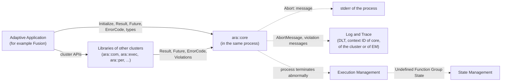
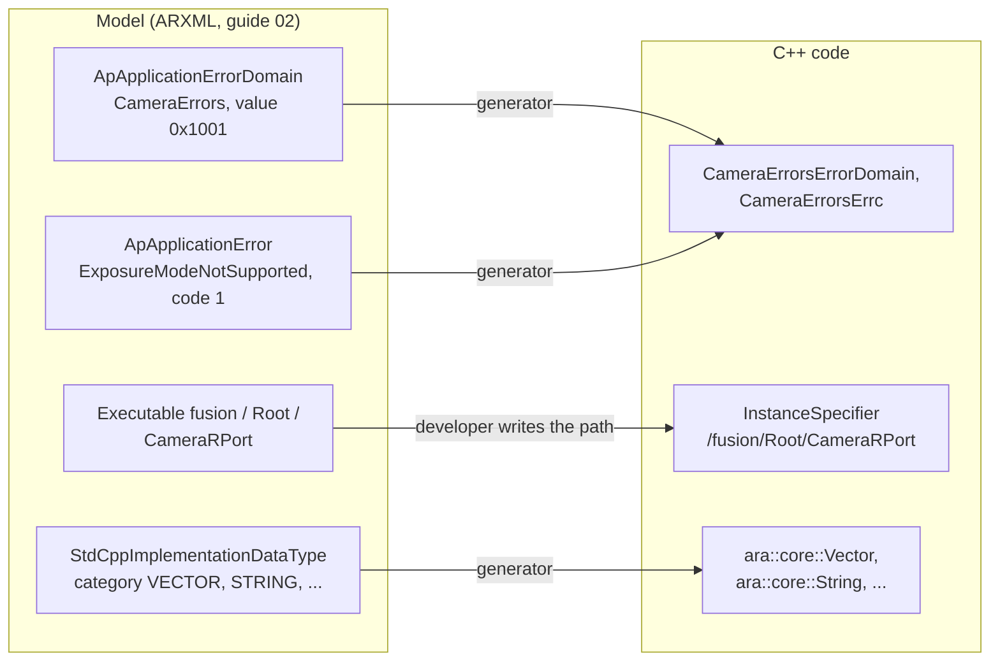
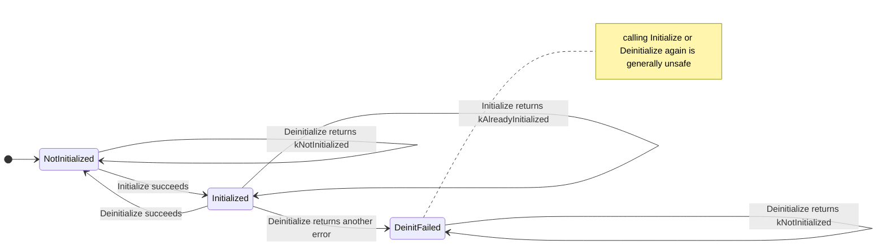
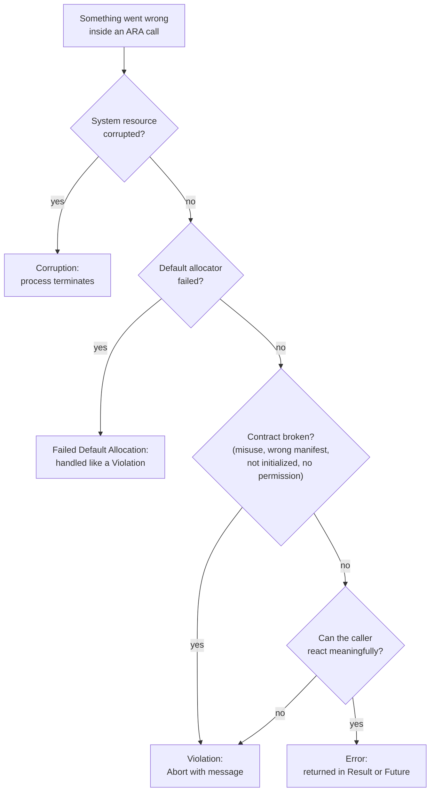
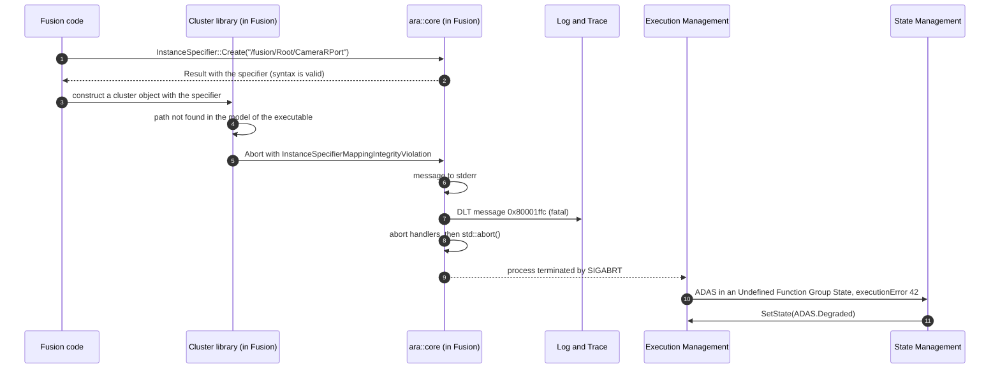
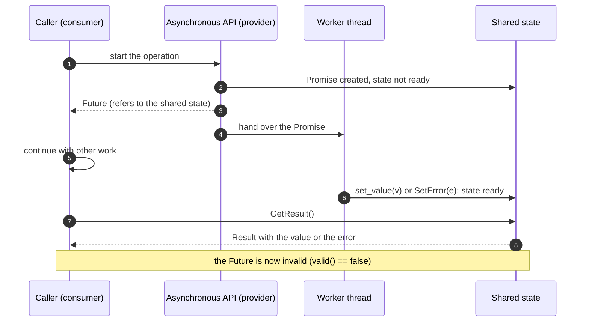
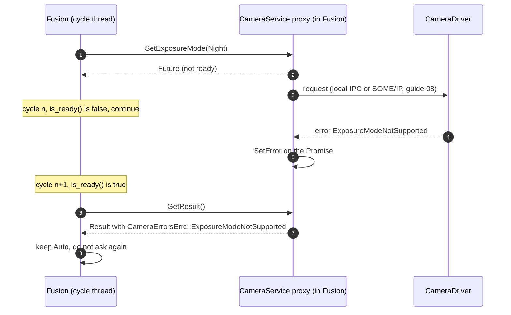
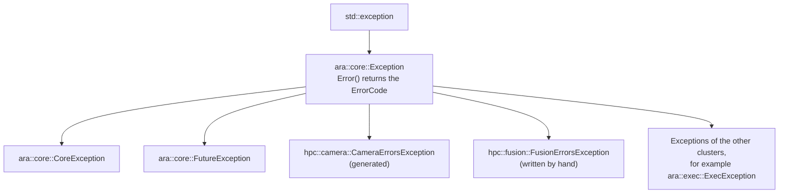
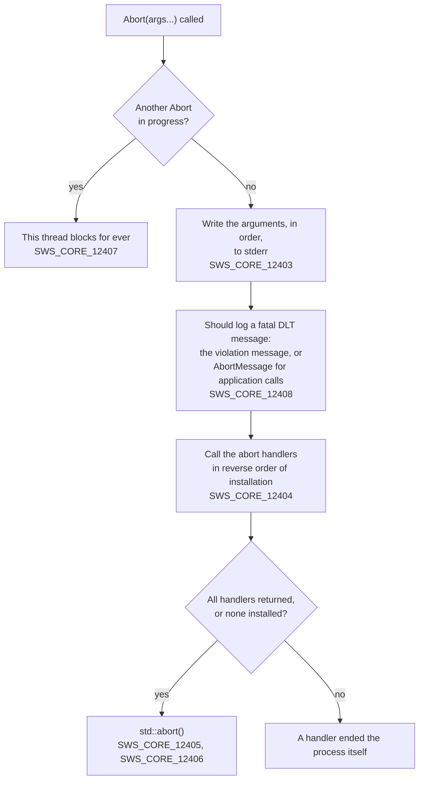
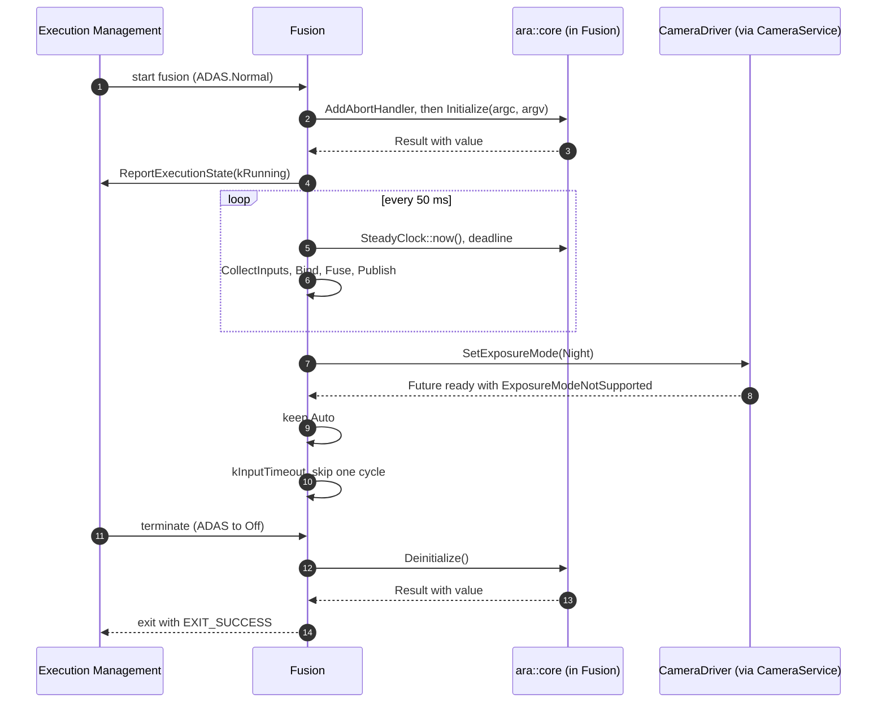

# AUTOSAR Adaptive Platform: `ara::core` and General Conventions Training Guide

<!-- markdownlint-disable MD013 MD033 -->

> **Source specification:** *Specification of Adaptive Platform Core* (`AUTOSAR_AP_SWS_Core`), AUTOSAR Adaptive Platform **R25-11**. Also based on *General Requirements specific to Adaptive Platform* (`AUTOSAR_AP_RS_General`) and *Specification of Language Binding for modeled AP data types* (`AUTOSAR_AP_SWS_LanguageBindingForModeledAPdatatypes`), Adaptive Platform R25-11.
>
> **Document type:** training material.
>
> **Author:** Hieu Do Minh/Claude
>
> **Version:** 1.0 (draft, pending review)
>
> **Part of the series:** [AUTOSAR Adaptive Platform Training Guides](00_LearningPath.md). Previous: [02 Manifests and Methodology](02_Manifests.md). Next: [04 Execution Management](04_ExecutionManagement.md).

## About This Guide

Every `ara::` API in the Adaptive Platform speaks the same language. A function that can fail returns an `ara::core::Result` or an `ara::core::Future` instead of throwing. A broken contract, such as a wrong `InstanceSpecifier`, terminates the process with a standardized violation message instead of returning an error. Every program calls `ara::core::Initialize` before it uses the platform. All of this is defined in one specification: *Core*. Core also contains the house rules that every functional cluster follows: names, header files, thread safety, signal safety and what "undefined" means. Many questions in real projects come down to Core: "Why did my process abort without an error code?", "Which error domain is this code from?", "Can I call this from two threads?". This guide explains the error handling model, the asynchronous result types, the other `ara::core` types, the general rules for all clusters, and the complete `ara::core` API.

### Who This Guide Is For

- **Application developers** who call `ara::` APIs every day and need to handle `Result` and `Future` correctly, with or without C++ exceptions.
- **Platform developers** who implement a functional cluster and must follow the general rules: error domains, violations, naming, `noexcept`, thread safety.
- **Integrators** who read violation messages in logs and need to trace them back to a configuration or code problem.

Assumed background: modern C++ (C++17), plus basic Linux/POSIX knowledge. Read [guide 00](00_LearningPath.md) (at least Chapters 1 and 6) and [guide 01](01_PlatformOverview.md) first. [Guide 02](02_Manifests.md) explains the model behind `InstanceSpecifier` and the application errors that this guide uses.

### Learning Objectives

After working through this guide you will be able to:

1. Distinguish the four kinds of unsuccessful operations (Error, Violation, Corruption, Failed Default Allocation) and explain how each one is handled.
2. Initialize and de-initialize the platform correctly, and predict the result of every call sequence.
3. Use `ara::core::Result`, `ara::core::Future` and `ara::core::Promise` without exceptions, including timeouts and continuations.
4. Read an `ara::core::ErrorCode` (value, domain, support data), define an error domain, and use a generated one.
5. Explain what `ara::core::Abort` and abort handlers do, and when the platform calls them.
6. Choose the right `ara::core` type and say how it differs from its `std` counterpart.
7. Apply the general rules for all functional clusters (names, headers, thread safety, signal safety, undefined and implementation-defined behavior) when you read any cluster's API table.
8. Trace a violation message in a log back to its cause.

### How to Read This Guide

Chapters 1 to 4 give the concepts and the big picture. Chapters 5 to 12 explain the mechanisms: initialization, the error handling model, error codes and domains, `Result`, `Future` and `Promise`, exceptions and `Abort`, the data types, and the general rules for all clusters. Chapter 13 lists the model elements that shape `ara::core` code. Chapter 14 is the API reference. Chapters 15 to 17 are practical: reporting, a walkthrough and troubleshooting. The appendices are for lookup.

| Convention | Meaning |
| --- | --- |
| `[SWS_CORE_00021]` | A requirement of the *Specification of Adaptive Platform Core* (SWS Core). Search for it in the specification to read the exact normative text. |
| `[RS_AP_00114]` | A requirement of *General Requirements specific to Adaptive Platform* (RS General). SWS Core traces to these requirements. |
| `[SWS_LBAP_00052]` | A requirement of the *Specification of Language Binding for modeled AP data types* (SWS LBAP): the C++ code that is generated from the model. |
| `[TPS_MANI_03268]`, `[constr_1665]` | A requirement or a constraint of the *Manifest Specification* (TPS). |
| **Note (implementation example)** | How a typical implementation, often on Linux, *might* realize something. This is not mandated by AUTOSAR. |
| **Pitfall** | A common mistake seen in real projects. |
| **Key takeaways** | A short summary at the end of each chapter. |
| Diagrams | Written in Mermaid. They render natively on GitHub and GitLab. In VS Code, install the *Markdown Preview Mermaid Support* extension. |

All code examples are illustrative. They use the names and signatures of the R25-11 specification, but vendor headers may differ in detail, for example in additional overloads.

### The Running Example

This guide follows the process `Fusion` of `HPC`, the running example of the series ([guide 00, Section 6.5](00_LearningPath.md#65-processes)). `Fusion` runs the executable `fusion` in the Function Group State `ADAS.Normal`. Every 50 ms it fuses camera images, radar detections and vehicle dynamics into an object list. It uses `CameraService`, `CalibrationDataService` and `VehicleDynamicsService`, provides `ObjectListService`, and is supervised by Platform Health Management. Its port for `CameraService` is identified by the `InstanceSpecifier` `/fusion/Root/CameraRPort` ([guide 02, Section 13.2](02_Manifests.md#132-the-instancespecifier-in-code)).

The guide uses these elements of the example. The last two rows were added for this guide; they are part of the master definition in guide 00 ([Section 6.6](00_LearningPath.md#66-services-and-their-consumers)).

| Element | Used for | Defined in |
| --- | --- | --- |
| `Fusion` and its 50 ms cycle | Initialization, timeouts with `SteadyClock`, the walkthrough | Guide 00, Sections 6.5 and 6.13 |
| `/fusion/Root/CameraRPort` | `InstanceSpecifier` and the mapping violations | Guide 02, Section 13.2 |
| Error domain `CameraErrors` (`0x1001`, namespace `hpc::camera`) with `ExposureModeNotSupported` (code 1) | A generated error domain | Guide 02, Section 6.3 |
| Error domain `AdasExecutionErrors` (`0x1002`) with `FusionFailed` (42) | An application error that is not a method error | Guide 02, Section 6.3 |
| `Fusion` calls `SetExposureMode(Night)` at dusk and keeps `Auto` if the camera answers `ExposureModeNotSupported` | `Future` and error handling of a service call | Guide 00, Section 6.6 (new) |
| Error domain `FusionErrors` (`0x1003`, namespace `hpc::fusion`) with `kInputTimeout` (1) and `kCalibrationImplausible` (2), written by hand inside `Fusion` | Defining an error domain; `Result` | Guide 00, Section 6.6 (new) |

## Table of Contents

- [AUTOSAR Adaptive Platform: ara::core and General Conventions Training Guide](#autosar-adaptive-platform-aracore-and-general-conventions-training-guide)
  - [About This Guide](#about-this-guide)
    - [Who This Guide Is For](#who-this-guide-is-for)
    - [Learning Objectives](#learning-objectives)
    - [How to Read This Guide](#how-to-read-this-guide)
    - [The Running Example](#the-running-example)
  - [Table of Contents](#table-of-contents)
  - [1. Introduction to Core](#1-introduction-to-core)
    - [1.1 What Is Core?](#11-what-is-core)
    - [1.2 What Core Does Not Do](#12-what-core-does-not-do)
    - [1.3 Analogies: The C++ Standard Library and AUTOSAR Classic](#13-analogies-the-c-standard-library-and-autosar-classic)
    - [1.4 Core and ARA: Who Uses What](#14-core-and-ara-who-uses-what)
    - [1.5 Two Facts Before You Start](#15-two-facts-before-you-start)
  - [2. Core Concepts and Terminology](#2-core-concepts-and-terminology)
    - [2.1 Four Kinds of Unsuccessful Operations](#21-four-kinds-of-unsuccessful-operations)
    - [2.2 Error Codes and Error Domains](#22-error-codes-and-error-domains)
    - [2.3 Synchronous and Asynchronous Results](#23-synchronous-and-asynchronous-results)
    - [2.4 Undefined, Implementation-Defined and Vendor-Specific Behavior](#24-undefined-implementation-defined-and-vendor-specific-behavior)
    - [2.5 Thread Safety and Recoverability](#25-thread-safety-and-recoverability)
    - [2.6 Other Key Terms](#26-other-key-terms)
  - [3. Core in the System Architecture](#3-core-in-the-system-architecture)
    - [3.1 Where Core Sits in the Platform](#31-where-core-sits-in-the-platform)
    - [3.2 Interfaces Provided by Core](#32-interfaces-provided-by-core)
    - [3.3 Interfaces Required by Core](#33-interfaces-required-by-core)
    - [3.4 Interaction Map](#34-interaction-map)
  - [4. Configuration Overview](#4-configuration-overview)
    - [4.1 Core Has No Configuration of Its Own](#41-core-has-no-configuration-of-its-own)
    - [4.2 Model Elements That Shape ara::core Code](#42-model-elements-that-shape-aracore-code)
  - [5. Platform Initialization and Shutdown](#5-platform-initialization-and-shutdown)
    - [5.1 Why ARA Needs Explicit Initialization](#51-why-ara-needs-explicit-initialization)
    - [5.2 Initialize](#52-initialize)
    - [5.3 Deinitialize](#53-deinitialize)
    - [5.4 What Works Before Initialize and After Deinitialize](#54-what-works-before-initialize-and-after-deinitialize)
    - [5.5 Sequence Rules](#55-sequence-rules)
    - [5.6 Worked Example: The main Function of Fusion](#56-worked-example-the-main-function-of-fusion)
  - [6. The Error Handling Model](#6-the-error-handling-model)
    - [6.1 Why Not Just Exceptions?](#61-why-not-just-exceptions)
    - [6.2 Errors Are Returned, Never Thrown](#62-errors-are-returned-never-thrown)
    - [6.3 Violations: Fail Early](#63-violations-fail-early)
    - [6.4 Corruptions and Failed Default Allocations](#64-corruptions-and-failed-default-allocations)
    - [6.5 Error or Violation? The Design Rules](#65-error-or-violation-the-design-rules)
    - [6.6 Recoverability Classes](#66-recoverability-classes)
    - [6.7 Worked Example: A Wrong InstanceSpecifier in Fusion](#67-worked-example-a-wrong-instancespecifier-in-fusion)
  - [7. ErrorCode and ErrorDomain](#7-errorcode-and-errordomain)
    - [7.1 ErrorCode: Value, Domain and Support Data](#71-errorcode-value-domain-and-support-data)
    - [7.2 Comparing Error Codes](#72-comparing-error-codes)
    - [7.3 ErrorDomain: Identity, Name and Message](#73-errordomain-identity-name-and-message)
    - [7.4 Error Domain Identifiers](#74-error-domain-identifiers)
    - [7.5 Core's Own Error Domains](#75-cores-own-error-domains)
    - [7.6 Vendor-Specific Errors](#76-vendor-specific-errors)
    - [7.7 Defining a New Error Domain](#77-defining-a-new-error-domain)
    - [7.8 Generated Error Domains](#78-generated-error-domains)
  - [8. Result: Synchronous Return Values](#8-result-synchronous-return-values)
    - [8.1 Result in Plain Words](#81-result-in-plain-words)
    - [8.2 Creating a Result](#82-creating-a-result)
    - [8.3 Checking and Accessing the Content](#83-checking-and-accessing-the-content)
    - [8.4 Defaults and Alternatives](#84-defaults-and-alternatives)
    - [8.5 Chaining with Bind](#85-chaining-with-bind)
    - [8.6 Result for void and for References](#86-result-for-void-and-for-references)
    - [8.7 Exception-Based Use: ValueOrThrow](#87-exception-based-use-valueorthrow)
    - [8.8 Worked Example: Fusion Checks Its Cycle Inputs](#88-worked-example-fusion-checks-its-cycle-inputs)
  - [9. Future and Promise: Asynchronous Results](#9-future-and-promise-asynchronous-results)
    - [9.1 Future and Promise in Plain Words](#91-future-and-promise-in-plain-words)
    - [9.2 Differences from std::future and std::promise](#92-differences-from-stdfuture-and-stdpromise)
    - [9.3 Getting the Result](#93-getting-the-result)
    - [9.4 Waiting with Timeouts](#94-waiting-with-timeouts)
    - [9.5 Continuations with then](#95-continuations-with-then)
    - [9.6 Providing a Result with Promise](#96-providing-a-result-with-promise)
    - [9.7 Worked Example: Fusion Requests the Night Exposure Mode](#97-worked-example-fusion-requests-the-night-exposure-mode)
  - [10. Exceptions and Explicit Abort](#10-exceptions-and-explicit-abort)
    - [10.1 The Exception Hierarchy](#101-the-exception-hierarchy)
    - [10.2 Building Without Exceptions](#102-building-without-exceptions)
    - [10.3 Abort](#103-abort)
    - [10.4 Abort Handlers](#104-abort-handlers)
    - [10.5 The SIGABRT Handler](#105-the-sigabrt-handler)
  - [11. Core Data Types](#11-core-data-types)
    - [11.1 Why ara::core Has Its Own Types](#111-why-aracore-has-its-own-types)
    - [11.2 Overview: ara::core Types and Their std Counterparts](#112-overview-aracore-types-and-their-std-counterparts)
    - [11.3 Containers: Array, Vector and Map](#113-containers-array-vector-and-map)
    - [11.4 Views: Span and StringView](#114-views-span-and-stringview)
    - [11.5 Optional and Variant](#115-optional-and-variant)
    - [11.6 String](#116-string)
    - [11.7 Bitset](#117-bitset)
    - [11.8 Memory Resources](#118-memory-resources)
    - [11.9 Byte, In-Place Tags and Container Access Functions](#119-byte-in-place-tags-and-container-access-functions)
    - [11.10 SteadyClock](#1110-steadyclock)
    - [11.11 InstanceSpecifier](#1111-instancespecifier)
    - [11.12 Executor](#1112-executor)
    - [11.13 How Model Types Become ara::core Types](#1113-how-model-types-become-aracore-types)
  - [12. General Rules for All Functional Clusters](#12-general-rules-for-all-functional-clusters)
    - [12.1 Names and Namespaces](#121-names-and-namespaces)
    - [12.2 Header Files](#122-header-files)
    - [12.3 ARA Coding Guidelines and API Design Rules](#123-ara-coding-guidelines-and-api-design-rules)
    - [12.4 Undefined and Implementation-Defined Behavior in Practice](#124-undefined-and-implementation-defined-behavior-in-practice)
    - [12.5 Logging and Tracing Conventions](#125-logging-and-tracing-conventions)
    - [12.6 Thread Safety](#126-thread-safety)
    - [12.7 Async Signal Safety](#127-async-signal-safety)
    - [12.8 How to Read an API Table](#128-how-to-read-an-api-table)
  - [13. Configuration Reference: What to Configure](#13-configuration-reference-what-to-configure)
    - [13.1 Minimal Configuration](#131-minimal-configuration)
    - [13.2 ApApplicationErrorDomain and ApApplicationError](#132-apapplicationerrordomain-and-apapplicationerror)
    - [13.3 The InstanceSpecifier Path Elements](#133-the-instancespecifier-path-elements)
    - [13.4 FunctionalClusterInteractsWithFunctionalClusterMapping](#134-functionalclusterinteractswithfunctionalclustermapping)
    - [13.5 StdCppImplementationDataType Categories](#135-stdcppimplementationdatatype-categories)
    - [13.6 The Running Example: Complete Configuration](#136-the-running-example-complete-configuration)
  - [14. API Reference and Usage Guide (ara::core)](#14-api-reference-and-usage-guide-aracore)
    - [14.1 API Overview](#141-api-overview)
    - [14.2 Initialization](#142-initialization)
    - [14.3 Abort](#143-abort)
    - [14.4 ErrorCode, ErrorDomain and Exception](#144-errorcode-errordomain-and-exception)
    - [14.5 CoreErrorDomain and FutureErrorDomain](#145-coreerrordomain-and-futureerrordomain)
    - [14.6 Result](#146-result)
    - [14.7 Future and Promise](#147-future-and-promise)
    - [14.8 InstanceSpecifier](#148-instancespecifier)
    - [14.9 Executor](#149-executor)
    - [14.10 SteadyClock and Utilities](#1410-steadyclock-and-utilities)
    - [14.11 Containers and Other std-Derived Types](#1411-containers-and-other-std-derived-types)
    - [14.12 Thread Safety and Exception Safety Summary](#1412-thread-safety-and-exception-safety-summary)
    - [14.13 Common API Pitfalls](#1413-common-api-pitfalls)
  - [15. Logging, Tracing and Reporting](#15-logging-tracing-and-reporting)
    - [15.1 Reporting Channels](#151-reporting-channels)
    - [15.2 Log Messages](#152-log-messages)
    - [15.3 Violation Messages](#153-violation-messages)
    - [15.4 Using the Messages in Practice](#154-using-the-messages-in-practice)
  - [16. End-to-End Walkthrough: A Day of Error Handling in Fusion](#16-end-to-end-walkthrough-a-day-of-error-handling-in-fusion)
    - [16.1 Start-Up](#161-start-up)
    - [16.2 A Normal Cycle](#162-a-normal-cycle)
    - [16.3 Dusk: An Application Error](#163-dusk-an-application-error)
    - [16.4 A Late Input](#164-a-late-input)
    - [16.5 A Configuration Error During Integration](#165-a-configuration-error-during-integration)
    - [16.6 Shutdown](#166-shutdown)
  - [17. Best Practices, Pitfalls and Troubleshooting](#17-best-practices-pitfalls-and-troubleshooting)
    - [17.1 Best Practices](#171-best-practices)
    - [17.2 Common Pitfalls](#172-common-pitfalls)
    - [17.3 Troubleshooting Guide](#173-troubleshooting-guide)
  - [18. Summary and Self-Check Quiz](#18-summary-and-self-check-quiz)
    - [18.1 Summary](#181-summary)
    - [18.2 Self-Check Quiz](#182-self-check-quiz)
  - [Appendix A. Glossary and Acronyms](#appendix-a-glossary-and-acronyms)
    - [A.1 Acronyms](#a1-acronyms)
    - [A.2 Glossary](#a2-glossary)
  - [Appendix B. Quick Reference Cheat Sheet](#appendix-b-quick-reference-cheat-sheet)
    - [B.1 Initialization](#b1-initialization)
    - [B.2 Error Codes of Core](#b2-error-codes-of-core)
    - [B.3 Standardized Error Domain Identifiers](#b3-standardized-error-domain-identifiers)
    - [B.4 Log and Trace Settings of the Functional Clusters](#b4-log-and-trace-settings-of-the-functional-clusters)
    - [B.5 Most Used Calls](#b5-most-used-calls)
  - [Appendix C. Spec Traceability](#appendix-c-spec-traceability)
  - [Appendix D. Notable Changes in Recent Releases](#appendix-d-notable-changes-in-recent-releases)
  - [Appendix E. References](#appendix-e-references)

---

## 1. Introduction to Core

> **Why this matters:** Core is the part of the Adaptive Platform that you use in every line of `ara::` code, often without noticing. If you know its error handling model and its rules, the API of every other cluster becomes predictable.

### 1.1 What Is Core?

**In plain words:** Core is the common toolbox and the house rules of the Adaptive Platform. The toolbox contains the C++ types that all `ara::` APIs share, such as `Result`, `Future` and `String`. The house rules say how every functional cluster names its symbols, reports errors and behaves under concurrency.

**Formally:** Core is the functional cluster with the standardized name `core` and the C++ namespace `ara::core` ([SWS_CORE_90025]). Its specification "defines basic requirements that apply to all Functional Clusters" and "functionality that applies to the entire framework, including a set of common data types" (SWS Core, Chapter 1). It has two parts:

- **General requirements for all functional clusters** (SWS Core, Section 7.1): names and namespaces, header files, coding guidelines, undefined and implementation-defined behavior, initialization, logging conventions, thread safety and async signal safety.
- **The `ara::core` API** (SWS Core, Sections 7.2 to 7.6 and Chapter 8): error handling, explicit abort, and the common data types.

| Responsibility | What it means in practice | Details in |
| --- | --- | --- |
| Platform initialization | `ara::core::Initialize` and `ara::core::Deinitialize` start and stop the whole ARA framework in a process | [Chapter 5](#5-platform-initialization-and-shutdown) |
| Error handling model | Errors are returned; Violations, Corruptions and failed allocations terminate the process | [Chapter 6](#6-the-error-handling-model) |
| Error codes | `ErrorCode`, `ErrorDomain` and the domain identifiers of all clusters | [Chapter 7](#7-errorcode-and-errordomain) |
| Synchronous results | `Result` carries a value or an error | [Chapter 8](#8-result-synchronous-return-values) |
| Asynchronous results | `Future` and `Promise` carry a value or an error that arrives later | [Chapter 9](#9-future-and-promise-asynchronous-results) |
| Exceptions and abort | The exception hierarchy, `Abort` and abort handlers | [Chapter 10](#10-exceptions-and-explicit-abort) |
| Common data types | Containers, views, `Optional`, `Variant`, `SteadyClock`, `InstanceSpecifier`, `Executor` and more | [Chapter 11](#11-core-data-types) |
| General rules | Names, headers, coding guidelines, UB and IDB, logging conventions, thread safety, signal safety | [Chapter 12](#12-general-rules-for-all-functional-clusters) |

### 1.2 What Core Does Not Do

| Not Core's job | Who does it instead |
| --- | --- |
| Run as a daemon or provide a service | Nobody: Core is a library in each process. It has no service interfaces (SWS Core, Chapter 9) and no interfaces to other clusters (Chapter 5). |
| Read configuration from a manifest | Core has none (SWS Core, Chapter 10). The model elements that shape `ara::core` code are configured for other purposes ([Chapter 4](#4-configuration-overview)). |
| Provide a logging API | Log and Trace (`ara::log`, guide 10). Core only defines the context IDs and message ID ranges of all clusters ([Section 12.5](#125-logging-and-tracing-conventions)). |
| Restart a process after an abort | Execution Management detects the Abnormal Termination; State Management decides what to do ([EM guide, Section 10.3](04_ExecutionManagement.md#103-undefined-function-group-state)). |
| Define the API of a single cluster | Each cluster's own specification and guide. |

### 1.3 Analogies: The C++ Standard Library and AUTOSAR Classic

**The C++ standard library.** Most `ara::core` types are close relatives of `std` types: `ara::core::Optional` of `std::optional`, `ara::core::Future` of `std::future`, `ara::core::ErrorCode` of `std::error_code`. `ara::core::Result` resembles `std::expected` of C++23. The analogy breaks down in three places. First, `ara::core` functions do not throw where `std` functions would: they raise a *Violation* instead ([SWS_CORE_00040]). Second, `ara::core` adds members that `std` does not have, such as `Future::GetResult` or `Bitset::to_uint8t`. Third, the allocation behavior of some containers is left to the implementation ([Section 11.1](#111-why-aracore-has-its-own-types)).

**AUTOSAR Classic.** A Classic Basic Software function usually returns `Std_ReturnType` with `E_OK` (0) or `E_NOT_OK` (1). Classic also separates three classes of errors: *development errors*, which are treated like assertions and reported to the Default Error Tracer; *runtime errors*; and *production errors*, which are stored in fault memory (*Classic Layered Software Architecture*, error classification). On the Adaptive Platform, `Result` replaces the plain return code and carries a typed error, a *Violation* plays the role of the development error, and production errors are Diagnostic events. The analogy breaks down because a Classic development error check can be switched off for production code, while an Adaptive Violation is part of the API contract and always terminates the process.

### 1.4 Core and ARA: Who Uses What

ARA, the AUTOSAR Runtime for Adaptive Applications, is the set of C++ interfaces that the functional clusters provide ([guide 01, Section 3.2](01_PlatformOverview.md#32-ara-the-autosar-runtime-for-adaptive-applications)). Core is the part of ARA that the others build on.

| Role | Uses from Core | Typical questions |
| --- | --- | --- |
| Application developer | `Initialize`, `Deinitialize`, `Result`, `Future`, `ErrorCode`, `InstanceSpecifier`, the containers and `SteadyClock` | How do I handle this error without exceptions? How long may I wait for a reply? |
| Platform developer | Everything above, plus the rules of Section 7.1, error domains, violations and their messages | Which identifier does my error domain get? Must this function be `noexcept`? |
| Integrator | Violation and abort messages, the context IDs of the clusters | Why was `Fusion` terminated during start-up? |

### 1.5 Two Facts Before You Start

**There is no *SWS General* any more.** Older material cites a *Specification of General Requirements*. AUTOSAR merged its content into SWS Core in R20-11 (SWS Core, change history: "Incorporate contents of SWS_General"). The general rules are now SWS Core Section 7.1, and this guide cites them as `[SWS_CORE_nnnnn]`.

**The minimum C++ version is C++17.** RS General requires that the C++ interfaces of the Adaptive Platform are compatible with ISO 14882:2017 ([RS_AP_00114]); R25-11 raised the minimum version from C++14 (RS General, change history). SWS Core has not been fully aligned yet: it still lists ISO/IEC 14882:2014 as reference [4] and refers to C++14 clauses, for example for declaration specifiers ([SWS_CORE_90004]) and for the clock requirements of `SteadyClock` ([SWS_CORE_11800]). Most `ara::core` headers are based on C++17, and two on C++20 ([Section 11.2](#112-overview-aracore-types-and-their-std-counterparts)). This guide follows [RS_AP_00114] and assumes C++17.

> **Key takeaways**
>
> - Core has two parts: the general rules for all functional clusters (former *SWS General*) and the `ara::core` API.
> - Core is a library in every process. It has no daemon, no service interface and no configuration of its own.
> - `ara::core` types resemble `std` types but raise Violations instead of throwing.
> - The minimum C++ version is C++17 ([RS_AP_00114]); SWS Core still cites C++14 in some places.

---

## 2. Core Concepts and Terminology

> **Why this matters:** The specification uses ordinary words such as *error* and *violation* with a precise meaning. If you mix them up, you will handle a failure that cannot be handled, or ignore one that must be.

### 2.1 Four Kinds of Unsuccessful Operations

**In plain words:** something can go wrong because the world is not as expected (an *Error*), because the program broke a rule (a *Violation*), because the machine is damaged (a *Corruption*), or because memory ran out (a *Failed Default Allocation*). Only the first one can be handled by the caller.

| Kind | Meaning | Recoverable? | How it reaches you | Spec |
| --- | --- | --- | --- | --- |
| **Error** | An assumed-bug-free API function cannot fulfill its purpose, often because of invalid or unexpected input | Yes | As the error of a `Result` or a `Future` | [SWS_CORE_00020], [SWS_CORE_00002] |
| **Violation** | A failed pre- or post-condition of the framework's internal state; the platform's analog of a failed assertion | No | The process is terminated, with a message | [SWS_CORE_00021], [SWS_CORE_00090], [SWS_CORE_00003] |
| **Corruption** | A system resource is corrupted: stack or heap overflow, a hardware memory flaw, a detected bit flip | No | The process terminates unsuccessfully, in an implementation-defined way | [SWS_CORE_00022], [SWS_CORE_00004] |
| **Failed Default Allocation** | The framework's default memory allocation cannot satisfy a request | No | Like a Non-Standardized Violation, with the message `FailedDefaultAllocation` | [SWS_CORE_00023], [SWS_CORE_00005] |

A Violation is either a **Standardized Violation**, defined in the AUTOSAR standard with its own log message, or a **Non-Standardized Violation**, specific to an implementation (SWS Core, Table 2.1). [Chapter 6](#6-the-error-handling-model) explains the handling.

### 2.2 Error Codes and Error Domains

**In plain words:** an error code says *what* went wrong; its error domain says *where* the code comes from, so that code 1 of the camera is not confused with code 1 of the platform.

An `ara::core::ErrorCode` contains three things ([SWS_CORE_10302]):

- the **error code value**, an integer that comes from an enumeration of the domain;
- the **error domain**, a reference to the `ara::core::ErrorDomain` object that defines the meaning of the value;
- the **support data value**, optional vendor-specific extra data.

Each error domain has a unique 64-bit identifier. Two error domains are the same if and only if their identifiers are equal ([SWS_CORE_10401]). [Chapter 7](#7-errorcode-and-errordomain) has the details.

### 2.3 Synchronous and Asynchronous Results

| Term | Meaning | Spec |
| --- | --- | --- |
| `Result` | The return type of a *synchronous* call that can fail: it contains either a value or an `ErrorCode` | [SWS_CORE_10600], [RS_AP_00139] |
| `Future` | The return type of an *asynchronous* call: a value or an `ErrorCode` that becomes available later | [SWS_CORE_10800], [RS_AP_00138] |
| `Promise` | The producer side of a `Future`: it stores the value or the error | [SWS_CORE_10800] |
| Shared state | The object that a `Promise` and its `Future` share; it holds the value or error and the "ready" flag. C++ calls a `Future` an *asynchronous return object* and a `Promise` an *asynchronous provider* | SWS Core, Section 7.2.5.5 |

### 2.4 Undefined, Implementation-Defined and Vendor-Specific Behavior

| Term | Meaning | Spec |
| --- | --- | --- |
| **Undefined behavior (UB)** | As in the C++ standard: no guarantees at all. Where known, AUTOSAR documents UB, and "documented UB in AUTOSAR is not an error" | [SWS_CORE_90031] |
| **Implementation-defined behavior (IDB)** | The behavior is chosen by the platform implementation, which must document it | [SWS_CORE_90032] |
| **Vendor-specific behavior** | The same as IDB | [SWS_CORE_90033] |

SWS Core Appendix D lists every documented case. [Section 12.4](#124-undefined-and-implementation-defined-behavior-in-practice) shows what they mean for you.

### 2.5 Thread Safety and Recoverability

Every API table of every cluster states two properties that come from RS General.

**Thread safety** ([RS_AP_00164]) is one of:

- **thread-safe:** the function can be called concurrently by several threads, on the same object, without synchronization by the caller ([SWS_CORE_13200], [SWS_CORE_13202]);
- **not thread-safe:** concurrent calls on the same object are undefined behavior ([SWS_CORE_13203]);
- **conditional:** thread-safe under a stated condition, for example "depends on thread-safety of `f()`".

**Recoverability** of each standardized error ([RS_AP_00160]) is one of:

- **rollback semantics:** the failed call has no negative side effects; you can retry it safely;
- **no rollback semantics:** the call may have had side effects, but invariants are kept and nothing leaks. This is the default when nothing else is known.

A function without any standardized errors is **failure transparent**: it always succeeds, is `noexcept` and returns neither `Result` nor `Future` (RS General, Section 4.1.2).

### 2.6 Other Key Terms

| Term | Meaning | Spec |
| --- | --- | --- |
| `InstanceSpecifier` | A path of short names in the model that identifies a port, or a cluster interaction, from the code | [SWS_CORE_10200], [SWS_CORE_10203] |
| `Executor` | An object that runs callables asynchronously in a thread-safe context | SWS Core, Section 7.4.1.2 |
| Explicitly aborting an Operation | Immediately aborting an API call by calling `ara::core::Abort`, usually after a Violation | SWS Core, Table 2.1, Section 7.3 |
| AbortHandler | A function that `ara::core::Abort` calls before it terminates the process | [SWS_CORE_12404] |
| Abnormal Termination | A process ended with an exit status other than `0`, for example after a crash or after `ara::core::Abort` ([EM guide, Section 2.5](04_ExecutionManagement.md#25-termination-events)) | SWS EM |
| Resolution, precision, accuracy, epoch | Properties of a clock: the smallest representable step, the smallest measurable step, the closeness to the truth, and the starting point | SWS Core, Section 7.4.2.5.1.1 |

> **Key takeaways**
>
> - Only an *Error* is recoverable. It is returned in a `Result` or a `Future`.
> - Violations, Corruptions and Failed Default Allocations terminate the process.
> - An `ErrorCode` is a value plus a domain (plus optional support data); domains are identified by 64-bit identifiers.
> - Every API table states thread safety, and every standardized error states rollback or no rollback semantics.

---

## 3. Core in the System Architecture

> **Why this matters:** Core has no daemon and no interfaces to other clusters, yet every cluster depends on it. Knowing where it sits explains why its rules apply everywhere and why its failures look like process crashes.

### 3.1 Where Core Sits in the Platform

Core is a library that is linked into every process that uses ARA. It belongs to the platform software of `HPC` (the Software Cluster `HpcPlatformCore`, [guide 00, Section 6.3](00_LearningPath.md#63-the-hpc-machine)), but it runs inside the processes that use it, like Log and Trace and Persistency. The libraries of the other clusters in a process use `ara::core` types in their interfaces and are initialized through `ara::core::Initialize` ([Section 3.3](#33-interfaces-required-by-core)).

> **Note (implementation example):** A platform vendor typically ships Core as a shared or static library plus headers. Some types may be thin aliases of `std` types: for example, a type alias to `std::chrono::steady_clock` is a conforming `ara::core::SteadyClock` if its period is nanoseconds and its representation is a 64-bit signed integer (SWS Core, Section 7.4.2.5.2).

### 3.2 Interfaces Provided by Core

Core provides its public API to applications and to the other clusters' libraries: the headers `ara/core/*.h` ([Chapter 14](#14-api-reference-and-usage-guide-aracore)). It provides no interfaces that only other functional clusters use (SWS Core, Table 5.1) and no service interfaces (Chapter 9).

### 3.3 Interfaces Required by Core

Core requires no interfaces of other clusters (SWS Core, Table 5.2). There is one exception in the other direction: `ara::core::Initialize` and `ara::core::Deinitialize` initialize and de-initialize the other clusters in the process "as necessary for the particular implementation" (SWS Core, Section 5.3). Every cluster that needs initialization therefore provides an internal interface for it, and no cluster defines its own public initialization function ([RS_AP_00155]).

### 3.4 Interaction Map

The following diagram shows how Core relates to the rest of the platform. Solid arrows are API use; dashed arrows are what happens after a Violation or an explicit abort.



> **Key takeaways**
>
> - Core is a library in every process; it has no daemon and no service interfaces.
> - Core requires no other cluster; `Initialize` and `Deinitialize` initialize the other clusters' libraries internally.
> - A Violation ends in an Abnormal Termination that Execution Management and State Management handle.

---

## 4. Configuration Overview

> **Why this matters:** Core has no configuration of its own, but your `ara::core` code is shaped by the model: the names of generated error types, the strings of your `InstanceSpecifier`s and the container types of your data all come from it. This chapter gives the big picture; [Chapter 13](#13-configuration-reference-what-to-configure) lists the elements in detail.

### 4.1 Core Has No Configuration of Its Own

SWS Core defines no default values and no semantic constraints for the configuration model (SWS Core, Sections 10.1 and 10.2), and no Core requirement reads a manifest. Appendix A of SWS Core lists twelve meta-classes, but only because the text mentions them. There is nothing to configure for `ara::core` itself.

### 4.2 Model Elements That Shape `ara::core` Code

Four groups of model elements, all configured for other purposes, decide what your `ara::core` code looks like:

| Model elements | Configured by, when | What it means for `ara::core` code | Details |
| --- | --- | --- | --- |
| `ApApplicationErrorDomain` and `ApApplicationError` | Service designer, application design | The generated error domain class, its error enumeration and its identifier | [Section 7.8](#78-generated-error-domains), [Section 13.2](#132-apapplicationerrordomain-and-apapplicationerror) |
| Short names of `Executable`, `RootSwComponentPrototype`, `SwComponentPrototype` and `PortPrototype` | Application designer, application design | The string of an application `InstanceSpecifier` | [Section 11.11](#1111-instancespecifier), [Section 13.3](#133-the-instancespecifier-path-elements) |
| `FunctionalClusterInteractsWithFunctionalClusterMapping` | Integrator, deployment | The string of an `InstanceSpecifier` between clusters | [Section 13.4](#134-functionalclusterinteractswithfunctionalclustermapping) |
| `StdCppImplementationDataType` and its `category` | Application designer, application design | Which `ara::core` container a generated data type uses | [Section 11.13](#1113-how-model-types-become-aracore-types), [Section 13.5](#135-stdcppimplementationdatatype-categories) |

The following diagram shows how these elements turn into code. The generator follows SWS LBAP; the `InstanceSpecifier` string is written by the developer, and the platform resolves it at run time.



> **Key takeaways**
>
> - SWS Core defines no configuration, no defaults and no constraints.
> - Error domains, `InstanceSpecifier` paths, cluster interaction mappings and C++ implementation data types shape `ara::core` code.
> - Guide 02 owns these model elements; this guide shows their effect on the code.

---

## 5. Platform Initialization and Shutdown

> **Why this matters:** Before `ara::core::Initialize` and after `ara::core::Deinitialize`, almost nothing in ARA is guaranteed to work. Getting the order wrong produces failures that look random: a constructor that aborts, a log message that never appears, a crash at exit.

### 5.1 Why ARA Needs Explicit Initialization

**In plain words:** the ARA libraries in a process need some set-up, for example data structures, connections to platform daemons and background threads. A library could do this lazily, on first use, but then the first call of an API would be slow at an unpredictable moment. Explicit initialization does the work up front, at a time the application chooses.

**Formally:** "initialization and shutdown functions exist that may be used by the framework vendor to initialize/shutdown the framework to an extent that no lazy initialization during runtime is necessary" (SWS Core, Section 7.1.7.1). A vendor may also leave them empty and initialize lazily. Either way, an application must call them, because it cannot know which approach its platform uses.

### 5.2 `Initialize`

```cpp
#include "ara/core/initialization.h"
Result< void > Initialize (int &argc, char **argv) noexcept;   // [SWS_CORE_10003]
```

`ara::core::Initialize` starts up the ARA framework of the process. This "might include (but is not limited to)" the initialization of framework data structures, of system resources, and the spawning of background threads ([SWS_CORE_15003]). A successful call makes "all its configured components ready for immediate servicing of further API calls" ([SWS_CORE_90026]). Call it right at the entry point of the application, inside `main()`, after static initialization has completed (SWS Core, Section 7.1.7.2; *Platform Design*, Section 18.4).

**Why `argc` and `argv`?** Both are mutable so that a platform can pass vendor-specific ARA configuration on the command line. `Initialize` interprets such arguments and removes them, so that the application's own command line parsing does not see them ([SWS_CORE_15006]). Call `Initialize` before you parse the command line yourself.

> **Note (implementation example):** A vendor might accept an option such as `--ara-config=<file>` that tells the ARA libraries where to find the processed manifests of the process. The option name is invented for this example; AUTOSAR only specifies that injected arguments are removed.

The possible outcomes of the call:

| Outcome | Meaning | Recoverability |
| --- | --- | --- |
| Value (`Result<void>` without error) | ARA is ready | |
| `CoreErrc::kAlreadyInitialized` | `Initialize` was already called successfully; the running framework is not affected ([SWS_CORE_90029]) | rollback semantics |
| Other errors, or a Violation | Error scenarios such as a corrupted configuration file are implementation-defined: either a Non-Standardized Violation or a vendor-specific error code (Notes of [SWS_CORE_10003]) | |

> **Pitfall:** Older material and older vendor stacks use `ara::core::Initialize()` without arguments. That overload was deleted in R25-11 ([SWS_CORE_10001], SWS Core Table F.19). Pass `argc` and `argv` from `main()`.

### 5.3 `Deinitialize`

```cpp
#include "ara/core/initialization.h"
Result< void > Deinitialize () noexcept;   // [SWS_CORE_10002]
```

`ara::core::Deinitialize` shuts the ARA framework down: it stops the background threads in an orderly way and releases memory and other system resources ([SWS_CORE_15004]). A successful call brings the framework into a state "equivalent to the state before the first call to `ara::core::Initialize`" ([SWS_CORE_90027]). It returns `CoreErrc::kNotInitialized` if the framework was never successfully initialized or has already been de-initialized ([SWS_CORE_90030]).

Three rules matter in practice (SWS Core, Section 7.1.7.3):

1. **Finish all ARA work first.** Calling `Deinitialize` while other threads still call ARA APIs is undefined behavior.
2. **Call it before static destruction.** Call it in `main()`, before the destructors of static objects run.
3. **Look at its result.** An error from `Deinitialize` is the only error report that is guaranteed to be available, even when `ara::log` is already shut down. You cannot recover from it, but you may record it in a project-specific way. A typical cause is that the application still holds a resource of the ARA, for example an object of a cluster that was not destroyed.

### 5.4 What Works Before `Initialize` and After `Deinitialize`

A small set of `ara::core` functionality is guaranteed to work independently of initialization ([SWS_CORE_15002]):

- `ErrorCode` and `StringView`, with all their members and non-member operators;
- `Result`, except `Result::ValueOrThrow`;
- `ErrorDomain` and its sub-classes, if they are literal types ([SWS_CORE_10400]), except `ThrowAsException`;
- `Initialize`, `Abort`, `SetAbortHandler` and `AddAbortHandler`.

These are exactly the tools that you need to handle a failed `Initialize` or `Deinitialize`: you can inspect the `Result`, read the `ErrorCode` and call `Abort`. For everything else:

| Situation | Behavior | Spec |
| --- | --- | --- |
| Any other ARA function before `Initialize` | Implementation-defined | [SWS_CORE_15005] |
| Any other ARA function after `Deinitialize` | Implementation-defined. Checking for it at run time would cost performance in every call | [SWS_CORE_90022] |
| A constructor of a cluster class that checks for an initialized ARA | May raise `AraNotInitializedViolation` | [SWS_CORE_13007], [RS_AP_00177] |

RS General explains the design choice: error codes for "not initialized" are avoided, because such checks are systematic and cost run time ([RS_AP_00149]). Constructors, which are called rarely, check and raise a Violation instead.

> **Pitfall:** Static objects that use ARA. The constructor of a global object runs *before* `main()`, so before `Initialize`; its destructor runs *after* `main()` returns, so after `Deinitialize`. Do not create ARA objects (proxies, loggers, storages) as globals or function-local statics. Create them in `main()` or below, and destroy them before `Deinitialize`.

### 5.5 Sequence Rules

The following state diagram summarizes what each call returns, depending on the state of the framework in the process.



| Sequence | Result | Spec |
| --- | --- | --- |
| `Initialize` fails | The implementation has cleaned up; you may find the cause and call `Initialize` again. Do not call `Deinitialize` | [SWS_CORE_90028], Section 7.1.7.4 |
| `Initialize` twice | The second call returns `kAlreadyInitialized`; the running instance is not impeded | [SWS_CORE_90029] |
| `Deinitialize` without successful `Initialize`, or twice | `kNotInitialized` | [SWS_CORE_90030] |
| `Deinitialize` fails with another error | Calling `Deinitialize` or `Initialize` again is "generally unsafe" | Section 7.1.7.4 |
| `Initialize` after a successful `Deinitialize` | Allowed: the framework is back in its initial state | [SWS_CORE_90027] |

Both functions are *not thread-safe* ([SWS_CORE_10003], [SWS_CORE_10002]). Call them from the main thread only.

### 5.6 Worked Example: The `main` Function of `Fusion`

The `main()` function of `Fusion` initializes ARA first and de-initializes it last. Everything else, including the `ExecutionClient` that reports `kRunning` ([EM guide, Section 14.3](04_ExecutionManagement.md#143-executionclient)), lives in between.

```cpp
// main() of the executable fusion (illustrative).
#include "ara/core/abort.h"
#include "ara/core/initialization.h"
#include "ara/core/result.h"

#include <cstdlib>

int RunFusion();  // creates ExecutionClient, proxies, the cycle; returns the exit code

int main(int argc, char* argv[]) {
    // 1. Initialize ARA before any other ARA call. It may remove vendor options from argv.
    ara::core::Result<void> init = ara::core::Initialize(argc, argv);
    if (!init.HasValue()) {
        // Logging may not work yet. Result, ErrorCode and Abort work without initialization
        // (SWS_CORE_15002), and Abort is meant for exactly this case.
        ara::core::Abort("fusion: ara::core::Initialize failed: ", init.Error().Message());
    }

    // 2. All ARA objects are created and destroyed inside RunFusion().
    const int exitCode = RunFusion();

    // 3. De-initialize after the last ARA call and before static destruction.
    ara::core::Result<void> deinit = ara::core::Deinitialize();
    if (!deinit.HasValue()) {
        // The only guaranteed error report; ara::log may already be gone.
        return EXIT_FAILURE;
    }
    return exitCode;
}
```

> **Key takeaways**
>
> - Call `ara::core::Initialize(argc, argv)` first in `main()`, and `ara::core::Deinitialize()` last; both are not thread-safe.
> - `Initialize` may consume vendor options from the command line; the overload without arguments no longer exists.
> - Before `Initialize` and after `Deinitialize`, only `ErrorCode`, `StringView`, `Result`, error domains and the abort functions are guaranteed to work.
> - Initialization can be retried after a failure; a failed `Deinitialize` cannot.
> - Keep ARA objects out of static storage.

---

## 6. The Error Handling Model

> **Why this matters:** The Adaptive Platform decides for you which failures your code can handle and which ones end the process. If you design your error handling against this model, your application survives every recoverable problem and fails fast on the others.

### 6.1 Why Not Just Exceptions?

C uses error codes; C++ added exceptions, and the C++ standard library relies on them. SWS Core gives two reasons why the Adaptive Platform does not (SWS Core, Section 7.2.1):

- **Hidden control flow.** A function with one visible `return` may have many hidden exits through exceptions. That is hard to review for humans and hard to analyze for static analysis tools.
- **Run time and certification.** Exception handling as specified for C++ implies dynamic memory allocation, which has non-predictable or even unbounded execution time. ASIL-certified C++ compilers "generally do not support exceptions at all".

The platform therefore uses an exception-less model by default and lets you add exceptions on top, if your toolchain supports them ([Chapter 10](#10-exceptions-and-explicit-abort)).

### 6.2 Errors Are Returned, Never Thrown

**In plain words:** if a call can fail for a reason you can handle, the failure is part of the return value.

**Formally:** an Error is "the inability of an assumed-bug-free API function to fulfill its specified purpose", often because of invalid or unexpected input; it is recoverable ([SWS_CORE_00020]). An Error "shall be returned from the function as an instance of `ara::core::Result` or `ara::core::Future`" ([SWS_CORE_00002]): `Result` for synchronous calls ([RS_AP_00139]), `Future` for asynchronous ones ([RS_AP_00138]). No API function ever throws an Error directly; you may turn it into an exception yourself (SWS Core, Section 7.2.5.7).

Because errors are returned, most `ara::` functions are declared `noexcept`, and functions that return a `Result` or a `Future` must be `noexcept(true)` ([RS_AP_00159]).

> **Important:** In the Adaptive Platform, `noexcept` does **not** mean "cannot fail" (RS General, Section 4.1.3). A `noexcept` function can return an error, and it can raise a Violation.

### 6.3 Violations: Fail Early

**In plain words:** a Violation is a broken rule, such as accessing the value of a `Result` that contains an error, or using an `InstanceSpecifier` that does not exist in the manifest. The platform does not report it to the caller, because the caller could not do anything sensible. It stops the process at once, with a message that tells the developer what went wrong.

**Formally:** a Violation is "the consequence of failed pre- or post-conditions of an internal state of the application framework", the platform's analog of a failed assertion; it is non-recoverable ([SWS_CORE_00021]). Systematic errors count as failed pre-conditions.

| | Standardized Violation | Non-Standardized Violation |
| --- | --- | --- |
| Defined by | The AUTOSAR standard, with a log message (all 22 of Core are in [Section 15.3](#153-violation-messages)) | The implementation |
| Termination | `Abort()`, which terminates the process abnormally | `Abort()`, or an exception that is not derived from `ara::core::Exception` |
| Message | The DLT message of the violation, as a string on the process's standard error stream; it should also be logged with the context ID of the detecting cluster or of Execution Management (which one is implementation-defined) | A message to support debugging should be created |
| Spec | [SWS_CORE_00090] | [SWS_CORE_00003] |

If a Violation is realized as an exception inside a function whose `noexcept` condition is true, the C++ runtime calls `std::terminate()` ([SWS_CORE_00006]). Since most ARA functions are `noexcept`, this is the common case.

Violations also replace the exceptions of the C++ standard library. Every function of an `ara::core` type that the C++ standard specifies to throw causes a Violation instead ([SWS_CORE_00040]). For example, `ara::core::Vector::at` with an index out of range raises `IsoStdOutOfRangeViolation` instead of throwing `std::out_of_range`.

> **Note:** The R25-11 change history of SWS Core says "Remove standardized stderr output for Violations", and the former requirement *Messages for Violations* ([SWS_CORE_00091]) was deleted. The requirement [SWS_CORE_00090], however, still requires the message on the standard error stream. This guide reports the requirement as written; check your vendor's documentation for where violation messages appear.

### 6.4 Corruptions and Failed Default Allocations

A **Corruption** is "the consequence of the corruption of a system resource", such as a stack or heap overflow or a detected bit flip; it is non-recoverable ([SWS_CORE_00022]). If one is detected, the process terminates unsuccessfully in an implementation-defined way, either abnormally or normally with an error status ([SWS_CORE_00004]).

A **Failed Default Allocation** is the inability of the framework's *default* memory allocation to satisfy a request; it is non-recoverable ([SWS_CORE_00023]). It is handled like a Non-Standardized Violation, but with the log message `FailedDefaultAllocation` ([SWS_CORE_00005], [SWS_CORE_13018]). A failure of a custom allocator that you supply does not count.

SWS Core expects that an application developer will rarely see either of them, or a Violation, in production: Corruptions usually mean faulty hardware, and Violations mean violated assumptions or an unsupported configuration (SWS Core, Section 7.2.3; *SW Architecture*, Section 13.12).

### 6.5 Error or Violation? The Design Rules

When a platform developer specifies a new API, RS General decides which failures become errors and which become Violations:

- **No error codes for non-recoverable conditions.** If the caller cannot react, there is no error code (RS General, guidelines after [RS_AP_00128]).
- **No error codes for "not initialized".** Use `AraNotInitializedViolation` in constructors instead ([RS_AP_00149], [RS_AP_00177]).
- **Integration errors are Violations.** Constructors and named constructors that take an `InstanceSpecifier` raise standardized Violations when the specifier cannot be resolved, maps to the wrong port interface or to another process, or is already in use ([RS_AP_00170] to [RS_AP_00173]). The rationale: these are integration errors "which anyway cannot be handled by the caller", and aborting "is in line with the strategy to fail early".
- **Access without permission is a Violation** ([RS_AP_00158], `InsufficientPermissionsViolation`).
- **No general errors.** Avoid codes such as `kGeneralError`; name concrete conditions (RS General, Section 4.1.2).

The following flowchart summarizes the decision.



### 6.6 Recoverability Classes

Each standardized error of an API carries a recoverability class in the API table ([RS_AP_00160]; [Section 2.5](#25-thread-safety-and-recoverability)). It tells you what to do after the error:

| Class | After the error | Your reaction |
| --- | --- | --- |
| **rollback semantics** | Nothing has changed | Retry, or retry with other arguments |
| **no rollback semantics** | Something may have changed; invariants hold and nothing leaked | Find out the current state before you continue |

RS General gives an example from Persistency: if resetting a key-value storage fails with `kAuthenticationFailed`, nothing has changed (rollback semantics). If it fails with `kOutOfStorageSpace`, some keys may already be reset and others not (no rollback semantics); you might free some storage and retry, and only after a successful call is the storage consistent again ([RS_AP_00160], explanation).

All errors of the Core API itself have rollback semantics, for example `kAlreadyInitialized`, `kNotInitialized` and the errors of `InstanceSpecifier::Create` ([Chapter 14](#14-api-reference-and-usage-guide-aracore)).

### 6.7 Worked Example: A Wrong `InstanceSpecifier` in `Fusion`

During integration, the port `CameraRPort` of `Fusion` is renamed in the model, but the code of `fusion` still uses `/fusion/Root/CameraRPort`. The specifier is syntactically valid, so `InstanceSpecifier::Create` succeeds ([SWS_CORE_10201]). The problem shows when a cluster class is constructed with it: the cluster cannot resolve the path in the context of the executable and raises `InstanceSpecifierMappingIntegrityViolation` ([SWS_CORE_13003], [RS_AP_00170]). The following sequence diagram shows what happens next.



> **Pitfall:** A Violation during start-up often looks like a crash loop: EM starts the process, it aborts within milliseconds, and the Function Group State transition fails. Look for the violation message in the log (or on the standard error stream) before you debug the code.

The DLT message carries the modeled process, the location, the specifier and the class name ([Section 15.3](#153-violation-messages)). That is enough to find the cause: compare the specifier with the short names in the manifest. State Management handles the termination exactly as a crash of `Fusion` ([guide 00, Section 6.4](00_LearningPath.md#64-function-groups-and-states)); for EM, an abort is an Abnormal Termination like any other.

> **Key takeaways**
>
> - Errors are returned in `Result` or `Future`; no `ara::` API throws an Error. `noexcept` does not mean "cannot fail".
> - Violations end the process with `Abort` and a standardized message; `ara::core` types raise Violations where `std` types would throw.
> - Integration problems with `InstanceSpecifier`s are Violations by design: fail early instead of running misconfigured.
> - Every standardized error has rollback or no rollback semantics; all Core errors have rollback semantics.

---

## 7. ErrorCode and ErrorDomain

> **Why this matters:** Every error in the platform, from the camera driver to Update and Configuration Management, travels as an `ara::core::ErrorCode`. If you can read one, you can handle errors of any cluster, including vendor-specific ones that no specification lists.

### 7.1 ErrorCode: Value, Domain and Support Data

**In plain words:** an `ErrorCode` is a small, cheap object that says "error number *n* of domain *D*". It is like `std::error_code`, but simpler.

**Formally:** `ara::core::ErrorCode` stores an error condition with three properties ([SWS_CORE_10302]):

| Property | Type | Access | Meaning |
| --- | --- | --- | --- |
| Error code value | `ErrorDomain::CodeType` (`std::int32_t`) | `Value()` | The value of an enumerator of the domain, type-erased into an integer |
| Error domain | `const ErrorDomain&` | `Domain()` | The context in which the value has its meaning |
| Support data | `ErrorDomain::SupportDataType` (implementation-defined type) | `SupportData()` | Optional vendor-specific extra information |

`Message()` returns a text for the error, provided by the domain. `ErrorCode` is a literal type ([SWS_CORE_10300]), so it can be created in constant expressions, and it does not depend on any particular domain: one `ErrorCode` type holds errors of every domain.

You rarely construct an `ErrorCode` directly. It is created from an enumerator of a domain, usually through `Result::FromError` (SWS Core, Section 7.2.5.1). The constructor that takes an enumerator calls the `MakeErrorCode` overload of the enumerator's domain, which it finds by argument-dependent lookup ([SWS_CORE_00512], [SWS_CORE_10990]).

### 7.2 Comparing Error Codes

Two `ErrorCode`s are equal if their values and their domains are equal. The support data is ignored ([SWS_CORE_10301], [SWS_CORE_00571]). This makes the usual comparison pattern work:

```cpp
// Illustrative: compare an ErrorCode with enumerators of different domains.
void Handle(const ara::core::ErrorCode& ec) {
    if (ec == hpc::camera::CameraErrorsErrc::ExposureModeNotSupported) {
        // ...
    } else if (ec == ara::core::FutureErrc::kBrokenPromise) {
        // ...
    }
}
```

Each comparison creates a temporary `ErrorCode` from the enumerator, with empty support data, and compares it with `ec`. SWS Core expects this to have no noticeable run-time cost, because `ErrorCode` is a literal type (SWS Core, Section 7.2.5.1). Code 1 of `CameraErrors` is never equal to code 1 of another domain.

### 7.3 ErrorDomain: Identity, Name and Message

**In plain words:** an error domain is the "dictionary" of a set of error codes: it knows their meaning and their texts, and it has a world-wide unique number.

**Formally:** `ara::core::ErrorDomain` "defines a context for a set of error conditions" ([SWS_CORE_10303]). It is the abstract base class of all domains, loosely based on `std::error_category`. A sub-class provides:

- `Id()`: the unique 64-bit identifier. Two domains are equal if and only if their identifiers are equal ([SWS_CORE_10401]);
- `Name()`: the short name, mostly for logging ([SWS_CORE_10951]);
- `Message(code)`: a text for a code of the domain ([SWS_CORE_00095]). Passing a code of another domain is a Violation, `WrongDomainOfAnErrorCodeViolation` ([SWS_CORE_00153]);
- `ThrowAsException(errorCode)`: throws the matching exception ([Chapter 10](#10-exceptions-and-explicit-abort));
- the type aliases `Errc` (the enumeration) and `Exception` (the exception base class of the domain).

Because identity is defined by the identifier, one instance per domain is enough. Each domain therefore has a non-member accessor that returns a reference to a single global instance, for example `ara::core::GetFutureErrorDomain()` (SWS Core, Section 7.2.5.3). Domains cannot be copied or moved ([SWS_CORE_00131] to [SWS_CORE_00134]), and their destructor is non-virtual and protected, so that domains can be literal types ([SWS_CORE_00136]).

### 7.4 Error Domain Identifiers

The identifier of an error domain is a `std::uint64_t`. It must be unique in the platform, whatever its origin, because errors can cross process and even ECU boundaries, and the receiver identifies the domain by this number (SWS Core, Section 7.2.5.3). The range is partitioned:

| Range | Bit pattern | Used for | Spec |
| --- | --- | --- | --- |
| AUTOSAR | bit 63 = 1 and bit 62 = 0 | Domains standardized by AUTOSAR | [SWS_CORE_00011], [SWS_CORE_90023] |
| Vendor | bits 63 to 32 = `0xc000'0000`; bits 31 to 16 = the vendor's AUTOSAR vendor ID; bits 15 to 0 free | Vendor-specific domains of a platform stack | [SWS_CORE_00016] |
| User-defined | most significant bit = 0 | Application domains, set by `ApApplicationErrorDomain.value` | SWS Core, Section 7.2.5.3.1 |

According to SWS Core, the identifier of a new domain is generated randomly, in the style of a UUID (Section 7.2.5.3). The standardized identifiers of all clusters are in [SWS_CORE_90023] (status DRAFT); a few examples:

| Cluster | Domain class | Identifier | Name |
| --- | --- | --- | --- |
| core | `ara::core::FutureErrorDomain` | `0x8000'0000'0000'0013` | CoreFuture |
| core | `ara::core::CoreErrorDomain` | `0x8000'0000'0000'0014` | Core |
| per | `ara::per::PerErrorDomain` | `0x8000'0000'0000'0101` | Per |
| exec | `ara::exec::ExecErrorDomain` | `0x8000'0000'0000'0202` | Exec |
| com | `ara::com::ComErrorDomain` | `0x8000'0000'0000'1267` | Com |

[Appendix B](#appendix-b-quick-reference-cheat-sheet) lists all of them. Every standardized domain returns its identifier from `Id()` and its name from `Name()` ([SWS_CORE_00010], [SWS_CORE_00094]).

> **Pitfall:** The model does not protect you from collisions. `ApApplicationErrorDomain.value` accepts any 64-bit value ([guide 02, Section 6.3](02_Manifests.md#63-application-errors)), including values in the AUTOSAR and vendor ranges. Keep a project-wide register of user-defined identifiers with the most significant bit 0, as guide 00 does for `HPC` ([guide 00, Section 6.6](00_LearningPath.md#66-services-and-their-consumers)).

### 7.5 Core's Own Error Domains

Core defines two domains of its own.

**`CoreErrorDomain`** holds the errors of `ara::core` outside `Future` and `Promise`. Its short name is `Core` and its identifier `0x8000'0000'0000'0014` ([SWS_CORE_00014]). Its enumeration is `CoreErrc` ([SWS_CORE_05200]):

| Enumerator | Value | Meaning | Returned by |
| --- | --- | --- | --- |
| `kInvalidArgument` | 22 | The argument is invalid, corrupt or missing. Status: obsolete | (none in R25-11) |
| `kInvalidMetaModelShortname` | 137 | The string is not a valid model element short name | `InstanceSpecifier::Create` |
| `kInvalidMetaModelPath` | 138 | Missing or invalid path to a model element | `InstanceSpecifier::Create` |
| `kAlreadyInitialized` | 141 | ARA has already been initialized | `Initialize` |
| `kNotInitialized` | 142 | ARA is not initialized: never, or already de-initialized | `Deinitialize` |

**`FutureErrorDomain`** holds the errors that arise from the interaction of `Future` and `Promise`. Its identifier is `0x8000'0000'0000'0013` ([SWS_CORE_00013]). Its enumeration is `FutureErrc` ([SWS_CORE_00400]):

| Enumerator | Value | Meaning |
| --- | --- | --- |
| `kBrokenPromise` | 101 | The asynchronous task abandoned its shared state: the `Promise` was destroyed without a value or an error |
| `kNoState` | 104 | Access without an associated shared state |

> **Note:** SWS Core names the `Future` domain inconsistently: [SWS_CORE_00013] gives the short name `Future`, while the table [SWS_CORE_90023] gives the error domain name `CoreFuture`. Do not rely on the exact string of `Name()` for this domain; compare domains by `Id()` or by `==`.

The `std::future_errc` values for an already retrieved future and an already satisfied promise do not exist in `FutureErrc`: in `ara::core`, these situations are Violations ([Section 9.6](#96-providing-a-result-with-promise)).

### 7.6 Vendor-Specific Errors

An API table lists the errors that "all or at least most implementations" of an API are expected to return. An implementation may return additional errors that no specification lists ([RS_AP_00119]). Such a vendor-specific error must use a vendor-specific domain ([SWS_CORE_00092]).

For you this means: never assume that the list in a specification is complete. Every error handler needs a default branch that handles unknown codes, for example by logging `Domain().Name()`, `Value()` and `Message()` and choosing a safe reaction.

### 7.7 Defining a New Error Domain

Any software module with "significant logical separation" from the existing ones should define its own error domain (SWS Core, Section 7.2.5.3.3). A domain consists of five parts, all in the namespace of the module, so that argument-dependent lookup finds them ([SWS_CORE_10999]):

| Part | Name (`<SN>` = short name of the domain) | Rules |
| --- | --- | --- |
| Error condition enumeration | `<SN>Errc` | `enum class` with the base type `ErrorDomain::CodeType`; no value means success; 0 unassigned ([SWS_CORE_10900] to [SWS_CORE_10903]) |
| Exception base class | `<SN>Exception` | Derived from `ara::core::Exception`; all further exceptions of the module derive from it ([SWS_CORE_10910] to [SWS_CORE_10912]) |
| `ErrorDomain` sub-class | `<SN>ErrorDomain` | Public base `ara::core::ErrorDomain`; `final`; aliases `Errc` and `Exception`; all public members `noexcept` except `ThrowAsException` ([SWS_CORE_10930] to [SWS_CORE_10934], [SWS_CORE_10950]) |
| Accessor | `Get<SN>ErrorDomain()` | Non-member, `constexpr`, returns `const ErrorDomain&` to a singleton ([SWS_CORE_10980] to [SWS_CORE_10982]) |
| Factory | `MakeErrorCode(<SN>Errc, ErrorDomain::SupportDataType)` | Non-member, `constexpr`, `noexcept` ([SWS_CORE_10990], [SWS_CORE_10991]) |

`Fusion` has errors of its own that never leave the process: a late input and an implausible calibration. Guide 00 registers the domain `FusionErrors` with the identifier `0x1003` for them. The following header is written by hand, following the rules above.

```cpp
// hpc/fusion/fusion_errors.h: the error domain FusionErrors of Fusion (illustrative).
#ifndef HPC_FUSION_FUSION_ERRORS_H_
#define HPC_FUSION_FUSION_ERRORS_H_

#include "ara/core/error_code.h"
#include "ara/core/error_domain.h"
#include "ara/core/exception.h"

namespace hpc {
namespace fusion {

enum class FusionErrorsErrc : ara::core::ErrorDomain::CodeType {
    kInputTimeout = 1,           // a cycle input did not arrive in time
    kCalibrationImplausible = 2  // the calibration failed the plausibility check
};

class FusionErrorsException : public ara::core::Exception {
public:
    explicit FusionErrorsException(ara::core::ErrorCode err) noexcept
        : ara::core::Exception(err) {}
};

class FusionErrorsErrorDomain final : public ara::core::ErrorDomain {
public:
    using Errc = FusionErrorsErrc;
    using Exception = FusionErrorsException;

    // 0x1003: user-defined range (most significant bit 0), registered in guide 00.
    constexpr FusionErrorsErrorDomain() noexcept : ara::core::ErrorDomain(0x1003U) {}

    const char* Name() const noexcept override { return "FusionErrors"; }

    const char* Message(ara::core::ErrorDomain::CodeType errorCode) const noexcept override {
        switch (static_cast<Errc>(errorCode)) {
            case Errc::kInputTimeout: return "cycle input did not arrive in time";
            case Errc::kCalibrationImplausible: return "calibration is implausible";
        }
        return "unknown FusionErrors code";
    }

#if defined(__cpp_exceptions)  // absent without exception support (SWS_CORE_10304)
    void ThrowAsException(const ara::core::ErrorCode& errorCode) const noexcept(false) override {
        throw Exception(errorCode);
    }
#endif
};

inline constexpr FusionErrorsErrorDomain g_fusionErrorsErrorDomain{};

constexpr const ara::core::ErrorDomain& GetFusionErrorsErrorDomain() noexcept {
    return g_fusionErrorsErrorDomain;
}

constexpr ara::core::ErrorCode MakeErrorCode(FusionErrorsErrc code,
                                             ara::core::ErrorDomain::SupportDataType data) noexcept {
    return ara::core::ErrorCode(static_cast<ara::core::ErrorDomain::CodeType>(code),
                                GetFusionErrorsErrorDomain(), data);
}

}  // namespace fusion
}  // namespace hpc

#endif  // HPC_FUSION_FUSION_ERRORS_H_
```

The enumerators follow the naming rule for enumerators of RS General: a leading `k` and upper camel case ([RS_AP_00125]). The guard `__cpp_exceptions` is the standard feature-test macro of GCC and Clang; your vendor may provide another mechanism.

### 7.8 Generated Error Domains

**In plain words:** you do not write the error domains of your service interfaces. You model them, and the generator writes the C++ code.

**Formally:** for every `ApApplicationErrorDomain` that a method references through its errors, the generator creates one header with the five parts of [Section 7.7](#77-defining-a-new-error-domain) (SWS LBAP, Section 7.2). The names come from the model:

| C++ element | Taken from | Spec |
| --- | --- | --- |
| Header `<ns1>/<ns2>/.../<sn>_error_domain.h` | The namespace symbols and the short name of the domain, in lower case | [SWS_LBAP_00050] |
| Namespace | The ordered namespace `SymbolProps` of the domain | [SWS_LBAP_00051] |
| `<SN>Errc` and its enumerators | The short names of the `ApApplicationError`s, **verbatim**, with their `errorCode` as value | [SWS_LBAP_00052], [SWS_LBAP_00053] |
| `<SN>ErrorDomain`, with `Id()` = `ApApplicationErrorDomain.value` | The domain | [SWS_LBAP_00058] |
| `<SN>Exception`, `Get<SN>ErrorDomain()`, `MakeErrorCode` | The domain | [SWS_LBAP_00054] to [SWS_LBAP_00057] |

> **Note:** SWS LBAP declares the default constructor of a generated domain as deleted ([SWS_LBAP_00061]), while SWS Core shows a `constexpr` default constructor in its example and requires a `constexpr` accessor to a singleton ([SWS_CORE_10980]). How the generated singleton is constructed is therefore left to the generator. Always use the accessor `Get<SN>ErrorDomain()`; never construct a domain yourself.

For the domain `CameraErrors` of `HPC` (value `0x1001`, namespace `hpc::camera`), the generator creates `hpc/camera/cameraerrors_error_domain.h` with `hpc::camera::CameraErrorsErrorDomain` and the enumeration `hpc::camera::CameraErrorsErrc` with the enumerator `ExposureModeNotSupported = 1`. [Section 13.6](#136-the-running-example-complete-configuration) shows the model and the generated declarations side by side.

Three consequences are worth knowing:

- **Enumerator names are the short names.** The generated enumerators do not get the `k` prefix of RS General ([SWS_LBAP_00053]): it is `CameraErrorsErrc::ExposureModeNotSupported`, not `kExposureModeNotSupported`.
- **Only method errors are generated.** The generator collects the errors referenced by `ClientServerOperation.possibleApError` or `possibleApErrorSet` (SWS LBAP, Section 7.2, step 1). `AdasExecutionErrors` with `FusionFailed` is referenced only by the `processExecutionError` of `Fusion` ([guide 02, Section 6.3](02_Manifests.md#63-application-errors)), so no C++ code is generated for it. Execution Management uses its code 42 as a number.
- **Error sets disappear.** `ApApplicationErrorSet`s are flattened; an error that appears more than once is generated only once (SWS LBAP, Section 7.2, step 3).

> **Key takeaways**
>
> - An `ErrorCode` is a value plus a domain; comparisons ignore the support data.
> - Domains are identified by unique 64-bit identifiers: AUTOSAR, vendor and user-defined ranges.
> - Core has `CoreErrorDomain` (`CoreErrc`) and `FutureErrorDomain` (`FutureErrc`).
> - A domain has five parts: enumeration, exception, domain class, accessor and `MakeErrorCode`.
> - Generated domains take their names from the model; enumerators are the error short names, verbatim.
> - Always handle unknown, vendor-specific codes.

---

## 8. Result: Synchronous Return Values

> **Why this matters:** `ara::core::Result` is the return type of nearly every synchronous `ara::` function that can fail. Using it well means fewer branches, no lost errors and no Violations from careless access.

### 8.1 Result in Plain Words

**In plain words:** a `Result<T>` is a box that holds either a `T` or an error. You look into the box before you take the value out.

**Formally:** `ara::core::Result<T, E>` follows the *ValueOrError* concept of the C++ proposal P0786 [EXT-018]. It contains either a value of `value_type` `T` or an error of `error_type` `E` ([SWS_CORE_10600]). `E` defaults to `ara::core::ErrorCode`, and any other `E` is a compile error ([SWS_CORE_00701]), so in practice you write `Result<T>`. In plain C++ terms it is very close to `std::expected<T, E>` of C++23 [EXT-016].

```cpp
#include "ara/core/result.h"
template <typename T, typename E = ErrorCode> class Result final;   // [SWS_CORE_00701]
```

### 8.2 Creating a Result

| You have | Write | Spec |
| --- | --- | --- |
| A value | `return value;` (implicit) or `Result<T>::FromValue(value)` | [SWS_CORE_00721], [SWS_CORE_00722], [SWS_CORE_00731] to [SWS_CORE_00733] |
| An enumerator of a domain | `Result<T>::FromError(SomeErrc::kX)`: the `ErrorCode` is built in place | [SWS_CORE_00736] |
| An `ErrorCode` | `Result<T>::FromError(ec)` or `Result<T>(ec)` (the constructor from an error is `explicit`) | [SWS_CORE_00723], [SWS_CORE_00724], [SWS_CORE_00734], [SWS_CORE_00735] |
| An existing `Result` to change | `EmplaceValue(args...)` or `EmplaceError(args...)` | [SWS_CORE_00743], [SWS_CORE_00744] |

The constructor from a value is implicit and the one from an error is explicit. A function can therefore `return` a value directly, while an error always has to be named.

### 8.3 Checking and Accessing the Content

| Member | Returns | If the content is the other kind |
| --- | --- | --- |
| `HasValue()` | `true` if a value is contained | (always safe) |
| `explicit operator bool()` | Same as `HasValue()`; disabled if `T` is `bool`, to avoid confusion | (always safe) |
| `Value()`, `operator*`, `operator->` | The value (by reference; moved out from an rvalue `Result`) | `ResultWithNoValueViolation` |
| `Error()` | The error | `ResultWithNoErrorViolation` |

These functions never throw ([SWS_CORE_00751] to [SWS_CORE_00759], [SWS_CORE_00774] to [SWS_CORE_00777]). Accessing the wrong kind of content is a Violation, so the process terminates. Always check first.

> **Pitfall:** `std::move(result).Value()` returns `T&&` and leaves a moved-from value in the `Result`. This is fine for the last use of a `Result`, but reading the value again afterwards gives you whatever the move left behind.

### 8.4 Defaults and Alternatives

When you only need *some* value, these members avoid the explicit branch:

| Member | Behavior | Spec |
| --- | --- | --- |
| `ValueOr(defaultValue)` | The value, or the given default converted to `T` | [SWS_CORE_00761], [SWS_CORE_00762] |
| `ErrorOr(defaultError)` | The error, or the given default converted to `E` | [SWS_CORE_00763], [SWS_CORE_00764] |
| `Resolve(f)` | The value, or the result of `f(error)`; `f` has the form `T f(const E&)` | [SWS_CORE_00767] |
| `CheckError(error)` | `true` if the `Result` contains the given error (converted to `E`) | [SWS_CORE_00765] |
| `Ok()` | The value as `ara::core::Optional<T>` (empty if an error is contained) | [SWS_CORE_00770], [SWS_CORE_00771] |
| `Err()` | The error as `ara::core::Optional<E>` | [SWS_CORE_00772], [SWS_CORE_00773] |

`Result` also compares with `==` and `!=` against another `Result`, a value or an error ([SWS_CORE_00780] to [SWS_CORE_00789]). A `Result` with a value is never equal to an error, and vice versa.

### 8.5 Chaining with Bind

**In plain words:** `Bind` says "if there is a value, continue with it; otherwise pass the error on".

`result.Bind(f)` calls `f(result.Value())` if `result` contains a value. `f` may return a plain value of some type `X` or a `Result<X>`; `Bind` returns a `Result<X>` in both cases. If `result` contains an error, `f` is not called and the new `Result` contains a copy of the error ([SWS_CORE_00768]). With `Bind`, a sequence of steps that can each fail becomes one expression, and the first error ends the chain.

> **Note:** The description of `Bind` in the R25-11 PDF contains leftover markup from the document generator (SWS Core, page 580). The intended meaning, as described above, is still clear from the text around it.

### 8.6 Result for void and for References

**`Result<void>`** is the return type of a call that has no value to return but can fail, such as `Initialize` and `Deinitialize`. It has a default constructor that creates a value, `FromValue()` without arguments, and `Value()` that returns `void` ([SWS_CORE_00801] to [SWS_CORE_00876]). It has no `operator->`.

> **Note:** SWS Core, Section 7.2.5.4, says that `Result<void>` omits `Bind`, but the API chapter specifies `Result<void, E>::Bind` ([SWS_CORE_00870]). Check your vendor's header before you use it.

**`Result<T&>`** holds an lvalue reference ([SWS_CORE_00069]), for example to an element inside a container. Assignment to a `Result<T&>` *rebinds* it to the new object; it does not assign through to the referenced object ([SWS_CORE_00070]). `Ok()` of a `Result<T&>` returns an `ara::core::Optional<T&>` ([SWS_CORE_00926], [SWS_CORE_00927]).

### 8.7 Exception-Based Use: ValueOrThrow

`ValueOrThrow()` returns the value, or throws the exception that belongs to the contained error: the domain's `ThrowAsException` decides the type ([SWS_CORE_00766], [SWS_CORE_00769], [SWS_CORE_00778]). It exists only when the toolchain supports exceptions, and it is not among the functions that work without initialization ([SWS_CORE_15002]). [Section 10.2](#102-building-without-exceptions) explains the exception-based style.

### 8.8 Worked Example: Fusion Checks Its Cycle Inputs

In every 50 ms cycle, `Fusion` collects its inputs until a deadline, checks its calibration and fuses the data. Each step can fail. The following code uses `Result` for every step and the error domain `FusionErrors` of [Section 7.7](#77-defining-a-new-error-domain).

```cpp
// One cycle of Fusion with Result (illustrative; data types simplified).
#include "ara/core/result.h"
#include "ara/core/steady_clock.h"
#include "hpc/fusion/fusion_errors.h"

#include <cmath>

namespace hpc {
namespace fusion {

struct Calibration { double pitchRad; double yawRad; };
struct CycleInputs { /* camera image, radar detections, vehicle dynamics */ };
struct ObjectList { /* detected objects */ };

// Waits for the inputs of this cycle; FusionErrorsErrc::kInputTimeout if one is late.
ara::core::Result<CycleInputs> CollectInputs(ara::core::SteadyClock::time_point deadline);
ObjectList Fuse(const CycleInputs& inputs, const Calibration& calibration);
void Publish(const ObjectList& objects);

ara::core::Result<Calibration> CheckCalibration(const Calibration& c) {
    constexpr double kMaxAngleRad = 0.1;  // illustrative plausibility limit
    if (std::abs(c.pitchRad) > kMaxAngleRad || std::abs(c.yawRad) > kMaxAngleRad) {
        return ara::core::Result<Calibration>::FromError(FusionErrorsErrc::kCalibrationImplausible);
    }
    return c;  // a value converts implicitly into a Result
}

ara::core::Result<ObjectList> RunCycle(const Calibration& calibration,
                                       ara::core::SteadyClock::time_point deadline) {
    // Bind calls the lambda only if CollectInputs returned a value;
    // otherwise the error is passed on unchanged.
    return CollectInputs(deadline).Bind(
        [&calibration](const CycleInputs& inputs) { return Fuse(inputs, calibration); });
}

void OnCycle(const Calibration& calibration, ara::core::SteadyClock::time_point deadline) {
    ara::core::Result<ObjectList> objects = RunCycle(calibration, deadline);
    if (objects.HasValue()) {
        Publish(objects.Value());
    } else if (objects.CheckError(FusionErrorsErrc::kInputTimeout)) {
        // A late input: skip this cycle. PHM supervises the cycle timing (guide 06).
    } else {
        // Any other error, including vendor-specific ones: log it and degrade.
    }
}

}  // namespace fusion
}  // namespace hpc
```

`CheckCalibration` runs once, after `Fusion` has read the calibration through `CalibrationDataService`; `OnCycle` runs every 50 ms. `objects.Value()` is called only after `HasValue()` returned `true`, so no Violation can occur.

> **Key takeaways**
>
> - `Result<T>` holds a value or an `ErrorCode`; it replaces return codes and out parameters.
> - Return values implicitly; create errors with `FromError`.
> - Check before you access: `Value()` or `Error()` on the wrong content is a Violation.
> - `ValueOr`, `Resolve`, `CheckError` and `Bind` make error handling short and explicit.
> - `ValueOrThrow` turns the error into an exception, if exceptions are available.

---

## 9. Future and Promise: Asynchronous Results

> **Why this matters:** Service calls, state transitions and many other `ara::` operations complete later than the call that starts them. `ara::core::Future` is how their result reaches you. Used carelessly, it blocks your cycle, loses errors or runs a continuation in a thread you did not expect.

### 9.1 Future and Promise in Plain Words

**In plain words:** a `Promise` is the sender's half of a one-shot mailbox, and a `Future` is the receiver's half. The sender puts either a value or an error into the mailbox once; the receiver waits for it, or checks it now and then, and takes it out once.

**Formally:** `ara::core::Future` and `ara::core::Promise` "provide a means to handle both return values and errors from asynchronous function calls in an exception-less way". Together they store a value of type `T` or an `ErrorCode` that can be retrieved later, in a thread-safe manner ([SWS_CORE_10800]). They are closely modeled on `std::future` and `std::promise` [EXT-014] and share a *shared state* as described in the C++ standard, with the changes listed in [Section 9.2](#92-differences-from-stdfuture-and-stdpromise) (SWS Core, Section 7.2.5.5).

The following sequence diagram shows the typical flow: an API creates a `Promise`, hands the `Future` to the caller, and fulfills the `Promise` later from another thread.



### 9.2 Differences from std::future and std::promise

| Aspect | `std::future` / `std::promise` (C++17) | `ara::core::Future` / `ara::core::Promise` |
| --- | --- | --- |
| Error type | `std::exception_ptr` | `ErrorCode` only; `Future<T, E>` with another `E` is a compile error ([SWS_CORE_00321]) |
| Getting the result | `get()`, which throws | `GetResult()`, which never throws and returns a `Result` ([SWS_CORE_00336]); `get()` only with exceptions ([SWS_CORE_00326]) |
| Storing an error | `set_exception` | `SetError` and `SetResult` ([SWS_CORE_00353] to [SWS_CORE_00356]) |
| Continuations, readiness check | Not in C++17 | `then` and `is_ready`, from the proposal N3857 [EXT-019] ([SWS_CORE_00331], [SWS_CORE_00332]) |
| Deferred execution | `std::launch::deferred`, `future_status::deferred` | Not available: `FutureStatus` has only `kReady` and `kTimeout` ([SWS_CORE_00361]) |
| `set_value_at_thread_exit` | Available | Removed (SWS Core, Section 7.2.5.5) |
| Broken promise | `std::future_error` with `broken_promise` | The error `FutureErrc::kBrokenPromise` in the shared state |
| Future already retrieved, promise already satisfied, no state | `std::future_error` thrown | Violations ([Section 9.6](#96-providing-a-result-with-promise)) |
| `shared_future` | Available | No counterpart in SWS Core |

### 9.3 Getting the Result

| Member | Blocks? | Returns | On an invalid `Future` | Spec |
| --- | --- | --- | --- | --- |
| `GetResult()` | Until ready | `Result<T>` with the value or the error; `kBrokenPromise` if the `Promise` was abandoned | `FutureInvalidViolation` | [SWS_CORE_00336] |
| `get()` | Until ready | The value; throws the exception of the stored error | Throws `FutureException` with `kNoState` | [SWS_CORE_00326] |
| `valid()` | No | `true` while the `Future` has a shared state | (always safe) | [SWS_CORE_00327] |

Both `GetResult()` and `get()` consume the result: afterwards the `Future` is invalid, and calling them again is a Violation (or a `kNoState` exception for `get`). Call `GetResult()` exactly once.

### 9.4 Waiting with Timeouts

| Member | Behavior | Thread safety | Spec |
| --- | --- | --- | --- |
| `is_ready()` | `true` if the value or error is available; then `GetResult()` and the waits do not block | thread-safe | [SWS_CORE_00332] |
| `wait()` | Blocks until ready | not thread-safe | [SWS_CORE_00328] |
| `wait_for(duration)` | Blocks until ready or until the duration has passed; returns `FutureStatus::kReady` or `kTimeout` | not thread-safe | [SWS_CORE_00329] |
| `wait_until(timePoint)` | Blocks until ready or until the time point; same return values | not thread-safe | [SWS_CORE_00330] |

All four raise `FutureInvalidViolation` on an invalid `Future`. The numeric values of the `FutureStatus` enumerators are implementation-defined ([SWS_CORE_00361]), so compare with the enumerators, never with numbers.

`wait_until` accepts a time point of any clock; in the Adaptive Platform, use `ara::core::SteadyClock` ([Section 11.10](#1110-steadyclock)). In a cyclic process such as `Fusion`, never call `wait()` without a limit: a reply that never comes would stop the cycle, and Platform Health Management would detect a missed deadline (guide 06).

### 9.5 Continuations with then

**In plain words:** instead of waiting for the result, you can leave instructions: "when the result is there, do this".

`future.then(func)` registers a continuation and returns a new `Future` ([SWS_CORE_00331]). When the original result is ready, `func` is called with it, as an rvalue `Result<T>`. The original `Future` becomes invalid immediately. The type of the returned `Future` depends on what `func` returns:

| `func` returns `U` = | `then` returns | Name |
| --- | --- | --- |
| `Future<T2>` | `Future<T2>` | implicit Future unwrapping |
| `Result<T2>` | `Future<T2>` | implicit Result unwrapping |
| anything else | `Future<U>` | |

Four rules matter in practice ([SWS_CORE_00331], [SWS_CORE_00337]):

1. **Where does `func` run?** Without an executor, `func` may run in the context of the `then` call, in the context of the `Promise` setter, or somewhere else. With the overload `then(func, executor)`, it runs in the given execution context ([Section 11.12](#1112-executor)).
2. **Keep the returned `Future`.** No continuation is executed after the destructor of the returned `Future` has returned. If you drop it at once, your continuation may never run.
3. **The destructor may block.** A continuation that is already running completes; the destructor of the returned `Future` waits for it.
4. **The continuation must not throw.** An exception that escapes it is a Violation, `FutureContinuationHasThrownViolation`. To report a failure, return a `Result` or `Future` with an error instead.

> **Pitfall:** A continuation that may run "somewhere else" may run in a thread of the cluster library, at the same time as your own code. Protect all data that it shares with the rest of your process, and keep it short: a slow continuation delays the thread that runs it.

### 9.6 Providing a Result with Promise

The provider creates a `Promise`, hands out its `Future` with `get_future()`, and later stores exactly one value or error:

| Member | Purpose | Violations | Spec |
| --- | --- | --- | --- |
| `get_future()` | Returns the `Future` of the shared state; call it only once | `IsoStdFutureErrcFutureAlreadyRetrievedViolation` if called twice; `IsoStdFutureErrcNoStateViolation` without a shared state | [SWS_CORE_00344] |
| `set_value(v)` | Stores a value and makes the state ready | `IsoStdFutureErrcPromiseAlreadySatisfiedViolation` if a value or error is already stored; `PromiseNoSharedStateToSetViolation` without a shared state | [SWS_CORE_00345], [SWS_CORE_00346] |
| `SetError(e)` | Stores an error | Same | [SWS_CORE_00353], [SWS_CORE_00354] |
| `SetResult(r)` | Stores the value or the error of a `Result` | Same | [SWS_CORE_00355], [SWS_CORE_00356] |
| Destructor | Abandons the shared state; a waiting `Future` then receives `kBrokenPromise` | | [SWS_CORE_00349] |

The setters and the default constructor are thread-safe; `get_future()`, the move operations and the destructor are not. `Promise` and `Future` can be moved but not copied ([SWS_CORE_00350], [SWS_CORE_00334]).

The following function runs the fusion of one cycle on a worker thread and returns its result as a `Future`.

```cpp
// Provider side: fuse on a worker thread (illustrative).
#include "ara/core/future.h"
#include "ara/core/result.h"

#include <thread>
#include <utility>

ara::core::Result<ObjectList> FuseChecked(const CycleInputs& inputs);  // may fail

ara::core::Future<ObjectList> FuseAsync(CycleInputs inputs) {
    ara::core::Promise<ObjectList> promise;
    ara::core::Future<ObjectList> future = promise.get_future();  // once per Promise

    std::thread worker([p = std::move(promise), in = std::move(inputs)]() mutable {
        p.SetResult(FuseChecked(in));  // value or error; makes the shared state ready
    });                                // if the lambda ended without a Set..., the
    worker.detach();                   // destroyed Promise would yield kBrokenPromise
    return future;                     // simplified: real code uses a managed worker
}
```

### 9.7 Worked Example: Fusion Requests the Night Exposure Mode

At dusk the camera images of `HPC` get dark. `Fusion` then asks `CameraDriver`, through `CameraService`, to switch to the exposure mode `Night`. If the camera hardware does not support it, `CameraDriver` answers with the application error `ExposureModeNotSupported` (code 1 of `CameraErrors`), and `Fusion` keeps the mode `Auto` ([guide 00, Section 6.6](00_LearningPath.md#66-services-and-their-consumers)). The call is asynchronous, and the 50 ms cycle must not block while the reply travels. The following sequence diagram shows the exchange over two cycles.



The following code polls the `Future` once per cycle. The generated proxy API belongs to guide 07; here a stand-in function represents the call.

```cpp
// Fusion asks for the Night exposure mode at dusk (illustrative).
#include "ara/core/future.h"
#include "ara/core/future_error_domain.h"
#include "ara/core/result.h"
#include "hpc/camera/cameraerrors_error_domain.h"  // generated, Section 7.8

namespace hpc {
namespace fusion {

// Stand-in for the proxy call CameraService::SetExposureMode(Night). Guide 07 shows the
// generated proxy; this example only assumes that the call returns ara::core::Future<void>.
ara::core::Future<void> RequestNightExposure();

class ExposureControl {
public:
    // Called once per 50 ms cycle. Never blocks. (Switching back at dawn is not shown.)
    void OnCycle(bool imageIsDark) {
        if (imageIsDark && !done_ && !pending_.valid()) {
            pending_ = RequestNightExposure();
        }
        if (pending_.valid() && pending_.is_ready()) {
            HandleReply(pending_.GetResult());  // pending_ is invalid afterwards
        }
    }

private:
    void HandleReply(const ara::core::Result<void>& reply) {
        if (reply.HasValue()) {
            done_ = true;  // the camera now uses Night
            return;
        }
        const ara::core::ErrorCode& error = reply.Error();
        if (error == hpc::camera::CameraErrorsErrc::ExposureModeNotSupported) {
            done_ = true;  // the camera cannot do it: keep Auto and do not ask again
        } else if (error == ara::core::FutureErrc::kBrokenPromise) {
            // The request was abandoned without an answer: ask again in a later cycle.
        } else {
            // A communication error of ara::com (guide 07) or a vendor-specific error:
            // log error.Domain().Name(), error.Value() and error.Message(); ask again later.
        }
    }

    ara::core::Future<void> pending_;  // default-constructed: valid() == false
    bool done_ = false;
};

}  // namespace fusion
}  // namespace hpc
```

The same logic with a continuation needs no polling, but `HandleReply` may then run in another thread at the same time as `OnCycle` ([Section 9.5](#95-continuations-with-then)), so `done_` would need protection, for example a `std::atomic<bool>`:

```cpp
// Alternative: a continuation (illustrative). handled_ is a member of type
// ara::core::Future<void>: it keeps the returned Future, and so the continuation, alive.
handled_ = RequestNightExposure().then(
    [this](ara::core::Result<void>&& reply) { HandleReply(reply); });  // must not throw
```

> **Key takeaways**
>
> - A `Promise` stores one value or error; its `Future` delivers it once, through `GetResult()` without exceptions or `get()` with them.
> - Errors from the provider, `kBrokenPromise` and errors of the transport all arrive as `ErrorCode`s in the same `Result`.
> - Never block a cyclic process without a limit: use `is_ready()`, `wait_for` or `wait_until`.
> - Keep the `Future` returned by `then`, synchronize what the continuation touches, and never let it throw.
> - Misusing `Future` or `Promise` (invalid future, double set, double `get_future`) is a Violation.

---

## 10. Exceptions and Explicit Abort

> **Why this matters:** Even in an exception-less platform, exceptions are available as an option, and every Violation ends in `ara::core::Abort`. Knowing both mechanisms tells you what you may do in a `catch` block, in an abort handler and in a signal handler.

### 10.1 The Exception Hierarchy

All exceptions of the standard derive from `ara::core::Exception`, which takes an `ErrorCode` as its mandatory constructor argument, much like `std::system_error` takes a `std::error_code` (SWS Core, Section 7.2.5.6). Below it, each error domain has its own exception base class, and a module may add further exceptions below that ([SWS_CORE_10910] to [SWS_CORE_10912]). The following diagram shows the hierarchy with the domains of this guide.



`ara::core::Exception` has three members besides the special members: the constructor from an `ErrorCode` ([SWS_CORE_00611]), `Error()` that returns it ([SWS_CORE_00613]) and `what()` that returns the explanatory string ([SWS_CORE_00612]). Its copy constructor and copy assignment are *protected*, to prevent accidental object slicing ([SWS_CORE_00618], [SWS_CORE_00614]). Catch exceptions by reference, and read the error with `Error()`:

```cpp
// Exception-based style (illustrative; needs exception support).
try {
    ara::core::InstanceSpecifier spec{"/fusion/Root/CameraRPort"};  // may throw CoreException
    Calibration c = CheckCalibration(raw).ValueOrThrow();           // may throw FusionErrorsException
    // ...
} catch (const ara::core::Exception& e) {
    const ara::core::ErrorCode& error = e.Error();  // compare it as in Section 7.2
}
```

### 10.2 Building Without Exceptions

All `ara::` APIs behave the same with and without exception support: no API throws an Error by itself (SWS Core, Section 7.2.5.7). What changes when you compile without exceptions, for example with GCC's `-fno-exceptions`, is that the throwing parts do not exist:

| Not available without exceptions | Use instead | Spec |
| --- | --- | --- |
| `Result::ValueOrThrow` | `HasValue()` and `Value()`, or `ValueOr`, `Resolve` | SWS Core, Section 7.2.5.7 |
| `Future::get` | `Future::GetResult` | [SWS_CORE_00326] |
| `ErrorCode::ThrowAsException`, `ErrorDomain::ThrowAsException` and its overrides | (none needed) | [SWS_CORE_00519], [SWS_CORE_10304] |
| Constructors that may throw, such as `InstanceSpecifier(StringView)` | The named constructor `Create`, which returns a `Result` | [SWS_CORE_90007], [SWS_CORE_08032] |

Named constructors exist for this reason: if the construction of an object can fail recoverably, the class has a `noexcept` named constructor, usually `Create`, that returns a `Result` ([RS_AP_00144]).

> **Note (implementation example):** Safety-related projects usually compile without exceptions, because certified compilers often do not support them. Projects without such constraints may use exceptions in their own code and still call `ara::` APIs in the exception-less style.

### 10.3 Abort

```cpp
#include "ara/core/abort.h"
template <typename... Args> [[noreturn]] void Abort (const Args &... args) noexcept;   // [SWS_CORE_00052]
```

**In plain words:** `ara::core::Abort` is `std::abort` with a message. It writes the message, gives the abort handlers a chance to act, and then terminates the process abnormally.

**Formally:** calling `Abort` is *Explicitly aborting an Operation*. It never returns; the stack is not unwound and no destructors run (SWS Core, Section 7.3; [SWS_CORE_00052]). Every argument must be convertible to `ara::core::StringView`; otherwise the call is ill-formed. The sequence is:



`Abort` is thread-safe and works without initialization ([SWS_CORE_15002]). When it is called for a Violation or a Failed Default Allocation, it logs the message of that event; when your code calls it directly, it logs `AbortMessage` with the same text as on the standard error stream and the context ID of `ara::core` ([SWS_CORE_12408], [SWS_CORE_13019]). For Execution Management, the result is an Abnormal Termination, as defined in SWS EM (SWS Core, Section 7.3).

Use `Abort` in your own code for the same purpose as the platform does: when a condition is detected that your code cannot handle, such as a failed `Initialize` ([Section 5.6](#56-worked-example-the-main-function-of-fusion)).

### 10.4 Abort Handlers

An abort handler is a hook that `Abort` calls before it terminates the process, similar to the way `std::atexit` hooks into `std::exit` (SWS Core, Section 7.3).

| Function | Behavior | Spec |
| --- | --- | --- |
| `AddAbortHandler(handler)` | Adds a handler. Returns `false` if the implementation-defined limit is reached or the handler is `nullptr`. At least 8 handlers are supported | [SWS_CORE_00054] |
| `SetAbortHandler(handler)` | Adds a handler and returns the most recently added one. With `nullptr`, the implementation may restore the default and remove all handlers | [SWS_CORE_00051] |
| `AbortHandler` | The type of a handler: a pointer to a function `void() noexcept` | [SWS_CORE_00050], [SWS_CORE_00053] |

Both functions are thread-safe and work without initialization. Handlers run after the message has been written, in reverse order of installation ([SWS_CORE_12404]). A handler has four choices for its final statement (SWS Core, Section 7.3.1):

| Choice | Assessment |
| --- | --- |
| Return | Normal: after the last handler, `Abort` calls `std::abort()` |
| Terminate the process | Allowed; do it with `std::abort()`, so that Execution Management sees the Abnormal Termination |
| Enter an infinite loop | Discouraged: it "defuncts" the thread in software that has already hit a Violation |
| Non-local jump (`std::longjmp`) | Strongly discouraged, and prohibited by MISRA |

Using any ARA API inside an abort handler "may result in undefined behavior" unless otherwise specified ([SWS_CORE_12409]). The process is in an unknown state; keep handlers minimal.

```cpp
// Fusion: leave a marker for post-mortem analysis (illustrative).
#include "ara/core/abort.h"

#include <unistd.h>  // write()

namespace {

int g_markerFd = -1;  // a file descriptor opened at start-up

void WriteAbortMarker() noexcept {
    static const char kMarker[] = "fusion aborted\n";
    if (g_markerFd >= 0) {
        static_cast<void>(::write(g_markerFd, kMarker, sizeof(kMarker) - 1));
    }
    // Return: ara::core::Abort then calls std::abort() (SWS_CORE_12406).
}

}  // namespace

void InstallAbortHandler() {  // may be called even before ara::core::Initialize
    if (!ara::core::AddAbortHandler(&WriteAbortMarker)) {
        // limit of handlers reached
    }
}
```

> **Note (implementation example):** The handler uses only `write()`, which POSIX lists as async-signal-safe [EXT-020]. AUTOSAR does not require this, but a handler that runs after a Violation, possibly while other threads hold locks, should avoid memory allocation, locks and ARA calls for the same reasons as a signal handler.

### 10.5 The SIGABRT Handler

`Abort` ends with `std::abort()`, which raises `SIGABRT`. An application can therefore also install a signal handler for `SIGABRT`, in addition to or instead of abort handlers (SWS Core, Section 7.3.2). It has the same choices as an abort handler, with the same caveats. If it does not return, it should end the process abnormally with `SIGABRT`: restore the default disposition with `std::signal(SIGABRT, SIG_DFL)` and raise the signal again, for example with `std::raise(SIGABRT)`. This is useful for applications that already handle other synchronous signals such as `SIGSEGV` or `SIGFPE` and want to treat `SIGABRT` the same way. Remember that ARA APIs must not be used in a signal handler ([SWS_CORE_13210], [Section 12.7](#127-async-signal-safety)).

> **Key takeaways**
>
> - All `ara::` exceptions derive from `ara::core::Exception`, which carries an `ErrorCode`; each domain has its own exception base class.
> - Without exception support, `ValueOrThrow`, `Future::get`, `ThrowAsException` and throwing constructors disappear; everything else works the same.
> - `Abort` writes a message, calls the abort handlers in reverse order and then calls `std::abort()`.
> - Abort handlers and `SIGABRT` handlers must be minimal and must not use ARA APIs.

---

## 11. Core Data Types

> **Why this matters:** The interfaces of all clusters use `ara::core` types instead of `std` types. They look familiar, but small differences, such as a Violation instead of an exception, or a view that must not outlive its data, decide whether your code is correct.

### 11.1 Why ara::core Has Its Own Types

**In plain words:** most `ara::core` types are the familiar `std` types with the sharp edges filed off for automotive use, plus a few types that AUTOSAR invented.

**Formally:** ARA interfaces shall use `ara::core` types where an equivalent exists ([RS_AP_00127]). SWS Core gives seven reasons for deriving types from the C++ standard (Section 7.4.2):

1. to eliminate non-deterministic and undefined behavior;
2. to apply implementation-defined or vendor-specific behavior, for example a vendor's allocator;
3. to add AUTOSAR-specific extensions, such as functions or type aliases;
4. to make an extensible class `final`;
5. to apply the exception-less pattern with `Result`;
6. to fail early with Violations;
7. to provide types of a newer C++ version than the minimum one ([RS_AP_00114]), such as `Span` from C++20.

The second reason is the main motivation for the containers: the memory allocation behavior of the `std` types "is often unsuitable for automotive purposes" (*Platform Design*, Section 18.2), and a safety project may need a vendor allocator that is deterministic. Public types must allow implementations without dynamic memory allocation after the initialization phase ([RS_AP_00129]).

> **Note:** SWS Core lists as a known limitation that the allocation behavior of `Map`, `Vector` and `String` is only described as "implementation-defined", and that their interaction with `ara::core::MemoryResource` is not defined (SWS Core, Section 4.1). Read your vendor's documentation before you rely on the allocation behavior of these containers.

### 11.2 Overview: ara::core Types and Their std Counterparts

Each header that is derived from the C++ standard "implements" a part of a specific edition of the standard. Unless the API table says otherwise, its APIs behave as in that edition; only the deviations and AUTOSAR additions are specified (for example [SWS_CORE_01200]). Where an exception is suppressed in favor of a Violation, the semantics of the exception still apply.

| `ara::core` type | Header | `std` counterpart [EXT-017] | Based on | Main AUTOSAR differences |
| --- | --- | --- | --- | --- |
| `Array<T, N>` | `ara/core/array.h` | `std::array` | C++17 | `at()` raises `IsoStdOutOfRangeViolation`; `get` overloads |
| `Vector<T, Allocator>` | `ara/core/vector.h` | `std::vector` (described as `std::pmr::vector`) | C++17 | Default allocator implementation-defined; Violations instead of exceptions |
| `Map<Key, T, Compare, Allocator>` | `ara/core/map.h` | `std::map` | C++17 | Default allocator implementation-defined; `at()` Violation |
| `Span<T, Extent>` | `ara/core/span.h` | `std::span` | C++20 | `MakeSpan` helpers (AUTOSAR) |
| `StringView` | `ara/core/string_view.h` | `std::string_view` | C++17 (some members C++20 and later) | `char` only; literal `_SV` |
| `String` (`BasicString<>`) | `ara/core/string.h` | `std::string` (described as `std::pmr::basic_string`) | C++17 | `char` only, UTF-8; allocator implementation-defined |
| `Optional<T>`, `Optional<T&>` | `ara/core/optional.h` | `std::optional` | C++17 | References supported, with rebinding; `value()` Violation |
| `Variant<Types...>` | `ara/core/variant.h` | `std::variant` | C++17 | `get` Violation; `Monostate` |
| `Bitset<N>` | `ara/core/bitset.h` | `std::bitset` | C++17 | `to_uint8t` ... `to_uint64t` (AUTOSAR); Violations |
| `MemoryResource` and friends | `ara/core/memory_resource.h` | `std::pmr::memory_resource` ... | C++20 | `allocate` returns `nullptr` instead of throwing |
| `Byte` | `ara/core/utility.h` | `std::byte` | C++17 | Implementation-defined type; `std::byte` conforms |
| `in_place_t`, `data`, `size`, `empty`, ... | `ara/core/utility.h` | `std::in_place_t`, `std::data`, ... | C++17 | none |
| `SteadyClock` | `ara/core/steady_clock.h` | `std::chrono::steady_clock` | C++14 clock rules | Fixed nanosecond resolution, `std::int64_t`, epoch = start-up |
| `InstanceSpecifier`, `Executor` | `ara/core/instance_specifier.h`, `ara/core/executor.h` | none | AUTOSAR | |
| `ErrorCode`, `Result`, `Future`, `Promise` | Chapters 7 to 9 | `std::error_code`, `std::expected`, `std::future`, `std::promise` | AUTOSAR, modeled on C++ | |

### 11.3 Containers: Array, Vector and Map

The three containers behave like their `std` counterparts, with two differences that you notice in practice:

- **Violations instead of exceptions.** `at()` with an index that is out of range raises `IsoStdOutOfRangeViolation` (for example [SWS_CORE_01273]); operations that would throw `std::length_error` raise `IsoStdLengthErrorViolation`. Use `size()` or `find()` to check first.
- **Implementation-defined allocators.** `Vector` and `Map` have a template parameter `Allocator` whose default is implementation-defined ([SWS_CORE_01301], [SWS_CORE_01400]). Do not assume `std::allocator`.

`Array` provides `get<I>()` overloads and the `std::tuple_size` and `std::tuple_element` specializations ([SWS_CORE_01280] to [SWS_CORE_01286]). `get` can be called with the namespace, or without it through argument-dependent lookup, the way `std::swap` is usually called (SWS Core, Section 7.4.2.1.1).

### 11.4 Views: Span and StringView

A view refers to data that it does not own. It is cheap to copy and pass by value, but it must not outlive the data.

- **`Span<T, Extent>`** is a view of a contiguous sequence, as `std::span` of C++20. The AUTOSAR functions `MakeSpan` create a `Span` from a pointer and a size, two pointers, a raw array or a container ([SWS_CORE_01990] to [SWS_CORE_01994]). `first`, `last` and `subspan` with arguments outside the span are undefined behavior (SWS Core, Table D.2).
- **`StringView`** is a view of a character sequence, as `std::string_view`. Only `char` is supported, because the Adaptive Platform uses UTF-8 throughout (SWS Core, Section 7.4.2.3.2). "It is the programmer's responsibility to ensure that `ara::core::StringView` does not outlive the pointed-to character array." The literal operator `_SV` in the namespace `ara::core::literals::string_view_literals` creates a `StringView` from a string literal ([SWS_CORE_02188]).

> **Pitfall:** A `StringView` returned by an API, such as `InstanceSpecifier::ToString()` or `ErrorCode::Message()`, refers to memory owned by someone else. Copy it into an `ara::core::String` if you need it later.

### 11.5 Optional and Variant

**`Optional<T>`** holds a value or nothing, as `std::optional` ([SWS_CORE_01033]). It is used for optional elements of generated structures (an element modeled as optional becomes an `Optional` member, [SWS_LBAP_00012]) and for return values that may be absent (SWS Core, Section 7.4.2.2.2). Accessing an empty `Optional` with `value()` raises `IsoStdBadOptionalAccessViolation`.

**`Optional<T&>`** holds an lvalue reference or nothing ([SWS_CORE_01032]). The question "what does assignment do?" has two possible answers. *Assign-through* would change the referenced object; *rebind* makes the `Optional` refer to the new object. `ara::core::Optional<T&>` rebinds ([SWS_CORE_01034]):

```cpp
int x = 42;
ara::core::Optional<int&> opt = x;  // opt refers to x
int y = 43;
opt = y;                            // opt now refers to y; x is still 42
```

**`Variant<Types...>`** holds exactly one of several alternatives, as `std::variant` ([SWS_CORE_01601]). Accessing the wrong alternative with `get` raises `IsoStdBadVariantAccessViolation`; check with `holds_alternative` or use `get_if` or `visit`. `Monostate` is the empty alternative ([SWS_CORE_01640]).

The in-place tags `in_place`, `in_place_type` and `in_place_index` construct the contained value of an `Optional` or `Variant` in place, as in C++17 ([Section 11.9](#119-byte-in-place-tags-and-container-access-functions)).

### 11.6 String

`ara::core::String` is `BasicString<>` with an implementation-defined allocator ([SWS_CORE_03001], [SWS_CORE_03000]). Only `char` is supported, and the default encoding of every string type in ARA interfaces is UTF-8 ([RS_AP_00136]). The non-member functions of `<string>` exist in `ara::core` with `ara::core::String` in place of `std::string`: `to_string`, `stoi`, `stol` and so on, `getline`, and the stream operators. R25-11 added the full specification of `String`.

### 11.7 Bitset

`ara::core::Bitset<N>` corresponds to `std::bitset` ([SWS_CORE_01701]), with AUTOSAR changes:

- **Fixed-width conversions.** `to_uint8t()`, `to_uint16t()`, `to_uint32t()` and `to_uint64t()` are AUTOSAR additions ([SWS_CORE_01736] to [SWS_CORE_01739]). `to_ulong()` and `to_ullong()` are `constexpr` and `noexcept`, and raise `IsoStdOverflowErrorViolation` if the value does not fit.
- **Position checks.** `test(pos)`, `set(pos, val)`, `reset(pos)` and `flip(pos)` with an invalid position raise `IsoStdOutOfRangeViolation`. The three modifiers return `Result< Bitset< N > & >` instead of `Bitset&` ([SWS_CORE_01726], [SWS_CORE_01728], [SWS_CORE_01731]); `test` is [SWS_CORE_01743].

### 11.8 Memory Resources

`ara/core/memory_resource.h` provides the polymorphic memory resources of C++20 [EXT-017]: `MemoryResource`, `MonotonicBufferResource`, `SynchronizedPoolResource`, `UnsynchronizedPoolResource`, `PoolOptions` and `PolymorphicAllocator` (default element type `ara::core::Byte`), plus `NewDeleteResource()`, `NullMemoryResource()`, `GetDefaultResource()` and `SetDefaultResource()` ([SWS_CORE_06500] to [SWS_CORE_06578], [SWS_CORE_00026] to [SWS_CORE_00049]). The important deviation is the failure behavior: `allocate()` is `noexcept` and returns `nullptr` instead of throwing `std::bad_alloc`, and errors in `deallocate()` are silently ignored ([SWS_CORE_06503], [SWS_CORE_06504]). Check every allocation result.

> **Note (implementation example):** A `MonotonicBufferResource` over a buffer that is reserved at start-up lets a cyclic process allocate per cycle without touching the heap, and release everything at the end of the cycle with `release()`. This is one way to meet the "no dynamic allocation after initialization" goal of [RS_AP_00129].

### 11.9 Byte, In-Place Tags and Container Access Functions

**`ara::core::Byte`** holds one byte of the machine and is a type of its own ([SWS_CORE_04200]). Its properties are specified so that `std::byte` is a conforming implementation ([SWS_CORE_10100] to [SWS_CORE_10110]):

- it is not an integral type, and `sizeof(ara::core::Byte)` is 1;
- it can be created from an integer with braces, also in constant expressions; a value outside the range of `unsigned char` is undefined behavior;
- it converts to `unsigned char` only with `static_cast`, never implicitly, not even to `bool`;
- it supports `==` and `!=`;
- a default-initialized `Byte` has an indeterminate value and costs nothing.

Unlike `std::byte`, whether `ara::core::Byte` may be used for type aliasing is implementation-defined (SWS Core, Section 7.4.2.4.1).

**In-place tags** (`in_place_t`, `in_place_type_t`, `in_place_index_t` and their constants) and the functions **`data`, `size` and `empty`** are equivalents of their C++17 counterparts, provided so that `Optional` and `Variant` can be implemented compatibly (SWS Core, Sections 7.4.2.2.5 and 7.4.2.2.6).

### 11.10 SteadyClock

**In plain words:** `ara::core::SteadyClock` is the platform's stopwatch: it never jumps, it counts nanoseconds, and it starts at zero when the ECU powers up.

**Formally:** `ara::core::SteadyClock` is a `std::chrono`-compatible monotonic clock with nanosecond resolution and the representation `std::int64_t` ([SWS_CORE_06401], [SWS_CORE_06412], [SWS_CORE_06413]). It meets the *TrivialClock* requirements ([SWS_CORE_11800]), its epoch is the system start-up ([SWS_CORE_11801]), and it will not overflow for 292 years. Its precision and accuracy are implementation-defined. It "is the standard clock of the Adaptive Platform and should be used for most timekeeping purposes" (SWS Core, Section 7.4.2.5.2). Use it for timeouts, deadlines and durations. It is not a calendar clock and not the synchronized vehicle time; that is Time Synchronization (guide 09).

The 50 ms cycle of `Fusion` uses `SteadyClock` for its period and its input deadline:

```cpp
// The cycle loop of Fusion (illustrative).
#include "ara/core/steady_clock.h"

#include <chrono>
#include <thread>

void CycleLoop(const Calibration& calibration) {
    using ara::core::SteadyClock;
    constexpr std::chrono::milliseconds kCycle{50};
    constexpr std::chrono::milliseconds kFusionBudget{10};  // time reserved for fusing

    SteadyClock::time_point next = SteadyClock::now() + kCycle;
    while (KeepRunning()) {
        OnCycle(calibration, next - kFusionBudget);  // inputs must arrive before this
        std::this_thread::sleep_until(next);         // works with any TrivialClock
        next += kCycle;                              // fixed rate, no drift
    }
}
```

### 11.11 InstanceSpecifier

**In plain words:** an `InstanceSpecifier` is the name of a port, written as a path through the model, so that the same binary can be deployed with different manifests.

**Formally:** it "bridges the divide between a modeled `PortPrototype` instance" and the C++ API class that uses it (SWS Core, Section 7.4.1.1). Any reference from an application API to another model element must use an `InstanceSpecifier`; IDs defined by a cluster are not allowed ([RS_AP_00137]). There are two forms:

| Form | Pattern | Example | Spec |
| --- | --- | --- | --- |
| Application interaction | `/Executable/RootSwComponentPrototype/[SwComponentPrototype/...]/PortPrototype` (short names) | `/fusion/Root/CameraRPort` | [SWS_CORE_10200] |
| Cluster interaction | `/` + short name of a `FunctionalClusterInteractsWithFunctionalClusterMapping` | `/<mapping short name>` | [SWS_CORE_10203] |

You create one with the named constructor `Create`, which returns a `Result` with `kInvalidMetaModelShortname` or `kInvalidMetaModelPath`, or with the constructor that throws `CoreException` ([SWS_CORE_08032], [SWS_CORE_08021], [SWS_CORE_10202]). Both check only the *syntax* ([SWS_CORE_10201]). Whether the path exists in the model shows when a cluster uses it: an unresolvable or wrong specifier is a Violation ([Section 6.7](#67-worked-example-a-wrong-instancespecifier-in-fusion)). Specifiers can be compared with each other and with a `StringView`, and ordered with `<`, for example as keys of a `Map` ([SWS_CORE_08042] to [SWS_CORE_08046]).

Cluster classes that are constructed from an `InstanceSpecifier` are not copyable, at most movable ([RS_AP_00147]), and using the same specifier twice in one process can raise `InstanceSpecifierAlreadyInUseViolation` ([SWS_CORE_13006]). [Guide 02, Section 13.2](02_Manifests.md#132-the-instancespecifier-in-code) shows how the path follows from the model, and the typical mistakes.

> **Pitfall:** `InstanceSpecifier` is not among the types that work without initialization ([SWS_CORE_15002]). Create specifiers after `ara::core::Initialize`, not as global constants.

### 11.12 Executor

`ara::core::Executor` provides a standardized API "to execute callable objects asynchronously in a thread-safe context" (SWS Core, Section 7.4.1.2). It has two operations ([SWS_CORE_00024], [SWS_CORE_00025]):

- `execute(f, args...)` invokes `f` asynchronously and returns an `ara::core::Future` with its result;
- `oneway_execute(f, args...)` invokes `f` asynchronously, fire-and-forget, without a `Future`.

An `Executor` can be passed to `Future::then` to choose where a continuation runs ([SWS_CORE_00337]).

> **Note:** SWS Core specifies no public constructor of `Executor` other than copy and move, so how an application obtains one is not standardized; it depends on the API that hands it out, or on the vendor. The class description also calls the second operation `execute_oneway`, while its syntax is `oneway_execute`. Use the name in your vendor's header.

### 11.13 How Model Types Become ara::core Types

When a service interface uses C++ implementation data types, the generator maps them to `ara::core` types (SWS LBAP; [guide 02, Section 6.4](02_Manifests.md#64-data-types)):

| `StdCppImplementationDataType.category` | Generated C++ | Spec |
| --- | --- | --- |
| `STRING` | `using X = ara::core::String;` | [SWS_LBAP_00015] |
| `ARRAY` | `using X = ara::core::Array<T, N>;` | [SWS_LBAP_00008] |
| `VECTOR` | `using X = ara::core::Vector<T>;` (or with an allocator) | [SWS_LBAP_00017], [SWS_LBAP_00018] |
| `ASSOCIATIVE_MAP` | `using X = ara::core::Map<K, V>;` | [SWS_LBAP_00023], [SWS_LBAP_00024] |
| `VARIANT` | `using X = ara::core::Variant<...>;` | [SWS_LBAP_00013] |
| `STRUCTURE` | `struct X { ... };`, optional elements as `ara::core::Optional` | [SWS_LBAP_00010], [SWS_LBAP_00012] |

For `CameraService`, the pixels of a `CameraImage` therefore arrive as an `ara::core::Vector` of `uint8_t` (the vector type `PixelVector` of guide 02).

> **Key takeaways**
>
> - ARA interfaces use `ara::core` types; most are `std` types of C++17 (two of C++20) with Violations instead of exceptions.
> - Default allocators of `Vector`, `Map` and `String` are implementation-defined; memory resources return `nullptr` instead of throwing.
> - Views (`Span`, `StringView`) must not outlive their data; `Optional<T&>` rebinds on assignment.
> - `SteadyClock` is the platform's monotonic nanosecond clock; use it for all timeouts.
> - `InstanceSpecifier` checks only syntax; the cluster that uses it detects mapping errors as Violations.

---

## 12. General Rules for All Functional Clusters

> **Why this matters:** These rules, formerly *SWS General*, apply to every cluster. Once you know them, you know how every `ara::` API is named, where its header is, what it does under concurrency and what "undefined" means in its documentation.

### 12.1 Names and Namespaces

Every AUTOSAR functional cluster has a standardized name and a reserved C++ namespace below `ara` ([SWS_CORE_90025], status DRAFT):

| Name | Functional cluster | Namespace | Name | Functional cluster | Namespace |
| --- | --- | --- | --- | --- | --- |
| aag | Automotive API Gateway | `ara::aag` | osi | Operating System Interface | n/a |
| adi | Sensor Interfaces | `ara::adi` | per | Persistency | `ara::per` |
| com | Communication Management | `ara::com` | phm | Platform Health Management | `ara::phm` |
| core | Core | `ara::core` | rds | Raw Data Stream | `ara::rds` |
| crypto | Cryptography | `ara::crypto` | rper | Remote Persistency | `ara::rper` |
| diag | Diagnostics | `ara::diag` | shwa | Safe Hardware Acceleration | `ara::shwa` |
| exec | Execution Management | `ara::exec` | sm | State Management | `ara::sm` |
| fw | Firewall | `ara::fw` | tsync | Time Synchronization | `ara::tsync` |
| idsm | Intrusion Detection System Manager | `ara::idsm` | ucm | Update and Configuration Management | `ara::ucm` |
| log | Log and Trace | `ara::log` | vucm | Vehicle Update and Configuration Management | `ara::vucm` |
| nm | Network Management | `ara::nm` | | | |

The namespace rules come from RS General:

- `ara` is reserved for AUTOSAR application interfaces. Each cluster has exactly one namespace below it, named as in the table; other namespaces are forbidden. Names are lower case; sub-namespaces are allowed ([RS_AP_00115]).
- `apext` is reserved for Platform Extension Interfaces, with the same structure ([RS_AP_00174]); for example `apext::tsync::TsyncFvmErrorDomain` in [SWS_CORE_90023].
- The sub-namespace `::internal` of each cluster namespace is reserved for the vendor ([RS_AP_00154]). Everything else in `ara` and its direct sub-namespaces that a specification does not define must not exist ([SWS_CORE_90005]).

Symbol names follow fixed conventions:

| Symbol | Convention | Example | Spec |
| --- | --- | --- | --- |
| Types (classes, structs, aliases, type template parameters) | UpperCamelCase, no underscores, no `_t` suffix | `ErrorDomain`, `SteadyClock` | [RS_AP_00122] |
| Functions and methods | UpperCamelCase, no underscores | `GetResult`, `HasValue` | [RS_AP_00120] |
| Parameters | lowerCamelCase | `qualifiedShortName` | [RS_AP_00121] |
| Variables and data members | lowerCamelCase | `executionError` | [RS_AP_00124] |
| Enumerators and constants | `k` + UpperCamelCase | `kAlreadyInitialized` | [RS_AP_00125] |
| Acronyms | Written as one word | `DiagUdsNrcErrorDomain`, not `DiagUDSNRCErrorDomain` | [RS_AP_00120] to [RS_AP_00125] |

Functions that replicate a function of an external standard keep its naming, for example `Future::get`, `Vector::push_back` or `begin()` ([RS_AP_00120], exception 1). That is why `ara::core` mixes `GetResult` and `get`.

### 12.2 Header Files

- Write every include of an ARA header as `#include "ara/<fc>/<header>.h"`, where `<fc>` starts with the cluster name, for example `#include "ara/exec/execution_client.h"`. Use the `"..."` form ([SWS_CORE_90001]).
- Each public class has its own self-contained header whose name is derived from the class name, with the extension `.h` ([RS_AP_00116]).
- Public headers have include guards; the recommended scheme is `ARA_<PATH>_H_`, for example `ARA_LOG_LOGGER_H_` for `ara/log/logger.h` ([SWS_CORE_90002]).
- Many `ara::core` types are also declared in the forwarding header `ara/core/core_fwd.h`, which you can include where a forward declaration is enough (SWS Core, Table 8.1, "Forwarding header file").

### 12.3 ARA Coding Guidelines and API Design Rules

SWS Core Section 7.1.3 contains four rules for implementations of ARA:

| Rule | Meaning | Spec |
| --- | --- | --- |
| `ARA` macros are reserved | Preprocessor symbols starting with `ARA` belong to AUTOSAR; vendors should define no symbols with this prefix | [SWS_CORE_90003] |
| Exact declarations | APIs are implemented with exactly the specified declaration specifiers (such as `static`, `virtual`, `constexpr`); only `inline` and `friend` may be added. The order of declarations is free | [SWS_CORE_90004] |
| Nothing extra in `ara` | No unspecified public declarations in `ara` or its direct sub-namespaces, except `::internal` | [SWS_CORE_90005] |
| Throwing constructors | Constructors that may throw do not participate in overload resolution when exceptions are disabled | [SWS_CORE_90007] |

Together they guarantee source code portability: an application that uses ARA only as specified compiles and links on every conforming platform, without changes and without conditional compilation ([RS_AP_00111], [SWS_CORE_90005] explanation).

RS General adds design rules that every cluster's API follows. Knowing them lets you predict an API before you read it:

| Rule | What you can expect | Spec |
| --- | --- | --- |
| `noexcept` everywhere | Functions are `noexcept` unless they exist to throw (`get`, `ValueOrThrow`, `ThrowAsException`, throwing constructors); destructors are `noexcept` | [RS_AP_00159], [RS_AP_00134] |
| Named constructors | If construction can fail recoverably, there is a `noexcept` `Create` that returns a `Result` | [RS_AP_00144] |
| Rule of five | Copy, move and destructor are all defined or all deleted | [RS_AP_00145] |
| No application construction | A class that only the framework creates has a deleted default constructor | [RS_AP_00146] |
| Move-only for specifier classes | Classes constructed from an `InstanceSpecifier` cannot be copied | [RS_AP_00147] |
| No fallible copies | A class whose copy could fail recoverably has no copy operations | [RS_AP_00157] |
| `final` by default | Types are `final` unless meant as base classes | [RS_AP_00140] |
| Assignment on lvalues | Assignment operators are ref-qualified with `&` | [RS_AP_00153] |
| No out parameters | Results are returned, except for expensive in-place modifications | [RS_AP_00141] |
| Unique ownership | `unique_ptr`, never `shared_ptr`; asynchronous results through `Future` | [RS_AP_00135] |
| No allocation after start-up | Types allow implementations without dynamic allocation after Execution State *Running* | [RS_AP_00129] |
| No default arguments in virtual functions | | [RS_AP_00148] |
| Documented lifetimes | Arguments that must live longer than the call are documented with "Lifetime:" | [RS_AP_00161] |
| Guidelines | C++ Core Guidelines (of 2024-05-11) and MISRA C++:2023; RS General wins in a conflict | [RS_AP_00151], [RS_AP_00167] |

### 12.4 Undefined and Implementation-Defined Behavior in Practice

SWS Core Appendix D lists every documented case. The most important ones for application developers:

| Category | Case | Spec |
| --- | --- | --- |
| IDB | Most ARA functions before `Initialize` or after `Deinitialize` | [SWS_CORE_15005], [SWS_CORE_90022] |
| IDB | Which context ID logs a standardized Violation | [SWS_CORE_00090] |
| IDB | How a Corruption terminates the process | [SWS_CORE_00004] |
| IDB | Iterator, size and difference types of the containers; the type of `Byte`; the numeric values of `FutureStatus` | Table D.1 |
| IDB | The maximum number of abort handlers (at least 8); the order of concurrent `SetAbortHandler` calls | [SWS_CORE_00054], [SWS_CORE_00051] |
| UB | Concurrent calls of a non-thread-safe function on the same object | [SWS_CORE_13203], [SWS_CORE_13204] |
| UB | Any ARA API in a signal handler; possibly any ARA API in an abort handler | [SWS_CORE_13210], [SWS_CORE_12409] |
| UB | Creating a `Byte` from a value out of range | [SWS_CORE_10103] |
| UB | Dereferencing `begin()` of an empty `Array`; `Span::first`, `last` and `subspan` out of range; `StringView::front`, `back`, `operator[]`, `remove_prefix` and `remove_suffix` out of range | Table D.2 |

Note the pattern: functions that are *checked* in C++ (`at()`, `value()`) raise Violations in `ara::core`, while functions that are *unchecked* in C++ (`operator[]`, `front()`) usually stay undefined behavior. Undefined behavior is not a Violation: nothing is detected, and anything can happen.

### 12.5 Logging and Tracing Conventions

The library of each cluster inside an application process logs with its own standardized *context ID* and its own range of message IDs, so that its messages can be told apart from the application's and from each other ([SWS_CORE_00055], [SWS_CORE_90024], status DRAFT). AUTOSAR context IDs have four characters and start with `#` ([RS_AP_00156]), so they fit version 1 of the DLT protocol. Some examples:

| Cluster | Context ID | Message ID range |
| --- | --- | --- |
| core | `#COR` | `0x8000'1000` to `0x8000'1fff` |
| com | `#COM` | `0x8000'0000` to `0x8000'0fff` |
| exec | `#EXE` | `0x8000'4000` to `0x8000'4fff` |
| per | `#PER` | `0x8000'8000` to `0x8000'8fff` |
| phm | `#PHM` | `0x8000'9000` to `0x8000'9fff` |

[Appendix B](#appendix-b-quick-reference-cheat-sheet) has the full table. The message IDs of Core's own messages lie in its range ([Section 15.2](#152-log-messages)). How logging works is the subject of guide 10.

> **Note:** One entry of the table does not follow the four-character rule: Safe Hardware Acceleration has the context ID `#SHWA`, five characters ([SWS_CORE_90024]). The table has the status DRAFT; check the final value in your stack.

### 12.6 Thread Safety

**In plain words:** "thread-safe" in an AUTOSAR API table means that you may call the function from several threads at the same time, *on the same object*, without your own lock.

**Formally:**

- A non-static member function is thread-safe if it can be called concurrently on the same object by several threads without synchronization by the caller ([SWS_CORE_13200]); all thread-safe members of an object can be called concurrently with each other ([SWS_CORE_13201]). The same applies to non-member and static member functions ([SWS_CORE_13202], [SWS_CORE_13211]).
- Calling a non-thread-safe member concurrently with itself or with any other member of the same object is undefined behavior, even if the other member is thread-safe ([SWS_CORE_13203]).
- Member functions can always be called concurrently on *different* objects ([SWS_CORE_13205]).
- Destructors and assignment operators are usually not thread-safe (note to [SWS_CORE_13200]).
- Functions are not reentrant unless stated otherwise ([RS_AP_00163]).

**Functions that you implement.** Callbacks that you pass to an API and pure virtual functions that you implement, for example in a skeleton class, have a thread-safety property too ([SWS_CORE_13212]). If the specification marks such a function *thread-safe*, the cluster may call it concurrently, so your implementation must be thread-safe ([SWS_CORE_13213]); `ara::phm::RecoveryAction::RecoveryHandler` is an example. If it is marked *not thread-safe*, the cluster calls it sequentially ([SWS_CORE_13214]); the time base notifier of `ara::tsync` is an example (SWS Core, Section 7.1.9). An overriding function must be at least as thread-safe as the function it overrides ([RS_AP_00169]).

> **Pitfall:** `const` does not mean thread-safe. `Future::wait()` is a `const` member, but it is *not thread-safe* ([SWS_CORE_00328]). Always read the *Thread Safety* row of the API table.

### 12.7 Async Signal Safety

A POSIX signal handler may only call *async-signal-safe* functions, which POSIX lists explicitly [EXT-020]. No ARA function is on that list, because nobody can know which functions it calls internally. Using any ARA API in a signal handler is therefore undefined behavior, unless the specification says otherwise ([SWS_CORE_13210]).

> **Note (implementation example):** If your process needs to react to a signal, let the handler only set a `volatile std::sig_atomic_t` flag or write a byte to a pipe, and do the ARA work in a normal thread that watches the flag or the pipe. For the termination request of Execution Management you do not need a signal handler at all: `ara::exec::ExecutionClient` calls your termination handler in a normal thread ([EM guide, Section 14.3](04_ExecutionManagement.md#143-executionclient)).

### 12.8 How to Read an API Table

Every API element of every cluster is specified in a table with fixed rows (SWS Core, Table 8.1). Here is the table of `Deinitialize` ([SWS_CORE_10002]), with what each row tells you:

| Row | Content for `Deinitialize` | What it tells you |
| --- | --- | --- |
| Kind | function | class, function, struct, type alias, enumeration or variable |
| Header file | `#include "ara/core/initialization.h"` | What to include ([SWS_CORE_90001]) |
| Scope | `namespace ara::core` | Namespace, or the class for a member |
| Syntax | `Result< void > Deinitialize () noexcept;` | The exact declaration ([SWS_CORE_90004]) |
| Return value | `Result< void >` | Value or error |
| Exception Safety | exception safe | Whether it may throw |
| Thread Safety | not thread-safe | [Section 12.6](#126-thread-safety) |
| Errors | `CoreErrc::kNotInitialized`, rollback semantics | The standardized errors with their recoverability class ([RS_AP_00160]); vendors may add more |
| Violations | (none for this function) | The Violations it may raise |
| Description | Shutdown of the ARA framework ... | Behavior, preconditions, notes on UB or IDB |

Further rows appear when needed: *Forwarding header file*, *Symbol*, *Template param*, *Parameters (in)*, *(inout)* and *(out)*, and *Exceptions* for functions that throw.

> **Key takeaways**
>
> - Every cluster has one reserved namespace below `ara`; `apext` is for platform extensions and `::internal` for vendors.
> - Types and functions are UpperCamelCase, parameters and variables lowerCamelCase, enumerators `kUpperCamelCase`; functions that copy `std` keep `std` names.
> - APIs are `noexcept`, `final`, move-only where created from an `InstanceSpecifier`, and offer `Create` where construction can fail.
> - "Thread-safe" means concurrent calls on the same object; destructors and assignments usually are not; `const` is not a guarantee.
> - No ARA API may be called from a signal handler.

---

## 13. Configuration Reference: What to Configure

> **Why this matters:** Core itself needs no configuration, but your `ara::core` code depends on four kinds of model elements. When a generated error enumerator has an unexpected name, or an `InstanceSpecifier` does not resolve, the cause is in one of them. This chapter lists them from the point of view of `ara::core`; [guide 02, Chapter 12](02_Manifests.md#12-configuration-reference-what-to-configure) is the full reference.

### 13.1 Minimal Configuration

1. **Core itself: nothing.** SWS Core defines no configuration, no defaults and no constraints (Chapter 10). *Mandatory: none.*
2. **For each application error that your code handles** (mandatory if a method can fail with it): an `ApApplicationErrorDomain` with a short name, a unique `value` in the user range and its namespace; an `ApApplicationError` with a short name, an `errorCode` and its `errorDomain`; and a reference from the method (`possibleApError` or `possibleApErrorSet`). Configured by the service designer during application design. Without the method reference, no C++ code is generated ([Section 7.8](#78-generated-error-domains)).
3. **For each `InstanceSpecifier` that your code creates** (mandatory): the short names along the path from the `Executable` through its `RootSwComponentPrototype` to the `PortPrototype`. Configured by the application designer.
4. **For each specifier between clusters** (only for platform developers): the concrete `FunctionalClusterInteractsWithFunctionalClusterMapping`. Configured by the integrator during deployment.
5. **For each data type of a service interface** (mandatory for code generation): a `StdCppImplementationDataType` with its `category`, and `typeEmitter` `TYPE_EMITTER_ARA` if the `ara` generator shall generate it ([guide 02, Section 6.4](02_Manifests.md#64-data-types)).

### 13.2 ApApplicationErrorDomain and ApApplicationError

**Purpose:** the application errors of methods and the domains they belong to. **Lives in:** application design (service interface design). **Configured by:** service designer. **Spec:** TPS Section 4.2.8; SWS LBAP Section 7.2; SWS Core Section 7.2.5.3; [guide 02, Section 12.6](02_Manifests.md#126-apapplicationerror-and-apapplicationerrordomain).

| Element.attribute | Meaning | Type and values | Mult. | Default | Rules | Effect on `ara::core` code |
| --- | --- | --- | --- | --- | --- | --- |
| `ApApplicationErrorDomain.shortName` | Name of the domain | `Identifier` | `1` | none | Unique in its package | `<SN>` in `<SN>ErrorDomain`, `<SN>Errc`, `<SN>Exception`, `Get<SN>ErrorDomain`; file name `<sn>_error_domain.h`; returned by `Name()` ([SWS_CORE_10931], [SWS_CORE_10951], [SWS_LBAP_00050]) |
| `ApApplicationErrorDomain.value` | Identifier of the domain | `PositiveUnlimitedInteger`, 0 to `0xffffffffffffffff` | `0..1` | not specified | Shall exist ([constr_10133]); user range: most significant bit 0 (SWS Core, Section 7.2.5.3.1); unique in the platform | Returned by `Id()`; decides equality of domains ([SWS_LBAP_00058], [SWS_CORE_10401]) |
| `ApApplicationErrorDomain.namespace` | Namespace of the generated code | `SymbolProps`, ordered | `*` | not specified | | C++ namespace and header directory ([SWS_LBAP_00051], [SWS_LBAP_00050]) |
| `ApApplicationError.shortName` | Name of the error | `Identifier` | `1` | none | Unique within the domain ([constr_1664]) | Name of the enumerator, verbatim ([SWS_LBAP_00053]) |
| `ApApplicationError.errorCode` | Code of the error | `Integer` | `0..1` | not specified | Shall exist ([constr_10132]); unique within the domain ([constr_1665]); 0 stays unassigned ([SWS_CORE_10903]); 1 to 63 if Classic ECUs use the interface over SOME/IP ([constr_3772]) | Value of the enumerator; `ErrorCode::Value()` ([SWS_LBAP_00053]) |
| `ApApplicationError.errorDomain` | Domain of the error | `ApApplicationErrorDomain` (reference) | `0..1` | not specified | Shall exist ([constr_1625]) | Which `<SN>Errc` contains the enumerator |
| `ClientServerOperation.possibleApError`, `possibleApErrorSet` | Errors that a method can return | `ApApplicationError`, `ApApplicationErrorSet` (references) | `*` | not specified | No two referenced domains of one method share a value ([constr_10574]) | Only referenced errors are generated; sets are flattened (SWS LBAP, Section 7.2) |

> **Pitfall:** Renaming an `ApApplicationError` in the model renames the enumerator in the generated code and breaks every comparison in the application. Changing its `errorCode` breaks nothing at compile time, but a provider and a consumer built from different model versions then disagree about the meaning of the code. Treat both as interface changes ([guide 02, Section 6.2](02_Manifests.md#62-namespaces-and-versions)).

### 13.3 The InstanceSpecifier Path Elements

**Purpose:** the model elements whose short names form the path of an application `InstanceSpecifier`. **Lives in:** application design. **Configured by:** application designer. **Spec:** [SWS_CORE_10200], [SWS_CORE_10201]; SWS Core Tables A.2, A.4, A.8 to A.10, A.12; [guide 02, Section 9.4](02_Manifests.md#94-from-port-to-instancespecifier).

| Element.attribute | Meaning | Type | Mult. | Rules | Effect on `ara::core` code |
| --- | --- | --- | --- | --- | --- |
| `Executable.shortName` | First path element | `Identifier` | `1` | The *Executable*, not the `Process` | `/fusion/...` |
| `Executable.rootSwComponentPrototype` | The top-level component of the executable | `RootSwComponentPrototype` (aggregated) | `0..1` | Needed for every port path | Second path element: `/fusion/Root/...` |
| `RootSwComponentPrototype.applicationType` | The component type of the root | `SwComponentType` (type reference) | `0..1` | | Its ports, or the components of a composition, are the next elements |
| `CompositionSwComponentType.component` | Nested components, if the root is a composition | `SwComponentPrototype` | `*` | Each prototype adds one path element | `/fusion/Root/<prototype>/...` |
| `PortPrototype.shortName` | Last path element | `Identifier` | `1` | Must be a `PortPrototype` | `.../CameraRPort` |

At run time, the cluster that receives the specifier resolves it in the context of the executable. If that fails, or the path ends at something other than a port, it raises `InstanceSpecifierMappingIntegrityViolation` ([SWS_CORE_13003]); if the port has the wrong interface type, `PortInterfaceMappingViolation` ([SWS_CORE_13004]); if no modeled process matches the running process, `ProcessMappingViolation` ([SWS_CORE_13005]).

### 13.4 FunctionalClusterInteractsWithFunctionalClusterMapping

**Purpose:** the anchor for interactions between functional clusters where no port exists, for example the mapping of a communication key to a crypto key slot. **Lives in:** deployment. **Configured by:** integrator. **Spec:** [TPS_MANI_03268]; [SWS_CORE_10203]; SWS Core Table A.5.

The meta-class is abstract and has no attributes of its own. Its concrete sub-classes include `ComKeyToCryptoKeySlotMapping`, `ComCertificateToCryptoCertificateMapping`, `FunctionalClusterToDltLogSinkMapping`, `FunctionalClusterToSecurityEventDefinitionMapping` and `PersistencyDeploymentToCryptoKeySlotMapping` (Table A.5 lists all). A cluster identifies such an interaction with the specifier `/` + the short name of the mapping ([SWS_CORE_10203]). Applications do not use this form; the guides of the clusters concerned show where it appears.

### 13.5 StdCppImplementationDataType Categories

**Purpose:** the C++ form of a data type. **Lives in:** application design. **Configured by:** application designer. **Spec:** TPS Section 3.3, [constr_1578]; SWS LBAP Chapter 8; [guide 02, Section 12.5](02_Manifests.md#125-cppimplementationdatatype).

| `category` | `ara::core` type in the generated code | Spec |
| --- | --- | --- |
| `STRING` | `ara::core::String` | [SWS_LBAP_00015] |
| `ARRAY` | `ara::core::Array` | [SWS_LBAP_00008] |
| `VECTOR` | `ara::core::Vector` | [SWS_LBAP_00017], [SWS_LBAP_00018] |
| `ASSOCIATIVE_MAP` | `ara::core::Map` | [SWS_LBAP_00023], [SWS_LBAP_00024] |
| `VARIANT` | `ara::core::Variant` | [SWS_LBAP_00013] |
| `STRUCTURE` | `struct`; optional elements as `ara::core::Optional` | [SWS_LBAP_00010], [SWS_LBAP_00012] |

`VALUE` and `TYPE_REFERENCE` produce fundamental types and aliases, and enumerations; they use no `ara::core` type.

### 13.6 The Running Example: Complete Configuration

`HPC` needs no configuration for Core. The following excerpt of the complete model of `HPC` ([guide 02, Section 12.16](02_Manifests.md#1216-the-running-example-complete-configuration), where the full model is validated against the R25-11 XML schema) shows the model elements behind the `ara::core` code of this guide: the domain `CameraErrors`, its error, and the method that references it.

```xml
<!-- Excerpt of the HPC model (guide 02, Section 12.16). Package /HPC/ApplicationErrorDomains -->
<AP-APPLICATION-ERROR-DOMAIN>
  <SHORT-NAME>CameraErrors</SHORT-NAME>
  <NAMESPACES>
    <SYMBOL-PROPS>
      <SHORT-NAME>Ns1</SHORT-NAME>
      <SYMBOL>hpc</SYMBOL>
    </SYMBOL-PROPS>
    <SYMBOL-PROPS>
      <SHORT-NAME>Ns2</SHORT-NAME>
      <SYMBOL>camera</SYMBOL>
    </SYMBOL-PROPS>
  </NAMESPACES>
  <VALUE>4097</VALUE>
</AP-APPLICATION-ERROR-DOMAIN>
<!-- Package /HPC/ApplicationErrors -->
<AP-APPLICATION-ERROR>
  <SHORT-NAME>ExposureModeNotSupported</SHORT-NAME>
  <ERROR-CODE>1</ERROR-CODE>
  <ERROR-DOMAIN-REF DEST="AP-APPLICATION-ERROR-DOMAIN">/HPC/ApplicationErrorDomains/CameraErrors</ERROR-DOMAIN-REF>
</AP-APPLICATION-ERROR>
<!-- Inside the SERVICE-INTERFACE CameraService -->
<CLIENT-SERVER-OPERATION>
  <SHORT-NAME>SetExposureMode</SHORT-NAME>
  <!-- ARGUMENTS: mode (ExposureMode, IN) -->
  <POSSIBLE-AP-ERROR-REFS>
    <POSSIBLE-AP-ERROR-REF DEST="AP-APPLICATION-ERROR">/HPC/ApplicationErrors/ExposureModeNotSupported</POSSIBLE-AP-ERROR-REF>
  </POSSIBLE-AP-ERROR-REFS>
</CLIENT-SERVER-OPERATION>
```

From this model, the generator creates a header of the following shape. The declarations follow SWS LBAP; the function bodies and the construction of the singleton are up to the generator.

```cpp
// hpc/camera/cameraerrors_error_domain.h: shape of the generated header (illustrative,
// derived from SWS_LBAP_00050 to SWS_LBAP_00064).
#ifndef HPC_CAMERA_CAMERAERRORS_ERROR_DOMAIN_H_
#define HPC_CAMERA_CAMERAERRORS_ERROR_DOMAIN_H_

#include "ara/core/error_code.h"
#include "ara/core/error_domain.h"
#include "ara/core/exception.h"

namespace hpc {
namespace camera {

enum class CameraErrorsErrc : ara::core::ErrorDomain::CodeType {
    ExposureModeNotSupported = 1
};

class CameraErrorsException : public ara::core::Exception {
public:
    explicit CameraErrorsException (ara::core::ErrorCode errorCode) noexcept;
};

class CameraErrorsErrorDomain final : public ara::core::ErrorDomain {  // Id() == 4097
public:
    using Errc = CameraErrorsErrc;
    using Exception = CameraErrorsException;
    const char * Name () const noexcept override;  // "CameraErrors"
    const char * Message (CodeType errorCode) const noexcept override;
    void ThrowAsException (const ara::core::ErrorCode &errorCode) const noexcept(false) override;
};

constexpr const ara::core::ErrorDomain & GetCameraErrorsErrorDomain () noexcept;
constexpr ara::core::ErrorCode MakeErrorCode (hpc::camera::CameraErrorsErrc code,
                                              ara::core::ErrorDomain::SupportDataType data) noexcept;

}  // namespace camera
}  // namespace hpc

#endif  // HPC_CAMERA_CAMERAERRORS_ERROR_DOMAIN_H_
```

| Value | Where it comes from | Why it was chosen |
| --- | --- | --- |
| `CameraErrors` | `ApApplicationErrorDomain.shortName` | Names the domain after the service; becomes `CameraErrorsErrorDomain` and the file `cameraerrors_error_domain.h` |
| `4097` (`0x1001`) | `ApApplicationErrorDomain.value` | User range (most significant bit 0); registered in guide 00 next to `0x1002` and `0x1003` |
| `hpc`, `camera` | `ApApplicationErrorDomain.namespace` | Same namespace as `CameraService`, so the error and the interface live together |
| `ExposureModeNotSupported` | `ApApplicationError.shortName` | Becomes the enumerator, verbatim |
| `1` | `ApApplicationError.errorCode` | First code; 0 is unassigned; within 1 to 63 in case Classic ECUs ever use the service |
| `POSSIBLE-AP-ERROR-REF` | `ClientServerOperation.possibleApError` | Without it, no C++ code would be generated for the domain |
| `/fusion/Root/CameraRPort` | Short names of `fusion`, `Root` and `CameraRPort` ([guide 02, Section 5.5](02_Manifests.md#55-worked-example-cameradriver-and-fusion)) | The `InstanceSpecifier` of `Fusion`'s port for `CameraService` |
| `FusionErrors`, `0x1003` | Not modeled; written by hand in `Fusion` ([Section 7.7](#77-defining-a-new-error-domain)) | Errors that never leave the process; the identifier is registered in guide 00 to stay unique |

> **Key takeaways**
>
> - Core needs no configuration; the four kinds of model elements above shape the code that uses it.
> - Domain short name, value and namespace, and error short name and code, determine the generated error code verbatim.
> - Only errors referenced by a method are generated.
> - The short names along the port path form the `InstanceSpecifier`; mistakes show up as Violations at run time.

---

## 14. API Reference and Usage Guide (ara::core)

> **Why this matters:** This chapter is the lookup reference for the whole `ara::core` API. All declarations follow Chapter 8 of the R25-11 specification and are copied as printed there, including its spacing. The code examples are illustrative, so check your vendor's headers for details.

### 14.1 API Overview

| Header | Contents | Typical user |
| --- | --- | --- |
| `ara/core/initialization.h` | `Initialize`, `Deinitialize` | Every application |
| `ara/core/abort.h` | `Abort`, `SetAbortHandler`, `AddAbortHandler`, `AbortHandler` | Applications, cluster implementations |
| `ara/core/error_code.h` | `ErrorCode` and its comparisons | Everyone |
| `ara/core/error_domain.h` | `ErrorDomain` | Domain implementers; everyone through `ErrorCode::Domain()` |
| `ara/core/exception.h` | `Exception` | Exception-based code |
| `ara/core/core_error_domain.h` | `CoreErrc`, `CoreErrorDomain`, `CoreException`, `GetCoreErrorDomain`, `MakeErrorCode` | Error handlers |
| `ara/core/result.h` | `Result`, `Result<void, E>`, `Result<T &, E>` | Everyone |
| `ara/core/future.h` | `Future`, `Promise`, their `void` specializations, `FutureStatus` | Everyone |
| `ara/core/future_error_domain.h` | `FutureErrc`, `FutureErrorDomain`, `FutureException`, `GetFutureErrorDomain`, `MakeErrorCode` | Error handlers |
| `ara/core/instance_specifier.h` | `InstanceSpecifier` | Applications |
| `ara/core/executor.h` | `Executor` | Advanced asynchronous code |
| `ara/core/steady_clock.h` | `SteadyClock` | Everyone who measures time |
| `ara/core/utility.h` | `Byte`, in-place tags, `data`, `size`, `empty`, `is_nothrow_swappable` | Generic code |
| `ara/core/array.h`, `vector.h`, `map.h`, `span.h`, `string.h`, `string_view.h`, `optional.h`, `variant.h`, `bitset.h`, `memory_resource.h` | The `std`-derived types of [Chapter 11](#11-core-data-types) | Everyone |
| `ara/core/core_fwd.h` | Forward declarations of most of the above | Headers that only need declarations |

### 14.2 Initialization

```cpp
#include "ara/core/initialization.h"
namespace ara::core {
Result< void > Initialize (int &argc, char **argv) noexcept;  // [SWS_CORE_10003]
Result< void > Deinitialize () noexcept;                      // [SWS_CORE_10002]
}
```

| Function | Thread safety | Errors (recoverability) | Usable without initialization |
| --- | --- | --- | --- |
| `Initialize` | not thread-safe | `CoreErrc::kAlreadyInitialized` (rollback); further errors vendor-specific | yes |
| `Deinitialize` | not thread-safe | `CoreErrc::kNotInitialized` (rollback) | (it is the de-initialization) |

Usage: [Chapter 5](#5-platform-initialization-and-shutdown).

### 14.3 Abort

```cpp
#include "ara/core/abort.h"
namespace ara::core {
void AbortHandlerPrototype () noexcept;                                           // [SWS_CORE_00053], no definition
using AbortHandler = decltype(&AbortHandlerPrototype);                            // [SWS_CORE_00050]
template <typename... Args> [[noreturn]] void Abort (const Args &... args) noexcept;  // [SWS_CORE_00052]
AbortHandler SetAbortHandler (AbortHandler handler) noexcept;                     // [SWS_CORE_00051]
bool AddAbortHandler (AbortHandler handler) noexcept;                             // [SWS_CORE_00054]
}
```

All three functions are thread-safe and usable without initialization ([SWS_CORE_15002]). `AbortHandlerPrototype` exists only to give `AbortHandler` a type that includes `noexcept`, which C++14 did not allow in an alias declaration. Usage: [Section 10.3](#103-abort) and [Section 10.4](#104-abort-handlers).

### 14.4 ErrorCode, ErrorDomain and Exception

```cpp
#include "ara/core/error_code.h"
namespace ara::core {
class ErrorCode final {                                                           // [SWS_CORE_00501]
public:
    template <typename EnumT> constexpr ErrorCode (EnumT e, ErrorDomain::SupportDataType data=ErrorDomain::SupportDataType()) noexcept;  // [SWS_CORE_00512]
    constexpr ErrorCode (ErrorDomain::CodeType value, const ErrorDomain &domain, ErrorDomain::SupportDataType data=ErrorDomain::SupportDataType()) noexcept;  // [SWS_CORE_00513]
    constexpr ErrorDomain::CodeType Value () const noexcept;                      // [SWS_CORE_00514]
    constexpr const ErrorDomain & Domain () const noexcept;                       // [SWS_CORE_00515]
    constexpr ErrorDomain::SupportDataType SupportData () const noexcept;         // [SWS_CORE_00516]
    StringView Message () const noexcept;                                         // [SWS_CORE_00518]
    void ThrowAsException () const noexcept(false);                               // [SWS_CORE_00519]
};
constexpr bool operator== (const ErrorCode &lhs, const ErrorCode &rhs) noexcept;  // [SWS_CORE_00571]
constexpr bool operator!= (const ErrorCode &lhs, const ErrorCode &rhs) noexcept;  // [SWS_CORE_00572]
}
```

All members of `ErrorCode` are thread-safe. The enumerator constructor participates only for enumeration types. `ThrowAsException` exists only with exception support and behaves as `Domain().ThrowAsException(*this)`.

```cpp
#include "ara/core/error_domain.h"
namespace ara::core {
class ErrorDomain {                                                               // [SWS_CORE_00110]
public:
    using CodeType = std::int32_t;                                                // [SWS_CORE_00122]
    using IdType = std::uint64_t;                                                 // [SWS_CORE_00121]
    using SupportDataType = {<support-data-type>};                                // [SWS_CORE_00123], implementation-defined
    ErrorDomain (const ErrorDomain &)=delete;                                     // [SWS_CORE_00131]
    ErrorDomain (ErrorDomain &&)=delete;                                          // [SWS_CORE_00132]
    ErrorDomain & operator= (const ErrorDomain &)=delete;                         // [SWS_CORE_00133]
    ErrorDomain & operator= (ErrorDomain &&)=delete;                              // [SWS_CORE_00134]
    constexpr IdType Id () const noexcept;                                        // [SWS_CORE_00151]
    virtual const char * Name () const noexcept=0;                                // [SWS_CORE_00152]
    virtual const char * Message (CodeType errorCode) const noexcept=0;           // [SWS_CORE_00153]
    virtual void ThrowAsException (const ErrorCode &errorCode) const noexcept(false)=0;  // [SWS_CORE_00154]
    constexpr bool operator== (const ErrorDomain &other) const noexcept;          // [SWS_CORE_00137]
    constexpr bool operator!= (const ErrorDomain &other) const noexcept;          // [SWS_CORE_00138]
protected:
    explicit constexpr ErrorDomain (IdType id) noexcept;                          // [SWS_CORE_00135]
    ~ErrorDomain () noexcept=default;                                             // [SWS_CORE_00136]
};
}
```

All public members are thread-safe. `Message` raises `WrongDomainOfAnErrorCodeViolation` for a code of another domain. The returned `const char*` stays owned by the domain; do not free it.

```cpp
#include "ara/core/exception.h"
namespace ara::core {
class Exception : public exception {                                              // [SWS_CORE_00601], std::exception
public:
    explicit Exception (ErrorCode err) noexcept;                                  // [SWS_CORE_00611]
    const ErrorCode & Error () const noexcept;                                    // [SWS_CORE_00613]
    const char * what () const noexcept override;                                 // [SWS_CORE_00612]
    Exception (Exception &&other) noexcept=default;                               // [SWS_CORE_00615]
    Exception & operator= (Exception &&other) & noexcept=default;                 // [SWS_CORE_00616]
    ~Exception () noexcept override=default;                                      // [SWS_CORE_00617]
protected:
    Exception (const Exception &other) noexcept=default;                          // [SWS_CORE_00618]
    Exception & operator= (const Exception &other) noexcept=default;              // [SWS_CORE_00614]
};
}
```

### 14.5 CoreErrorDomain and FutureErrorDomain

```cpp
#include "ara/core/core_error_domain.h"
namespace ara::core {
enum class CoreErrc : ErrorDomain::CodeType {...};                                // [SWS_CORE_05200], values in Section 7.5
class CoreErrorDomain final : public ErrorDomain {                                // [SWS_CORE_05221], Id 0x8000'0000'0000'0014
public:
    using Errc = CoreErrc;                                                        // [SWS_CORE_05231]
    using Exception = CoreException;                                              // [SWS_CORE_05232]
    constexpr CoreErrorDomain () noexcept;                                        // [SWS_CORE_05241]
    const char * Name () const noexcept override;                                 // [SWS_CORE_05242]
    const char * Message (ErrorDomain::CodeType errorCode) const noexcept override;  // [SWS_CORE_05243]
    void ThrowAsException (const ErrorCode &errorCode) const noexcept(false) override;  // [SWS_CORE_05244]
};
class CoreException : public Exception {                                          // [SWS_CORE_05211]
public:
    explicit CoreException (ErrorCode err) noexcept;                              // [SWS_CORE_05212]
};
constexpr const ErrorDomain & GetCoreErrorDomain () noexcept;                     // [SWS_CORE_05280]
constexpr ErrorCode MakeErrorCode (CoreErrc code, ErrorDomain::SupportDataType data) noexcept;  // [SWS_CORE_05290]
}
```

```cpp
#include "ara/core/future_error_domain.h"
namespace ara::core {
enum class FutureErrc : ara::core::ErrorDomain::CodeType {...};                   // [SWS_CORE_00400], values in Section 7.5
class FutureErrorDomain final : public ErrorDomain {                              // [SWS_CORE_00421], Id 0x8000'0000'0000'0013
public:
    using Errc = FutureErrc;                                                      // [SWS_CORE_00431]
    using Exception = FutureException;                                            // [SWS_CORE_00432]
    constexpr FutureErrorDomain () noexcept;                                      // [SWS_CORE_00441]
    const char * Name () const noexcept override;                                 // [SWS_CORE_00442]
    const char * Message (ErrorDomain::CodeType errorCode) const noexcept override;  // [SWS_CORE_00443]
    void ThrowAsException (const ErrorCode &errorCode) const noexcept(false) override;  // [SWS_CORE_00444]
};
class FutureException : public Exception {                                        // [SWS_CORE_00411]
public:
    explicit FutureException (ErrorCode err) noexcept;                            // [SWS_CORE_00412]
};
constexpr const ErrorDomain & GetFutureErrorDomain () noexcept;                   // [SWS_CORE_00480]
constexpr ErrorCode MakeErrorCode (FutureErrc code, ErrorDomain::SupportDataType data) noexcept;  // [SWS_CORE_00490]
}
```

### 14.6 Result

```cpp
#include "ara/core/result.h"
namespace ara::core {
template <typename T, typename E = ErrorCode> class Result final {                // [SWS_CORE_00701]
public:
    using value_type = T;                                                         // [SWS_CORE_00711]
    using error_type = E;                                                         // [SWS_CORE_00712]

    // Construction, assignment, destruction
    Result (const T &t) noexcept(std::is_nothrow_copy_constructible< T >::value);  // [SWS_CORE_00721]
    Result (T &&t) noexcept(std::is_nothrow_move_constructible< T >::value);      // [SWS_CORE_00722]
    explicit Result (const E &e) noexcept(std::is_nothrow_copy_constructible< E >::value);  // [SWS_CORE_00723]
    explicit Result (E &&e) noexcept(std::is_nothrow_move_constructible< E >::value);  // [SWS_CORE_00724]
    Result (const Result &other) noexcept(std::is_nothrow_copy_constructible< T >::value &&std::is_nothrow_copy_constructible< E >::value);  // [SWS_CORE_00725]
    Result (Result &&other) noexcept(std::is_nothrow_move_constructible< T >::value &&std::is_nothrow_move_constructible< E >::value);  // [SWS_CORE_00726]
    ~Result () noexcept;                                                          // [SWS_CORE_00727]
    Result & operator= (const Result &other) noexcept(std::is_nothrow_copy_constructible< T >::value &&std::is_nothrow_copy_assignable< T >::value &&std::is_nothrow_copy_constructible< E >::value &&std::is_nothrow_copy_assignable< E >::value);  // [SWS_CORE_00741]
    Result & operator= (Result &&other) noexcept(std::is_nothrow_move_constructible< T >::value &&std::is_nothrow_move_assignable< T >::value &&std::is_nothrow_move_constructible< E >::value &&std::is_nothrow_move_assignable< E >::value);  // [SWS_CORE_00742]

    // Factories and modifiers
    static Result FromValue (const T &t) noexcept(std::is_nothrow_copy_constructible< T >::value);  // [SWS_CORE_00731]
    static Result FromValue (T &&t) noexcept(std::is_nothrow_move_constructible< T >::value);  // [SWS_CORE_00732]
    template <typename... Args> static Result FromValue (Args &&... args) noexcept(std::is_nothrow_constructible< T, Args... >::value);  // [SWS_CORE_00733]
    static Result FromError (const E &e) noexcept(std::is_nothrow_copy_constructible< E >::value);  // [SWS_CORE_00734]
    static Result FromError (E &&e) noexcept(std::is_nothrow_move_constructible< E >::value);  // [SWS_CORE_00735]
    template <typename... Args> static Result FromError (Args &&... args) noexcept(std::is_nothrow_constructible< E, Args... >::value);  // [SWS_CORE_00736]
    template <typename... Args> void EmplaceValue (Args &&... args) noexcept(std::is_nothrow_constructible< T, Args... >::value);  // [SWS_CORE_00743]
    template <typename... Args> void EmplaceError (Args &&... args) noexcept(std::is_nothrow_constructible< E, Args... >::value);  // [SWS_CORE_00744]
    void Swap (Result &other) noexcept(std::is_nothrow_move_constructible< T >::value &&std::is_nothrow_move_assignable< T >::value &&std::is_nothrow_move_constructible< E >::value &&std::is_nothrow_move_assignable< E >::value);  // [SWS_CORE_00745]

    // Observers
    bool HasValue () const noexcept;                                              // [SWS_CORE_00751]
    explicit operator bool () const noexcept;                                     // [SWS_CORE_00752]
    const T & operator * () const & noexcept;                                     // [SWS_CORE_00753]
    T && operator * () &&noexcept;                                                // [SWS_CORE_00759]
    T & operator * () & noexcept;                                                 // [SWS_CORE_00774]
    const T * operator-> () const noexcept;                                       // [SWS_CORE_00754]
    T * operator-> () noexcept;                                                   // [SWS_CORE_00777]
    const T & Value () const & noexcept;                                          // [SWS_CORE_00755]
    T & Value () & noexcept;                                                      // [SWS_CORE_00775]
    T && Value () &&noexcept;                                                     // [SWS_CORE_00756]
    const E & Error () const & noexcept;                                          // [SWS_CORE_00757]
    E & Error () & noexcept;                                                      // [SWS_CORE_00776]
    E && Error () &&noexcept;                                                     // [SWS_CORE_00758]
    Optional< T > Ok () const &noexcept(std::is_nothrow_constructible< Optional< T >, const T &>::value);  // [SWS_CORE_00770]
    Optional< T > Ok () &&noexcept(std::is_nothrow_constructible< Optional< T >, T && >::value);  // [SWS_CORE_00771]
    Optional< E > Err () const &noexcept(std::is_nothrow_constructible< Optional< E >, const E &>::value);  // [SWS_CORE_00772]
    Optional< E > Err () &&noexcept(std::is_nothrow_constructible< Optional< E >, E && >::value);  // [SWS_CORE_00773]
    template <typename U> T ValueOr (U &&defaultValue) const &noexcept(std::is_nothrow_copy_constructible< T >::value &&std::is_nothrow_constructible< T, U &&>::value);  // [SWS_CORE_00761]
    template <typename U> T ValueOr (U &&defaultValue) &&noexcept(std::is_nothrow_move_constructible< T >::value &&std::is_nothrow_constructible< T, U && >::value);  // [SWS_CORE_00762]
    template <typename G> E ErrorOr (G &&defaultError) const &noexcept(std::is_nothrow_copy_constructible< E >::value &&std::is_nothrow_constructible< E, G &&>::value);  // [SWS_CORE_00763]
    template <typename G> E ErrorOr (G &&defaultError) &&noexcept(std::is_nothrow_move_constructible< E >::value &&std::is_nothrow_constructible< E, G && >::value);  // [SWS_CORE_00764]
    template <typename G> bool CheckError (G &&error) const noexcept;             // [SWS_CORE_00765]
    template <typename F> T Resolve (F &&f) const;                                // [SWS_CORE_00767]
    template <typename F> auto Bind (F &&f) const -> <see below> ;                // [SWS_CORE_00768]

    // Only with exception support
    const T & ValueOrThrow () const &noexcept(false);                             // [SWS_CORE_00766]
    T & ValueOrThrow () &noexcept(false);                                         // [SWS_CORE_00778]
    T && ValueOrThrow () &&noexcept(false);                                       // [SWS_CORE_00769]
};
template <typename T, typename E> void swap (Result< T, E > &lhs, Result< T, E > &rhs) noexcept(noexcept(lhs.Swap(rhs)));  // [SWS_CORE_00796]
// operator== and operator!= for Result-Result, Result-T, T-Result, Result-E, E-Result: [SWS_CORE_00780] to [SWS_CORE_00789]
}
```

| Group | Thread safety | Violations |
| --- | --- | --- |
| Constructors and factories that copy: [SWS_CORE_00721], [SWS_CORE_00723], [SWS_CORE_00725], [SWS_CORE_00731], [SWS_CORE_00734], and `FromError(Args...)` [SWS_CORE_00736] | thread-safe | |
| Constructors and factories that move or construct in place: [SWS_CORE_00722], [SWS_CORE_00724], [SWS_CORE_00726], [SWS_CORE_00732], [SWS_CORE_00733], [SWS_CORE_00735] | not thread-safe | |
| Assignment, `Swap`, `swap`, `EmplaceValue`, `EmplaceError`, destructor | not thread-safe | |
| `HasValue`, `operator bool`, `Ok`, `Err`, `ValueOr`, `ErrorOr`, `CheckError`, `ValueOrThrow` | thread-safe | |
| `Value`, `operator*`, `operator->` | thread-safe | `ResultWithNoValueViolation` |
| `Error` | thread-safe | `ResultWithNoErrorViolation` |
| `Bind`, `Resolve` | conditional: depends on the thread safety of `f` | |

**Specializations.** `Result<void, E>` ([SWS_CORE_00801] to [SWS_CORE_00876]) has `Result () noexcept;` ([SWS_CORE_00821]), `static Result FromValue () noexcept;` ([SWS_CORE_00831]), `void Value () const noexcept;` ([SWS_CORE_00855]), `void ValueOrThrow () const noexcept(false);` ([SWS_CORE_00866]) and `template <typename F> void Resolve (F &&f) const;` ([SWS_CORE_00867]); it has no `operator->` and no `Ok`. `Result<T &, E>` ([SWS_CORE_00901] to [SWS_CORE_00949]) has `value_type` `T&`, rebinds on assignment, and returns `Optional< T & >` from `Ok`.

### 14.7 Future and Promise

```cpp
#include "ara/core/future.h"
namespace ara::core {
enum class FutureStatus : std::uint8_t {...};                                     // [SWS_CORE_00361]: kReady, kTimeout

template <typename T, typename E = ErrorCode> class Future final {                // [SWS_CORE_00321]
public:
    Future () noexcept=default;                                                   // [SWS_CORE_00322]
    Future (Future &&other) noexcept;                                             // [SWS_CORE_00323]
    Future & operator= (Future &&other) noexcept;                                 // [SWS_CORE_00325]
    ~Future () noexcept;                                                          // [SWS_CORE_00333]
    // copy constructor and copy assignment deleted: [SWS_CORE_00334], [SWS_CORE_00335]
    Result< T, E > GetResult () noexcept(std::is_nothrow_move_constructible< T >::value &&std::is_nothrow_move_constructible< E >::value);  // [SWS_CORE_00336]
    T get () noexcept(false);                                                     // [SWS_CORE_00326]
    bool valid () const noexcept;                                                 // [SWS_CORE_00327]
    bool is_ready () const noexcept;                                              // [SWS_CORE_00332]
    void wait () const noexcept;                                                  // [SWS_CORE_00328]
    template <typename Rep, typename Period> FutureStatus wait_for (const std::chrono::duration< Rep, Period > &timeoutDuration) const noexcept;  // [SWS_CORE_00329]
    template <typename Clock, typename Duration> FutureStatus wait_until (const std::chrono::time_point< Clock, Duration > &deadline) const noexcept;  // [SWS_CORE_00330]
    template <typename F> auto then (F &&func) noexcept -> Future< <see below> >;  // [SWS_CORE_00331]
    template <typename F, typename ExecutorT> auto then (F &&func, ExecutorT &&executor) noexcept -> Future< <see below> >;  // [SWS_CORE_00337]
};

template <typename T, typename E = ErrorCode> class Promise final {               // [SWS_CORE_00340]
public:
    Promise () noexcept;                                                          // [SWS_CORE_00341]
    Promise (Promise &&other) noexcept;                                           // [SWS_CORE_00342]
    Promise & operator= (Promise &&other) noexcept;                               // [SWS_CORE_00343]
    ~Promise () noexcept;                                                         // [SWS_CORE_00349]
    // copy constructor and copy assignment deleted: [SWS_CORE_00350], [SWS_CORE_00351]
    Future< T, E > get_future () noexcept;                                        // [SWS_CORE_00344]
    void set_value (const T &value) noexcept(std::is_nothrow_copy_constructible< T >::value);  // [SWS_CORE_00345]
    void set_value (T &&value) noexcept(std::is_nothrow_move_constructible< T >::value);  // [SWS_CORE_00346]
    void SetError (E &&error) noexcept(std::is_nothrow_move_constructible< E >::value);  // [SWS_CORE_00353]
    void SetError (const E &error) noexcept(std::is_nothrow_copy_constructible< E >::value);  // [SWS_CORE_00354]
    void SetResult (const Result< T, E > &result) noexcept(std::is_nothrow_copy_constructible< T >::value &&std::is_nothrow_copy_constructible< E >::value);  // [SWS_CORE_00355]
    void SetResult (Result< T, E > &&result) noexcept(std::is_nothrow_move_constructible< T >::value &&std::is_nothrow_move_constructible< E >::value);  // [SWS_CORE_00356]
    void swap (Promise &other) noexcept;                                          // [SWS_CORE_00352]
};
}
```

| Member | Thread safety | Errors / Violations |
| --- | --- | --- |
| `Future::GetResult` | not thread-safe | `FutureErrc::kBrokenPromise` (rollback); `FutureInvalidViolation` |
| `Future::get` | not thread-safe | throws the stored error's exception; `FutureException` with `kNoState` if invalid |
| `Future::valid`, `Future::is_ready` | thread-safe | `is_ready`: `FutureInvalidViolation` |
| `Future::wait`, `wait_for`, `wait_until` | not thread-safe | `FutureInvalidViolation` |
| `Future::then` (both) | not thread-safe | `FutureInvalidViolation`; `FutureContinuationHasThrownViolation` |
| `Promise::get_future` | not thread-safe | `IsoStdFutureErrcFutureAlreadyRetrievedViolation`, `IsoStdFutureErrcNoStateViolation` |
| `Promise::set_value`, `SetError`, `SetResult` | thread-safe | `IsoStdFutureErrcPromiseAlreadySatisfiedViolation`, `PromiseNoSharedStateToSetViolation` |

**Specializations.** `Future<void, E>` ([SWS_CORE_06221] to [SWS_CORE_06237]) returns `Result< void, E >` from `GetResult` and `void` from `get`. `Promise<void, E>` ([SWS_CORE_06340] to [SWS_CORE_06356]) has `void set_value () noexcept;` ([SWS_CORE_06345]) instead of the value setters. The thread-safety rows of the specializations differ in a few places from the primary templates, for example the destructor of `Future<void, E>` is thread-safe ([SWS_CORE_06233]) while that of `Future` is not ([SWS_CORE_00333]); read the table of the specialization you use.

### 14.8 InstanceSpecifier

```cpp
#include "ara/core/instance_specifier.h"
namespace ara::core {
class InstanceSpecifier final {                                                   // [SWS_CORE_08001]
public:
    explicit InstanceSpecifier (ara::core::StringView qualifiedShortName) noexcept(false);  // [SWS_CORE_08021]
    static ara::core::Result< InstanceSpecifier > Create ( ara::core::StringView qualifiedShortName) noexcept;  // [SWS_CORE_08032]
    InstanceSpecifier (const InstanceSpecifier &other) noexcept;                  // [SWS_CORE_08022]
    InstanceSpecifier (InstanceSpecifier &&other) noexcept;                       // [SWS_CORE_08023]
    InstanceSpecifier & operator= (const InstanceSpecifier &other) noexcept;      // [SWS_CORE_08024]
    InstanceSpecifier & operator= (InstanceSpecifier &&other) noexcept;           // [SWS_CORE_08025]
    ~InstanceSpecifier () noexcept;                                               // [SWS_CORE_08029]
    ara::core::StringView ToString () const noexcept;                             // [SWS_CORE_08041]
    bool operator== (const InstanceSpecifier &other) const noexcept;              // [SWS_CORE_08042]
    bool operator== (ara::core::StringView other) const noexcept;                 // [SWS_CORE_08043]
    bool operator!= (const InstanceSpecifier &other) const noexcept;              // [SWS_CORE_08044]
    bool operator!= (ara::core::StringView other) const noexcept;                 // [SWS_CORE_08045]
    bool operator< (const InstanceSpecifier &other) const noexcept;               // [SWS_CORE_08046]
};
bool operator== (ara::core::StringView lhs, const InstanceSpecifier &rhs) noexcept;  // [SWS_CORE_08081]
bool operator!= (ara::core::StringView lhs, const InstanceSpecifier &rhs) noexcept;  // [SWS_CORE_08082]
}
```

`Create` returns `CoreErrc::kInvalidMetaModelShortname` if a path element is missing or contains invalid characters, and `CoreErrc::kInvalidMetaModelPath` if the string is not a valid path (both rollback). The constructor throws `CoreException` with the same codes. Both, the copy constructor, `ToString` and the comparisons are thread-safe; move, assignment and destructor are not. Usage: [Section 11.11](#1111-instancespecifier).

### 14.9 Executor

```cpp
#include "ara/core/executor.h"
namespace ara::core {
class Executor {                                                                  // [SWS_CORE_00008]
public:
    Executor (const Executor &other);                                             // [SWS_CORE_00009]
    Executor (Executor &&other) noexcept;                                         // [SWS_CORE_00015]
    Executor & operator= (const Executor &other);                                 // [SWS_CORE_00017]
    Executor & operator= (Executor &&other) noexcept;                             // [SWS_CORE_00018]
    ~Executor () noexcept;                                                        // [SWS_CORE_00019]
    template <class F, class... P> ara::core::Future< std::invoke_result_t< std::decay_t< F >, std::decay_t< P >... > > execute (F &&f, P &&... p) noexcept;  // [SWS_CORE_00024]
    template <class F, class... P> void oneway_execute (F &&f, P &&... p) noexcept;  // [SWS_CORE_00025]
};
}
```

`execute` is not thread-safe; `oneway_execute`, the copy operations and the destructor are thread-safe. Neither function specifies standardized errors. Usage and open points: [Section 11.12](#1112-executor).

### 14.10 SteadyClock and Utilities

```cpp
#include "ara/core/steady_clock.h"
namespace ara::core {
class SteadyClock final {                                                         // [SWS_CORE_06401]
public:
    using rep = std::int64_t;                                                     // [SWS_CORE_06412]
    using period = std::nano;                                                     // [SWS_CORE_06413]
    using duration = std::chrono::duration<rep, period>;                          // [SWS_CORE_06411]
    using time_point = std::chrono::time_point<SteadyClock, duration>;            // [SWS_CORE_06414]
    static constexpr bool is_steady = true;                                       // [SWS_CORE_06431]
    static time_point now () noexcept;                                            // [SWS_CORE_06432], thread-safe
};
}
```

`ara/core/utility.h` declares `using Byte = {<byte-type>};` ([SWS_CORE_04200], implementation-defined), the in-place tags `in_place_t`, `in_place_type_t`, `in_place_index_t` with the constants `in_place`, `in_place_type`, `in_place_index` ([SWS_CORE_04011] to [SWS_CORE_04033]), the functions `data`, `size` and `empty` for containers, raw arrays and initializer lists ([SWS_CORE_04110] to [SWS_CORE_04132]), and `is_nothrow_swappable` ([SWS_CORE_04014], DRAFT).

### 14.11 Containers and Other std-Derived Types

The `std`-derived types are specified member by member in SWS Core Sections 8.1 to 8.10, but only their deviations from the C++ standard need to be learned ([Section 11.2](#112-overview-aracore-types-and-their-std-counterparts)). Their class declarations:

| Class | Declaration | Spec |
| --- | --- | --- |
| `Array` | `template <typename T, std::size_t N> class Array final {...};` | [SWS_CORE_01201] |
| `Vector` | `template <typename T, typename Allocator = {<fq-allocator>}> class Vector {...};` | [SWS_CORE_01301] |
| `Map` | `template <typename Key, typename T, typename Compare = std::less<Key>, typename Allocator = {<fq-allocator>}> class Map {...};` | [SWS_CORE_01400] |
| `Span` | `template <typename T, std::size_t Extent = dynamic_extent> class Span {...};` | [SWS_CORE_01900] |
| `StringView` | `class StringView {...};` | [SWS_CORE_02001] |
| `BasicString`, `String` | `template <typename Allocator = {<fq-allocator>}> class BasicString {...};` and `using String = BasicString<>;` | [SWS_CORE_03000], [SWS_CORE_03001] |
| `Optional` | `template <typename T> class Optional final {...};` and `template <typename T> class Optional< T & > final {...};` | [SWS_CORE_01033], [SWS_CORE_01150] |
| `Variant` | `template <typename... Types> class Variant {...};` | [SWS_CORE_01601] |
| `Bitset` | `template <std::size_t N> class Bitset {...};` | [SWS_CORE_01701] |
| `MemoryResource` | `class MemoryResource {...};` | [SWS_CORE_06500] |
| `PolymorphicAllocator` | `template <class Tp = ara::core::Byte> class PolymorphicAllocator {...};` | [SWS_CORE_06540] |

`{<fq-allocator>}` stands for an implementation-defined allocator class. Many of these items have the status DRAFT in R25-11.

### 14.12 Thread Safety and Exception Safety Summary

| API | Thread safety | Exceptions |
| --- | --- | --- |
| `Initialize`, `Deinitialize` | not thread-safe | never |
| `Abort`, `SetAbortHandler`, `AddAbortHandler` | thread-safe | never |
| `ErrorCode`, `ErrorDomain` and its sub-classes (all members) | thread-safe | only `ThrowAsException` |
| `Result` observers | thread-safe; `Bind` and `Resolve` conditional | only `ValueOrThrow` (and `Bind`, `Resolve` if `f` throws) |
| `Result` modifiers (assignment, `Swap`, `Emplace...`) | not thread-safe | conditional `noexcept` |
| `Future::valid`, `is_ready` | thread-safe | never |
| `Future::GetResult`, `get`, `wait...`, `then`, move, destructor | not thread-safe | only `get` |
| `Promise` setters | thread-safe | conditional `noexcept` |
| `Promise::get_future`, move, destructor | not thread-safe | never |
| `InstanceSpecifier::Create`, constructor from `StringView`, `ToString`, comparisons | thread-safe | only the constructor from `StringView` |
| `SteadyClock::now` | thread-safe | never |

### 14.13 Common API Pitfalls

- **Accessing without checking.** `Value()` on an error or `Error()` on a value is a Violation, not undefined behavior: the process ends. Check `HasValue()` first ([Section 8.3](#83-checking-and-accessing-the-content)).
- **Calling `GetResult()` twice.** The first call makes the `Future` invalid; the second is a Violation.
- **Dropping the `Future` of `then`.** The continuation may never run ([Section 9.5](#95-continuations-with-then)).
- **Throwing from a continuation.** It is a Violation; return an error instead.
- **`Initialize()` without arguments.** It was deleted in R25-11; use `Initialize(argc, argv)`.
- **Comparing error values without the domain.** `ec.Value() == 1` matches code 1 of *every* domain; compare `ec` with an enumerator instead ([Section 7.2](#72-comparing-error-codes)).
- **Relying on `FutureStatus` numbers.** Their values are implementation-defined; compare enumerators.
- **Keeping a `StringView` from `Message()` or `ToString()`.** It refers to memory that you do not own.

> **Key takeaways**
>
> - Every declaration in this chapter is copied from SWS Core Chapter 8; vendor headers may add overloads but not change these.
> - Read the thread-safety and violation columns before you share an object between threads or access a result.
> - The exception-based members (`get`, `ValueOrThrow`, `ThrowAsException`, throwing constructors) exist only with exception support.
> - The `std`-derived types are specified member by member, but only their deviations need to be learned.

---

## 15. Logging, Tracing and Reporting

> **Why this matters:** When a process ends unexpectedly, the messages of Core are often the only clue. Knowing which messages exist, where they appear and what they contain shortens debugging from hours to minutes.

### 15.1 Reporting Channels

| Channel | What appears there | Spec |
| --- | --- | --- |
| Standard error stream of the process | The message of every `Abort` call, with the string forms of its arguments; the message of every Standardized Violation | [SWS_CORE_12403], [SWS_CORE_00090] |
| Log and Trace (DLT), fatal level | `AbortMessage` for application calls of `Abort`; the violation message for Violations; `FailedDefaultAllocation`. Logged with the context ID of the process's `ara::core` (`#COR`), of the detecting cluster, or of Execution Management | [SWS_CORE_12408], [SWS_CORE_00090], [SWS_CORE_00005] |
| Process termination | `SIGABRT` from `std::abort()`; Execution Management sees an Abnormal Termination. For a Corruption, the kind of termination is implementation-defined | [SWS_CORE_12405], [SWS_CORE_00004] |

Core defines no security events and no production errors (SWS Core, Sections 7.6.1 and 7.6.4).

### 15.2 Log Messages

| Message | ID | Level | Arguments | Sent when | Spec |
| --- | --- | --- | --- | --- | --- |
| `AbortMessage` | `0x80001001` | `DLT_LOG_FATAL` | `message`: the text generated from the arguments of `Abort` | The process was terminated by a call of `ara::core::Abort` | [SWS_CORE_13019] |
| `FailedDefaultAllocation` | `0x80001000` | `DLT_LOG_FATAL` | `modeledProcessId`, `location`, `message` | The process was terminated because of a failed default allocation | [SWS_CORE_13018] |

Both have the status DRAFT. All arguments are UTF-8 strings.

### 15.3 Violation Messages

Every Standardized Violation has a DLT message with at least two arguments ([RS_AP_00178]): `modeledProcessId`, the short name path of the modeled process with `/` as separator, and `location`, an implementation-defined identifier of the place where the Violation was detected, for example `{filename}:{linenumber}`. All messages have the level `DLT_LOG_FATAL` and the status DRAFT.

| Violation message | Message ID | Further arguments | Typical cause | Spec |
| --- | --- | --- | --- | --- |
| `InsufficientPermissionsViolation` | `0x80001fff` | `message` | The caller lacks the permission for the operation (IAM, guide 15) | [SWS_CORE_13000] |
| `IsoStdBadVariantAccessViolation` | `0x80001ffe` | | `get` on a `Variant` with another alternative | [SWS_CORE_13001] |
| `InstanceSpecifierMappingIntegrityViolation` | `0x80001ffc` | `instanceSpecifier`, `className` | Specifier not resolvable in the executable, or not a port | [SWS_CORE_13003] |
| `PortInterfaceMappingViolation` | `0x80001ffb` | `instanceSpecifier`, `className` | The port's interface type does not match the class | [SWS_CORE_13004] |
| `ProcessMappingViolation` | `0x80001ffa` | `instanceSpecifier`, `className` | A mapping exists, but not for this running process | [SWS_CORE_13005] |
| `InstanceSpecifierAlreadyInUseViolation` | `0x80001ff9` | `instanceSpecifier`, `className` | A second object with the same specifier in one process | [SWS_CORE_13006] |
| `AraNotInitializedViolation` | `0x80001ff8` | `instanceSpecifier` (if any), `functionName` | A constructor called before `Initialize` | [SWS_CORE_13007] |
| `WrongDomainOfAnErrorCodeViolation` | `0x80001ff7` | `errorCodeValue`, `errorCodeDomainName`, `errorDomainName` | `ErrorDomain::Message` with a code of another domain | [SWS_CORE_13008] |
| `ResultWithNoValueViolation` | `0x80001ff6` | | `Value()`, `*`, `->` on a `Result` with an error | [SWS_CORE_13009] |
| `ResultWithNoErrorViolation` | `0x80001ff5` | | `Error()` on a `Result` with a value | [SWS_CORE_13010] |
| `FutureInvalidViolation` | `0x80001ff4` | `methodName` | `GetResult`, `wait...`, `is_ready` or `then` on an invalid `Future` | [SWS_CORE_13011] |
| `FutureContinuationHasThrownViolation` | `0x80001ff3` | `exceptionExplanatoryString` | A continuation of `then` threw | [SWS_CORE_13012] |
| `IsoStdFutureErrcFutureAlreadyRetrievedViolation` | `0x80001ff2` | | `get_future` called twice | [SWS_CORE_13013] |
| `IsoStdFutureErrcNoStateViolation` | `0x80001ff1` | | `get_future` on a `Promise` without shared state | [SWS_CORE_13014] |
| `IsoStdFutureErrcPromiseAlreadySatisfiedViolation` | `0x80001ff0` | `targetField` (`value`, `error` or `result`) | A second `set_value`, `SetError` or `SetResult` | [SWS_CORE_13015] |
| `PromiseNoSharedStateToSetViolation` | `0x80001fef` | `targetField` | A setter on a moved-from `Promise` | [SWS_CORE_13016] |
| `IsoStdOutOfRangeViolation` | `0x80001fee` | `indexValue` | `at()` or a `Bitset` position out of range | [SWS_CORE_13017] |
| `IsoStdBadOptionalAccessViolation` | `0x80001fed` | | `value()` on an empty `Optional` | [SWS_CORE_13020] |
| `IsoStdBadAllocViolation` | `0x80001fec` | | As `std::bad_alloc` | [SWS_CORE_13021] |
| `IsoStdInvalidArgumentViolation` | `0x80001feb` | | As `std::invalid_argument` | [SWS_CORE_13022] |
| `IsoStdOverflowErrorViolation` | `0x80001fea` | | `Bitset::to_ulong` and similar overflow | [SWS_CORE_13023] |
| `IsoStdLengthErrorViolation` | `0x80001fe9` | | As `std::length_error`, for example a container that would exceed its maximum size | [SWS_CORE_13024] |

Other clusters define their own violation messages in their own message ID ranges, for example the four violations of Execution Management ([EM guide, Section 15.4](04_ExecutionManagement.md#154-violation-messages)).

### 15.4 Using the Messages in Practice

When a process ends unexpectedly:

1. **Check how it ended.** A termination by `SIGABRT` points to `Abort`, either from a Violation or from the application. Execution Management reports the Abnormal Termination ([EM guide, Section 15.2](04_ExecutionManagement.md#152-process-lifecycle-trace-messages)).
2. **Find the fatal message.** Search the DLT log of the ECU for fatal messages in the time before the termination, and the standard error output of the process if your platform captures it. The message ID tells you which Violation it was, even if the text is not decoded.
3. **Read the arguments.** `modeledProcessId` tells you which modeled process, `location` where in the code, and the further arguments what exactly: the specifier and class for mapping violations, the method for `FutureInvalidViolation`, the index for `IsoStdOutOfRangeViolation`.
4. **Decide whether it is a code or a configuration problem.** The four mapping and in-use violations, `AraNotInitializedViolation` and `InsufficientPermissionsViolation` usually point to the manifest, the start-up order or the access rights. The `Result`, `Future`, `Promise` and `IsoStd...` violations point to the code.

> **Key takeaways**
>
> - Every `Abort` writes to the standard error stream and should log a fatal DLT message; Violations use their standardized message.
> - Core defines two log messages and 22 violation messages, all fatal, all with `modeledProcessId` and `location`.
> - The message ID identifies the Violation; the arguments tell you where to look.
> - Mapping, in-use, initialization and permission violations are usually configuration problems; the others are usually code problems.

---

## 16. End-to-End Walkthrough: A Day of Error Handling in Fusion

> **Why this matters:** The previous chapters looked at one mechanism at a time. This chapter follows `Fusion` through one day, from start-up to shutdown, and shows which `ara::core` mechanism handles which event.

### 16.1 Start-Up

Execution Management starts `fusion` when `ADAS` enters `Normal` ([EM guide, Section 5.2](04_ExecutionManagement.md#52-starting-a-process)), possibly with vendor options on the command line. `main()` installs the abort handler first, because `AddAbortHandler` works without initialization, and then calls `ara::core::Initialize(argc, argv)`, which removes the vendor options ([Section 5.6](#56-worked-example-the-main-function-of-fusion), [Section 10.4](#104-abort-handlers)). `Fusion` creates its `InstanceSpecifier`s with `Create`, constructs its cluster objects, reads its calibration once through `CalibrationDataService` and checks it with `CheckCalibration` ([Section 8.8](#88-worked-example-fusion-checks-its-cycle-inputs)). Finally it reports `kRunning` to Execution Management through `ExecutionClient` ([EM guide, Section 14.3](04_ExecutionManagement.md#143-executionclient)).

### 16.2 A Normal Cycle

Every 50 ms, the cycle loop computes the next period and the input deadline with `SteadyClock` ([Section 11.10](#1110-steadyclock)). `CollectInputs` returns a `Result<CycleInputs>`, `Bind` passes it to `Fuse`, and `Publish` sends the object list through `ObjectListService`. No exception is thrown and no `Value()` is called without a check.

### 16.3 Dusk: An Application Error

The camera image gets dark. `ExposureControl::OnCycle` sends `SetExposureMode(Night)` and keeps the `Future` ([Section 9.7](#97-worked-example-fusion-requests-the-night-exposure-mode)). In the next cycle `is_ready()` is `true`, and `GetResult()` returns `CameraErrorsErrc::ExposureModeNotSupported`. `Fusion` keeps `Auto` and does not ask again. The error was an ordinary, recoverable Error: nothing else happens.

### 16.4 A Late Input

One cycle, a radar frame arrives too late. `CollectInputs` returns `FusionErrorsErrc::kInputTimeout`, `Bind` skips `Fuse`, and `OnCycle` skips the cycle ([Section 8.8](#88-worked-example-fusion-checks-its-cycle-inputs)). If inputs stay late, this becomes a matter of supervision: Platform Health Management watches the cycle of `Fusion` (guide 06).

### 16.5 A Configuration Error During Integration

In an integration build, the port `CameraRPort` was renamed in the model, but not in the code. When `Fusion` constructs the cluster object with `/fusion/Root/CameraRPort`, the cluster raises `InstanceSpecifierMappingIntegrityViolation`. `Abort` writes the message to the standard error stream and the DLT log, calls the abort handler, and ends the process with `std::abort()`. Execution Management detects the Abnormal Termination, and State Management switches `ADAS` to `Degraded` ([Section 6.7](#67-worked-example-a-wrong-instancespecifier-in-fusion)). The integrator finds the message with ID `0x80001ffc`, reads the specifier from it and fixes the model.

### 16.6 Shutdown

When the vehicle is switched off, State Management switches `ADAS` to `Off`, and Execution Management asks `Fusion` to terminate. `Fusion` leaves its cycle, destroys all cluster objects, calls `ara::core::Deinitialize()` and returns from `main()` with `EXIT_SUCCESS` ([EM guide, Section 5.5](04_ExecutionManagement.md#55-terminating-a-process)). If `Deinitialize` reported an error, for example because an object was still alive, `Fusion` would return `EXIT_FAILURE`.

The following sequence diagram shows the day in one picture.



> **Key takeaways**
>
> - Recoverable events (application errors, late inputs) are handled locally through `Result` and `Future`; the process keeps running.
> - Integration errors end the process through a Violation; Execution Management and State Management take over.
> - Initialization and de-initialization frame the whole life of the process.

---

## 17. Best Practices, Pitfalls and Troubleshooting

> **Why this matters:** Most problems with `ara::core` are not bugs in the platform but small misunderstandings of its rules. This chapter collects them in one place.

### 17.1 Best Practices

**For application developers:**

1. Call `Initialize(argc, argv)` first and `Deinitialize()` last in `main()`; check both results. Keep ARA objects out of static storage.
2. Check every `Result` before you access it. Prefer `ValueOr`, `Resolve`, `CheckError` and `Bind` over nested `if`s.
3. Give every error handler a default branch for unknown and vendor-specific codes; log the domain name, the value and the message.
4. Compare `ErrorCode`s with enumerators, never with bare numbers.
5. Never block a cyclic thread on a `Future` without a limit; use `is_ready()`, `wait_for` or `wait_until` with `SteadyClock`.
6. Keep the `Future` returned by `then`; synchronize what the continuation touches; never let it throw.
7. Create `InstanceSpecifier`s with `Create` after `Initialize`, and treat a failure as a configuration error.
8. Keep abort handlers and signal handlers minimal; never call ARA APIs in them.

**For platform developers:**

1. Return recoverable errors in `Result` or `Future`; define no error codes for non-recoverable conditions; use Violations for contract breaches ([Section 6.5](#65-error-or-violation-the-design-rules)).
2. Give every error a recoverability class, and every function a thread-safety statement.
3. Use your cluster's standardized error domain identifier, namespace and log context ID; put vendor-specific errors into a vendor domain.
4. Follow the API design rules of [Section 12.3](#123-ara-coding-guidelines-and-api-design-rules): `noexcept`, `final`, `Create`, rule of five, move-only classes for specifiers.

### 17.2 Common Pitfalls

| Pitfall | Why it hurts | See |
| --- | --- | --- |
| Using `Initialize()` without arguments | Deleted in R25-11; does not compile against an R25-11 stack | [Section 5.2](#52-initialize) |
| Global ARA objects | Constructed before `Initialize`, destroyed after `Deinitialize` | [Section 5.4](#54-what-works-before-initialize-and-after-deinitialize) |
| `Value()` without `HasValue()` | Violation, the process ends | [Section 8.3](#83-checking-and-accessing-the-content) |
| `GetResult()` twice, or on a default-constructed `Future` | Violation | [Section 9.3](#93-getting-the-result) |
| `wait()` without a limit in a cyclic process | The cycle stops; PHM reports a missed deadline | [Section 9.4](#94-waiting-with-timeouts) |
| Dropping the `Future` returned by `then` | The continuation may never run | [Section 9.5](#95-continuations-with-then) |
| Assuming the error list of an API is complete | Vendor-specific errors exist | [Section 7.6](#76-vendor-specific-errors) |
| A user-defined error domain identifier with the most significant bit set | Collides with AUTOSAR or vendor domains | [Section 7.4](#74-error-domain-identifiers) |
| Expecting `k`-prefixed enumerators for generated application errors | The generator uses the short names verbatim | [Section 7.8](#78-generated-error-domains) |
| Keeping a `StringView` from `Message()` or `ToString()` | Dangling view | [Section 11.4](#114-views-span-and-stringview) |
| Calling ARA APIs from a signal handler or an abort handler | Undefined behavior | [Section 12.7](#127-async-signal-safety) |
| Treating `const` members as thread-safe | `Future::wait` is `const` but not thread-safe | [Section 12.6](#126-thread-safety) |

### 17.3 Troubleshooting Guide

| Symptom | Likely cause | What to check |
| --- | --- | --- |
| The process ends with `SIGABRT` right after start | A Violation during initialization, often a mapping violation or `AraNotInitializedViolation` | The fatal DLT message or the standard error output; the `instanceSpecifier` argument against the manifest; the order of `Initialize` and object creation |
| `Initialize` returns `kAlreadyInitialized` | `Initialize` is called twice, for example by a library and by `main()` | Call it once, in `main()` |
| `Deinitialize` returns an error at exit | An ARA object is still alive, or another thread still uses ARA | Destroy all ARA objects and join all threads before `Deinitialize` |
| A crash after `main()` returns | A static object uses ARA after `Deinitialize` | Global and function-local static ARA objects |
| `ResultWithNoValueViolation` in the log | `Value()`, `*` or `->` on a `Result` with an error | The `location` argument; add a `HasValue()` check |
| `FutureInvalidViolation` | `GetResult`, `wait`, `is_ready` or `then` on an invalid `Future` | The `methodName` argument; a second `GetResult`, a moved-from or default-constructed `Future` |
| A `Future` never becomes ready | The provider never sets it and never releases the `Promise`; or a continuation was dropped | The provider side; keep the `Future` from `then`; use timeouts |
| `kBrokenPromise` | The provider destroyed the `Promise` without setting it | The error paths of the provider |
| An error code that no specification lists | A vendor-specific error | `Domain().Name()` and `Domain().Id()`: the vendor range starts with `0xc000'0000` |
| Two different errors compare equal | Two domains with the same identifier | The project's register of domain identifiers |
| `CameraErrorsErrc::kExposureModeNotSupported` does not compile | Generated enumerators are the short names verbatim | Use `CameraErrorsErrc::ExposureModeNotSupported` |

> **Key takeaways**
>
> - Check every result, handle unknown codes, never block without a limit.
> - Most aborts during start-up are configuration problems; the violation message names the cause.
> - Keep ARA objects inside the window between `Initialize` and `Deinitialize`.

---

## 18. Summary and Self-Check Quiz

### 18.1 Summary

1. **Core is the toolbox and the house rules.** SWS Core defines the common `ara::core` types and, since R20-11, the general requirements for all functional clusters. It has no daemon and no configuration of its own.
2. **Initialization frames everything.** `Initialize(argc, argv)` first, `Deinitialize()` last; only a few types work outside this window.
3. **Errors are returned, Violations abort.** Recoverable Errors travel in `Result` and `Future`; Violations, Corruptions and failed default allocations end the process, with a standardized message for Standardized Violations.
4. **An `ErrorCode` is a value plus a domain.** Domains are identified by unique 64-bit identifiers; generated domains take their names from the model.
5. **`Result` and `Future` replace exceptions.** Check before you access; use timeouts and continuations with care.
6. **Exceptions are optional.** `ValueOrThrow`, `get` and throwing constructors exist only with exception support; `Abort` always works.
7. **`ara::core` types are `std` types with guard rails.** They raise Violations instead of throwing and may use vendor allocators.
8. **The general rules make every API predictable.** Names, headers, `noexcept`, thread safety and signal safety follow the same rules in every cluster.

### 18.2 Self-Check Quiz

Try to answer each question first, then expand the answer.

<details>
<summary>1. Which of the four kinds of unsuccessful operations can the caller handle, and how does it reach the caller?</summary>

Only an *Error*. It is returned as the error of an `ara::core::Result` or an `ara::core::Future` ([SWS_CORE_00020], [SWS_CORE_00002]). Violations, Corruptions and Failed Default Allocations terminate the process. See [Section 2.1](#21-four-kinds-of-unsuccessful-operations).

</details>

<details>
<summary>2. Why is an InstanceSpecifier that cannot be resolved a Violation and not an error code?</summary>

It is an integration error that the caller cannot handle at run time; aborting follows the strategy to fail early ([RS_AP_00170]). See [Section 6.5](#65-error-or-violation-the-design-rules).

</details>

<details>
<summary>3. What does a second call of Initialize return after a successful first call, and what happens to the running framework?</summary>

`CoreErrc::kAlreadyInitialized`; the running framework instance is not impeded ([SWS_CORE_90029]). See [Section 5.5](#55-sequence-rules).

</details>

<details>
<summary>4. Initialize failed. May you call it again? Must you call Deinitialize first?</summary>

You may call it again: the implementation has cleaned up ([SWS_CORE_90028]). You need not, and should not, call `Deinitialize` (SWS Core, Section 7.1.7.4). See [Section 5.5](#55-sequence-rules).

</details>

<details>
<summary>5. What happens if you call Value() on a Result that contains an error?</summary>

A Violation, `ResultWithNoValueViolation`: the process is aborted ([SWS_CORE_13009]). See [Section 8.3](#83-checking-and-accessing-the-content).

</details>

<details>
<summary>6. CollectInputs(deadline).Bind(f) is called, and CollectInputs returns kInputTimeout. What happens to f, and what does Bind return?</summary>

`f` is not called; `Bind` returns a new `Result` that contains a copy of the error ([SWS_CORE_00768]). See [Section 8.5](#85-chaining-with-bind).

</details>

<details>
<summary>7. Name three differences between ara::core::Future and std::future.</summary>

Any three of: the error type is `ErrorCode` only; `GetResult()` returns a `Result` and never throws; `SetError`/`SetResult` replace `set_exception`; `then` and `is_ready` exist; no deferred launch and no `set_value_at_thread_exit`; misuse is a Violation instead of `future_error`; no `shared_future`. See [Section 9.2](#92-differences-from-stdfuture-and-stdpromise).

</details>

<details>
<summary>8. You register a continuation with then() and do not store the returned Future. What can go wrong?</summary>

No continuation is executed after the destructor of the returned `Future` has returned, so the continuation may never run ([SWS_CORE_00331]). See [Section 9.5](#95-continuations-with-then).

</details>

<details>
<summary>9. ec.Value() == 1. Is this a good way to check for ExposureModeNotSupported?</summary>

No. Code 1 exists in many domains. Compare with the enumerator: `ec == hpc::camera::CameraErrorsErrc::ExposureModeNotSupported`, which compares value and domain ([SWS_CORE_10301]). See [Section 7.2](#72-comparing-error-codes).

</details>

<details>
<summary>10. Your team wants to use 0x8000'0000'0000'1001 as the identifier of a new application error domain. What do you say?</summary>

Bit 63 is 1 and bit 62 is 0: that is the AUTOSAR range ([SWS_CORE_00011]). User-defined domains use identifiers with the most significant bit 0, unique in the platform. See [Section 7.4](#74-error-domain-identifiers).

</details>

<details>
<summary>11. Which C++ code is generated for the error domain AdasExecutionErrors of HPC, and why?</summary>

None. The generator collects only errors referenced by a method (`possibleApError` or `possibleApErrorSet`); `FusionFailed` is referenced only by `processExecutionError` (SWS LBAP, Section 7.2). See [Section 7.8](#78-generated-error-domains).

</details>

<details>
<summary>12. In which order does ara::core::Abort do its work?</summary>

Message to the standard error stream; a fatal DLT message should be logged; the abort handlers in reverse order of installation; finally `std::abort()` if all handlers return ([SWS_CORE_12403], [SWS_CORE_12408], [SWS_CORE_12404], [SWS_CORE_12406]). See [Section 10.3](#103-abort).

</details>

<details>
<summary>13. May an abort handler log the incident with ara::log?</summary>

It should not: using any ARA API in an abort handler may result in undefined behavior ([SWS_CORE_12409]). Use minimal, async-signal-safe operations. See [Section 10.4](#104-abort-handlers).

</details>

<details>
<summary>14. What is the difference between at() and operator[] of ara::core::Vector when the index is out of range?</summary>

`at()` raises `IsoStdOutOfRangeViolation` instead of throwing `std::out_of_range` ([SWS_CORE_00040]). `operator[]` is specified "as per corresponding usage" in the C++ standard ([SWS_CORE_01352]), where an index out of range is undefined behavior. See [Section 11.3](#113-containers-array-vector-and-map) and [Section 12.4](#124-undefined-and-implementation-defined-behavior-in-practice).

</details>

<details>
<summary>15. Which clock should Fusion use for its 50 ms cycle, and what are its properties?</summary>

`ara::core::SteadyClock`: monotonic, nanosecond resolution, `std::int64_t`, epoch at system start-up ([SWS_CORE_06412], [SWS_CORE_06413], [SWS_CORE_11801]). See [Section 11.10](#1110-steadyclock).

</details>

<details>
<summary>16. An API table says "Thread Safety: not thread-safe" for a const member function. May two threads call it on the same object at the same time?</summary>

No. Concurrent calls of a non-thread-safe member on the same object are undefined behavior ([SWS_CORE_13203]); `const` does not change that. On different objects it is allowed ([SWS_CORE_13205]). See [Section 12.6](#126-thread-safety).

</details>

<details>
<summary>17. Why must an application not call ARA APIs in a POSIX signal handler?</summary>

No ARA API is known to be async-signal-safe; using one in a signal handler is undefined behavior ([SWS_CORE_13210]). See [Section 12.7](#127-async-signal-safety).

</details>

<details>
<summary>18. The DLT log shows a fatal message with ID 0x80001ffc just before Fusion terminated. What happened, and where do you look next?</summary>

`InstanceSpecifierMappingIntegrityViolation` ([SWS_CORE_13003]): a specifier could not be resolved in the context of the executable, or does not refer to a port. Read the `instanceSpecifier` and `className` arguments and compare the path with the short names in the manifest. See [Section 15.3](#153-violation-messages) and [Section 6.7](#67-worked-example-a-wrong-instancespecifier-in-fusion).

</details>

---

## Appendix A. Glossary and Acronyms

### A.1 Acronyms

| Acronym | Meaning |
| --- | --- |
| ADL | Argument-dependent lookup: the C++ rule that finds a function in the namespaces of its arguments |
| ARA | AUTOSAR Runtime for Adaptive Applications |
| ASIL | Automotive Safety Integrity Level (ISO 26262) |
| DLT | Diagnostic Log and Trace, the AUTOSAR log and trace protocol |
| EM | Execution Management |
| EXP | Explanatory document (AUTOSAR document type) |
| FC | Functional cluster |
| IAM | Identity and Access Management |
| IDB | Implementation-defined behavior |
| LBAP | Short form used in this guide for the *Specification of Language Binding for modeled AP data types* (requirement prefix `SWS_LBAP`) |
| MISRA | Motor Industry Software Reliability Association; here its C++:2023 coding guidelines |
| PHM | Platform Health Management |
| RS | Requirements Specification (AUTOSAR document type) |
| SM | State Management |
| SWS | Software Specification (AUTOSAR document type) |
| TPS | Template Specification (AUTOSAR document type), here the *Manifest Specification* |
| UB | Undefined behavior |
| UTF-8 | The Unicode encoding used for all strings in ARA |
| UUID | Universally Unique Identifier, a 128-bit identifier |

### A.2 Glossary

| Term | Meaning | See |
| --- | --- | --- |
| Abnormal Termination | A process ended with an exit status other than `0`, for example after a crash or after `ara::core::Abort` | [Section 6.7](#67-worked-example-a-wrong-instancespecifier-in-fusion) |
| AbortHandler | A function `void() noexcept` that `ara::core::Abort` calls, in reverse order of installation, before it ends the process | [Section 10.4](#104-abort-handlers) |
| Async-signal-safe | Safe to call from a POSIX signal handler. No ARA API is | [Section 12.7](#127-async-signal-safety) |
| Context ID | The four-character Log and Trace identifier of a cluster's messages, for example `#COR` | [Section 12.5](#125-logging-and-tracing-conventions) |
| Continuation | A callable registered with `Future::then` that runs when the result is ready | [Section 9.5](#95-continuations-with-then) |
| Corruption | The corruption of a system resource, such as a stack overflow or a bit flip; non-recoverable | [Section 6.4](#64-corruptions-and-failed-default-allocations) |
| Error | The inability of an assumed-bug-free API function to fulfill its purpose; recoverable; returned in `Result` or `Future` | [Section 6.2](#62-errors-are-returned-never-thrown) |
| Error code value | The integer part of an `ErrorCode`, from the enumeration of its domain | [Section 7.1](#71-errorcode-value-domain-and-support-data) |
| Error domain | The context of a set of error codes: identifier, name, messages, exception type | [Section 7.3](#73-errordomain-identity-name-and-message) |
| Error domain identifier | The unique 64-bit number that identifies an error domain | [Section 7.4](#74-error-domain-identifiers) |
| Explicitly aborting an Operation | Immediately aborting an API call by calling `ara::core::Abort`, usually after a Violation | [Section 10.3](#103-abort) |
| Executor | An `ara::core` object that runs callables asynchronously in a thread-safe context | [Section 11.12](#1112-executor) |
| Failed Default Allocation | The default memory allocation of the framework cannot satisfy a request; handled like a Non-Standardized Violation | [Section 6.4](#64-corruptions-and-failed-default-allocations) |
| Failure transparent | A function that always succeeds: no errors, `noexcept`, no `Result` or `Future` | [Section 2.5](#25-thread-safety-and-recoverability) |
| Forwarding header | `ara/core/core_fwd.h`, which declares most `ara::core` types without defining them | [Section 12.2](#122-header-files) |
| Implementation-defined behavior | Behavior chosen and documented by the platform implementation; vendor-specific behavior is the same | [Section 2.4](#24-undefined-implementation-defined-and-vendor-specific-behavior) |
| InstanceSpecifier | A path of model short names that identifies a port, or a cluster interaction, from code | [Section 11.11](#1111-instancespecifier) |
| Named constructor | A static `noexcept` function, usually `Create`, that constructs an object and returns a `Result` | [Section 10.2](#102-building-without-exceptions) |
| No rollback semantics | A recoverability class: the failed call may have had side effects; invariants hold | [Section 6.6](#66-recoverability-classes) |
| Non-Standardized Violation | A Violation specific to an implementation; ends with `Abort` or a non-`ara::core` exception | [Section 6.3](#63-violations-fail-early) |
| Rebind | The assignment behavior of `Optional<T&>` and `Result<T&>`: the object refers to the new target afterwards | [Section 11.5](#115-optional-and-variant) |
| Rollback semantics | A recoverability class: the failed call has no negative side effects; retrying is safe | [Section 6.6](#66-recoverability-classes) |
| Shared state | The object shared by a `Promise` and its `Future` that holds the value or error | [Section 9.1](#91-future-and-promise-in-plain-words) |
| Standardized Violation | A Violation defined by AUTOSAR, with a standardized DLT message | [Section 6.3](#63-violations-fail-early) |
| Support data value | Optional vendor-specific data inside an `ErrorCode`; ignored by comparisons | [Section 7.1](#71-errorcode-value-domain-and-support-data) |
| Thread-safe | Callable concurrently on the same object by several threads without synchronization by the caller | [Section 12.6](#126-thread-safety) |
| Undefined behavior | No guarantees at all, as in the C++ standard; not detected, unlike a Violation | [Section 2.4](#24-undefined-implementation-defined-and-vendor-specific-behavior) |
| Vendor-specific error | An error that an implementation returns in addition to the specified ones, in a vendor-specific domain | [Section 7.6](#76-vendor-specific-errors) |
| Violation | A failed pre- or post-condition of the framework's internal state; the platform's failed assertion; non-recoverable | [Section 6.3](#63-violations-fail-early) |
| Violation message | The standardized fatal DLT message of a Standardized Violation | [Section 15.3](#153-violation-messages) |

## Appendix B. Quick Reference Cheat Sheet

### B.1 Initialization

| Call | Result | Rule |
| --- | --- | --- |
| `Initialize(argc, argv)` first in `main()` | value or `kAlreadyInitialized` | Retry allowed after an error |
| `Deinitialize()` last in `main()` | value or `kNotInitialized` | After another error, do not call again |
| Before `Initialize`, after `Deinitialize` | Only `ErrorCode`, `StringView`, `Result` (no `ValueOrThrow`), error domains, `Initialize`, `Abort`, `SetAbortHandler`, `AddAbortHandler` | Everything else implementation-defined |

### B.2 Error Codes of Core

| Enumeration | Enumerator | Value |
| --- | --- | --- |
| `CoreErrc` | `kInvalidArgument` (obsolete) | 22 |
| `CoreErrc` | `kInvalidMetaModelShortname` | 137 |
| `CoreErrc` | `kInvalidMetaModelPath` | 138 |
| `CoreErrc` | `kAlreadyInitialized` | 141 |
| `CoreErrc` | `kNotInitialized` | 142 |
| `FutureErrc` | `kBrokenPromise` | 101 |
| `FutureErrc` | `kNoState` | 104 |

### B.3 Standardized Error Domain Identifiers

From [SWS_CORE_90023] (status DRAFT). User-defined domains use identifiers with the most significant bit 0; vendor domains start with `0xc000'0000`.

| Cluster | Domain class | Identifier | Name |
| --- | --- | --- | --- |
| core | `ara::core::FutureErrorDomain` | `0x8000'0000'0000'0013` | CoreFuture |
| core | `ara::core::CoreErrorDomain` | `0x8000'0000'0000'0014` | Core |
| per | `ara::per::PerErrorDomain` | `0x8000'0000'0000'0101` | Per |
| rper | `ara::rper::RemotePerErrorDomain` | `0x8000'0000'0000'0102` | RemotePer |
| exec | `ara::exec::ExecErrorDomain` | `0x8000'0000'0000'0202` | Exec |
| sm | `ara::sm::SmErrorDomain` | `0x8000'0000'0000'0301` | Sm |
| diag | `ara::diag::DiagErrorDomain` | `0x8000'0000'0000'0401` | Diag |
| diag | `ara::diag::DiagReportingErrorDomain` | `0x8000'0000'0000'0402` | DiagReporting |
| diag | `ara::diag::DiagOfferErrorDomain` | `0x8000'0000'0000'0403` | DiagOffer |
| diag | `ara::diag::DiagUdsNrcErrorDomain` | `0x8000'0000'0000'0411` | DiagUdsNrc |
| diag | `ara::diag::DiagSovdErrorDomain` | `0x8000'0000'0000'0412` | DiagSovd |
| fw | `ara::fw::FwErrorDomain` | `0x8000'0000'0000'0501` | Fw |
| phm | `ara::phm::PhmErrorDomain` | `0x8000'0000'0000'0602` | Phm |
| ucm | `ara::ucm::UcmErrorDomain` | `0x8000'0000'0000'0701` | Ucm |
| crypto | `ara::crypto::CryptoErrorDomain` | `0x8000'0000'0000'0801` | Crypto |
| tsync | `ara::tsync::TsyncErrorDomain` | `0x8000'0000'0000'0901` | Tsync |
| tsync | `apext::tsync::TsyncFvmErrorDomain` | `0x8000'0000'0000'0911` | TsyncFvm |
| nm | `ara::nm::NmErrorDomain` | `0x8000'0000'0000'1001` | Nm |
| idsm | `ara::idsm::IdsmErrorDomain` | `0x8000'0000'0000'1101` | Idsm |
| com | `ara::com::ComErrorDomain` | `0x8000'0000'0000'1267` | Com |
| com | `ara::com::e2e::ComE2eErrorDomain` | `0x8000'0000'0000'1268` | ComE2e |
| com | `apext::com::secoc::ComSecOcFvmErrorDomain` | `0x8000'0000'0000'1271` | ComSecOcFvm |
| rds | `ara::rds::RdsErrorDomain` | `0x8000'0000'0000'1280` | Rds |
| vucm | `ara::vucm::VucmErrorDomain` | `0x8000'0000'0000'1301` | Vucm |
| shwa | `ara::shwa::ShwaErrorDomain` | `0x8000'0000'0000'1302` | Shwa |

### B.4 Log and Trace Settings of the Functional Clusters

From [SWS_CORE_90024] (status DRAFT).

| Cluster | Context ID | Message ID range | Cluster | Context ID | Message ID range |
| --- | --- | --- | --- | --- | --- |
| aag | `#AAG` | `0x8001'1000` to `0x8001'1fff` | osi | `#OSI` | `0x8000'e000` to `0x8000'efff` |
| com | `#COM` | `0x8000'0000` to `0x8000'0fff` | per | `#PER` | `0x8000'8000` to `0x8000'8fff` |
| core | `#COR` | `0x8000'1000` to `0x8000'1fff` | phm | `#PHM` | `0x8000'9000` to `0x8000'9fff` |
| crypto | `#CRY` | `0x8000'2000` to `0x8000'2fff` | rds | `#RDS` | `0x8000'f000` to `0x8000'ffff` |
| diag | `#DIA` | `0x8000'3000` to `0x8000'3fff` | rper | `#RPR` | `0x8001'3000` to `0x8001'3fff` |
| exec | `#EXE` | `0x8000'4000` to `0x8000'4fff` | shwa | `#SHWA` | `0x8001'2000` to `0x8001'2fff` |
| fw | `#FWX` | `0x8001'0000` to `0x8001'0fff` | sm | `#SMX` | `0x8000'a000` to `0x8000'afff` |
| idsm | `#IDS` | `0x8000'5000` to `0x8000'5fff` | tsync | `#TSY` | `0x8000'b000` to `0x8000'bfff` |
| log | `#LOG` | `0x8000'6000` to `0x8000'6fff` | ucm | `#UCM` | `0x8000'c000` to `0x8000'cfff` |
| nm | `#NMX` | `0x8000'7000` to `0x8000'7fff` | vucm | `#VUM` | `0x8000'd000` to `0x8000'dfff` |

### B.5 Most Used Calls

| Task | Call |
| --- | --- |
| Return a value / an error | `return value;` / `return Result<T>::FromError(SomeErrc::kX);` |
| Check and read | `if (r.HasValue()) { use(r.Value()); } else { handle(r.Error()); }` |
| Default value | `r.ValueOr(fallback)` |
| Test for one error | `r.CheckError(SomeErrc::kX)` or `r.Error() == SomeErrc::kX` |
| Chain steps | `Step1().Bind(step2)` |
| Poll a `Future` | `if (f.valid() && f.is_ready()) { auto r = f.GetResult(); }` |
| Wait with a limit | `f.wait_until(ara::core::SteadyClock::now() + std::chrono::milliseconds(20))` |
| Create a specifier | `auto spec = ara::core::InstanceSpecifier::Create("/fusion/Root/CameraRPort");` |
| Stop on an unrecoverable condition | `ara::core::Abort("reason: ", detail);` |

Violation message IDs: [Section 15.3](#153-violation-messages).

## Appendix C. Spec Traceability

Use this table to find the normative text in the specification (R25-11) for each topic of this guide.

| Topic | Guide | Specification section | Key requirement IDs |
| --- | --- | --- | --- |
| Scope of Core, interfaces | [1](#1-introduction-to-core), [3](#3-core-in-the-system-architecture) | SWS Core 1, 5, 9 | [SWS_CORE_90025], [RS_AP_00155] |
| C++ version | [1.5](#15-two-facts-before-you-start) | RS General 4.1.1; SWS Core 3, 7.4.2 | [RS_AP_00114], [SWS_CORE_90004] |
| Terminology | [2](#2-core-concepts-and-terminology) | SWS Core 2, 7.1.4 to 7.1.6, 7.1.9, 7.2 | [SWS_CORE_00020] to [SWS_CORE_00023], [SWS_CORE_90031] to [SWS_CORE_90033] |
| Configuration | [4](#4-configuration-overview), [13](#13-configuration-reference-what-to-configure) | SWS Core 10, Appendix A; TPS 4.2.8, 15; SWS LBAP 7.2, 8 | [SWS_CORE_10200], [SWS_CORE_10203], [TPS_MANI_03268], [SWS_LBAP_00050] to [SWS_LBAP_00064] |
| Initialization | [5](#5-platform-initialization-and-shutdown) | SWS Core 7.1.7, 8.21 | [SWS_CORE_15002] to [SWS_CORE_15006], [SWS_CORE_90026] to [SWS_CORE_90030], [SWS_CORE_10002], [SWS_CORE_10003] |
| Error handling model | [6](#6-the-error-handling-model) | SWS Core 7.2.1 to 7.2.5; RS General 4.1.2, 4.1.3 | [SWS_CORE_00002] to [SWS_CORE_00007], [SWS_CORE_00021], [SWS_CORE_00090], [RS_AP_00160], [RS_AP_00170] to [RS_AP_00173] |
| ErrorCode and ErrorDomain | [7](#7-errorcode-and-errordomain) | SWS Core 7.2.5.1 to 7.2.5.3, 8.13 to 8.15, 8.17; SWS LBAP 7.2 | [SWS_CORE_10300] to [SWS_CORE_10304], [SWS_CORE_10401], [SWS_CORE_90023], [SWS_CORE_10900] to [SWS_CORE_10999] |
| Result | [8](#8-result-synchronous-return-values) | SWS Core 7.2.5.4, 8.23 | [SWS_CORE_10600], [SWS_CORE_00069], [SWS_CORE_00070], [SWS_CORE_00701] to [SWS_CORE_00949] |
| Future and Promise | [9](#9-future-and-promise-asynchronous-results) | SWS Core 7.2.5.5, 8.16, 8.17 | [SWS_CORE_10800], [SWS_CORE_00321] to [SWS_CORE_00361], [SWS_CORE_00400], [SWS_CORE_06221] to [SWS_CORE_06356] |
| Exceptions and Abort | [10](#10-exceptions-and-explicit-abort) | SWS Core 7.2.5.6, 7.2.5.7, 7.3, 8.11, 8.12 | [SWS_CORE_12403] to [SWS_CORE_12409], [SWS_CORE_00050] to [SWS_CORE_00054], [SWS_CORE_00601] to [SWS_CORE_00618] |
| Data types | [11](#11-core-data-types) | SWS Core 7.4, 8.1 to 8.10, 8.18 to 8.20, 8.22; SWS LBAP 8.2 | [SWS_CORE_00040], [SWS_CORE_10100] to [SWS_CORE_10110], [SWS_CORE_11800], [SWS_CORE_11801], [SWS_CORE_10200] to [SWS_CORE_10203] |
| General rules | [12](#12-general-rules-for-all-functional-clusters) | SWS Core 7.1, Table 8.1, Appendix D; RS General 4.1 | [SWS_CORE_90001] to [SWS_CORE_90007], [SWS_CORE_00055], [SWS_CORE_90024], [SWS_CORE_13200] to [SWS_CORE_13214] |
| API | [14](#14-api-reference-and-usage-guide-aracore) | SWS Core 8 | see the synopses |
| Reporting | [15](#15-logging-tracing-and-reporting) | SWS Core 7.6 | [SWS_CORE_13000] to [SWS_CORE_13024], [RS_AP_00178] |

## Appendix D. Notable Changes in Recent Releases

This summary is based on the change history of SWS Core and RS General. It lists only the changes that matter most when you port code or material from an older release.

| Release | Change | Specification items |
| --- | --- | --- |
| R25-11 | `Initialize()` without arguments deleted; use `Initialize(argc, argv)` | [SWS_CORE_10001] (deleted), [SWS_CORE_10003] |
| R25-11 | Minimum C++ version raised to C++17; several APIs adapted to C++17 | [RS_AP_00114] |
| R25-11 | Full specification of `String`, `Map`, `Vector` and `Bitset` | SWS Core 8.2, 8.3, 8.8, 8.10 |
| R25-11 | Undefined, implementation-defined and vendor-specific behavior defined and summarized | [SWS_CORE_90031] to [SWS_CORE_90033], Appendix D |
| R25-11 | Violations harmonized across the data types, with new standardized violation messages | [SWS_CORE_13000] to [SWS_CORE_13024] |
| R25-11 | Error domain identifiers and Log and Trace settings of all clusters standardized | [SWS_CORE_90023], [SWS_CORE_90024] |
| R25-11 | "Standardized stderr output for Violations" removed according to the change history (the former *Messages for Violations* deleted) | [SWS_CORE_00091] (deleted); see [Section 6.3](#63-violations-fail-early) |
| R25-11 | Thread safety of static members and of user-implemented functions defined | [SWS_CORE_13211] to [SWS_CORE_13214] |
| R25-11 | `ARA_COMPILER_DEFINED_NODISCARD` and the vendor header requirement removed | [SWS_CORE_11952], [SWS_CORE_00093] (deleted) |
| R24-11 | `Initialize` takes command line arguments | [SWS_CORE_10003], [SWS_CORE_15006] |
| R24-11 | Full specification of `Optional`, `Variant`, `StringView`; `Optional<T&>` and `Result<T&>` added | [SWS_CORE_01032], [SWS_CORE_00069] |
| R24-11 | `ErrorCode` mandated as the error type of `Result`, `Future` and `Promise`; exception and thread safety of all APIs specified | [SWS_CORE_00701], [SWS_CORE_00321] |
| R24-11 | Standardized violation messages introduced | [SWS_CORE_00090] |
| R23-11 | `MemoryResource` added; `ScaleLinearAndTexttable` removed; undefined behavior replaced by Violations in many data types | SWS Core 8.4 |
| R22-11 | `Abort` with several arguments; several abort handlers (`AddAbortHandler`); `Future` and `Promise` in one header; `String` specified | [SWS_CORE_00052], [SWS_CORE_00054] |
| R20-11 | *SWS General* merged into SWS Core; `SteadyClock`, explicit abort, async signal safety, vendor and custom error domains added | [SWS_CORE_11800], [SWS_CORE_13210], [SWS_CORE_00016] |
| R19-11 | Error handling reworked; `CoreErrorDomain` replaces `PosixErrorDomain`; `ErrorCode` lost its user message | [SWS_CORE_00014], [SWS_CORE_10302] |

## Appendix E. References

**AUTOSAR specifications (R25-11):**

- *Specification of Adaptive Platform Core* (`AUTOSAR_AP_SWS_Core`)
- *General Requirements specific to Adaptive Platform* (`AUTOSAR_AP_RS_General`)
- *Specification of Language Binding for modeled AP data types* (`AUTOSAR_AP_SWS_LanguageBindingForModeledAPdatatypes`)
- *Specification of Manifest* (`AUTOSAR_AP_TPS_ManifestSpecification`)
- *Explanation of Adaptive Platform Design* (`AUTOSAR_AP_EXP_PlatformDesign`)
- *Explanation of Adaptive Platform Software Architecture* (`AUTOSAR_AP_EXP_SWArchitecture`)
- *Layered Software Architecture* (`AUTOSAR_CP_EXP_LayeredSoftwareArchitecture`, Classic Platform R25-11), for the Classic analogy in [Section 1.3](#13-analogies-the-c-standard-library-and-autosar-classic)

**Other sources:**

- [EXT-014] *std::future*, cppreference.com. <https://en.cppreference.com/w/cpp/thread/future> (accessed 2026-10-26)
- [EXT-015] *std::error_code*, cppreference.com. <https://en.cppreference.com/w/cpp/error/error_code> (accessed 2026-10-26)
- [EXT-016] *std::expected*, cppreference.com. <https://en.cppreference.com/w/cpp/utility/expected> (accessed 2026-10-26)
- [EXT-017] *C++ reference* (pages on `std::optional`, `std::variant`, `std::span`, `std::basic_string_view`, `std::pmr::memory_resource`, `std::byte`, `std::chrono::steady_clock`, `std::abort`), cppreference.com. <https://en.cppreference.com/w/cpp> (accessed 2026-10-26)
- [EXT-018] *P0786R1: ValueOrError and ValueOrNone types*, ISO/IEC JTC1/SC22/WG21. <http://www.open-std.org/jtc1/sc22/wg21/docs/papers/2018/p0786r1.pdf> (accessed 2026-10-26)
- [EXT-019] *N3857: Improvements to `std::future<T>` and Related APIs*, ISO/IEC JTC1/SC22/WG21. <https://isocpp.org/files/papers/N3857.pdf> (accessed 2026-10-26)
- [EXT-020] *signal-safety(7): async-signal-safe functions*, Linux man-pages project. <https://man7.org/linux/man-pages/man7/signal-safety.7.html> (accessed 2026-10-26)

---

*End of the training guide. For normative details, always refer to `AUTOSAR_AP_SWS_Core` (R25-11) and to the specifications it references.*
