# AUTOSAR Adaptive Platform: Execution Management Training Guide

<!-- markdownlint-disable MD013 MD033 -->

> **Source specification:** *Specification of Execution Management* (`AUTOSAR_AP_SWS_ExecutionManagement`), AUTOSAR Adaptive Platform **R25-11**. Also based on *Specification of Manifest* (`AUTOSAR_AP_TPS_ManifestSpecification`), *Specification of Adaptive Platform Core* (`AUTOSAR_AP_SWS_Core`) and *Specification of Operating System Interface* (`AUTOSAR_AP_SWS_OperatingSystemInterface`), Adaptive Platform R25-11, and on *Safety Requirements for AUTOSAR Adaptive Platform and AUTOSAR Classic Platform* (`AUTOSAR_FO_RS_Safety`, Foundation R25-11).
>
> **Document type:** training material.
>
> **Author:** Hieu Do Minh/Claude
>
> **Version:** 1.0 (draft, pending review)
>
> **Part of the series:** [AUTOSAR Adaptive Platform Training Guides](00_LearningPath.md). Previous: [03 `ara::core` and General Conventions](03_CoreAndGeneral.md). Next: 05 State Management (`05_StateManagement.md`, planned).

## About This Guide

Execution Management (EM) is the functional cluster of the AUTOSAR Adaptive Platform that brings the platform to life. It starts every process of the Adaptive Platform, that is, the daemons of all other functional clusters and all Adaptive Applications. It then tracks the lifecycle of these processes and stops them again. Processes outside the Adaptive Platform, such as the OS init process or drivers, are not managed by EM (see [Section 3.1](#31-where-em-sits-in-the-platform)). Many problem reports, such as "my application does not start", "the ECU hangs during startup" or "the state transition failed", come down to EM behavior. This guide explains that behavior in plain language and shows how EM works with the rest of the platform. It also walks through the `ara::exec` C++ API.

### Who This Guide Is For

- **Application developers** who write processes that run on the Adaptive Platform.
- **Integrators** who write Execution Manifests and Machine Manifests and who debug startup problems.
- **Platform developers**, for example of State Management, who use the `ara::exec` API.

Assumed background: modern C++, plus basic Linux/POSIX knowledge (processes, signals, process creation, scheduling). You do not need prior AUTOSAR Adaptive knowledge. AUTOSAR Classic knowledge helps but is optional. The guide can be read on its own, but three guides of this series make it easier: [01 Adaptive Platform Overview and Architecture](01_PlatformOverview.md) for the big picture, [02 Manifests and Methodology](02_Manifests.md) for how manifests are modeled, and [03 `ara::core` and General Conventions](03_CoreAndGeneral.md) for initialization and error handling.

### Learning Objectives

After working through this guide you will be able to:

1. Explain what EM is responsible for and, just as important, what it is *not* responsible for.
2. Use the EM vocabulary correctly: Executable, Modelled Process, Function Group, Machine State, Execution State, Process State, Execution Dependency, and so on.
3. Describe the lifecycle of a process, from creation through `kRunning` and `SIGTERM` to termination.
4. Predict what EM does during a Function Group State transition, including timeouts, crashes and cancellations.
5. Describe how EM interacts with State Management, Platform Health Management, Log and Trace, the operating system, IAM and the Intrusion Detection System Manager.
6. Use `ara::exec::ExecutionClient` and `ara::exec::StateClient` correctly in C++ code.
7. Configure EM through the Execution Manifest and the Machine Manifest: know what is mandatory, what each setting means and what happens when it is absent.
8. Use EM's log messages to troubleshoot real systems.

### How to Read This Guide

The chapters build on each other. Chapters 1 and 2 introduce the concepts. Chapter 3 places EM in the platform, and Chapter 4 gives the big picture of its configuration. Chapters 5 to 12 explain how EM works. Chapter 13 lists every configuration setting in detail, and Chapter 14 covers the API. Chapters 15 to 17 are practical, and the appendices are for quick reference.

| Convention | Meaning |
| --- | --- |
| `[SWS_EM_01050]` | A requirement ID in the EM specification. Search for it in the specification to read the exact normative text. |
| `[constr_1688]`, `[TPS_MANI_01041]` | A constraint or requirement of the *Manifest Specification* (TPS) that the EM specification refers to. |
| **Note (implementation example)** | How a typical implementation, often on Linux, *might* realize something. This is not mandated by AUTOSAR. |
| **Pitfall** | A common mistake seen in real projects. |
| **Key takeaways** | A short summary at the end of each chapter. |
| Diagrams | Written in Mermaid. They render natively on GitHub and GitLab. In VS Code, install the *Markdown Preview Mermaid Support* extension. |

### The Running Example

All guides of the series use the same invented system, so that the concepts can build on each other. A high-performance ECU called **`HPC`** runs an ADAS feature. [Guide 00, Chapter 6](00_LearningPath.md#6-the-running-example-the-hpc-reference-system) defines the complete example; this section recaps the part that EM needs.

- **Function Group `MachineFG`** (controls the machine lifecycle) has the states `Off`, `Startup`, `Driving`, `Shutdown`, `Restart` and `Verify`. `Driving` is a project-specific state. The others are mandatory. `MachineFG` belongs to the Software Cluster `HpcPlatformCore`.
- **Function Group `ADAS`** (controls the ADAS feature) has the states `Off`, `Normal`, `Degraded` and `Verify`. Every Function Group needs `Verify` ([Section 7.2](#72-function-groups-and-function-group-states)); State Management uses it while an update of the Software Cluster `AdasCluster` is activated. No process of this guide runs in `ADAS.Verify`; guide 13 *Update and Configuration Management* (`13_UpdateAndConfigManagement.md`, planned) decides which processes do.

> **Note:** The example deliberately avoids naming a state "Running". The word *Running* already has two other meanings in EM (see [Section 2.3](#23-states)).

| Process | Executable | Function Group | Referenced states | Kind | Execution Dependencies |
| --- | --- | --- | --- | --- | --- |
| `StateManager` | `state_manager` | MachineFG | Startup, Driving, Shutdown, Restart, Verify | Reporting; the State Management daemon (`functionClusterAffiliation = STATE_MANAGEMENT`) | none |
| `PlatformHealth` | `platform_health` | MachineFG | Startup, Driving, Shutdown, Restart, Verify | Reporting; the Platform Health Management daemon | none |
| `PowerControl` | `power_control` | MachineFG | Shutdown, Restart | Reporting; project-specific process that actually powers off or reboots the OS | none |
| `Storage` | `storage` | ADAS | Normal, Degraded (one shared startup configuration) | Reporting; a storage service | none |
| `CameraDriver` | `camera_driver` | ADAS | Normal, Degraded (one shared startup configuration) | Reporting | none |
| `CalibrationCheck` | `calib_check` | ADAS | Normal | Reporting, **self-terminating** (runs once, then exits) | `Storage` must be *Running* |
| `LegacyLogger` | `legacy_logger` | ADAS | Normal, Degraded (one shared startup configuration) | **Non-reporting**; third-party binary that cannot be modified | none |
| `LoggerCompanion` | `logger_companion` | ADAS | Normal, Degraded (one startup configuration *per state*) | Reporting; **companion** of `LegacyLogger` | `LegacyLogger` must be *Running* |
| `Fusion` | `fusion` | ADAS | Normal | Reporting; the full-featured sensor fusion | `CalibrationCheck` must be *Terminated*, `LoggerCompanion` must be *Running* |
| `FusionLite` | `fusion_lite` | ADAS | Degraded | Reporting; the reduced-function fallback | `LoggerCompanion` must be *Running* |

The first three processes belong to `HpcPlatformCore`, the seven ADAS processes to `AdasCluster`. The table omits other platform daemons, such as Communication Management and Diagnostic Management, for brevity. Do not worry if some of the terms in the table are new: they are all explained in the following chapters. [Section 13.11](#1311-the-running-example-complete-configuration) shows the complete EM configuration of the example.

## Table of Contents

- [AUTOSAR Adaptive Platform: Execution Management Training Guide](#autosar-adaptive-platform-execution-management-training-guide)
  - [About This Guide](#about-this-guide)
    - [Who This Guide Is For](#who-this-guide-is-for)
    - [Learning Objectives](#learning-objectives)
    - [How to Read This Guide](#how-to-read-this-guide)
    - [The Running Example](#the-running-example)
  - [Table of Contents](#table-of-contents)
  - [1. Introduction to Execution Management](#1-introduction-to-execution-management)
    - [1.1 What Is Execution Management?](#11-what-is-execution-management)
    - [1.2 What EM Does Not Do](#12-what-em-does-not-do)
    - [1.3 Analogies: systemd and AUTOSAR Classic](#13-analogies-systemd-and-autosar-classic)
    - [1.4 EM and the AUTOSAR Runtime for Adaptive (ARA)](#14-em-and-the-autosar-runtime-for-adaptive-ara)
  - [2. Core Concepts and Terminology](#2-core-concepts-and-terminology)
    - [2.1 Software Units: From Application to OS Process](#21-software-units-from-application-to-os-process)
    - [2.2 Manifests](#22-manifests)
    - [2.3 States](#23-states)
    - [2.4 Process Flavors](#24-process-flavors)
    - [2.5 Termination Events](#25-termination-events)
    - [2.6 Other Key Terms](#26-other-key-terms)
  - [3. EM in the System Architecture](#3-em-in-the-system-architecture)
    - [3.1 Where EM Sits in the Platform](#31-where-em-sits-in-the-platform)
    - [3.2 Interfaces Provided by EM](#32-interfaces-provided-by-em)
    - [3.3 Interfaces Required by EM](#33-interfaces-required-by-em)
    - [3.4 Interaction Map](#34-interaction-map)
    - [3.5 Where Do State Requests Come From?](#35-where-do-state-requests-come-from)
  - [4. Configuration Overview](#4-configuration-overview)
    - [4.1 Where the Configuration Lives](#41-where-the-configuration-lives)
    - [4.2 How the Elements Relate](#42-how-the-elements-relate)
  - [5. Process Lifecycle Management](#5-process-lifecycle-management)
    - [5.1 Two Views of a Process: Execution State and Process State](#51-two-views-of-a-process-execution-state-and-process-state)
    - [5.2 Starting a Process](#52-starting-a-process)
    - [5.3 Reporting kRunning](#53-reporting-krunning)
    - [5.4 Non-reporting Processes and the Companion Pattern](#54-non-reporting-processes-and-the-companion-pattern)
    - [5.5 Terminating a Process](#55-terminating-a-process)
    - [5.6 Self-terminating Processes](#56-self-terminating-processes)
    - [5.7 Crashes Outside a State Transition](#57-crashes-outside-a-state-transition)
    - [5.8 Signal Mask, Arguments and Environment Variables](#58-signal-mask-arguments-and-environment-variables)
    - [5.9 Synchronization with Platform Health Management](#59-synchronization-with-platform-health-management)
    - [5.10 Child Processes](#510-child-processes)
  - [6. Execution Dependencies: Startup and Shutdown Ordering](#6-execution-dependencies-startup-and-shutdown-ordering)
    - [6.1 What Is an Execution Dependency?](#61-what-is-an-execution-dependency)
    - [6.2 Startup and Termination Rules](#62-startup-and-termination-rules)
    - [6.3 Worked Example](#63-worked-example)
    - [6.4 Rules and Constraints You Must Know](#64-rules-and-constraints-you-must-know)
    - [6.5 Dependencies in the Running Example](#65-dependencies-in-the-running-example)
    - [6.6 Prefer Service Discovery for Applications](#66-prefer-service-discovery-for-applications)
    - [6.7 Pitfall: Deadlock with Terminated Dependencies](#67-pitfall-deadlock-with-terminated-dependencies)
  - [7. State Management Support: Machine State and Function Groups](#7-state-management-support-machine-state-and-function-groups)
    - [7.1 The Four Kinds of State](#71-the-four-kinds-of-state)
    - [7.2 Function Groups and Function Group States](#72-function-groups-and-function-group-states)
    - [7.3 MachineFG and Machine States](#73-machinefg-and-machine-states)
    - [7.4 Division of Responsibilities: SM Decides, EM Executes](#74-division-of-responsibilities-sm-decides-em-executes)
  - [8. Function Group State Transitions Step by Step](#8-function-group-state-transitions-step-by-step)
    - [8.1 Vocabulary](#81-vocabulary)
    - [8.2 The Three Logical Steps](#82-the-three-logical-steps)
    - [8.3 Timeouts and Start-up Failures](#83-timeouts-and-start-up-failures)
    - [8.4 Process Crashes During a Transition](#84-process-crashes-during-a-transition)
    - [8.5 When Is a Transition Successful?](#85-when-is-a-transition-successful)
    - [8.6 Overlapping and Repeated Requests](#86-overlapping-and-repeated-requests)
    - [8.7 Sequence Diagrams](#87-sequence-diagrams)
    - [8.8 Worked Example: Dependency Resolution During a State Change](#88-worked-example-dependency-resolution-during-a-state-change)
  - [9. Machine Lifecycle: Startup, Shutdown and Restart](#9-machine-lifecycle-startup-shutdown-and-restart)
    - [9.1 Authenticated Boot Chain](#91-authenticated-boot-chain)
    - [9.2 Machine Startup Step by Step](#92-machine-startup-step-by-step)
    - [9.3 Handing Over Control to State Management](#93-handing-over-control-to-state-management)
    - [9.4 Shutdown and Restart](#94-shutdown-and-restart)
    - [9.5 Functional Cluster Lifecycle of the ara::exec Library](#95-functional-cluster-lifecycle-of-the-araexec-library)
    - [9.6 What If EM Itself Fails?](#96-what-if-em-itself-fails)
  - [10. Error Handling, Recovery and Fault Tolerance](#10-error-handling-recovery-and-fault-tolerance)
    - [10.1 Errors and Violations](#101-errors-and-violations)
    - [10.2 Error Codes (ExecErrc)](#102-error-codes-execerrc)
    - [10.3 Undefined Function Group State](#103-undefined-function-group-state)
    - [10.4 Unrecoverable State](#104-unrecoverable-state)
    - [10.5 Fault Tolerance Concepts](#105-fault-tolerance-concepts)
  - [11. Resource Management](#11-resource-management)
    - [11.1 Why Resource Management Matters](#111-why-resource-management-matters)
    - [11.2 Who Configures What](#112-who-configures-what)
    - [11.3 ResourceGroup: Group-Level Limits](#113-resourcegroup-group-level-limits)
    - [11.4 Process-Level Memory Settings](#114-process-level-memory-settings)
    - [11.5 CPU: Core Affinity and Scheduling](#115-cpu-core-affinity-and-scheduling)
    - [11.6 Monitoring and Reaction](#116-monitoring-and-reaction)
    - [11.7 Mapping to OS Mechanisms](#117-mapping-to-os-mechanisms)
    - [11.8 Working Folder](#118-working-folder)
  - [12. Security: Trusted Platform and IAM](#12-security-trusted-platform-and-iam)
    - [12.1 Trusted Platform Basics](#121-trusted-platform-basics)
    - [12.2 What EM Verifies and Why](#122-what-em-verifies-and-why)
    - [12.3 Launch Behavior Modes](#123-launch-behavior-modes)
    - [12.4 Security Events](#124-security-events)
    - [12.5 Identity and Access Management Support](#125-identity-and-access-management-support)
    - [12.6 Function Group Access Control](#126-function-group-access-control)
  - [13. Configuration Reference: What to Configure](#13-configuration-reference-what-to-configure)
    - [13.1 Minimal Configuration](#131-minimal-configuration)
    - [13.2 Executable](#132-executable)
    - [13.3 Process](#133-process)
    - [13.4 StateDependentStartupConfig and ExecutionDependency](#134-statedependentstartupconfig-and-executiondependency)
    - [13.5 StartupConfig](#135-startupconfig)
    - [13.6 Machine](#136-machine)
    - [13.7 ResourceGroup](#137-resourcegroup)
    - [13.8 Core Affinity: ProcessToMachineMapping and ProcessDesignToMachineDesignMapping](#138-core-affinity-processtomachinemapping-and-processdesigntomachinedesignmapping)
    - [13.9 Function Groups and Software Clusters](#139-function-groups-and-software-clusters)
    - [13.10 State Management Access: StateClientInterface and FunctionGroupPortMapping](#1310-state-management-access-stateclientinterface-and-functiongroupportmapping)
    - [13.11 The Running Example: Complete Configuration](#1311-the-running-example-complete-configuration)
  - [14. API Reference and Usage Guide (ara::exec)](#14-api-reference-and-usage-guide-araexec)
    - [14.1 API Overview](#141-api-overview)
    - [14.2 ExecutionState](#142-executionstate)
    - [14.3 ExecutionClient](#143-executionclient)
      - [ExecutionClient: Create and Constructor](#executionclient-create-and-constructor)
      - [ReportExecutionState](#reportexecutionstate)
      - [Special member functions](#special-member-functions)
      - [ExecutionClient: Rules](#executionclient-rules)
      - [Example: a minimal reporting application](#example-a-minimal-reporting-application)
    - [14.4 FunctionGroup and FunctionGroupState](#144-functiongroup-and-functiongroupstate)
    - [14.5 StateClient](#145-stateclient)
      - [StateClient: Create and Constructor](#stateclient-create-and-constructor)
      - [SetState](#setstate)
      - [GetInitialMachineStateTransitionResult](#getinitialmachinestatetransitionresult)
      - [GetExecutionError](#getexecutionerror)
      - [StateClient: Rules](#stateclient-rules)
      - [Example: State Management side](#example-state-management-side)
    - [14.6 ExecutionErrorEvent and ExecutionError](#146-executionerrorevent-and-executionerror)
    - [14.7 Error Handling Types](#147-error-handling-types)
    - [14.8 Thread Safety and Exception Safety Summary](#148-thread-safety-and-exception-safety-summary)
    - [14.9 Common API Pitfalls](#149-common-api-pitfalls)
  - [15. Logging, Tracing and Reporting](#15-logging-tracing-and-reporting)
    - [15.1 Reporting Channels](#151-reporting-channels)
    - [15.2 Process Lifecycle Trace Messages](#152-process-lifecycle-trace-messages)
    - [15.3 Error Log Messages](#153-error-log-messages)
    - [15.4 Violation Messages](#154-violation-messages)
    - [15.5 Using EM Traces in Practice](#155-using-em-traces-in-practice)
  - [16. End-to-End Walkthrough: A Day in the Life of an ECU](#16-end-to-end-walkthrough-a-day-in-the-life-of-an-ecu)
    - [16.1 Phase 1: Power On to Startup](#161-phase-1-power-on-to-startup)
    - [16.2 Phase 2: Bringing Up the Vehicle Function](#162-phase-2-bringing-up-the-vehicle-function)
    - [16.3 Phase 3: A Process Crashes](#163-phase-3-a-process-crashes)
    - [16.4 Phase 4: Recovery to Degraded](#164-phase-4-recovery-to-degraded)
    - [16.5 Phase 5: Shutdown](#165-phase-5-shutdown)
    - [16.6 Process State Overview](#166-process-state-overview)
  - [17. Best Practices, Pitfalls and Troubleshooting](#17-best-practices-pitfalls-and-troubleshooting)
    - [17.1 Checklist for Application Developers](#171-checklist-for-application-developers)
    - [17.2 Checklist for Integrators](#172-checklist-for-integrators)
    - [17.3 Troubleshooting Guide](#173-troubleshooting-guide)
  - [18. Summary and Self-Check Quiz](#18-summary-and-self-check-quiz)
    - [18.1 Summary](#181-summary)
    - [18.2 Self-Check Quiz](#182-self-check-quiz)
  - [Appendix A. Glossary and Acronyms](#appendix-a-glossary-and-acronyms)
    - [A.1 Acronyms](#a1-acronyms)
    - [A.2 Glossary](#a2-glossary)
  - [Appendix B. Quick Reference Cheat Sheet](#appendix-b-quick-reference-cheat-sheet)
    - [B.1 States at a Glance](#b1-states-at-a-glance)
    - [B.2 Error Codes at a Glance](#b2-error-codes-at-a-glance)
    - [B.3 Defaults at a Glance](#b3-defaults-at-a-glance)
    - [B.4 Timeouts and Signals at a Glance](#b4-timeouts-and-signals-at-a-glance)
    - [B.5 DLT Message IDs at a Glance](#b5-dlt-message-ids-at-a-glance)
  - [Appendix C. Spec Traceability](#appendix-c-spec-traceability)
  - [Appendix D. Notable Changes in Recent Releases](#appendix-d-notable-changes-in-recent-releases)
  - [Appendix E. References](#appendix-e-references)

---

## 1. Introduction to Execution Management

> **Why this matters:** EM is the first part of the Adaptive Platform that runs. It is the component that starts, reconfigures and stops all other Adaptive Platform processes. Knowing exactly what EM is responsible for is the key to understanding how an Adaptive ECU starts, changes modes and shuts down.

### 1.1 What Is Execution Management?

**In plain words:** EM makes sure that the right processes run, with the right configuration and in the right order, whenever State Management asks the machine to enter a new state.

**Formally:** EM is the functional cluster within the Adaptive Platform Foundation that is responsible for platform initialization and for the startup and shutdown of processes. It takes its information from manifests, which describe when and how each Executable should be started. EM works with the operating system and configures it to perform run-time scheduling and resource monitoring. EM also provides support for State Management and for security.

| Responsibility | What it means in practice | Details in |
| --- | --- | --- |
| Platform initialization | EM is the first process of the Adaptive Platform. It starts all other platform daemons (State Management, Communication Management, ...) and all applications. | [Chapter 9](#9-machine-lifecycle-startup-shutdown-and-restart) |
| Process lifecycle management | Creates OS processes as described in the manifests, tracks their state, asks them to stop (`SIGTERM`), and enforces start-up and termination timeouts. | [Chapter 5](#5-process-lifecycle-management) |
| State transitions | Performs the Function Group State transitions (including Machine State transitions) that State Management requests, and reports the result back. | [Chapters 7](#7-state-management-support-machine-state-and-function-groups) and [8](#8-function-group-state-transitions-step-by-step) |
| Start and stop ordering | Respects the Execution Dependencies declared between processes. | [Chapter 6](#6-execution-dependencies-startup-and-shutdown-ordering) |
| OS configuration per process | Sets scheduling policy and priority, core affinity, CPU and memory limits, signal mask, command-line arguments and environment variables. | [Chapters 5](#5-process-lifecycle-management) and [11](#11-resource-management) |
| Security | Checks the integrity and authenticity of executables and manifests (Trusted Platform), associates processes with an identity for IAM, and restricts creation of child processes. | [Chapter 12](#12-security-trusted-platform-and-iam) |
| Reporting | Emits standardized log, trace and violation messages and a security event. | [Chapter 15](#15-logging-tracing-and-reporting) |

Two properties shape how EM behaves:

- **EM treats all processes the same way.** It handles all Executables and their processes alike, independent of which application they belong to.
- **EM interacts very little with running processes.** EM only starts and terminates processes. While a process is running, the only interaction is through the State Management mechanisms: the process reports `kRunning` once, and EM sends `SIGTERM` when the process must stop.

### 1.2 What EM Does Not Do

Many misunderstandings come from expecting EM to do things that belong to other components:

| Not EM's job | Who does it instead |
| --- | --- |
| Deciding *which* state the machine or a Function Group should be in | **State Management**. EM only performs the transition that SM requested. |
| Run-time scheduling of threads | **The operating system**. EM only *configures* the OS when it starts a process. |
| Actually powering off or rebooting the machine | A **project-specific process** that runs in the `Shutdown` or `Restart` Machine State (see [Section 9.4](#94-shutdown-and-restart)). |
| Automatically restarting a crashed process at run time | **State Management**. EM reports the crash, and SM decides how to recover. EM only retries during *start-up* within a state transition (`numberOfRestartAttempts`). |
| Managing child processes that an application creates itself | **The parent process**. Such children exist outside the control of EM. |
| Ordering applications by service availability | **Communication Management** (service discovery). This is the preferred way for applications to wait for each other. |
| Supervising deadlines and aliveness of applications | **Platform Health Management**. EM informs PHM about lifecycle events. |
| Integrity of persistent application data | **Persistency**. |
| Standardized reaction to a `SIGTERM` sent to EM itself | Nobody. This reaction is implementation-defined. |

### 1.3 Analogies: systemd and AUTOSAR Classic

If you know Linux, **systemd** is a helpful mental model. The analogy is approximate.

| systemd concept | EM counterpart | Comment |
| --- | --- | --- |
| Service unit file | Execution Manifest (Process and StartupConfig) | Both describe how to start a program. EM's manifests come from ARXML and can be integrity-checked. |
| `ExecStart=` arguments, `Environment=` | `processArgument`, `environmentVariable` | |
| Target (for example `multi-user.target`) | Function Group State | A named set of processes that should run. |
| `systemctl isolate some.target` | `StateClient::SetState(...)` | Stops what is no longer needed and starts what is now needed. |
| `Type=notify` together with `sd_notify("READY=1")` | Reporting Process with `ReportExecutionState(kRunning)` | The process says "I am initialized". |
| `Type=simple` (no readiness notification) | Non-reporting Process | Considered running as soon as it has been started. |
| `Type=oneshot` | Self-terminating Process | Runs a job and exits. |
| `After=` | Execution Dependency | **Ordering only.** Unlike `Requires=` or `Wants=`, an Execution Dependency never causes a process to be started. |
| `TimeoutStartSec=` | Start-up timeout | |
| `TimeoutStopSec=`, then `SIGKILL` | Termination timeout, then forced termination | |
| `CPUQuota=`, `MemoryMax=` | `ResourceGroup.cpuUsage`, `ResourceGroup.memUsage` | |
| `CPUAffinity=`, `CPUSchedulingPolicy=`, `CPUSchedulingPriority=` | `shallRunOn` / `shallNotRunOn`, `schedulingPolicy`, `schedulingPriority` | EM configures only the first (main) thread. |
| `Restart=on-failure` | *No run-time equivalent* | EM retries only during start-up. A crash of a running process is reported to State Management. |

Key differences from systemd:

- **Who decides.** In systemd, the init system itself resolves targets and dependencies. In AUTOSAR Adaptive, the decision logic lives in a separate component, State Management. EM is only the executor.
- **Where EM runs.** systemd is PID 1. EM is the first process *of the Adaptive Platform*, but an OS init process may start EM.
- **Scope of dependencies.** Execution Dependencies are limited to the processes of one Function Group State.

If you know **AUTOSAR Classic**, this rough mapping helps:

| Topic | AUTOSAR Classic | AUTOSAR Adaptive |
| --- | --- | --- |
| Unit of execution | OS tasks and runnables, statically configured | POSIX processes (with threads) created from Executables |
| Who decides modes | BswM (mode arbitration rules) and EcuM (ECU state handling) | State Management |
| Who starts and stops software | EcuM startup and shutdown sequences; the OS activates tasks | Execution Management |
| Configuration | ECU configuration compiled into the image | Manifests that are processed at integration or installation time and can be updated |
| Scheduling | AUTOSAR OS (fixed priorities, schedule tables) | POSIX OS scheduler, configured per process by EM |

### 1.4 EM and the AUTOSAR Runtime for Adaptive (ARA)

The set of programming interfaces available to Adaptive Applications is called **ARA** (AUTOSAR Runtime for Adaptive). [Guide 01](01_PlatformOverview.md) places ARA in the architecture of the platform, and [guide 03](03_CoreAndGeneral.md) covers its common base, `ara::core`. EM's part of ARA is the C++ namespace `ara::exec` (see [Chapter 14](#14-api-reference-and-usage-guide-araexec)).

- EM itself is a process running on a POSIX-compliant operating system.
- EM starts the processes of *all* functional clusters, platform services and user applications. Therefore EM has no standardized dependencies on other functional clusters: nothing needs to run before EM.
- Platform services are offered through Communication Management. Before applications can use them, the corresponding functional clusters must have been started and initialized, and that is EM's job.
- The `ara::exec` API has two groups of users:
  - **Every reporting process** uses `ExecutionClient` to report `kRunning` and to receive the termination request.
  - **Only State Management** uses `StateClient`, `FunctionGroup` and `FunctionGroupState` to request state transitions.

> **Key takeaways**
>
> - EM starts, configures and stops processes based on manifests, and performs the state transitions that State Management requests.
> - EM does not decide *when* or *why* states change (that is State Management's job) and does not schedule threads at run time (that is the OS's job).
> - EM does not automatically restart crashed processes at run time. It reports the crash, and State Management decides.
> - The `ara::exec` API is used by every reporting process (`ExecutionClient`) and by State Management (`StateClient`).

---

## 2. Core Concepts and Terminology

> **Why this matters:** EM has a precise vocabulary, and several words, such as *process*, *state* and *running*, have more than one meaning. If you read only one chapter, read this one. Every later chapter relies on these terms.

The following concept map shows how the most important terms relate to each other:

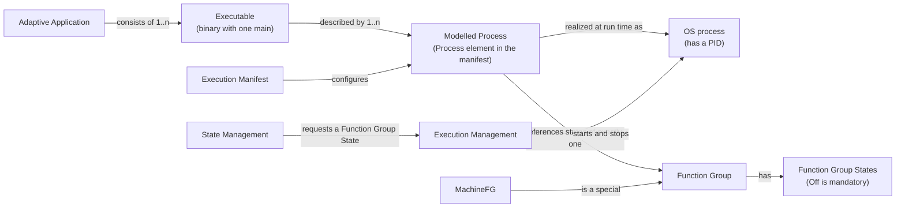

### 2.1 Software Units: From Application to OS Process

**Adaptive Application.** *In plain words:* a piece of software that delivers a function, for example "lane keeping". *Precisely:* it consists of one or more Executables. It uses only ARA and the POSIX profile PSE51, so that it can be deployed on any Adaptive Platform. Executables of the same application may even be deployed to different machines, for example one high-performance machine and one high-safety machine.

**Executable.** *In plain words:* a program file that you can run. *Precisely:* a software unit that is part of an application and has exactly one entry point, the `main` function ([SWS_OSI_01001]). *Example:* the binary `fusion`.

**Modelled Process.** *In plain words:* a written-down description of *one* way to run an Executable. *Precisely:* an instance of the meta-class `Process` in the manifest. It says which Executable to run, in which Function Group States, and with which startup configuration (arguments, scheduling, limits, and so on). One Executable can be described by several Modelled Processes with different configurations. *Example:* the Modelled Process `Fusion` runs the executable `fusion` in the state `ADAS.Normal`.

**Process.** *In plain words:* the running program. *Precisely:* the OS process that EM creates at run time from a Modelled Process. It has a PID. In everyday language, and in this guide, "process" usually means this OS process, while "Modelled Process" means the configuration element.

> **C++ analogy:** an Executable is like a *class*. A Modelled Process is like a written-down constructor call with specific arguments. A Process is the *live object* created from it.

**Machine.** The environment that one instance of the Adaptive Platform runs on. It can be a physical ECU, a virtual machine on a hypervisor, or an OS-level container.

### 2.2 Manifests

**Manifest.** A standardized configuration description, written in the AUTOSAR XML format (ARXML), that tells the platform how to deploy and run software. [Guide 02](02_Manifests.md#23-the-kinds-of-manifest) explains all kinds of manifest and how they are modeled. For EM, four of them matter:

- **Execution Manifest:** belongs to an Executable. Describes how its processes are started: the states in which they run, arguments, environment, scheduling, resource group, dependencies and timeouts.
- **Machine Manifest:** belongs to a machine. Holds machine-wide configuration, such as default timeouts, machine-wide environment variables, resource groups and the trusted-platform mode.
- **Service Instance Manifest:** the configuration of how service-oriented communication is deployed on the network. EM does *not* use it for configuration. In `strictMode`, however, EM checks its integrity (see [Chapter 12](#12-security-trusted-platform-and-iam)).
- **Processed Manifest:** the manifests converted into a platform-specific format that is quick to read at startup. This is what EM actually reads at run time.

[Chapter 4](#4-configuration-overview) shows which elements EM reads, and [Chapter 13](#13-configuration-reference-what-to-configure) explains every setting.

### 2.3 States

**Function Group (FG).** *In plain words:* a named group of processes that are switched on and off together. *Precisely:* each Function Group has its own set of processes and its own set of states. *Example:* `ADAS`.

**Function Group State.** *In plain words:* one named "mode" of a Function Group, saying exactly which processes run (and with which configuration). *Precisely:* modelled as a `ModeDeclaration`. Every Function Group has a mandatory `Off` state, in which no processes run, and a mandatory `Verify` state. *Example:* `ADAS.Normal`, `ADAS.Degraded`, `ADAS.Off`.

**MachineFG and Machine State.** `MachineFG` is the special Function Group whose states control the lifecycle of the whole machine. Its states are called **Machine States**. The mandatory ones are `Off`, `Startup`, `Shutdown`, `Restart` and `Verify`. Projects add their own states, such as `Driving`.

**Execution State.** The state of a process *as seen by the process itself*. The only value a process can report is `kRunning`, meaning "I have finished initializing". The phases before and after (*Initializing* and *Terminating*) are implicit.

**Process State.** The state of a process *as tracked by EM*: `Idle`, `Starting`, `Running`, `Terminating`, `Terminated`. EM uses it to resolve dependencies and to manage timeouts.

**Undefined Function Group State.** Any state of a Function Group that is *not* one of the modelled states. A Function Group is in an Undefined Function Group State in three cases:

- while a state transition is in progress;
- after a state transition has failed;
- after one of its processes has terminated abnormally or unexpectedly.

**Unrecoverable State.** EM's last resort when it faces a situation that it cannot resolve, for example when it cannot read its configuration. EM stops taking further actions, terminates all processes it manages, and hands over to project-specific handling (see [Section 10.4](#104-unrecoverable-state)).

> **Pitfall: "Running" means three different things.**
>
> 1. `kRunning` is the **Execution State** value that a process reports with `ReportExecutionState`.
> 2. *Running* is the **Process State** that EM assigns after it receives `kRunning`, or immediately after creation for a non-reporting process. An Execution Dependency such as "`A` must be *Running*" refers to this meaning.
> 3. `Running` is also a popular **name for a Function Group State** in examples (the specification uses `FG1:Running`). That is just a name chosen by the integrator.
>
> When you discuss a problem, always say which "Running" you mean.

### 2.4 Process Flavors

Processes differ in two independent ways: whether they *report* their Execution State, and whether they are allowed to *terminate by themselves*.

| Flavor | How it is configured | Behavior | Typical use |
| --- | --- | --- | --- |
| Reporting Process | `Executable.reportingBehavior = reportsExecutionState`, or the attribute is omitted ([TPS_MANI_01279]) | Must report `kRunning` using `ara::exec::ExecutionClient`. | The normal case: all software written for the Adaptive Platform |
| Non-reporting Process | `Executable.reportingBehavior = doesNotReportExecutionState` | Considered *Running* immediately after creation. It must not use `ExecutionClient`. | Legacy or third-party binaries that cannot be modified, and development tools |
| Companion Process | A normal reporting process with a special role | Checks, by a project-specific method, whether a non-reporting process is really ready, and only then reports `kRunning`. | Making dependencies on non-reporting processes meaningful |
| Self-terminating Process | `StartupConfig.terminationBehavior = processIsSelfTerminating` | May exit with `EXIT_SUCCESS` on its own after its job is done, or wait for EM's `SIGTERM`. | One-shot jobs such as consistency checks, calibration and data migration |
| Non-self-terminating Process (default) | `terminationBehavior = processIsNotSelfTerminating`, or the attribute is omitted ([SWS_EM_01314]) | Terminates only when EM requests it. | Services and daemons |

The two properties combine freely. The specification's own example, which this guide uses in [Section 5.4](#54-non-reporting-processes-and-the-companion-pattern), is a process that is both non-reporting and self-terminating.

### 2.5 Termination Events

EM classifies the end of a process with two terms that are easily confused:

- **Abnormal Termination:** the process terminated with an exit status other than `0` (`EXIT_SUCCESS`). Any unhandled signal, such as a segmentation fault, results in an Abnormal Termination.
- **Unexpected Termination:** the process terminated *without a justified reason*. For example:
  - a process configured as `processIsNotSelfTerminating` terminated without a prior request from EM;
  - a process terminated before reporting `kRunning`.

| What happened | Abnormal? | Unexpected? |
| --- | --- | --- |
| Process exits with status `0` after EM sent `SIGTERM` | no | no |
| Process exits with a non-zero status after EM sent `SIGTERM` | yes | no |
| Non-self-terminating process crashes with `SIGSEGV` while running | yes | yes |
| Non-self-terminating process calls `exit(EXIT_SUCCESS)` on its own while running | no | yes |
| Process exits before it reported `kRunning` | depends on the exit status | yes |
| Self-terminating process reports `kRunning`, does its job and exits with status `0` | no | no |

An Unexpected Termination may also be an Abnormal Termination. For error handling, EM treats both kinds alike (see [Sections 5.7](#57-crashes-outside-a-state-transition) and [8.4](#84-process-crashes-during-a-transition)).

### 2.6 Other Key Terms

**Execution Dependency.** A declaration in the manifest such as "start `B` only after `A` has reached the Process State *Running*", or "...after `A` has *Terminated*". It controls the *order* of start and termination. It does *not* control *whether* a process is started (see [Chapter 6](#6-execution-dependencies-startup-and-shutdown-ordering)).

**StartupConfig and StateDependentStartupConfig.** A `StartupConfig` is a reusable set of start parameters, such as arguments, environment, scheduling, timeouts and termination behavior. A `StateDependentStartupConfig` connects a process with a `StartupConfig` *for a set of Function Group States*, and adds dependencies and resource settings (see [Section 4.2](#42-how-the-elements-relate) and [Section 13.4](#134-statedependentstartupconfig-and-executiondependency)).

**State Management (SM).** The functional cluster that decides which Function Group States the machine should be in, based on project-specific logic and vehicle-wide events. It requests transitions through `ara::exec::StateClient`. SM is itself a process started by EM.

**Platform Health Management (PHM).** The functional cluster that supervises processes, for example whether they are alive and meet their deadlines. EM informs PHM about lifecycle events of supervised processes.

**ResourceGroup.** A group of processes that share a CPU-time limit and a memory limit (see [Chapter 11](#11-resource-management)).

**Trusted Platform and Trust Anchor.** A platform on which only software of verified integrity and authenticity is executed. The Trust Anchor, also called the "root of trust", is the element that is authentic by definition, for example a public key in protected memory (see [Chapter 12](#12-security-trusted-platform-and-iam)).

> **Key takeaways**
>
> - Executable (program file) → Modelled Process (manifest description) → Process (running OS process).
> - A Function Group is a group of processes that are switched together. A Function Group State says which processes run. `MachineFG` is the Function Group for the machine lifecycle.
> - The *Execution State* is the process's own view (it reports `kRunning`). The *Process State* is EM's view (`Idle`, `Starting`, `Running`, `Terminating`, `Terminated`).
> - Reporting and non-reporting, self-terminating and non-self-terminating are independent properties of a process.
> - Abnormal Termination means a non-zero exit status. Unexpected Termination means termination without a justified reason. EM handles both alike.

---

## 3. EM in the System Architecture

> **Why this matters:** EM rarely works alone. A process start involves the operating system, Platform Health Management and Log and Trace. A state change involves State Management. This chapter shows who talks to whom, about what, and through which interface.

### 3.1 Where EM Sits in the Platform

EM is the first process of the Adaptive Platform (Section 7.3.5 of the specification). It is not necessarily the first process on the *machine*, though. An OS init process, or user-level processes of a micro-kernel OS such as drivers and file systems, may run before EM. These are managed outside the Adaptive Platform. Once EM runs, it starts the daemons of all other functional clusters and all applications.

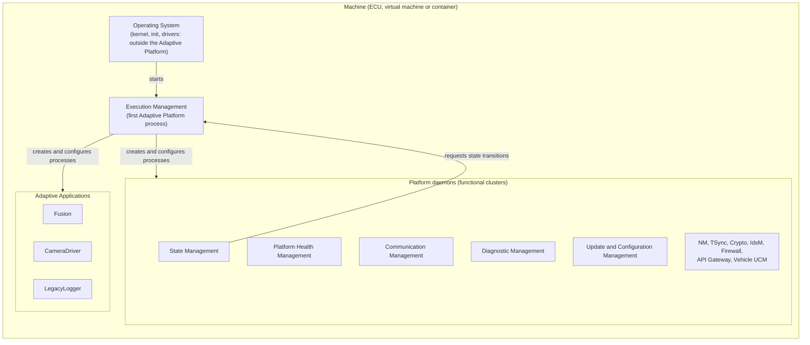

### 3.2 Interfaces Provided by EM

EM provides C++ library interfaces only. It defines no `ara::com` service interfaces (Chapter 9 of the specification). Behind the API, the library talks to the EM daemon through an implementation-specific IPC channel; the specification mentions a POSIX FIFO as an example.

| Interface | Used by | Purpose |
| --- | --- | --- |
| `ExecutionClient` | Every daemon-based functional cluster: State Management, PHM, Communication Management, Diagnostic Management, Update and Configuration Management, Vehicle Update and Configuration Management, Network Management, Time Synchronization, Cryptography, Intrusion Detection System Manager, Firewall, Automotive API Gateway. Also every reporting Adaptive Application. | Report the Execution State of the own process (`kRunning`), and receive the termination request (`SIGTERM`) through a termination handler. |
| `StateClient` | State Management only | Request Function Group State transitions, retrieve the result of the initial `Startup` transition, and query execution errors. |
| `FunctionGroup` | State Management | Represent a Function Group, as a handle built from an `InstanceSpecifier`. |
| `FunctionGroupState` | State Management | Represent a Function Group State that can be requested. |

### 3.3 Interfaces Required by EM

| Provider | Interface | Purpose |
| --- | --- | --- |
| Log and Trace | `Logger` | EM logs its standardized, non-verbose (modelled) DLT messages (see [Chapter 15](#15-logging-tracing-and-reporting)). |
| Platform Health Management | `SupervisedEntity` (`ReportCheckpoint`) | EM reports checkpoints so that PHM can supervise EM's own process or processes. |
| Operating System | "Multi-Process System Interface". This is informative and implementation-specific, for example *set process configuration*, *start process*, *terminate process*. | Create and configure processes, terminate them, and observe their exit status. |

### 3.4 Interaction Map

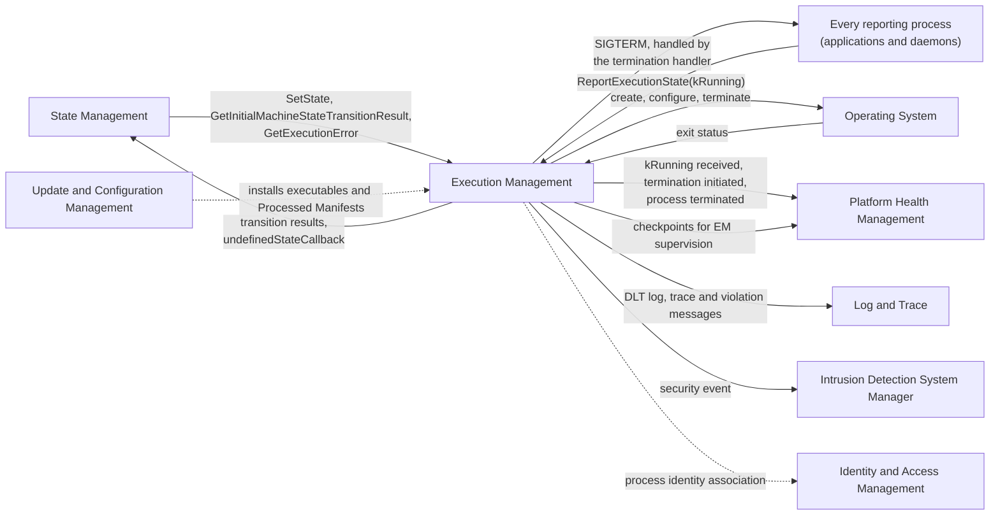

| Partner | Direction | Mechanism | Information exchanged | Standardized? |
| --- | --- | --- | --- | --- |
| State Management | SM → EM | `ara::exec::StateClient` | State transition requests (`SetState`), query of the initial `Startup` result, query of execution errors | Yes (C++ API) |
| State Management | EM → SM | `ara::core::Future` results and the `undefinedStateCallback` | Success or error code of a transition; an `ExecutionErrorEvent` naming the affected Function Group and the `ExecutionError` | Yes |
| Every reporting process | Process → EM | `ara::exec::ExecutionClient` | The `kRunning` report | Yes |
| Every reporting process | EM → process | `SIGTERM`, which `ExecutionClient` turns into a call of the termination handler | The termination request | Yes (behavior is specified) |
| Operating System | EM ↔ OS | OS process APIs | Process creation and configuration, termination, exit status (for example via `waitpid()`) | No (OS-specific) |
| Platform Health Management | EM → PHM | Inter-functional-cluster interface | For supervised processes: "kRunning received" ([SWS_EM_01210]), "termination about to be initiated" ([SWS_EM_01211]), "process terminated" ([SWS_EM_01212]) | No (vendor-specific signature) |
| Platform Health Management | EM → PHM | `SupervisedEntity` | Checkpoints used to supervise EM itself | Yes (API) |
| Log and Trace | EM → LT | `Logger` | Standardized DLT messages | Yes (message catalog is standardized, status DRAFT) |
| Intrusion Detection System Manager | EM → IdsM | Security event reporting | `SEV_EXEC_SW_COMPONENT_INTEGRITY_CHECK_FAILED` | Yes (event is standardized, status DRAFT) |
| Identity and Access Management | EM → IAM | Implementation-defined | Association between a Modelled Process and the identity of its OS process ([SWS_EM_02400]) | No |
| Update and Configuration Management | UCM → EM (indirect) | Software installation | New executables and Processed Manifests. Manifests may be converted on the machine at installation time. | No (indirect) |

Each partner has its own guide in this series: the operating system interface in [guide 01, Chapter 7](01_PlatformOverview.md#7-the-operating-system-interface); State Management in guide 05 (`05_StateManagement.md`, planned); Platform Health Management in guide 06 (`06_PlatformHealthManagement.md`, planned); Log and Trace in guide 10 (`10_LogAndTrace.md`, planned); Update and Configuration Management in guide 13 (`13_UpdateAndConfigManagement.md`, planned); Identity and Access Management in guide 15 (`15_IdentityAndAccessManagement.md`, planned); and the Intrusion Detection System Manager in guide 16 (`16_IDSM_Firewall.md`, planned).

> **Note:** Communication Management does not appear in the table as an EM partner, although EM starts the CM daemon like any other daemon. Applications use CM's **service discovery**, not EM, to wait until another application's service is available (see [Section 6.6](#66-prefer-service-discovery-for-applications)).

### 3.5 Where Do State Requests Come From?

EM never decides on its own to change a Function Group State. The only exception is the initial `Startup` transition, see [Chapter 9](#9-machine-lifecycle-startup-shutdown-and-restart). All other requests come from State Management, which in turn reacts to many inputs. The following picture is typical, but it lies outside the scope of the EM specification. Refer to the State Management, PHM, Diagnostic Management and UCM specifications for details.

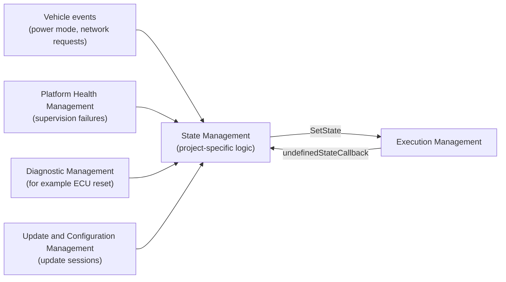

> **Key takeaways**
>
> - EM is the first Adaptive Platform process. It starts all functional-cluster daemons and all applications.
> - EM *provides* `ExecutionClient` (for every reporting process) and `StateClient`, `FunctionGroup` and `FunctionGroupState` (for State Management). It *requires* Log and Trace, PHM and the operating system.
> - The EM → PHM lifecycle notifications and the EM ↔ IAM identity exchange are real interactions, but their interfaces are vendor-specific.
> - All state change requests come from State Management, the only exception being the initial `Startup` transition.

---

## 4. Configuration Overview

> **Why this matters:** EM has no built-in knowledge of your system. Everything it does, which processes to start, in which order, with which priorities and limits, comes from configuration. If EM "does something strange", the answer is usually in the manifest. This chapter gives the big picture; [Chapter 13](#13-configuration-reference-what-to-configure) lists every setting in detail.

### 4.1 Where the Configuration Lives

EM reads parts of several models and manifests. [Guide 02](02_Manifests.md#4-configuration-overview) describes all of them and how they are written in ARXML; the following table shows only what matters to EM. The roles and steps follow the AUTOSAR methodology ([guide 02, Chapter 11](02_Manifests.md#11-the-methodology-from-design-to-a-running-machine)); real projects may distribute the work differently.

| Model or manifest | Typically configured by | Methodology step | Main elements for EM |
| --- | --- | --- | --- |
| Application design | Application developer | Application Design | `Executable` (whether its processes report their Execution State) |
| Machine Manifest | Integrator of the Machine | Machine Manifest | `Machine` (default timeouts, environment variables, trusted-platform mode, processors), `ResourceGroup`, the Function Group `MachineFG` and its states |
| Execution Manifest | Integrator of a Software Cluster | Software Cluster Integration | `Process`, `StateDependentStartupConfig`, `StartupConfig`, `ExecutionDependency`, `ProcessToMachineMapping`, application Function Groups such as `ADAS` |
| State Management configuration | Integrator | Configure Platform Modules | `FunctionGroupPortMapping`: which State Management process may control which Function Group |
| Software distribution | Integrator, OEM | Software Packaging | `SoftwareCluster`: which Function Groups and processes belong to which installable unit |
| Service Instance Manifest | Software cluster responsible, finalized by the integrator | Software Cluster Integration | Nothing to configure for EM. In `strictMode`, EM checks its integrity ([SWS_EM_02308]). |

EM does not read ARXML at run time. The manifests are converted into **Processed Manifests**, a platform-specific format that is quick to read at startup. The conversion happens off-board at integration or deployment time, or on the machine by Update and Configuration Management at installation time ([guide 02, Section 11.8](02_Manifests.md#118-how-the-platform-consumes-manifests-at-run-time)).

### 4.2 How the Elements Relate

The following class diagram shows the elements that EM reads and the references between them. An arrow points from the element that holds the reference.

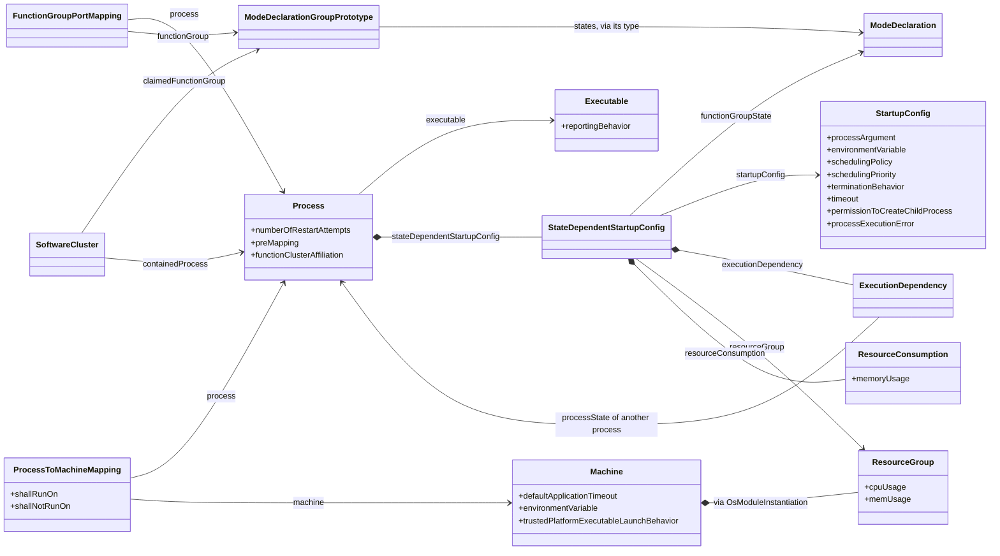

A Function Group is modeled as a `ModeDeclarationGroupPrototype`, and each of its states as a `ModeDeclaration` ([guide 02, Section 7.5](02_Manifests.md#75-function-groups-and-their-states)). Read the diagram from the `Process` outwards:

- A **`Process`** (the Modelled Process) runs one **`Executable`**. The Executable says whether its processes report their Execution State.
- The process has one or more **`StateDependentStartupConfig`** elements. Each one says: "in *these* Function Group States, start the process with *this* `StartupConfig`, *these* Execution Dependencies, *this* ResourceGroup and *these* memory limits."
- A **`StartupConfig`** is a reusable set of start parameters: arguments, environment, scheduling, termination behavior, timeouts, child-process permission and execution error.
- An **`ExecutionDependency`** points to a Process State (`Running` or `Terminated`) of another process.
- The **`Machine`** holds the machine-wide defaults and the ResourceGroups. A **`ProcessToMachineMapping`** puts each process on its machine and can restrict its cores.
- A **`FunctionGroupPortMapping`** gives one State Management process the right to control one Function Group. A **`SoftwareCluster`** claims Function Groups and contains processes.

When this guide says that **a process references a state**, it means that one of the process's `StateDependentStartupConfig` elements lists that Function Group State in `functionGroupState`.

Two consequences shape everything that follows:

- **Per-process, per-state configuration.** Each process is configured individually and can use a *different* configuration in different Function Group States, for example different arguments in `Normal` and in `Degraded`. Whether two states share a configuration decides whether a process keeps running or is restarted when the Function Group switches between them ([Section 8.2](#82-the-three-logical-steps)).
- **Validation is the tooling's job.** The constraints of the *Manifest Specification* are checked by the vendor tooling at integration time. EM assumes that the manifests it reads are consistent.

> **Key takeaways**
>
> - EM reads the Executable, the Execution Manifest, the Machine Manifest, the State Management configuration and the Software Clusters, all converted into Processed Manifests.
> - The central element is the `StateDependentStartupConfig`: *in which states* a process runs, *with which* startup configuration, dependencies and resources.
> - Whether a process keeps running or is restarted at a transition depends on whether the two states share the same `StateDependentStartupConfig`.
> - [Chapter 13](#13-configuration-reference-what-to-configure) lists every attribute, its meaning, what happens when it is absent, and the complete configuration of the running example.

---

## 5. Process Lifecycle Management

> **Why this matters:** Every process of the Adaptive Platform goes through the same lifecycle under EM's control. If you know exactly when EM considers a process "started", "running" and "terminated", you can write applications that start fast and shut down cleanly, and you can read EM's logs with confidence.

### 5.1 Two Views of a Process: Execution State and Process State

A process has two state machines:

- The **Execution State** describes the lifecycle *from the point of view of the process*. The process goes through *Initializing* (allocating resources, initializing data), then *Running* (its main functionality), then *Terminating* (storing data, freeing resources, exiting). The only value that the process actually *reports* is `kRunning` ([SWS_EM_02000]). *Initializing* and *Terminating* are implied.
- The **Process State** describes the lifecycle *from the point of view of EM*. EM uses it internally to resolve Execution Dependencies, manage timeouts and so on. There is no standardized C++ type for it.

The two are deliberately kept separate. The Process State can then evolve in future releases without affecting the code of any process.

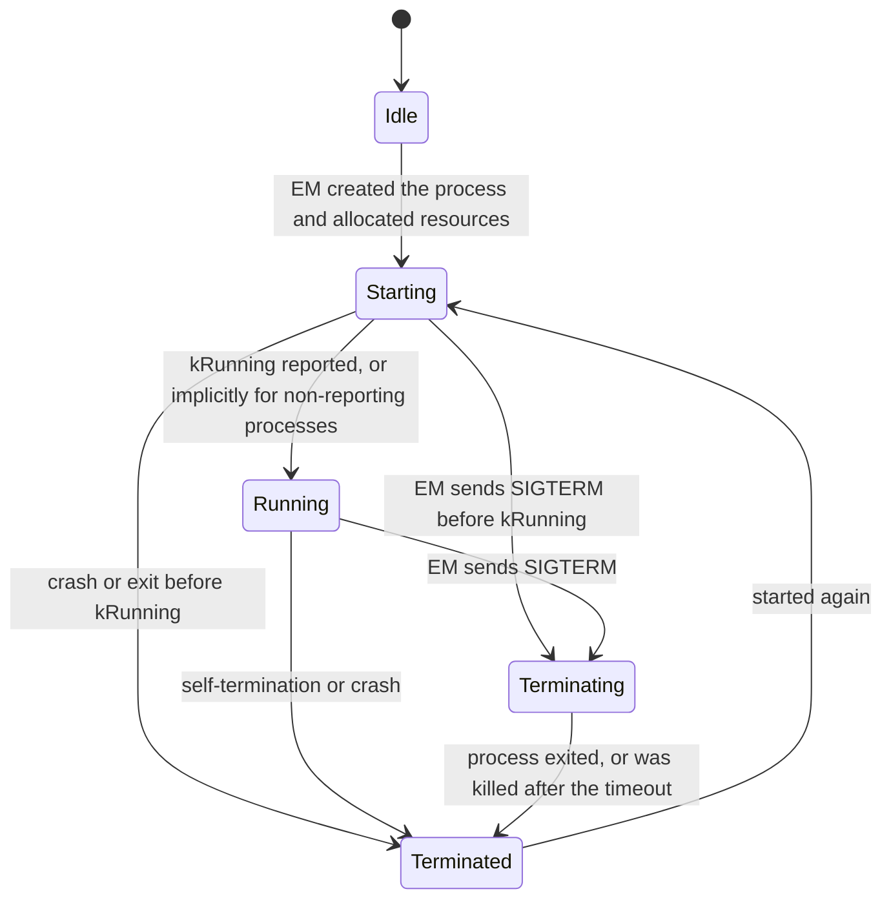

| Process State (EM's view) | Meaning | Execution State (process's view) | Spec |
| --- | --- | --- | --- |
| `Idle` | Before the process is created and before resources are allocated | (none) | [SWS_EM_01002] |
| `Starting` | The process has been created and its resources have been allocated. EM waits for `kRunning`. | *Initializing* (implied) | [SWS_EM_01003] |
| `Running` | A reporting process has reported `kRunning`. A non-reporting process enters this state implicitly right after creation. | `kRunning` | [SWS_EM_01004], [SWS_EM_01402] |
| `Terminating` | EM has sent `SIGTERM` to the process | *Terminating* (implied) | [SWS_EM_01404] |
| `Terminated` | The process has terminated and its resources have been freed | (none) | [SWS_EM_01006] |

Three details are worth remembering:

- **Additional states are allowed.** An implementation may add its own Process States, as long as they do not conflict with or replace the standard ones.
- **`Terminated` is not the same as `Idle`.** In both states no process runs and no resources are allocated. `Terminated`, however, tells EM that the process *has already run* and may now be restarted if needed. The difference matters for dependencies on self-terminating processes (see [Chapter 6](#6-execution-dependencies-startup-and-shutdown-ordering)).
- **EM observes every exit status.** EM is the parent of every process it starts. The mechanism is implementation-specific, typically POSIX `waitpid()`.

### 5.2 Starting a Process

Before the `main()` function of a process runs, EM prepares the process according to the manifest. The exact order is implementation-specific. Conceptually, EM performs these steps:

1. **Verify integrity and authenticity** of the Executable, its shared objects and its Processed Manifests, if a Trusted Platform is configured ([SWS_EM_02301], [SWS_EM_02302], [SWS_EM_02303]). In `strictMode`, a failed check means that the process is *not* started.
2. **Configure the ResourceGroup** (CPU and memory limit of the group) before any process of that group is loaded ([SWS_EM_02102], [SWS_EM_02103], [SWS_EM_02106]).
3. **Set process-level memory settings:** the maximum memory usage ([SWS_EM_02108]) and pre-mapping if `preMapping = true` ([SWS_EM_02109]).
4. **Configure the first thread:** core affinity ([SWS_EM_02104]), scheduling policy ([SWS_EM_01014]) and scheduling priority ([SWS_EM_01015]).
5. **Set the initial signal mask** ([SWS_EM_02578], [SWS_EM_02579]).
6. **Prepare command-line arguments and environment variables** ([SWS_EM_01012], [SWS_EM_02246], [SWS_EM_02247]).
7. **Restrict child-process creation** unless `permissionToCreateChildProcess` is `true` ([SWS_EM_02559]).
8. **Associate the process with its identity**, so that IAM can enforce access rights ([SWS_EM_02400]).
9. **Create the OS process.** The Process State becomes `Starting`. EM logs `ProcessCreated` ([SWS_EM_02573]) and starts monitoring the start-up timeout ([SWS_EM_02253]).

Every step is driven by a setting of the `Process`, its `StartupConfig` or the `Machine`. [Chapter 13](#13-configuration-reference-what-to-configure) lists them, from [Section 13.3](#133-process) to [Section 13.8](#138-core-affinity-processtomachinemapping-and-processdesigntomachinedesignmapping).

The following diagram shows the normal start of a reporting process that is supervised by PHM:

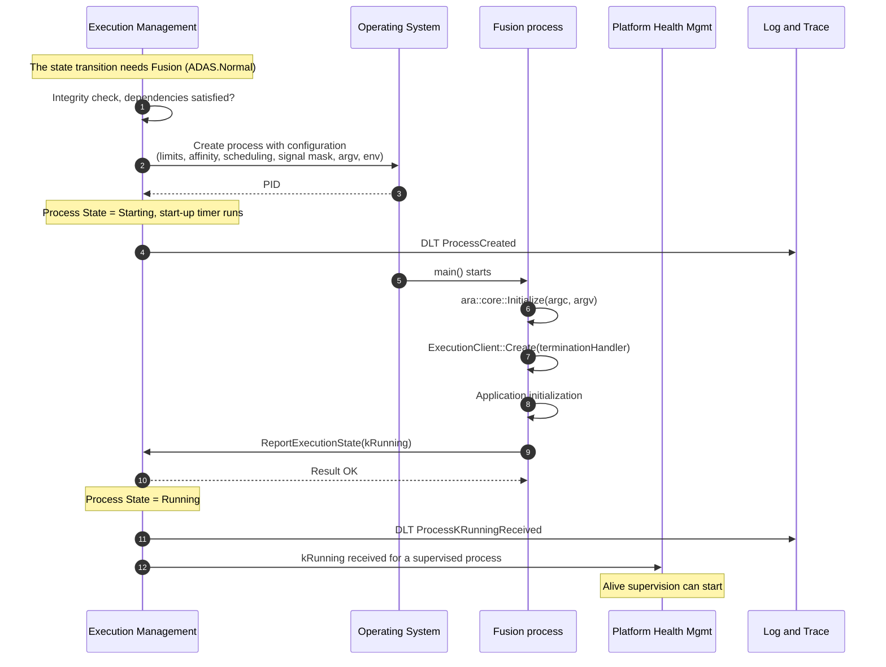

### 5.3 Reporting kRunning

A reporting process **must** report `kRunning` with `ara::exec::ExecutionClient::ReportExecutionState` ([SWS_EM_01004], [SWS_EM_02003]):

```cpp
// After the own initialization is complete, before waiting for other services:
auto result = executionClient.ReportExecutionState(ara::exec::ExecutionState::kRunning);
```

**When to report.** Report *after* your own initialization is complete, but *before* service discovery of other services has completed. If a process reported `kRunning` only after service discovery, the non-deterministic discovery delays would also delay every process that depends on it through Execution Dependencies. A common pattern is:

1. Read your configuration, allocate memory, create threads, and offer your own services.
2. Report `kRunning`.
3. Wait for the services you need. This is already part of the *Running* phase.

**Rules around kRunning:**

| Rule | Consequence of breaking it | Spec |
| --- | --- | --- |
| A process may only report its *own* Execution State. | The implementation does not allow anything else. | [SWS_EM_01401] |
| `kRunning` is accepted only while the Process State is `Starting`. | `ReportExecutionState` returns `kInvalidTransition`, for example when `kRunning` is reported twice. | [SWS_EM_02243] |
| Report within the start-up timeout. The timer runs from the moment EM requests the process creation. | Start-up failure: EM kills the process, retries if configured, and then fails the state transition. | [SWS_EM_02253], [SWS_EM_02260] |
| Non-reporting processes must not report. | `ReportExecutionStateViolation`: the process is terminated. | [SWS_EM_01403] |
| Only one `ExecutionClient` instance per process | `ExecutionClientMultipleInstanceViolation` | [SWS_EM_02582] |

> **Note:** To protect itself against denial-of-service attacks, an EM implementation may rate-limit Execution State reports or have the OS terminate a misbehaving process. Such reactions are not standardized.

### 5.4 Non-reporting Processes and the Companion Pattern

Some software was not written for the Adaptive Platform: a binary-only third-party tool, a program whose source code cannot be patched, or a tool used only during development. Such an Executable can be integrated as a **non-reporting process** (`reportingBehavior = doesNotReportExecutionState`):

- It does **not** use `ara::exec::ExecutionClient`. If it calls `ReportExecutionState` anyway, this is a violation ([SWS_EM_01403]).
- It is in Process State `Running` **immediately after creation**, after EM has allocated its resources ([SWS_EM_01402]). Its start-up time is therefore effectively zero.
- It starts with an **empty signal mask** and handles signals itself ([SWS_EM_02579]).
- It is not monitored by PHM. In safety-related systems, isolate it, for example in its own ResourceGroup.

**The problem.** Because a non-reporting process is *Running* right away, an Execution Dependency on it (`X.Running`) is satisfied immediately, possibly long before the process actually offers its functionality.

**The solution: a Companion Process.** A small *reporting* process acts as a representative of the non-reporting process. It waits until the non-reporting process is really usable, using a project-specific check such as connecting to its socket, and only then reports `kRunning`. Processes that need the non-reporting process depend on the *companion* instead. A `Terminated` dependency on a non-reporting process works without a companion, because the OS tells EM when the process terminates.

The specification's example (Figure 7.4) illustrates this. Arrows show the start order:

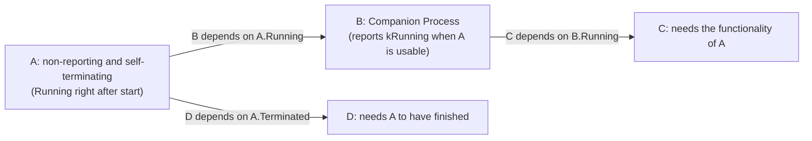

1. `A` has no Execution Dependencies, so it is started first and immediately enters `Running` ([SWS_EM_01402]).
2. Companion `B` starts as soon as `A` is *Running*. `B` checks whether `A` is fully functional and reports `kRunning` only when it is.
3. `C` starts only when `B` has reported `kRunning`. This works regardless of whether `C` itself is reporting or not.
4. `D` waits until `A` has *Terminated*. This works out of the box.

In the running example, `LoggerCompanion` plays the role of `B` for `LegacyLogger`, and `Fusion` and `FusionLite` play the role of `C`.

### 5.5 Terminating a Process

EM initiates the termination of a process by sending it **`SIGTERM`** ([SWS_EM_01055]). From EM's point of view, this only *starts* a graceful shutdown that the process itself controls. EM may send `SIGTERM` at any time, even while the process is still initializing, that is, before it has reported `kRunning`.

What happens next:

1. The Process State becomes `Terminating` ([SWS_EM_01404]). EM logs `ProcessTerminationRequest` ([SWS_EM_02575]). If the process is supervised, EM has informed PHM beforehand that termination is about to be initiated ([SWS_EM_01211]).
2. Inside the process, `ara::exec::ExecutionClient` receives the signal and calls the **termination handler** that the application passed to `ExecutionClient::Create` ([SWS_EM_02577]). The handler runs in a **background thread** that `ExecutionClient` maintains, *not* in a signal-handler context. All POSIX and `ara` APIs may therefore be used, subject to their own contracts.
3. The application stops its work, saves persistent data and frees its resources. It signals completion by exiting with status `0` (`EXIT_SUCCESS`).
4. EM detects the exit. The Process State becomes `Terminated` ([SWS_EM_01006]). EM logs `ProcessTerminated` ([SWS_EM_02576]) and informs PHM ([SWS_EM_01212]). Because it waits for the actual exit, EM can process dependencies on the `Terminated` state and make sure that two conflicting processes never run at the same time.
5. If the process does not terminate within the **termination timeout**, EM asks the OS to terminate it forcibly ([SWS_EM_02255]), which on POSIX systems means `SIGKILL`, and logs `ProcessTerminationTimeout` ([SWS_EM_02258]).

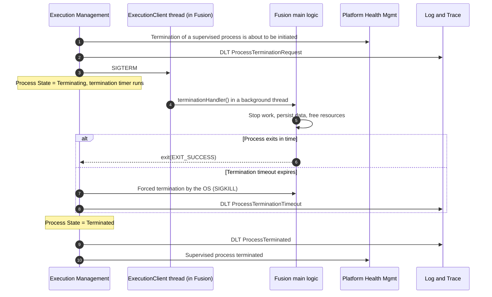

> **Note (implementation example):** A common way to implement the termination handler is the following. The `ExecutionClient` library keeps `SIGTERM` blocked in all threads, which matches the initial signal mask described in [Section 5.8](#58-signal-mask-arguments-and-environment-variables). A dedicated thread waits for the signal synchronously, for example with `sigwait()`, and then calls the user's handler. This is why the handler is not restricted to async-signal-safe functions.
>
> **Pitfall:** Do not do the actual cleanup *inside* the termination handler if it can take long or needs locks that the main thread holds. Use the handler only to *notify* the main logic, for example by setting a flag and waking a condition variable. Then clean up in the normal control flow. In any case, finish within the termination timeout.

### 5.6 Self-terminating Processes

By default, a process terminates **only when EM requests it** ([SWS_EM_01314]). A process configured with `terminationBehavior = processIsSelfTerminating` may instead:

- terminate by itself, exiting with `EXIT_SUCCESS` when its job is done, **or**
- wait for EM to request termination with `SIGTERM`.

Self-terminating processes are made for **one-shot jobs**, such as a storage consistency check, a calibration check or a data migration. Other processes can wait for them to finish by using a `Terminated` Execution Dependency (see [Chapter 6](#6-execution-dependencies-startup-and-shutdown-ordering)).

> **Pitfall:** A self-terminating process that is a *reporting* process must still report `kRunning` before it exits. If it terminates before reporting `kRunning`, that is an Unexpected Termination, and the state transition fails (see [Section 8.3](#83-timeouts-and-start-up-failures)).

### 5.7 Crashes Outside a State Transition

What happens if a process terminates abnormally while no state transition is in progress, for example when `Fusion` crashes in the middle of `ADAS.Normal`? [SWS_EM_01309] defines EM's reaction:

1. If the Function Group is not already in an Undefined Function Group State:
   1. EM sets the state of the Function Group that the process belongs to to an **Undefined Function Group State**.
   2. EM calls the **`undefinedStateCallback`** that State Management registered with `ara::exec::StateClient`, passing an `ara::exec::ExecutionErrorEvent`.
2. EM logs `ProcessAbnormalTermination` (if logging is active).

The same applies to an Unexpected Termination. Important details:

- **EM does not restart the process.** State Management decides how to recover, for example by requesting a degraded state (see [Section 10.3](#103-undefined-function-group-state)).
- **Only one notification per incident.** If further processes of the same Function Group fail while it is already undefined, the callback is not called again. Once SM requests a new transition, the Function Group remains undefined until the transition completes. Failures during that transition are reported through the `SetState` result, not through the callback.
- **SM can query the error later.** `StateClient::GetExecutionError` returns the same information as the callback ([SWS_EM_02542]).
- **The error value has a default.** The `ExecutionError` in the event is the process's configured `processExecutionError`. If none is configured, EM reports the value `1` ([SWS_EM_02543]).

### 5.8 Signal Mask, Arguments and Environment Variables

**Signal mask.** The Adaptive Platform limits interaction with POSIX signals to a minimum. The only reason for signal interaction is EM's termination request. To avoid threads with an undefined signal mask, for example threads created inside `ara` libraries, EM starts every process with a well-defined mask:

| Process type | Initial signal mask | Spec |
| --- | --- | --- |
| Reporting process | **All blockable signals blocked**, except `SIGABRT`, `SIGBUS`, `SIGFPE`, `SIGILL` and `SIGSEGV` | [SWS_EM_02578] |
| Non-reporting process | **Empty** (nothing blocked); the process handles signals itself | [SWS_EM_02579] |

The five unblocked signals are raised by the OS when a program cannot reasonably continue. According to POSIX, ignoring them leads to undefined behavior, so their default action, Abnormal Termination, must stay in effect. `SIGKILL` and `SIGSTOP` can never be blocked anyway. For reporting processes, `ExecutionClient` takes care of `SIGTERM`.

> **Pitfall:** In a reporting process, do not install your own `SIGTERM` handler and do not unblock signals globally. Use the termination handler of `ExecutionClient` instead.

**Command-line arguments.** EM passes arguments the same way a shell does ([SWS_EM_01012]):

- `argv[0]` is the name of the Executable ([SWS_EM_01072]).
- `argv[1]` onwards are the `ProcessArgument.argument` values of the `StartupConfig`, in their modelled order ([SWS_EM_01078]). The order preserves option and value pairs such as `-b value`, and supports both short and long option styles.

*Example:* `processArgument = ["--mode", "full", "-v"]` for the executable `fusion` results in `argv = {"fusion", "--mode", "full", "-v"}`.

**Environment variables.** EM builds the environment from two sources: the process-specific variables of the `StartupConfig` ([SWS_EM_02246]) and the machine-wide variables of the Machine Manifest ([SWS_EM_02247]). The process reads them with `getenv()`.

| Variable | Machine Manifest | Execution Manifest | Value seen by the process |
| --- | --- | --- | --- |
| `LOG_LEVEL` | `info` | `debug` | `debug`, because the Execution Manifest wins ([SWS_EM_02248]) |
| `TZ` | `UTC` | (not set) | `UTC` |
| `FEATURE_X` | (not set) | key without a value | `""`, an empty string ([SWS_EM_02249]) |

### 5.9 Synchronization with Platform Health Management

PHM supervises processes, for example with alive, deadline and logical supervision. To start and stop its supervisions at the right time, PHM needs lifecycle information that only EM has. EM therefore informs PHM about three events for every **supervised** process. Which processes are supervised is defined by the PHM configuration.

| Event | Why PHM needs it | Spec |
| --- | --- | --- |
| "kRunning received" | To start alive supervision | [SWS_EM_01210] |
| "Initiating process termination" | To stop the supervisions before the process goes away | [SWS_EM_01211] |
| "Process terminated" | To supervise self-terminating processes | [SWS_EM_01212] |

These notifications use vendor-specific interfaces between the two functional clusters. Their signatures are not standardized. How PHM supervises processes is the topic of guide 06 (`06_PlatformHealthManagement.md`, planned).

### 5.10 Child Processes

By default a process may **not** create child processes. If `permissionToCreateChildProcess` is absent, EM treats it as `false` ([SWS_EM_02558]) and restricts the process accordingly ([SWS_EM_02559]). The mechanism is implementation-specific; one example is a capability mask applied at process creation.

If the integrator sets `permissionToCreateChildProcess = true`, the following points must be considered:

- **Safety and security.** Does the software come from a trusted source? Is this permission really necessary?
- **Responsibility.** The parent process must terminate the children it creates. Such children are not controlled by EM and exist outside the Adaptive Platform.
- **Resource planning.** Children consume unplanned resources. Put the parent into a dedicated ResourceGroup to limit their impact on CPU and memory.

> **Key takeaways**
>
> - Process States: `Idle` → `Starting` → `Running` → `Terminating` → `Terminated`. A reporting process becomes `Running` only when it reports `kRunning`.
> - Report `kRunning` right after your own initialization, and before you wait for other services.
> - Termination is cooperative: `SIGTERM`, then the termination handler, then cleanup, then `exit(EXIT_SUCCESS)`. Processes that do not finish within the timeout are killed.
> - A crash outside a transition puts the Function Group into an Undefined Function Group State and triggers the `undefinedStateCallback`. EM does not restart the process.
> - Reporting processes start with most signals blocked. `ExecutionClient` handles `SIGTERM` for them.

---

## 6. Execution Dependencies: Startup and Shutdown Ordering

> **Why this matters:** Some processes must not start before another process is ready, and some must not lose a service while they are shutting down. Execution Dependencies express this ordering. They are also a common source of configuration errors and of state transitions that "hang".

### 6.1 What Is an Execution Dependency?

An Execution Dependency is declared by the *dependent* process. It names the **provider** process and the **Process State** that the provider must have reached. You can write it as a pair `<process>.<processState>`.

- It is configured in the Execution Manifest (`StateDependentStartupConfig.executionDependency`, [TPS_MANI_01041]), at integration time, based on information from the application developer.
- Only two target states are allowed: **`Running`** and **`Terminated`** ([SWS_EM_CONSTR_01744]). There is no use case for `Idle` or `Terminating`.

| Dependency | Meaning | Typical use |
| --- | --- | --- |
| `B` depends on `A.Running` | `B` is started only after `A` has reached Process State `Running`, that is, after `A` reported `kRunning`. | `A` provides a service that `B` needs from its very first moment. |
| `D` depends on `C.Terminated` | `D` is started only after `C` has terminated. `C` must be a **self-terminating** process ([SWS_EM_CONSTR_00001]). | `C` is a one-shot job, such as a consistency check, that must finish before `D` starts. |

> **Important:** Execution Dependencies determine only the **order** in which processes are started and terminated. They never decide **whether** a process is started. EM starts a process only because it references the requested Function Group State, never because another process depends on it.

### 6.2 Startup and Termination Rules

- **Startup** ([SWS_EM_01050]). Before EM starts a process, every process it depends on must have reached the requested Process State, at some earlier point during the *current* state transition.
- **Termination** ([SWS_EM_01051]). The same dependencies apply in reverse. EM does not terminate a provider before the processes that depend on it have terminated, so that the service stays available until nobody needs it any more. It is not an error if the provider has already terminated by itself.
- **No dependency means no order.** If no dependency exists between two processes, EM may start or terminate them in any order, also in parallel.

*Example from the specification:* `DataLogger` depends on `Storage.Running`. At startup, EM starts `Storage` first, so that `DataLogger` can store its data. At termination, EM terminates `DataLogger` first, so that `DataLogger` can still flush its data to `Storage`.

### 6.3 Worked Example

This is Example 7.3 of the specification, with three processes:

- `Storage`: a service process without dependencies;
- `StorageConsistencyChecker`: a self-terminating process that requires `Storage.Running`;
- `ConfigReader`: a service process that requires `StorageConsistencyChecker.Terminated`.

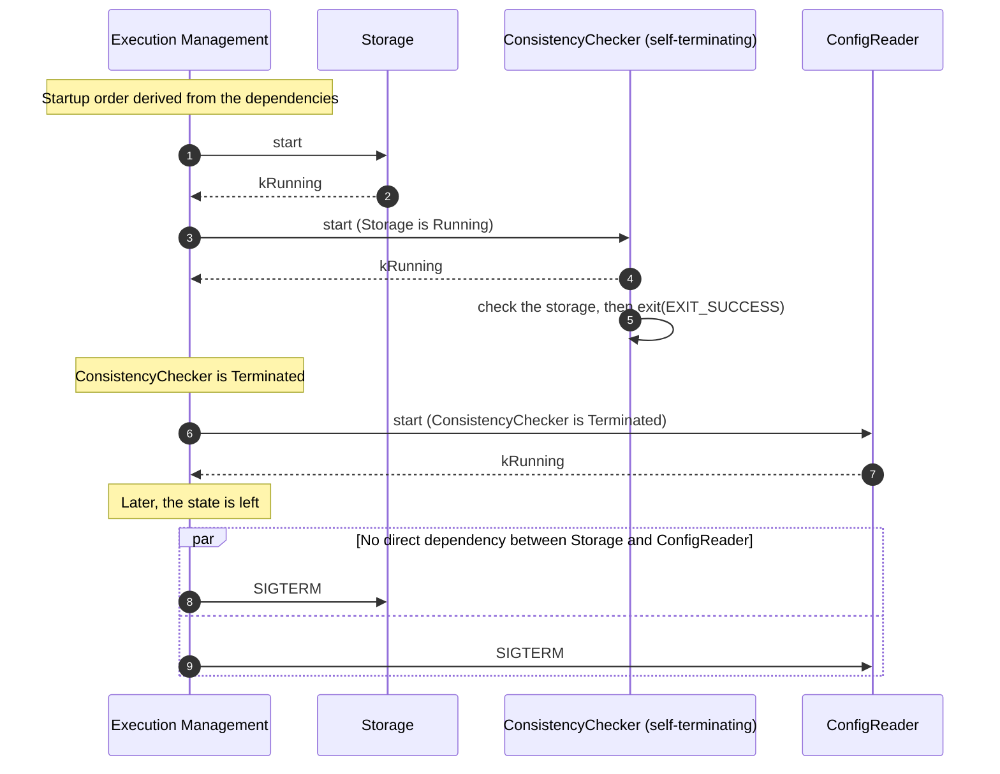

At termination, EM may stop `Storage` and `ConfigReader` **at the same time**. `StorageConsistencyChecker` has already terminated, and `ConfigReader` has no *direct* dependency on `Storage`. If `ConfigReader` must be stopped before `Storage`, add a direct dependency `ConfigReader` → `Storage.Running`.

### 6.4 Rules and Constraints You Must Know

1. **Dependencies are limited to one Function Group State** ([SWS_EM_01001], [constr_1689]). If process `A` depends on process `B`, but `B` is not part of the same Function Group State as `A`, EM treats this as an error and does not start `A`. Without this rule, `A` would wait forever. Dependencies *between* Function Groups would also hide relationships from State Management. If you need them, for example map software that needs GPS software, model them in State Management.
2. **`Terminated` only on self-terminating processes** ([SWS_EM_CONSTR_00001]). A `Terminated` dependency on a normal process could only be fulfilled at the next transition, so it is a configuration error.
3. **A startup configuration with dependencies cannot be shared between states** ([constr_10411]). If a `StateDependentStartupConfig` declares Execution Dependencies, it may be used in only *one* Function Group State. Such a process therefore uses a separate `StateDependentStartupConfig` per state, and EM **restarts** it at every transition between those states.
4. **A restart attempt does not fulfill `Terminated` dependencies** ([SWS_EM_02280]). If EM kills a failing process during start-up and retries, that kill does not count as "terminated" for the processes waiting on it.
5. **Dependencies are resolved against the processes of the RequestedState** ([SWS_EM_02245]). If `A` is restarted during a transition, `B`, which depends on `A.Running`, waits for the *new* instance of `A` (see [Section 8.8](#88-worked-example-dependency-resolution-during-a-state-change)).
6. **Non-reporting providers are Running at once.** Use a Companion Process (see [Section 5.4](#54-non-reporting-processes-and-the-companion-pattern)).
7. **No mutual dependencies** ([constr_1606]). If `A` depends on a state of `B`, then `B` must not depend on a state of `A`. Neither could ever start.

### 6.5 Dependencies in the Running Example

In the running example, the arrows mean "must reach this Process State before the next process starts":

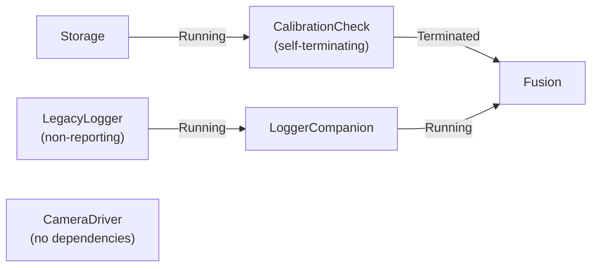

When SM requests `ADAS.Normal`, the dependencies lead to three "waves":

| Wave | Processes | Why |
| --- | --- | --- |
| 1 | `Storage`, `CameraDriver`, `LegacyLogger` | No dependencies. EM may start them in parallel. `LegacyLogger` is *Running* immediately. |
| 2 | `CalibrationCheck`, `LoggerCompanion` | `Storage` reported `kRunning`, and `LegacyLogger` is *Running*. |
| 3 | `Fusion` | `CalibrationCheck` has terminated, *and* `LoggerCompanion` reported `kRunning`. |

When ADAS goes to `Off`, the order is reversed. `Fusion` stops first. `LoggerCompanion` stops only after `Fusion`, and `LegacyLogger` only after `LoggerCompanion`. `Storage` and `CameraDriver` can stop at any time, because no *running* process depends on them: `CalibrationCheck` has already terminated.

### 6.6 Prefer Service Discovery for Applications

User-level applications should use the **service discovery of Communication Management** as their primary means of sequencing. It works within a machine *and* across machines, while Execution Dependencies work only within one Function Group State on one machine. Use Execution Dependencies only when strictly necessary. Typical justified cases:

- platform daemons that must be up before others;
- one-shot preconditions, such as checks and migrations, expressed with `Terminated` dependencies;
- non-reporting software behind a Companion Process.

In addition, the integrator must map all service dependencies onto the State Management configuration, so that all processes whose services are needed actually run when they are needed.

### 6.7 Pitfall: Deadlock with Terminated Dependencies

Consider again `D` depending on `C.Terminated`, where `C` is self-terminating. Suppose `C` reports `kRunning` but then hangs and never terminates, for example because of a bug:

- EM sees no fault. `C` reported `kRunning` in time and has not crashed.
- `D` is never started.
- The state transition never completes.

The specification states that **projects using `Terminated` dependencies must handle this situation outside EM**, for example in State Management. Practical countermeasures:

- State Management supervises each `SetState` future with a timeout and starts recovery when the timeout expires.
- PHM supervises the self-terminating process, for example with a deadline supervision.
- The self-terminating process implements an internal watchdog that bounds its run time.

> **Key takeaways**
>
> - An Execution Dependency is `<process>.<Running or Terminated>`. It orders start and termination, but never causes a start.
> - Termination order is the reverse of start order. Processes without dependencies between them may start or stop in parallel.
> - Dependencies must stay within one Function Group State. `Terminated` dependencies require a self-terminating provider.
> - A process with Execution Dependencies cannot share its startup configuration between states, so it is restarted on every transition between them.
> - Prefer Communication Management's service discovery for application-level sequencing.

---

## 7. State Management Support: Machine State and Function Groups

> **Why this matters:** Function Groups are the main tool for switching software on and off. Understanding how processes are mapped to Function Group States, and what is special about `MachineFG`, is the basis for designing a platform's operating modes.

### 7.1 The Four Kinds of State

EM deals with four kinds of state:

| State | Whose view | Who changes it | Values | Visible in the API as |
| --- | --- | --- | --- | --- |
| Execution State | The process itself | The process, by reporting | `kRunning`. *Initializing* and *Terminating* are implied. | `ara::exec::ExecutionState` |
| Process State | EM, internally | EM | `Idle`, `Starting`, `Running`, `Terminating`, `Terminated`, plus implementation-specific additions | Not standardized |
| Function Group State | One Function Group | SM requests, EM performs | `Off` plus project-defined states, for example `Normal` and `Degraded`. Undefined while switching or after a failure. | `ara::exec::FunctionGroupState` |
| Machine State | The Function Group `MachineFG` | SM requests, EM performs. EM self-initiates only `Startup`. | `Off`, `Startup`, `Shutdown`, `Restart`, `Verify`, plus project-defined states | `ara::exec::FunctionGroupState` of `MachineFG` |

The following timeline shows how the states of one process (`Fusion`, which references `ADAS.Normal`) relate to the state of its Function Group. It is a simplified version of Figure 7.12 of the specification, without delays and dependencies:

| Step | Event | ADAS Function Group State | Process State of Fusion | Execution State of Fusion |
| --- | --- | --- | --- | --- |
| t0 | Machine has started, ADAS not yet requested | `Off` | `Idle` | (none) |
| t1 | SM requests `ADAS.Normal`, EM creates the process | Undefined (transition in progress) | `Starting` | *Initializing* |
| t2 | `Fusion` reports `kRunning`, and so do all other processes of the state | `Normal` | `Running` | `kRunning` |
| t3 | SM requests `ADAS.Off`, EM sends `SIGTERM` | Undefined (transition in progress) | `Terminating` | *Terminating* |
| t4 | `Fusion` exits with `EXIT_SUCCESS` | `Off` | `Terminated` | (none) |

### 7.2 Function Groups and Function Group States

When a group of applications is installed on a machine, it is useful to control them coherently. That is why Function Groups exist:

- **Each Function Group has its own processes and its own states.** Each Function Group State defines which processes run, and with which startup configuration, when State Management requests that state.
- **`Off` is mandatory and initial.** Every Function Group, including `MachineFG`, has an `Off` state that EM uses as the initial state ([SWS_EM_01110], [TPS_MANI_03195]). No process can be mapped to `Off` ([constr_3424]).
- **`Verify` is mandatory, too.** Every Function Group must also have a state `Verify` ([constr_10023]). For `MachineFG` the EM specification requires it as well ([SWS_EM_CONSTR_02556]). State Management uses `Verify` while an update of the Function Group's Software Cluster is activated; guide 13 (`13_UpdateAndConfigManagement.md`, planned) explains the update sequence.
- **A process belongs to at most one Function Group** ([constr_1688]). If a process could run in states of two Function Groups, a state transition in one group would have to terminate it and would thereby break the active state of the other group.
- **A process can reference several states of the same Function Group.** If these states share one `StateDependentStartupConfig`, the process keeps running when the group switches between them. If they use different configurations, the process is restarted ([SWS_EM_01033], [SWS_EM_02251]).
- **A process that references no state is never started.**
- **Function Groups are independent of each other, from EM's point of view.** A transition in one group has no side effects on another. Dependencies between groups are State Management's concern.
- **Plan the resources.** All processes of all simultaneously active states must fit into the machine's resources at the same time.

Figure 7.11 of the specification shows typical patterns. They are summarized here:

| Process | References | Behavior at state transitions |
| --- | --- | --- |
| `A` | Machine State `Startup`; self-terminating | Runs once during `Startup` and exits. |
| `B` | Machine States `Startup` and `Running`, through *different* startup configurations | Two configurations are required because `B` depends on the termination of `A` in `Startup` ([constr_10411]). `B` is restarted at `Startup` → `Running`. |
| `C` | Machine State `Running` only | Terminated when SM requests the Machine State `Diagnostics`. |
| `D`, `E` | `FG1:Running` only, no dependency between them | Started and terminated in arbitrary order, in parallel if possible. |
| `F` | `FG2:Running` and `FG2:Fallback`, with *different* startup configurations | Terminated at the transition and started again with the other configuration. |
| `G` | `FG2:Running` and `FG2:Fallback`, through the *same* `StateDependentStartupConfig` | Not restarted; keeps running. |

In the running example, `Storage`, `CameraDriver` and `LegacyLogger` behave like `G`, and `LoggerCompanion` behaves like `F`.

### 7.3 MachineFG and Machine States

`MachineFG` is the Function Group whose states, the **Machine States**, control the lifecycle of the machine, and usually also the processes of platform-level applications. Other Function Groups control groups of user-level applications. This is a convention, not a rule: not every platform-level process has to be controlled by Machine States.

- **Configuration source.** EM obtains the Machine States from the Function Group `"MachineFG"` of the `SoftwareCluster` with category `PLATFORM_CORE` ([SWS_EM_01032]). Each machine has exactly one such SoftwareCluster ([constr_1788]), and only it may claim `MachineFG` ([SWS_EM_CONSTR_02557]).
- **Mandatory states.** Exactly one Function Group named `"MachineFG"` must exist per machine, with at least the following states ([SWS_EM_CONSTR_02556]). The standard model file `AUTOSAR_MOD_GeneralDefinition_MachineFG.arxml` provides a definition. Additional Machine States are project-specific.

| Machine State | Purpose | Special rules |
| --- | --- | --- |
| `Off` | Initial state before EM starts. No processes. | EM refuses a request to switch `MachineFG` to `Off` with `kInvalidTransition` ([SWS_EM_02549]). |
| `Startup` | First state. Brings up the platform, including State Management. | Entered by EM's *self-initiated* transition ([SWS_EM_01023]). If this transition fails, EM enters the Unrecoverable State ([SWS_EM_02555]). |
| `Shutdown` | Clean shutdown of the machine | At least one process must reference it ([SWS_EM_CONSTR_02558]). That process performs the actual OS shutdown. |
| `Restart` | Clean restart of the machine | At least one process must reference it ([SWS_EM_CONSTR_02559]). |
| `Verify` | Mandatory state related to software-update verification | Its usage is defined by State Management and Update and Configuration Management, not by the EM specification. |
| Project-specific, for example `Driving`, `Parking`, `Diagnostics` | The normal operating modes | Defined by the integrator |

> **Important:** State Management must be configured to run in **every** Machine State, including `Startup`, `Shutdown` and `Restart` ([SWS_SM_CONSTR_00001]). Otherwise no component would be left that can request the next state, and the machine would be stuck in that state forever.

### 7.4 Division of Responsibilities: SM Decides, EM Executes

| Topic | State Management | Execution Management |
| --- | --- | --- |
| Decides *when* and *why* a Function Group changes state | Yes | No. The only exception is the initial `Startup` transition. |
| Knows dependencies *between* Function Groups | Yes | No. For EM, Function Groups are independent. |
| Performs the transition (terminate, start, configure processes) | No | Yes |
| Reacts to failures | Decides on recovery | Detects and reports: through the `SetState` result or the `undefinedStateCallback` |
| Controls a given Function Group | Exactly one SM process per Function Group ([SWS_EM_CONSTR_02560]) | Exactly one EM per machine |

Several processes with State Management responsibilities may exist on a machine. Each Function Group, however, must be referenced by at most one `FunctionGroupPortMapping`, so that it is clear which SM process is responsible for it ([Section 13.10](#1310-state-management-access-stateclientinterface-and-functiongroupportmapping)). How State Management decides which state to request is the topic of guide 05 (`05_StateManagement.md`, planned).

> **Key takeaways**
>
> - Four kinds of state: Execution State (the process's view), Process State (EM's view), Function Group State, and Machine State (the states of `MachineFG`).
> - Every Function Group has an `Off` state. A process belongs to at most one Function Group.
> - Sharing a `StateDependentStartupConfig` between states keeps a process running across transitions. Different configurations mean a restart.
> - `MachineFG` must have `Off`, `Startup`, `Shutdown`, `Restart` and `Verify`. State Management must run in all Machine States.
> - SM decides, EM executes. Exactly one SM process controls each Function Group.

---

## 8. Function Group State Transitions Step by Step

> **Why this matters:** A Function Group State transition is EM's most important and most complex operation. Most field problems ("the transition does not finish", "SetState returns an error", "my process is restarted although nothing changed") can be explained with the rules in this chapter.

### 8.1 Vocabulary

State Management requests transitions with `ara::exec::StateClient::SetState`. Several Function Groups can be switched in parallel, with one `SetState` call per group. To change the Machine State, SM uses a `FunctionGroup` object that represents `MachineFG`. The specification uses the following terms:

- **CurrentState:** the currently active state of the Function Group (for `MachineFG`, the current Machine State). It is the starting point of the transition: the set of processes that should be running now. Note that self-terminating processes may already have terminated.
- **RequestedState:** the target of the transition: the set of processes that will be running once the transition finishes successfully. On success, it becomes the new CurrentState.
- **StartupConfig:** in the transition rules, this word means the `StateDependentStartupConfig` through which a process references a state.
- **A process references a state:** one of its `StateDependentStartupConfig` elements lists that Function Group State.

### 8.2 The Three Logical Steps

A transition is composed of three simple logical steps:

| Step | Which processes | Rule | Spec |
| --- | --- | --- | --- |
| 1. Terminate | Processes that reference the CurrentState but **not** the RequestedState, and whose Process State is not `Idle` or `Terminated` | EM requests their termination (`SIGTERM`). | [SWS_EM_01060] |
| 2. Restart | Processes that reference **both** states but with a **different** StartupConfig, and whose Process State is not `Idle` or `Terminated` | EM terminates them now. Step 3 starts them again with the new configuration. | [SWS_EM_02251] |
| 3. Start | Processes that reference the RequestedState and whose Process State is `Idle` or `Terminated` | EM starts them, respecting Execution Dependencies. | [SWS_EM_01066] |

Processes that reference both states through the **same** StartupConfig are not touched. They keep running.

The per-process decision looks like this:

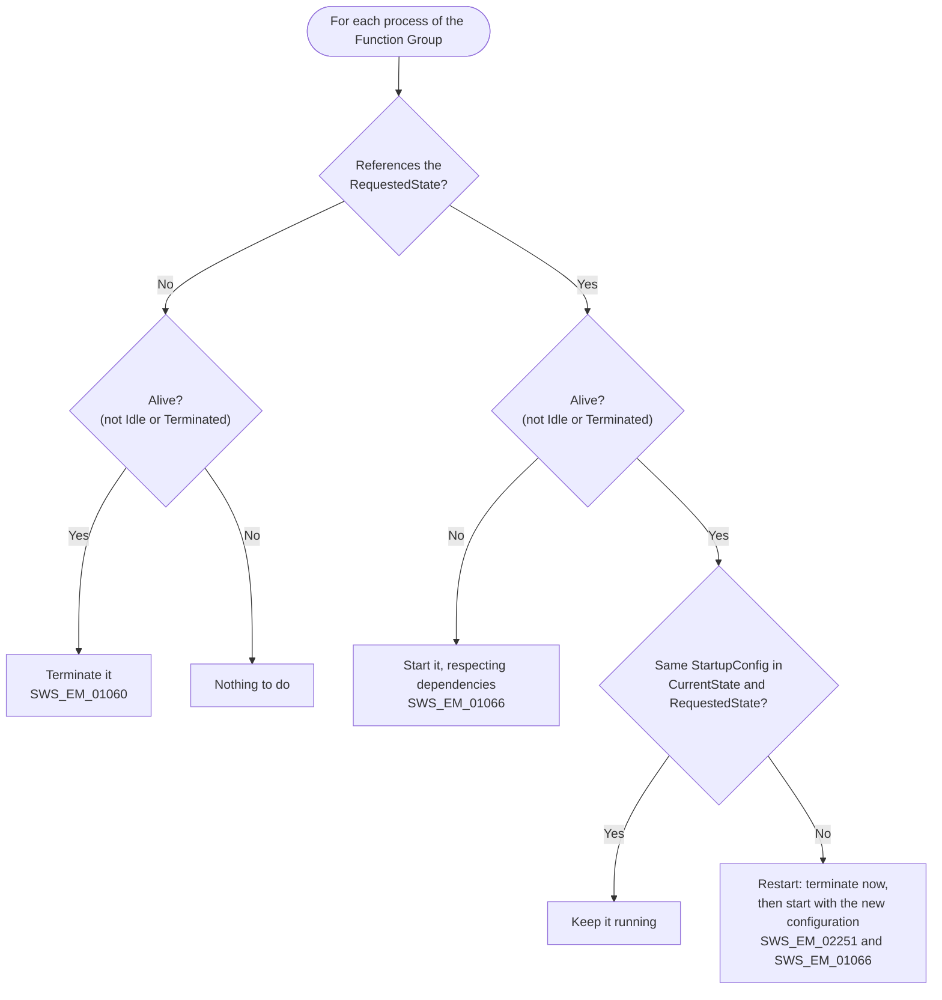

Some details matter in practice:

- **Self-terminating processes run again.** A self-terminating process that has already terminated *and* references the RequestedState is started again (step 3). This is one reason why State Management should not request a state it is already in: EM ignores such a request anyway (see [Section 8.6](#86-overlapping-and-repeated-requests)).
- **Dependencies are respected in both directions.** They order the terminations of steps 1 and 2 and the starts of step 3. Dependencies are resolved against the processes configured for the RequestedState ([SWS_EM_02245]).
- **The steps may run in parallel.** The step-by-step description is for clarity only. EM does not have to stop all old processes before it starts any new one. Implementations are free to parallelize as much as possible.

### 8.3 Timeouts and Start-up Failures

EM monitors two timeouts during a transition. They are handled in fundamentally different ways.

**Termination timeout.** The integrator defines the default termination timeout in the Machine Manifest ([TPS_MANI_03151]). It can be overridden per startup configuration in the Execution Manifest ([TPS_MANI_01278]).

- EM monitors the time a process needs to reach `Terminated` ([SWS_EM_01065]).
- When the timeout expires, EM asks the OS to terminate the process forcibly, which is `SIGKILL` on POSIX systems ([SWS_EM_02255]), and logs `ProcessTerminationTimeout` ([SWS_EM_02258]).
- **The transition continues.** The target state is still reached, because the hanging process has been killed. This guarantees that the `Off` state can always be reached, provided that killing a process at OS level always works.

**Start-up timeout.** The start-up timeout is defined per startup configuration in the Execution Manifest ([TPS_MANI_01277]). The Machine Manifest also provides a default start-up timeout ([TPS_MANI_01412]); the EM specification itself mentions only the per-configuration value. [Section 13.5](#135-startupconfig) shows both timeouts and their defaults.

- EM monitors the time between requesting the process creation from the OS and the process reporting `kRunning` ([SWS_EM_02253]).
- For non-reporting processes, the start-up time is zero, because they enter `Running` immediately.

**Start-up failure** ([SWS_EM_02260]). A start-up failure includes, among other cases:

- creation of the OS process fails, for example a failed spawn, fork or exec because of resource exhaustion or missing permissions;
- the process crashes before reporting `kRunning`;
- the process does not report `kRunning` within the start-up timeout.

On a start-up failure, EM proceeds as follows:

1. EM considers the process erroneous and terminates it **forcibly through the OS, for example with `SIGKILL`**, instead of sending `SIGTERM`.
2. EM retries the start up to `numberOfRestartAttempts` times. A retry does not fulfill any `Terminated` dependencies ([SWS_EM_02280]).
3. If all attempts fail, EM asks the OS to terminate the process ([SWS_EM_02310]). *Then* ([SWS_EM_02312]) EM performs the failure reaction of [SWS_EM_02259]:
   1. stop the Function Group State transition, so that State Management can decide how to proceed;
   2. set the CurrentState to an **Undefined Function Group State**;
   3. complete the `SetState` future with **`kOperationFailed`**;
   4. provide the configured `processExecutionError` through `StateClient::GetExecutionError`;
   5. log `ProcessStartUpFailure`.

**Integrity failure.** If starting a process fails because an integrity or authenticity check fails while `strictMode` is active, EM performs the same five actions. The error code is then **`kIntegrityOrAuthenticityCheckFailed`**, and the log message is `FailedIntegrityOrAuthenticityCheck` ([SWS_EM_02552]).

| | Termination timeout | Start-up failure |
| --- | --- | --- |
| Detected when | The process has not terminated within the termination timeout | Process creation fails, the process crashes before `kRunning`, or `kRunning` does not arrive within the start-up timeout |
| EM's action | Forced termination (`SIGKILL`) | `SIGKILL`, retries up to `numberOfRestartAttempts`, then forced termination |
| Transition | **Continues** | **Stops**. The Function Group becomes undefined. |
| State Management sees | Success, if nothing else fails | `kOperationFailed`, details through `GetExecutionError` |
| DLT message | `ProcessTerminationTimeout` | `ProcessStartUpFailure` |
| Rationale | A process can always be forced to stop | A process cannot be forced to start |

### 8.4 Process Crashes During a Transition

What if a process terminates abnormally *while* a transition is in progress? It depends on whether the process belongs to the target state:

| The crashing process is ... | EM's reaction | State Management sees | Spec |
| --- | --- | --- | --- |
| configured for the **RequestedState** | Stops the transition, sets the Function Group to an Undefined Function Group State, logs `ProcessAbnormalTermination`, and provides the configured `executionError` through `GetExecutionError` | The `SetState` future fails with **`kUnexpectedTermination`** | [SWS_EM_02315] |
| configured **only for the CurrentState** | Logs `ProcessAbnormalTermination` and **continues** the transition | The normal result | [SWS_EM_02316] |

Both rules also apply to Unexpected Termination. EM continues in the second case for two reasons:

- EM was going to terminate that process anyway, because it is not part of the RequestedState. For State Management it does not matter whether it ended as expected or because of an internal error.
- A transition to `Off` must always succeed, so that it can be used as a reaction to error conditions.

> **Note:** If `B` depends on the *termination* of `A` and both belong to the RequestedState, the transition fails when `A` dies unexpectedly before it reaches `Terminated`.

### 8.5 When Is a Transition Successful?

EM considers a transition successful when all of the following have happened:

- dependency resolution has been performed ([SWS_EM_02245]);
- all processes that were expected to terminate have terminated ([SWS_EM_01060]);
- all started ([SWS_EM_01066]) and restarted ([SWS_EM_02251]) *reporting* processes have reported `kRunning`.

EM then sets the CurrentState to the RequestedState and reports success to State Management ([SWS_EM_01067]). An abnormal termination of a process of the RequestedState ([SWS_EM_02315]) can still make the transition fail before this point.

### 8.6 Overlapping and Repeated Requests

`SetState` returns immediately with an `ara::core::Future`. State Management may therefore send a new request while a previous one is still in progress:

| Situation | EM's behavior | Spec |
| --- | --- | --- |
| New request for a **different** state of a Function Group that is in transition | After validating the new request, EM cancels the ongoing transition and completes the old future with **`kOperationCanceled`**, *before* it starts the new transition and returns a new future. | [SWS_EM_02298] |
| New request for the **same target** state that the Function Group is already transitioning to | EM completes the previous future with `kOperationCanceled`, returns a new future, and **continues** the ongoing transition. | [SWS_EM_02296] |
| Request for the state that the Function Group is **already in** | EM ignores the request and returns success immediately. No error is used, because SM would interpret an error as a failure. | [SWS_EM_02295] |
| Request for the same state again after a **failed** transition | Allowed. A failed transition leaves the Function Group in an Undefined Function Group State, so the request is a real transition. | Section 7.4.5 |
| Request for `MachineFG` → `Off` | Refused with `kInvalidTransition` | [SWS_EM_02549] |
| Request for another `MachineFG` state while EM's initial `Startup` transition is still running | Allowed, for example to start a recovery sequence. There is no previous future to cancel, but `GetInitialMachineStateTransitionResult` reports `kOperationCanceled`. | [SWS_EM_02241] and Section 7.4.2.1 |

Further rules:

- EM validates a new request before it cancels an ongoing transition. Validation includes, for example, [SWS_EM_02549].
- Requests for different Function Groups are independent. Apart from the rules above, the specification makes no assumptions about the order in which `SetState` requests are processed.
- Mistaken requests happen, especially in misconfigured systems or during development. EM therefore informs the requester of the ongoing transition about the cancellation as soon as possible. Both requesters may be the same `StateClient` instance.

### 8.7 Sequence Diagrams

**(a) Successful transition** `ADAS.Normal` → `ADAS.Degraded` (simplified: the restart of `LoggerCompanion` is shown in [Chapter 16](#16-end-to-end-walkthrough-a-day-in-the-life-of-an-ecu)):

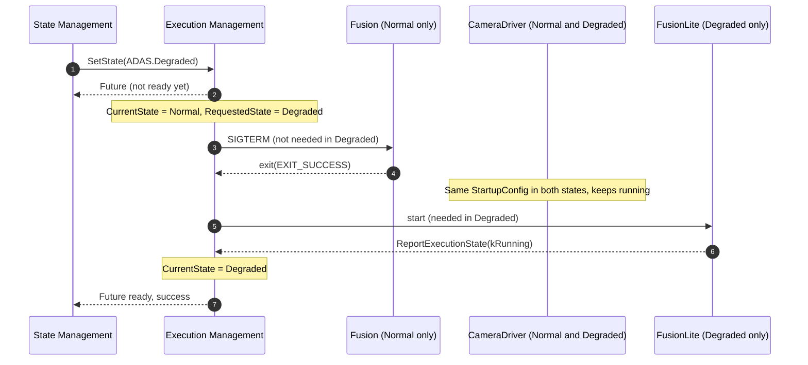

**(b) Termination timeout:** the transition continues.

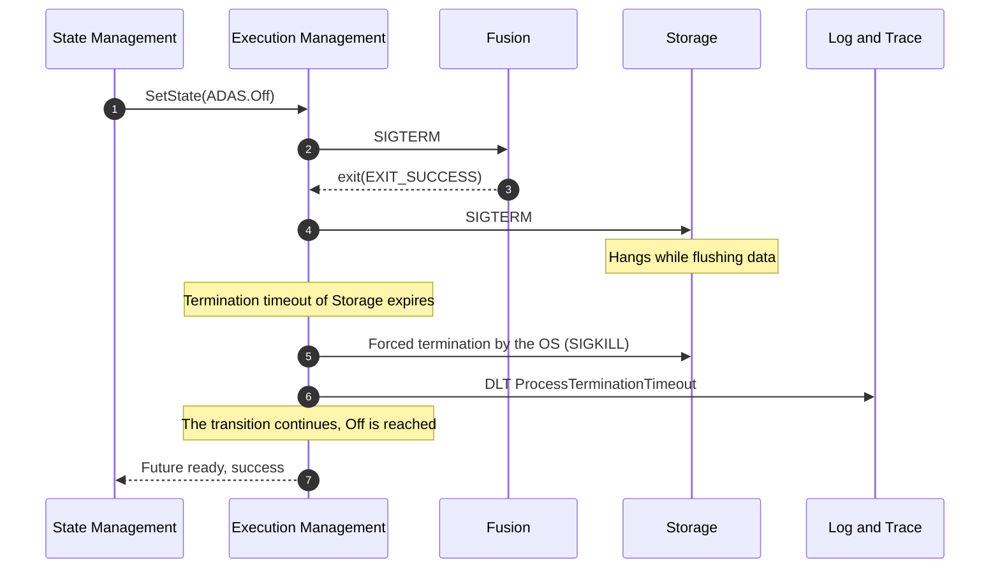

**(c) Start-up failure:** the transition is aborted.

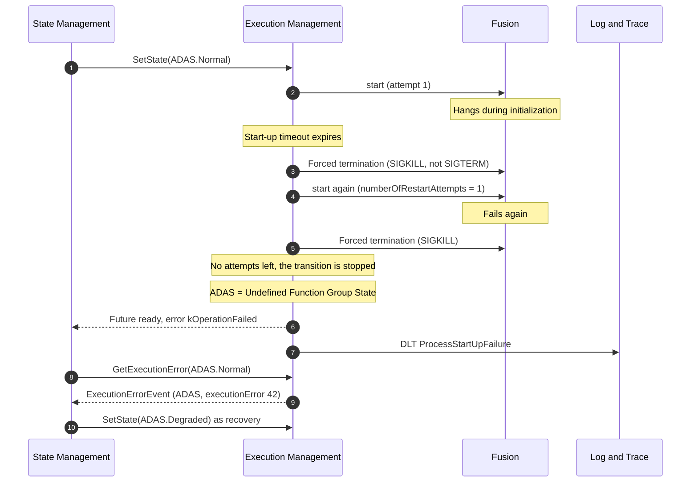

**(d) Cancellation by a newer request:**

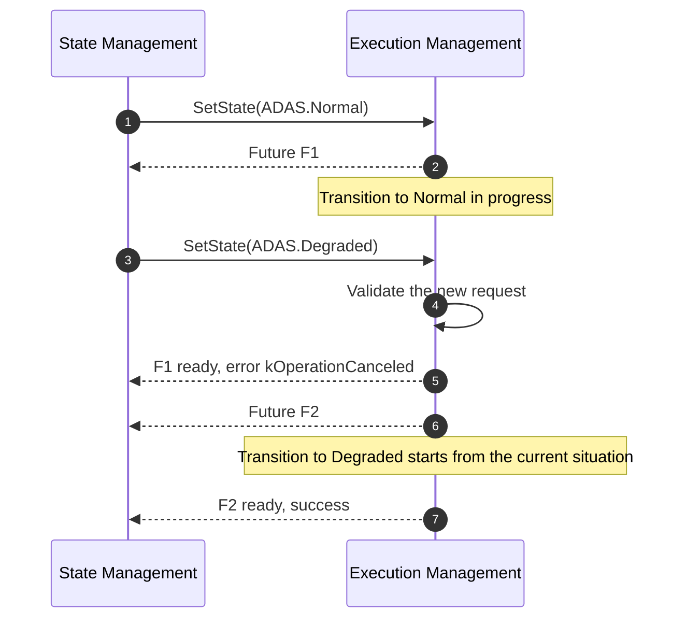

### 8.8 Worked Example: Dependency Resolution During a State Change

Figure 7.14 of the specification shows a Function Group `FG2` with the states `Off`, `Running` and `Fallback`, and four processes:

| Process | Configuration |
| --- | --- |
| `A` | Referenced in `Running` and `Fallback`, with *different* startup options |
| `B` | Depends on `A.Running` |
| `C` | Self-terminating |
| `D` | Depends on `C.Terminated` |

When State Management requests `FG2.Fallback` while `FG2` is in `Running`, the following happens:

1. **`A` is restarted.** Its startup configuration differs between the two states ([SWS_EM_02251], then [SWS_EM_01066]).
2. **`B` waits for the *new* `A`.** Dependency resolution is performed against the processes configured for the RequestedState ([SWS_EM_02245]). EM must therefore complete the restart of `A`, up to its new `kRunning`, before it starts `B`. If EM resolved the dependency against the old instance of `A`, it would violate the rule, because that instance belongs to the CurrentState.
3. **`C` runs again.** `C` has already terminated in `Running`. Because it references the RequestedState and is `Terminated`, EM starts it again, and it must terminate again.
4. **`D` waits for the new run of `C`.** It starts only after `C` has terminated in the new state.

`B` and `D` declare Execution Dependencies. Constraint [constr_10411] therefore forces them to use a separate startup configuration per state, so they are restarted at this transition as well.

> **Key takeaways**
>
> - A transition terminates what is no longer needed, restarts what changes its configuration, and starts what is newly needed. Processes with an unchanged configuration keep running.
> - A termination timeout leads to `SIGKILL`, and the transition *continues*. A start-up failure leads to `SIGKILL`, retries, and then the transition *fails* (`kOperationFailed`, Undefined Function Group State).
> - A crash of a process of the RequestedState fails the transition (`kUnexpectedTermination`). A crash of a process that is being phased out is only logged.
> - A newer request cancels an ongoing one (`kOperationCanceled`). Requesting the current state again is ignored with success.
> - Dependencies are always resolved against the processes of the RequestedState.

---

## 9. Machine Lifecycle: Startup, Shutdown and Restart

> **Why this matters:** "The ECU does not come up" and "data is lost at shutdown" are among the most expensive problems to debug. This chapter tells the full story of an Adaptive machine, from power-on to power-off, from EM's point of view.

### 9.1 Authenticated Boot Chain

On a Trusted Platform, every software component is authenticated by its predecessor before it runs (Figure 7.17 of the specification):

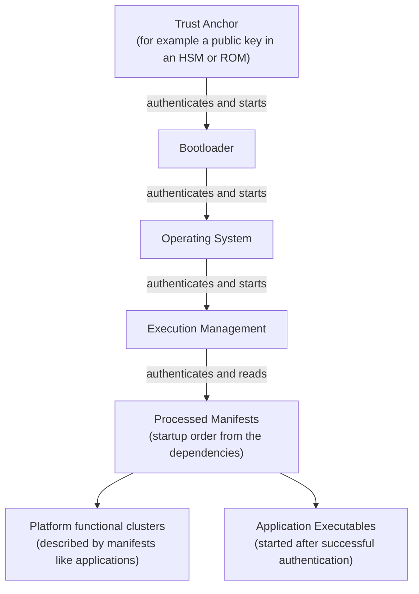

The system designer must ensure that EM itself is started authentically, for example through a chain of trust. EM in turn ensures that all executable code on the platform is authenticated before it runs (see [Chapter 12](#12-security-trusted-platform-and-iam)).

### 9.2 Machine Startup Step by Step

1. **The OS starts EM**, the first Adaptive Platform process.
2. **EM reads the Processed Manifests.** On a Trusted Platform, EM first verifies the integrity and authenticity of the machine configuration ([SWS_EM_02300]). If the check of the manifest that contains the trusted-platform mode fails, EM stops the startup and enters the Unrecoverable State ([SWS_EM_02306]).
3. **EM parses the `Startup` state of `MachineFG`.** If it cannot do so, for example because of a misconfigured development system, a corrupted file system or memory errors, EM enters the **Unrecoverable State** ([SWS_EM_02250]).
4. **Every Function Group is in `Off`**, the initial state ([SWS_EM_01110]).
5. **EM self-initiates the transition `MachineFG`: `Off` → `Startup`** ([SWS_EM_01023]). EM starts all processes that reference `MachineFG.Startup`, typically State Management, PHM, Communication Management and the other platform daemons. The startup order follows from the Machine Manifest and the Execution Manifests ([SWS_EM_01000]), that is, from the Execution Dependencies.
6. **If this transition fails, EM enters the Unrecoverable State** ([SWS_EM_02555]). In this early phase, EM cannot know which functionality is available. State Management itself may be missing or only partly functional, so nobody else could handle the failure.
7. **EM makes the result available** through `StateClient::GetInitialMachineStateTransitionResult` ([SWS_EM_02241]). The result is *not* broadcast. State Management has to ask for it. Only a process with a `FunctionGroupPortMapping` to `MachineFG` may ask; any other process receives `kInvalidMetaModelIdentifier` ([SWS_EM_02583]).

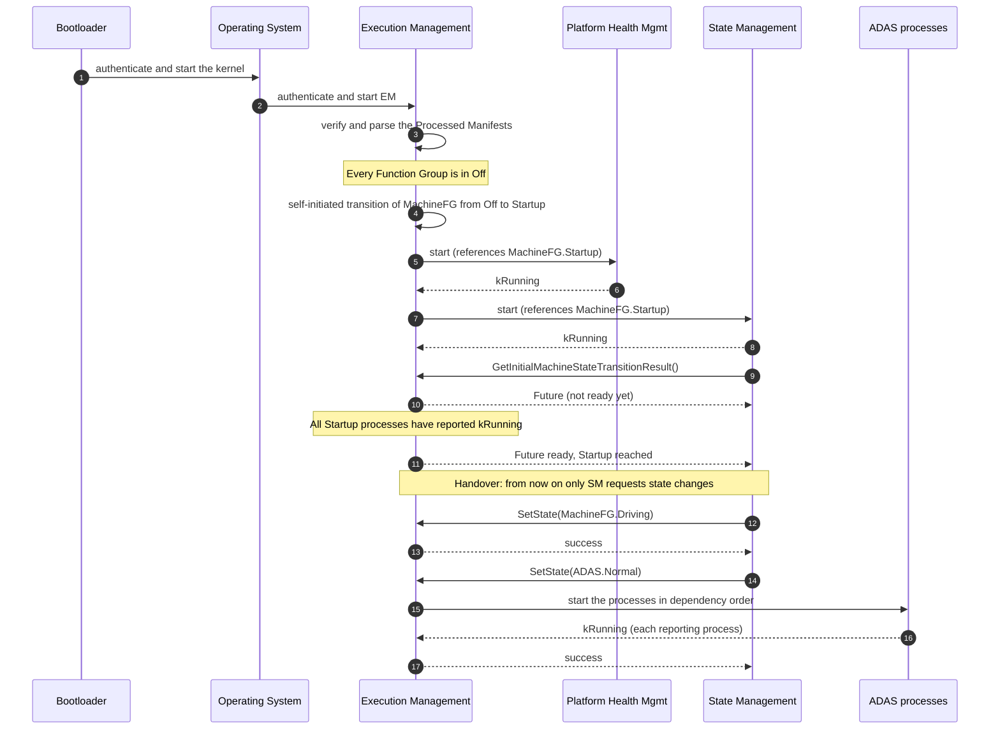

### 9.3 Handing Over Control to State Management

Once `Startup` has been reached, **EM never initiates a Function Group State change on its own again**, including Machine State changes. From then on, every change is requested by State Management and performed by EM. This has consequences for the system configuration:

- **SM must run in `Startup`.** State Management must be configured to run in the `Startup` Machine State, and in fact in every Machine State ([SWS_SM_CONSTR_00001]). If it is not started in `Startup`, the machine can never leave `Startup`.
- **The `Startup` transition may never complete,** for example because a platform process never reports `kRunning`. State Management can then interrupt it by requesting another Machine State, such as a recovery state, with `SetState`. `GetInitialMachineStateTransitionResult` then reports `kOperationCanceled`. A legitimate reason for such an interruption is an update sequence that was interrupted before the last reboot.
- **The initial result never changes.** The `Startup` transition happens once per machine lifecycle, so the result delivered by `GetInitialMachineStateTransitionResult` stays the same until the machine is started again.

### 9.4 Shutdown and Restart

**EM does not shut down or restart the machine itself.** This avoids embedding project-specific behavior in EM. Instead, a project-specific actor provides the mechanism ([constr_1618], [constr_1619]). This can be:

- a standalone process that EM starts during the transition to the `Shutdown` or `Restart` Machine State, like `PowerControl` in the running example; **or**
- a process started in `Startup` that waits for a signal before it shuts the machine down.

This way, the project controls both *when* and *how* the machine shuts down or restarts.

From EM's point of view, a request for `MachineFG.Shutdown` or `MachineFG.Restart` is **an ordinary Function Group State transition**. EM terminates the processes that are not configured for the target state and starts those that are.

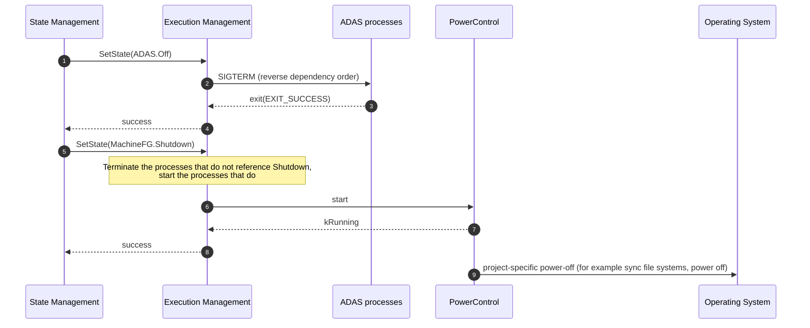

Important rules for integrators:

- **Wind down the other Function Groups first.** When the OS shuts down, processes that are still running are *not* terminated by EM, so they cannot persist their data. State Management should therefore bring the other Function Groups to `Off` *before* it requests `Shutdown` or `Restart`, as in the diagram. When this is valid is decided by State Management, which knows the dependencies between Function Groups.
- **Keep State Management alive.** SM must run in `Shutdown` and `Restart` too. A state transition can fail, and SM must remain available to report errors and wait for further instructions.
- **Configure at least one process for each state.** At least one process must reference `Shutdown`, and at least one must reference `Restart` ([SWS_EM_CONSTR_02558], [SWS_EM_CONSTR_02559]). If these states are missing, EM's reaction is implementation-specific.
- **Restart follows the same sequence as shutdown.** The only difference is that the process configured for `Restart` must know how to perform a restart.

### 9.5 Functional Cluster Lifecycle of the ara::exec Library

Like every Adaptive Platform library, `ara::exec` is initialized by `ara::core::Initialize` and deinitialized by `ara::core::Deinitialize` ([SWS_EM_02557]). Calling `ara::exec` APIs before `Initialize` or after `Deinitialize` results in implementation-defined behavior. Since R25-11, `Initialize` takes `argc` and `argv`, because a platform may pass its own options on the command line ([SWS_CORE_10003]). [Guide 03, Chapter 5](03_CoreAndGeneral.md#5-platform-initialization-and-shutdown) explains the rules; in short:

```cpp
int main(int argc, char* argv[]) {
    if (!ara::core::Initialize(argc, argv).HasValue()) { return EXIT_FAILURE; }
    // ... use ara::exec::ExecutionClient, ara::log, ara::com, ...
    if (!ara::core::Deinitialize().HasValue()) { return EXIT_FAILURE; }
    return EXIT_SUCCESS;
}
```

### 9.6 What If EM Itself Fails?

- **EM crash.** If EM is used on a safety-critical platform, EM should use alive, deadline and/or logical supervision and report its checkpoints to PHM. If PHM detects a supervision failure of EM, PHM should trigger a **watchdog reset**.
- **Situations EM cannot resolve.** In situations that EM cannot handle, such as an unreadable configuration or a non-working OS, EM enters the **Unrecoverable State** (see [Section 10.4](#104-unrecoverable-state)).
- **A `SIGTERM` sent to EM.** EM's reaction is implementation-defined. There is no standardized termination handling for EM itself.

> **Key takeaways**
>
> - EM self-initiates exactly one transition: `MachineFG` from `Off` to `Startup`. A failure here leads to the Unrecoverable State.
> - State Management fetches the result with `GetInitialMachineStateTransitionResult` and from then on drives every state change.
> - EM does not power off the machine. A project-specific process configured for `Shutdown` or `Restart` does.
> - Bring the Function Groups to `Off` before requesting `Shutdown` or `Restart`. Otherwise processes cannot persist their data.

---

## 10. Error Handling, Recovery and Fault Tolerance

> **Why this matters:** EM is the first to notice many failures: crashes, hangs, missing files, failed signature checks. Knowing *how* EM reports a failure, and *who* is expected to react, is essential for designing robust recovery.

### 10.1 Errors and Violations

`ara::exec` follows the error handling model of `ara::core`, which [guide 03, Chapter 6](03_CoreAndGeneral.md#6-the-error-handling-model) explains in depth. In short:

- **Errors** are conditions that the caller can handle. Functions return `ara::core::Result<T>` or `ara::core::Future<T>`, which contain either a value or an `ara::core::ErrorCode`. An error code consists of an error *domain*, here `ExecErrorDomain`, and a *value*, here `ExecErrc`. If C++ exceptions are enabled, an error can also be thrown as `ara::exec::ExecException`.
- **Violations** are broken contracts that the caller cannot sensibly handle, such as misuse of an API. The platform logs a **violation message** and terminates the offending process, which is an Abnormal Termination.

EM defines four violations ([SWS_EM_02597] to [SWS_EM_02600]):

| Violation | Raised when | Spec |
| --- | --- | --- |
| `ExecutionClientMultipleInstanceViolation` | A process creates a second `ExecutionClient` instance | [SWS_EM_02582] |
| `ReportExecutionStateViolation` | A non-reporting process calls `ReportExecutionState` | [SWS_EM_01403] |
| `StateClientUsageRestrictionViolation` | A process whose `functionClusterAffiliation` is not `STATE_MANAGEMENT` uses `StateClient` | [SWS_EM_02297] |
| `StateClientMultipleInstanceViolation` | A process creates a second `StateClient` instance | [SWS_EM_02585] |

> **Design decision:** A *wrong meta-model identifier*, such as an unknown Function Group or state name, is deliberately **not** treated as a violation ([SWS_EM_02587]). If it were, the caller, which is State Management, would be terminated, and that would make the system less robust. The State Management APIs therefore return `kInvalidMetaModelIdentifier`, which allows SM to apply a fallback strategy.

### 10.2 Error Codes (ExecErrc)

| Error code | Value | Meaning | Returned by (examples) | Recovery hint |
| --- | --- | --- | --- | --- |
| `kNoCommunication` | 3 | Communication with EM failed: the request could not be sent, or the result could not be retrieved. | All APIs that talk to EM | Try again. If communication between EM and SM is lost, the system may have to enter the Unrecoverable State. |
| `kInvalidMetaModelIdentifier` | 4 | Wrong meta-model identifier: the state was not found in the Processed Manifest, or the process has no `FunctionGroupPortMapping` to the Function Group. | `SetState`, `GetExecutionError`, `GetInitialMachineStateTransitionResult` | Fix the argument or the configuration. |
| `kOperationCanceled` | 5 | The transition was canceled by a newer request. | `SetState`, `GetInitialMachineStateTransitionResult` | Informative. It does not indicate a problem. |
| `kOperationFailed` | 6 | The operation could not be performed, for example because `kRunning` was not reported in time. | `SetState`, `GetInitialMachineStateTransitionResult`; also `GetExecutionError` when the Function Group is not undefined | Request another state. |
| `kInvalidTransition` | 9 | The transition is not valid, for example reporting `kRunning` twice, requesting `MachineFG.Off`, or requesting a state that no longer exists after a software update. | `ReportExecutionState`, `SetState` | Do not repeat the call. Possibly request another state. |
| `kIntegrityOrAuthenticityCheckFailed` | 14 | The integrity or authenticity check of a process to be started in the requested state failed. | `SetState` | Request another state. |
| `kUnexpectedTermination` | 15 | An Abnormal Termination occurred during a Function Group State transition. | `SetState` | Request another state. |
| `kInvalidArgument` | 16 | An argument is not valid, for example a termination handler or callback that is not callable. | `ExecutionClient` and `StateClient` construction | Change the argument. |

Every documented error of an API also has a **recoverability class** (defined in [RS_AP_00160]):

- `rollback_semantics`: the failed call has left no lasting effect. You can retry safely, or retry with a different argument.
- `no_rollback_semantics`: the call may already have had effects. For example, a transition that failed half-way may already have terminated or started processes.

The tables in [Chapter 14](#14-api-reference-and-usage-guide-araexec) list the class for each API.

### 10.3 Undefined Function Group State

A Function Group is in an **Undefined Function Group State** while a transition is in progress, after a transition has failed, and after one of its processes has terminated abnormally or unexpectedly. State Management learns about it in one of two ways:

| Situation | How SM is informed | Spec |
| --- | --- | --- |
| A failure *during* a transition that SM requested | The `SetState` future completes with an error: `kOperationFailed`, `kUnexpectedTermination` or `kIntegrityOrAuthenticityCheckFailed` | [SWS_EM_02259], [SWS_EM_02315], [SWS_EM_02552] |
| A failure *outside* any transition | `undefinedStateCallback(const ExecutionErrorEvent&)`, called once per incident | [SWS_EM_01309] |

In both cases, SM can call `StateClient::GetExecutionError(state)` to obtain the `ExecutionErrorEvent`. The event contains the affected `functionGroup` and the `executionError`, which is the configured `processExecutionError` of the failed process, or `1` by default. `GetExecutionError` returns `kOperationFailed` if the Function Group is no longer undefined, because the problem has already been resolved.

**Recovery is State Management's job.** SM typically requests another state, for example `ADAS.Degraded`. The transition to `Off` is always possible, because termination timeouts guarantee that it completes. After a failure, SM may also request the *same* state again.

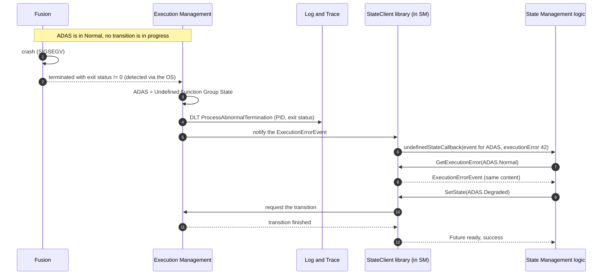

### 10.4 Unrecoverable State

The **Unrecoverable State** is an internal state of EM and the OS that only EM can trigger, and only when it has no other course of action:

```mermaid
flowchart TD
    E["EM detects a situation it cannot resolve"] --> P1["Invoke the pre-cleanup action<br/>SWS_EM_02032"]
    P1 --> P2["Shut down all processes managed by EM<br/>SWS_EM_02033"]
    P2 --> P3["Invoke the post-cleanup action<br/>SWS_EM_02034"]
    P3 --> X["Project-specific handling,<br/>for example persistent error log or ECU reset"]
```

The mechanism that invokes the pre-cleanup and post-cleanup actions is platform-specific. What the actions do is project-specific.

**When does EM enter the Unrecoverable State?** The list cannot be exhaustive. Examples:

- The OS does not work as expected, for example `SIGKILL` fails and EM cannot kill processes.
- EM can no longer read the Processed Manifests, so nothing can be started or stopped.
- EM cannot deliver responses, that is, transition results, to State Management.
- The trusted-platform configuration cannot be read, so EM does not know whether to run in `strictMode` or `monitorMode`.
- The `Startup` information of `MachineFG` cannot be parsed ([SWS_EM_02250]), or the initial `Startup` transition fails ([SWS_EM_02555]).
- The integrity check of the manifest that contains the trusted-platform mode fails ([SWS_EM_02306]).

> **Important:** EM should **not** enter the Unrecoverable State while it can still communicate normally with State Management. In that case, handling system errors such as failed start-up attempts is State Management's responsibility.

### 10.5 Fault Tolerance Concepts

The fault tolerance section of the specification is informative and still under development. It is based on the taxonomy of Avizienis et al.: a **fault**, for example a bug, can be activated and cause an **error** (a wrong internal state), which can lead to a **failure** (a wrong service).

- **Threats.** The main threats are systematic faults, introduced during design and dormant until deployment, physical faults such as random hardware failures, and *interaction faults*. A wrong state transition request is an example of an interaction fault.
- **Fault activation.** From EM's point of view, a fault is activated when the Function Group State, or combination of states, that triggers it is requested.
- **Two steps.** Fault tolerance consists of *error detection*, for example EM's timeouts, exit-status checks and integrity checks, followed by *error recovery*, for example State Management requesting a degraded state or PHM triggering a reset. How detection and recovery are bound together is a matter of the platform-wide fault tolerance model.
- **Two levels.** EM has to handle faults on both levels of the platform: the application level and the platform instance level.

> **Key takeaways**
>
> - Errors are returned through `Result` and `Future` (`ExecErrc`). Violations terminate the offending process.
> - Wrong meta-model identifiers are *errors* (`kInvalidMetaModelIdentifier`), not violations, so that State Management survives them.
> - An Undefined Function Group State is reported through the `SetState` future during a transition, or through the `undefinedStateCallback` outside a transition. Details are available through `GetExecutionError`.
> - Recovery is State Management's decision. `Off` is always reachable.
> - The Unrecoverable State (pre-cleanup, kill all, post-cleanup) is EM's last resort, used only when State Management cannot handle the situation.

---

## 11. Resource Management

> **Why this matters:** The Adaptive Platform consolidates many functions on one machine. A single misbehaving process must not starve the others of CPU time or memory. EM is where the limits are put in place, because EM creates every Adaptive Platform process.

### 11.1 Why Resource Management Matters

Even if an application itself behaves correctly, potential incorrect behavior or unforeseen interactions must not cause interference in unrelated parts of the system ([RS_SAF_10008]). This property is called **Freedom From Interference**. Keep three points in mind:

- **Not everything is standardized.** The available mechanisms depend heavily on the operating system, so the specification does not standardize all of them.
- **EM configures, the OS enforces.** EM is responsible for configuring the limits correctly. *Enforcing* them is usually done by the OS, or by another component such as Persistency.
- **The scope is RAM and CPU.** The resources considered are RAM (code, data, thread stacks, heap) and CPU time. Persistent storage and I/O are currently out of scope.

### 11.2 Who Configures What

There are two resource demand values:

- **Minimum resources:** must be guaranteed so that the process can reach `Running` and perform its basic functionality.
- **Maximum resources:** may be needed temporarily, but must never be exceeded. Otherwise an error can be assumed.

| Stakeholder | Knows | Provides |
| --- | --- | --- |
| Application developer | How much memory and computing time the processes need for their tasks, and their deadlines, for example cycle times. These are only *estimates*: they depend on the use case (for example the video resolution), on the processor type, and on parallel execution on several cores. | The application description, which is the pre-integration stage of the Execution Manifest |
| Integrator | The platform, its resources and constraints, and the other applications that can be active at the same time | The final resource configuration. If the resources are not sufficient: a criticality per process, OS limits per process or group (for example Linux cgroups), and a scheduling policy that gives critical threads guaranteed computing time. Memory cannot simply be taken away from a running process, so critical processes must have their maximum memory available at any time, while less critical processes share the rest. |

### 11.3 ResourceGroup: Group-Level Limits

A **ResourceGroup** bundles resource limits for a set of processes. Every Modelled Process is required to belong to a ResourceGroup (Section 7.5.1 of the specification). Membership is configured per `StateDependentStartupConfig`, which must reference exactly one ResourceGroup of the Machine Manifest ([constr_3413]), so it can differ from state to state. EM configures each process according to its membership ([SWS_EM_02106]).

| Attribute | Meaning | EM behavior | If not configured |
| --- | --- | --- | --- |
| `memUsage` | Memory limit in bytes for **all** processes of the group together | Configured before any process of the group is loaded ([SWS_EM_02102]) | Processes are bound only by their implicit memory limit |
| `cpuUsage` | CPU limit as a percentage of the machine's total CPU capacity, for **all** processes of the group together | Configured before any process of the group is loaded ([SWS_EM_02103]) | Processes are bound only by implicit limits (priority, scheduling scheme) |

The actual algorithm for scheduling and CPU limiting depends on the OS and is not specified ([SWS_OSI_02002]). The intention is that the **limits are never reached** in normal operation. The integrator should configure them based on *measurements*, not on worst-case execution times.

Good uses of separate ResourceGroups:

- non-reporting third-party software, like `legacy_rg` in the running example;
- processes that are allowed to create child processes;
- separating mixed-criticality workloads.

### 11.4 Process-Level Memory Settings

Operating systems typically provide memory *on demand*. That is flexible and memory-efficient, but it makes timing less deterministic, because making memory available may require potentially unbounded OS activities, and the OS may also take unused memory away again. EM therefore offers two per-process settings:

- **Maximum memory usage** ([SWS_EM_02108]): `Process.stateDependentStartupConfig.resourceConsumption.memoryUsage` limits the memory that the process *itself* can allocate. Depending on the OS, this does not necessarily include all memory that the process causes to be allocated. For example, if the file system is implemented as a separate process, memory allocated there on behalf of the limited process is not counted. On POSIX systems, the limit is typically enforced with `RLIMIT_AS`.
- **Pre-mapping** ([SWS_EM_02109]): if `Process.preMapping` is `true`, EM fully pre-maps the process. Code and data execution is then never delayed by demand-loading. This has three benefits:
  - predictable timing during startup and on first execution;
  - better safety, because the code that handles error cases is guaranteed to be loaded;
  - robustness against a file system that is corrupted later, when parts of the program could no longer be loaded.

### 11.5 CPU: Core Affinity and Scheduling

CPU usage is represented by the threads of a process. Threads may be created at run time, and POSIX allows a thread to change its own scheduling at run time, for example with `pthread_setschedparam()`. EM can therefore configure **only the first thread**, the one that calls `main()`. The process itself is responsible for configuring its secondary threads.

**Core affinity** ([SWS_EM_02104]). EM restricts the first thread to a subset of cores, using `shallRunOn` or `shallNotRunOn`:

- **Two configuration levels.** The attributes can be set on the `ProcessToMachineMapping` (deployment level) or on the `ProcessDesignToMachineDesignMapping` (design level). If both are configured, the deployment level wins ([SWS_EM_02596]).
- **One of the two per process.** `shallRunOn` and `shallNotRunOn` are mutually exclusive for a process ([constr_1677], [constr_10662]).
- **Limited OS support.** If the OS cannot bind threads to specific cores, the only supported subset is the full set of cores.

**Scheduling** ([SWS_EM_01014], [SWS_EM_01015]). EM configures the scheduling policy and priority of the first thread from `StartupConfig.schedulingPolicy` and `StartupConfig.schedulingPriority`:

| Policy | Meaning | Spec |
| --- | --- | --- |
| `SCHED_FIFO` | Real-time, first-in first-out within a priority level | [SWS_EM_01041] |
| `SCHED_RR` | Real-time, round-robin within a priority level | [SWS_EM_01042] |
| `SCHED_OTHER` | Non-real-time. Its behavior is implementation-specific and may differ between platform implementations. | [SWS_EM_01043] |

These three policies are the minimal set. Depending on the OS, more may be configurable. The available priority range, and what a priority means, depend on the selected policy ([constr_1692]).

**Deterministic and best-effort subsystems.** For deterministic subsystems, the required computing time is guaranteed and violations are treated as errors. Best-effort subsystems can often mitigate sporadic violations, for example by finishing the calculation at the next activation, or by delivering a result of lower quality. Monitoring them may therefore not even be necessary. The critical property in both cases is that one process, or set of processes, **cannot adversely affect the others**.

> **Pitfall:** Setting `schedulingPolicy = SCHED_FIFO` in the manifest configures only the **main thread**. EM cannot enforce a policy for the whole process (Section 7.5.3.3 of the specification). What a worker thread gets depends on how it is created. On Linux, the default of a new thread is `PTHREAD_INHERIT_SCHED`, so it inherits the policy and priority of the thread that creates it [EXT-021]; with `PTHREAD_EXPLICIT_SCHED` and explicit attributes, or after `pthread_setschedparam()`, it gets whatever the code sets. The process is responsible for the scheduling of all threads other than the first one.

### 11.6 Monitoring and Reaction

The OS performs resource monitoring for the whole system. PHM complements it, for example for execution deadlines. The capabilities depend on the OS, so choose and configure the OS according to the system requirements and safety goals. Monitoring serves two purposes: detecting the misbehavior of a process, and protecting the rest of the system from it.

When a process tries to exceed its configured maximum, one of two approaches is valid:

1. **Treat it as a failure.** The violation is reported to State Management, which starts recovery actions.
2. **Limit it by design.** If the OS limits the resource consumption of a process or group by design, for example with cgroups, explicit monitoring is usually not necessary, and often not even possible. Monitoring may still be used for diagnostics.

Self-monitoring, and monitoring by another process, are currently out of scope of the Adaptive Platform.

### 11.7 Mapping to OS Mechanisms

> **Note (implementation example):** The specification does not prescribe *how* EM implements the configuration. On Linux, an implementation might use the following mechanisms, which the Linux documentation describes [EXT-009], [EXT-010]. Other operating systems, such as QNX or PikeOS, have their own equivalents.

| Configuration | Possible mechanism on Linux |
| --- | --- |
| `ResourceGroup.cpuUsage` | cgroup v2 CPU bandwidth limit (`cpu.max`) |
| `ResourceGroup.memUsage` | cgroup v2 memory limit (`memory.max`) |
| `resourceConsumption.memoryUsage` | `setrlimit(RLIMIT_AS, ...)` before `exec` (the specification names `RLIMIT_AS`) |
| `preMapping` | Pre-faulting and locking the pages of the program, for example with `mlock` or `mlockall` |
| `shallRunOn` / `shallNotRunOn` | `sched_setaffinity()` with a CPU set |
| `schedulingPolicy` / `schedulingPriority` | `sched_setscheduler()` |
| `permissionToCreateChildProcess = false` | A restriction applied at process creation, for example a seccomp filter or a capability or resource limit |
| Initial signal mask | `sigprocmask()` before `exec`. The signal mask is inherited across `exec`. |
| Arguments and environment | `argv` and `envp` of `execve()` |

### 11.8 Working Folder

The working folder of a process is **not** defined by configuration. It is deliberately implementation-specific. The required POSIX profile, PSE51, does not even require a file system. Paths in Adaptive Applications therefore merely identify objects, for example in calls to `open()` or `stat()`. Whether parts of a path have a meaning, such as the directory `/data` in `/data/config.dat`, is implementation-defined.

> **Key takeaways**
>
> - EM configures the resource limits when it creates a process. The OS enforces them.
> - A ResourceGroup limits CPU (in percent) and memory (in bytes) for a group of processes. Every process belongs to one.
> - Per process, EM can limit memory (`memoryUsage`) and pre-map the executable (`preMapping`).
> - Core affinity and scheduling apply to the **first thread only**. Configure your worker threads yourself.
> - Base the limits on measurements. In normal operation they should never be reached.

---

## 12. Security: Trusted Platform and IAM

> **Why this matters:** EM is the gatekeeper of the platform. Every Adaptive Platform process is started by EM. That makes EM the natural place to check that only trusted software runs, and to provide the process identities on which access control is built.

### 12.1 Trusted Platform Basics

From a security perspective, all software executed on the Adaptive Platform must be **trusted**: its integrity (it is unmodified) and its authenticity (it comes from the expected source) are ensured. As the entity responsible for process creation, EM takes over this task.

- **Trust Anchor.** A Trusted Platform needs a Trust Anchor on the machine, which is authentic by definition. That is why it is also called the "root of trust". It is often realized as a public key stored in a secure environment, for example in non-modifiable persistent memory or in a hardware security module (HSM).
- **Chain of trust.** The trust has to be passed on to EM by appropriate means, typically a chain of trust (see [Section 9.1](#91-authenticated-boot-chain)).
- **No Trust Anchor, no Trusted Platform.** If the machine has no Trust Anchor, the trusted-platform requirements of EM may be ignored ([SWS_EM_02299]).

A Trusted Platform can be realized in different ways, for example:

- the bootloader verifies the complete RAM disk;
- individual executables and data files are verified, using OS functionality or a trusted third-party process;
- individual memory pages are verified when they are loaded, again using OS functionality or a trusted third-party process.

The integrity of *persistent data* written by applications is not in EM's scope. The Persistency functional cluster takes care of it.

### 12.2 What EM Verifies and Why

| What | Requirement | Why it is an attack target |
| --- | --- | --- |
| Machine information from the Processed Manifests, checked before use | [SWS_EM_02300] | Manifests describe *what* is executed and *how*. |
| Every Executable that is about to be started | [SWS_EM_02301] | A modified executable lets an attacker run arbitrary code. |
| Every shared object related to a process that is about to be started | [SWS_EM_02302] | Shared objects contain code executed in the process, or data that influences it. |
| The Processed Manifests of every process that is about to be started. This covers *all* manifest information, including Service Instance information, not only what EM uses. | [SWS_EM_02303] | As above |

> **Note:** EM can determine the shared objects that an executable is *linked* against. It cannot know which libraries a program will load dynamically at run time, for example with `dlopen()`. Such libraries must be validated through an alternative, implementation-specific mechanism.

### 12.3 Launch Behavior Modes

`Machine.trustedPlatformExecutableLaunchBehavior` selects how a failed check affects startup ([SWS_EM_02305]). The selected mode may only be processed after the integrity and authenticity of the Processed Manifest that contains it have been verified. If *that* check fails, EM stops the startup of the platform and enters the Unrecoverable State. This applies to every mode ([SWS_EM_02306]). At that point no other application runs, so the possible reactions are limited to implementation-defined actions such as OS-level logging.

| Mode | Checks performed? | Executable launched if a check fails? | Reporting | Typical use |
| --- | --- | --- | --- | --- |
| `strictMode` | Yes | **No** ([SWS_EM_02307], [SWS_EM_02308], [SWS_EM_02309]) | `FailedIntegrityOrAuthenticityCheck`; security event with verification mode `STRICT` ([SWS_EM_02591]) | Production systems |
| `monitorMode` | Yes | **Yes**. Startup continues even if the file system has been compromised ([SWS_EM_02556]). | `FailedIntegrityOrAuthenticityCheck`; security event with verification mode `MEASURED_BOOT` ([SWS_EM_02590]) | Development, where frequent changes make keeping signatures valid tedious. Also systems that rely on additional measures, for example restricted key access in an HSM. |
| `noTrustedPlatformSupport` | No Trusted Platform on this machine | (not applicable) | (none) | Machines without a Trust Anchor |

In `strictMode`, EM refuses to start an Executable if the check fails for any of the following:

- its processed Execution Manifest ([SWS_EM_02307]);
- at least one of its processed Service Instance Manifests ([SWS_EM_02308]);
- the Executable itself or any shared object linked with it ([SWS_EM_02309]).

*Example:* in `strictMode`, EM has started several Executables whose checks succeeded. Now it wants to start another one whose check fails. EM does not launch that Executable, but the others continue to run. Executables started later are launched as long as their checks pass. If the failure happens during a state transition, the transition fails with `kIntegrityOrAuthenticityCheckFailed` ([SWS_EM_02552]).

```mermaid
sequenceDiagram
    autonumber
    participant SM as State Management
    participant EM as Execution Management
    participant IDS as IdsM
    participant LT as Log and Trace

    SM->>EM: SetState(ADAS.Normal)
    EM->>EM: verify the Fusion executable, shared objects and manifests
    Note over EM: Signature check FAILED in strictMode
    EM->>EM: do not launch Fusion, stop the transition
    Note over EM: ADAS = Undefined Function Group State
    EM-->>SM: Future ready, error kIntegrityOrAuthenticityCheckFailed
    EM->>LT: DLT FailedIntegrityOrAuthenticityCheck
    EM->>IDS: SEV_EXEC_SW_COMPONENT_INTEGRITY_CHECK_FAILED (mode STRICT)
    SM->>EM: GetExecutionError(ADAS.Normal)
    EM-->>SM: ExecutionErrorEvent
    SM->>EM: SetState(ADAS.Degraded) as recovery
```

### 12.4 Security Events

EM defines one security event for the Intrusion Detection System Manager ([SWS_EM_02588], [SWS_EM_02589]). Its status is DRAFT in R25-11. How IdsM qualifies and forwards security events is the topic of guide 16 (`16_IDSM_Firewall.md`, planned).

| Field | Value |
| --- | --- |
| Name | `SEV_EXEC_SW_COMPONENT_INTEGRITY_CHECK_FAILED` |
| ID | `99` |
| Description | The integrity check of a software component has failed. |
| Context data (version 1) | `SWComponent` (`uint16`) and `VerificationMode` (`uint8`): `RECOVERY` (`0x00`), `MEASURED_BOOT` (`0x01`), `RUNTIME_PERIODIC` (`0x02`), `STRICT` (`0x03`) |
| Raised with `MEASURED_BOOT` | when a check fails in `monitorMode` ([SWS_EM_02590]) |
| Raised with `STRICT` | when a check of [SWS_EM_02306], [SWS_EM_02307], [SWS_EM_02308] or [SWS_EM_02309] fails ([SWS_EM_02591]) |

### 12.5 Identity and Access Management Support

Following the **principle of least privilege**, Identity and Access Management (IAM) assigns permissions to Modelled Processes for accessing the public interfaces of functional clusters. To enforce those permissions, processes must be identifiable at run time. IAM itself is the topic of guide 15 (`15_IdentityAndAccessManagement.md`, planned).

- **EM records the identity.** EM starts processes from Modelled Processes, so it knows which OS process belongs to which Modelled Process. EM associates the identity of the Modelled Process with the identity of the OS process when it creates the process ([SWS_EM_02400]).
- **The form of identity is open.** It is implementation-specific, for example the process ID, a cryptographic token or a user ID.
- **IAM uses it at run time.** EM may expose implementation-defined interfaces through which IAM retrieves this association. IAM can then authenticate processes at run time with the help of the OS and EM.

The same least-privilege idea applies to process creation. By default, a process may not create child processes ([SWS_EM_02558], [SWS_EM_02559], see [Section 5.10](#510-child-processes)).

### 12.6 Function Group Access Control

If it were not protected, `StateClient` could be used to destabilize the machine: any process could switch Function Groups off. EM therefore protects it with several layers:

1. **Only State Management processes.** A process whose `functionClusterAffiliation` is not `STATE_MANAGEMENT` that uses the `StateClient` API causes a `StateClientUsageRestrictionViolation` ([SWS_EM_02297]).
2. **Only mapped Function Groups.** `SetState` returns `kInvalidMetaModelIdentifier` if the calling process has no `FunctionGroupPortMapping` to the Function Group of the requested state ([SWS_EM_02584]). Likewise, `GetInitialMachineStateTransitionResult` requires a mapping to `MachineFG` ([SWS_EM_02583]).
3. **One State Management process per Function Group.** A Function Group may be referenced by at most one `FunctionGroupPortMapping` ([SWS_EM_CONSTR_02560]).
4. **One `StateClient` per process.** A second instance in the same process causes a `StateClientMultipleInstanceViolation` ([SWS_EM_02585]). This keeps the responsibility for error recovery clear.

```mermaid
flowchart TD
    C["A process calls the StateClient API"] --> A1{"functionClusterAffiliation<br/>is STATE_MANAGEMENT?"}
    A1 -->|"No"| V["Violation:<br/>StateClientUsageRestrictionViolation"]
    A1 -->|"Yes"| A2{"FunctionGroupPortMapping from this process<br/>to the Function Group?"}
    A2 -->|"No"| E["Error: kInvalidMetaModelIdentifier"]
    A2 -->|"Yes"| A3["Further validation, for example<br/>MachineFG Off gives kInvalidTransition"]
    A3 --> OK["Request processed"]
```

> **Key takeaways**
>
> - EM verifies the machine configuration, every executable, its shared objects and its manifests before use, provided a Trust Anchor exists.
> - `strictMode` refuses to launch unverified software. `monitorMode` only logs and reports. If the manifest holding the mode itself fails its check, EM enters the Unrecoverable State.
> - A failed check is reported as a DLT message and as the IdsM security event `SEV_EXEC_SW_COMPONENT_INTEGRITY_CHECK_FAILED`.
> - EM associates each OS process with its Modelled Process identity, which is the basis for IAM.
> - Only State Management processes, with a `FunctionGroupPortMapping`, may control a Function Group. Exactly one SM process controls each group.

---

## 13. Configuration Reference: What to Configure

> **Why this matters:** Many integration problems with EM are configuration problems: a process that is never started because it references no state, a transition that hangs on a dependency, a restart nobody expected, a State Management process that gets `kInvalidMetaModelIdentifier`. This chapter lists everything that you must or can configure for EM, what each setting means, and what happens at run time when you change it.

[Chapter 4](#4-configuration-overview) gave the map. This chapter goes through the elements one by one. Each section starts with the purpose of the element, the manifest it lives in and the role that typically configures it, followed by a table with these columns:

- **Meaning:** what the attribute says, in plain words.
- **Type and values:** the meta-model type; for enumerations, the literals as written in the meta-model. [Guide 02, Chapter 12](02_Manifests.md#12-configuration-reference-what-to-configure) gives the XML names.
- **Mult.:** the multiplicity in the class table (Appendix A of the specification, or the TPS). Many attributes are `0..1` in the meta-model and are made mandatory by a constraint; the *Rules* column says so.
- **If absent:** the EM specification defines no default values for its configuration (Section 10.1 of the specification). This column gives the behavior that a requirement of the EM specification or the TPS states for a missing attribute. Where neither states one, it says "not specified".
- **Rules:** the constraints. Constraints of the TPS are checked by the integration tooling, typically when the manifests are created (imposition time `IT_Mani`); EM assumes that they hold.
- **Effect at run time:** what EM does with the value, with a link to the section that explains the mechanism.

### 13.1 Minimal Configuration

The following checklist is the smallest configuration with which EM brings up the running example. Each step names the element, its manifest and whether it is mandatory. [Section 13.11](#1311-the-running-example-complete-configuration) shows the result.

1. **Machine** (mandatory, Machine Manifest). Set `trustedPlatformExecutableLaunchBehavior` (`HPC`: `strictMode`), `defaultApplicationTimeout` with both values, at least one `Processor` with its cores, and an `OsModuleInstantiation` with at least one `ResourceGroup` ([Section 13.6](#136-machine)). The tooling rejects a Machine without them ([constr_10170], [constr_10430], [constr_10171], [constr_1661]).
2. **ResourceGroups** (mandatory, Machine Manifest). One per isolation domain, with measured `cpuUsage` and `memUsage` (`HPC`: `platform_rg`, `adas_rg`, `legacy_rg`; [Section 13.7](#137-resourcegroup)).
3. **`MachineFG`** (mandatory, Machine Manifest). Exactly one Function Group named `MachineFG` with `Off` as initial state, `Startup`, `Shutdown`, `Restart` and `Verify`, plus the project states (`HPC`: `Driving`) ([Section 13.9](#139-function-groups-and-software-clusters)).
4. **Application Function Groups** (as needed, Execution Manifest). Each with `Off` as initial state and `Verify` (`HPC`: `ADAS` with `Normal` and `Degraded`).
5. **Software Clusters** (mandatory). Exactly one of category `PLATFORM_CORE`, which claims `MachineFG`; each cluster claims its Function Groups and contains its processes (`HPC`: `HpcPlatformCore`, `AdasCluster`).
6. **Executables** (mandatory, application design). Leave `reportingBehavior` out for software written for the Adaptive Platform; set it to `doesNotReportExecutionState` only for software that cannot report (`HPC`: `legacy_logger`; [Section 13.2](#132-executable)).
7. **StartupConfigs** (mandatory, Execution Manifest). At least one per process; an empty one is valid and gives the behavior of the *If absent* column ([Section 13.5](#135-startupconfig)).
8. **Processes** (mandatory, Execution Manifest). Per process: its `executable`, and one `StateDependentStartupConfig` per group of states that share a configuration, each with its states (never `Off`), a `StartupConfig` and exactly one `ResourceGroup` ([Section 13.3](#133-process), [Section 13.4](#134-statedependentstartupconfig-and-executiondependency)).
9. **Execution Dependencies** (optional). Give every process that others depend on a `processStateMachine` with the states `Running` and `Terminated`, then add the `executionDependency` entries (`HPC`: four dependency targets).
10. **ProcessToMachineMappings** (mandatory, Execution Manifest). Exactly one per process, to its Machine ([Section 13.8](#138-core-affinity-processtomachinemapping-and-processdesigntomachinedesignmapping)).
11. **Shutdown and restart** (mandatory). At least one process references `MachineFG.Shutdown` and at least one references `MachineFG.Restart` (`HPC`: `PowerControl`).
12. **State Management** (mandatory). The State Management process references every Machine State except `Off` ([SWS_SM_CONSTR_00001]), has `functionClusterAffiliation = STATE_MANAGEMENT`, and has one R-port typed by a `StateClientInterface` plus one `FunctionGroupPortMapping` for each Function Group it controls ([Section 13.10](#1310-state-management-access-stateclientinterface-and-functiongroupportmapping)).
13. **Validation** (mandatory). Let the tooling check all constraints before the manifests are converted into Processed Manifests ([guide 02, Section 3.9](02_Manifests.md#39-validating-arxml)).

> **Pitfall:** Steps 11 and 12 are easy to forget on a first bring-up, because the machine starts without them. Without step 12, State Management gets `kInvalidMetaModelIdentifier` for every request, or a `StateClientUsageRestrictionViolation`. Without step 11, no process performs the actual shutdown or restart, because EM never does it itself ([Section 9.4](#94-shutdown-and-restart)).

### 13.2 Executable

**Purpose:** the program file. **Lives in:** application design. **Configured by:** application developer. **Spec:** Table A.1; [TPS_MANI_01279].

| Attribute | Meaning | Type and values | Mult. | If absent | Rules | Effect at run time |
| --- | --- | --- | --- | --- | --- | --- |
| `reportingBehavior` | Whether the processes of this Executable report their Execution State | `ExecutionStateReportingBehaviorEnum`: `reportsExecutionState`, `doesNotReportExecutionState` | `0..1` | Reports ([TPS_MANI_01279]) | Non-reporting: no port typed by a PHM supervision interface ([constr_3795]) | Reporting: EM waits for `kRunning`. Non-reporting: *Running* right after creation ([SWS_EM_01402]), empty signal mask ([SWS_EM_02579]), `ReportExecutionState` is a violation ([SWS_EM_01403]). See [Section 5.4](#54-non-reporting-processes-and-the-companion-pattern). |

The other attributes of `Executable`, such as `version` and `minimumTimerGranularity`, are not used by EM. The `rootSwComponentPrototype` matters for the State Management ports of [Section 13.10](#1310-state-management-access-stateclientinterface-and-functiongroupportmapping).

> **Pitfall:** A non-reporting process cannot be supervised by Platform Health Management ([constr_3795]). If you need supervision, the software must be adapted to report its Execution State.

### 13.3 Process

**Purpose:** the Modelled Process: one way to run an Executable. **Lives in:** Execution Manifest. **Configured by:** integrator of the Software Cluster. **Spec:** Table A.10; TPS Section 10.2.

| Attribute | Meaning | Type and values | Mult. | If absent | Rules | Effect at run time |
| --- | --- | --- | --- | --- | --- | --- |
| `executable` | The Executable that the process runs | Reference to `Executable` | `*` | Not specified | At most one ([constr_3732]) | The binary that EM starts; `argv[0]` is its name ([SWS_EM_01072]) |
| `stateDependentStartupConfig` | The startup configurations, each for a set of Function Group States | `StateDependentStartupConfig` | `*` | Never started: the process references no state | No two of them reference the same state ([constr_3396]); all states of one Function Group ([constr_1688]) | [Section 13.4](#134-statedependentstartupconfig-and-executiondependency) |
| `numberOfRestartAttempts` | How often EM retries a failed start-up during a transition | `PositiveInteger` | `0..1` | Start once, no retry (Table A.10: "0" or absent) | | `1` means one retry. Retries kill the process and do not fulfill `Terminated` dependencies ([SWS_EM_02260], [SWS_EM_02280]). See [Section 8.3](#83-timeouts-and-start-up-failures). |
| `preMapping` | Whether the Executable is pre-loaded into memory | `Boolean` | `0..1` | Not specified (EM pre-maps only on `true`) | | Fully pre-mapped process, no demand-loading delays ([SWS_EM_02109]). See [Section 11.4](#114-process-level-memory-settings). |
| `functionClusterAffiliation` | The functional cluster that the process belongs to | `String`; standardized values `STATE_MANAGEMENT` and `PLATFORM_HEALTH_MANAGEMENT` ([TPS_MANI_01337]) | `0..1` | Not specified | | Only a process with `STATE_MANAGEMENT` may use `StateClient` ([SWS_EM_02297]). See [Section 12.6](#126-function-group-access-control). |
| `processStateMachine` | The Process States that other processes can depend on | `ModeDeclarationGroupPrototype`, typed by a group with the states `Running` and `Terminated` only | `0..1` | No other process can depend on this one | [SWS_EM_CONSTR_01744] | Target of `ExecutionDependency.processState` ([Section 13.4](#134-statedependentstartupconfig-and-executiondependency)) |

The reference `design` to a `ProcessDesign` is not used by EM directly; it links the process to a design-level core affinity ([Section 13.8](#138-core-affinity-processtomachinemapping-and-processdesigntomachinedesignmapping)). A `Process` is meant for one Machine; its `StartupConfig`s can be reused ([TPS_MANI_01308]).

### 13.4 StateDependentStartupConfig and ExecutionDependency

**Purpose:** "in *these* states, start the process with *this* configuration, *these* dependencies and *these* resources". **Lives in:** Execution Manifest, inside the `Process`. **Configured by:** integrator of the Software Cluster. **Spec:** Tables A.2, A.15, A.19; TPS Section 10.3.

| Attribute | Meaning | Type and values | Mult. | If absent | Rules | Effect at run time |
| --- | --- | --- | --- | --- | --- | --- |
| `functionGroupState` | The Function Group States in which this configuration applies | Instance reference to `ModeDeclaration` | `*` | | At least one ([constr_3423]); never `Off` ([constr_3424]); the states are or-ed ([TPS_MANI_01046]); only Function Groups claimed by the process's Software Cluster ([constr_1787]) | EM starts the process when one of the states is requested ([SWS_EM_01066]). See [Section 8.2](#82-the-three-logical-steps). |
| `startupConfig` | The start parameters | Reference to `StartupConfig` | `0..1` | | Shall exist ([constr_10176]) | [Section 13.5](#135-startupconfig) |
| `resourceGroup` | The ResourceGroup of the process in these states | Reference to `ResourceGroup` | `0..1` | | Shall exist ([constr_10175]); exactly one, from the Machine Manifest ([constr_3413]) | EM configures the process according to its membership ([SWS_EM_02106]). See [Section 11.3](#113-resourcegroup-group-level-limits). |
| `executionDependency` | Process States of other processes that must be reached before this process starts | `ExecutionDependency` | `*` | No ordering constraint | Same Function Group State on both sides ([constr_1689]); at most one state in this configuration ([constr_10411]); no mutual dependencies ([constr_1606]) | Start order and reverse termination order ([SWS_EM_01050], [SWS_EM_01051]). See [Chapter 6](#6-execution-dependencies-startup-and-shutdown-ordering). |
| `ExecutionDependency.processState` | The Process State that the other process must reach | Instance reference to a `ModeDeclaration` in the other process's `processStateMachine`: `Running` or `Terminated` | `0..1` | | [SWS_EM_CONSTR_01744]; `Terminated` only on a self-terminating process ([SWS_EM_CONSTR_00001]) | [Section 6.2](#62-startup-and-termination-rules) |
| `resourceConsumption.memoryUsage.memoryConsumption` | Maximum memory that the process itself may allocate | `PositiveInteger`, bytes; the sum of all `memoryUsage` elements counts ([TPS_MANI_01269]) | `0..1`, `*`, `0..1` | Not specified (no process-level limit is configured) | | EM configures the maximum memory usage ([SWS_EM_02108]). See [Section 11.4](#114-process-level-memory-settings). |

**One configuration or several?** In the transition rules, "StartupConfig" means the `StateDependentStartupConfig` (Section 7.4.5 of the specification). A process whose states are listed in **one** `StateDependentStartupConfig` keeps running when its Function Group switches between these states. A process with **separate** `StateDependentStartupConfig` elements is restarted at that transition, even if both point to the same `StartupConfig` ([SWS_EM_02251]).

> **Pitfall:** Adding an Execution Dependency to a process that runs in several states silently changes its restart behavior. [constr_10411] forces one `StateDependentStartupConfig` per state, so the process is now restarted at every transition between those states. `LoggerCompanion` in the running example is restarted at every `Normal` ↔ `Degraded` transition for exactly this reason.

### 13.5 StartupConfig

**Purpose:** a reusable set of start parameters. **Lives in:** Execution Manifest. **Configured by:** integrator of the Software Cluster, with values from the application developer. **Spec:** Tables A.11, A.18, A.20, A.21; TPS Sections 10.3 and 11.

| Attribute | Meaning | Type and values | Mult. | If absent | Rules | Effect at run time |
| --- | --- | --- | --- | --- | --- | --- |
| `processArgument` (ordered) `.argument` | Command-line arguments | `ProcessArgument` with `argument` (`String`) | `*` | Only `argv[0]` | `argument` shall exist ([constr_1769]) | `argv[1]` onwards, in modelled order ([SWS_EM_01012], [SWS_EM_01078]). See [Section 5.8](#58-signal-mask-arguments-and-environment-variables). |
| `environmentVariable` | Environment variables of the process | `TagWithOptionalValue` with `key`, `value` | `*` | No process-specific variables | [TPS_MANI_01209] | Passed at process start ([SWS_EM_02246]); wins over the Machine value ([SWS_EM_02248]); a missing `value` gives an empty string ([SWS_EM_02249]) |
| `schedulingPolicy` | Scheduling policy of the first thread | `String`; standardized `SCHED_FIFO`, `SCHED_RR`, `SCHED_OTHER` ([TPS_MANI_01328]); a custom value is allowed if it cannot clash with future standardized values | `0..1` | Not specified | Applies to the main thread ([TPS_MANI_01061]) | [SWS_EM_01014]. See [Section 11.5](#115-cpu-core-affinity-and-scheduling). |
| `schedulingPriority` | Scheduling priority of the first thread | `Integer`; a higher value means a higher priority ([TPS_MANI_01188]) | `0..1` | Not specified | Positive ([constr_1692]); the valid range depends on the policy | [SWS_EM_01015] |
| `terminationBehavior` | Whether the process may exit on its own | `TerminationBehaviorEnum`: `processIsNotSelfTerminating`, `processIsSelfTerminating` | `0..1` | Terminates only on request ([SWS_EM_01314]) | Required for a `Terminated` dependency target ([SWS_EM_CONSTR_00001]) | See [Section 5.6](#56-self-terminating-processes). |
| `timeout.enterTimeoutValue` | Start-up timeout: time from process creation to `kRunning` | `TimeValue`, seconds | `0..1` | `Machine.defaultApplicationTimeout.enterTimeoutValue` ([TPS_MANI_01412]) | [TPS_MANI_01277] | Monitored ([SWS_EM_02253]); on expiry: kill, retry, then the transition fails ([SWS_EM_02260]). See [Section 8.3](#83-timeouts-and-start-up-failures). |
| `timeout.exitTimeoutValue` | Termination timeout: time from `SIGTERM` to exit | `TimeValue`, seconds | `0..1` | `Machine.defaultApplicationTimeout.exitTimeoutValue` ([TPS_MANI_03151]) | [TPS_MANI_01278] | Monitored ([SWS_EM_01065]); on expiry: forced termination, the transition continues ([SWS_EM_02255]) |
| `permissionToCreateChildProcess` | Whether the process may create child processes | `Boolean` | `0..1` | `false` ([SWS_EM_02558]) | | EM restricts the process ([SWS_EM_02559]). See [Section 5.10](#510-child-processes). |
| `processExecutionError` | The `ExecutionError` value reported to State Management when this process fails | Reference to an `ApApplicationError` (status draft) | `0..1` | Value `1` ([SWS_EM_02543]) | | In `ExecutionErrorEvent` and `GetExecutionError` ([SWS_EM_02542]). See [Section 14.6](#146-executionerrorevent-and-executionerror). |

**Which number is reported?** `processExecutionError` references an `ApApplicationError`, while `ExecutionError` is a plain `std::uint32_t`. Neither the EM specification nor the TPS says explicitly how one becomes the other. This series reads it as the `errorCode` of the referenced application error, so `FusionFailed` (code 42) is reported as `42`. Check your vendor's documentation.

`timeout` is an `EnterExitTimeout` with the two values. The specification of EM mentions only the Machine default of the termination timeout (Section 7.4.5); the Machine default of the start-up timeout comes from the TPS. To be independent of this difference, set both values whenever you set `timeout`.

> **Pitfall:** Timeouts are in **seconds** (`TimeValue`). A termination timeout of 500 ms is written `0.5`, not `500`.

### 13.6 Machine

**Purpose:** the machine-wide settings. **Lives in:** Machine Manifest. **Configured by:** integrator of the Machine. **Spec:** Table A.5; TPS Section 11.

| Attribute | Meaning | Type and values | Mult. | If absent | Rules | Effect at run time |
| --- | --- | --- | --- | --- | --- | --- |
| `defaultApplicationTimeout` | Default start-up and termination timeouts | `EnterExitTimeout` with `enterTimeoutValue`, `exitTimeoutValue` (`TimeValue`, seconds) | `0..1` | | Shall exist with both values ([constr_10430], [constr_10431], [constr_10432]) | Used for every `StartupConfig` without its own timeout ([TPS_MANI_01412], [TPS_MANI_03151]) |
| `environmentVariable` | Environment variables for all processes of the Machine | `TagWithOptionalValue` (splitable) | `*` | No machine-wide variables | [TPS_MANI_01208] | Passed at every process start ([SWS_EM_02247]); a process value with the same key wins |
| `trustedPlatformExecutableLaunchBehavior` | How a failed integrity or authenticity check affects launching | `TrustedPlatformExecutableLaunchBehaviorEnum`: `strictMode`, `monitorMode`, `noTrustedPlatformSupport` | `0..1` | | Shall exist ([constr_10170]); [TPS_MANI_01273] | Selects the mode ([SWS_EM_02305]). See [Section 12.3](#123-launch-behavior-modes). |
| `processor` | The processors and their cores | `Processor` with `core` (`ProcessorCore` with `coreId`, `PositiveInteger`) | `*` | | At least one ([constr_10171]); `core` and `coreId` shall exist ([constr_10172], [constr_10173]) | Targets of core affinity ([Section 13.8](#138-core-affinity-processtomachinemapping-and-processdesigntomachinedesignmapping)) |
| `moduleInstantiation` | Configuration of the platform modules, among them the OS | `AdaptiveModuleInstantiation`, for EM the `OsModuleInstantiation` | `*` | | The `OsModuleInstantiation` defines at least one `resourceGroup` ([constr_1661]) | [Section 13.7](#137-resourcegroup) |

Environment variables of the Machine can come from several partial models, because the aggregation is splitable. If several contributions define the same `key`, the optional `TagWithOptionalValue.sequenceOffset` gives the order in which their values are concatenated, for example for a `PATH`-like variable (Table A.20). The other attributes of `Machine`, such as `machineDesign`, are not used by EM; [guide 02, Section 12.9](02_Manifests.md#129-machine) lists them.

### 13.7 ResourceGroup

**Purpose:** limits for a group of processes. **Lives in:** Machine Manifest, aggregated by the `OsModuleInstantiation`. **Configured by:** integrator of the Machine. **Spec:** Table A.16; TPS Section 12.

| Attribute | Meaning | Type and values | Mult. | If absent | Rules | Effect at run time |
| --- | --- | --- | --- | --- | --- | --- |
| `cpuUsage` | CPU limit for all processes of the group together | `PositiveInteger`, percent of the total CPU capacity of the Machine | `0..1` | Only implicit limits: priority and scheduling scheme (note after [SWS_EM_02103]) | | Configured before the first process of the group is loaded ([SWS_EM_02103]) |
| `memUsage` | RAM limit for all processes of the group together | `PositiveInteger`, bytes | `0..1` | Only the implicit memory limit (note after [SWS_EM_02102]) | | Configured before the first process of the group is loaded ([SWS_EM_02102]) |

A ResourceGroup limits a *group*; `resourceConsumption` of [Section 13.4](#134-statedependentstartupconfig-and-executiondependency) limits a single *process*. [Section 11.7](#117-mapping-to-os-mechanisms) shows how a Linux implementation might enforce both.

### 13.8 Core Affinity: ProcessToMachineMapping and ProcessDesignToMachineDesignMapping

**Purpose:** put a process on its Machine and, optionally, restrict the cores of its first thread. **Lives in:** Execution Manifest (`ProcessToMachineMapping`); system design (`ProcessDesignToMachineDesignMapping`). **Configured by:** integrator of the Software Cluster; system designer for the design level. **Spec:** Tables A.12, A.13; TPS Sections 6.2.2 and 11.3.

| Attribute | Meaning | Type and values | Mult. | If absent | Rules | Effect at run time |
| --- | --- | --- | --- | --- | --- | --- |
| `ProcessToMachineMapping.process`, `.machine` | The process and the Machine it runs on | References | `0..1` each | | Both shall exist ([constr_10174], [constr_10658]); exactly one mapping per process ([constr_5004], [constr_1553]) | EM of that Machine manages the process |
| `ProcessToMachineMapping.shallRunOn` | The cores the first thread may run on | References to `ProcessorCore` | `*` | Not specified | Cores of the mapped Machine ([constr_3393]) and of one processor ([constr_1676]); not together with `shallNotRunOn` ([constr_1677]) | Core affinity of the first thread ([SWS_EM_02104]) |
| `ProcessToMachineMapping.shallNotRunOn` | The cores the first thread must not run on | References to `ProcessorCore` | `*` | Not specified | As above | As above |
| `ProcessDesignToMachineDesignMapping.shallRunOn`, `.shallNotRunOn` | The same, at design level, for a `ProcessDesign` | References to `ProcessorCore` | `*` each | Not specified | Not both ([constr_10662]); [TPS_MANI_01477] | The deployment level wins if both are configured ([SWS_EM_02596]) |

Without `shallRunOn` or `shallNotRunOn`, EM has no core restriction to configure, and the OS places the thread. If the OS cannot bind threads to cores, the full set of cores is the only supported subset ([Section 11.5](#115-cpu-core-affinity-and-scheduling)). `HPC` configures no core affinity.

### 13.9 Function Groups and Software Clusters

**Purpose:** the state machines that switch processes, and the installable units that own them. **Lives in:** Machine Manifest (`MachineFG`), Execution Manifest (application Function Groups), Software Cluster (claims). **Configured by:** integrator. **Spec:** Tables A.7, A.8, A.17; TPS Sections 10.4 and 16.3; [guide 02, Section 7.5](02_Manifests.md#75-function-groups-and-their-states).

| Element.attribute | Meaning | Type and values | Mult. | If absent | Rules | Effect at run time |
| --- | --- | --- | --- | --- | --- | --- |
| `FunctionGroupSet.functionGroup` | The Function Groups | `ModeDeclarationGroupPrototype`, typed by a `ModeDeclarationGroup` ([TPS_MANI_03145]) | `*` | | Exactly one `MachineFG` per Machine with `Off`, `Verify`, `Startup`, `Shutdown`, `Restart` ([SWS_EM_CONSTR_02556]) | Groups that `SetState` can switch; independent of each other for EM ([Section 7.2](#72-function-groups-and-function-group-states)) |
| `ModeDeclarationGroup.modeDeclaration` | The states | `ModeDeclaration`, identified by its short name | `*` | | `Off` ([TPS_MANI_03195]) and `Verify` ([constr_10023]) in every group | The states that `FunctionGroupState` names ([Section 14.4](#144-functiongroup-and-functiongroupstate)) |
| `ModeDeclarationGroup.initialMode` | The state before the first transition | Reference to `ModeDeclaration` | `0..1` | | Shall be `Off` ([TPS_MANI_03195]) | EM uses `Off` as the initial state ([SWS_EM_01110]) |
| `SoftwareCluster.claimedFunctionGroup` | The Function Groups that this cluster owns | References to `ModeDeclarationGroupPrototype` | `*` | | A group is claimed by at most one cluster ([constr_1786]); `MachineFG` only by the `PLATFORM_CORE` cluster ([SWS_EM_CONSTR_02557]) | EM takes the Machine States from the `PLATFORM_CORE` cluster ([SWS_EM_01032]) |
| `SoftwareCluster.containedProcess` | The processes of this cluster | References to `Process` | `*` | | They use only claimed groups ([constr_1787]); exactly one `PLATFORM_CORE` cluster per Machine ([constr_1788]) | |

Two rules span several elements. At least one process must reference `MachineFG.Shutdown` and at least one `MachineFG.Restart` ([SWS_EM_CONSTR_02558], [SWS_EM_CONSTR_02559]); that process performs the actual shutdown or restart ([Section 9.4](#94-shutdown-and-restart)). And the State Management process must reference every Machine State except `Off` ([SWS_SM_CONSTR_00001]).

AUTOSAR publishes the mandatory states of `MachineFG` as a standardized model (`AUTOSAR_MOD_GeneralDefinition_MachineFG.arxml`). [Guide 02, Section 7.5](02_Manifests.md#75-function-groups-and-their-states) explains why the running example defines its own group with the project state `Driving`.

### 13.10 State Management Access: StateClientInterface and FunctionGroupPortMapping

**Purpose:** give exactly one State Management process the right to control a Function Group. **Lives in:** the application design of the State Management executable (the port) and the State Management configuration (the mapping, TPS Section 12.14.6). **Configured by:** integrator. **Spec:** Table A.4; TPS Section 12.14.6. Both meta-classes have the status *draft* in R25-11.

The following diagram shows how the elements connect for the Function Group `ADAS` of the running example:

```mermaid
flowchart LR
    subgraph EXE["Executable state_manager"]
        PORT["R-port AdasFgPort<br/>typed by StateClientInterface AdasStateClient"]
    end
    MAP["FunctionGroupPortMapping<br/>StateManagerToADAS"]
    PROC["Process StateManager<br/>functionClusterAffiliation = STATE_MANAGEMENT"]
    FG["Function Group ADAS"]
    MAP -->|"rPortPrototypeInExecutable"| PORT
    MAP -->|"process"| PROC
    MAP -->|"functionGroup"| FG
    PORT -.->|"functionGroupType: same ModeDeclarationGroup"| FG
```

The code names the port; the mapping names the Function Group. That is how `FunctionGroup{InstanceSpecifier{"/state_manager/Root/AdasFgPort"}}` ends up meaning `ADAS` ([SWS_EM_02586]).

| Element.attribute | Meaning | Type and values | Mult. | If absent | Rules | Effect at run time |
| --- | --- | --- | --- | --- | --- | --- |
| `StateClientInterface.functionGroupType` | The states that can be requested over a port of this interface | Reference to `ModeDeclarationGroup` | `0..1` | | Shall exist ([constr_10616]); [TPS_MANI_01473] | |
| `FunctionGroupPortMapping.functionGroup` | The Function Group that the port controls | Reference to `ModeDeclarationGroupPrototype` | `0..1` | | Shall exist ([constr_10617]); one mapping per Function Group ([constr_10620], [SWS_EM_CONSTR_02560]); same `ModeDeclarationGroup` as the port's interface ([constr_10621]) | Without a mapping, `SetState` and `GetExecutionError` return `kInvalidMetaModelIdentifier` ([SWS_EM_02584]); for `MachineFG` also `GetInitialMachineStateTransitionResult` ([SWS_EM_02583]) |
| `FunctionGroupPortMapping.process` | The State Management process | Reference to `Process` | `0..1` | | Shall exist ([constr_10618]) | |
| `FunctionGroupPortMapping.rPortPrototypeInExecutable` | The R-port in the executable | Instance reference to `RPortPrototype` | `0..1` | | Shall exist ([constr_10619]); one mapping per port and process ([constr_10622]) | The port that the `InstanceSpecifier` of `FunctionGroup` names ([SWS_EM_02586]) |

The process also needs `functionClusterAffiliation = STATE_MANAGEMENT` ([Section 13.3](#133-process)). [Section 12.6](#126-function-group-access-control) shows the checks in the order in which EM applies them.

### 13.11 The Running Example: Complete Configuration

The following conceptual view is the complete EM configuration of `HPC`. Values that guide 00 does not fix, such as the scheduling of `CameraDriver`, are illustrative. [Guide 02, Section 12.16](02_Manifests.md#1216-the-running-example-complete-configuration) shows the real, validated ARXML of the `Machine`, the Function Groups and the processes `CameraDriver` and `Fusion`.

```yaml
# Conceptual view of the EM configuration of HPC. NOT real ARXML syntax.

Machine HPC:                                             # Machine Manifest (HpcPlatformCore)
  trustedPlatformExecutableLaunchBehavior: strictMode
  defaultApplicationTimeout: { enter: 2s, exit: 1s }     # used where a StartupConfig sets no timeout
  environmentVariable: [ "LOG_LEVEL=info", "TZ=UTC" ]
  processor: Soc { cores: [ Core0, Core1, Core2, Core3 ] }
  OsModuleInstantiation Os:
    resourceGroup:
      platform_rg: { cpuUsage: 20, memUsage: 536870912 }   # 20 % CPU, 512 MiB
      adas_rg:     { cpuUsage: 60, memUsage: 2147483648 }  # 60 % CPU, 2 GiB
      legacy_rg:   { cpuUsage: 10, memUsage: 268435456 }   # 10 % CPU, 256 MiB: isolates the third-party binary

FunctionGroups:                                          # initial state: Off
  MachineFG: [ Off, Startup, Driving, Shutdown, Restart, Verify ]
  ADAS:      [ Off, Normal, Degraded, Verify ]
ModeDeclarationGroup ProcessStates: [ Running, Terminated ]   # type of every processStateMachine

SoftwareCluster HpcPlatformCore:                         # category PLATFORM_CORE
  claimedFunctionGroup: [ MachineFG ]
  containedProcess: [ StateManager, PlatformHealth, PowerControl ]
SoftwareCluster AdasCluster:                             # category APPLICATION_LAYER
  claimedFunctionGroup: [ ADAS ]
  containedProcess: [ Storage, CameraDriver, CalibrationCheck, LegacyLogger, LoggerCompanion, Fusion, FusionLite ]

Executable legacy_logger: { reportingBehavior: doesNotReportExecutionState }
# All other executables omit reportingBehavior: their processes report kRunning.

StartupConfig platform_cfg:    { }                       # nothing set: Machine timeouts, OS scheduling
StartupConfig storage_cfg:     { timeout: { enter: 2s, exit: 3s } }   # illustrative: time to flush recordings
StartupConfig camera_cfg:      { schedulingPolicy: SCHED_FIFO, schedulingPriority: 50 }   # illustrative
StartupConfig calib_cfg:       { terminationBehavior: processIsSelfTerminating }
StartupConfig legacy_cfg:      { environmentVariable: [ "LOGGER_QUIET" ] }   # illustrative; no value: ""
StartupConfig companion_cfg:   { }
StartupConfig fusion_cfg:
  processArgument: [ "--mode", "full" ]                  # argv = { "fusion", "--mode", "full" }
  environmentVariable: [ "LOG_LEVEL=debug" ]             # overrides the machine-wide value
  schedulingPolicy: SCHED_FIFO
  schedulingPriority: 40
  terminationBehavior: processIsNotSelfTerminating
  timeout: { enter: 3s, exit: 500ms }
  permissionToCreateChildProcess: false
  processExecutionError: FusionFailed                    # error code 42 of AdasExecutionErrors
StartupConfig fusion_lite_cfg: { schedulingPolicy: SCHED_FIFO, schedulingPriority: 40 }   # illustrative

Process StateManager:
  executable: state_manager
  functionClusterAffiliation: STATE_MANAGEMENT
  stateDependentStartupConfig:
    - functionGroupState: [ MachineFG.Startup, MachineFG.Driving, MachineFG.Shutdown, MachineFG.Restart, MachineFG.Verify ]
      startupConfig: platform_cfg
      resourceGroup: platform_rg
Process PlatformHealth:                                  # same states, config and group as StateManager
  executable: platform_health
  functionClusterAffiliation: PLATFORM_HEALTH_MANAGEMENT
Process PowerControl:
  executable: power_control
  stateDependentStartupConfig:
    - { functionGroupState: [ MachineFG.Shutdown, MachineFG.Restart ], startupConfig: platform_cfg, resourceGroup: platform_rg }

Process Storage:
  executable: storage
  processStateMachine: ProcessStates                     # CalibrationCheck depends on it
  stateDependentStartupConfig:
    - { functionGroupState: [ ADAS.Normal, ADAS.Degraded ], startupConfig: storage_cfg, resourceGroup: adas_rg }
Process CameraDriver:
  executable: camera_driver
  stateDependentStartupConfig:
    - { functionGroupState: [ ADAS.Normal, ADAS.Degraded ], startupConfig: camera_cfg, resourceGroup: adas_rg }
Process CalibrationCheck:
  executable: calib_check
  processStateMachine: ProcessStates                     # Fusion depends on it
  stateDependentStartupConfig:
    - { functionGroupState: [ ADAS.Normal ], startupConfig: calib_cfg, resourceGroup: adas_rg,
        executionDependency: [ Storage.Running ] }
Process LegacyLogger:
  executable: legacy_logger
  processStateMachine: ProcessStates                     # LoggerCompanion depends on it
  stateDependentStartupConfig:
    - { functionGroupState: [ ADAS.Normal, ADAS.Degraded ], startupConfig: legacy_cfg, resourceGroup: legacy_rg }
Process LoggerCompanion:
  executable: logger_companion
  processStateMachine: ProcessStates                     # Fusion and FusionLite depend on it
  stateDependentStartupConfig:                           # one per state, because of the dependency
    - { functionGroupState: [ ADAS.Normal ],   startupConfig: companion_cfg, resourceGroup: adas_rg,
        executionDependency: [ LegacyLogger.Running ] }
    - { functionGroupState: [ ADAS.Degraded ], startupConfig: companion_cfg, resourceGroup: adas_rg,
        executionDependency: [ LegacyLogger.Running ] }
Process Fusion:
  executable: fusion
  numberOfRestartAttempts: 1
  stateDependentStartupConfig:
    - { functionGroupState: [ ADAS.Normal ], startupConfig: fusion_cfg, resourceGroup: adas_rg,
        executionDependency: [ CalibrationCheck.Terminated, LoggerCompanion.Running ],
        resourceConsumption: { memoryUsage: 1073741824 } }      # 1 GiB
Process FusionLite:
  executable: fusion_lite
  stateDependentStartupConfig:
    - { functionGroupState: [ ADAS.Degraded ], startupConfig: fusion_lite_cfg, resourceGroup: adas_rg,
        executionDependency: [ LoggerCompanion.Running ] }

ProcessToMachineMapping: one per process, all to HPC, no shallRunOn or shallNotRunOn

StateClientInterface MachineFgStateClient: { functionGroupType: MachineFG_States }
StateClientInterface AdasStateClient:      { functionGroupType: ADAS_States }
Executable state_manager, root prototype Root:
  R-ports: [ MachineFgPort: MachineFgStateClient, AdasFgPort: AdasStateClient ]
FunctionGroupPortMapping StateManagerToMachineFG: { process: StateManager, port: MachineFgPort, functionGroup: MachineFG }
FunctionGroupPortMapping StateManagerToADAS:      { process: StateManager, port: AdasFgPort,    functionGroup: ADAS }
```

Each value has a reason:

| Setting | Value | Why |
| --- | --- | --- |
| Trusted-platform mode | `strictMode` | A production configuration: software that fails its check is never started ([Section 12.3](#123-launch-behavior-modes)). |
| Default timeouts | 2 s start-up, 1 s termination | Used by every process whose `StartupConfig` sets no timeout: the platform daemons and most ADAS processes. `Storage` and `Fusion` set their own. |
| `legacy_rg` | 10 % CPU, 256 MiB | The third-party binary cannot be fixed, so it is isolated. |
| One `StateDependentStartupConfig` for `Normal` and `Degraded` | `Storage`, `CameraDriver`, `LegacyLogger` | They keep running when `ADAS` switches between the two states ([Section 7.2](#72-function-groups-and-function-group-states)). |
| Two `StateDependentStartupConfig`s | `LoggerCompanion` | Forced by its dependency ([constr_10411]); it is restarted at every `Normal` ↔ `Degraded` transition. |
| `processStateMachine` | `Storage`, `CalibrationCheck`, `LegacyLogger`, `LoggerCompanion` | Only these four are dependency targets. |
| `terminationBehavior: processIsSelfTerminating` | `calib_cfg` | `Fusion` waits for `CalibrationCheck` to *terminate*, which requires a self-terminating process ([SWS_EM_CONSTR_00001]). |
| `numberOfRestartAttempts: 1` | `Fusion` | One retry before the transition to `ADAS.Normal` fails. |
| `processExecutionError: FusionFailed` | `fusion_cfg` | State Management sees `ExecutionError` 42 and chooses `ADAS.Degraded` ([Section 16.3](#163-phase-3-a-process-crashes)). Other processes report the value `1`. |
| `storage_cfg` termination timeout | 3 s | `Storage` flushes the recordings before it exits. |
| `PowerControl` in `Shutdown` and `Restart` | | Satisfies [SWS_EM_CONSTR_02558] and [SWS_EM_CONSTR_02559]; powers the machine off or reboots it ([Section 9.4](#94-shutdown-and-restart)). |
| `StateManager` in every Machine State except `Off` | | Somebody must always be able to request the next state ([SWS_SM_CONSTR_00001]). |
| Two `FunctionGroupPortMapping`s | `MachineFG`, `ADAS` | `StateManager` controls both groups and is the only process that does. |
| No process in `ADAS.Verify` | | Guide 13 (`13_UpdateAndConfigManagement.md`, planned) decides what runs during the verification of an update. |

> **Key takeaways**
>
> - EM defines no default values. When an attribute is absent, the behavior comes from a specific requirement or from the TPS, and sometimes it is simply not specified.
> - The mandatory minimum: the Machine with its timeouts, trusted-platform mode, processors and ResourceGroups; `MachineFG` and `Verify` in every Function Group; Software Clusters; one `StateDependentStartupConfig` with states, `StartupConfig` and ResourceGroup per process configuration; one `ProcessToMachineMapping` per process.
> - Whether a process restarts at a transition depends on its `StateDependentStartupConfig` elements, not on its `StartupConfig`.
> - Execution Dependencies need a `processStateMachine` on the target, stay within one state, and force separate configurations per state.
> - State Management needs `STATE_MANAGEMENT`, an R-port typed by a `StateClientInterface`, and one `FunctionGroupPortMapping` per Function Group.

---

## 14. API Reference and Usage Guide (ara::exec)

> **Why this matters:** The `ara::exec` API is small: two client classes, two identifier classes, one event struct and the error types. Its *rules*, however, such as single instances, access rights and lifetimes, are easy to break. This chapter explains every API element, how it relates to the concepts of the previous chapters, and how to use it correctly. All declarations follow Chapter 8 of the R25-11 specification. The code examples are illustrative, so check your vendor's headers for details.

### 14.1 API Overview

| Header | Contents | Typical user |
| --- | --- | --- |
| `ara/exec/execution_client.h` | `ExecutionState`, `ExecutionClient` | Every reporting process |
| `ara/exec/state_client.h` | `StateClient` | State Management only |
| `ara/exec/function_group.h` | `FunctionGroup` | State Management |
| `ara/exec/function_group_state.h` | `FunctionGroupState` | State Management |
| `ara/exec/execution_error_event.h` | `ExecutionError`, `ExecutionErrorEvent` | State Management |
| `ara/exec/exec_error_domain.h` | `ExecErrc`, `ExecErrorDomain`, `ExecException`, `GetExecErrorDomain`, `MakeErrorCode` | All users |
| `ara/exec/exec_fwd.h` | Forward declarations | All users |

All symbols live in the namespace `ara::exec`. EM's API initialization and deinitialization are part of `ara::core::Initialize(argc, argv)` and `ara::core::Deinitialize()` ([SWS_EM_02557]), so call `Initialize` first and `Deinitialize` last ([Section 9.5](#95-functional-cluster-lifecycle-of-the-araexec-library)).

```mermaid
classDiagram
    class ExecutionState {
        <<enumeration>>
        kRunning
    }
    class ExecutionClient {
        +Create(terminationHandler) Result~ExecutionClient~$
        +ExecutionClient(terminationHandler)
        +ReportExecutionState(state) Result~void~
    }
    class StateClient {
        +Create(undefinedStateCallback) Result~StateClient~$
        +StateClient(undefinedStateCallback)
        +SetState(state) Future~void~
        +GetInitialMachineStateTransitionResult() Future~void~
        +GetExecutionError(functionGroupState) Result~ExecutionErrorEvent~
    }
    class FunctionGroup {
        +FunctionGroup(instanceSpecifier)
    }
    class FunctionGroupState {
        +FunctionGroupState(functionGroup, state)
    }
    class ExecutionErrorEvent {
        <<struct>>
        +ExecutionError executionError
        +FunctionGroup functionGroup
    }
    ExecutionClient ..> ExecutionState : reports
    StateClient ..> FunctionGroupState : requests
    StateClient ..> ExecutionErrorEvent : delivers
    FunctionGroupState ..> FunctionGroup : belongs to
    ExecutionErrorEvent --> FunctionGroup : affected group
```

### 14.2 ExecutionState

```cpp
// #include "ara/exec/execution_client.h"
namespace ara::exec {

enum class ExecutionState : std::uint32_t {
    kRunning = 0
};

}  // namespace ara::exec
```

`ExecutionState` contains only the states that a process can *report* ([SWS_EM_02000]). *Initializing* and *Terminating* are not part of the enumeration. EM assumes that a process is initializing until it reports `kRunning`, and that it is terminating from the moment EM requests termination until the process exits.

### 14.3 ExecutionClient

**Purpose:** lets a process report its Execution State to EM and receive EM's termination request ([SWS_EM_02001]). **Used by:** every reporting process, both applications and platform daemons.

```cpp
// #include "ara/exec/execution_client.h"
namespace ara::exec {

class ExecutionClient final {
public:
    // Named constructor: no exceptions, errors are returned in the Result.
    static ara::core::Result<ExecutionClient> Create(std::function<void()> terminationHandler) noexcept;

    // Regular constructor: reports errors by throwing.
    ExecutionClient(std::function<void()> terminationHandler) noexcept(false);

    ExecutionClient(const ExecutionClient&) = delete;
    ExecutionClient& operator=(const ExecutionClient&) = delete;
    ExecutionClient(ExecutionClient&& rval) noexcept;
    ExecutionClient& operator=(ExecutionClient&& rval) noexcept;
    ~ExecutionClient() noexcept;

    ara::core::Result<void> ReportExecutionState(ExecutionState state) noexcept;
};

}  // namespace ara::exec
```

#### ExecutionClient: Create and Constructor

| Aspect | Details |
| --- | --- |
| Parameter `terminationHandler` | Called when the `ExecutionClient` receives `SIGTERM` ([SWS_EM_02577]). It runs in a **background thread** that the library maintains. A typical handler sets a flag and wakes up other threads, which then perform the graceful termination. **Lifetime:** the handler must remain callable during the entire lifetime of the `ExecutionClient`. This matters especially if it is bound to an object, for example with `std::bind` or a lambda that captures `this`. |
| Return value | `Create`: `ara::core::Result<ExecutionClient>`, holding the object or an error. The constructor returns the object, or throws on error. |
| Errors | `kNoCommunication` (no_rollback_semantics): a communication error occurred; try again. `kInvalidArgument` (rollback_semantics): the handler does not contain a callable function; change the argument. |
| Exception safety | `Create`: exception safe (`noexcept`). Constructor: not exception safe (`noexcept(false)`). |
| Thread safety | Thread-safe |
| Spec | [SWS_EM_02562], [SWS_EM_02560] |

#### ReportExecutionState

| Aspect | Details |
| --- | --- |
| Parameter `state` | The Execution State to report. In practice this is always `ExecutionState::kRunning`. |
| Return value | `ara::core::Result<void>`: either success or one of the errors below |
| Errors | `kNoCommunication` (no_rollback_semantics): communication with EM failed, for example the confirmation that the report was received did not arrive; try again. `kInvalidTransition` (rollback_semantics): an invalid transition, for example reporting `kRunning` when the process is already *Running*; there is no need to report again. |
| Exception safety | Exception safe |
| Thread safety | Thread-safe |
| Spec | [SWS_EM_02003], [SWS_EM_02243] |

#### Special member functions

- **Not copyable** ([SWS_EM_02563], [SWS_EM_02564]).
- **Movable** ([SWS_EM_02580], [SWS_EM_02581]). Moving is `noexcept` and exception safe, but not thread-safe.
- **Destructor** ([SWS_EM_02002]): `noexcept`, not thread-safe. Because `ExecutionClient` takes over the handling of `SIGTERM`, its destructor should restore the original `SIGTERM` handling.

#### ExecutionClient: Rules

- **One instance per process** ([SWS_EM_02582]). A second instance causes an `ExecutionClientMultipleInstanceViolation`. The reason: with two instances and two termination handlers, it would be unclear which handler should run when `SIGTERM` arrives.
- **Only the own Execution State** can be reported ([SWS_EM_01401]).
- **Reporting processes only.** A non-reporting process must not call `ReportExecutionState`; doing so is a `ReportExecutionStateViolation` ([SWS_EM_01403]).

#### Example: a minimal reporting application

```cpp
// Minimal reporting Adaptive Application (illustrative).
#include "ara/core/initialization.h"
#include "ara/exec/execution_client.h"

#include <chrono>
#include <condition_variable>
#include <cstdlib>
#include <mutex>
#include <utility>

namespace {

std::mutex g_mutex;
std::condition_variable g_cv;
bool g_stopRequested = false;  // protected by g_mutex

// Called by ExecutionClient in a background thread when EM sends SIGTERM.
// Keep it short: only notify the main logic.
void OnTerminationRequested() {
    {
        std::lock_guard<std::mutex> lock(g_mutex);
        g_stopRequested = true;
    }
    g_cv.notify_all();
}

bool InitializeApplication() { /* read configuration, create threads, offer services */ return true; }
void DoCyclicWork() { /* the actual work */ }
void ShutdownApplication() { /* stop threads, persist data, release resources */ }

int Run() {
    // Exactly one ExecutionClient per process.
    auto clientResult = ara::exec::ExecutionClient::Create(OnTerminationRequested);
    if (!clientResult.HasValue()) {
        return EXIT_FAILURE;  // kNoCommunication or kInvalidArgument
    }
    ara::exec::ExecutionClient client = std::move(clientResult).Value();

    // Own initialization. Do not wait for other services here.
    if (!InitializeApplication()) {
        return EXIT_FAILURE;  // EM treats an exit before kRunning as a start-up failure
    }

    // Initialization done: EM sets the Process State to Running.
    auto reported = client.ReportExecutionState(ara::exec::ExecutionState::kRunning);
    if (!reported.HasValue()) {
        // kInvalidTransition: already reported. kNoCommunication: may be retried.
    }

    // Running phase: work until EM requests termination.
    std::unique_lock<std::mutex> lock(g_mutex);
    while (!g_stopRequested) {
        lock.unlock();
        DoCyclicWork();
        lock.lock();
        g_cv.wait_for(lock, std::chrono::milliseconds(100), [] { return g_stopRequested; });
    }
    lock.unlock();

    // Terminating phase: must complete within the termination timeout.
    ShutdownApplication();
    return EXIT_SUCCESS;
}  // ExecutionClient is destroyed here and restores the original SIGTERM handling

}  // namespace

int main(int argc, char* argv[]) {
    // Before any ara::exec usage. Initialize may remove platform options from argv.
    if (!ara::core::Initialize(argc, argv).HasValue()) {
        return EXIT_FAILURE;
    }
    const int exitCode = Run();
    // After the last ara::exec usage.
    if (!ara::core::Deinitialize().HasValue()) {
        return EXIT_FAILURE;
    }
    return exitCode;  // 0 = normal termination; anything else = Abnormal Termination
}
```

### 14.4 FunctionGroup and FunctionGroupState

**Purpose:** these two classes are lightweight, implementation-specific representations of a Function Group ([SWS_EM_02263]) and a Function Group State ([SWS_EM_02269]) as defined in the manifest. Once an object has been created for a manifest element, it stays bound to that element for its entire lifetime. Qualified short names can be long, so implementations may store an optimized internal representation that speeds up the checks in `SetState`. **Used by:** State Management.

```cpp
// #include "ara/exec/function_group.h"
namespace ara::exec {

class FunctionGroup final {
public:
    FunctionGroup(const ara::core::InstanceSpecifier& instance) noexcept;

    FunctionGroup() = delete;
    FunctionGroup(const FunctionGroup& other) = delete;
    FunctionGroup& operator=(const FunctionGroup& other) = delete;
    FunctionGroup(FunctionGroup&& other) noexcept;
    FunctionGroup& operator=(FunctionGroup&& other) noexcept;
    ~FunctionGroup() noexcept;

    bool operator==(const FunctionGroup& other) const noexcept;
    bool operator!=(const FunctionGroup& other) const noexcept;
};

}  // namespace ara::exec

// #include "ara/exec/function_group_state.h"
namespace ara::exec {

class FunctionGroupState final {
public:
    FunctionGroupState(const FunctionGroup& functionGroup, ara::core::StringView state) noexcept;

    FunctionGroupState(const FunctionGroupState& other) noexcept;
    FunctionGroupState& operator=(const FunctionGroupState& other) & noexcept;
    FunctionGroupState(FunctionGroupState&& other) noexcept;
    FunctionGroupState& operator=(FunctionGroupState&& other) & noexcept;
    ~FunctionGroupState() noexcept;

    bool operator==(const FunctionGroupState& other) const noexcept;
    bool operator!=(const FunctionGroupState& other) const noexcept;
};

}  // namespace ara::exec
```

| Element | Explanation | Spec |
| --- | --- | --- |
| `FunctionGroup(instance)` | `instance` is the instance specifier of an **R-port prototype typed by the `StateClientInterface`** in the State Management executable. A `FunctionGroupPortMapping` connects that port to the actual Function Group. To control the Machine State, the port must be mapped to the `ModeDeclarationGroupPrototype` that represents `MachineFG`. | [SWS_EM_02586] |
| `FunctionGroup` copy and default construction | Deleted. The class is non-copyable to avoid problems with resource allocations during copying. It is movable. | [SWS_EM_02321], [SWS_EM_02322], [SWS_EM_02327], [SWS_EM_02328], [SWS_EM_02329] |
| `FunctionGroupState(functionGroup, state)` | `state` is the **short name of the `ModeDeclaration`** that represents the state, for example `"Normal"`. | [SWS_EM_02324] |
| `FunctionGroupState` copy and move | Both allowed. Assignment is lvalue-ref-qualified (`&`). | [SWS_EM_02325], [SWS_EM_02330], [SWS_EM_02331], [SWS_EM_02332] |
| `operator==`, `operator!=` | True or false depending on whether both objects represent exactly the same meta-model element | [SWS_EM_02267], [SWS_EM_02268], [SWS_EM_02273], [SWS_EM_02274] |

**No errors at construction.** Both constructors are `noexcept` and return no error. A wrong port or state name is detected only when the object is *used*: `SetState` and `GetExecutionError` then return `kInvalidMetaModelIdentifier`.

> **Note:** Releases up to R23-11 provided named constructors `FunctionGroup::Create` and `FunctionGroupState::Create` that returned an `ara::core::Result`. They were removed in R24-11. The overview figure in Chapter 5 of the specification still shows `Create()`, but the normative API in Chapter 8 uses the constructors shown above. As a safe practice, keep a `FunctionGroup` object alive as long as the `FunctionGroupState` objects created from it are in use.

### 14.5 StateClient

**Purpose:** the interface of EM through which State Management requests Function Group State transitions and performs related operations ([SWS_EM_02275]). To start software, SM requests a transition to a state in which that software is configured. To stop software, SM requests a state in which the software is not configured. Internally, `StateClient` opens a communication channel to EM, for example a POSIX FIFO. **Used by:** State Management only.

```cpp
// #include "ara/exec/state_client.h"
namespace ara::exec {

class StateClient final {
public:
    static ara::core::Result<StateClient> Create(
        std::function<void(const ara::exec::ExecutionErrorEvent&)> undefinedStateCallback) noexcept;

    StateClient(
        std::function<void(const ara::exec::ExecutionErrorEvent&)> undefinedStateCallback) noexcept(false);

    StateClient(const StateClient&) = delete;
    StateClient& operator=(const StateClient&) = delete;
    StateClient(StateClient&& rval) noexcept;
    StateClient& operator=(StateClient&& rval) noexcept;
    ~StateClient() noexcept;

    ara::core::Future<void> SetState(const FunctionGroupState& state) const noexcept;
    ara::core::Future<void> GetInitialMachineStateTransitionResult() const noexcept;
    ara::core::Result<ara::exec::ExecutionErrorEvent> GetExecutionError(
        const ara::exec::FunctionGroupState& functionGroupState) noexcept;
};

}  // namespace ara::exec
```

#### StateClient: Create and Constructor

| Aspect | Details |
| --- | --- |
| Parameter `undefinedStateCallback` | Invoked by the `StateClient` library when a Function Group *unexpectedly* changes to an Undefined Function Group State, that is, without a previous `SetState` request. The affected Function Group and the `ExecutionError` are passed as an `ExecutionErrorEvent`. **Lifetime:** the callback must remain callable during the entire lifetime of the `StateClient`. |
| Errors | `kNoCommunication` (no_rollback_semantics): try again. `kInvalidArgument` (rollback_semantics): the callback is not callable; change the argument. |
| Exception safety / thread safety | `Create`: exception safe. Constructor: not exception safe. Both are thread-safe. |
| Spec | [SWS_EM_02276], [SWS_EM_02561] |

#### SetState

Requests a state transition for **one** Function Group and returns **immediately**. The returned `ara::core::Future<void>` delivers the result once the transition has finished ([SWS_EM_02278]).

| Error | Class | Meaning | Recovery |
| --- | --- | --- | --- |
| `kOperationCanceled` | no_rollback | The transition was canceled by a newer request. | Informative only; not a problem |
| `kOperationFailed` | no_rollback | The transition to the requested state failed, for example because of a start-up failure. | Try a transition to another state |
| `kNoCommunication` | no_rollback | `StateClient` cannot communicate with EM, for example because the IPC link is down. | Try again |
| `kInvalidTransition` | rollback | The transition is prohibited (for example `MachineFG` → `Off`), or the requested state is invalid, for example because it no longer exists after a software update. | Possibly request another state |
| `kIntegrityOrAuthenticityCheckFailed` | no_rollback | An integrity or authenticity check failed during the transition. | Transition to another state |
| `kUnexpectedTermination` | no_rollback | A process terminated unexpectedly during the transition. | Transition to another state |
| `kInvalidMetaModelIdentifier` | rollback | The state was not found in the Processed Manifest, or the process has no mapping to its Function Group ([SWS_EM_02584]). | Transition to another state, and fix the configuration |

`SetState` is `noexcept`, exception safe and thread-safe. Two notes from the specification:

- The returned `Future` depends on the lifetime of the `StateClient` instance that created it. Once EM has received a request, however, EM processes it independently of that instance's lifetime.
- `FunctionGroupState` may contain implementation-specific data that speeds up the checks `SetState` has to perform.

#### GetInitialMachineStateTransitionResult

Retrieves the result of EM's self-initiated transition of `MachineFG` to `Startup` ([SWS_EM_02279]). This transition happens once per machine lifecycle, so the result does not change until the machine starts again.

| Error | Class | Meaning | Recovery |
| --- | --- | --- | --- |
| `kOperationCanceled` | rollback | SM itself canceled the initial transition and started a specific startup sequence, for example because a machine update sequence had been interrupted. | Call `SetState` again with the initial state |
| `kOperationFailed` | rollback | The transition failed. | Call `SetState` again with the initial state |
| `kNoCommunication` | rollback | `StateClient` cannot communicate with EM. | Call the function again |
| `kInvalidMetaModelIdentifier` | rollback | The process has no mapping to `MachineFG` ([SWS_EM_02583]). | Indicates a configuration problem; should never happen |

#### GetExecutionError

Returns the `ExecutionErrorEvent` that put the Function Group of the given state into an Undefined Function Group State ([SWS_EM_02542]). If the Function Group is in a *defined* state again, the function returns an error instead of an event. The information is the same as the information passed to the `undefinedStateCallback`.

| Error | Class | Meaning | Recovery |
| --- | --- | --- | --- |
| `kOperationFailed` | rollback | The Function Group is not in an Undefined Function Group State. | Only call this function while the group is undefined; the problem has probably been resolved already |
| `kNoCommunication` | rollback | The IPC link to EM is down. | Call the function again |
| `kInvalidMetaModelIdentifier` | rollback | The state was not found in the Processed Manifest, or the process has no mapping to its Function Group. | Call the function with a different argument |

#### StateClient: Rules

- **Only State Management processes**: `functionClusterAffiliation` must be `STATE_MANAGEMENT` ([SWS_EM_02297]).
- **One `StateClient` per process** ([SWS_EM_02585]).
- **Only mapped Function Groups** may be controlled ([SWS_EM_02584], [SWS_EM_02583]), and each group is controlled by at most one SM process ([SWS_EM_CONSTR_02560]).

#### Example: State Management side

```cpp
// Simplified State Management logic (illustrative).
#include "ara/core/instance_specifier.h"
#include "ara/exec/exec_error_domain.h"
#include "ara/exec/function_group.h"
#include "ara/exec/function_group_state.h"
#include "ara/exec/state_client.h"

#include <utility>

namespace {

bool Is(const ara::core::ErrorCode& error, ara::exec::ExecErrc code) {
    // Two ErrorCodes compare equal if their domain and value are equal.
    return error == ara::exec::MakeErrorCode(code, {});
}

// Called by the StateClient library when a Function Group unexpectedly enters an
// Undefined Function Group State (no SetState() in progress), for example after a crash.
void OnUndefinedState(const ara::exec::ExecutionErrorEvent& event) {
    // Keep it short: hand event.executionError and the affected group
    // (compare event.functionGroup with your FunctionGroup objects) to the SM logic.
    static_cast<void>(event);
}

}  // namespace

void RunStateManagement() {
    auto scResult = ara::exec::StateClient::Create(OnUndefinedState);
    if (!scResult.HasValue()) {
        return;  // kNoCommunication or kInvalidArgument
    }
    ara::exec::StateClient stateClient = std::move(scResult).Value();

    // 1. Wait for the result of EM's self-initiated MachineFG transition Off -> Startup.
    auto initial = stateClient.GetInitialMachineStateTransitionResult().GetResult();
    if (!initial.HasValue()) {
        // kOperationFailed or kOperationCanceled: project-specific recovery
    }

    // 2. Handles for the Function Groups this process may control. The instance specifiers
    //    name R-ports of the executable state_manager that FunctionGroupPortMappings connect
    //    to the groups (Section 13.10). The InstanceSpecifier constructor throws on a
    //    syntax error; InstanceSpecifier::Create returns a Result instead.
    ara::exec::FunctionGroup machineFg{ara::core::InstanceSpecifier{"/state_manager/Root/MachineFgPort"}};
    ara::exec::FunctionGroup adasFg{ara::core::InstanceSpecifier{"/state_manager/Root/AdasFgPort"}};

    ara::exec::FunctionGroupState machineDriving{machineFg, "Driving"};
    ara::exec::FunctionGroupState adasNormal{adasFg, "Normal"};
    ara::exec::FunctionGroupState adasDegraded{adasFg, "Degraded"};

    // 3. Request transitions. SetState() returns immediately; GetResult() waits.
    auto machineResult = stateClient.SetState(machineDriving).GetResult();
    if (!machineResult.HasValue()) {
        return;  // project-specific error handling
    }

    auto adasResult = stateClient.SetState(adasNormal).GetResult();
    if (!adasResult.HasValue()) {
        const ara::core::ErrorCode& error = adasResult.Error();
        if (Is(error, ara::exec::ExecErrc::kOperationCanceled)) {
            // Informative only: a newer request replaced this one.
        } else if (Is(error, ara::exec::ExecErrc::kOperationFailed) ||
                   Is(error, ara::exec::ExecErrc::kUnexpectedTermination) ||
                   Is(error, ara::exec::ExecErrc::kIntegrityOrAuthenticityCheckFailed)) {
            // ADAS is now in an Undefined Function Group State. Find out why ...
            auto details = stateClient.GetExecutionError(adasNormal);
            if (details.HasValue()) {
                const ara::exec::ExecutionError code = details.Value().executionError;
                static_cast<void>(code);  // for example, choose the recovery based on the code
            }
            // ... and recover by requesting another state.
            auto recovery = stateClient.SetState(adasDegraded).GetResult();
            static_cast<void>(recovery);
        }
    }
}
```

> **Tip:** Production State Management code should not block forever in `GetResult()`. Use `wait_for()` on the future, or a continuation with `then()`, together with a project-specific timeout. This also protects against the `Terminated`-dependency deadlock described in [Section 6.7](#67-pitfall-deadlock-with-terminated-dependencies).

### 14.6 ExecutionErrorEvent and ExecutionError

```cpp
// #include "ara/exec/execution_error_event.h"
namespace ara::exec {

using ExecutionError = std::uint32_t;

struct ExecutionErrorEvent final {
    ExecutionError executionError;  // the execution error of the process that unexpectedly terminated
    FunctionGroup functionGroup;    // the Function Group in which the error occurred
};

}  // namespace ara::exec
```

- `ExecutionError` ([SWS_EM_02541]) is a plain number. Its value comes from the failing process's `StartupConfig.processExecutionError`, or is `1` if none is configured ([SWS_EM_02543]). Integrators can assign distinct values per process, which lets State Management select a recovery strategy.
- `ExecutionErrorEvent` ([SWS_EM_02544], [SWS_EM_02545], [SWS_EM_02546]) contains a `FunctionGroup`, which is not copyable, so the event itself cannot be copied either. Inside the callback, copy `executionError`, and identify the Function Group by comparing `functionGroup` with your own `FunctionGroup` objects using `operator==`.

### 14.7 Error Handling Types

```cpp
// #include "ara/exec/exec_error_domain.h"
namespace ara::exec {

enum class ExecErrc : ara::core::ErrorDomain::CodeType {
    kNoCommunication = 3,
    kInvalidMetaModelIdentifier = 4,
    kOperationCanceled = 5,
    kOperationFailed = 6,
    kInvalidTransition = 9,
    kIntegrityOrAuthenticityCheckFailed = 14,
    kUnexpectedTermination = 15,
    kInvalidArgument = 16
};

class ExecException final : public ara::core::Exception {
public:
    explicit ExecException(ara::core::ErrorCode errorCode) noexcept;
};

class ExecErrorDomain final : public ara::core::ErrorDomain {
public:
    ExecErrorDomain() noexcept;
    const char* Name() const noexcept override;
    const char* Message(CodeType errorCode) const noexcept override;
    void ThrowAsException(const ara::core::ErrorCode& errorCode) const noexcept(false) override;
};

const ara::core::ErrorDomain& GetExecErrorDomain() noexcept;
ara::core::ErrorCode MakeErrorCode(ara::exec::ExecErrc code,
                                   ara::core::ErrorDomain::SupportDataType data) noexcept;

}  // namespace ara::exec
```

| Element | Purpose | Spec |
| --- | --- | --- |
| `ExecErrc` | The EM error codes. The meaning of each code is explained in [Section 10.2](#102-error-codes-execerrc). | [SWS_EM_02281] |
| `ExecErrorDomain` | The error domain of EM. Its unique ID is defined in [SWS_CORE_90023]. `Name()` returns the domain name, and `Message()` returns a text for an error code. | [SWS_EM_02284], [SWS_EM_02286], [SWS_EM_02287], [SWS_EM_02288] |
| `ExecErrorDomain::ThrowAsException` | Creates an `ExecException` from the error code and throws it. It does not take part in overload resolution if C++ exceptions are disabled in the toolchain. | [SWS_EM_02289] |
| `ExecException` | The exception type of EM, derived from `ara::core::Exception` | [SWS_EM_02282], [SWS_EM_02283] |
| `GetExecErrorDomain()` | Returns a reference to the global `ExecErrorDomain` object | [SWS_EM_02290] |
| `MakeErrorCode()` | Creates an `ara::core::ErrorCode` from an `ExecErrc` value and vendor-defined support data | [SWS_EM_02291] |

### 14.8 Thread Safety and Exception Safety Summary

R25-11 added a thread-safety assessment for every API. *Thread-safe* means that the function may be called concurrently from different threads. *Not thread-safe* means that the caller must serialize the calls (see [SWS_CORE_13200]).

| API | `noexcept` | Exception safety | Thread safety |
| --- | --- | --- | --- |
| `ExecutionClient::Create` | yes | exception safe | thread-safe |
| `ExecutionClient` constructor | no (`noexcept(false)`) | not exception safe | thread-safe |
| `ExecutionClient::ReportExecutionState` | yes | exception safe | thread-safe |
| `ExecutionClient` move constructor and move assignment, destructor | yes | exception safe | not thread-safe |
| `StateClient::Create` | yes | exception safe | thread-safe |
| `StateClient` constructor | no (`noexcept(false)`) | not exception safe | thread-safe |
| `StateClient::SetState`, `GetInitialMachineStateTransitionResult`, `GetExecutionError` | yes | exception safe | thread-safe |
| `StateClient` move constructor and move assignment, destructor | yes | exception safe | not thread-safe |
| `FunctionGroup` constructor, `operator==`, `operator!=` | yes | exception safe | thread-safe |
| `FunctionGroup` move constructor and move assignment, destructor | yes | exception safe | not thread-safe |
| `FunctionGroupState` constructor, `operator==`, `operator!=` | yes | exception safe | thread-safe |
| `FunctionGroupState` copy and move operations, destructor | yes | exception safe | not thread-safe |
| `GetExecErrorDomain`, `MakeErrorCode`, `ExecErrorDomain` constructor, `Name`, `Message` | yes | exception safe | thread-safe |
| `ExecErrorDomain::ThrowAsException` | no (`noexcept(false)`) | not exception safe | thread-safe |
| `ExecException` constructor | yes | exception safe | thread-safe |

### 14.9 Common API Pitfalls

1. **Two `ExecutionClient` or two `StateClient` objects in one process.** This is a violation, and the process is terminated.
2. **Reporting `kRunning` twice.** The second call returns `kInvalidTransition`. It is harmless, but it indicates a logic error.
3. **Calling `ReportExecutionState` in a non-reporting process.** This is a violation.
4. **Installing your own `SIGTERM` handler or unblocking signals.** This interferes with `ExecutionClient`. Use the termination handler.
5. **Doing the whole shutdown inside the termination handler.** The handler is a notification. Wake up the main logic and clean up there, within the termination timeout.
6. **Dangling handlers or callbacks.** A lambda that captures `this`, or an `std::bind` to an object that is destroyed before the client object, leads to undefined behavior.
7. **Using `ara::exec` before `ara::core::Initialize` or after `ara::core::Deinitialize`.** The behavior is implementation-defined. Also note that `Initialize()` without arguments no longer exists in R25-11; call `Initialize(argc, argv)`.
8. **Reporting `kRunning` too late,** for example only after all required services have been found. This delays every dependent process and risks the start-up timeout.
9. **Using `StateClient` in a process that is not State Management.** This is a violation, because `functionClusterAffiliation` must be `STATE_MANAGEMENT`.
10. **Wrong port or state names.** The constructors do not complain. The error appears later as `kInvalidMetaModelIdentifier`.
11. **Destroying the `StateClient` while futures are pending.** The futures depend on the lifetime of the instance.
12. **Treating `kOperationCanceled` as a failure.** It only means that a newer request replaced this one.
13. **Expecting EM to restart a crashed process.** EM reports the crash. Recovery is State Management's job.
14. **Porting old code that uses `DeterministicClient` or `FunctionGroup::Create`.** Both were removed in R24-11 (see [Appendix D](#appendix-d-notable-changes-in-recent-releases)).
15. **Two `FunctionGroup` objects from the same instance specifier.** A constructor of the ARA framework that is called with an instance specifier already in use in the process is a violation, `InstanceSpecifierAlreadyInUseViolation` ([SWS_CORE_13006]). Create one `FunctionGroup` per port and keep it, together with the `FunctionGroupState` objects built from it.

> **Key takeaways**
>
> - Applications need exactly one thing from `ara::exec`: one `ExecutionClient`, created with a termination handler and used once to report `kRunning`.
> - State Management uses one `StateClient`, together with `FunctionGroup` and `FunctionGroupState` handles built from instance specifiers and state short names.
> - `SetState` is asynchronous. Check the future and use `GetExecutionError` to find out why a Function Group became undefined.
> - Construction of `FunctionGroup` and `FunctionGroupState` never fails. Wrong identifiers show up later as `kInvalidMetaModelIdentifier`.

---

## 15. Logging, Tracing and Reporting

> **Why this matters:** When something goes wrong in the field, EM's messages are often the only record of what happened. These messages are standardized, so you can look for the same messages on every compliant platform.

### 15.1 Reporting Channels

| Channel | Receiver | Content | Spec |
| --- | --- | --- | --- |
| DLT log and trace messages (non-verbose, modelled) | Log and Trace | Process lifecycle trace points and error messages | [SWS_EM_02569] to [SWS_EM_02572], [SWS_EM_02592] to [SWS_EM_02595] |
| Violation messages | Log and Trace | API misuse that terminates the offending process | [SWS_EM_02597] to [SWS_EM_02600] |
| Security events | Intrusion Detection System Manager | Failed integrity checks (see [Section 12.4](#124-security-events)) | [SWS_EM_02588] to [SWS_EM_02591] |
| Production errors (diagnostic events) | Diagnostic Management | **None.** EM defines no production errors. | Section 7.9.4 |

*Non-verbose* means that a message carries a message ID and the argument values, while the texts and argument types are described in a model. This makes the messages efficient to transmit, and the tools decode them. All of these messages have the status DRAFT in R25-11, so details may still change in later releases. Messages marked "if logging is activated" in the specification are emitted only when logging is enabled. How DLT messages are transported, filtered and decoded is the topic of guide 10 (`10_LogAndTrace.md`, planned).

### 15.2 Process Lifecycle Trace Messages

These messages have the message type `DLT_TRACE_VFB`. Together they allow a timing analysis of every process.

| Message | Message ID | Emitted when | Arguments | Spec |
| --- | --- | --- | --- | --- |
| `ProcessCreated` | `0x80004001` | Right after EM has successfully created a process; the Process State becomes `Starting` | `posixProcessId` (`uint32`), `modeledProcessId` (UTF-8 short-name path with `/` as separator), the text "is created" | [SWS_EM_02569], [SWS_EM_02573] |
| `ProcessKRunningReceived` | `0x80004002` | When EM receives `kRunning` from `ReportExecutionState` | `posixProcessId`, the text "received kRunning" | [SWS_EM_02570], [SWS_EM_02574] |
| `ProcessTerminationRequest` | `0x80004003` | When EM requests a process to terminate, that is, sends `SIGTERM` | The text "Execution Management requested to terminate", `posixProcessId` | [SWS_EM_02571], [SWS_EM_02575] |
| `ProcessTerminated` | `0x80004004` | When a process has terminated, whether successfully or not | `posixProcessId`, the text "is terminated" | [SWS_EM_02572], [SWS_EM_02576] |

### 15.3 Error Log Messages

These messages have the message type `DLT_LOG_ERROR`.

| Message | Message ID | Emitted when | Arguments | Spec |
| --- | --- | --- | --- | --- |
| `ProcessAbnormalTermination` | `0x80004005` | A process terminated abnormally, outside or during a transition | `posixProcessId`, the text "abnormally terminated with exit status", `exitStatus` (`uint32`) | [SWS_EM_02592]; emitted under [SWS_EM_01309], [SWS_EM_02315], [SWS_EM_02316] |
| `ProcessStartUpFailure` | `0x80004006` | The start-up of a process failed. If no process was created at all, for example because the executable is missing from the file system, the PID is `0`. | The text "Process Start-Up Failure happened for PID", `posixProcessId`, `modeledProcessId` | [SWS_EM_02593]; emitted under [SWS_EM_02259] |
| `FailedIntegrityOrAuthenticityCheck` | `0x80004007` | An integrity or authenticity check failed, for the machine configuration, an executable, shared objects or manifests | The text "Integrity or authenticity check failed for process", `modeledProcessId`, `errorCode` (`uint32`, implementation-defined details) | [SWS_EM_02594]; emitted under [SWS_EM_02552], [SWS_EM_02556] |
| `ProcessTerminationTimeout` | `0x80004008` | The termination of a process ran into the termination timeout | The text "Process termination timeout happened for PID", `posixProcessId` | [SWS_EM_02595]; emitted under [SWS_EM_02258] |

### 15.4 Violation Messages

These messages have the message type `DLT_LOG_FATAL`. A violation terminates the offending process (see [Section 10.1](#101-errors-and-violations)).

| Message | Message ID | Arguments | Spec |
| --- | --- | --- | --- |
| `ExecutionClientMultipleInstanceViolation` | `0x80004fff` | `modeledProcessId`, `location` | [SWS_EM_02597] |
| `ReportExecutionStateViolation` | `0x80004ffe` | `modeledProcessId` | [SWS_EM_02598] |
| `StateClientUsageRestrictionViolation` | `0x80004ffd` | `modeledProcessId` | [SWS_EM_02599] |
| `StateClientMultipleInstanceViolation` | `0x80004ffc` | `modeledProcessId`, `location` | [SWS_EM_02600] |

`location` is an implementation-defined identifier of the place where the violation was detected, for example `{ClassName}:{MethodName}` or `{filename}:{linenumber}`. Implementations may define additional, non-standardized violations.

### 15.5 Using EM Traces in Practice

| Question | How to answer it with EM messages |
| --- | --- |
| How long does a process take to start? | `ProcessKRunningReceived` minus `ProcessCreated` for the same `posixProcessId`. Compare the result with the configured start-up timeout. |
| How long does a process take to stop? | `ProcessTerminated` minus `ProcessTerminationRequest`. Compare the result with the termination timeout. |
| Which PID belongs to which Modelled Process? | `ProcessCreated` contains both `posixProcessId` and `modeledProcessId`. Most later messages contain only the PID. |
| Why did a start fail immediately? | `ProcessStartUpFailure` with PID `0` means that the OS process could not even be created, for example because the executable is missing or permissions are wrong. |
| Is a process crash-looping? | Repeated `ProcessCreated` and `ProcessAbnormalTermination` messages for the same `modeledProcessId`. |
| What is the critical path of the boot? | Order all `ProcessCreated` and `ProcessKRunningReceived` messages by time, and follow the Execution Dependencies. |

An illustrative decoded trace follows. The format depends on the DLT viewer used.

```text
time[s]  app  message-id  message                    arguments
12.104   EM   0x80004001  ProcessCreated             posixProcessId=812 modeledProcessId=/HPC/Processes/Fusion "is created"
12.388   EM   0x80004002  ProcessKRunningReceived    posixProcessId=812 "received kRunning"
95.210   EM   0x80004005  ProcessAbnormalTermination posixProcessId=812 "abnormally terminated with exit status" exitStatus=1
95.214   EM   0x80004004  ProcessTerminated          posixProcessId=812 "is terminated"
```

In this example, `Fusion` needed 284 ms from creation to `kRunning`, and it later terminated with exit status 1.

> **Key takeaways**
>
> - EM emits standardized DLT messages for creation, `kRunning`, termination request and termination (trace level), and for abnormal termination, start-up failure, integrity failure and termination timeout (error level).
> - Violations are logged at fatal level, and the offending process is terminated.
> - EM defines no diagnostic events. Integrity failures are reported to IdsM as security events.
> - Timestamps of `ProcessCreated` and `ProcessKRunningReceived` give you per-process startup times.

---

## 16. End-to-End Walkthrough: A Day in the Life of an ECU

> **Why this matters:** The previous chapters looked at one mechanism at a time. This chapter follows the running example (see [The Running Example](#the-running-example)) through a complete cycle: power-on, normal operation, a crash with recovery, and shutdown.

### 16.1 Phase 1: Power On to Startup

1. The bootloader authenticates and starts the OS, and the OS authenticates and starts EM.
2. EM verifies the Processed Manifests. The machine runs in `strictMode`, and all checks pass. Every Function Group is in `Off`.
3. EM self-initiates `MachineFG`: `Off` → `Startup` and starts `PlatformHealth` and `StateManager`, together with the other platform daemons. Each of them reports `kRunning`.
4. `StateManager` calls `GetInitialMachineStateTransitionResult()`, and the future reports success. From now on, `StateManager` is in control (see [Section 9.2](#92-machine-startup-step-by-step)).

### 16.2 Phase 2: Bringing Up the Vehicle Function

- `StateManager` requests `MachineFG.Driving`. `StateManager` and `PlatformHealth` reference `Startup` and `Driving` through the same startup configuration, so EM leaves them running.
- `StateManager` then requests `ADAS.Normal`. EM starts the ADAS processes in the three waves derived from the Execution Dependencies (see [Section 6.5](#65-dependencies-in-the-running-example)).

```mermaid
sequenceDiagram
    autonumber
    participant SM as StateManager
    participant EM as Execution Management
    participant ST as Storage
    participant CC as CalibrationCheck
    participant LL as LegacyLogger
    participant LC as LoggerCompanion
    participant FU as Fusion

    SM->>EM: SetState(ADAS.Normal)
    par Wave 1, no dependencies (CameraDriver omitted)
        EM->>ST: start
        ST-->>EM: kRunning
    and
        EM->>LL: start (non-reporting, Running at once)
    end
    par Wave 2
        EM->>CC: start (Storage is Running)
        CC-->>EM: kRunning
        CC->>CC: verify the calibration, exit(EXIT_SUCCESS)
    and
        EM->>LC: start (LegacyLogger is Running)
        LC->>LL: probe the logger (project-specific check)
        LC-->>EM: kRunning
    end
    EM->>FU: start (CalibrationCheck Terminated and LoggerCompanion Running)
    FU-->>EM: kRunning
    EM-->>SM: Future ready, ADAS.Normal reached
```

### 16.3 Phase 3: A Process Crashes

Some time later, `Fusion` crashes with a segmentation fault. No state transition is in progress, so [SWS_EM_01309] applies:

1. EM detects the abnormal exit and puts `ADAS` into an **Undefined Function Group State**.
2. EM calls `StateManager`'s `undefinedStateCallback` with an `ExecutionErrorEvent` for `ADAS`, with `executionError = 42`, which is `Fusion`'s configured `processExecutionError`.
3. EM logs `ProcessAbnormalTermination`. Because `Fusion` is supervised, EM informs PHM that the process has terminated.
4. EM does **nothing else**. It does not restart `Fusion`, and it leaves all other ADAS processes running.

`StateManager` decides, based on its project-specific logic and the error code `42`, to switch ADAS to `Degraded`.

### 16.4 Phase 4: Recovery to Degraded

The Function Group is undefined at this point, and the specification does not spell out the details for this case. Conceptually, EM compares the processes that are still alive, and the configurations they were started with, against the RequestedState. This is also what guarantees that a transition to `Off` always works. For the running example, the result is:

| Process | Situation | Action |
| --- | --- | --- |
| `Fusion` | Already `Terminated` (crashed); not part of `Degraded` | None |
| `CalibrationCheck` | Already `Terminated` (it ran once); not part of `Degraded` | None |
| `Storage`, `CameraDriver`, `LegacyLogger` | Running, with the same startup configuration in `Normal` and `Degraded` | Keep running |
| `LoggerCompanion` | Running, but with a *different* `StateDependentStartupConfig` in `Degraded` ([constr_10411]) | Restart |
| `FusionLite` | Part of `Degraded`, not running | Start after the new `LoggerCompanion` instance reports `kRunning` ([SWS_EM_02245]) |

```mermaid
sequenceDiagram
    autonumber
    participant SM as StateManager
    participant EM as Execution Management
    participant LC as LoggerCompanion
    participant FL as FusionLite

    SM->>EM: SetState(ADAS.Degraded)
    EM->>LC: SIGTERM (restart because the startup configuration differs)
    LC-->>EM: exit(EXIT_SUCCESS)
    EM->>LC: start with the Degraded configuration
    LC-->>EM: kRunning
    EM->>FL: start (LoggerCompanion is Running)
    FL-->>EM: kRunning
    EM-->>SM: Future ready, ADAS.Degraded reached
```

### 16.5 Phase 5: Shutdown

1. The driver switches off the vehicle, and `StateManager` decides to shut down.
2. `StateManager` requests `ADAS.Off`. EM terminates the processes in reverse dependency order: first `FusionLite`, then `LoggerCompanion`, then `LegacyLogger`. `Storage` and `CameraDriver` can stop in parallel. Every process persists its data and exits with `EXIT_SUCCESS`.
3. `StateManager` requests `MachineFG.Shutdown`. EM starts `PowerControl`. `StateManager` and `PlatformHealth` reference `Shutdown`, too, so they keep running.
4. `PowerControl` reports `kRunning`, synchronizes the file systems and powers off the machine in a project-specific way (see [Section 9.4](#94-shutdown-and-restart)).

### 16.6 Process State Overview

| Process | After `Startup` | `ADAS.Normal` | After the `Fusion` crash | `ADAS.Degraded` | `MachineFG.Shutdown` |
| --- | --- | --- | --- | --- | --- |
| `StateManager` | Running | Running | Running | Running | Running (until power-off) |
| `PlatformHealth` | Running | Running | Running | Running | Running (until power-off) |
| `PowerControl` | Idle | Idle | Idle | Idle | Running |
| `Storage` | Idle | Running | Running | Running (kept) | Terminated |
| `CameraDriver` | Idle | Running | Running | Running (kept) | Terminated |
| `CalibrationCheck` | Idle | Terminated (ran once) | Terminated | Terminated | Terminated |
| `LegacyLogger` | Idle | Running | Running | Running (kept) | Terminated |
| `LoggerCompanion` | Idle | Running | Running | Running (restarted) | Terminated |
| `Fusion` | Idle | Running | Terminated (crashed) | Terminated | Terminated |
| `FusionLite` | Idle | Idle | Idle | Running | Terminated |
| ADAS Function Group State | `Off` | `Normal` | Undefined | `Degraded` | `Off` |
| Machine State | `Startup` | `Driving` | `Driving` | `Driving` | `Shutdown` |

> **Key takeaways**
>
> - EM starts processes in waves, as the Execution Dependencies dictate, and reports the result to State Management.
> - After a crash, EM only reports. State Management chooses the recovery state.
> - During a transition, processes with an unchanged configuration keep running, processes with a changed configuration are restarted, and processes that are no longer needed are stopped.
> - A clean shutdown first brings the application Function Groups to `Off`, then switches `MachineFG` to `Shutdown`, where a project-specific process powers off the machine.

---

## 17. Best Practices, Pitfalls and Troubleshooting

> **Why this matters:** Most EM-related problems are not caused by EM bugs. They come from application code or manifests that do not follow EM's rules. These checklists and the troubleshooting table condense the rules from the previous chapters into actionable form.

### 17.1 Checklist for Application Developers

- [ ] Call `ara::core::Initialize(argc, argv)` first. Then create **exactly one** `ExecutionClient`, early in `main()`.
- [ ] Pass a termination handler that only *signals* the main logic, and keep the handler valid for the client's lifetime.
- [ ] Report `kRunning` **once**, right after your own initialization. Do not wait for other services before reporting.
- [ ] On termination, persist data and release resources **within the termination timeout**, then exit with `EXIT_SUCCESS`.
- [ ] Return a non-zero exit status only for real errors. EM treats any non-zero status as an Abnormal Termination.
- [ ] Do not install your own `SIGTERM` handler, and do not unblock signals globally.
- [ ] If worker threads need special scheduling or core affinity, configure it yourself. EM configures only the main thread.
- [ ] Do not create child processes unless the integrator has granted `permissionToCreateChildProcess`.
- [ ] Wait for other applications through **service discovery** (`ara::com`), not through Execution Dependencies.
- [ ] For a one-shot job (self-terminating), report `kRunning`, do the job, then exit with `EXIT_SUCCESS`.
- [ ] Give the integrator realistic estimates for memory, CPU time and start-up time.

### 17.2 Checklist for Integrators

- [ ] Start from the minimal configuration of [Section 13.1](#131-minimal-configuration).
- [ ] Configure exactly one `MachineFG` with `Off`, `Startup`, `Shutdown`, `Restart` and `Verify`, in the `PLATFORM_CORE` Software Cluster. Give every other Function Group `Off` and `Verify`, too.
- [ ] Configure State Management to run in **every** Machine State, including `Startup`, `Shutdown` and `Restart`.
- [ ] Configure at least one process each for `Shutdown` and `Restart` that performs the actual OS shutdown or reboot.
- [ ] Make sure every process belongs to exactly one Function Group and references at least one of its states.
- [ ] Keep Execution Dependencies within one Function Group State. Use only `Running` and `Terminated`, and use `Terminated` only on self-terminating processes.
- [ ] Know which processes restart at which transition: a shared or a separate `StateDependentStartupConfig`, keeping [constr_10411] in mind.
- [ ] Derive start-up and termination timeouts from measurements. The termination timeout must leave enough time to persist data.
- [ ] Choose `numberOfRestartAttempts` deliberately for each process.
- [ ] Put every process into a ResourceGroup with measured limits. Isolate non-reporting and third-party software.
- [ ] Add a Companion Process wherever other processes depend on a non-reporting process.
- [ ] Assign distinct `processExecutionError` values, so that State Management can choose meaningful recoveries.
- [ ] Give each Function Group exactly one `FunctionGroupPortMapping`, and set the SM process's `functionClusterAffiliation` to `STATE_MANAGEMENT`.
- [ ] Use `strictMode` in production. Use `monitorMode` only during development.
- [ ] Ensure that State Management brings the application Function Groups to `Off` before requesting `Shutdown` or `Restart`, and that it supervises every `SetState` future with a timeout.

### 17.3 Troubleshooting Guide

| Symptom | Likely cause | What to check |
| --- | --- | --- |
| The platform does not come up at all, and no Adaptive Application runs | EM entered the Unrecoverable State: Processed Manifests unreadable, `MachineFG.Startup` cannot be parsed, or the check of the trusted-platform manifest failed | OS-level logs. No AP logging may be available yet. ([SWS_EM_02250], [SWS_EM_02306], [SWS_EM_02555]) |
| The machine is stuck in `Startup` | A `Startup` process never reports `kRunning`, or State Management is not configured for `Startup` | `ProcessCreated` without a matching `ProcessKRunningReceived`; the SM configuration |
| A process is never started | It references no state of the requested Function Group State, or it depends on a process outside that state ([SWS_EM_01001]) | The `StateDependentStartupConfig` of the process and its dependencies |
| `SetState` never completes | A `Terminated` dependency on a self-terminating process that hangs after reporting `kRunning`, or a start-up timeout that is missing or very long | The last `ProcessCreated` / `ProcessKRunningReceived` messages; a supervision timeout in SM |
| `SetState` returns `kOperationFailed` | A start-up failure: process creation failed, the process crashed before `kRunning`, or it reported `kRunning` too late | `ProcessStartUpFailure` (PID `0` means creation failed, for example because the executable is missing); `GetExecutionError` |
| `SetState` returns `kUnexpectedTermination` | A process of the target state crashed during the transition | `ProcessAbnormalTermination` and its exit status |
| `SetState` returns `kIntegrityOrAuthenticityCheckFailed` | A signature or manifest mismatch in `strictMode` | `FailedIntegrityOrAuthenticityCheck`; the IdsM security event |
| `SetState` returns `kInvalidMetaModelIdentifier` | Wrong Function Group or state short name, or a missing `FunctionGroupPortMapping` | The instance specifier, the state name and the mappings |
| `SetState` returns `kInvalidTransition` | Request for `MachineFG.Off`, or the state no longer exists after a software update | The requested state |
| `SetState` returns `kOperationCanceled` | A newer request for the same Function Group replaced this one | Normal. Check SM's logic if it happens unexpectedly. |
| A process is killed during shutdown, and data is lost | The termination took longer than the termination timeout, or the termination handler blocked | `ProcessTerminationTimeout`; the duration between `ProcessTerminationRequest` and `ProcessTerminated` |
| A process dies immediately with a fatal log message | A violation: a second `ExecutionClient` or `StateClient`, `ReportExecutionState` in a non-reporting process, or `StateClient` in a non-SM process | Violation messages `0x80004ffc` to `0x80004fff` |
| A dependent process starts before the service it needs is ready | Its provider is non-reporting, so the dependency was satisfied immediately | Add a Companion Process (see [Section 5.4](#54-non-reporting-processes-and-the-companion-pattern)) |
| A process restarts at every state change, although its configuration "did not change" | Different `StateDependentStartupConfig` per state, often forced by [constr_10411] because the process has Execution Dependencies | The manifest. Consider removing unnecessary dependencies. |
| A real-time application shows non-real-time behavior | EM configured only the main thread; worker threads were created with explicit attributes or changed their own scheduling | Thread creation code in the application |
| Timeouts behave as if they were 1000 times too long | Milliseconds written where the manifest expects seconds (`TimeValue`) | `StartupConfig.timeout` and `Machine.defaultApplicationTimeout` ([Section 13.5](#135-startupconfig)) |
| `fork` or `posix_spawn` fails inside an application | `permissionToCreateChildProcess` is `false`, which is the default | The manifest |
| A Function Group stays undefined after a crash | State Management did not react to the `undefinedStateCallback` | SM logic and logs. EM does not recover on its own. |

> **Key takeaways**
>
> - Most EM problems are configuration or application problems, not EM bugs. Start every investigation with the manifest and EM's DLT messages.
> - Application developers: one `ExecutionClient`, `kRunning` right after your own initialization, a short termination handler, a clean exit within the termination timeout.
> - Integrators: follow the minimal configuration, know which processes restart at which transition, and base timeouts and limits on measurements.
> - The error code of `SetState` and the DLT message together usually point straight to the cause.

---

## 18. Summary and Self-Check Quiz

### 18.1 Summary

1. **EM is the executor, not the decision maker.** It starts, configures and stops processes according to manifests. State Management decides which states are requested.
2. **Three levels of software unit.** Executable (file) → Modelled Process (manifest description) → Process (running OS process).
3. **Function Groups switch software.** Each Function Group has its own states, including the mandatory `Off` and `Verify`. `MachineFG` controls the machine lifecycle and must have `Off`, `Startup`, `Shutdown`, `Restart` and `Verify`.
4. **Two views of a process.** The Execution State is what the process reports (`kRunning`). The Process State is what EM tracks: `Idle`, `Starting`, `Running`, `Terminating`, `Terminated`.
5. **Cooperative termination.** `SIGTERM`, then the termination handler, then cleanup, then `EXIT_SUCCESS`. A timeout leads to `SIGKILL`.
6. **Execution Dependencies order processes; they do not start them.** They are limited to one Function Group State. Prefer service discovery for applications.
7. **The transition algorithm.** Terminate what is not needed, restart what changes its configuration, start what is newly needed. A start-up failure fails the transition. A termination timeout does not.
8. **Errors are reported, not repaired.** Failures lead to an Undefined Function Group State, reported through the `SetState` future or the `undefinedStateCallback`. State Management recovers.
9. **Security gatekeeper.** In `strictMode`, unverified software is never launched. EM also provides process identities for IAM, and only State Management may use `StateClient`.
10. **Traceability.** Standardized DLT messages let you reconstruct every process lifecycle.
11. **Configuration decides.** EM defines no default values. The `StateDependentStartupConfig` decides in which states a process runs and whether it restarts; the Machine provides the default timeouts and the ResourceGroups; a `FunctionGroupPortMapping` decides who may switch a Function Group.

### 18.2 Self-Check Quiz

Try to answer each question first, then expand the answer.

<details>
<summary>1. Who decides that ADAS should switch to Degraded: EM or State Management?</summary>

State Management. EM only performs the transition that SM requests with `StateClient::SetState`, and reports the result. See [Section 7.4](#74-division-of-responsibilities-sm-decides-em-executes).

</details>

<details>
<summary>2. Name the five standard Process States and the event that leads into each.</summary>

`Idle` (before creation), `Starting` (process created, resources allocated), `Running` (`kRunning` reported, or immediately for non-reporting processes), `Terminating` (EM sent `SIGTERM`), `Terminated` (the process has exited and its resources are freed). See [Section 5.1](#51-two-views-of-a-process-execution-state-and-process-state).

</details>

<details>
<summary>3. A reporting process forgets to call ReportExecutionState. What happens during the state transition?</summary>

The start-up timeout expires. EM kills the process (`SIGKILL`), retries up to `numberOfRestartAttempts` times, and then stops the transition. The Function Group enters an Undefined Function Group State, `SetState` returns `kOperationFailed`, and EM logs `ProcessStartUpFailure`. See [Section 8.3](#83-timeouts-and-start-up-failures).

</details>

<details>
<summary>4. Which signals remain unblocked for a reporting process, and why?</summary>

`SIGABRT`, `SIGBUS`, `SIGFPE`, `SIGILL` and `SIGSEGV`. The OS raises them when execution cannot reasonably continue, and ignoring them would be undefined behavior under POSIX. All other blockable signals are blocked, and `SIGTERM` is handled by `ExecutionClient`. See [Section 5.8](#58-signal-mask-arguments-and-environment-variables).

</details>

<details>
<summary>5. Process D depends on C.Terminated. What must be true about C?</summary>

`C` must be a self-terminating process (`terminationBehavior = processIsSelfTerminating`), and it must belong to the same Function Group State as `D`. See [Section 6.4](#64-rules-and-constraints-you-must-know).

</details>

<details>
<summary>6. A process ignores SIGTERM during a transition. Does the transition fail?</summary>

No. After the termination timeout, EM has the OS kill the process (`SIGKILL`), logs `ProcessTerminationTimeout`, and continues the transition. That is why `Off` is always reachable. See [Section 8.3](#83-timeouts-and-start-up-failures).

</details>

<details>
<summary>7. What is the difference between Abnormal Termination and Unexpected Termination?</summary>

Abnormal Termination: the exit status is not `0`, which includes crashes from unhandled signals. Unexpected Termination: termination without a justified reason, for example a non-self-terminating process that exits without a request, or any process that exits before reporting `kRunning`. EM handles both alike. See [Section 2.5](#25-termination-events).

</details>

<details>
<summary>8. A process crashes while no transition is in progress. How does State Management learn about it?</summary>

EM sets the Function Group to an Undefined Function Group State and calls the `undefinedStateCallback` with an `ExecutionErrorEvent`. SM can retrieve the same information later with `GetExecutionError`. See [Section 5.7](#57-crashes-outside-a-state-transition).

</details>

<details>
<summary>9. Why may a process not belong to two Function Groups?</summary>

A transition in one group might have to terminate the process, which would break the active state of the other group. See [Section 7.2](#72-function-groups-and-function-group-states).

</details>

<details>
<summary>10. SetState is called for the state that the Function Group is already in. What is the result?</summary>

EM ignores the request and returns success immediately ([SWS_EM_02295]). See [Section 8.6](#86-overlapping-and-repeated-requests).

</details>

<details>
<summary>11. What distinguishes strictMode from monitorMode?</summary>

Both perform the integrity and authenticity checks. In `strictMode`, software that fails a check is not launched. In `monitorMode`, the failure is logged and reported, but startup continues. See [Section 12.3](#123-launch-behavior-modes).

</details>

<details>
<summary>12. Which processes may use StateClient?</summary>

Only processes with `functionClusterAffiliation = STATE_MANAGEMENT`, and for each Function Group only the process that has the `FunctionGroupPortMapping` to it. A process may create only one `StateClient`. See [Section 12.6](#126-function-group-access-control).

</details>

<details>
<summary>13. Why should a process report kRunning before its service discovery completes?</summary>

Discovery delays are non-deterministic. Waiting for them would delay every process that depends on this one through Execution Dependencies, and it risks the start-up timeout. See [Section 5.3](#53-reporting-krunning).

</details>

<details>
<summary>14. Does EM power off the machine in the Shutdown state?</summary>

No. A project-specific process configured for the `Shutdown` Machine State performs the actual power-off. EM handles `Shutdown` like any other state transition. See [Section 9.4](#94-shutdown-and-restart).

</details>

<details>
<summary>15. Process X has Execution Dependencies and runs in both ADAS.Normal and ADAS.Degraded. What happens at a Normal to Degraded transition?</summary>

Because of [constr_10411], `X` needs a separate `StateDependentStartupConfig` per state. The configurations differ, so EM restarts `X` at the transition ([SWS_EM_02251]). See [Section 13.4](#134-statedependentstartupconfig-and-executiondependency).

</details>

<details>
<summary>16. An integrator removes the attribute numberOfRestartAttempts from a process. How often does EM try to start it?</summary>

Once. "0" and an absent attribute both mean "start once"; there is no retry. See [Section 13.3](#133-process).

</details>

<details>
<summary>17. Process P sets no timeout in its StartupConfig. Which start-up and termination timeouts apply?</summary>

The defaults of the Machine: `Machine.defaultApplicationTimeout.enterTimeoutValue` for the start-up ([TPS_MANI_01412]) and `exitTimeoutValue` for the termination ([TPS_MANI_03151]). Both are mandatory in the Machine Manifest. See [Section 13.5](#135-startupconfig).

</details>

<details>
<summary>18. State Management calls SetState for ADAS and always gets kInvalidMetaModelIdentifier, although the state name is correct. What is missing?</summary>

Most likely the `FunctionGroupPortMapping` that connects the R-port named by the `FunctionGroup`'s instance specifier, in the State Management process, to the Function Group `ADAS`. Without it, EM rejects the request ([SWS_EM_02584]). See [Section 13.10](#1310-state-management-access-stateclientinterface-and-functiongroupportmapping).

</details>

---

## Appendix A. Glossary and Acronyms

### A.1 Acronyms

| Acronym | Meaning |
| --- | --- |
| AP | (AUTOSAR) Adaptive Platform |
| ARA | AUTOSAR Runtime for Adaptive: the set of programming interfaces available to Adaptive Applications |
| ARXML | AUTOSAR XML, the format of the manifests |
| CM | Communication Management |
| DLT | Diagnostic Log and Trace, the AUTOSAR log and trace protocol |
| DM | Diagnostic Management |
| EM | Execution Management |
| FC | Functional Cluster |
| FFI | Freedom From Interference |
| FG | Function Group |
| HSM | Hardware Security Module |
| IAM | Identity and Access Management |
| IdsM | Intrusion Detection System Manager |
| IPC | Inter-Process Communication |
| NM | Network Management |
| OS | Operating System |
| PHM | Platform Health Management |
| PID | Process Identifier |
| POSIX | Portable Operating System Interface (IEEE Std 1003.1) |
| PSE51 | The minimal real-time POSIX profile (IEEE Std 1003.13) that the Adaptive Platform requires from the OS |
| RS | Requirements Specification, for example `AUTOSAR_AP_RS_ExecutionManagement` |
| SEV | Security Event |
| SM | State Management |
| SWS | Software Specification, for example the EM specification this guide is based on |
| TPS | Template Specification, for example the Manifest Specification |
| TSync | Time Synchronization |
| UCM | Update and Configuration Management |
| V-UCM | Vehicle Update and Configuration Management |

### A.2 Glossary

| Term | Plain-language definition | See |
| --- | --- | --- |
| Abnormal Termination | A process ended with an exit status other than `0`, for example after a crash. | [2.5](#25-termination-events) |
| Adaptive Application | Software that delivers a function. It consists of one or more Executables. It uses only ARA and the POSIX profile PSE51, so that it can be deployed on any Adaptive Platform. | [2.1](#21-software-units-from-application-to-os-process) |
| Companion Process | A small reporting process that reports `kRunning` on behalf of a non-reporting process once that process is really usable. | [5.4](#54-non-reporting-processes-and-the-companion-pattern) |
| CurrentState | The state a Function Group is in when a transition starts. | [8.1](#81-vocabulary) |
| Executable | A program file with exactly one `main()` function. | [2.1](#21-software-units-from-application-to-os-process) |
| Execution Dependency | "Start me only after process X is *Running* (or has *Terminated*)." It controls order, not whether a process starts. | [6](#6-execution-dependencies-startup-and-shutdown-ordering) |
| Execution Manifest | The configuration of an Executable's processes: states, arguments, scheduling, dependencies, timeouts and more. | [4.1](#41-where-the-configuration-lives) |
| Execution State | The state of a process as seen by the process itself. The only reportable value is `kRunning`. | [5.1](#51-two-views-of-a-process-execution-state-and-process-state) |
| ExecutionError | A number (`std::uint32_t`) that identifies why a process failed. It is configured per process, with the default `1`. | [14.6](#146-executionerrorevent-and-executionerror) |
| ExecutionErrorEvent | The event that tells State Management which Function Group failed, together with its `ExecutionError`. | [14.6](#146-executionerrorevent-and-executionerror) |
| Freedom From Interference | The guarantee that a faulty part of the system cannot disturb unrelated parts. | [11.1](#111-why-resource-management-matters) |
| Function Group | A named group of processes that are switched on and off together. | [7.2](#72-function-groups-and-function-group-states) |
| Function Group State | One mode of a Function Group, which defines the set of processes that run. | [7.2](#72-function-groups-and-function-group-states) |
| FunctionGroupPortMapping | The manifest element that allows one State Management process to control one Function Group. | [12.6](#126-function-group-access-control), [13.10](#1310-state-management-access-stateclientinterface-and-functiongroupportmapping) |
| Machine | The environment one Adaptive Platform instance runs on: an ECU, a virtual machine or a container. | [2.1](#21-software-units-from-application-to-os-process) |
| Machine Manifest | The machine-wide configuration. | [4.1](#41-where-the-configuration-lives) |
| Machine State | A state of the Function Group `MachineFG`. | [7.3](#73-machinefg-and-machine-states) |
| MachineFG | The mandatory Function Group that controls the machine lifecycle. | [7.3](#73-machinefg-and-machine-states) |
| Modelled Process | The manifest description of one way to run an Executable (the meta-class `Process`). | [2.1](#21-software-units-from-application-to-os-process) |
| monitorMode | Trusted-platform mode in which failed checks are logged, but software is still launched. | [12.3](#123-launch-behavior-modes) |
| Non-reporting Process | A process that does not report its Execution State and is considered *Running* immediately after creation. | [5.4](#54-non-reporting-processes-and-the-companion-pattern) |
| Off (state) | The mandatory initial state of every Function Group. No processes run in it. | [7.2](#72-function-groups-and-function-group-states) |
| PLATFORM_CORE | The category of the Software Cluster that carries `MachineFG`. There is exactly one per machine. | [7.3](#73-machinefg-and-machine-states) |
| Pre-mapping | Loading a process completely before it runs, to avoid demand-loading delays. | [11.4](#114-process-level-memory-settings) |
| Process | The running OS process that EM creates from a Modelled Process. | [2.1](#21-software-units-from-application-to-os-process) |
| Process State | The state of a process as tracked by EM: `Idle`, `Starting`, `Running`, `Terminating`, `Terminated`. | [5.1](#51-two-views-of-a-process-execution-state-and-process-state) |
| Processed Manifest | A manifest converted into a platform-specific format for fast reading at startup. | [4.1](#41-where-the-configuration-lives) |
| Reporting Process | A process that reports `kRunning` using `ExecutionClient`. This is the normal case. | [2.4](#24-process-flavors) |
| RequestedState | The target state of a transition. | [8.1](#81-vocabulary) |
| ResourceGroup | A group of processes that share a CPU limit and a memory limit. | [11.3](#113-resourcegroup-group-level-limits) |
| Self-terminating Process | A process that is allowed to exit on its own, typically a one-shot job. | [5.6](#56-self-terminating-processes) |
| Service Discovery | The Communication Management mechanism with which applications find each other's services. It is the preferred way to sequence applications. | [6.6](#66-prefer-service-discovery-for-applications) |
| Service Instance Manifest | The configuration of how service-oriented communication is deployed on the network. EM does not use it, but checks its integrity in `strictMode`. | [4.1](#41-where-the-configuration-lives) |
| Software Cluster | The unit of deployment and update: a set of executables, manifests and data, which claims Function Groups. The meta-class is `SoftwareCluster`. | [13.9](#139-function-groups-and-software-clusters) |
| StartupConfig | A reusable set of start parameters for a process. | [4.2](#42-how-the-elements-relate), [13.5](#135-startupconfig) |
| StateClientInterface | The port interface of the R-port through which State Management controls one Function Group. | [13.10](#1310-state-management-access-stateclientinterface-and-functiongroupportmapping) |
| StateDependentStartupConfig | Links a process to a `StartupConfig` for a set of Function Group States, with dependencies and resources. | [4.2](#42-how-the-elements-relate), [13.4](#134-statedependentstartupconfig-and-executiondependency) |
| State Management | The functional cluster that decides which Function Group States are requested. | [7.4](#74-division-of-responsibilities-sm-decides-em-executes) |
| strictMode | Trusted-platform mode in which software that fails a check is never launched. | [12.3](#123-launch-behavior-modes) |
| Supervised Process | A process that PHM supervises. EM informs PHM about its lifecycle. | [5.9](#59-synchronization-with-platform-health-management) |
| Termination handler | The callback that `ExecutionClient` invokes, in a background thread, when `SIGTERM` arrives. | [5.5](#55-terminating-a-process) |
| Trust Anchor | The root of trust, for example a public key in protected memory, from which all authenticity checks derive. | [12.1](#121-trusted-platform-basics) |
| Trusted Platform | A platform on which only software of verified integrity and authenticity runs. | [12.1](#121-trusted-platform-basics) |
| Undefined Function Group State | A Function Group state that is not one of the modelled states: during a transition, after a failed transition, or after a crash. | [10.3](#103-undefined-function-group-state) |
| Unexpected Termination | A process ended without a justified reason, for example without being asked to, or before it reported `kRunning`. | [2.5](#25-termination-events) |
| Unrecoverable State | EM's last resort: pre-cleanup, then terminate all processes, then post-cleanup. | [10.4](#104-unrecoverable-state) |
| Verify (state) | The state that every Function Group must have. State Management uses it while an update of the Function Group's Software Cluster is activated. | [7.2](#72-function-groups-and-function-group-states) |
| Violation | A broken API contract, for example two `ExecutionClient` objects. It is logged, and the offending process is terminated. | [10.1](#101-errors-and-violations) |

---

## Appendix B. Quick Reference Cheat Sheet

### B.1 States at a Glance

| Item | Values |
| --- | --- |
| Process States (EM's view) | `Idle` → `Starting` → `Running` → `Terminating` → `Terminated` |
| Execution State (reportable) | `ExecutionState::kRunning` (`= 0`) |
| Mandatory Machine States | `Off`, `Startup`, `Shutdown`, `Restart`, `Verify` |
| Initial state of every Function Group | `Off` (no processes may be mapped to it) |
| Allowed dependency target states | `Running`, `Terminated` (the latter only for self-terminating processes) |

### B.2 Error Codes at a Glance

| `ExecErrc` | Value | One-line meaning |
| --- | --- | --- |
| `kNoCommunication` | 3 | Cannot talk to EM. Retry. |
| `kInvalidMetaModelIdentifier` | 4 | Unknown state or Function Group, or no `FunctionGroupPortMapping` |
| `kOperationCanceled` | 5 | Replaced by a newer request (informative) |
| `kOperationFailed` | 6 | The transition failed, typically a start-up failure |
| `kInvalidTransition` | 9 | Not allowed, for example `kRunning` twice, `MachineFG.Off`, or a state removed by an update |
| `kIntegrityOrAuthenticityCheckFailed` | 14 | Signature or manifest check failed (`strictMode`) |
| `kUnexpectedTermination` | 15 | A process of the target state crashed during the transition |
| `kInvalidArgument` | 16 | The handler or callback is not callable |

### B.3 Defaults at a Glance

EM defines no default values for its configuration (Section 10.1 of the specification). The table lists what happens when an attribute is absent, with the item that says so. [Chapter 13](#13-configuration-reference-what-to-configure) has the complete tables.

| Setting | If absent | Source |
| --- | --- | --- |
| `Executable.reportingBehavior` | Reporting | [TPS_MANI_01279] |
| `StartupConfig.terminationBehavior` | Terminates only on request (`processIsNotSelfTerminating`) | [SWS_EM_01314] |
| `StartupConfig.permissionToCreateChildProcess` | `false` | [SWS_EM_02558] |
| `Process.numberOfRestartAttempts` | Start once, no retry (same as `0`) | Table A.10 |
| `StartupConfig.processExecutionError` | `ExecutionError` value `1` | [SWS_EM_02543] |
| `StartupConfig.timeout` (start-up) | `Machine.defaultApplicationTimeout.enterTimeoutValue` | [TPS_MANI_01412] |
| `StartupConfig.timeout` (termination) | `Machine.defaultApplicationTimeout.exitTimeoutValue` | [TPS_MANI_03151] |
| `ResourceGroup.cpuUsage`, `memUsage` | Only implicit limits | Notes after [SWS_EM_02103], [SWS_EM_02102] |
| `schedulingPolicy`, `schedulingPriority`, `preMapping`, `shallRunOn`, `shallNotRunOn`, `resourceConsumption` | Not specified: EM has nothing to configure | |
| Environment variable in both manifests | The Execution Manifest wins | [SWS_EM_02248] |
| Environment variable without a value | Empty string | [SWS_EM_02249] |
| `argv[0]` | The name of the Executable | [SWS_EM_01072] |

### B.4 Timeouts and Signals at a Glance

| Event | EM's reaction | Effect on the transition |
| --- | --- | --- |
| Termination timeout | Forced termination (`SIGKILL`), DLT `ProcessTerminationTimeout` | Continues |
| Start-up timeout, crash before `kRunning`, or creation failure | `SIGKILL`, retries, then forced termination, DLT `ProcessStartUpFailure` | Fails (`kOperationFailed`) |
| Crash of a process of the RequestedState | DLT `ProcessAbnormalTermination` | Fails (`kUnexpectedTermination`) |
| Crash of a process only in the CurrentState | DLT `ProcessAbnormalTermination` | Continues |
| Crash outside any transition | Undefined Function Group State, `undefinedStateCallback` | (no transition) |
| Initial signal mask of a reporting process | All blockable signals blocked except `SIGABRT`, `SIGBUS`, `SIGFPE`, `SIGILL`, `SIGSEGV` | |
| Initial signal mask of a non-reporting process | Empty | |

### B.5 DLT Message IDs at a Glance

| ID | Message | Level |
| --- | --- | --- |
| `0x80004001` | `ProcessCreated` | Trace |
| `0x80004002` | `ProcessKRunningReceived` | Trace |
| `0x80004003` | `ProcessTerminationRequest` | Trace |
| `0x80004004` | `ProcessTerminated` | Trace |
| `0x80004005` | `ProcessAbnormalTermination` | Error |
| `0x80004006` | `ProcessStartUpFailure` | Error |
| `0x80004007` | `FailedIntegrityOrAuthenticityCheck` | Error |
| `0x80004008` | `ProcessTerminationTimeout` | Error |
| `0x80004ffc` | `StateClientMultipleInstanceViolation` | Fatal |
| `0x80004ffd` | `StateClientUsageRestrictionViolation` | Fatal |
| `0x80004ffe` | `ReportExecutionStateViolation` | Fatal |
| `0x80004fff` | `ExecutionClientMultipleInstanceViolation` | Fatal |
| Security event `99` | `SEV_EXEC_SW_COMPONENT_INTEGRITY_CHECK_FAILED` (to IdsM) | (security event) |

---

## Appendix C. Spec Traceability

Use this table to find the normative text in the specification (R25-11) for each topic of this guide.

| Topic | Guide | Specification section | Key requirement IDs |
| --- | --- | --- | --- |
| Overview and responsibilities | [1](#1-introduction-to-execution-management) | 1, 7 (intro), 7.2 | [SWS_EM_02558], [SWS_EM_02559] |
| Terminology | [2](#2-core-concepts-and-terminology) | 2, 7.1 | (definitions) |
| Interfaces to other functional clusters | [3](#3-em-in-the-system-architecture) | 5 | [SWS_EM_01210], [SWS_EM_01211], [SWS_EM_01212], [SWS_EM_02400] |
| Configuration overview | [4](#4-configuration-overview) | 7.1.3 to 7.1.5, 10, Appendix A; TPS 10, 11 | [SWS_EM_02308] |
| Execution State and Process State | [5.1](#51-two-views-of-a-process-execution-state-and-process-state) | 7.3.1, 7.3.2 | [SWS_EM_01002], [SWS_EM_01003], [SWS_EM_01004], [SWS_EM_01402], [SWS_EM_01404], [SWS_EM_01006] |
| Reporting `kRunning` | [5.3](#53-reporting-krunning) | 7.3.1.1, 7.3.1.4 | [SWS_EM_01401], [SWS_EM_02243], [SWS_EM_01403], [SWS_EM_02582] |
| Termination and the termination handler | [5.5](#55-terminating-a-process) | 7.3.1.2 | [SWS_EM_01055], [SWS_EM_02577], [SWS_EM_01314] |
| Abnormal termination outside transitions | [5.7](#57-crashes-outside-a-state-transition) | 7.3.1.3 | [SWS_EM_01309], [SWS_EM_02543] |
| Signal mask, arguments, environment | [5.8](#58-signal-mask-arguments-and-environment-variables) | 7.3.4.2 to 7.3.4.4 | [SWS_EM_02578], [SWS_EM_02579], [SWS_EM_01012], [SWS_EM_01072], [SWS_EM_01078], [SWS_EM_02246], [SWS_EM_02247], [SWS_EM_02248], [SWS_EM_02249] |
| Tracing of process state transitions | [15.2](#152-process-lifecycle-trace-messages) | 7.3.3 | [SWS_EM_02573], [SWS_EM_02574], [SWS_EM_02575], [SWS_EM_02576] |
| Execution Dependencies | [6](#6-execution-dependencies-startup-and-shutdown-ordering) | 7.3.4.1 | [SWS_EM_01050], [SWS_EM_01051], [SWS_EM_01001], [SWS_EM_02245], [SWS_EM_02280] |
| Machine State and Function Group State | [7](#7-state-management-support-machine-state-and-function-groups) | 7.4.1 to 7.4.4 | [SWS_EM_01032], [SWS_EM_01033], [SWS_EM_01110], [SWS_EM_02549] |
| State transitions | [8](#8-function-group-state-transitions-step-by-step) | 7.4.5 | [SWS_EM_01060], [SWS_EM_02251], [SWS_EM_01066], [SWS_EM_02253], [SWS_EM_02255], [SWS_EM_02259], [SWS_EM_02260], [SWS_EM_02295], [SWS_EM_02296], [SWS_EM_02298], [SWS_EM_02315], [SWS_EM_02316], [SWS_EM_01067] |
| Machine startup and shutdown | [9](#9-machine-lifecycle-startup-shutdown-and-restart) | 7.3.5, 7.4.2.1, 7.4.2.2, 7.8 | [SWS_EM_01000], [SWS_EM_01023], [SWS_EM_02241], [SWS_EM_02250], [SWS_EM_02555], [SWS_EM_02557] |
| Error handling and the Unrecoverable State | [10](#10-error-handling-recovery-and-fault-tolerance) | 7.2.1, 7.6, 8.1, Appendix D | [SWS_EM_02547], [SWS_EM_02548], [SWS_EM_02032], [SWS_EM_02033], [SWS_EM_02034], [SWS_EM_02587] |
| Resource management | [11](#11-resource-management) | 7.5 | [SWS_EM_02102], [SWS_EM_02103], [SWS_EM_02104], [SWS_EM_02596], [SWS_EM_01014], [SWS_EM_01015], [SWS_EM_02106], [SWS_EM_02108], [SWS_EM_02109] |
| Trusted Platform | [12](#12-security-trusted-platform-and-iam) | 7.7.1, 7.9.1 | [SWS_EM_02299], [SWS_EM_02300], [SWS_EM_02305], [SWS_EM_02306], [SWS_EM_02307], [SWS_EM_02556], [SWS_EM_02588] |
| IAM and access control | [12.5](#125-identity-and-access-management-support), [12.6](#126-function-group-access-control) | 7.7.2, 7.4.5 | [SWS_EM_02400], [SWS_EM_02297], [SWS_EM_02583], [SWS_EM_02584], [SWS_EM_02585] |
| Configuration: Executable and Process | [13.2](#132-executable), [13.3](#133-process) | 10, Tables A.1, A.10; TPS 10.2 | [TPS_MANI_01279], [constr_3795], [TPS_MANI_01337], [SWS_EM_CONSTR_01744] |
| Configuration: StateDependentStartupConfig, ExecutionDependency | [13.4](#134-statedependentstartupconfig-and-executiondependency) | 7.4.5, Tables A.2, A.19; TPS 10.3 | [constr_3423], [constr_3424], [constr_10411], [constr_1689], [constr_1606], [constr_3413] |
| Configuration: StartupConfig | [13.5](#135-startupconfig) | Tables A.18, A.21; TPS 10.3 | [TPS_MANI_01277], [TPS_MANI_01278], [TPS_MANI_01328], [constr_1692], [SWS_EM_01314], [SWS_EM_02558], [SWS_EM_02543] |
| Configuration: Machine, ResourceGroup, core affinity | [13.6](#136-machine), [13.7](#137-resourcegroup), [13.8](#138-core-affinity-processtomachinemapping-and-processdesigntomachinedesignmapping) | Tables A.5, A.12, A.13, A.16; TPS 6.2, 11 | [TPS_MANI_01412], [TPS_MANI_03151], [constr_10430], [constr_10170], [constr_1661], [constr_1677] |
| Configuration: Function Groups, Software Clusters, State Management access | [13.9](#139-function-groups-and-software-clusters), [13.10](#1310-state-management-access-stateclientinterface-and-functiongroupportmapping) | 10.2, Tables A.4, A.7, A.17; TPS 10.4, 12.14.6 | [SWS_EM_CONSTR_02556], [SWS_EM_CONSTR_02557], [constr_10023], [constr_1787], [constr_10620], [constr_10621] |
| API | [14](#14-api-reference-and-usage-guide-araexec) | 8 | [SWS_EM_02001], [SWS_EM_02003], [SWS_EM_02263], [SWS_EM_02269], [SWS_EM_02275], [SWS_EM_02278], [SWS_EM_02281], [SWS_EM_02544] |
| Log, violation and security reporting | [15](#15-logging-tracing-and-reporting) | 7.9 | [SWS_EM_02569], [SWS_EM_02592], [SWS_EM_02597], [SWS_EM_02588] |
| End-to-end walkthrough | [16](#16-end-to-end-walkthrough-a-day-in-the-life-of-an-ecu) | 7.3, 7.4 | [SWS_EM_01309], [SWS_EM_02245], [SWS_EM_02251] |
| Best practices and troubleshooting | [17](#17-best-practices-pitfalls-and-troubleshooting) | 7 (all), 10 | [SWS_EM_02250], [SWS_EM_02306], [SWS_EM_02555] |

---

## Appendix D. Notable Changes in Recent Releases

This summary is based on the "History of Constraints and Specification Items" in Appendix E of the specification. It lists only the changes that matter most when you port code or material from an older release.

| Release | Change | Specification items |
| --- | --- | --- |
| R23-11 | `ExecutionClient` takes over `SIGTERM` handling with a termination handler. Named constructors (`Create`) were introduced for `ExecutionClient`, and new constructors for `ExecutionClient` and `StateClient`. | Added: [SWS_EM_02560], [SWS_EM_02561], [SWS_EM_02562], [SWS_EM_02577] |
| R23-11 | Defined initial signal masks for reporting and non-reporting processes | Added: [SWS_EM_02578], [SWS_EM_02579] |
| R23-11 | First standardized DLT messages and state transition logging | Added: [SWS_EM_02569] to [SWS_EM_02576] |
| R23-11 | Requests for the current or the target state are no longer *rejected*. They are ignored with success, or the old request is canceled and the transition continues. | Deleted: [SWS_EM_02553], [SWS_EM_02554]. Added: [SWS_EM_02295], [SWS_EM_02296] |
| R23-11 | Handling of abnormal termination during a transition | Added: [SWS_EM_02315], [SWS_EM_02316] |
| R23-11 | Configurable right to create child processes; `monitorMode` requirement | Added: [SWS_EM_02558], [SWS_EM_02559], [SWS_EM_02556] |
| R24-11 | **`DeterministicClient` removed**, together with its activation, worker-pool and random-number functions, after the deterministic execution requirements had been set to obsolete | Deleted: for example [SWS_EM_02210], [SWS_EM_02217], [SWS_EM_02221] |
| R24-11 | **`FunctionGroup::Create` and `FunctionGroupState::Create` removed**. `FunctionGroup` is now constructed directly from an `InstanceSpecifier`. | Deleted: [SWS_EM_02323], [SWS_EM_02326]. Added: [SWS_EM_02586] |
| R24-11 | Single-instance rules for `ExecutionClient` and `StateClient` | Added: [SWS_EM_02582], [SWS_EM_02585] |
| R24-11 | Function Group access control through `FunctionGroupPortMapping` | Added: [SWS_EM_02583], [SWS_EM_02584] |
| R25-11 | A wrong meta-model identifier returns `kInvalidMetaModelIdentifier` instead of raising a violation | Added: [SWS_EM_02587] |
| R25-11 | Security event `SEV_EXEC_SW_COMPONENT_INTEGRITY_CHECK_FAILED` | Added: [SWS_EM_02588] to [SWS_EM_02591] |
| R25-11 | Additional DLT error messages (abnormal termination, start-up failure, integrity failure, termination timeout) | Added: [SWS_EM_02592] to [SWS_EM_02595] |
| R25-11 | Precedence rule for core affinity | Added: [SWS_EM_02596] |
| R25-11 | Standardized violation messages | Added: [SWS_EM_02597] to [SWS_EM_02600] |
| R25-11 | Thread-safety assessment of all APIs; clarified error reporting and error recovery | Changed: many API items, see Section E.1.2 of the specification |

---

## Appendix E. References

**AUTOSAR specifications (R25-11):**

- *Specification of Execution Management* (`AUTOSAR_AP_SWS_ExecutionManagement`)
- *Specification of Manifest* (`AUTOSAR_AP_TPS_ManifestSpecification`), for the configuration in [Chapter 13](#13-configuration-reference-what-to-configure)
- *Specification of Adaptive Platform Core* (`AUTOSAR_AP_SWS_Core`), for initialization, error handling and violations
- *Specification of Operating System Interface* (`AUTOSAR_AP_SWS_OperatingSystemInterface`), for Executables and resource control
- *Safety Requirements for AUTOSAR Adaptive Platform and AUTOSAR Classic Platform* (`AUTOSAR_FO_RS_Safety`, Foundation R25-11), for Freedom From Interference in [Section 11.1](#111-why-resource-management-matters)
- *Standardized M1 Models used for the Definition of AUTOSAR* (`AUTOSAR_FO_MOD_GeneralDefinitions`, Foundation R25-11), for the standardized `MachineFG` model

**Other sources:**

- [EXT-009] *sched(7): overview of CPU scheduling*, Linux man-pages project. <https://man7.org/linux/man-pages/man7/sched.7.html> (accessed 2026-10-25)
- [EXT-010] *Control Group v2*, Linux kernel documentation. <https://docs.kernel.org/admin-guide/cgroup-v2.html> (accessed 2026-10-25)
- [EXT-021] *pthread_attr_setinheritsched(3): set/get inherit-scheduler attribute in thread attributes object*, Linux man-pages project. <https://man7.org/linux/man-pages/man3/pthread_attr_setinheritsched.3.html> (accessed 2026-10-27)

---

*End of the training guide. For normative details, always refer to `AUTOSAR_AP_SWS_ExecutionManagement` (R25-11) and to the specifications it references: the Manifest Specification, State Management, Platform Health Management, and Core.*
