# AUTOSAR Adaptive Platform: State Management Training Guide

<!-- markdownlint-disable MD013 MD033 -->

> **Source specification:** *Specification of State Management* (`AUTOSAR_AP_SWS_StateManagement`), AUTOSAR Adaptive Platform **R25-11**. Also based on *Specification of Manifest* (`AUTOSAR_AP_TPS_ManifestSpecification`) and, for the neighboring sides of each interaction, *Specification of Execution Management* (`AUTOSAR_AP_SWS_ExecutionManagement`), *Specification of Platform Health Management* (`AUTOSAR_AP_SWS_PlatformHealthManagement`) and *Specification of Diagnostics* (`AUTOSAR_AP_SWS_Diagnostics`), Adaptive Platform R25-11.
>
> **Document type:** training material.
>
> **Author:** Hieu Do Minh/Claude
>
> **Version:** 1.0 (draft, pending review)
>
> **Part of the series:** [AUTOSAR Adaptive Platform Training Guides](00_LearningPath.md). Previous: [04 Execution Management](04_ExecutionManagement.md). Next: [06 Platform Health Management](06_PlatformHealthManagement.md).

## About This Guide

State Management (SM) is the functional cluster of the AUTOSAR Adaptive Platform that *decides* which state the machine and its Function Groups should be in. Execution Management (EM) carries out these decisions: it starts and stops the processes. SM collects the inputs that matter for the decision, such as the vehicle's power mode, failures reported by Platform Health Management and EM, requests of Update and Configuration Management and the state of the networks, and it turns them into Function Group State requests. Much of this logic is specific to each project, so AUTOSAR standardizes only a frame: the interfaces of SM, and an optional, configurable *StateMachine approach* that covers the common cases. Problem reports such as "the ECU never leaves `Startup`", "ADAS switched to degraded mode and never came back", "the update was refused" or "after a reset the ECU started only half of its software" usually come down to SM's configuration or to the project-specific logic around it. This guide explains both: what AUTOSAR requires and what the project decides. It also covers the configuration in the manifest, the service interfaces through which applications talk to SM, and the small `ara::sm` C++ API.

### Who This Guide Is For

- **Integrators** who define the operating modes of a machine, configure SM's StateMachines and connect SM to EM, PHM, UCM and Network Management.
- **Application developers** who write the project-specific control application that requests state changes, or who must react to state changes, for example before the machine suspends to RAM.
- **Platform developers**, in particular of EM, PHM and UCM, who need to know what SM expects from them and what it answers.
- **System and safety engineers** who need to know which state behavior is standardized and which is a project decision.

Assumed background: modern C++, plus basic Linux/POSIX knowledge (processes, signals, power management). You do not need prior AUTOSAR Adaptive knowledge. Four guides of the series make this one easier: [01 Adaptive Platform Overview and Architecture](01_PlatformOverview.md) for the big picture, [02 Manifests and Methodology](02_Manifests.md) for how the model is written, [03 `ara::core` and General Conventions](03_CoreAndGeneral.md) for `Result`, `Future` and error domains, and above all [04 Execution Management](04_ExecutionManagement.md), which explains the Function Group State transitions that SM requests.

### Learning Objectives

After working through this guide you will be able to:

1. Explain what State Management decides, what it delegates to other clusters, and what AUTOSAR leaves to the project.
2. Choose between an individual implementation of SM and the StateMachine approach, and name what each standardizes.
3. Design StateMachines with ActionLists, a TransitionRequestTable and an ErrorRecoveryTable, and predict the result of a transition request.
4. Split the control of a machine between one Controller and several Agents, and keep the configuration consistent with the completeness rules.
5. Predict how SM reacts to failures reported by PHM and EM, including nested recovery and errors during an update session.
6. Explain SM's part in a software update: granting the session, preparing, verifying, rolling back, and continuing after a reset.
7. Explain how SM coordinates Suspend-to-RAM with applications and the operating system.
8. Configure SM in the manifest: know what is mandatory, what each setting means and which defaults the specification defines.
9. Use the SM service interfaces and the `ara::sm` API from a control application.
10. Troubleshoot typical SM problems with the help of `CurrentState`, error codes and the standardized reports.

### How to Read This Guide

The chapters build on each other. Chapters 1 and 2 introduce the concepts and draw the line between standardized and project-specific behavior. Chapter 3 places SM in the platform, and Chapter 4 gives the big picture of its configuration. Chapters 5 to 11 explain how SM works: StateMachines and transitions (5), ActionLists (6), the Controller and its Agents (7), error handling (8), software updates (9), Suspend-to-RAM (10) and the remaining interactions (11). Chapter 12 lists every configuration setting in detail and shows the complete configuration of the running example, and Chapter 13 covers the service interfaces and the API. Chapters 14 to 17 are reference and practice, and the appendices are for quick look-up.

| Convention | Meaning |
| --- | --- |
| `[SWS_SM_00607]` | A requirement ID in the State Management specification. Search for it in the specification to read the exact normative text. |
| `[SWS_SM_CONSTR_00014]` | A constraint of the State Management specification on the configuration. It applies "at the time when the creation of the manifest is finished". |
| `[constr_10387]`, `[TPS_MANI_01384]` | A constraint or requirement of the *Manifest Specification* (TPS). |
| `[SWS_EM_01309]`, `[SWS_PHM_01142]`, `[SWS_DM_00235]` | A requirement of the EM, PHM or Diagnostics specification, for the other side of an interaction. |
| **DRAFT** | Many items of the State Management specification have the status DRAFT in R25-11, and all State Management meta-classes have the status *draft* or *candidate*. They may still change in later releases. |
| **Note (implementation example)** | How a typical implementation, often on Linux, *might* realize something. This is not mandated by AUTOSAR. |
| **Pitfall** | A common mistake seen in real projects. |
| **Key takeaways** | A short summary at the end of each chapter. |
| Diagrams | Written in Mermaid. They render natively on GitHub and GitLab. In VS Code, install the *Markdown Preview Mermaid Support* extension. |

### The Running Example

All guides of the series use the same invented system. A high-performance ECU called **`HPC`** runs an ADAS feature. [Guide 00, Chapter 6](00_LearningPath.md#6-the-running-example-the-hpc-reference-system) defines the complete example; this section recaps the part that SM needs.

- **Two Function Groups.** `MachineFG` with the Machine States `Off`, `Startup`, `Driving`, `Shutdown`, `Restart` and `Verify`, and `ADAS` with the states `Off`, `Normal`, `Degraded` and `Verify` ([guide 00, Section 6.4](00_LearningPath.md#64-function-groups-and-states)).
- **`StateManager`** is the SM daemon (`functionClusterAffiliation = STATE_MANAGEMENT`) of the Software Cluster `HpcPlatformCore`. It controls the two Function Groups through the R-ports `MachineFgPort` and `AdasFgPort` ([EM guide, Section 13.10](04_ExecutionManagement.md#1310-state-management-access-stateclientinterface-and-functiongroupportmapping)).
- **`Fusion`** runs in `ADAS.Normal`; its `processExecutionError` is 42 (`FusionFailed`). In `ADAS.Degraded`, **`FusionLite`** replaces it and uses only radar and vehicle data. **`CameraDriver`** runs in both states with one shared startup configuration.
- **PHM** supervises `Fusion` and `CameraDriver` and sends its recovery notification `AdasRecovery` (timeout 6 s) to the P-port `PhmRecoveryPort` of `StateManager` ([guide 06, Chapter 12](06_PlatformHealthManagement.md#12-recovery-notifying-state-management)).
- **The partial network `AdasPn`** connects `HPC`, `FrontRadar` and `Cockpit`; the signal `PowerMode` of `CentralGateway` arrives as the service `PowerModeService`.

This guide adds the State Management design of `HPC`. It was first added to guide 00 ([Section 6.4](00_LearningPath.md#64-function-groups-and-states) and [Section 6.5](00_LearningPath.md#65-processes)). All values are illustrative.

| Element | What it is | Used in |
| --- | --- | --- |
| StateMachine approach | `HPC` builds SM with the standardized StateMachines, not with fully individual code | [Section 1.4](#14-two-ways-to-build-state-management) |
| Process `SmControl` (executable `sm_control`) | The SMControlApplication: the project-specific logic. Runs in `MachineFG` `Startup`, `Driving` and `Verify`. Uses `PowerModeService` (values `Off`, `On`) and `VehicleDynamicsService`, provides `AdasStatusService`, requests transitions, allows updates only at standstill, implements the ECU reset for Diagnostic Management | [Section 2.6](#26-smcontrolapplication), [Section 13.7](#137-example-the-main-loop-of-smcontrol) |
| StateMachine `HpcController` | The Controller: controls `MachineFG` and starts and stops `AdasAgent`. States `Init` (initial), `Driving`, `Shutdown`, `Restart`, `PrepareUpdate`, `VerifyUpdate`, `PrepareRollback`, `AfterUpdate`, `ContinueUpdate`, `LeaveSuspend` | [Section 7.6](#76-worked-example-hpccontroller-and-adasagent) |
| StateMachine `AdasAgent` | An Agent: controls `ADAS` and the network handle `AdasPnHandle` of `AdasPn`. States `Off`, `Normal` (initial), `Degraded`, `PrepareUpdate`, `VerifyUpdate`, `PrepareRollback` | [Section 6.6](#66-worked-example-the-actionlists-of-adasagent) |
| Transition requests | `HpcController`: `Drive` (1), `PowerOff` (2), `Reset` (3). `AdasAgent`: `Degrade` (10) | [Section 5.2](#52-requesting-a-transition) |
| Error reactions | `HpcController`: `ANY` → `Restart`. `AdasAgent`: 42 → `Degraded`, 1 → `Degraded`, `ANY` → `Off` | [Section 8.2](#82-the-errorrecoverytable-and-the-any-entry) |
| Application errors `AdasStateTimeout` (60) and `AdasTransitionRequestFailed` (61) | Error codes of the SM configuration, in the error domain `AdasExecutionErrors` (`0x1002`) | [Section 8.1](#81-where-errors-come-from) |
| Timeouts | Machine-wide ActionList timeout 10 s; 6 s for the list of `AdasAgent.Degraded`; afterrun of 2 s before `AdasPn` is released | [Section 6.5](#65-actionlisttimeout) |

## Table of Contents

- [1. Introduction to State Management](#1-introduction-to-state-management)
    - [1.1 What Is State Management?](#11-what-is-state-management)
    - [1.2 What State Management Does Not Do](#12-what-state-management-does-not-do)
    - [1.3 Analogies](#13-analogies)
    - [1.4 Two Ways to Build State Management](#14-two-ways-to-build-state-management)
    - [1.5 State Management and ARA](#15-state-management-and-ara)
- [2. Core Concepts and Terminology](#2-core-concepts-and-terminology)
    - [2.1 The States State Management Handles](#21-the-states-state-management-handles)
    - [2.2 StateMachine, StateMachine State and Initial State](#22-statemachine-statemachine-state-and-initial-state)
    - [2.3 ActionList and ActionListItem](#23-actionlist-and-actionlistitem)
    - [2.4 TransitionRequestTable and ErrorRecoveryTable](#24-transitionrequesttable-and-errorrecoverytable)
    - [2.5 Controller and Agent](#25-controller-and-agent)
    - [2.6 SMControlApplication](#26-smcontrolapplication)
    - [2.7 Update Session Terms](#27-update-session-terms)
    - [2.8 Suspend-to-RAM Terms](#28-suspend-to-ram-terms)
    - [2.9 Standardized or Project-Specific?](#29-standardized-or-project-specific)
- [3. State Management in the System Architecture](#3-state-management-in-the-system-architecture)
    - [3.1 Where State Management Sits in the Platform](#31-where-state-management-sits-in-the-platform)
    - [3.2 Interfaces Provided by State Management](#32-interfaces-provided-by-state-management)
    - [3.3 Interfaces Required by State Management](#33-interfaces-required-by-state-management)
    - [3.4 Interaction Map](#34-interaction-map)
    - [3.5 Who May Talk to State Management](#35-who-may-talk-to-state-management)
- [4. Configuration Overview](#4-configuration-overview)
    - [4.1 Where the Configuration Lives](#41-where-the-configuration-lives)
    - [4.2 How the Elements Relate](#42-how-the-elements-relate)
    - [4.3 From Tables to Model Elements](#43-from-tables-to-model-elements)
- [5. StateMachines and Transitions](#5-statemachines-and-transitions)
    - [5.1 Anatomy of a StateMachine](#51-anatomy-of-a-statemachine)
    - [5.2 Requesting a Transition](#52-requesting-a-transition)
    - [5.3 Triggers from Network Management](#53-triggers-from-network-management)
    - [5.4 Publishing the State: CurrentState](#54-publishing-the-state-currentstate)
    - [5.5 Worked Example: SmControl Brings HPC from Startup to Driving](#55-worked-example-smcontrol-brings-hpc-from-startup-to-driving)
- [6. ActionLists: What Happens When a State Is Entered](#6-actionlists-what-happens-when-a-state-is-entered)
    - [6.1 Order, Parallelism and SYNC](#61-order-parallelism-and-sync)
    - [6.2 Function Group State Items](#62-function-group-state-items)
    - [6.3 Network Handle Items and Afterrun](#63-network-handle-items-and-afterrun)
    - [6.4 Completeness Rules](#64-completeness-rules)
    - [6.5 ActionListTimeout](#65-actionlisttimeout)
    - [6.6 Worked Example: The ActionLists of AdasAgent](#66-worked-example-the-actionlists-of-adasagent)
- [7. Controller and Agents](#7-controller-and-agents)
    - [7.1 Why Several StateMachines](#71-why-several-statemachines)
    - [7.2 The Controller Owns the Machine Lifecycle](#72-the-controller-owns-the-machine-lifecycle)
    - [7.3 Starting and Stopping Agents](#73-starting-and-stopping-agents)
    - [7.4 The Agent's Off State](#74-the-agents-off-state)
    - [7.5 Startup, Shutdown and Restart of the Machine](#75-startup-shutdown-and-restart-of-the-machine)
    - [7.6 Worked Example: HpcController and AdasAgent](#76-worked-example-hpccontroller-and-adasagent)
- [8. Error Handling and Recovery](#8-error-handling-and-recovery)
    - [8.1 Where Errors Come From](#81-where-errors-come-from)
    - [8.2 The ErrorRecoveryTable and the ANY Entry](#82-the-errorrecoverytable-and-the-any-entry)
    - [8.3 The Recovery Reaction](#83-the-recovery-reaction)
    - [8.4 Nested Recovery](#84-nested-recovery)
    - [8.5 State Management's Side of RecoveryHandler](#85-state-managements-side-of-recoveryhandler)
    - [8.6 Failures Reported by Execution Management](#86-failures-reported-by-execution-management)
    - [8.7 Worked Example: Fusion Fails and ADAS Goes to Degraded](#87-worked-example-fusion-fails-and-adas-goes-to-degraded)
    - [8.8 Worked Example: A Stuck CameraDriver](#88-worked-example-a-stuck-cameradriver)
    - [8.9 Error Handling Without StateMachines](#89-error-handling-without-statemachines)
- [9. Software Updates: State Management's Side](#9-software-updates-state-managements-side)
    - [9.1 The UpdateRequest Interface](#91-the-updaterequest-interface)
    - [9.2 Granting a Session: UpdateAllowed](#92-granting-a-session-updateallowed)
    - [9.3 ImpactedByUpdate](#93-impactedbyupdate)
    - [9.4 Prepare, Verify and Roll Back](#94-prepare-verify-and-roll-back)
    - [9.5 Machine Reset During a Session](#95-machine-reset-during-a-session)
    - [9.6 Ending the Session: AfterUpdate](#96-ending-the-session-afterupdate)
    - [9.7 Worked Example: Updating AdasCluster to 1.1.0](#97-worked-example-updating-adascluster-to-110)
- [10. Power Management and Suspend-to-RAM](#10-power-management-and-suspend-to-ram)
    - [10.1 Why Suspend-to-RAM](#101-why-suspend-to-ram)
    - [10.2 Tolerant, Aware and Not Supported Applications](#102-tolerant-aware-and-not-supported-applications)
    - [10.3 S2R Hub and S2R Satellites](#103-s2r-hub-and-s2r-satellites)
    - [10.4 Talking to the Operating System: PowerStateInterface](#104-talking-to-the-operating-system-powerstateinterface)
    - [10.5 Suspend-to-RAM in the StateMachine Approach](#105-suspend-to-ram-in-the-statemachine-approach)
    - [10.6 Autonomous Wake-Up](#106-autonomous-wake-up)
    - [10.7 Security and Virtual Machines](#107-security-and-virtual-machines)
    - [10.8 What HPC Does](#108-what-hpc-does)
- [11. Other Interactions](#11-other-interactions)
    - [11.1 Network Management and Network Handles](#111-network-management-and-network-handles)
    - [11.2 Diagnostics: ECU Reset and Communication Control](#112-diagnostics-ecu-reset-and-communication-control)
    - [11.3 Persistency, Logging and Supervision of State Management](#113-persistency-logging-and-supervision-of-state-management)
- [12. Configuration Reference: What to Configure](#12-configuration-reference-what-to-configure)
    - [12.1 Minimal Configuration](#121-minimal-configuration)
    - [12.2 StateManagementModuleInstantiation](#122-statemanagementmoduleinstantiation)
    - [12.3 StateManagementStateNotification and the StateMachine Type](#123-statemanagementstatenotification-and-the-statemachine-type)
    - [12.4 Requests and Rules](#124-requests-and-rules)
    - [12.5 StateManagementActionList](#125-statemanagementactionlist)
    - [12.6 Action Items](#126-action-items)
    - [12.7 Error Codes: FunctionGroupErrorMapping and Related References](#127-error-codes-functiongrouperrormapping-and-related-references)
    - [12.8 Network Management Mappings](#128-network-management-mappings)
    - [12.9 Port Interfaces and Ports](#129-port-interfaces-and-ports)
    - [12.10 Suspend-to-RAM Configuration](#1210-suspend-to-ram-configuration)
    - [12.11 Related Settings Outside State Management](#1211-related-settings-outside-state-management)
    - [12.12 The Running Example: Complete Configuration](#1212-the-running-example-complete-configuration)
- [13. API Reference and Usage Guide (ara::sm)](#13-api-reference-and-usage-guide-arasm)
    - [13.1 API Overview](#131-api-overview)
    - [13.2 The Service Interfaces and Their Data Types](#132-the-service-interfaces-and-their-data-types)
    - [13.3 Errors: Application Errors and SmErrorDomain](#133-errors-application-errors-and-smerrordomain)
    - [13.4 S2RSatellite](#134-s2rsatellite)
    - [13.5 S2RHub](#135-s2rhub)
    - [13.6 apext::sm::PowerStateInterface](#136-apextsmpowerstateinterface)
    - [13.7 Example: The Main Loop of SmControl](#137-example-the-main-loop-of-smcontrol)
- [14. Logging, Security Events and Violations](#14-logging-security-events-and-violations)
- [15. End-to-End Walkthrough: A Drive Cycle of the HPC](#15-end-to-end-walkthrough-a-drive-cycle-of-the-hpc)
    - [15.1 Power On](#151-power-on)
    - [15.2 Drive](#152-drive)
    - [15.3 A Failure](#153-a-failure)
    - [15.4 An Update Request While Driving](#154-an-update-request-while-driving)
    - [15.5 Power Off](#155-power-off)
    - [15.6 State Timeline](#156-state-timeline)
- [16. Best Practices, Pitfalls and Troubleshooting](#16-best-practices-pitfalls-and-troubleshooting)
    - [16.1 Best Practices](#161-best-practices)
    - [16.2 Common Pitfalls](#162-common-pitfalls)
    - [16.3 Troubleshooting Guide](#163-troubleshooting-guide)
- [17. Summary and Self-Check Quiz](#17-summary-and-self-check-quiz)
    - [17.1 Summary](#171-summary)
    - [17.2 Self-Check Quiz](#172-self-check-quiz)
- [Appendix A. Glossary and Acronyms](#appendix-a-glossary-and-acronyms)
- [Appendix B. Quick Reference Cheat Sheet](#appendix-b-quick-reference-cheat-sheet)
- [Appendix C. Spec Traceability](#appendix-c-spec-traceability)
- [Appendix D. Notable Changes in Recent Releases](#appendix-d-notable-changes-in-recent-releases)
- [Appendix E. References](#appendix-e-references)

---

## 1. Introduction to State Management

> **Why this matters:** Every machine has operating modes: starting, running, degraded, updating, shutting down. Someone has to decide when to switch between them, and that decision depends on the vehicle, the project and the failures that occur. On the Adaptive Platform, this "someone" is State Management. Knowing what SM decides, and what it leaves to EM, PHM and the project, is the basis for every design of a machine's modes.

### 1.1 What Is State Management?

**In plain words:** State Management is the "brain" of the machine's operating modes. It listens to events, decides which Function Group States should be active, and asks Execution Management to switch to them.

**Formally:** State Management is a functional cluster of the Adaptive Platform Services. It determines its internal states from the information it receives from other Adaptive Platform applications and Adaptive Applications, arbitrates contradicting requests, and initiates Function Group State and Machine State transitions by requesting them from Execution Management (SWS, Chapter 1 and Sections 7.1, 7.1.3). It is a *daemon-based* cluster (SWS, Figure 5.1): it runs as its own process.

The following table lists SM's responsibilities.

| Responsibility | What it means in practice | Details in |
| --- | --- | --- |
| Decide the Machine State and the Function Group States | Request `MachineFG.Driving` when the vehicle is switched on; request `ADAS.Degraded` after a failure | [Chapter 5](#5-statemachines-and-transitions), [Chapter 7](#7-controller-and-agents) |
| Arbitrate requests | Several sources may want different states at the same time; SM is the single point that decides (SWS, Section 7.1.3) | [Section 5.2](#52-requesting-a-transition) |
| Recover from failures | React to supervision failures reported by PHM and to process failures reported by EM | [Chapter 8](#8-error-handling-and-recovery) |
| Support software updates | Grant update sessions to UCM, prepare and verify the affected Function Groups, keep the machine from shutting down during a session | [Chapter 9](#9-software-updates-state-managements-side) |
| Control networks | Switch (partial) networks through the network handles of Network Management, and react to their changes | [Section 6.3](#63-network-handle-items-and-afterrun), [Section 11.1](#111-network-management-and-network-handles) |
| Coordinate Suspend-to-RAM | Prepare applications and the operating system for a low-power state and wake them up again | [Chapter 10](#10-power-management-and-suspend-to-ram) |
| Publish its state | Offer the current state of its StateMachines as a service | [Section 5.4](#54-publishing-the-state-currentstate) |

### 1.2 What State Management Does Not Do

| Not SM's job | Who does it instead |
| --- | --- |
| Start, stop and configure processes; perform a Function Group State transition | Execution Management ([EM guide, Chapter 8](04_ExecutionManagement.md#8-function-group-state-transitions-step-by-step)) |
| Shut down or reboot the machine itself | A project-specific process that runs in `MachineFG.Shutdown` or `Restart`, such as `PowerControl` ([EM guide, Section 9.4](04_ExecutionManagement.md#94-shutdown-and-restart)) |
| Supervise processes at run time | Platform Health Management ([guide 06](06_PlatformHealthManagement.md)) |
| Install, update or remove software | Update and Configuration Management (guide 13, `13_UpdateAndConfigManagement.md`, planned) |
| Run network management protocols | Network Management (guide 09, `09_NM_TimeSync_RawDataStream.md`, planned) |
| Handle diagnostic requests | Diagnostic Management (guide 12a, `12a_Diagnostics.md`, planned). The interaction with SM is not yet specified in R25-11 ([Section 11.2](#112-diagnostics-ecu-reset-and-communication-control)). |
| Decide *project-specific* conditions, for example "allow an update only at standstill" | A project-specific application: the SMControlApplication ([Section 2.6](#26-smcontrolapplication)) |

AUTOSAR also deliberately does **not** standardize the arbitration logic itself. Unlike the Basic Software Mode Manager (BswM) of the Classic Platform, SM on the Adaptive Platform has no standardized rule engine for arbitrary project logic (SWS, Section 7.1.3).

### 1.3 Analogies

**Linux with systemd.** A systemd *target* groups the units that should run together, and `systemctl isolate` starts a target and its dependencies and stops all other units (EXT-026). That is close to a Function Group State transition: the target is the state, and systemd plays the role of EM. What systemd does not decide is *when* to isolate which target. On a Linux desktop, a human or a script does that. On the Adaptive Platform, SM does it.

**AUTOSAR Classic.** The BswM of the Classic Platform evaluates mode requests and conditions with configurable rules and executes action lists. The StateMachine approach of SM reuses the idea of *action lists*, but its rules are much simpler: a value is compared with a constant ([Section 4.3](#43-from-tables-to-model-elements)). Complex conditions stay in project code.

**Where the analogies break down.** SM does not own the processes; it only requests states, and EM may fail to reach them. SM also has several standardized partners, PHM, UCM and Network Management, that may change its state without asking the project logic.

### 1.4 Two Ways to Build State Management

State Management is highly project-specific. R25-11 therefore offers two approaches (SWS, Section 7.1.3):

1. **Individual implementation.** Only the interfaces of SM are standardized: the interfaces it uses (EM's `StateClient`, NM's network handles) and the interfaces it provides (to UCM and PHM). The project writes the decision logic itself, for example as a library that is plugged into a vendor's SM framework.
2. **StateMachine approach.** In addition to the interfaces, AUTOSAR standardizes a configurable state machine engine inside SM. The project configures StateMachines, the actions to execute in each state and tables of allowed transitions and error reactions. A separate project-specific application, the *SMControlApplication*, decides which transitions to request. It "does not have to care about concrete Function Group States", network handle settings or recovery actions (SWS, Section 7.1.3).

StateMachines are optional. A project may implement SM completely on its own; then it is not bound by the requirements of SWS Section 7.7 (SWS, Section 7.7.1). The configuration model of the *Manifest Specification* exists only for the StateMachine approach (SWS, Chapter 10).

| Aspect | Individual implementation | StateMachine approach |
| --- | --- | --- |
| Interfaces to EM, PHM, UCM, NM, OS | Standardized | Standardized |
| Decision logic ("when which state") | Project code inside SM | Project code in the SMControlApplication |
| Which Function Group States belong to which mode | Project code | Configuration (ActionLists) |
| Reaction to failures of processes and transitions | Project code, for example the countermeasures of SWS 7.6 | Configuration (ErrorRecoveryTable) |
| Behavior during an update session | Partly standardized (SWS 7.3), the rest is project code | Standardized in detail (SWS 7.7.14) |
| Configuration in the manifest | None | TPS Section 12.14 |
| Services to applications | Project-specific | `StateMachineService`, `StateMachineNotification`, `UpdateAllowedService` |

`HPC` uses the **StateMachine approach**. Most of this guide therefore explains it. [Section 8.9](#89-error-handling-without-statemachines) summarizes what an individual implementation must do instead.

> **Note (implementation example):** Platform vendors usually ship an SM framework with the StateMachine engine, so that a project can start with configuration only. Complex projects add their own logic either in the SMControlApplication or as vendor-specific extensions inside SM. The *Platform Design* calls the StateMachines "lightweight" and expects that complex use cases "will still require user provided source code" (*Platform Design*, Chapter 7).

### 1.5 State Management and ARA

SM's C++ namespace is `ara::sm`. Unlike most clusters, SM offers only a small C++ API. Applications talk to SM mainly through **service interfaces** that SM provides over `ara::com`:

| What | Kind | Typical user | Details in |
| --- | --- | --- | --- |
| `StateMachineService` (method `RequestTransition`) | `ara::com` service, one per StateMachine | The SMControlApplication | [Section 13.2](#132-the-service-interfaces-and-their-data-types) |
| `StateMachineNotification` (field `CurrentState`) | `ara::com` service, optional per StateMachine | Any interested application | [Section 5.4](#54-publishing-the-state-currentstate) |
| `UpdateAllowedService` (field `UpdateAllowed`) | `ara::com` service | The SMControlApplication | [Section 9.2](#92-granting-a-session-updateallowed) |
| `UpdateRequest` | `ara::com` service | Update and Configuration Management only | [Section 9.1](#91-the-updaterequest-interface) |
| `ara/sm/sm_error_domain.h` | C++ API: `SmErrc`, `SmErrorDomain`, `SmException` | S2R users | [Section 13.3](#133-errors-application-errors-and-smerrordomain) |
| `ara/sm/s2r/S2RSatellite.h`, `ara/sm/s2r/S2RHub.h` | C++ API for Suspend-to-RAM | S2R-aware applications; an SMControlApplication without StateMachines | [Section 13.4](#134-s2rsatellite), [Section 13.5](#135-s2rhub) |
| `apext/sm/power_state_interface.h` | Platform extension interface | The platform vendor (OS adaptation) | [Section 13.6](#136-apextsmpowerstateinterface) |

SM itself *uses* the C++ APIs of other clusters: `ara::exec::StateClient` to request Function Group States, `ara::phm::RecoveryAction` to receive recovery requests, Network Management's network handles and `ara::per` for its own persistent data ([Section 3.3](#33-interfaces-required-by-state-management)).

> **Key takeaways**
>
> - SM decides which Function Group States, including the Machine State, should be active; EM executes the transitions.
> - SM arbitrates requests from applications, PHM, EM, UCM and Network Management, and coordinates Suspend-to-RAM.
> - AUTOSAR standardizes the interfaces of SM and an optional StateMachine approach, but not the project's decision logic.
> - The manifest configuration of SM exists only for the StateMachine approach. `HPC` uses it.
> - Applications talk to SM mainly through four `ara::com` service interfaces; the C++ API `ara::sm` is small.

---

## 2. Core Concepts and Terminology

> **Why this matters:** SM's vocabulary is easy to confuse. A "state" can mean a Machine State, a Function Group State, a StateMachine State or a process state; "Controller" and "Agent" have a precise meaning. This chapter defines each term once, so that the following chapters can use them without ambiguity.

### 2.1 The States State Management Handles

SM deals with several kinds of state (SWS, Section 7.1). The following table shows whose state each one is and who changes it.

| State | Whose state | Who changes it | Example in `HPC` |
| --- | --- | --- | --- |
| **Machine State** | The Function Group `MachineFG`; a special Function Group State (SWS, Section 7.1.1) | SM requests, EM performs. EM self-initiates only `Startup`. | `MachineFG.Driving` |
| **Function Group State** | One Function Group; defines which processes run | SM requests, EM performs | `ADAS.Degraded` |
| **Network handle state** | A set of (partial) networks of Network Management | SM requests `FullCom` or `NoCom`; NM reports changes | `AdasPnHandle` in `FullCom` |
| **Application state for Suspend-to-RAM** | An S2R-aware application: normal operation or *Suspend Mode* | The application, when SM asks | (not used in `HPC`) |
| **StateMachine State** | One StateMachine inside SM; SM's *internal* state | SM, on requests, errors and network changes | `AdasAgent` in `Degraded` |

The last row is the new one. A StateMachine State is not a Function Group State, even when both have the same name. `AdasAgent` in its state `Degraded` *requests* `ADAS.Degraded`, but the two can differ for a while: during the transition, or when EM fails to reach the requested state.

> **Pitfall:** Do not mix up the StateMachine State `HpcController.Restart` with the Machine State `MachineFG.Restart`. The first is SM's decision; the second is what EM does when SM requests it. This guide always writes the StateMachine or Function Group in front of the state name when it matters.

### 2.2 StateMachine, StateMachine State and Initial State

**In plain words:** a StateMachine is a configurable finite state machine inside SM. Each of its states says which Function Group States and network states belong together.

**Formally:**

- A **StateMachine** is a collection of StateMachine States, each associated with an ActionList, plus a TransitionRequestTable and an ErrorRecoveryTable that define the possible state changes (SWS, Chapter 2). It is modeled as a `ModeDeclarationGroupPrototype`, owned by a `StateManagementStateNotification` ([TPS_MANI_01392]).
- A **StateMachine State** is a modeled state of a StateMachine that can be entered based on its inputs. It is a `ModeDeclaration` of the `ModeDeclarationGroup` that types the StateMachine.
- The **Initial State** is the StateMachine State configured as `ModeDeclarationGroup.initialMode`. A StateMachine enters it when it is started without a parameter ([SWS_SM_00612]).

Every StateMachine has at least the Initial State and the states that an update session needs: `PrepareUpdate`, `VerifyUpdate` and `PrepareRollback` ([SWS_SM_CONSTR_00021] to [SWS_SM_CONSTR_00023]). Agents also need `Off` ([SWS_SM_CONSTR_00024]), and the Controller needs a few more ([Section 7.2](#72-the-controller-owns-the-machine-lifecycle)). Projects add their own states, for example degraded modes (SWS, Section 7.7.1).

> **Note:** The introduction of the specification says that *every* StateMachine has at least five states, including `Off` (SWS, Section 7.7.1). The constraint [SWS_SM_CONSTR_00024] and Section 7.7.8 require `Off` only for Agents. This guide follows the constraints: `HpcController` has no `Off` state.

### 2.3 ActionList and ActionListItem

**In plain words:** an ActionList is the "to-do list" of a StateMachine State. When the StateMachine enters the state, SM works through the list.

**Formally:** an **ActionList** is a collection of ActionListItems that reference one StateMachine State; it is executed as soon as the state is entered (SWS, Section 7.7.6). It is modeled as `StateManagementActionList`. An **ActionListItem** defines one action (meta-class `StateManagementActionItem` and its subclasses). R25-11 has nine kinds:

| ActionListItem | What it does | Meta-class | Spec |
| --- | --- | --- | --- |
| Function Group State | Requests a Function Group State from EM | `StateManagementSetFunctionGroupStateActionItem` | [SWS_SM_00608] |
| Start StateMachine | Starts an Agent, optionally in a given state | `StateManagementStateMachineActionItem.startAgent` | [SWS_SM_00612] |
| Stop StateMachine | Stops an Agent | `StateManagementStateMachineActionItem.stopAgent` | [SWS_SM_00614] |
| SYNC | Waits until all previous items have finished | `StateManagementSyncActionItem` | [SWS_SM_00610] |
| Sleep | Delays the next item | `StateManagementSleepActionItem` | [SWS_SM_00624] |
| SetNetworkHandle | Switches a network handle to `FullCom` or `NoCom` | `StateManagementNmActionItem` | [SWS_SM_00625], [SWS_SM_00626] |
| EnterSuspendToRam | Asks S2R-aware applications to enter Suspend Mode | `StateManagementEnterSuspendToRamActionItem` | [SWS_SM_00689] |
| EnterSuspendToRamOS | Asks the operating system to suspend to RAM | `StateManagementEnterSuspendToRamOsActionItem` | [SWS_SM_00692] |
| LeaveSuspendToRam | Asks S2R-aware applications to leave Suspend Mode | `StateManagementLeaveSuspendToRamActionItem` | [SWS_SM_00691] |

### 2.4 TransitionRequestTable and ErrorRecoveryTable

A StateMachine changes its state for three kinds of input. Two of them are configured as tables:

- The **TransitionRequestTable** defines the valid state changes on request. Each row maps a *TransitionRequest value* (a number) and the current StateMachine State to the next StateMachine State (SWS, Section 7.7.2, Figure 7.8). It is modeled as a set of `StateManagementTriggerCompareRule`s.
- The **ErrorRecoveryTable** maps an *ErrorCode* (a number) to the StateMachine State to enter, independent of the current state. It must contain exactly one entry `ANY` for all codes that are not listed ([SWS_SM_CONSTR_00014]). It is modeled as a set of `StateManagementErrorCompareRule`s.
- **Changes of a network handle** to `FullCom` or `NoCom` can be fed into the TransitionRequestTable as well ([Section 5.3](#53-triggers-from-network-management)).

The tables of `HpcController` and `AdasAgent` are shown in [Section 5.2](#52-requesting-a-transition) and [Section 8.2](#82-the-errorrecoverytable-and-the-any-entry).

### 2.5 Controller and Agent

As soon as any StateMachine is configured, exactly one of them must have the role **Controller** ([SWS_SM_CONSTR_00031]). All others are **Agents**. The role is configured with the `category` of the StateMachine: `STATE_MANAGEMENT_CONTROLLER` or `STATE_MANAGEMENT_AGENT` ([TPS_MANI_01437]).

| | Controller | Agent |
| --- | --- | --- |
| Number per machine | Exactly one | Any number |
| Started by | SM itself, when its process starts ([SWS_SM_00648]) | The Controller, with a Start StateMachine item |
| Controls | The machine lifecycle (`MachineFG`) and the Agents | The Function Groups of one Software Cluster ([SWS_SM_CONSTR_00018]) |
| May start and stop StateMachines | Yes | No ([SWS_SM_CONSTR_00019]) |
| Mandatory states | Initial, `PrepareUpdate`, `VerifyUpdate`, `PrepareRollback`, `Restart`, `AfterUpdate`, `ContinueUpdate`, `LeaveSuspend` | Initial, `Off`, `PrepareUpdate`, `VerifyUpdate`, `PrepareRollback` |

### 2.6 SMControlApplication

**In plain words:** the SMControlApplication is the project's "driver" of the StateMachines. It knows the vehicle and decides *when* to request *which* transition.

**Formally:** an **SMControlApplication** is a project-specific Adaptive Application that evaluates information from the system and requests StateMachine State changes through the `StateMachineService` interface (SWS, Chapter 2). The SMControlApplication that talks to the Controller must also decide whether an update is allowed, through the field `UpdateAllowed` ([Section 9.2](#92-granting-a-session-updateallowed)).

An SMControlApplication is needed only when the StateMachine configuration allows arbitrary state changes on request. If a StateMachine only reacts to errors and network changes, it starts its function in its Initial State and needs no SMControlApplication (SWS, Section 7.7.2).

In `HPC`, the SMControlApplication is the process **`SmControl`**. It follows `PowerMode` and the vehicle speed, requests the transitions of `HpcController` and `AdasAgent`, publishes `AdasStatus` and implements the ECU reset that Diagnostic Management requests.

> **Note:** SM itself, its StateMachines and the SMControlApplication are separate processes. SM runs the StateMachines; the SMControlApplication is an ordinary Adaptive Application. Its processes should run in the same Machine States as SM, or be started by the Initial State of the Controller (SWS, Section 7.7.2, Figures 7.6 and 7.7). `SmControl` runs in `MachineFG` `Startup`, `Driving` and `Verify`.

### 2.7 Update Session Terms

- An **update session** is the period in which UCM changes software on the machine. The period between accepting a session request and ending it is the **active update session** ([SWS_SM_00210]). SM persists it, so that it survives a reset ([SWS_SM_00204]).
- A StateMachine is marked **"ImpactedByUpdate"** while one of the Function Groups it manages is part of an update step ([SWS_SM_00654]). The marking blocks transition requests and recovery for that StateMachine ([Section 9.3](#93-impactedbyupdate)).

### 2.8 Suspend-to-RAM Terms

- **Suspend-to-RAM (S2R)** is an energy-saving mode in which the computer is almost completely switched off, but the RAM keeps the system state, so that the system can be restored quickly (SWS, Chapter 2).
- **Suspend Mode** is the internal state of an application in which it has prepared for S2R, for example by stopping its service offers or its safety functions.
- The **S2R Hub** is the part of SM that coordinates the **S2R Satellites**. A satellite lives in an *S2R-aware* application, registers with the hub and is notified before suspend and after wake-up.
- An application is **S2R-aware** (it needs to be notified), **S2R-tolerant** (it survives S2R without action, for example because it uses only monotonic clocks) or **S2R-unsupported** (it must be terminated before S2R and restarted afterwards) (SWS, Table 2.1).

### 2.9 Standardized or Project-Specific?

The following table is the short answer to the question "what does AUTOSAR fix, and what must my project decide?".

| Topic | Standardized by AUTOSAR (R25-11) | Decided by the project |
| --- | --- | --- |
| Who requests Function Group States | Only SM, through EM's `StateClient` ([SWS_SM_00400]) | Which SM process controls which Function Group |
| SM's presence | SM runs in every Machine State except `Off` ([SWS_SM_CONSTR_00001]) | |
| Machine States | `Off`, `Startup`, `Shutdown`, `Restart`, `Verify` (EM) | Further states, for example `Driving` |
| StateMachine engine | Behavior of transitions, ActionLists, Start/Stop, errors, updates and S2R (SWS 7.7) | Whether to use it at all |
| StateMachine States | The mandatory states and their meaning during updates and wake-up | All other states, their names and ActionLists |
| Transition rules | How a request is evaluated and answered | The request values and the allowed transitions |
| Error reactions | Where error codes come from, default code 1, the `ANY` entry | Which code leads to which state |
| When to request a transition | Nothing | Entirely in the SMControlApplication |
| Update session | The `UpdateRequest` interface and the StateMachine behavior | Whether an update is allowed; what "prepared" and "verified" mean for each Function Group |
| Dependencies between Function Groups | Nothing; for EM they are independent (SWS, Section 7.1.2) | Order of items and SYNC in the ActionLists |
| Diagnostics | Not yet specified (SWS, Section 4.1) | The path of an ECU reset request to SM |

> **Key takeaways**
>
> - Distinguish Machine State, Function Group State, network handle state, application S2R state and StateMachine State.
> - A StateMachine is a configured state machine inside SM; each StateMachine State has an ActionList.
> - The TransitionRequestTable handles requests and network changes; the ErrorRecoveryTable handles errors and must contain `ANY`.
> - Exactly one Controller controls the machine and starts the Agents; each Agent controls the Function Groups of one Software Cluster.
> - The SMControlApplication holds the project-specific "when"; SM's configuration holds the "what".

---

## 3. State Management in the System Architecture

> **Why this matters:** SM is connected to almost every platform cluster. When a transition does not happen, the cause can be in SM, in one of its partners, or in the access rights between them. This chapter shows the interfaces on both sides.

### 3.1 Where State Management Sits in the Platform

SM is a platform service that runs as a daemon. It belongs to the Software Cluster of category `PLATFORM_CORE`, which contains at least EM, SM and UCM, because these are needed to install any further software ([guide 00, Section 6.3](00_LearningPath.md#63-the-hpc-machine)).

Three rules place SM in the lifecycle of the machine:

- **SM runs in every Machine State.** At least one process with `functionClusterAffiliation = STATE_MANAGEMENT` must run in each `MachineFG` state except `Off`, if one runs in `Startup` ([SWS_SM_CONSTR_00001]). Otherwise no component could request the next state, and the machine would be stuck. (The constraint writes `functionClusterAffinity`; the attribute of the meta-class `Process` is called `functionClusterAffiliation`.)
- **Its dependencies start first.** PHM may need to run before SM, because it supervises SM, and SOME/IP and logging must be available before SM starts (SWS, Section 7.8.1).
- **SM is supervised.** SM should report checkpoints to PHM. If SM crashes, the machine becomes unusable, and PHM triggers the watchdog reaction (SWS, Section 7.8.5).

In `HPC`, the SM daemon is the process `StateManager`. It runs in `MachineFG` `Startup`, `Driving`, `Shutdown`, `Restart` and `Verify`, and it hosts the StateMachines `HpcController` and `AdasAgent`. The SMControlApplication `SmControl` is a separate process of the same Software Cluster.

### 3.2 Interfaces Provided by State Management

| Interface | Kind | Used by | Purpose | Spec |
| --- | --- | --- | --- | --- |
| `UpdateRequest` | `ara::com` service; at most one port per machine | UCM | Start, prepare, verify, roll back and stop an update session; reset the machine | [SWS_SM_91016], [SWS_SM_91017], [SWS_SM_CONSTR_00020] |
| `StateMachineService` | `ara::com` service, one per StateMachine | SMControlApplications | Request a StateMachine State change | [SWS_SM_00600], [SWS_SM_91021], [SWS_SM_91022] |
| `StateMachineNotification` | `ara::com` service, if configured per StateMachine | Any application | Publish the current StateMachine State | [SWS_SM_00665], [SWS_SM_91028] |
| `UpdateAllowedService` | `ara::com` service | The SMControlApplication of the Controller | Allow or deny update sessions | [SWS_SM_91024], [SWS_SM_91025] |
| `RecoveryAction` (implemented by SM) | C++ class of `ara::phm`, with the callback `RecoveryHandler` | PHM | Receive supervision failures | (SWS, Figure 5.1) |
| `S2RHub`, `S2RSatellite` | C++ API | S2R-aware applications | Suspend-to-RAM coordination | [SWS_SM_81102], [SWS_SM_81002] |

The table in the SWS lists only `UpdateRequest` as provided to other *functional clusters* (SWS, Table 5.1). The other services are offered to Adaptive Applications.

### 3.3 Interfaces Required by State Management

| Cluster | Interface | Purpose | Guide |
| --- | --- | --- | --- |
| Execution Management | `StateClient`, `FunctionGroup`, `FunctionGroupState` | Request Function Group State transitions and learn about failures | [04, 14.4](04_ExecutionManagement.md#144-functiongroup-and-functiongroupstate), [14.5](04_ExecutionManagement.md#145-stateclient) |
| Execution Management | `ExecutionClient` | Report the execution state of SM's own processes | [04, 14.2](04_ExecutionManagement.md#142-executionstate) |
| Platform Health Management | `RecoveryAction` | Receive recovery requests (SM implements it) | [06, 15.4](06_PlatformHealthManagement.md#154-recoveryaction) |
| Platform Health Management | `SupervisedEntity` | Report SM's own checkpoints | [06, 15.3](06_PlatformHealthManagement.md#153-supervisedentity) |
| Network Management | `NetworkHandle` (C++ API) | Read and set the state of network handles | 09 |
| Persistency | `KeyValueStorage` | Store SM's internal state, for example the update session | 11 |
| Log and Trace | `Logger` | Log messages | 10 |
| Operating system | `apext::sm::PowerStateInterface` | Suspend to RAM, wake-up notification | [Section 13.6](#136-apextsmpowerstateinterface) |

### 3.4 Interaction Map

The following diagram shows SM with its partners in `HPC`. Solid arrows are calls or requests; dashed arrows are notifications.

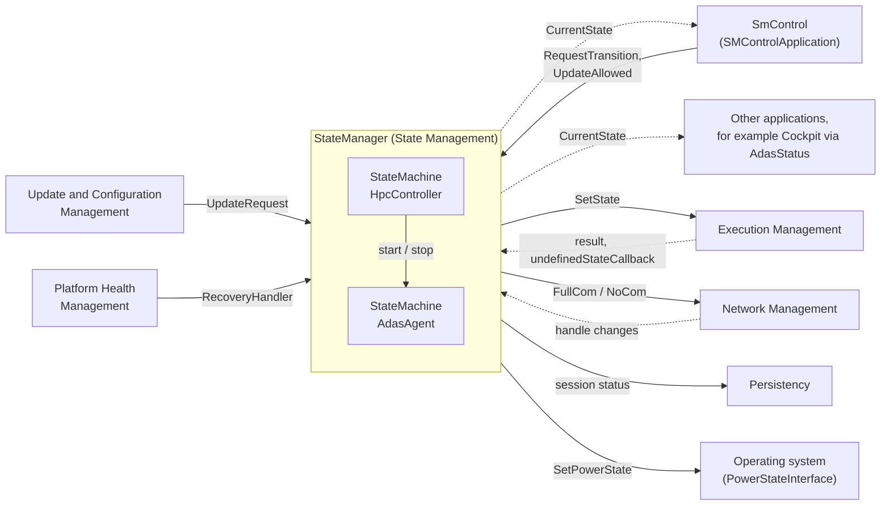

### 3.5 Who May Talk to State Management

Because SM's functions are critical, access from other applications must be secured, for example by Identity and Access Management (IAM) (SWS, Section 7.1). Four mechanisms apply:

| What is protected | How | Spec |
| --- | --- | --- |
| Requesting Function Group States from EM | Only the process that a `FunctionGroupPortMapping` names may control a Function Group; EM checks it | [EM guide, Section 12.6](04_ExecutionManagement.md#126-function-group-access-control) |
| `UpdateRequest` | At most one port per machine; the integrator restricts its use to UCM with IAM | [SWS_SM_CONSTR_00020], SWS Section 7.3 |
| `StateMachineService` and `UpdateAllowedService` | IAM configuration of the project; several SMControlApplications could otherwise change `UpdateAllowed` at the same time | SWS Sections 7.7.1, 7.7.14 |
| S2R Hub and satellites | IAM checks in the constructors; the security event `SEV_ACCESS_CONTROL_SM_IAM_ACCESS_DENIED` | [SWS_SM_00706], [SWS_SM_00712], [SWS_SM_70000] |

In `HPC`, only `StateManager` uses `StateClient`, and only `SmControl` may request transitions and set `UpdateAllowed` ([guide 00, Section 6.12](00_LearningPath.md#612-security)). Guide 15 configures the IAM rules.

> **Key takeaways**
>
> - SM is a daemon of the `PLATFORM_CORE` Software Cluster and must run in every Machine State except `Off`.
> - SM provides `UpdateRequest` to UCM and three services to applications, and it implements PHM's `RecoveryAction`.
> - SM requires EM's `StateClient`, NM's network handles, Persistency, Log and Trace, PHM supervision and the OS power interface.
> - Access to SM must be restricted: `FunctionGroupPortMapping` for EM, IAM for the services, at most one `UpdateRequest` port.

---

## 4. Configuration Overview

> **Why this matters:** With the StateMachine approach, most of SM's behavior is configuration. This chapter gives the mental model of that configuration; [Chapter 12](#12-configuration-reference-what-to-configure) lists every setting in detail.

### 4.1 Where the Configuration Lives

SM's configuration is a hybrid: part of it describes the SM executable like any application, and part of it is the target configuration of the machine (TPS, Section 12.14.1).

| Manifest or model | Configured by | When (methodology step) | Main elements for SM |
| --- | --- | --- | --- |
| Application design of the SM executable | Platform vendor and integrator | Design | The ports of the executable: R-ports typed by `StateClientInterface`, request ports of the tables, notification and service ports; the `ModeDeclarationGroup`s that type the StateMachines |
| Machine Manifest (target configuration) | Integrator | Integration | `StateManagementModuleInstantiation` in `Machine.moduleInstantiation`, with the StateMachines, requests, rules, ActionLists and error mappings; `FunctionGroupPortMapping`; the mappings to Network Management; Suspend-to-RAM module and mappings |
| Execution Manifest | Integrator | Integration | The SM process with `functionClusterAffiliation = STATE_MANAGEMENT`; its `ProcessToMachineMapping`, which references the module instantiation; the `processExecutionError` of every other process; `Executable.suspendToRamAwareness` |
| Application design of the SMControlApplication | Application designer | Design | R-ports for `StateMachineService`, `StateMachineNotification` and `UpdateAllowedService` |

The SWS defines **no default values** for these attributes (SWS, Section 10.1). Where the SWS defines a behavior for a missing setting, for example the error code 1, this guide names it; everywhere else it writes "not specified".

### 4.2 How the Elements Relate

The entry point is `StateManagementModuleInstantiation`. The following diagram shows what it aggregates and references.

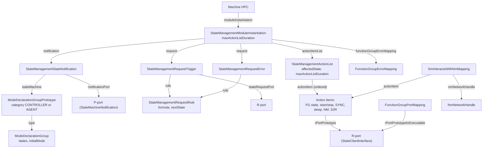

Three points are worth knowing:

1. **One notification owns one StateMachine.** A `StateManagementStateNotification` aggregates exactly the `ModeDeclarationGroupPrototype` that *is* the StateMachine ([TPS_MANI_01392]). Several notifications may use the same `ModeDeclarationGroup`, which creates several instances of the same "type" of StateMachine.
2. **Rules and ActionLists point at states, not at StateMachines.** A rule names its `nextState`, and an ActionList its `affectedState`, through an instance reference whose context is the StateMachine. That is how SM knows which StateMachine a rule or list belongs to.
3. **The SM process is connected through `ProcessToMachineMapping`.** The mapping references both the module instantiation and the SM process (TPS, Section 12.14.2, Figure 12.69).

### 4.3 From Tables to Model Elements

Many engineers think of SM configuration as tables. The *Manifest Specification* shows how such tables map to the model (TPS, Section B.6):

| Table column | Meta-model element |
| --- | --- |
| TransitionRequest value | `StateManagementCompareCondition.compareValue` of a `StateManagementTriggerCompareRule` |
| Current State | `StateManagementTriggerCompareRule.assumedCurrentState` |
| Next State | `StateManagementRequestRule.nextState` |
| ErrorCode | `StateManagementCompareCondition.compareValue` of a `StateManagementErrorCompareRule` |

Each row becomes one `StateManagementRequestRule` with a `formula` that holds one compare rule. The only comparison type in R25-11 is `isEqual`, and the formula has no logical operator, so a rule compares exactly one value. The model is prepared for more complex formulas in later releases (TPS, Section 12.14.4.1).

> **Note:** The meta-model cannot express the `ANY` entry that [SWS_SM_CONSTR_00014] requires: there is no "any" comparison and no reserved value. This guide shows `ANY` only in the conceptual configuration. Ask your tool vendor how its configuration tool represents it.

> **Key takeaways**
>
> - SM's configuration is split between the SM executable, the target configuration of the machine and the Execution Manifest.
> - `StateManagementModuleInstantiation` is the entry point; each `StateManagementStateNotification` owns one StateMachine.
> - Table rows map to `StateManagementRequestRule`s with one `isEqual` comparison each.
> - The SWS defines no default attribute values; only a few behaviors for missing settings.

---

## 5. StateMachines and Transitions

> **Why this matters:** A StateMachine only does what its tables allow. When a request is refused or a transition fails, the answer of `RequestTransition` tells you why, if you know how SM evaluates a request. This chapter explains the evaluation, the network triggers and how SM publishes its state.

### 5.1 Anatomy of a StateMachine

A StateMachine has four parts. The following diagram shows them for `AdasAgent`.

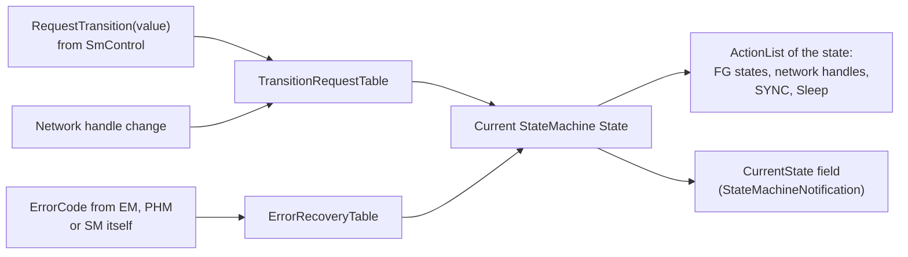

1. **StateMachine States**, one of which is the Initial State.
2. **One ActionList per state**, executed whenever the state is entered.
3. **Two tables** that decide the next state: the TransitionRequestTable for requests and network changes, and the ErrorRecoveryTable for errors.
4. **Two services**: `StateMachineService`, through which requests arrive, and optionally `StateMachineNotification`, which publishes the current state.

A StateMachine changes its state only for these inputs. It has no timers of its own that change the state, and it cannot evaluate conditions such as "the vehicle speed is 0". Such conditions belong in the SMControlApplication.

### 5.2 Requesting a Transition

**In plain words:** the SMControlApplication sends a number. SM looks up the number and the current state in the TransitionRequestTable. If it finds a row, it switches to the next state and executes its ActionList; the answer comes when the list is done.

**Formally:** the SMControlApplication calls the method `RequestTransition` of the `StateMachineService` of the StateMachine, with a `TransitionRequest` value of type `TransitionRequestType` (`uint32_t`) ([SWS_SM_91107], [SWS_SM_91023]). The possible outcomes are:

| Outcome | When | Spec |
| --- | --- | --- |
| `kUpdateInProgress` | The StateMachine is marked "ImpactedByUpdate" | [SWS_SM_00649] |
| `kRecoveryTransitionOngoing` | An error recovery of this StateMachine is in progress; the request is not processed | [SWS_SM_00605] |
| `kInvalidValue` | The value does not appear in the TransitionRequestTable at all | [SWS_SM_00604] |
| `kTransitionNotAllowed` | The value appears, but not for the current state | [SWS_SM_00603] |
| Accepted | A row matches. SM evaluates the next state, stops processing the current ActionList, switches immediately and starts the ActionList of the next state | [SWS_SM_00607] |
| `kOperationCanceled` | Given to an *earlier* request that was still pending, when a new request is accepted | [SWS_SM_00606] |
| `kTransitionFailed` | An error occurred while the ActionList of the new state was processed | [SWS_SM_00650] |
| Success (no error) | The ActionList of the new state was processed successfully | [SWS_SM_91107] |

The SWS does not prescribe in which order SM checks these conditions. The error codes are application errors of the service interface ([SWS_SM_91010], [Section 13.3](#133-errors-application-errors-and-smerrordomain)).

Two consequences are easy to overlook:

- **The previous ActionList is abandoned.** A new accepted request stops the processing of the current list, even if it is only half done (SWS, Figure 7.13). Items that were already requested, for example a Function Group State, are not taken back.
- **Requesting the current state runs its ActionList again.** All ActionListItems of a requested state are always executed, also when the StateMachine was already in that state (SWS, Section 7.7.8). This applies to requests, error reactions, network triggers and Start StateMachine with a parameter.

**The tables of `HPC`.** `SmControl` uses three values for `HpcController` and one for `AdasAgent`:

| StateMachine | TransitionRequest | Current State | Next State |
| --- | --- | --- | --- |
| `HpcController` | 1 (`Drive`) | `Init` | `Driving` |
| `HpcController` | 1 (`Drive`) | `AfterUpdate` | `Driving` |
| `HpcController` | 2 (`PowerOff`) | `Init`, `Driving`, `AfterUpdate` (three rows) | `Shutdown` |
| `HpcController` | 3 (`Reset`) | `Init`, `Driving`, `AfterUpdate` (three rows) | `Restart` |
| `AdasAgent` | 10 (`Degrade`) | `Normal` | `Degraded` |

So `RequestTransition(2)` in `Driving` leads to `Shutdown`; `RequestTransition(10)` in `Degraded` returns `kTransitionNotAllowed`, and `RequestTransition(7)` returns `kInvalidValue`. There is deliberately no row from `Degraded` back to `Normal` ([Section 8.8](#88-worked-example-a-stuck-cameradriver)).

> **Pitfall:** The request values are numbers that only the configuration and the SMControlApplication know. Keep them in one generated header or constant table that both are built from. A value that the SMControlApplication sends but the table does not contain fails with `kInvalidValue` only at run time.

### 5.3 Triggers from Network Management

A change of a network handle can also drive the TransitionRequestTable (SWS, Section 7.7.5). For example, when a partial network is woken by another ECU, a StateMachine can switch on the function that needs it.

- The trigger is configured as a `StateManagementRequestTrigger` that a `NmInteractsWithSmMapping` connects to an `NmNetworkHandle` ([TPS_MANI_01447]). Such a trigger has no `stateRequestPort` ([constr_10390], [constr_10511]).
- When the handle changes to `FullCom` or to `NoCom`, the StateMachine evaluates the next state from its TransitionRequestTable, stops the current list and switches immediately, as for a request ([SWS_SM_00620], [SWS_SM_00621]).
- One handle change can trigger transitions in several StateMachines. A handle is like a "remote control", for example parking assistance that switches on the rear camera and the proximity sensors, which different StateMachines control (SWS, Figure 7.15).
- While a StateMachine is "ImpactedByUpdate", it ignores handle changes ([SWS_SM_00627]); the Controller does too while an Agent is blocked by an update ([SWS_SM_00628]).

The SWS does not say which compare values in the rules stand for `FullCom` and `NoCom`; check the documentation of your configuration tool. `HPC` does not use network triggers: `AdasPn` follows `ADAS`, not the other way round.

### 5.4 Publishing the State: CurrentState

If a `StateMachineNotification` is configured for a StateMachine, SM offers it with the field `CurrentState` (getter and notifier, no setter) ([SWS_SM_00665], [SWS_SM_91109]):

- When a transition starts, `CurrentState` becomes "inTransition", whatever the source of the transition. It stays so even if an error reaction starts another transition in between ([SWS_SM_00616]).
- When all ActionListItems of the new state have been executed and all results collected, `CurrentState` becomes the name of the new state ([SWS_SM_00617]). The type is `StateMachineStateNameType`, a string ([SWS_SM_91020]).
- No StateMachine may have a state called "inTransition" ([SWS_SM_CONSTR_00026]).

The services of a StateMachine exist only while it runs: they are offered when the Start StateMachine item has been processed successfully, and withdrawn when the Stop StateMachine item has finished ([SWS_SM_00618], [SWS_SM_00619]). The early offer lets an SMControlApplication request a transition immediately, even while the initial ActionList is still running.

> **Pitfall:** The requirement [SWS_SM_00616] writes "inTransition", but the field definition [SWS_SM_91109] and Figure 7.12 write "InTransition". Compare the value without regard to case, or check your vendor's implementation.

In `HPC`, `SmControl` subscribes to `CurrentState` of `AdasAgent` and derives the field `AdasStatus` of `AdasStatusService` from it:

| `CurrentState` of `AdasAgent` | `AdasStatus` |
| --- | --- |
| service not offered (Agent stopped), or `Off` | `Off` |
| `Normal` | `Active` |
| `Degraded` | `Degraded` |
| `PrepareUpdate`, `VerifyUpdate`, `PrepareRollback` | `Unavailable` |
| "inTransition" | unchanged until the next state is published |

### 5.5 Worked Example: SmControl Brings HPC from Startup to Driving

The vehicle is switched on. The following sequence shows how `HPC` reaches `MachineFG.Driving` and `ADAS.Normal`. It continues the startup of the [EM guide, Section 9.3](04_ExecutionManagement.md#93-handing-over-control-to-state-management).

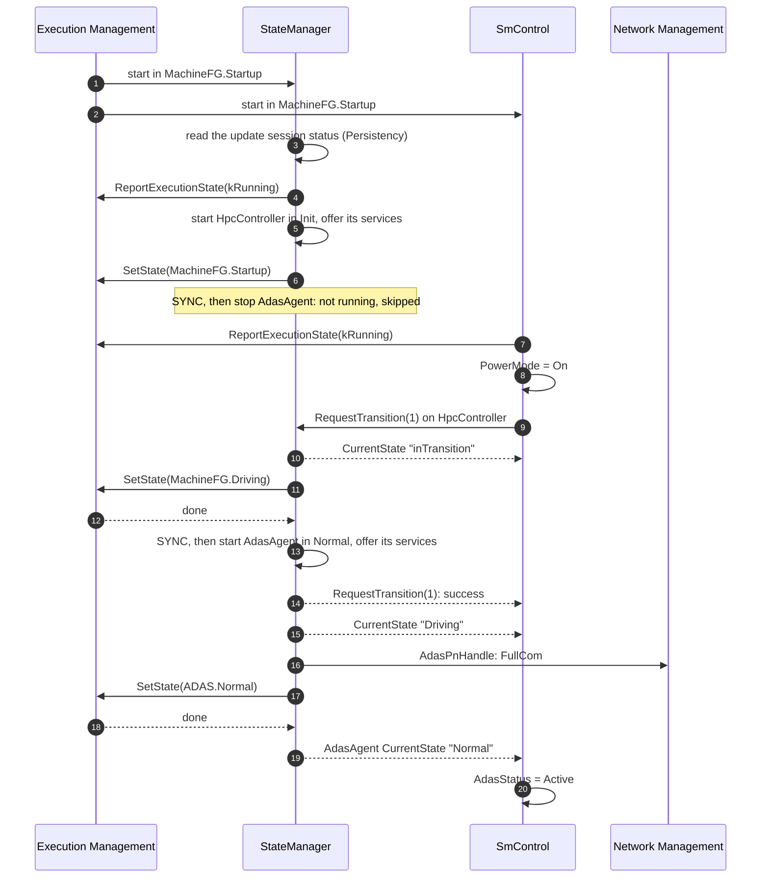

Steps 9 to 15 are the transition `Init` → `Driving` of `HpcController`. The Controller regards `AdasAgent` as started as soon as it exists and offers its services; it does not wait for the Agent's initial ActionList (SWS, Section 7.7.8). That is why `RequestTransition(1)` succeeds before `ADAS` has reached `Normal`. `SmControl` learns that `ADAS` is running from the `CurrentState` of `AdasAgent`.

> **Note (implementation example):** The Initial State of the Controller requests `MachineFG.Startup` while EM may still be performing its self-initiated `Startup` transition. The SWS shows this pattern (SWS, Figure 7.9) but does not discuss it, and it does not mention `GetInitialMachineStateTransitionResult` in the StateMachine approach. An implementation may, for example, wait for the result of the initial transition before it processes the Initial State. Check your vendor's documentation.

> **Key takeaways**
>
> - A StateMachine changes state only on a request, a network handle change or an error.
> - `RequestTransition` is refused with `kUpdateInProgress`, `kRecoveryTransitionOngoing`, `kInvalidValue` or `kTransitionNotAllowed`; an accepted request cancels a pending one and answers when the new ActionList is done.
> - Requesting the current state executes its ActionList again.
> - `CurrentState` is "inTransition" during a transition and the state name afterwards; the services exist only while the StateMachine runs.

---

## 6. ActionLists: What Happens When a State Is Entered

> **Why this matters:** The ActionLists are where the StateMachine approach meets the real system: they request Function Group States, switch networks and start other StateMachines. Their order and their SYNC items decide whether dependencies between Function Groups are respected.

### 6.1 Order, Parallelism and SYNC

**In plain words:** SM starts the items one after the other, in the configured order, but does not wait for one to finish before it starts the next, unless a SYNC item says so.

**Formally:**

- The processing of the items is *started* in the configured order ([SWS_SM_00609]).
- Subsequent items are processed in parallel unless a SYNC item is processed ([SWS_SM_00611]).
- At a SYNC item, the StateMachine waits until all previously processed items have finished, since the beginning of the list or since the last SYNC ([SWS_SM_00610]).
- Every ActionList ends with an implicit SYNC. The list is processed successfully as soon as all its items have been executed and all results collected ([SWS_SM_00667]).

How parallel the processing really is depends on the implementation, the hardware and the operating system (SWS, Section 7.7.7).

The following diagram shows the ActionList of `HpcController.Driving`.

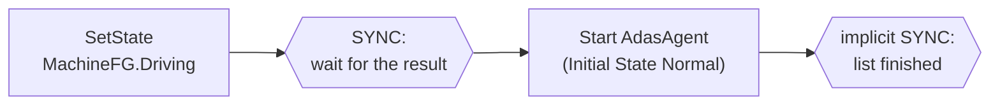

### 6.2 Function Group State Items

When SM finds a Function Group State item, it requests the configured Function Group State from EM ([SWS_SM_00608]). The item names the state to request (`setFunctionGroupState`) and the R-port through which the request is sent (`rPortPrototype`). In `HPC`, that port is `MachineFgPort` or `AdasFgPort`, typed by a `StateClientInterface`, and the `FunctionGroupPortMapping` tells EM which Function Group it controls ([EM guide, Section 13.10](04_ExecutionManagement.md#1310-state-management-access-stateclientinterface-and-functiongroupportmapping)).

For EM, Function Groups are independent of each other. Dependencies between them exist only in SM (SWS, Section 7.1.2), and the ActionLists are the place to express them: give the items in the needed order and put a SYNC where one transition must be finished before the next starts (SWS, Figure 7.17). Without a SYNC, the items run in parallel.

**Example.** The ActionList of `HpcController.Shutdown` is: stop `AdasAgent`, SYNC, `MachineFG.Shutdown`. The SYNC makes sure that `ADAS` is `Off` before `PowerControl` starts in `Shutdown` and powers the machine off. Without it, the ADAS processes could be cut off in the middle of their termination.

> **Pitfall:** The SWS recommends that every Controller state with `MachineFG.Shutdown` or `MachineFG.Restart` stops all Agents first. Otherwise their processes are terminated abruptly when the machine goes down (SWS, Section 7.7.4).

### 6.3 Network Handle Items and Afterrun

A SetNetworkHandle item switches a network handle of Network Management to `FullCom` or `NoCom` ([SWS_SM_00625], [SWS_SM_00626]). The item (`StateManagementNmActionItem`) carries the requested state; a separate `SmInteractsWithNmMapping` connects it to the `NmNetworkHandle` ([TPS_MANI_01446]). Only one StateMachine may reference a given network handle ([SWS_SM_CONSTR_00025]); otherwise the state of the handle would be unpredictable.

A Sleep item delays the processing of the next item for the configured time ([SWS_SM_00624]). Its main use is the **afterrun**: keeping something alive for a while after a function has stopped (SWS, Section 7.7.9, Figure 7.23). The sleep does not block the StateMachine: a request, an error or a network change during the sleep can still change the state.

**Example.** The ActionList of `AdasAgent.Off` is:

| # | Item | Effect |
| --- | --- | --- |
| 1 | Function Group State `ADAS.Off` | EM terminates the ADAS processes |
| 2 | SYNC | Wait until `ADAS` is `Off` |
| 3 | Sleep 2 s | Afterrun: keep `AdasPn` for the last messages, for example the final `AdasStatus` to `Cockpit` |
| 4 | SetNetworkHandle `AdasPnHandle` = `NoCom` | Release the partial network |

> **Note:** The *Manifest Specification* describes `sleepTime` as a time after which the action "is expected to be complete" and "considered failed" if it is not ([TPS_MANI_01444]). The SWS defines Sleep as a pure delay ([SWS_SM_00624]). This guide follows the SWS. The value must be greater than 0 ([constr_10512]).

### 6.4 Completeness Rules

Several constraints make sure that no Function Group or network handle is ever "forgotten" in a state, and that each one has exactly one owner:

| Rule | Why | Spec |
| --- | --- | --- |
| A Function Group is referenced by the items of exactly one StateMachine | Otherwise it is unclear which StateMachine is responsible | [SWS_SM_CONSTR_00013] |
| All ActionLists of a StateMachine reference the same set of Function Groups | Every state must say what each controlled Function Group does, even if it does not change | [SWS_SM_CONSTR_00015] |
| All ActionLists of a StateMachine reference the same set of network handles | Same reason for networks | [SWS_SM_CONSTR_00032] |
| A network handle is referenced by the items of exactly one StateMachine | Predictable network state | [SWS_SM_CONSTR_00025] |
| Every ActionList of the Controller references all Agents it controls | The Controller always says whether each Agent runs | [SWS_SM_CONSTR_00016] |
| Every ActionList of the Controller contains an item for `MachineFG` | Only the Controller controls the machine lifecycle | [SWS_SM_CONSTR_00017] |

In `HPC`, every list of `HpcController` has one `MachineFG` item and one start or stop item for `AdasAgent`, and every list of `AdasAgent` has one `ADAS` item and one `AdasPnHandle` item ([Section 7.6](#76-worked-example-hpccontroller-and-adasagent)).

### 6.5 ActionListTimeout

An ActionList can take too long without any explicit error, for example because of a too large Sleep value, a process that waits for a dependency that never comes, or a slow target (SWS, Section 7.7.12). The **ActionListTimeout** detects this:

- SM monitors the time from processing the first item to receiving the last response of the list ([SWS_SM_00669]).
- The limit is `StateManagementActionList.maxActionListDuration`. If a list has none, SM uses the machine-wide `StateManagementModuleInstantiation.maxActionListDuration` ([SWS_SM_00668]), which must exist ([constr_10641]).
- On a timeout, the StateMachine uses the list's `maxDurationExceededError` as an error code ([SWS_SM_00673]), or 1 if none is configured ([SWS_SM_00674]). The error code then goes through the ErrorRecoveryTable ([Chapter 8](#8-error-handling-and-recovery)).

In `HPC`, the machine-wide limit is 10 s. The list of `AdasAgent.Degraded`, which is the target of the recovery from a supervision failure, has its own limit of 6 s, equal to PHM's `recoveryNotificationTimeout`. Both cover the worst case of the EM timeouts for `ADAS.Normal` → `ADAS.Degraded`, about 5.5 s ([guide 06, Section 12.4](06_PlatformHealthManagement.md#124-when-the-notification-fails)). All lists of `AdasAgent` report a timeout with `AdasStateTimeout` (60), which leads to `Off`.

> **Pitfall:** Derive the timeouts from measured durations with a margin, and check them against the EM timeouts of the processes involved ([EM guide, Section 13.11](04_ExecutionManagement.md#1311-the-running-example-complete-configuration)) and against PHM's recovery timeout ([guide 06, Section 12.4](06_PlatformHealthManagement.md#124-when-the-notification-fails)). A Sleep item counts towards the duration of its list.

### 6.6 Worked Example: The ActionLists of AdasAgent

`AdasAgent` controls the Function Group `ADAS` and the network handle `AdasPnHandle`. Every list references both ([SWS_SM_CONSTR_00015], [SWS_SM_CONSTR_00032]).

| StateMachine State | ActionList | Purpose |
| --- | --- | --- |
| `Normal` (initial) | `AdasPnHandle` = `FullCom`; `ADAS.Normal` | Full ADAS with `Fusion` |
| `Degraded` | `AdasPnHandle` = `FullCom`; `ADAS.Degraded` (list limit 6 s) | Fallback with `FusionLite` |
| `Off` | `ADAS.Off`; SYNC; Sleep 2 s; `AdasPnHandle` = `NoCom` | Stopped, with afterrun |
| `PrepareUpdate` | `ADAS.Off`; SYNC; `AdasPnHandle` = `NoCom` | Before the new software is installed |
| `VerifyUpdate` | `AdasPnHandle` = `FullCom`; `ADAS.Verify` | Check the new software |
| `PrepareRollback` | `ADAS.Off`; SYNC; `AdasPnHandle` = `NoCom` | Before the old software is restored |

The network item comes first in `Normal` and `Degraded` without a SYNC: the network wake-up and the process start overlap. In `Off`, `PrepareUpdate` and `PrepareRollback`, the SYNC makes sure that the processes are stopped before the network is released.

> **Key takeaways**
>
> - Items are started in the configured order and run in parallel until a SYNC; a list ends with an implicit SYNC.
> - Dependencies between Function Groups are expressed by the order of items and by SYNC.
> - A Sleep item realizes an afterrun without blocking the StateMachine.
> - Each Function Group and each network handle belongs to one StateMachine and appears in all of its lists.
> - The ActionListTimeout turns a list that takes too long into an error code.

---

## 7. Controller and Agents

> **Why this matters:** A single StateMachine for a whole machine quickly becomes unmanageable. SM therefore splits the control between one Controller and several Agents. The split follows the Software Clusters, which matters most during updates.

### 7.1 Why Several StateMachines

All Function Groups could be controlled by one StateMachine. But with more Software Clusters, Function Groups and states, the number of combined states grows fast (SWS, Section 7.7.3). SM therefore supports several StateMachine instances: one Controller and any number of Agents.

The split follows the Software Clusters. An update is done per Software Cluster, and UCM passes the list of Function Groups that the cluster claims (`claimedFunctionGroup`). An Agent must therefore only manage Function Groups claimed by the same Software Cluster ([SWS_SM_CONSTR_00018]), so that an update can stop exactly the Agents it affects. The Controller may manage Function Groups of several clusters, but this is recommended only when there are no Agents (SWS, Section 7.7.3).

In `HPC`, `HpcController` belongs to `HpcPlatformCore` and controls `MachineFG`; `AdasAgent` belongs to `AdasCluster` and controls `ADAS`.

### 7.2 The Controller Owns the Machine Lifecycle

The Controller is the first StateMachine of SM. When the SM process that controls it starts, it starts the Controller ([SWS_SM_00648]). The Controller manages the life-cycle of the whole machine and of the Agents (SWS, Section 7.7.3):

- **`MachineFG` is always the Controller's.** Every ActionList of the Controller contains an item for `MachineFG` ([SWS_SM_CONSTR_00017]), and no other StateMachine may reference it ([SWS_SM_CONSTR_00013]).
- **Shutdown and restart are states of the Controller.** The machine is shut down or restarted through the Machine States `Shutdown` and `Restart`. The SWS recommends Controller states whose lists request them (SWS, Figure 7.9), and it requires a Controller state `Restart` whose list requests `MachineFG.Restart` ([SWS_SM_CONSTR_00029], [SWS_SM_CONSTR_00030]). SM never shuts the machine down on its own (SWS, Section 7.7.8).
- **Mandatory states.** Besides `Restart`, the Controller needs `PrepareUpdate`, `VerifyUpdate`, `PrepareRollback`, `AfterUpdate` and `ContinueUpdate` for update sessions ([Chapter 9](#9-software-updates-state-managements-side)) and `LeaveSuspend` for the wake-up from Suspend-to-RAM ([Section 10.5](#105-suspend-to-ram-in-the-statemachine-approach)).

### 7.3 Starting and Stopping Agents

Only the Controller may use the items Start StateMachine and Stop StateMachine ([SWS_SM_CONSTR_00019]), so there is only one level of nesting. Starting a StateMachine has two parts: its services are created and offered, and it processes the ActionList of its first state. For the Controller, an Agent counts as *started* as soon as it exists and offers its services; waiting for the first ActionList would make the Controller's own transitions slow and unpredictable (SWS, Section 7.7.8).

What a Start StateMachine item does depends on whether the Agent already runs and whether the item has a parameter (`overrideInitialState`):

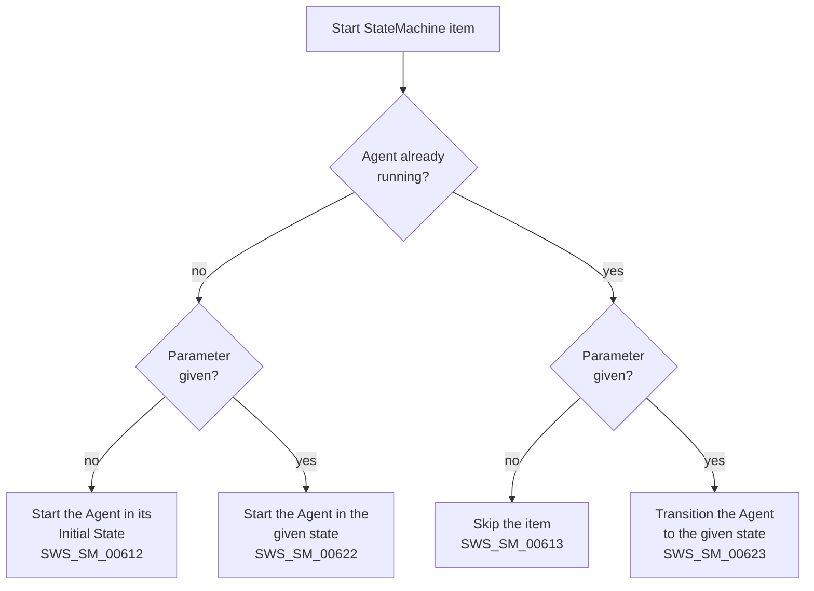

A Stop StateMachine item works as follows:

- If the Agent does not run, the item is skipped ([SWS_SM_00615]).
- Otherwise the Agent is transitioned to its `Off` state ([SWS_SM_00651]). When the item has been processed, the Agent ceases to exist ([SWS_SM_00614]) and its services are no longer offered ([SWS_SM_00619]). The Controller must wait until `Off` is reached and the services are gone (SWS, Section 7.7.8).

If the creation or the destruction of an Agent fails, the Controller uses the item's `startAgentError` or `stopAgentError` as an error code in *its own* ErrorRecoveryTable, or 1 if none is configured ([SWS_SM_00675] to [SWS_SM_00678]). These errors concern the Agent and its services, not the ActionLists of its states.

> **Pitfall:** A Start StateMachine item *without* a parameter does nothing if the Agent already runs ([SWS_SM_00613]). To force a running Agent into a state, give the parameter ([SWS_SM_00623]). `HpcController.AfterUpdate` uses this: after an update, `AdasAgent` may still be running in `VerifyUpdate`, and only a start with the parameter `Normal` brings it back.

### 7.4 The Agent's Off State

Every Agent must have a state `Off` ([SWS_SM_CONSTR_00024]). When a StateMachine stops, it must leave the system consistent: none of its Function Groups may remain in a state that nobody can influence any more, so all of them go to `Off` (SWS, Section 7.7.4). The list of an Agent's `Off` state may therefore contain only these items ([SWS_SM_CONSTR_00011]):

- Function Group State `Off`,
- SetNetworkHandle `NoCom`,
- SYNC,
- Sleep.

`AdasAgent.Off` uses all four ([Section 6.3](#63-network-handle-items-and-afterrun)). The Controller needs no `Off` state ([Section 2.2](#22-statemachine-statemachine-state-and-initial-state)).

### 7.5 Startup, Shutdown and Restart of the Machine

**Startup.** EM controls the processes, but after `Startup` it never changes a Function Group State on its own. SM must therefore run in every Machine State, including `Startup`, `Shutdown` and `Restart` ([SWS_SM_CONSTR_00001]). When SM starts (SWS, Section 7.8.1 and Figure 7.37):

1. It restores the state of an ongoing update session from Persistency, so that it does not start processes that could interfere with UCM.
2. It reports `kRunning` to EM.
3. It starts the Controller: in the Initial State normally, or in `ContinueUpdate` if an update session is active ([SWS_SM_00657], [Section 9.5](#95-machine-reset-during-a-session)).
4. From then on it handles requests and processes ActionLists.

Every Adaptive Application that talks to SM must have initialized ARA with `ara::core::Initialize(argc, argv)` before (SWS, Section 7.8.1).

**Shutdown and restart.** SM must still run in `Shutdown` and `Restart`, because a transition can fail and somebody must be able to report it (SWS, Sections 7.8.2 and 7.8.3). At some point the machine goes down, and SM with it; errors after that point are handled in an implementation-specific way. SM should terminate gracefully when it receives `SIGTERM`, which with a correct configuration happens rarely. Every SMControlApplication should terminate before SM receives `SIGTERM` and call `ara::core::Deinitialize()` before it exits. PHM, SOME/IP and logging should be terminated after SM.

In `HPC`, `SmControl` does not run in `Shutdown` and `Restart`, so EM terminates it during the transition to these states. `StateManager`, `PlatformHealth` and `PowerControl` run in both. The following diagram shows the shutdown:

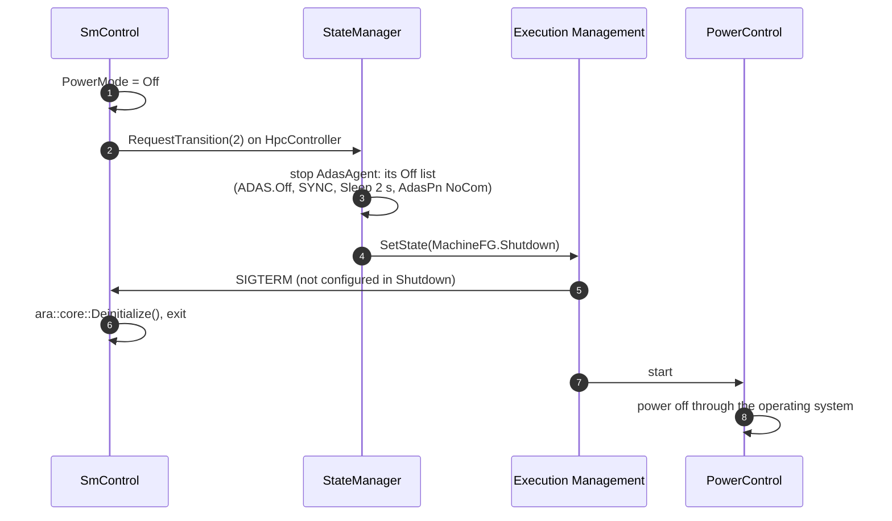

> **Pitfall:** If a Machine State does not contain an SM process, the machine can never leave that state ([SWS_SM_CONSTR_00001]). Check this for every project-specific Machine State.

### 7.6 Worked Example: HpcController and AdasAgent

`HpcController` has ten states. The first four are the operating modes of `HPC`; the others are required for updates and wake-up and are explained in Chapters 9 and 10.

| StateMachine State | ActionList | Entered by |
| --- | --- | --- |
| `Init` (initial) | `MachineFG.Startup`; SYNC; stop `AdasAgent` | Start of SM |
| `Driving` | `MachineFG.Driving`; SYNC; start `AdasAgent` | `Drive` (1) |
| `Shutdown` | stop `AdasAgent`; SYNC; `MachineFG.Shutdown` | `PowerOff` (2) |
| `Restart` | stop `AdasAgent`; SYNC; `MachineFG.Restart` | `Reset` (3); `ResetMachine` of UCM; any error (`ANY`) |
| `PrepareUpdate` | `MachineFG.Driving`; stop `AdasAgent` | `PrepareUpdate` of UCM, if `MachineFG` is affected |
| `VerifyUpdate` | stop `AdasAgent`; SYNC; `MachineFG.Verify` | `VerifyUpdate` of UCM, if `MachineFG` is affected |
| `PrepareRollback` | `MachineFG.Driving`; stop `AdasAgent` | `PrepareRollback` of UCM, if `MachineFG` is affected |
| `AfterUpdate` | `MachineFG.Driving`; SYNC; start `AdasAgent` in `Normal` | `StopUpdateSession` of UCM |
| `ContinueUpdate` | `MachineFG.Startup`; stop `AdasAgent` | Start of SM during an active update session |
| `LeaveSuspend` | LeaveSuspendToRam; `MachineFG.Driving`; SYNC; start `AdasAgent` | Never in `HPC` ([Section 10.8](#108-what-hpc-does)) |

The following diagram shows the transitions of `HpcController` that requests and errors cause. The update states are left out.

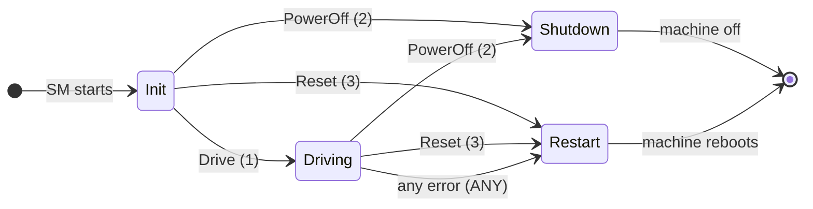

`AdasAgent` exists only while `HpcController` is in `Driving` or `AfterUpdate`. The following diagram shows its operating states; [Section 6.6](#66-worked-example-the-actionlists-of-adasagent) lists the ActionLists.

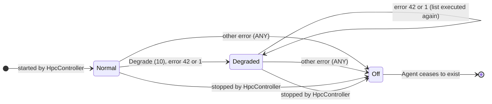

> **Key takeaways**
>
> - Exactly one Controller starts with SM and controls `MachineFG`; Agents control the Function Groups of one Software Cluster each.
> - Only the Controller starts and stops Agents. A start without parameter skips a running Agent; a start with parameter forces its state.
> - Stopping an Agent transitions it to `Off`, whose list may contain only `Off`, `NoCom`, SYNC and Sleep items.
> - SM must run in every Machine State; it restores an update session at startup and starts the Controller in `ContinueUpdate` if needed.
> - SMControlApplications should terminate before SM at shutdown.

---

## 8. Error Handling and Recovery

> **Why this matters:** The most important job of SM in a safety-relevant system is the reaction to failures. In the StateMachine approach this reaction is configuration: an error code and a table. Knowing where each error code comes from, and what SM does while it recovers, explains most "unexpected" state changes in the field.

### 8.1 Where Errors Come From

In the StateMachine approach, every error ends up as a number, the **ErrorCode**, which the ErrorRecoveryTable of one StateMachine evaluates. The reaction is the same whether the error was reported by PHM, by EM or by SM itself (SWS, Section 7.7.13). The following table lists the sources (SWS, Figure 7.29).

| Error | How SM learns about it | ErrorCode | If not configured | Evaluated by | Spec |
| --- | --- | --- | --- | --- | --- |
| A process failed: crash, failed start, supervision failure | EM: `GetExecutionError` or `undefinedStateCallback`; PHM: `RecoveryHandler` | The `ExecutionError` of the failed process (its `processExecutionError`) | 1 (set by EM and PHM) | The StateMachine that manages the Function Group of the failed process | [SWS_SM_00670] |
| A `SetState` request itself failed: `kNoCommunication`, `kInvalidTransition` or `kInvalidMetaModelIdentifier` | Result of `SetState` | `FunctionGroupErrorMapping.functionGroupTransitionRequestFailedError` of the Function Group | 1 | The StateMachine that manages the Function Group | [SWS_SM_00671], [SWS_SM_00672] |
| An ActionList takes too long | SM's own timeout | `maxDurationExceededError` of the list | 1 | The StateMachine of the list | [SWS_SM_00673], [SWS_SM_00674] |
| Starting or stopping an Agent failed | SM itself | `startAgentError` or `stopAgentError` of the item | 1 | The Controller | [SWS_SM_00675] to [SWS_SM_00678] |
| An ActionList of an Agent failed | SM itself | `actionListProcessingFailedError` of the list | Not reported to the Controller | The Controller | [SWS_SM_00679] |
| Entering or leaving Suspend-to-RAM failed | SM itself | `enterSuspendToRamError` or `leaveSuspendToRamError` | 1 | The Controller | [SWS_SM_00685] to [SWS_SM_00688] |

Two failed answers of `SetState` must be told apart (SWS, Section 7.7.13): if the transition was accepted and started but a process failed, the failure arrives as the `ExecutionError` of the process (first row). If the request itself failed, because the communication with EM failed or the request was invalid, the error code of the Function Group is used (second row).

The last three rows let an Agent's trouble reach the Controller. Usually an Agent handles its errors itself. If the success of a particular Agent list is important for the whole machine, configure `actionListProcessingFailedError` on that list, and the Controller reacts with its own table (SWS, Section 7.7.13).

**The error codes of `HPC`.** `Fusion` has the `processExecutionError` 42 (`FusionFailed`); all other processes have none, so their failures arrive as 1. The configuration of `AdasAgent` adds two codes of the error domain `AdasExecutionErrors`: `AdasStateTimeout` (60) for its list timeouts, and `AdasTransitionRequestFailed` (61) for failed `SetState` requests on `ADAS`. The Controller uses only defaults.

> **Pitfall:** The ErrorRecoveryTable compares only the number. It does not know from which source or which error domain a code comes. An `ExecutionError` 60 of some process would be indistinguishable from `AdasStateTimeout`, and the default 1 is used by every source that has no configured code. Give every failure that needs its own reaction a unique number within the StateMachine.

### 8.2 The ErrorRecoveryTable and the ANY Entry

The ErrorRecoveryTable of a StateMachine maps each ErrorCode to the StateMachine State to enter. Unlike the TransitionRequestTable, a row does not depend on the current state: if the code matches, the StateMachine switches to the row's next state ([TPS_MANI_01836]; TPS, Section B.6.3). Every table must contain exactly one entry with the value `ANY`, which applies to all codes without a row of their own ([SWS_SM_CONSTR_00014]).

The tables of `HPC`:

| StateMachine | ErrorCode | Next State | Typical cause |
| --- | --- | --- | --- |
| `AdasAgent` | 42 | `Degraded` | `Fusion` crashed, or a supervision of `Fusion` failed |
| `AdasAgent` | 1 | `Degraded` | `CameraDriver` or another ADAS process without its own code failed |
| `AdasAgent` | `ANY` | `Off` | `AdasStateTimeout` (60), `AdasTransitionRequestFailed` (61), any other code |
| `HpcController` | `ANY` | `Restart` | A platform process failed, `MachineFG` could not be requested, `AdasAgent` could not be started or stopped |

The design follows a simple idea: a known failure of one ADAS process leads to the fallback `Degraded`; an unknown or structural problem switches the feature off; a problem of the platform restarts the machine.

> **Note:** As [Section 4.3](#43-from-tables-to-model-elements) explains, the meta-model of R25-11 has no way to express `ANY`. The constraint exists, but how a tool stores the entry is not standardized.

### 8.3 The Recovery Reaction

When an ErrorCode is reported for a StateMachine that is not affected by an update session, the StateMachine ([SWS_SM_00601]):

1. sets an internal flag that an error recovery is ongoing (*ErrorRecoveryOngoing*);
2. evaluates the next StateMachine State for the ErrorCode in its ErrorRecoveryTable;
3. stops processing the current ActionList;
4. switches to the next state immediately and starts its ActionList.

While the flag is set, every `RequestTransition` for this StateMachine is refused with `kRecoveryTransitionOngoing` ([SWS_SM_00605]). The flag is reset when all items of the ActionList of the recovery state have been processed successfully ([SWS_SM_00602]). `CurrentState` shows "inTransition" during the whole recovery ([SWS_SM_00616]).

If the StateMachine *is* affected by an update session, it ignores an `ExecutionError` reported by PHM or EM and logs the event, if logging is activated ([SWS_SM_00664], [Section 9.3](#93-impactedbyupdate)).

> **Note:** SM must expect PHM to report a supervision failure before EM has confirmed that a requested Function Group State was reached (SWS, Section 7.6). The recovery then interrupts the transition in progress.

### 8.4 Nested Recovery

**In plain words:** a nested recovery is a second failure in the same StateMachine while SM is still recovering from the first one.

**Formally:** if a new issue must be handled by a StateMachine whose ErrorRecoveryOngoing flag is set, this is a *nested recovery* ([SWS_SM_00666]). The StateMachine reacts to the new error as to any error: it evaluates its table again and switches immediately (SWS, Figure 7.28). For PHM, SM gives the same result to all `RecoveryHandler` calls that concern the same StateMachine, based on the result when the recovery action of the *last* call has finished ([SWS_SM_00031]).

**Example in `HPC`.** `Fusion` stalls; PHM reports 42, and `AdasAgent` switches to `Degraded`. While EM is still starting `FusionLite`, the alive supervision of `CameraDriver` expires; PHM reports 1. `AdasAgent` evaluates 1, enters `Degraded` again and restarts its list. When that list has finished, SM completes both `RecoveryHandler` calls with the same result. Both calls must be answered within PHM's `recoveryNotificationTimeout`, measured from the detection of each failure ([guide 06, Section 12.4](06_PlatformHealthManagement.md#124-when-the-notification-fails)).

> **Pitfall:** A StateMachine has no counter of failures. If the process that fails is also part of the recovery state, for example `FusionLite` in `Degraded`, each failure leads to `Degraded` again, possibly forever. Break such loops in the design: give the fallback process its own `processExecutionError` that maps to `Off`, or let the SMControlApplication watch `CurrentState` and act when the StateMachine is calm again.

### 8.5 State Management's Side of RecoveryHandler

PHM tells SM about a failed Global Supervision by calling `RecoveryHandler` of an `ara::phm::RecoveryAction` object that SM implements ([guide 06, Section 12.2](06_PlatformHealthManagement.md#122-what-state-management-receives)). In `HPC`, `StateManager` constructs it with the instance specifier `/state_manager/Root/PhmRecoveryPort` and calls `Offer()` at startup.

The call carries an `ExecutionErrorEvent`, with the Function Group of the Global Supervision and the `ExecutionError` of the failed process, and the kind of supervision that failed. SM handles it as follows:

| Situation | What SM does | Spec |
| --- | --- | --- |
| The parameters are invalid, for example the Function Group is unknown | Answer `kSMCanNotHandleRecovery`; PHM then fires the watchdog reaction | [SWS_SM_00030] |
| The StateMachine of the Function Group is not affected by an update | Use the `ExecutionError` as ErrorCode in that StateMachine ([Section 8.3](#83-the-recovery-reaction)) | [SWS_SM_00670], [SWS_SM_00601] |
| The StateMachine is "ImpactedByUpdate" | Ignore the request; log it | [SWS_SM_00664] |
| A recovery of the same StateMachine is already running | Nested recovery: same result for all calls when the last action has finished | [SWS_SM_00031] |

SM answers through the `Future` that `RecoveryHandler` returns. A value means that the recovery is handled; `kSMCanNotHandleRecovery` asks PHM to fire the watchdog reaction as a last resort (SWS, Section 7.2). PHM watches the answer with a configurable timeout ([guide 06, Section 12.4](06_PlatformHealthManagement.md#124-when-the-notification-fails)).

> **Note:** Apart from nested recovery, the SWS does not say exactly *when* SM completes the `Future`, nor what it answers when it ignores a request during an update session. This series assumes that SM answers when the ActionList of the recovery state has finished. Then the recovery state's list must fit into PHM's timeout, which is why `AdasAgent.Degraded` has a list limit of 6 s ([Section 6.5](#65-actionlisttimeout)).

### 8.6 Failures Reported by Execution Management

SM requests every Function Group State, including the Machine State, through EM's `StateClient` ([SWS_SM_00400]), and it must evaluate the results ([SWS_SM_00401]). EM reports failures in two ways ([EM guide, Section 10.3](04_ExecutionManagement.md#103-undefined-function-group-state)): during a requested transition through the result of `SetState`, and outside a transition through the `undefinedStateCallback`. In both cases SM can fetch the `ExecutionErrorEvent` with `GetExecutionError`.

| EM reports | Meaning | ErrorCode in the StateMachine approach |
| --- | --- | --- |
| `undefinedStateCallback(event)` | A process of the Function Group failed outside a transition | `event.executionError` ([SWS_SM_00670]) |
| `SetState` fails with `kOperationFailed`, `kUnexpectedTermination` or `kIntegrityOrAuthenticityCheckFailed` | The transition started, but a process failed | The `ExecutionError` from `GetExecutionError` ([SWS_SM_00670]) |
| `SetState` fails with `kNoCommunication`, `kInvalidTransition` or `kInvalidMetaModelIdentifier` | The request itself failed | `functionGroupTransitionRequestFailedError`, default 1 ([SWS_SM_00671]) |

`kIntegrityOrAuthenticityCheckFailed` deserves attention: every later request for the same Function Group State will fail in the same way, because the trusted platform has found software that is not authentic. Fixing it, for example by an update, is outside SM's scope (SWS, Section 7.6). In `HPC`, the code 1 of such a failure leads `AdasAgent` to `Degraded`; if `Degraded` fails too, the next failure leads there again ([Section 8.4](#84-nested-recovery)).

### 8.7 Worked Example: Fusion Fails and ADAS Goes to Degraded

This is the State Management side of the failure that [guide 06, Section 12.6](06_PlatformHealthManagement.md#126-worked-example-fusion-stalls-and-adas-goes-to-degraded) shows from PHM's side. `Fusion` misses its compute deadline, and `FusionSupervision` expires.

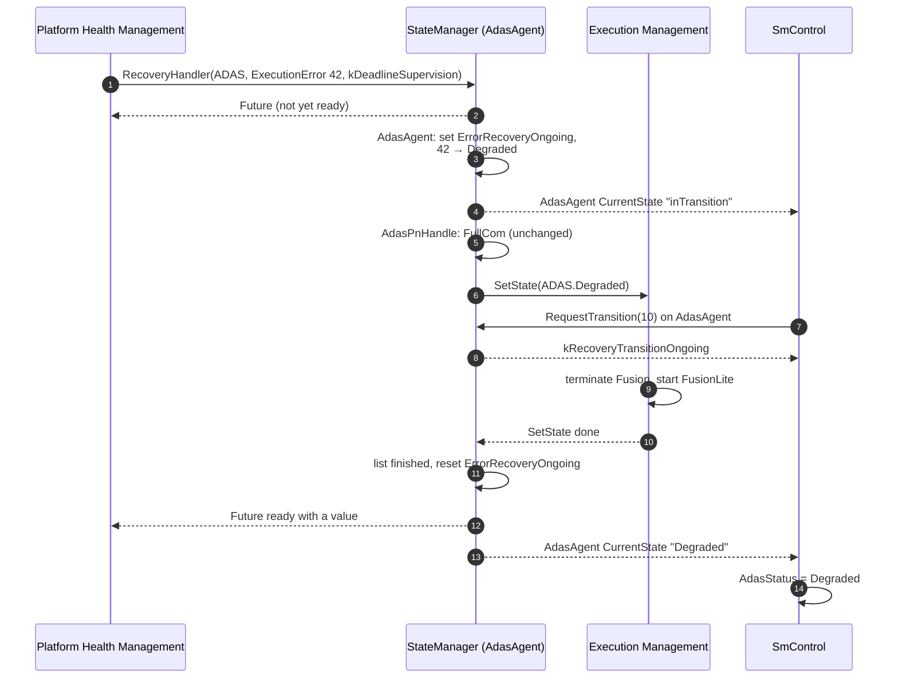

If `Fusion` had crashed instead, EM would have reported it through the `undefinedStateCallback` with the same `ExecutionError` 42, and `AdasAgent` would have reacted in the same way, only without a `Future` for PHM. Steps 7 and 8 show a request of `SmControl` that arrives during the recovery: it is refused, not queued.

### 8.8 Worked Example: A Stuck CameraDriver

Now the alive supervision of `CameraDriver` expires because its image loop hangs, but the process does not crash ([guide 06, Section 12.7](06_PlatformHealthManagement.md#127-known-limitation-successive-failures)).

1. PHM calls `RecoveryHandler` with `ADAS` and the `ExecutionError` 1, because `CameraDriver` has no `processExecutionError`.
2. `AdasAgent` maps 1 to `Degraded` and requests `ADAS.Degraded`.
3. EM replaces `Fusion` by `FusionLite`. `CameraDriver` runs in `Normal` and `Degraded` with the same startup configuration, so EM does *not* restart it. Its supervision stays expired, and PHM will not report it again.

So `HPC` drives on with an unsupervised `CameraDriver`. That is acceptable for one reason: in `Degraded`, no safety-relevant function uses the camera. `FusionLite` uses only radar and vehicle data; the camera image goes only to the display of `Cockpit`.

What must not happen is a return to `Normal` during the same drive. `Fusion` would then fuse images from a camera driver that nobody supervises. `HPC` therefore follows a simple policy:

- `AdasAgent` has **no transition from `Degraded` to `Normal`**. A request `Degrade` in `Degraded` returns `kTransitionNotAllowed`, and there is no request for the way back ([Section 5.2](#52-requesting-a-transition)).
- `ADAS` returns to `Normal` only when `AdasAgent` is started again. That happens at the next drive cycle: at `PowerOff`, `HpcController` stops `AdasAgent`, whose `Off` list terminates all ADAS processes, including `CameraDriver`. At the next `Drive`, `AdasAgent` starts in `Normal`, and all supervisions start fresh.

A *crashed* `CameraDriver` is a different case: EM reports it with the code 1, and the request for `ADAS.Degraded` makes EM start `CameraDriver` again, because it belongs to `Degraded`. A crash is therefore repaired at once; only a hang stays until the next drive cycle.

> **Pitfall:** Do not add a direct `Degraded` → `Normal` transition just because "the failure is gone". After a supervision failure, the failed process may still run unsupervised. Return to the full function only through a state change that restarts the processes, for example through `Off`.

> **Note:** A project that cannot wait for the next drive cycle could let the SMControlApplication restart `ADAS` at standstill, with request rows `Degraded` → `Off` and `Off` → `Normal`. `HPC` does not do this.

### 8.9 Error Handling Without StateMachines

With an individual implementation of SM, the reactions are project code. The SWS lists typical countermeasures that SM can take depending on the error returned by EM (SWS, Section 7.6):

- request another state for the same Function Group, for example `Off`;
- request a state for another Function Group;
- persist the error, at least for the current power cycle, so that SM does not request an unrecoverable state again, for example after `kIntegrityOrAuthenticityCheckFailed`;
- trigger a restart of the system for generic unrecoverable errors, for example by reporting a wrong supervision checkpoint to PHM.

The SWS adds that these reactions are valid only for an individual implementation; with the StateMachine approach, a StateMachine State change is configured as error reaction. [SWS_SM_00030] and [SWS_SM_00031] apply to both approaches.

> **Note:** This list of the SWS also names the error codes `kMetaModelError`, `kGeneralError` and `kCommunicationError`. The `ExecErrc` of R25-11 does not define them ([EM guide, Section 10.2](04_ExecutionManagement.md#102-error-codes-execerrc)); read them as examples of the kind of error.

> **Key takeaways**
>
> - Every error becomes a number: the `ExecutionError` of a process, or an error code from the SM configuration, by default 1.
> - The ErrorRecoveryTable maps the number to a state, independent of the current state; `ANY` is mandatory.
> - During a recovery, requests are refused with `kRecoveryTransitionOngoing`; a second failure starts a nested recovery.
> - SM answers PHM through the `Future` of `RecoveryHandler`; an invalid request gets `kSMCanNotHandleRecovery`.
> - A process that keeps running after a supervision failure stays unsupervised; return to the full function only through a restart.

---

## 9. Software Updates: State Management's Side

> **Why this matters:** During an update, UCM changes the software under the feet of SM. SM must stop the affected functions, let UCM install, check the new software and survive resets in between, without letting normal requests or error reactions interfere. This chapter shows SM's part; guide 13 (`13_UpdateAndConfigManagement.md`, planned) tells the whole update story.

### 9.1 The UpdateRequest Interface

SM provides the service interface `UpdateRequest` to UCM ([SWS_SM_91017]). The system integrator must restrict its use to UCM with IAM (SWS, Section 7.3).

| Element | Purpose | Errors | Spec |
| --- | --- | --- | --- |
| `RequestUpdateSession()` | Ask whether an update may start; starts the active update session | `kOperationRejected`, `kNotAllowedMultipleUpdateSessions` | [SWS_SM_00203], [SWS_SM_91102] |
| `PrepareUpdate(functionGroupList)` | Prepare the given Function Groups for the update | `kOperationRejected`, `kOperationFailed` | [SWS_SM_00206], [SWS_SM_91103] |
| `VerifyUpdate(functionGroupList)` | Verify the updated Function Groups | `kOperationRejected`, `kOperationFailed` | [SWS_SM_00207], [SWS_SM_91104] |
| `PrepareRollback(functionGroupList)` | Prepare the given Function Groups for a rollback | `kOperationRejected`, `kOperationFailed` | [SWS_SM_00208], [SWS_SM_91105] |
| `StopUpdateSession()` | Tell SM that the update is finished and the machine is stable | `kOperationRejected` | [SWS_SM_00205], [SWS_SM_91101] |
| `ResetMachine()` | Request a reset of the machine; fire-and-forget | `kOperationRejected` | [SWS_SM_00202], [SWS_SM_91100] |
| Field `ResetMachineNotifier` | The status of the last `ResetMachine`: `kIdle`, `kRejected`, `kSuccessful`, `kFailed`; default `kIdle` | | [SWS_SM_00211], [SWS_SM_00212], [SWS_SM_91106] |

The Function Groups are passed as a list of strings, each the fully qualified short name of a Function Group ([SWS_SM_91018], [SWS_SM_91019]). The SWS does not show an example; in the model of guide 02, the path of `ADAS` is `/HPC/FunctionGroupSets/AdasFunctionGroups/ADAS`.

The following rules apply to every implementation of SM, with or without StateMachines (SWS, Section 7.3):

- **One session at a time.** The period from an accepted `RequestUpdateSession` to the end of `StopUpdateSession` is the active update session ([SWS_SM_00210]). A further `RequestUpdateSession` during it returns `kNotAllowedMultipleUpdateSessions` ([SWS_SM_00209]).
- **No steps outside a session.** `PrepareUpdate`, `VerifyUpdate`, `PrepareRollback` and `StopUpdateSession` return `kOperationRejected` outside an active session ([SWS_SM_00213]).
- **The session survives resets.** SM persists the information about the ongoing session, so that it can be read after any kind of reset ([SWS_SM_00204]).
- **No suspend during a session.** SM rejects a Suspend-to-RAM request while a session is active ([SWS_SM_00214]).
- **Minimum meaning of the steps.** `PrepareUpdate` and `PrepareRollback` set at least the given Function Groups to `Off`; `VerifyUpdate` sets them at least to `Verify`. A step fails if a Function Group cannot reach the state (SWS, Section 7.3).
- **No shutdown during a session, in principle.** SM should keep the machine running while a session is active. AUTOSAR accepts that there can be good reasons to restart or shut down anyway, for example low voltage or high temperature, and also a project-specific limit on the session duration (SWS, Section 7.3).

### 9.2 Granting a Session: UpdateAllowed

In the StateMachine approach, the SM process that runs the Controller provides `UpdateRequest`, if it has a port for it ([SWS_SM_00629]); a machine has at most one such port ([SWS_SM_CONSTR_00020]). The StateMachines themselves cannot judge whether an update is possible. That decision is delegated to the SMControlApplication through the field `UpdateAllowed` of the `UpdateAllowedService` (SWS, Section 7.7.14):

- If `UpdateAllowed` is `kUpdateNotAllowed`, `RequestUpdateSession` returns `kOperationRejected` ([SWS_SM_00630]).
- If it is `kUpdateAllowed`, `RequestUpdateSession` succeeds ([SWS_SM_00631]), and SM sets `ResetMachineNotifier` to `kIdle` ([SWS_SM_00659]).
- `UpdateAllowed` is evaluated only during `RequestUpdateSession`. Later changes do not affect an active session.

The feasibility of an update campaign is normally assessed at vehicle level before UCM asks; the local check is still needed because the situation may change while a campaign runs over several machines (SWS, Section 7.7.14).

In `HPC`, `SmControl` sets `UpdateAllowed` to `kUpdateAllowed` while the vehicle stands still (`VehicleSpeed` = 0) and to `kUpdateNotAllowed` otherwise.

> **Pitfall:** The SWS defines no initial value for `UpdateAllowed`, and no numeric values for its literals ([SWS_SM_91026]). Let the SMControlApplication set the field explicitly as soon as it starts, so that the answer to the first `RequestUpdateSession` does not depend on the implementation.

### 9.3 ImpactedByUpdate

During `PrepareUpdate`, `VerifyUpdate` or `PrepareRollback`, SM marks every StateMachine that manages one of the listed Function Groups as "ImpactedByUpdate" ([SWS_SM_00654]). Because the Controller manages the Agents, it is marked as well whenever an Agent is marked ([SWS_SM_00655]). The marking protects the update from interference:

| Effect on a marked StateMachine | Spec |
| --- | --- |
| `RequestTransition` returns `kUpdateInProgress` | [SWS_SM_00649] |
| An `ExecutionError` reported by PHM or EM is ignored and logged | [SWS_SM_00664] |
| Changes of network handles do not change the state | [SWS_SM_00627] |
| The Controller keeps its state on network changes while an Agent returns `kUpdateInProgress` | [SWS_SM_00628] |

Once the Controller has answered a request with `kUpdateInProgress`, it should keep doing so until UCM calls `StopUpdateSession` (SWS, Section 7.7.14). When exactly the blocking starts is left to the implementation; the SWS fixes only the latest point. An implementation may stay responsive between `RequestUpdateSession` and the start of the real work.

> **Note:** The SWS asks SM to transition "every affected StateMachine" to `PrepareUpdate`, `VerifyUpdate` or `PrepareRollback` ([SWS_SM_00633], [SWS_SM_00638], [SWS_SM_00642]). It does not say clearly whether this includes the Controller when it is only marked indirectly. This guide reads it as: only the StateMachines whose own Function Groups are listed change their state; the indirectly marked Controller is only blocked. The ActionLists of `HPC` give the same result with both readings for an update of `AdasCluster`.

> **Pitfall:** While an update of `AdasCluster` runs, the Controller is blocked too. If the driver switches the vehicle off during the session, `SmControl`'s `PowerOff` request returns `kUpdateInProgress`. The SMControlApplication must handle this answer, for example by repeating the request after the session.

### 9.4 Prepare, Verify and Roll Back

Every StateMachine must have the states `PrepareUpdate`, `VerifyUpdate` and `PrepareRollback` ([SWS_SM_CONSTR_00021] to [SWS_SM_CONSTR_00023]). Their ActionLists define what "prepared" and "verified" mean for the Function Groups of the StateMachine. If nothing special is needed, a preparation can simply switch all Function Groups to `Off`. For the verification, the SWS recommends the `Verify` state, which every Function Group has (SWS, Section 7.7.14).

The SM process of the Controller performs the steps as follows (SWS, Figures 7.30 and 7.31):

| UCM calls | SM does | Answer | Spec |
| --- | --- | --- | --- |
| `PrepareUpdate(list)` | Mark the affected StateMachines; transition each to `PrepareUpdate`; then stop each affected Agent, which transitions it to `Off` | Success, or `kOperationFailed` if a step failed | [SWS_SM_00633] to [SWS_SM_00636] |
| (UCM installs the new software) | Nothing | | |
| `VerifyUpdate(list)` | Reload the SM configuration; mark the affected StateMachines; start the stopped Agents and transition each affected StateMachine to `VerifyUpdate` | Success, or `kOperationFailed` if the verification of any marked StateMachine failed | [SWS_SM_00638] to [SWS_SM_00640] |
| `PrepareRollback(list)` | Transition the affected StateMachines to `PrepareRollback`; then stop the affected Agents | Success, or `kOperationFailed` | [SWS_SM_00642] to [SWS_SM_00645] |

Three details matter:

- **Stopping is the real preparation.** Stopping an Agent switches all its Function Groups to `Off` anyway; the `Off` in the list of `PrepareUpdate` is optional, for clarity (SWS, Section 7.7.14).
- **Agents are stopped so that they can be replaced.** An update may install, change or remove the configuration of an Agent. The new configuration is used from `VerifyUpdate` on.
- **After a successful verification, UCM no longer cares.** Errors of processes that keep running after a successful `VerifyUpdate` are no longer relevant for UCM (SWS, Section 7.7.14).

### 9.5 Machine Reset During a Session

Sometimes UCM needs a machine reset, for example when SM, PHM or EM themselves are updated. It calls `ResetMachine` ([SWS_SM_00202]). Resets can also happen unintentionally: watchdog, power loss. SM handles both cases with two Controller states:

- **`Restart`.** On `ResetMachine`, the Controller transitions to its state `Restart` ([SWS_SM_00658]), whose list requests `MachineFG.Restart` ([SWS_SM_CONSTR_00030]). Only this state is used for an update session, even if other Controller states also request `MachineFG.Restart`. Outside a session, `ResetMachine` only sets `ResetMachineNotifier` to `kRejected` ([SWS_SM_00661]).
- **`ContinueUpdate`.** When SM starts and finds an active session in its persistent data, the Controller enters `ContinueUpdate` instead of its Initial State ([SWS_SM_00657]). SM does not know how far UCM got, so this state should start only what is essential to continue the update, at least UCM. When the transition succeeds, SM sets `ResetMachineNotifier` to `kSuccessful`, otherwise to `kFailed` ([SWS_SM_00662], [SWS_SM_00663]). UCM follows the field to resynchronize.

The SWS sketches two strategies (SWS, Section 7.7.14): if UCM runs in a Machine State, `ContinueUpdate` requests that state and stops the Agents; if UCM runs in a Function Group of an Agent, `ContinueUpdate` starts only that Agent. In `HPC`, the UCM daemon runs in `MachineFG.Startup`, so `ContinueUpdate` requests `MachineFG.Startup` and stops `AdasAgent`.

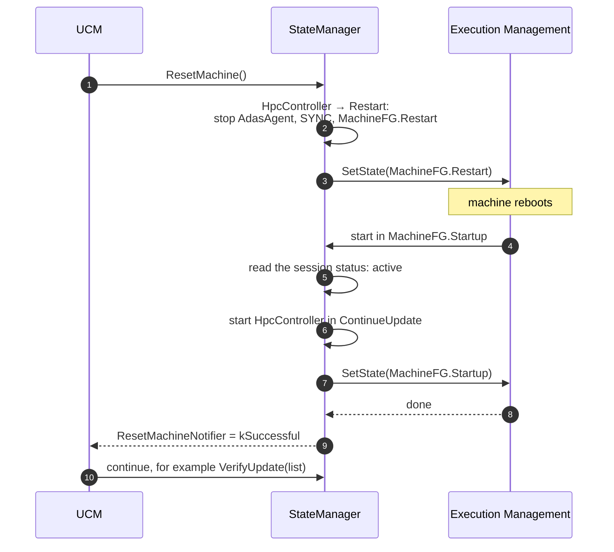

### 9.6 Ending the Session: AfterUpdate

When UCM calls `StopUpdateSession`, the machine is in an undefined state: StateMachines may have been installed, updated or removed, and so may their ActionLists. The Controller therefore retakes full control and moves the machine to a well-defined state:

- The Controller transitions to its state `AfterUpdate` ([SWS_SM_00646], [SWS_SM_CONSTR_00027]).
- `ResetMachineNotifier` is set to `kIdle` ([SWS_SM_00660]).
- All "ImpactedByUpdate" markings are removed ([SWS_SM_00656]), and the Controller no longer answers `kUpdateInProgress` ([SWS_SM_00647]). Requests and recovery actions work again.

The session is finished when the call of `StopUpdateSession` ends. Everything SM does afterwards is project-specific (SWS, Section 7.3).

In `HPC`, the list of `HpcController.AfterUpdate` is `MachineFG.Driving`, SYNC, start `AdasAgent` with the parameter `Normal`. The parameter matters: after a successful update, `AdasAgent` still runs in `VerifyUpdate`, and a start without parameter would be skipped ([Section 7.3](#73-starting-and-stopping-agents)). After the session, `SmControl` requests `Drive` to bring the Controller from `AfterUpdate` back to `Driving`.

### 9.7 Worked Example: Updating AdasCluster to 1.1.0

The vehicle is parked, and V-UCM starts the update of `AdasCluster` from 1.0.0 to 1.1.0 ([guide 00, Section 6.11](00_LearningPath.md#611-software-updates)). The following sequence shows SM's part; which processes run in `ADAS.Verify` and how UCM decides about the rollback is the subject of guide 13.

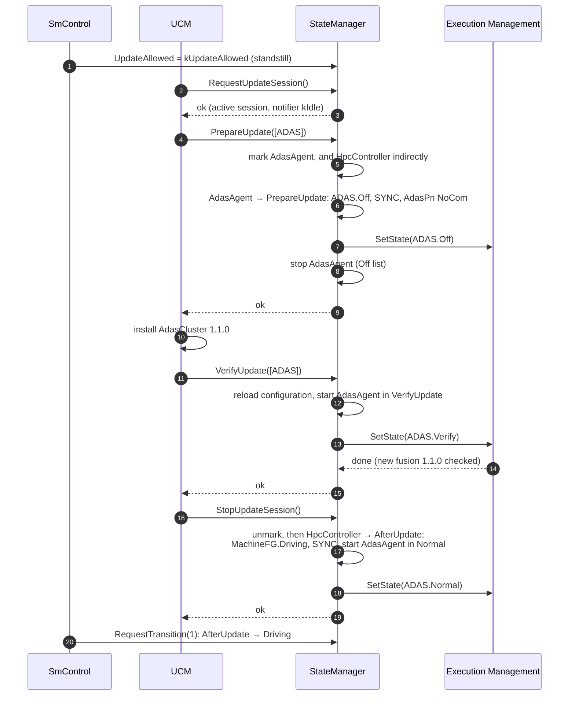

If the verification fails, SM answers `VerifyUpdate` with `kOperationFailed` (step 15). UCM then calls `PrepareRollback([ADAS])`: `AdasAgent` enters `PrepareRollback` (`ADAS.Off`, SYNC, `AdasPn` `NoCom`) and is stopped. UCM restores 1.0.0 and finishes with `StopUpdateSession`, after which `AfterUpdate` starts `AdasAgent` in `Normal` with the old software.

> **Key takeaways**
>
> - `UpdateRequest` is UCM's interface to SM: one session at a time, persisted, no steps outside a session.
> - The SMControlApplication decides through `UpdateAllowed`, evaluated only at `RequestUpdateSession`.
> - Marked StateMachines refuse requests with `kUpdateInProgress`, ignore error reports and network changes; the Controller is marked with its Agents.
> - `PrepareUpdate` and `PrepareRollback` transition and then stop the affected Agents; `VerifyUpdate` starts them in `VerifyUpdate`.
> - `Restart`, `ContinueUpdate` and `ResetMachineNotifier` let an update survive a reset; `AfterUpdate` retakes control at the end.

---

## 10. Power Management and Suspend-to-RAM

> **Why this matters:** A high-performance computer takes many seconds to boot, but a driver expects the rear camera to work the moment the door opens. Suspend-to-RAM (S2R), new in R25-11, lets a machine sleep with its memory powered and resume quickly. It only works if every application is prepared, and SM is the cluster that coordinates the preparation. All S2R items of the SWS have the status DRAFT.

### 10.1 Why Suspend-to-RAM

Besides the normal cold boot, a machine can save its state to RAM, power down the CPU and the peripheral devices, and resume from there (SWS, Section 7.8.4). This shortens the startup and saves power while the vehicle is parked. SM supports a coordinated entry into S2R of the operating system, if the operating system supports it, and the wake-up afterwards (SWS, Section 7.5):

1. Before the operating system suspends, SM shuts down the Function Groups whose processes cannot survive S2R, or switches them to a state without these processes.
2. SM notifies the processes that need to prepare.
3. SM asks the operating system to suspend.
4. After the wake-up, SM restores normal operation: it starts the processes again or asks the prepared ones to leave their Suspend Mode.

### 10.2 Tolerant, Aware and Not Supported Applications

Each executable declares how it copes with S2R in the attribute `Executable.suspendToRamAwareness` (status *candidate*). The three values decide what SM must do (SWS, Section 7.8.4):

| Value | Meaning | What SM does before the suspend | Example |
| --- | --- | --- | --- |
| `suspendToRamTolerant` | The process survives S2R without any action | Nothing | A process that uses only resources that support S2R, such as a monotonic clock |
| `suspendToRamAware` | The process needs to prepare: stop offering services, persist data, stop safety functions | Notifies it through the S2R Hub; it enters its Suspend Mode | A process with an S2R Satellite |
| `suspendToRamNotSupported` | The process cannot survive S2R, for example because of a hardware requirement | Terminates it through a Function Group State transition, and restarts it after the wake-up | A driver that must reinitialize its hardware |

The SWS does not specify what applies when the attribute is absent.

### 10.3 S2R Hub and S2R Satellites

An S2R-aware application creates an **S2R Satellite**, a class derived from `ara::sm::s2r::S2RSatellite` that implements the callbacks `EnterSuspendMode` and `LeaveSuspendMode` ([Section 13.4](#134-s2rsatellite)). The satellite registers with the **S2R Hub** inside SM:

| Step | Rule | Spec |
| --- | --- | --- |
| Register | `Offer()` registers the satellite; it stays registered until `StopOffer()` | [SWS_SM_00710] |
| Callbacks | On a suspend trigger the satellite invokes `EnterSuspendMode`; on a resume trigger `LeaveSuspendMode` | [SWS_SM_00711] |
| Deregister | `StopOffer()` deregisters and blocks until a running callback has completed. Call it before the satellite is destroyed, or in the destructor of the derived class | [SWS_SM_00713] |
| Enter | `S2RHub::RequestToEnterSuspendMode` calls `EnterSuspendMode` of all registered satellites | [SWS_SM_00701] |
| Collect | It returns when all satellites have answered, deregistered or timed out: positive if all answered positively or deregistered; `kAtLeastOneRejected` if one answered `kRejected`; `kCommunicationTimeout` if one did not answer in time; `kCommunicationFailed` on an internal communication error | [SWS_SM_00702] |
| Suspend | `S2RHub::EnterSuspendToRamOs` forwards to `PowerStateInterface::SetPowerState(kPmSuspendToRam)` | [SWS_SM_00705] |
| Leave | `S2RHub::RequestToLeaveSuspendMode` calls `LeaveSuspendMode` of all satellites; results as for entering, with `kAtLeastOneHadIssuesToLeave` | [SWS_SM_00703], [SWS_SM_00707] |

A satellite that deregisters counts as a positive answer, because its process is assumed to terminate.

**Access control.** The hub and the satellites are protected by IAM. The `S2RHub` constructor checks that the calling process is the one mapped by a `SuspendToRamHubMapping`; the `S2RSatellite` constructor checks the `SuspendToRamSatelliteMapping`. On a mismatch, the Violation `InsufficientPermissionsViolation` and the security event `SEV_ACCESS_CONTROL_SM_IAM_ACCESS_DENIED` are raised ([SWS_SM_00706], [SWS_SM_00712]). Only the processes that a `SuspendToRamHubMapping` names may use the hub ([SWS_SM_00714]), and the hub accepts only authenticated satellites ([SWS_SM_00715]). Projects without IAM requirements can create a satellite with the named constructor `Create()`, which fails with `kAuthenticationRequired` if a "Force IAM switch" is set ([SWS_SM_00716]); the SWS does not define how that switch is configured.

The following diagram shows the entry into S2R when an SMControlApplication uses the hub API directly, without StateMachines (SWS, Figure 7.3).

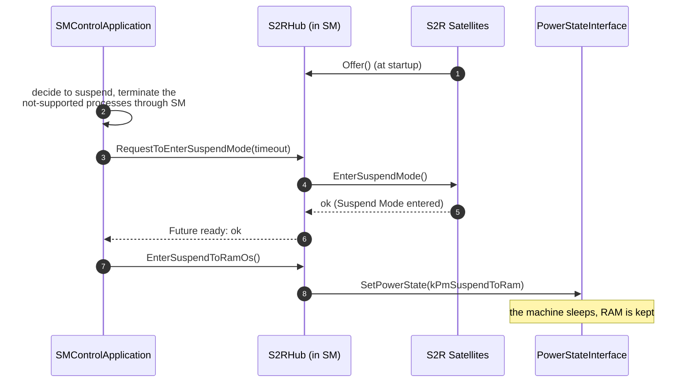

### 10.4 Talking to the Operating System: PowerStateInterface

How a machine suspends depends on the operating system. SM therefore uses a **platform extension interface**, `apext::sm::PowerStateInterface`, which the platform vendor or integrator implements for the operating system ([SWS_SM_71000]). When an `S2RHub` exists, SM also creates a `PowerStateInterface` ([SWS_SM_00717]).

| Function | Purpose | Spec |
| --- | --- | --- |
| `SetPowerState(PowerState state)` | Forward a power state request to the operating system | [SWS_SM_71001] |
| `RegisterWakeUpHandler(WakeUpHandler handler)` | Register a function that the OS wrapper calls to inform SM about a wake-up | [SWS_SM_71003] |
| `UnregisterWakeUpHandler()` | Remove the handler | [SWS_SM_71005] |

The enumeration `PowerState` has the values `kPmSuspendToIdle` (1), `kPmSuspendToRam` (2), `kPmHibernation` (3) and `kPmOff` (4). The SWS derives them from the power states of the Linux kernel ([SWS_SM_71002]).

> **Note (implementation example):** On Linux, the kernel documents the system sleep states *suspend-to-idle*, *standby*, *suspend-to-RAM* and *hibernation*. Writing `mem` to `/sys/power/state` enters the variant selected in `/sys/power/mem_sleep`, where `deep` means suspend-to-RAM and `s2idle` suspend-to-idle; `disk` means hibernation (EXT-025). A `PowerStateInterface` for Linux could map `kPmSuspendToRam` to `deep` plus `mem`, and call the registered wake-up handler when the kernel resumes. AUTOSAR does not prescribe this.

### 10.5 Suspend-to-RAM in the StateMachine Approach

With StateMachines, the Controller orchestrates S2R, and SM uses the S2R Hub internally:

- **One owner of the hub.** If SM follows the StateMachine approach, Adaptive Applications must not use the `S2RHub` API; S2R is coordinated exclusively by the StateMachine logic. Conversely, the `S2RHub` API may be used only without StateMachines ([SWS_SM_00684]).
- **Items instead of calls.** If S2R items exist in the configuration, SM creates an `S2RHub` ([SWS_SM_00690]). The item EnterSuspendToRam calls `RequestToEnterSuspendMode` with the item's `maxActionItemDuration` as timeout, and its result is the result of the item ([SWS_SM_00689]). EnterSuspendToRamOS calls `EnterSuspendToRamOs` ([SWS_SM_00692]). LeaveSuspendToRam calls `RequestToLeaveSuspendMode` ([SWS_SM_00691]). Each S2R item must have a `maxActionItemDuration` greater than 0 ([constr_10720]).
- **Suspend states of the Controller only.** Only *suspend-related* states of the Controller may contain the suspend items: at least one EnterSuspendToRam and exactly one EnterSuspendToRamOS ([SWS_SM_CONSTR_00034]); the SWS expects only one EnterSuspendToRam per state. These states must not contain LeaveSuspendToRam ([SWS_SM_CONSTR_00035]).
- **Wake-up states.** Controller states that handle the wake-up contain LeaveSuspendToRam. The item is always executed. If the Controller really leaves a suspend, its result reflects the outcome; if there was no suspend before, it completes without error ([SWS_SM_00680]). A wake-up state can therefore also be entered for other reasons, such as error recovery.
- **Errors.** A failure of EnterSuspendToRam or LeaveSuspendToRam is reported with `enterSuspendToRamError` or `leaveSuspendToRamError` in the Controller's ErrorRecoveryTable, default 1 ([SWS_SM_00685] to [SWS_SM_00688]).

**What if `HPC` suspended?** The following variant is *not* part of the running example; it only illustrates the rules. Suppose `HPC` had a project-specific Machine State `Standby` in which only S2R-tolerant platform processes run, and the Controller had two more states (compare SWS, Figure 7.38):

| Controller state (variant) | ActionList |
| --- | --- |
| `Suspend` | stop `AdasAgent`; `MachineFG.Standby`; SYNC; EnterSuspendToRam; SYNC; EnterSuspendToRamOS |
| `LeaveSuspend` | LeaveSuspendToRam; `MachineFG.Driving`; SYNC; start `AdasAgent` |

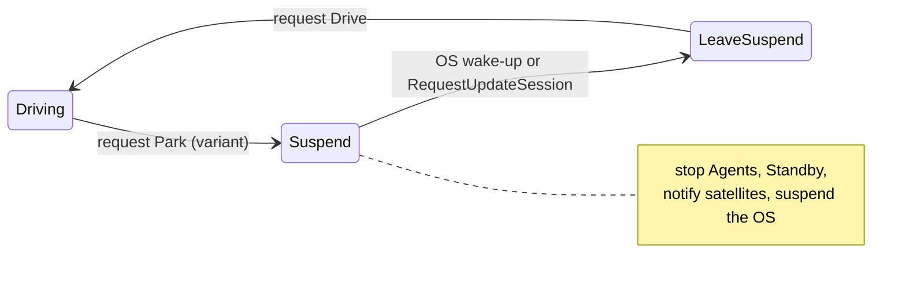

Stopping `AdasAgent` terminates the ADAS processes, which would be the right choice for `suspendToRamNotSupported` executables. S2R-aware processes would keep running in `Standby` and receive `EnterSuspendMode`.

### 10.6 Autonomous Wake-Up

SM can leave the suspend without a request of the SMControlApplication (SWS, Section 7.7.15.1). For this, the Controller must have a state `LeaveSuspend` ([SWS_SM_CONSTR_00036]), and its list must contain LeaveSuspendToRam ([SWS_SM_CONSTR_00037]).

| Trigger | Reaction | Spec |
| --- | --- | --- |
| The operating system reports the wake-up through the `WakeUpHandler` | The Controller transitions to `LeaveSuspend` | [SWS_SM_00683] |
| UCM calls `RequestUpdateSession`, `UpdateAllowed` is `kUpdateAllowed` and the Controller is in a suspend-related state | The Controller transitions to `LeaveSuspend` | [SWS_SM_00681] |
| After such a wake-up for an update | SM continues with `RequestUpdateSession` only if the list of `LeaveSuspend` completed successfully; otherwise it answers `kOperationRejected` | [SWS_SM_00682] |

This guarantees that the machine is fully operational before UCM gets access. Conversely, a request to suspend during an active update session is rejected ([SWS_SM_00214]).

### 10.7 Security and Virtual Machines

**Security.** S2R relies on the security capabilities of the underlying platform. The system integrator must make sure that S2R is configured correctly and that all relevant security mechanisms are implemented and validated. On ECUs that handle sensitive data, S2R may be used only after its security implications have been assessed and mitigated (SWS, Section 5.3).

**Virtual machines.** If a computer runs several virtual machines, the SWS recommends coordinating their suspend externally: an external system signals the suspend event, for example to SM through `ara::com`, and each virtual machine reacts according to its own configuration. AUTOSAR SM provides no standardized external management interface for this. Network Management can be used instead to coordinate the suspend or shutdown of a virtual machine; for the wake-up, the virtual machine must be configured to resume or start on network activity (SWS, Section 7.5.4).

### 10.8 What HPC Does

`HPC` does not use Suspend-to-RAM: when the vehicle is switched off, `HPC` shuts down ([Section 7.5](#75-startup-shutdown-and-restart-of-the-machine)). Its Controller therefore has no suspend-related state.

R25-11 nevertheless requires a state `LeaveSuspend` with the item LeaveSuspendToRam in every Controller ([SWS_SM_CONSTR_00036], [SWS_SM_CONSTR_00037]). `HpcController` has it, with the list LeaveSuspendToRam, `MachineFG.Driving`, SYNC, start `AdasAgent`. The state is never entered in `HPC`: the operating system never wakes up from a suspend, and UCM can never find the Controller in a suspend-related state. If it were entered, the LeaveSuspendToRam item would complete without error ([SWS_SM_00680]).

Because the configuration contains an S2R item, SM creates an `S2RHub` ([SWS_SM_00690]) and a `PowerStateInterface` ([SWS_SM_00717]). The hub needs a port and an IAM mapping, so `HPC` also configures a `SuspendToRamModuleInstantiation` and a `SuspendToRamHubMapping` for `StateManager` ([Section 12.10](#1210-suspend-to-ram-configuration)). The executables of `HPC` do not set `suspendToRamAwareness`.

> **Note:** These requirements on machines without S2R are a consequence of DRAFT constraints. They may be relaxed in a later release; check the release you work with.

> **Key takeaways**
>
> - S2R keeps the system state in RAM for a fast wake-up; SM coordinates applications and the operating system.
> - Executables are S2R-tolerant, S2R-aware (S2R Satellite) or not supported (terminated by a state transition).
> - The S2R Hub notifies the satellites and calls the platform extension `PowerStateInterface`, which the platform vendor implements.
> - With StateMachines, S2R is configured with three action items in Controller states; the hub API is then off-limits for applications.
> - Every Controller needs a `LeaveSuspend` state, which also serves the autonomous wake-up by the OS or by UCM.

---

## 11. Other Interactions

> **Why this matters:** Network Management, Diagnostics and Persistency are smaller partners of SM, but each of them can block the machine: a network that is never released, an ECU reset that never happens, an update that is forgotten after a reset. This chapter collects what the R25-11 specification says about them, and what it leaves open.

### 11.1 Network Management and Network Handles

Adaptive Applications should not need to know which networks they use; on a different ECU, the networks may be configured differently. Network Management (NM) therefore provides **network handles**: each handle (`NmNetworkHandle`) represents a set of partial networks or VLANs that are controlled together (SWS, Sections 2 and 7.4). SM controls the handles through NM's C++ API and can react to their changes.

- With StateMachines, SM switches handles with SetNetworkHandle items ([Section 6.3](#63-network-handle-items-and-afterrun)) and can use handle changes as triggers ([Section 5.3](#53-triggers-from-network-management)).
- The *Manifest Specification* also has a mapping between network handles and Function Group States on the NM side, `NmHandleToFunctionGroupStateMapping` (TPS, Section 12.7.3). The R25-11 SM specification does not use it; the older SM requirements on network handles were removed in R24-11 ([Appendix D](#appendix-d-notable-changes-in-recent-releases)). Guide 09 explains NM's side.

In `HPC`, `AdasAgent` requests `AdasPnHandle` as `FullCom` in `Normal`, `Degraded` and `VerifyUpdate`, and releases it to `NoCom` 2 s after `ADAS` has reached `Off`.

> **Pitfall:** A request to a network handle may not take effect, and SM does not necessarily notice (SWS, Section 7.7.13). Use the ActionListTimeout to detect lists that never finish.

### 11.2 Diagnostics: ECU Reset and Communication Control

**What the specification says.** The SWS of R25-11 lists the interaction with Diagnostic Management as a known limitation that is "to be clarified" in an upcoming release (SWS, Section 4.1). The earlier requirements on a diagnostic reset through SM were removed in R24-11 ([Appendix D](#appendix-d-notable-changes-in-recent-releases)). The *Manifest Specification* still defines a port interface `StateManagementDiagTriggerInterface` for diagnostic triggers to SM, but the SWS SM does not use it.

**What Diagnostic Management does.** The *Specification of Diagnostics* of R25-11 does not mention SM. For the UDS service ECUReset (`0x11`), Diagnostic Management calls `ara::diag::EcuResetRequest::RequestReset` of an application that implements this class ([SWS_DM_00235], [SWS_DM_01009]). It sends the positive response before or after the reset, depending on its configuration ([SWS_DM_00268], [SWS_DM_00360]), and calls `ExecuteReset` of the same class to perform the reset ([SWS_DM_01023], [SWS_DM_01090]). The sub-functions for rapid power shutdown call `EnableRapidShutdown` ([SWS_DM_01020], [SWS_DM_01021]). Similarly, the UDS service CommunicationControl (`0x28`) is delivered to an application through `ara::diag::CommunicationControl` ([SWS_DM_00140], [SWS_DM_00804]). Who implements these classes is a project decision.

**What `HPC` does.** `SmControl` implements `ara::diag::EcuResetRequest`. When the tester requests an ECU reset, `SmControl` requests `Reset` (3) from `HpcController`, whose `Restart` state stops `AdasAgent` and requests `MachineFG.Restart`. Guide 12a shows the Diagnostic Management side, including the response timing. The diagnostic request that switches `ADAS` to `Degraded` ([guide 00, Section 6.4](00_LearningPath.md#64-function-groups-and-states)) also ends in `SmControl`, which sends `Degrade` (10) to `AdasAgent`; guide 12a defines its trigger. `HPC` does not use CommunicationControl through SM.

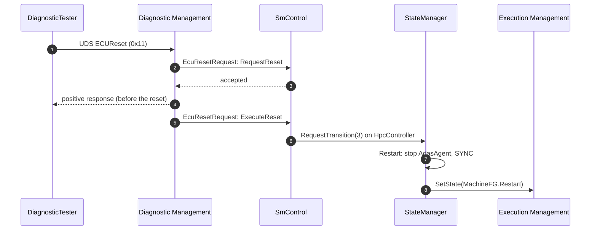

> **Note:** Because the path is project-specific, check how your SMControlApplication behaves during an update session: the Controller then answers `kUpdateInProgress` ([Section 9.3](#93-impactedbyupdate)), and the ECU reset would have to be refused or delayed.

### 11.3 Persistency, Logging and Supervision of State Management

**Persistency.** SM stores its internal state with `ara::per`, in particular the information about an active update session ([SWS_SM_00204]). At startup it restores this state before it starts any process that could interfere with UCM (SWS, Section 7.8.1).

**Logging.** SM uses Log and Trace for its messages, but defines no standardized (modelled) log messages ([Chapter 14](#14-logging-security-events-and-violations)). An error that a StateMachine ignores during an update session is logged if logging is activated ([SWS_SM_00664]).

**Supervision of SM.** SM is the central entity of the machine; if its daemon crashes, the machine becomes unusable. SM should therefore be supervised by PHM with checkpoints, and PHM may trigger the watchdog reaction when SM misbehaves (SWS, Sections 7.2 and 7.8.5). In `HPC`, `StateManager` reports the checkpoint `MainLoop` of the Supervised Entity `StateManagerHeartbeat`, and a hang ends in a watchdog reset ([guide 06, Section 13.6](06_PlatformHealthManagement.md#136-worked-example-statemanager-hangs)).

> **Key takeaways**
>
> - SM switches network handles and reacts to them; the NM-side mapping to Function Group States is not used by SM in R25-11.
> - The interaction with Diagnostic Management is not specified in R25-11; an ECU reset reaches an application through `ara::diag::EcuResetRequest`.
> - In `HPC`, `SmControl` turns the ECU reset into the transition `Reset` of `HpcController`.
> - SM persists the update session, logs without modelled messages and is supervised by PHM.

---

## 12. Configuration Reference: What to Configure

> **Why this matters:** With the StateMachine approach, most problems with SM are configuration problems: a state without its ActionList, a Function Group that is forgotten in one state, a table row with the wrong current state, an error code that ends in `ANY`. This chapter lists everything that you must or can configure, what each setting means, and what happens at run time.

All meta-classes of this chapter have the status *draft* in R25-11, the Suspend-to-RAM ones *candidate*. The SWS defines no default attribute values (SWS, Section 10.1); "Default" therefore says "not specified" unless the SWS defines a behavior for the missing setting. The tables use the attribute names of the meta-model.

### 12.1 Minimal Configuration

The following checklist is the smallest configuration with which the StateMachine approach works for `HPC`.

1. **SM process in every Machine State** (mandatory). The process `StateManager` with `functionClusterAffiliation = STATE_MANAGEMENT` runs in every `MachineFG` state except `Off` ([SWS_SM_CONSTR_00001]). Execution Manifest; see the [EM guide, Section 13.3](04_ExecutionManagement.md#133-process).
2. **Access to the Function Groups** (mandatory). R-ports `MachineFgPort` and `AdasFgPort` typed by `StateClientInterface`s, and one `FunctionGroupPortMapping` per Function Group ([EM guide, Section 13.10](04_ExecutionManagement.md#1310-state-management-access-stateclientinterface-and-functiongroupportmapping)).
3. **One `ModeDeclarationGroup` per kind of StateMachine** (mandatory), with all StateMachine States and an `initialMode`.
4. **One `StateManagementModuleInstantiation`** in the Machine (mandatory, at most one per Machine), with `maxActionListDuration` ([constr_10489], [constr_10641]); its `ProcessToMachineMapping` connects it to the SM process.
5. **One `StateManagementStateNotification` per StateMachine** (mandatory), each with its `stateMachine` and its `notificationPort`; exactly one has the category `STATE_MANAGEMENT_CONTROLLER` ([SWS_SM_CONSTR_00031], [constr_10391]).
6. **The mandatory StateMachine States**: for the Controller `PrepareUpdate`, `VerifyUpdate`, `PrepareRollback`, `Restart`, `AfterUpdate`, `ContinueUpdate` and `LeaveSuspend`; for each Agent `Off`, `PrepareUpdate`, `VerifyUpdate` and `PrepareRollback`.
7. **One `StateManagementActionList` per StateMachine State** (needed for every state that does anything), following the completeness rules of [Section 6.4](#64-completeness-rules).
8. **One ErrorRecoveryTable per StateMachine** (mandatory): a `StateManagementRequestError` with rules, including `ANY` ([SWS_SM_CONSTR_00014]).
9. **A TransitionRequestTable per StateMachine that the SMControlApplication controls** (optional): a `StateManagementRequestTrigger` with rules.
10. **Service ports** (optional, but needed for `HPC`): `StateMachineService` per StateMachine for `SmControl`, `UpdateAllowedService`, and the one `UpdateRequest` port for UCM.
11. **Network handle mappings** (optional): one `SmInteractsWithNmMapping` per SetNetworkHandle item.
12. **Suspend-to-RAM hub** (needed because the Controller has `LeaveSuspend`): `SuspendToRamModuleInstantiation`, a hub port and a `SuspendToRamHubMapping` ([Section 10.8](#108-what-hpc-does)).
13. **Error codes** (optional): `FunctionGroupErrorMapping`, `maxDurationExceededError` and the other error references; without them the code is 1.

### 12.2 StateManagementModuleInstantiation

**Purpose:** the entry point of SM's target configuration on one machine. **Lives in:** Machine Manifest, `Machine.moduleInstantiation`. **Configured by:** integrator. **Spec:** TPS Section 12.14.1, Table 12.132.

| Attribute | Meaning | Type and allowed values | Multiplicity | Default | Rules | Effect at run time |
| --- | --- | --- | --- | --- | --- | --- |
| `actionItemList` | The ActionLists of all StateMachines | `StateManagementActionList` (aggregation, splitable) | `*` | none | | [Section 6.1](#61-order-parallelism-and-sync) |
| `functionGroupErrorMapping` | One error code per Function Group for failed `SetState` requests | `FunctionGroupErrorMapping` | `*` | none: error code 1 ([SWS_SM_00672]) | | [Section 12.7](#127-error-codes-functiongrouperrormapping-and-related-references) |
| `maxActionListDuration` | Machine-wide ActionListTimeout | `TimeValue` (seconds) | `0..1` | Must exist ([constr_10641]) | | Used by every list without its own value ([SWS_SM_00668]) |
| `notification` | The StateMachines and their notifications | `StateManagementStateNotification` (aggregation, splitable) | `*` | none | Exactly one Controller ([SWS_SM_CONSTR_00031]) | [Section 12.3](#123-statemanagementstatenotification-and-the-statemachine-type) |
| `request` | The inputs: trigger and error requests | `StateManagementStateRequest` (abstract; aggregation, splitable) | `*` | none | | [Section 12.4](#124-requests-and-rules) |

A Machine aggregates at most one `StateManagementModuleInstantiation` ([constr_10489]). The `ProcessToMachineMapping` of the SM process references it in the role `nonOsModuleInstantiation` (TPS, Figure 12.69).

### 12.3 StateManagementStateNotification and the StateMachine Type

**Purpose:** owns one StateMachine and names the port over which its state is published. **Lives in:** `StateManagementModuleInstantiation.notification`. **Configured by:** integrator. **Spec:** [TPS_MANI_01392], Table 12.136.

| Attribute | Meaning | Type and allowed values | Multiplicity | Default | Rules | Effect at run time |
| --- | --- | --- | --- | --- | --- | --- |
| `stateMachine` | The StateMachine itself | `ModeDeclarationGroupPrototype` (aggregation) | `0..1` | not specified | Its type needs an `initialMode` ([constr_1973]) | SM creates the StateMachine; the Controller is started with SM ([SWS_SM_00648]) |
| `stateMachine.category` | The role | `STATE_MANAGEMENT_CONTROLLER` or `STATE_MANAGEMENT_AGENT` | `0..1` | not specified | Standardized values ([TPS_MANI_01437]); exactly one Controller ([SWS_SM_CONSTR_00031]) | [Section 2.5](#25-controller-and-agent) |
| `notificationPort` | The P-port over which `StateMachineNotification` is offered | Instance reference to `PPortPrototype` in the SM executable | `0..1` | Must exist ([constr_10391]) | Typed by a `ServiceInterface` ([constr_10388]) | `CurrentState` ([SWS_SM_00616], [SWS_SM_00617]) |

The **type** of the StateMachine is an ordinary `ModeDeclarationGroup` (recommended package `ModeDeclarationGroups`):

| Element.attribute | Meaning | Type | Multiplicity | Rules |
| --- | --- | --- | --- | --- |
| `ModeDeclarationGroup.modeDeclaration` | The StateMachine States | `ModeDeclaration` | `*` | No state named "inTransition" ([SWS_SM_CONSTR_00026]); the mandatory states of [Section 12.1](#121-minimal-configuration) |
| `ModeDeclarationGroup.initialMode` | The Initial State | Reference to `ModeDeclaration` | `0..1` | Must exist ([constr_1973]) |
| `ModeDeclaration.value` | Optional number of the state | `PositiveInteger` | `0..1` | Allows tables with numbers instead of names (TPS, Section B.6.2) |

Several notifications may use the same `ModeDeclarationGroup`; each then creates its own instance of that kind of StateMachine (TPS, Section 12.14.3).

> **Note:** The TPS requires a `notificationPort` for every notification ([constr_10391]), while the SWS calls `StateMachineNotification` optional ("if configured", [SWS_SM_00665]). In practice, model a notification port for every StateMachine.

### 12.4 Requests and Rules

**Purpose:** the inputs of the StateMachines and the tables that evaluate them. **Lives in:** `StateManagementModuleInstantiation.request`. **Configured by:** integrator. **Spec:** TPS Sections 12.14.2 and 12.14.4, [TPS_MANI_01391], [TPS_MANI_01384].

A `StateManagementStateRequest` is abstract; its subclasses are `StateManagementRequestTrigger` (for the TransitionRequestTable) and `StateManagementRequestError` (for the ErrorRecoveryTable).

| Element.attribute | Meaning | Type and allowed values | Mult. | Default | Rules | Effect at run time |
| --- | --- | --- | --- | --- | --- | --- |
| `StateManagementStateRequest.stateRequestPort` | The port from which the input comes | Instance reference to `RPortPrototype` | `0..1` | Must exist, unless an `NmInteractsWithSmMapping` references the request; then it must not exist ([constr_10390], [constr_10511]) | Trigger: typed by a `ServiceInterface` or a `StateManagementTriggerInterface` ([constr_10384]); error: typed by a `StateManagementErrorInterface` ([constr_10385]) | Source of requests or errors |
| `StateManagementRequestTrigger.rule` | The rows of the TransitionRequestTable | `StateManagementRequestRule` | `*` | none | | [SWS_SM_00603] to [SWS_SM_00607] |
| `StateManagementRequestError.rule` | The rows of the ErrorRecoveryTable | `StateManagementRequestRule` | `*` | none | One `ANY` row per table ([SWS_SM_CONSTR_00014]) | [SWS_SM_00601] |
| `StateManagementRequestRule.formula` | The condition of the row | `StateManagementCompareFormula` | `0..1` | Must exist ([constr_10392]) | | |
| `StateManagementRequestRule.nextState` | The state to switch to if the formula is true | Instance reference to `ModeDeclaration`, in the context of the StateMachine | `0..1` | Must exist ([constr_10393]) | The context names the StateMachine | [TPS_MANI_01835], [TPS_MANI_01836] |
| `StateManagementCompareFormula.part` | The conditions | `StateManagementCompareFormulaPart`, ordered | `*` | none | No logical operator exists in R25-11: use one condition | |
| `StateManagementCompareCondition.compareType` | The comparison | `StateManagementCompareEnum`: `isEqual` only | `0..1` | Must exist ([constr_10394]) | | |
| `StateManagementCompareCondition.compareValue` | The TransitionRequest value or the ErrorCode | `ValueSpecification`, for example `NumericalValueSpecification` | `0..1` | Must exist ([constr_10395]) | `ANY` cannot be expressed ([Section 4.3](#43-from-tables-to-model-elements)) | Compared with the input |
| `StateManagementTriggerCompareRule.assumedCurrentState` | The "Current State" column | Instance reference to `ModeDeclaration` | `0..1` | Must exist ([constr_10396]) | | The row matches only in this state |
| `StateManagementErrorCompareRule` | An error row | (no own attributes) | | | | Independent of the current state |

The states used by the rules are internal StateMachine States; Function Group States must not be used for rule evaluation (TPS, Section 12.14.4.1).

> **Note:** Two connections are not specified in R25-11. First, the TPS models the input of a trigger request as an *R-port* of the SM executable, while the SWS defines `StateMachineService` as a *provided* port per StateMachine ([SWS_SM_91021]); how a `RequestTransition` call reaches the trigger request is left to the implementation. Second, the TPS defines error interfaces for EM and for PHM (`StateManagementEmErrorInterface`, `StateManagementPhmErrorInterface`), but a request has only one port, and the SWS requires one table per StateMachine for errors from EM, PHM and SM itself. `HPC` models one error request per StateMachine and assumes that SM feeds all errors of a StateMachine into its table. Check how your tool and your SM implementation do it.

### 12.5 StateManagementActionList

**Purpose:** the actions of one StateMachine State. **Lives in:** `StateManagementModuleInstantiation.actionItemList`. **Configured by:** integrator. **Spec:** [TPS_MANI_01387], Table 12.145.

| Attribute | Meaning | Type and allowed values | Multiplicity | Default | Rules | Effect at run time |
| --- | --- | --- | --- | --- | --- | --- |
| `affectedState` | The state whose entry triggers the list | Instance reference to `ModeDeclaration`, in the context of the StateMachine | `0..1` | Must exist ([constr_10405]) | | The list runs whenever the state is entered ([SWS_SM_00607]) |
| `actionItem` | The actions | `StateManagementActionItem`, **ordered** | `*` | none | Completeness rules ([Section 6.4](#64-completeness-rules)) | Order and parallelism ([SWS_SM_00609] to [SWS_SM_00611]) |
| `maxActionListDuration` | The timeout of this list | `TimeValue` (seconds) | `0..1` | The module's value ([SWS_SM_00668]) | | [SWS_SM_00669] |
| `maxDurationExceededError` | The error code on timeout | Reference to `ApApplicationError` | `0..1` | Error code 1 ([SWS_SM_00674]) | | [SWS_SM_00673] |
| `actionListProcessingFailedError` | The error code that a failed list of an Agent reports to the Controller | Reference to `ApApplicationError` | `0..1` | Not reported | Only relevant for Agents | [SWS_SM_00679] |

### 12.6 Action Items

**Purpose:** the single actions of a list. **Lives in:** `StateManagementActionList.actionItem`. **Configured by:** integrator. **Spec:** TPS Section 12.14.5, Tables 12.146 to 12.156. Each item is `Identifiable` and has a short name.

| Item (meta-class) | Attribute | Meaning | Type and values | Mult. | Default | Rules | Effect at run time |
| --- | --- | --- | --- | --- | --- | --- | --- |
| `StateManagementSetFunctionGroupStateActionItem` | `setFunctionGroupState` | The Function Group State to request | Instance reference to `ModeDeclaration` in a `FunctionGroupSet` | `0..1` | Must exist ([constr_10398]) | One StateMachine per Function Group ([SWS_SM_CONSTR_00013]) | `SetState` ([SWS_SM_00608]) |
| | `rPortPrototype` | The port through which the request is sent | Instance reference to `RPortPrototype` | `0..1` | Must exist ([constr_10397]) | Same `ModeDeclarationGroup` as the Function Group ([constr_10387]) | The `StateClient` of that port |
| `StateManagementStateMachineActionItem` | `startAgent` | The Agent to start | Reference to `ModeDeclarationGroupPrototype` | `0..1` | | At most one of `startAgent` and `stopAgent` ([constr_10386]); never the Controller ([constr_10666]); only in the Controller ([SWS_SM_CONSTR_00019]); same process ([TPS_MANI_01436]) | [SWS_SM_00612], [SWS_SM_00613] |
| | `overrideInitialState` | Start "with parameter": the state to start in | Instance reference to `ModeDeclaration` | `0..1` | The `initialMode` | Not with `stopAgent` ([constr_10633]); [TPS_MANI_01438] | [SWS_SM_00622], [SWS_SM_00623] |
| | `stopAgent` | The Agent to stop | Reference to `ModeDeclarationGroupPrototype` | `0..1` | | As for `startAgent` | [SWS_SM_00614], [SWS_SM_00615], [SWS_SM_00651] |
| | `startAgentError`, `stopAgentError` | Error codes when the creation or destruction of the Agent fails | Reference to `ApApplicationError` | `0..1` each | Error code 1 ([SWS_SM_00676], [SWS_SM_00678]) | | In the Controller's table ([SWS_SM_00675], [SWS_SM_00677]) |
| `StateManagementSyncActionItem` | (none) | Wait for all previous items | | | | | [SWS_SM_00610], [TPS_MANI_01389] |
| `StateManagementSleepActionItem` | `sleepTime` | Delay before the next item | `TimeValue` (seconds) | `0..1` | not specified | Greater than 0 ([constr_10512]) | [SWS_SM_00624] |
| `StateManagementNmActionItem` | `nmStateRequest` | The requested network state | `NmStateRequestEnum`: `noCom`, `fullCom` | `0..1` | not specified | Needs a `SmInteractsWithNmMapping` ([TPS_MANI_01446]); one StateMachine per handle ([SWS_SM_CONSTR_00025]) | [SWS_SM_00625], [SWS_SM_00626] |
| `StateManagementSuspendToRamActionItem` (abstract) | `maxActionItemDuration` | Time after which the item counts as failed | `TimeValue` (seconds) | `0..1` | Must exist and be greater than 0 ([constr_10720]) | | Timeout of the hub call ([SWS_SM_00689]) |
| `StateManagementEnterSuspendToRamActionItem` | `enterSuspendToRamError` | Error code when entering fails | Reference to `ApApplicationError` | `0..1` | Error code 1 ([SWS_SM_00686]) | Only in suspend-related Controller states ([SWS_SM_CONSTR_00034]) | [SWS_SM_00689], [SWS_SM_00685] |
| `StateManagementEnterSuspendToRamOsActionItem` | (none) | Suspend the OS | | | | Exactly one per suspend-related state ([SWS_SM_CONSTR_00034]) | [SWS_SM_00692] |
| `StateManagementLeaveSuspendToRamActionItem` | `leaveSuspendToRamError` | Error code when leaving fails | Reference to `ApApplicationError` | `0..1` | Error code 1 ([SWS_SM_00688]) | Not in suspend-related states ([SWS_SM_CONSTR_00035]); mandatory in `LeaveSuspend` ([SWS_SM_CONSTR_00037]) | [SWS_SM_00691], [SWS_SM_00680] |

> **Note:** [constr_10387] describes the port of a Function Group State item as a `PPortPrototype` typed by a `StateManagementFunctionGroupSwitchNotificationInterface`, while the attribute `rPortPrototype` is an `RPortPrototype`, and the TPS describes Function Group switching through ports typed by a `StateClientInterface` (TPS, Section 12.14.6). `HPC` uses the `StateClientInterface` R-ports `MachineFgPort` and `AdasFgPort`, so that the same port serves EM's access control and the ActionLists.

### 12.7 Error Codes: FunctionGroupErrorMapping and Related References

**Purpose:** give errors distinct numbers for the ErrorRecoveryTables. **Spec:** TPS Section 12.14.7, [TPS_MANI_01478].

`FunctionGroupErrorMapping` (in `StateManagementModuleInstantiation.functionGroupErrorMapping`) assigns one error code to a whole Function Group, independent of the requested state (TPS, Section 12.14.7.1):

| Attribute | Meaning | Type | Multiplicity | Default | Effect at run time |
| --- | --- | --- | --- | --- | --- |
| `functionGroup` | The Function Group | Reference to `ModeDeclarationGroupPrototype` | `0..1` | not specified | |
| `functionGroupTransitionRequestFailedError` | The error code when a `SetState` request for this Function Group fails | Reference to `ApApplicationError` | `0..1` | Error code 1 ([SWS_SM_00672]) | [SWS_SM_00671] |

The complete set of error references in the SM configuration ([TPS_MANI_01478]):

| Error scenario | Configured at | Default |
| --- | --- | --- |
| Starting an Agent failed | `StateManagementStateMachineActionItem.startAgentError` | 1 |
| Stopping an Agent failed | `StateManagementStateMachineActionItem.stopAgentError` | 1 |
| A `SetState` request failed | `FunctionGroupErrorMapping.functionGroupTransitionRequestFailedError` | 1 |
| An ActionList took too long | `StateManagementActionList.maxDurationExceededError` | 1 |
| An ActionList of an Agent failed | `StateManagementActionList.actionListProcessingFailedError` | not reported |
| A process failed | `StartupConfig.processExecutionError` (Execution Manifest) | 1 (set by EM and PHM) |
| Entering Suspend-to-RAM failed | `StateManagementEnterSuspendToRamActionItem.enterSuspendToRamError` | 1 |
| Leaving Suspend-to-RAM failed | `StateManagementLeaveSuspendToRamActionItem.leaveSuspendToRamError` | 1 |

The error code is the `errorCode` of the referenced `ApApplicationError`. The ErrorRecoveryTable compares only this number ([Section 8.1](#81-where-errors-come-from)).

### 12.8 Network Management Mappings

**Purpose:** connect SM and NM in both directions. **Lives in:** packageable elements (recommended package `FCInteractions`). **Configured by:** integrator. **Spec:** TPS Section 15.11.

| Element.attribute | Meaning | Type | Mult. | Rules | Effect at run time |
| --- | --- | --- | --- | --- | --- |
| `SmInteractsWithNmMapping.actionItem` | The SetNetworkHandle item | Reference to `StateManagementNmActionItem` | `0..1` | Must exist ([constr_10513]) | The item switches this handle ([TPS_MANI_01446]) |
| `SmInteractsWithNmMapping.nmNetworkHandle` | The network handle | Reference to `NmNetworkHandle` | `0..1` | Must exist ([constr_10514]) | |
| `NmInteractsWithSmMapping.nmNetworkHandle` | The handle whose changes are reported | Reference to `NmNetworkHandle` | `0..1` | Must exist ([constr_10516]) | Triggers [SWS_SM_00620], [SWS_SM_00621] |
| `NmInteractsWithSmMapping.stateRequest` | The trigger request that receives the change | Reference to `StateManagementStateRequest` | `0..1` | Must exist ([constr_10515]); that request has no `stateRequestPort` ([constr_10511]) | |

Each SetNetworkHandle item needs its own `SmInteractsWithNmMapping`. `AdasAgent` has six items for `AdasPnHandle`, so `HPC` has six mappings. The `NmNetworkHandle` itself belongs to the NM configuration (`NmInstantiation.networkHandle`), which guide 09 explains.

### 12.9 Port Interfaces and Ports

**Purpose:** type the ports of the SM executable and of the SMControlApplication. **Lives in:** application design (recommended package `StateManagementPortInterfaces` for the SM port interfaces). **Configured by:** platform vendor, integrator and application designer. **Spec:** TPS Section 4.5; SWS Sections 9.2 and 10.2.

| Port interface | Kind | Attributes | Used for | Spec |
| --- | --- | --- | --- | --- |
| `StateClientInterface` | `StateManagementNotificationInterface` | `functionGroupType` (must exist) | R-port through which SM switches one Function Group | [TPS_MANI_01473], [constr_10616]; [EM guide, Section 13.10](04_ExecutionManagement.md#1310-state-management-access-stateclientinterface-and-functiongroupportmapping) |
| `StateManagementFunctionGroupSwitchNotificationInterface` | `StateManagementNotificationInterface` | `modeGroup` (must exist) | Notification of a Function Group switch | [constr_10389]; see the Note in [Section 12.6](#126-action-items) |
| `StateManagementEmErrorInterface`, `StateManagementPhmErrorInterface` | `StateManagementErrorInterface` | none | Ports of error requests | TPS Section 4.5.4 |
| `StateManagementDiagTriggerInterface` | `StateManagementTriggerInterface` | none | Diagnostic triggers; not used by the SWS SM | TPS Section 4.5.3 |
| `StateMachineService`, `StateMachineNotification`, `UpdateAllowedService`, `UpdateRequest` | `ServiceInterface`, namespace `ara::sm`, version 1.0 | as defined in the SWS | The services of SM | [SWS_SM_91017], [SWS_SM_91022], [SWS_SM_91025], [SWS_SM_91028] |

The `StateManagementPortInterface`s are not service interfaces, and they never have a configurable namespace ([SWS_SM_CONSTR_00033]). AUTOSAR publishes no model file for the four SM service interfaces; projects model them as the SWS defines them.

The ports of `HPC` (instance specifiers `/state_manager/Root/<port>` and `/sm_control/Root/<port>`):

| Component | Port | Direction, interface | Purpose |
| --- | --- | --- | --- |
| `StateManagerSwc` | `MachineFgPort`, `AdasFgPort` | R, `MachineFgStateClient`, `AdasStateClient` | Switch `MachineFG` and `ADAS` |
| `StateManagerSwc` | `ControllerServicePort`, `AdasServicePort` | P, `StateMachineService` | Requests from `SmControl` |
| `StateManagerSwc` | `ControllerStatePort`, `AdasStatePort` | P, `StateMachineNotification` | `notificationPort` of the two StateMachines |
| `StateManagerSwc` | `UpdateAllowedPort`, `UpdateRequestPort` | P, `UpdateAllowedService`, `UpdateRequest` | For `SmControl` and for UCM |
| `StateManagerSwc` | `ControllerTriggerPort`, `AdasTriggerPort` | R, `StateMachineService` | `stateRequestPort` of the trigger requests (TPS model) |
| `StateManagerSwc` | `ControllerErrorPort`, `AdasErrorPort` | R, `SmEmErrors`, `SmPhmErrors` | `stateRequestPort` of the error requests |
| `StateManagerSwc` | `S2rHubPort` | P, `S2rHub` (`SuspendToRamHubInterface`) | The S2R Hub ([Section 12.10](#1210-suspend-to-ram-configuration)) |
| `StateManagerSwc` | `PhmRecoveryPort`, `HeartbeatPort` | P and R | Recovery and supervision ([guide 06, Section 14.3](06_PlatformHealthManagement.md#143-phmsupervisionrecoverynotificationinterface)) |
| `SmControlSwc` | `ControllerRequestRPort`, `AdasRequestRPort` | R, `StateMachineService` | `RequestTransition` |
| `SmControlSwc` | `AdasStateRPort` | R, `StateMachineNotification` | `CurrentState` of `AdasAgent` |
| `SmControlSwc` | `UpdateAllowedRPort` | R, `UpdateAllowedService` | Set `UpdateAllowed` |
| `SmControlSwc` | `PowerModeRPort`, `VehicleDynamicsRPort`, `AdasStatusPPort` | R, R, P | `PowerModeService`, `VehicleDynamicsService`, `AdasStatusService` |
| `SmControlSwc` | `EcuResetPort` | typed by `DiagnosticEcuResetInterface` | `ara::diag::EcuResetRequest` (guide 12a) |

> **Pitfall:** A machine may have at most one port typed by `UpdateRequest` ([SWS_SM_CONSTR_00020]), and only the process of the Controller may provide it ([SWS_SM_00629]). A second SM process with an `UpdateRequest` port makes the configuration invalid.

### 12.10 Suspend-to-RAM Configuration

**Purpose:** the IAM frame of the S2R Hub and Satellites. **Lives in:** Machine Manifest and mappings (recommended packages `SuspendToRamMappings` and `SuspendToRamInterfaces`). **Configured by:** integrator. **Spec:** TPS Section 12.15. All elements have the status *candidate*.

| Element.attribute | Meaning | Type | Mult. | Rules | Effect at run time |
| --- | --- | --- | --- | --- | --- |
| `SuspendToRamModuleInstantiation` | The S2R module of the machine; exists mainly for IAM | (no attributes) | in `Machine.moduleInstantiation` | | |
| `SuspendToRamHubMapping.moduleInstantiation`, `.process`, `.pPortPrototypeInExecutable` | Which process and port may act as hub | References; instance reference to `PPortPrototype` | `0..1` each | Port typed by `SuspendToRamHubInterface` ([constr_10726]); [TPS_MANI_01512] | IAM check of the `S2RHub` constructor ([SWS_SM_00706], [SWS_SM_00714]) |
| `SuspendToRamSatelliteMapping.moduleInstantiation`, `.process`, `.pPortPrototypeInExecutable` | Which process and port may act as satellite | References; instance reference to `PPortPrototype` | `0..1` each; all must exist ([constr_10723] to [constr_10725]) | Port typed by `SuspendToRamSatelliteInterface` ([constr_10721], [constr_10722]); [TPS_MANI_01510] | IAM checks ([SWS_SM_00712], [SWS_SM_00715]) |
| `Executable.suspendToRamAwareness` | How the executable copes with S2R | `SuspendToRamAwarenessEnum`: `suspendToRamTolerant`, `suspendToRamNotSupported`, `suspendToRamAware` | `0..1` | | [Section 10.2](#102-tolerant-aware-and-not-supported-applications) |

> **Note:** [constr_10721] and [constr_10726] both constrain the role `pPortPrototypeInExecutable` of the common base class, one to the satellite interface and one to the hub interface. Read each for its own subclass: the satellite mapping targets satellite ports, the hub mapping targets hub ports.

### 12.11 Related Settings Outside State Management

| Setting | Where | Why it matters for SM | Details in |
| --- | --- | --- | --- |
| `Process.functionClusterAffiliation = STATE_MANAGEMENT` | Execution Manifest | Marks the SM process; required in every Machine State ([SWS_SM_CONSTR_00001]) | [EM guide, Section 13.3](04_ExecutionManagement.md#133-process) |
| `ProcessToMachineMapping.nonOsModuleInstantiation` | Execution Manifest | Connects the SM process to `StateManagementModuleInstantiation` | TPS Figure 12.69 |
| `StartupConfig.processExecutionError` | Execution Manifest | The error code of a failed process ([SWS_SM_00670]) | [EM guide, Section 13.5](04_ExecutionManagement.md#135-startupconfig) |
| `FunctionGroupPortMapping` | Machine level | Gives the SM process access to a Function Group | [EM guide, Section 13.10](04_ExecutionManagement.md#1310-state-management-access-stateclientinterface-and-functiongroupportmapping) |
| `Verify` state in every Function Group | Function Group definition | Target of `VerifyUpdate` ([constr_10023]) | [EM guide, Section 7.2](04_ExecutionManagement.md#72-function-groups-and-function-group-states) |
| `RecoveryNotificationToPPortPrototypeMapping` | PHM contribution | Delivers PHM's recovery notification to SM's port | [guide 06, Section 14.13](06_PlatformHealthManagement.md#1413-recoverynotification-and-recoverynotificationtopportprototypemapping) |
| `NmNetworkHandle` | NM configuration | The handles that SM switches | guide 09 |

### 12.12 The Running Example: Complete Configuration

The following conceptual view is the complete SM configuration of `HPC`. Element names are those of the model; the notation is simplified.

```yaml
# Conceptual view of the State Management configuration of HPC. NOT real ARXML syntax.

# --- Execution Manifest (guide 04) ---------------------------------------------
Process StateManager:
  functionClusterAffiliation: STATE_MANAGEMENT
  states: MachineFG.[Startup, Driving, Shutdown, Restart, Verify]   # all but Off
ProcessToMachineMapping StateManagerOnHpc:
  process: StateManager
  machine: HPC
  nonOsModuleInstantiation: HpcStateManagement
Process SmControl:                                  # the SMControlApplication
  states: MachineFG.[Startup, Driving, Verify]
FunctionGroupPortMapping StateManagerToMachineFG: { process: StateManager, port: MachineFgPort, functionGroup: MachineFG }
FunctionGroupPortMapping StateManagerToADAS:      { process: StateManager, port: AdasFgPort,    functionGroup: ADAS }

# --- StateMachine types ----------------------------------------------------------
ModeDeclarationGroup HpcControllerStates:           # initialMode: Init
  [Init 0, Driving 1, Shutdown 2, Restart 3, PrepareUpdate 4, VerifyUpdate 5,
   PrepareRollback 6, AfterUpdate 7, ContinueUpdate 8, LeaveSuspend 9]
ModeDeclarationGroup AdasAgentStates:               # initialMode: Normal
  [Off 0, Normal 1, Degraded 2, PrepareUpdate 3, VerifyUpdate 4, PrepareRollback 5]

# --- Machine HPC: target configuration -------------------------------------------
StateManagementModuleInstantiation HpcStateManagement:
  maxActionListDuration: 10 s
  notification:
    HpcControllerNotification:
      stateMachine: HpcController { category: STATE_MANAGEMENT_CONTROLLER, type: HpcControllerStates }
      notificationPort: ControllerStatePort
    AdasAgentNotification:
      stateMachine: AdasAgent { category: STATE_MANAGEMENT_AGENT, type: AdasAgentStates }
      notificationPort: AdasStatePort
  request:
    HpcControllerTriggers:                          # StateManagementRequestTrigger
      stateRequestPort: ControllerTriggerPort
      rules:                                        # value, assumedCurrentState -> nextState
        - [1, Init, Driving]
        - [1, AfterUpdate, Driving]
        - [2, Init, Shutdown]
        - [2, Driving, Shutdown]
        - [2, AfterUpdate, Shutdown]
        - [3, Init, Restart]
        - [3, Driving, Restart]
        - [3, AfterUpdate, Restart]
    AdasAgentTriggers:
      stateRequestPort: AdasTriggerPort
      rules:
        - [10, Normal, Degraded]
    HpcControllerErrors:                            # StateManagementRequestError
      stateRequestPort: ControllerErrorPort         # typed by SmEmErrors
      rules:                                        # errorCode -> nextState
        - [ANY, Restart]
    AdasAgentErrors:
      stateRequestPort: AdasErrorPort               # typed by SmPhmErrors
      rules:
        - [42, Degraded]                            # FusionFailed
        - [1, Degraded]                             # default ExecutionError
        - [ANY, Off]                                # includes 60 and 61
  actionItemList:                                   # SYNC = StateManagementSyncActionItem
    HpcController_Init:            [MachineFG.Startup, SYNC, stop AdasAgent]
    HpcController_Driving:         [MachineFG.Driving, SYNC, start AdasAgent]
    HpcController_Shutdown:        [stop AdasAgent, SYNC, MachineFG.Shutdown]
    HpcController_Restart:         [stop AdasAgent, SYNC, MachineFG.Restart]
    HpcController_PrepareUpdate:   [MachineFG.Driving, stop AdasAgent]
    HpcController_VerifyUpdate:    [stop AdasAgent, SYNC, MachineFG.Verify]
    HpcController_PrepareRollback: [MachineFG.Driving, stop AdasAgent]
    HpcController_AfterUpdate:     [MachineFG.Driving, SYNC, start AdasAgent (overrideInitialState Normal)]
    HpcController_ContinueUpdate:  [MachineFG.Startup, stop AdasAgent]
    HpcController_LeaveSuspend:    [LeaveSuspendToRam (maxActionItemDuration 1 s),
                                    MachineFG.Driving, SYNC, start AdasAgent]
    # every AdasAgent list: maxDurationExceededError = AdasStateTimeout (60)
    AdasAgent_Normal:          [AdasPnHandle fullCom, ADAS.Normal]
    AdasAgent_Degraded:        [AdasPnHandle fullCom, ADAS.Degraded]          # maxActionListDuration 6 s
    AdasAgent_Off:             [ADAS.Off, SYNC, sleep 2 s, AdasPnHandle noCom]
    AdasAgent_PrepareUpdate:   [ADAS.Off, SYNC, AdasPnHandle noCom]
    AdasAgent_VerifyUpdate:    [AdasPnHandle fullCom, ADAS.Verify]
    AdasAgent_PrepareRollback: [ADAS.Off, SYNC, AdasPnHandle noCom]
  functionGroupErrorMapping:
    - { functionGroup: ADAS, functionGroupTransitionRequestFailedError: AdasTransitionRequestFailed }  # 61
SuspendToRamModuleInstantiation HpcS2r: {}

# --- Mappings ----------------------------------------------------------------------
SmInteractsWithNmMapping (6x): AdasAgent_<state>/<NM item> -> AdasPnHandle
SuspendToRamHubMapping StateManagerS2rHub: { moduleInstantiation: HpcS2r, process: StateManager, port: S2rHubPort }
ApApplicationError AdasStateTimeout:            { errorCode: 60, domain: AdasExecutionErrors }
ApApplicationError AdasTransitionRequestFailed: { errorCode: 61, domain: AdasExecutionErrors }
```

The following table explains the values that are not obvious.

| Value | Why |
| --- | --- |
| `Init` as the Controller's Initial State | Keeps StateMachine States apart from Machine States in names; `Init` only confirms `MachineFG.Startup` |
| `MachineFG` item in every Controller list, `AdasAgent` in every Controller list | Required by [SWS_SM_CONSTR_00017] and [SWS_SM_CONSTR_00016]; a stop of a stopped Agent is skipped |
| SYNC before `MachineFG.Shutdown` and `Restart` | `ADAS` must be `Off` before the machine goes down ([Section 6.2](#62-function-group-state-items)) |
| `overrideInitialState` in `AfterUpdate` | Forces `AdasAgent` from `VerifyUpdate` to `Normal` ([Section 9.6](#96-ending-the-session-afterupdate)) |
| `MachineFG.Driving` in `PrepareUpdate` and `PrepareRollback` of the Controller | The platform keeps running; only the Agents are stopped |
| `MachineFG.Startup` in `ContinueUpdate` | The UCM daemon runs in `Startup`; ADAS stays off until the session ends |
| No `Degraded` → `Normal` row | Policy of [Section 8.8](#88-worked-example-a-stuck-cameradriver) |
| 42 and 1 → `Degraded`, `ANY` → `Off` | Known process failures fall back; structural problems switch ADAS off ([Section 8.2](#82-the-errorrecoverytable-and-the-any-entry)) |
| `ANY` → `Restart` for the Controller | A failure of the platform restarts the machine |
| 10 s module timeout, 6 s for `AdasAgent_Degraded` | The recovery target must finish within PHM's 6 s ([Section 6.5](#65-actionlisttimeout)) |
| Sleep 2 s in `AdasAgent_Off` | Afterrun for the last messages on `AdasPn` |
| `LeaveSuspend` with LeaveSuspendToRam, hub mapping | Required by DRAFT constraints even without S2R ([Section 10.8](#108-what-hpc-does)) |

**ARXML excerpts.** The following excerpts show the real syntax for the unambiguous parts of the configuration. They come from one file that validates against the R25-11 XML schema (`AUTOSAR_00054.xsd`), and whose references were checked together with the ARXML of [guide 02](02_Manifests.md#1216-the-running-example-complete-configuration) and [guide 06](06_PlatformHealthManagement.md#1415-the-running-example-complete-configuration). The elements are split parts: the `Machine` `HPC` and the component `StateManagerSwc` merge with their definitions in those guides. References to the service ports `ControllerStatePort`, `AdasStatePort` and `AdasTriggerPort` and to the network handle point to elements that the excerpts leave out. The `ANY` rows cannot be written in ARXML ([Section 4.3](#43-from-tables-to-model-elements)).

<details>
<summary><code>AdasAgentStates</code>: the type of the StateMachine AdasAgent (30 lines)</summary>

```xml
<MODE-DECLARATION-GROUP>
  <SHORT-NAME>AdasAgentStates</SHORT-NAME>
  <INITIAL-MODE-REF DEST="MODE-DECLARATION">/HPC/ModeDeclarationGroups/AdasAgentStates/Normal</INITIAL-MODE-REF>
  <MODE-DECLARATIONS>
    <MODE-DECLARATION>
      <SHORT-NAME>Off</SHORT-NAME>
      <VALUE>0</VALUE>
    </MODE-DECLARATION>
    <MODE-DECLARATION>
      <SHORT-NAME>Normal</SHORT-NAME>
      <VALUE>1</VALUE>
    </MODE-DECLARATION>
    <MODE-DECLARATION>
      <SHORT-NAME>Degraded</SHORT-NAME>
      <VALUE>2</VALUE>
    </MODE-DECLARATION>
    <MODE-DECLARATION>
      <SHORT-NAME>PrepareUpdate</SHORT-NAME>
      <VALUE>3</VALUE>
    </MODE-DECLARATION>
    <MODE-DECLARATION>
      <SHORT-NAME>VerifyUpdate</SHORT-NAME>
      <VALUE>4</VALUE>
    </MODE-DECLARATION>
    <MODE-DECLARATION>
      <SHORT-NAME>PrepareRollback</SHORT-NAME>
      <VALUE>5</VALUE>
    </MODE-DECLARATION>
  </MODE-DECLARATIONS>
</MODE-DECLARATION-GROUP>
```

</details>

<details>
<summary><code>AdasAgentNotification</code>: the StateMachine AdasAgent and its notification port (12 lines)</summary>

```xml
<STATE-MANAGEMENT-STATE-NOTIFICATION>
  <SHORT-NAME>AdasAgentNotification</SHORT-NAME>
  <NOTIFICATION-PORT-IREF>
    <CONTEXT-ROOT-SW-COMPONENT-PROTOTYPE-REF DEST="ROOT-SW-COMPONENT-PROTOTYPE">/HPC/Executables/state_manager/Root</CONTEXT-ROOT-SW-COMPONENT-PROTOTYPE-REF>
    <TARGET-P-PORT-PROTOTYPE-REF DEST="P-PORT-PROTOTYPE">/HPC/AdaptiveApplicationSwComponentTypes/StateManagerSwc/AdasStatePort</TARGET-P-PORT-PROTOTYPE-REF>
  </NOTIFICATION-PORT-IREF>
  <STATE-MACHINE>
    <SHORT-NAME>AdasAgent</SHORT-NAME>
    <CATEGORY>STATE_MANAGEMENT_AGENT</CATEGORY>
    <TYPE-TREF DEST="MODE-DECLARATION-GROUP">/HPC/ModeDeclarationGroups/AdasAgentStates</TYPE-TREF>
  </STATE-MACHINE>
</STATE-MANAGEMENT-STATE-NOTIFICATION>
```

</details>

<details>
<summary><code>AdasAgentTriggers</code>: one row of the TransitionRequestTable of AdasAgent: Degrade (10), Normal to Degraded (32 lines)</summary>

```xml
<STATE-MANAGEMENT-REQUEST-TRIGGER>
  <SHORT-NAME>AdasAgentTriggers</SHORT-NAME>
  <STATE-REQUEST-PORT-IREF>
    <CONTEXT-ROOT-SW-COMPONENT-PROTOTYPE-REF DEST="ROOT-SW-COMPONENT-PROTOTYPE">/HPC/Executables/state_manager/Root</CONTEXT-ROOT-SW-COMPONENT-PROTOTYPE-REF>
    <TARGET-R-PORT-PROTOTYPE-REF DEST="R-PORT-PROTOTYPE">/HPC/AdaptiveApplicationSwComponentTypes/StateManagerSwc/AdasTriggerPort</TARGET-R-PORT-PROTOTYPE-REF>
  </STATE-REQUEST-PORT-IREF>
  <RULES>
    <STATE-MANAGEMENT-REQUEST-RULE>
      <FORMULA>
        <PARTS>
          <STATE-MANAGEMENT-TRIGGER-COMPARE-RULE>
            <COMPARE-TYPE>IS-EQUAL</COMPARE-TYPE>
            <COMPARE-VALUE>
              <NUMERICAL-VALUE-SPECIFICATION>
                <SHORT-LABEL>Degrade</SHORT-LABEL>
                <VALUE>10</VALUE>
              </NUMERICAL-VALUE-SPECIFICATION>
            </COMPARE-VALUE>
            <ASSUMED-CURRENT-STATE-IREF>
              <CONTEXT-MODE-DECLARATION-GROUP-PROTOTYPE-REF DEST="MODE-DECLARATION-GROUP-PROTOTYPE">/HPC/Machines/HPC/HpcStateManagement/AdasAgentNotification/AdasAgent</CONTEXT-MODE-DECLARATION-GROUP-PROTOTYPE-REF>
              <TARGET-MODE-DECLARATION-REF DEST="MODE-DECLARATION">/HPC/ModeDeclarationGroups/AdasAgentStates/Normal</TARGET-MODE-DECLARATION-REF>
            </ASSUMED-CURRENT-STATE-IREF>
          </STATE-MANAGEMENT-TRIGGER-COMPARE-RULE>
        </PARTS>
      </FORMULA>
      <NEXT-STATE-IREF>
        <CONTEXT-MODE-DECLARATION-GROUP-PROTOTYPE-REF DEST="MODE-DECLARATION-GROUP-PROTOTYPE">/HPC/Machines/HPC/HpcStateManagement/AdasAgentNotification/AdasAgent</CONTEXT-MODE-DECLARATION-GROUP-PROTOTYPE-REF>
        <TARGET-MODE-DECLARATION-REF DEST="MODE-DECLARATION">/HPC/ModeDeclarationGroups/AdasAgentStates/Degraded</TARGET-MODE-DECLARATION-REF>
      </NEXT-STATE-IREF>
    </STATE-MANAGEMENT-REQUEST-RULE>
  </RULES>
</STATE-MANAGEMENT-REQUEST-TRIGGER>
```

</details>

<details>
<summary><code>AdasAgentErrors</code>: the numeric rows of the ErrorRecoveryTable of AdasAgent (47 lines)</summary>

```xml
<STATE-MANAGEMENT-REQUEST-ERROR>
  <SHORT-NAME>AdasAgentErrors</SHORT-NAME>
  <STATE-REQUEST-PORT-IREF>
    <CONTEXT-ROOT-SW-COMPONENT-PROTOTYPE-REF DEST="ROOT-SW-COMPONENT-PROTOTYPE">/HPC/Executables/state_manager/Root</CONTEXT-ROOT-SW-COMPONENT-PROTOTYPE-REF>
    <TARGET-R-PORT-PROTOTYPE-REF DEST="R-PORT-PROTOTYPE">/HPC/AdaptiveApplicationSwComponentTypes/StateManagerSwc/AdasErrorPort</TARGET-R-PORT-PROTOTYPE-REF>
  </STATE-REQUEST-PORT-IREF>
  <RULES>
    <STATE-MANAGEMENT-REQUEST-RULE>
      <FORMULA>
        <PARTS>
          <STATE-MANAGEMENT-ERROR-COMPARE-RULE>
            <COMPARE-TYPE>IS-EQUAL</COMPARE-TYPE>
            <COMPARE-VALUE>
              <NUMERICAL-VALUE-SPECIFICATION>
                <SHORT-LABEL>FusionFailed</SHORT-LABEL>
                <VALUE>42</VALUE>
              </NUMERICAL-VALUE-SPECIFICATION>
            </COMPARE-VALUE>
          </STATE-MANAGEMENT-ERROR-COMPARE-RULE>
        </PARTS>
      </FORMULA>
      <NEXT-STATE-IREF>
        <CONTEXT-MODE-DECLARATION-GROUP-PROTOTYPE-REF DEST="MODE-DECLARATION-GROUP-PROTOTYPE">/HPC/Machines/HPC/HpcStateManagement/AdasAgentNotification/AdasAgent</CONTEXT-MODE-DECLARATION-GROUP-PROTOTYPE-REF>
        <TARGET-MODE-DECLARATION-REF DEST="MODE-DECLARATION">/HPC/ModeDeclarationGroups/AdasAgentStates/Degraded</TARGET-MODE-DECLARATION-REF>
      </NEXT-STATE-IREF>
    </STATE-MANAGEMENT-REQUEST-RULE>
    <STATE-MANAGEMENT-REQUEST-RULE>
      <FORMULA>
        <PARTS>
          <STATE-MANAGEMENT-ERROR-COMPARE-RULE>
            <COMPARE-TYPE>IS-EQUAL</COMPARE-TYPE>
            <COMPARE-VALUE>
              <NUMERICAL-VALUE-SPECIFICATION>
                <SHORT-LABEL>DefaultExecutionError</SHORT-LABEL>
                <VALUE>1</VALUE>
              </NUMERICAL-VALUE-SPECIFICATION>
            </COMPARE-VALUE>
          </STATE-MANAGEMENT-ERROR-COMPARE-RULE>
        </PARTS>
      </FORMULA>
      <NEXT-STATE-IREF>
        <CONTEXT-MODE-DECLARATION-GROUP-PROTOTYPE-REF DEST="MODE-DECLARATION-GROUP-PROTOTYPE">/HPC/Machines/HPC/HpcStateManagement/AdasAgentNotification/AdasAgent</CONTEXT-MODE-DECLARATION-GROUP-PROTOTYPE-REF>
        <TARGET-MODE-DECLARATION-REF DEST="MODE-DECLARATION">/HPC/ModeDeclarationGroups/AdasAgentStates/Degraded</TARGET-MODE-DECLARATION-REF>
      </NEXT-STATE-IREF>
    </STATE-MANAGEMENT-REQUEST-RULE>
  </RULES>
</STATE-MANAGEMENT-REQUEST-ERROR>
```

</details>

<details>
<summary><code>AdasAgent_Off</code>: the ActionList of AdasAgent.Off with afterrun (32 lines)</summary>

```xml
<STATE-MANAGEMENT-ACTION-LIST>
  <SHORT-NAME>AdasAgent_Off</SHORT-NAME>
  <ACTION-ITEMS>
    <STATE-MANAGEMENT-SET-FUNCTION-GROUP-STATE-ACTION-ITEM>
      <SHORT-NAME>AdasOff</SHORT-NAME>
      <R-PORT-PROTOTYPE-IREF>
        <CONTEXT-ROOT-SW-COMPONENT-PROTOTYPE-REF DEST="ROOT-SW-COMPONENT-PROTOTYPE">/HPC/Executables/state_manager/Root</CONTEXT-ROOT-SW-COMPONENT-PROTOTYPE-REF>
        <TARGET-R-PORT-PROTOTYPE-REF DEST="R-PORT-PROTOTYPE">/HPC/AdaptiveApplicationSwComponentTypes/StateManagerSwc/AdasFgPort</TARGET-R-PORT-PROTOTYPE-REF>
      </R-PORT-PROTOTYPE-IREF>
      <SET-FUNCTION-GROUP-STATE-IREF>
        <CONTEXT-MODE-DECLARATION-GROUP-PROTOTYPE-REF DEST="MODE-DECLARATION-GROUP-PROTOTYPE">/HPC/FunctionGroupSets/AdasFunctionGroups/ADAS</CONTEXT-MODE-DECLARATION-GROUP-PROTOTYPE-REF>
        <TARGET-MODE-DECLARATION-REF DEST="MODE-DECLARATION">/HPC/ModeDeclarationGroups/ADAS_States/Off</TARGET-MODE-DECLARATION-REF>
      </SET-FUNCTION-GROUP-STATE-IREF>
    </STATE-MANAGEMENT-SET-FUNCTION-GROUP-STATE-ACTION-ITEM>
    <STATE-MANAGEMENT-SYNC-ACTION-ITEM>
      <SHORT-NAME>Sync1</SHORT-NAME>
    </STATE-MANAGEMENT-SYNC-ACTION-ITEM>
    <STATE-MANAGEMENT-SLEEP-ACTION-ITEM>
      <SHORT-NAME>Afterrun</SHORT-NAME>
      <SLEEP-TIME>2.0</SLEEP-TIME>
    </STATE-MANAGEMENT-SLEEP-ACTION-ITEM>
    <STATE-MANAGEMENT-NM-ACTION-ITEM>
      <SHORT-NAME>ReleaseAdasPn</SHORT-NAME>
      <NM-STATE-REQUEST>NO-COM</NM-STATE-REQUEST>
    </STATE-MANAGEMENT-NM-ACTION-ITEM>
  </ACTION-ITEMS>
  <AFFECTED-STATE-IREF>
    <CONTEXT-MODE-DECLARATION-GROUP-PROTOTYPE-REF DEST="MODE-DECLARATION-GROUP-PROTOTYPE">/HPC/Machines/HPC/HpcStateManagement/AdasAgentNotification/AdasAgent</CONTEXT-MODE-DECLARATION-GROUP-PROTOTYPE-REF>
    <TARGET-MODE-DECLARATION-REF DEST="MODE-DECLARATION">/HPC/ModeDeclarationGroups/AdasAgentStates/Off</TARGET-MODE-DECLARATION-REF>
  </AFFECTED-STATE-IREF>
  <MAX-DURATION-EXCEEDED-ERROR-REF DEST="AP-APPLICATION-ERROR">/HPC/ApplicationErrors/AdasStateTimeout</MAX-DURATION-EXCEEDED-ERROR-REF>
</STATE-MANAGEMENT-ACTION-LIST>
```

</details>

<details>
<summary><code>AdasOffReleasesAdasPn</code>: the mapping of the SetNetworkHandle item to AdasPnHandle (5 lines)</summary>

```xml
<SM-INTERACTS-WITH-NM-MAPPING>
  <SHORT-NAME>AdasOffReleasesAdasPn</SHORT-NAME>
  <ACTION-ITEM-REF DEST="STATE-MANAGEMENT-NM-ACTION-ITEM">/HPC/Machines/HPC/HpcStateManagement/AdasAgent_Off/ReleaseAdasPn</ACTION-ITEM-REF>
  <NM-NETWORK-HANDLE-REF DEST="NM-NETWORK-HANDLE">/HPC/Machines/HPC/HpcNm/AdasPnHandle</NM-NETWORK-HANDLE-REF>
</SM-INTERACTS-WITH-NM-MAPPING>
```

</details>

<details>
<summary><code>HpcController_AfterUpdate</code>: the ActionList of HpcController.AfterUpdate: start with a parameter (31 lines)</summary>

```xml
<STATE-MANAGEMENT-ACTION-LIST>
  <SHORT-NAME>HpcController_AfterUpdate</SHORT-NAME>
  <ACTION-ITEMS>
    <STATE-MANAGEMENT-SET-FUNCTION-GROUP-STATE-ACTION-ITEM>
      <SHORT-NAME>MachineFgDriving</SHORT-NAME>
      <R-PORT-PROTOTYPE-IREF>
        <CONTEXT-ROOT-SW-COMPONENT-PROTOTYPE-REF DEST="ROOT-SW-COMPONENT-PROTOTYPE">/HPC/Executables/state_manager/Root</CONTEXT-ROOT-SW-COMPONENT-PROTOTYPE-REF>
        <TARGET-R-PORT-PROTOTYPE-REF DEST="R-PORT-PROTOTYPE">/HPC/AdaptiveApplicationSwComponentTypes/StateManagerSwc/MachineFgPort</TARGET-R-PORT-PROTOTYPE-REF>
      </R-PORT-PROTOTYPE-IREF>
      <SET-FUNCTION-GROUP-STATE-IREF>
        <CONTEXT-MODE-DECLARATION-GROUP-PROTOTYPE-REF DEST="MODE-DECLARATION-GROUP-PROTOTYPE">/HPC/FunctionGroupSets/MachineFunctionGroups/MachineFG</CONTEXT-MODE-DECLARATION-GROUP-PROTOTYPE-REF>
        <TARGET-MODE-DECLARATION-REF DEST="MODE-DECLARATION">/HPC/ModeDeclarationGroups/MachineFG_States/Driving</TARGET-MODE-DECLARATION-REF>
      </SET-FUNCTION-GROUP-STATE-IREF>
    </STATE-MANAGEMENT-SET-FUNCTION-GROUP-STATE-ACTION-ITEM>
    <STATE-MANAGEMENT-SYNC-ACTION-ITEM>
      <SHORT-NAME>Sync1</SHORT-NAME>
    </STATE-MANAGEMENT-SYNC-ACTION-ITEM>
    <STATE-MANAGEMENT-STATE-MACHINE-ACTION-ITEM>
      <SHORT-NAME>StartAdasAgentInNormal</SHORT-NAME>
      <OVERRIDE-INITIAL-STATE-IREF>
        <CONTEXT-MODE-DECLARATION-GROUP-PROTOTYPE-REF DEST="MODE-DECLARATION-GROUP-PROTOTYPE">/HPC/Machines/HPC/HpcStateManagement/AdasAgentNotification/AdasAgent</CONTEXT-MODE-DECLARATION-GROUP-PROTOTYPE-REF>
        <TARGET-MODE-DECLARATION-REF DEST="MODE-DECLARATION">/HPC/ModeDeclarationGroups/AdasAgentStates/Normal</TARGET-MODE-DECLARATION-REF>
      </OVERRIDE-INITIAL-STATE-IREF>
      <START-AGENT-REF DEST="MODE-DECLARATION-GROUP-PROTOTYPE">/HPC/Machines/HPC/HpcStateManagement/AdasAgentNotification/AdasAgent</START-AGENT-REF>
    </STATE-MANAGEMENT-STATE-MACHINE-ACTION-ITEM>
  </ACTION-ITEMS>
  <AFFECTED-STATE-IREF>
    <CONTEXT-MODE-DECLARATION-GROUP-PROTOTYPE-REF DEST="MODE-DECLARATION-GROUP-PROTOTYPE">/HPC/Machines/HPC/HpcStateManagement/HpcControllerNotification/HpcController</CONTEXT-MODE-DECLARATION-GROUP-PROTOTYPE-REF>
    <TARGET-MODE-DECLARATION-REF DEST="MODE-DECLARATION">/HPC/ModeDeclarationGroups/HpcControllerStates/AfterUpdate</TARGET-MODE-DECLARATION-REF>
  </AFFECTED-STATE-IREF>
</STATE-MANAGEMENT-ACTION-LIST>
```

</details>

> **Key takeaways**
>
> - The minimum is: the SM process in every Machine State, State Client ports and mappings, one module instantiation, one notification per StateMachine, ActionLists, and an ErrorRecoveryTable per StateMachine.
> - Rules are table rows: one `isEqual` comparison, an assumed current state for triggers, a next state.
> - ActionLists are ordered; their items cover Function Groups, Agents, SYNC, Sleep, network handles and Suspend-to-RAM.
> - Every error source has its own error reference; without it, the code is 1.
> - The model has gaps (`ANY`, the request and error ports); document how your tool and implementation fill them.

---

## 13. API Reference and Usage Guide (ara::sm)

> **Why this matters:** Applications reach SM mainly through generated `ara::com` proxies of its service interfaces, and S2R-aware applications through two small C++ classes. This chapter lists them exactly as the R25-11 specification defines them. All declarations follow Chapters 8 and 9 and Appendix C of the SWS; most items have the status DRAFT. The code examples are illustrative, so check your vendor's headers for details.

### 13.1 API Overview

| What | Header or service | Contents | Typical user |
| --- | --- | --- | --- |
| Service interfaces | `StateMachineService`, `StateMachineNotification`, `UpdateAllowedService`, `UpdateRequest` (namespace `ara::sm`, version 1.0) | Methods and fields, used through generated proxies | SMControlApplication, UCM, any interested application |
| Data types | `ara::sm` implementation data types | `TransitionRequestType`, `StateMachineStateNameType`, `UpdateAllowedType`, `UpdateStatusType`, `FunctionGroupListType`, `FunctionGroupNameType` | Users of the services |
| Error domain | `ara/sm/sm_error_domain.h` (forward header `ara/sm/sm_fwd.h`) | `SmErrc`, `SmErrorDomain`, `SmException`, `GetSmDomain`, `MakeErrorCode` | Users of the S2R classes |
| S2R Satellite | `ara/sm/s2r/S2RSatellite.h` | `ara::sm::s2r::S2RSatellite` | S2R-aware applications |
| S2R Hub | `ara/sm/s2r/S2RHub.h` | `ara::sm::s2r::S2RHub` | SMControlApplications without StateMachines |
| Platform extension | `apext/sm/power_state_interface.h` (forward header `apext/sm/sm_fwd.h`) | `apext::sm::PowerStateInterface`, `PowerState`, `WakeUpHandler` | Platform vendor |

SM itself uses `ara::exec::StateClient` ([EM guide, Section 14.5](04_ExecutionManagement.md#145-stateclient)) and implements `ara::phm::RecoveryAction` ([guide 06, Section 15.4](06_PlatformHealthManagement.md#154-recoveryaction)); these are documented in their guides.

### 13.2 The Service Interfaces and Their Data Types

The service interfaces are defined in the model (SWS, Chapter 9). Applications use the proxies that the `ara::com` generator creates from them; guide 07 (`07_CommunicationManagement.md`, planned) explains proxies.

**`StateMachineService`** ([SWS_SM_91022]), one per StateMachine ([SWS_SM_00600]):

| Element | Signature (model) | Errors | Spec |
| --- | --- | --- | --- |
| Method `RequestTransition` | IN `TransitionRequest`: `TransitionRequestType`; no output; not fire-and-forget | `kInvalidValue`, `kTransitionNotAllowed`, `kRecoveryTransitionOngoing`, `kTransitionFailed`, `kOperationCanceled`, `kUpdateInProgress` | [SWS_SM_91107] |

**`StateMachineNotification`** ([SWS_SM_91028]), optional per StateMachine:

| Element | Type | Getter, notifier, setter | Spec |
| --- | --- | --- | --- |
| Field `CurrentState` | `StateMachineStateNameType` | yes, yes, no | [SWS_SM_91109] |

**`UpdateAllowedService`** ([SWS_SM_91025]):

| Element | Type | Getter, notifier, setter | Spec |
| --- | --- | --- | --- |
| Field `UpdateAllowed` | `UpdateAllowedType` | yes, yes, yes | [SWS_SM_91108] |

**`UpdateRequest`** ([SWS_SM_91017]): the methods `RequestUpdateSession`, `PrepareUpdate`, `VerifyUpdate`, `PrepareRollback`, `StopUpdateSession`, `ResetMachine` and the field `ResetMachineNotifier`, as listed in [Section 9.1](#91-the-updaterequest-interface).

**Data types** (namespace `ara::sm`):

| Type | Kind | Values | Spec |
| --- | --- | --- | --- |
| `TransitionRequestType` | `uint32_t` | The values of the TransitionRequestTable | [SWS_SM_91023] |
| `StateMachineStateNameType` | String | A StateMachine State name, or "inTransition" | [SWS_SM_91020] |
| `UpdateAllowedType` | `uint32_t` | `kUpdateAllowed`, `kUpdateNotAllowed` (numeric values not given) | [SWS_SM_91026] |
| `UpdateStatusType` | `uint32_t` | `kIdle` (no request), `kRejected` (requested outside a session), `kSuccessful`, `kFailed` (numeric values not given) | [SWS_SM_91027] |
| `FunctionGroupListType` | Vector of `FunctionGroupNameType` | | [SWS_SM_91018] |
| `FunctionGroupNameType` | String | Fully qualified short name of a Function Group | [SWS_SM_91019] |

### 13.3 Errors: Application Errors and SmErrorDomain

SM has **two sets of error codes**, which must not be confused.

**Application errors of the service interfaces** ([SWS_SM_91010]). They are returned by the methods of `StateMachineService` and `UpdateRequest`:

| Error | Code | Meaning |
| --- | --- | --- |
| `kOperationRejected` | 5 | Rejected because of the internal state of SM or the machine |
| `kOperationFailed` | 6 | The operation failed |
| `kNotAllowedMultipleUpdateSessions` | 9 | Only one active update session is allowed |
| `kInvalidValue` | 10 | The value is not mapped to any transition |
| `kTransitionNotAllowed` | 11 | The transition is not possible from the current state |
| `kRecoveryTransitionOngoing` | 12 | A recovery is ongoing |
| `kTransitionFailed` | 13 | An error occurred during the transition |
| `kOperationCanceled` | 14 | The request was replaced by a newer one |
| `kUpdateInProgress` | 15 | Not allowed while an update session is in progress |

**The C++ error domain** `ara::sm::SmErrorDomain` ([SWS_SM_81241]), used by the S2R classes:

```cpp
// ara/sm/sm_error_domain.h, namespace ara::sm (excerpt)
enum class SmErrc : ara::core::ErrorDomain::CodeType {                    // [SWS_SM_81240]
    kOfferFailed = 2,                  // Offer: communication with the SM daemon failed
    kCommunicationFailed = 3,          // communication to the satellites failed
    kCommunicationTimeout = 4,         // a satellite did not answer in time
    kAtLeastOneRejected = 5,           // a satellite could not enter Suspend Mode
    kAtLeastOneHadIssuesToLeave = 6,   // a satellite could not leave Suspend Mode
    kRejected = 7,                     // a satellite's own answer: cannot enter or leave
    kAuthenticationRequired = 8        // S2RSatellite::Create: IAM authentication required
};
constexpr const ara::core::ErrorDomain & GetSmDomain () noexcept;          // [SWS_SM_81251]
constexpr ara::core::ErrorCode MakeErrorCode (SmErrc code,
    ara::core::ErrorDomain::SupportDataType data) noexcept;               // [SWS_SM_81244]
class SmErrorDomain final : public ara::core::ErrorDomain {...};          // [SWS_SM_81241]
class SmException : public ara::core::Exception {...};                    // [SWS_SM_81242]
```

| Member of `SmErrorDomain` | Signature | Spec |
| --- | --- | --- |
| Constructor | `SmErrorDomain () noexcept;` | [SWS_SM_81247] |
| `Name` | `const char * Name () const noexcept override;` returns `"Sm"` | [SWS_SM_81248] |
| `Message` | `const char * Message (CodeType errorCode) const noexcept override;` | [SWS_SM_81249] |
| `ThrowAsException` | `void ThrowAsException (const ara::core::ErrorCode &errorCode) const override;` | [SWS_SM_81250] |
| `Errc`, `Exception` | `using Errc = SmErrc;` `using Exception = SmException;` | [SWS_SM_81245], [SWS_SM_81246] |
| `SmException` constructor | `explicit SmException (ara::core::ErrorCode errorCode) noexcept;` | [SWS_SM_81243] |

The identifier of `SmErrorDomain` is `0x8000'0000'0000'0301`, defined in the SWS Core ([SWS_CORE_90023]).

> **Pitfall:** The codes 5 and 6 mean `kOperationRejected` and `kOperationFailed` for the services, but `kAtLeastOneRejected` and `kAtLeastOneHadIssuesToLeave` in `SmErrc`. The SWS does not say whether the application errors of the services belong to the same error domain identifier. Never compare only the number: compare `ara::core::ErrorCode` objects, which compare domain and value ([guide 03, Section 7.1](03_CoreAndGeneral.md#71-errorcode-value-domain-and-support-data)).

### 13.4 S2RSatellite

An S2R-aware application derives from the abstract class `ara::sm::s2r::S2RSatellite` and implements the two callbacks.

```cpp
// ara/sm/s2r/S2RSatellite.h, namespace ara::sm::s2r (excerpt)
class S2RSatellite {                                                          // [SWS_SM_81002]
public:
    explicit S2RSatellite (const ara::core::InstanceSpecifier &instance) noexcept;  // [SWS_SM_81003]
    static ara::core::Result< S2RSatellite > Create () noexcept;              // [SWS_SM_81014]
    S2RSatellite ()=delete;                                                   // [SWS_SM_81004]
    S2RSatellite (S2RSatellite &&ra) noexcept;                                // [SWS_SM_81006]
    S2RSatellite (const S2RSatellite &)=delete;                               // [SWS_SM_81007]
    S2RSatellite & operator= (S2RSatellite &&ra) noexcept;                    // [SWS_SM_81008]
    S2RSatellite & operator= (const S2RSatellite &)=delete;                   // [SWS_SM_81009]
    virtual ~S2RSatellite () noexcept;                                        // [SWS_SM_81005]
    virtual ara::core::Future< void > EnterSuspendMode ()=0;                  // [SWS_SM_81010]
    virtual ara::core::Future< void > LeaveSuspendMode ()=0;                  // [SWS_SM_81011]
    ara::core::Result< void > Offer () noexcept;                              // [SWS_SM_81012]
    void StopOffer () noexcept;                                               // [SWS_SM_81013]
};
```

| Function | Behavior | Errors and violations |
| --- | --- | --- |
| Constructor with `InstanceSpecifier` | Creates the satellite for a P-port typed by a `SuspendToRamSatelliteInterface`; checks the IAM mapping ([SWS_SM_00712]) | The usual InstanceSpecifier violations and `AraNotInitializedViolation`; `InsufficientPermissionsViolation` on an IAM mismatch |
| `Create()` | Named constructor without IAM, for projects without IAM requirements | `kAuthenticationRequired` if the "Force IAM switch" is set ([SWS_SM_00716]) |
| `Offer()` | Registers with the hub; enables the callbacks ([SWS_SM_00710]) | `kOfferFailed` |
| `StopOffer()` | Deregisters; blocks until a running callback has completed ([SWS_SM_00713]) | |
| `EnterSuspendMode()`, `LeaveSuspendMode()` | Implemented by the application; the result completes the `Future` | `kRejected` if the application cannot enter or leave Suspend Mode |

> **Note:** `Create()` returns a `Result<S2RSatellite>` by value, although `S2RSatellite` is abstract. As specified, this cannot compile for the abstract class itself; check how your vendor resolves it. The example below uses the constructor.

The following example shows an S2R-aware recorder in a hypothetical project; `HPC` does not use S2R.

```cpp
#include "ara/core/future.h"
#include "ara/core/instance_specifier.h"
#include "ara/core/promise.h"
#include "ara/sm/s2r/S2RSatellite.h"
#include "ara/sm/sm_error_domain.h"

// Illustrative: an S2R-aware application that flushes its data before the machine sleeps.
class RecorderSatellite final : public ara::sm::s2r::S2RSatellite {
public:
    explicit RecorderSatellite(const ara::core::InstanceSpecifier& port) noexcept
        : ara::sm::s2r::S2RSatellite{port} {}

    ~RecorderSatellite() noexcept override { StopOffer(); }  // deregister before destruction [SWS_SM_00713]

    ara::core::Future<void> EnterSuspendMode() override {
        ara::core::Promise<void> promise;
        if (StopOffersAndFlush()) {           // application-specific preparation
            promise.set_value();
        } else {
            promise.SetError(ara::sm::MakeErrorCode(ara::sm::SmErrc::kRejected,
                                                    ara::core::ErrorDomain::SupportDataType{}));
        }
        return promise.get_future();
    }

    ara::core::Future<void> LeaveSuspendMode() override {
        ara::core::Promise<void> promise;
        ResumeOffers();                       // application-specific
        promise.set_value();
        return promise.get_future();
    }

private:
    bool StopOffersAndFlush();
    void ResumeOffers();
};

// In main(), after ara::core::Initialize(argc, argv):
//   RecorderSatellite satellite{ara::core::InstanceSpecifier{"/recorder/Root/S2rSatellitePort"}};
//   if (!satellite.Offer()) { /* kOfferFailed: SM daemon not reachable */ }
```

### 13.5 S2RHub

`ara::sm::s2r::S2RHub` coordinates the satellites. Applications may use it only if SM does **not** follow the StateMachine approach ([SWS_SM_00684]).

```cpp
// ara/sm/s2r/S2RHub.h, namespace ara::sm::s2r (excerpt)
class S2RHub {                                                                    // [SWS_SM_81102]
public:
    explicit S2RHub (const ara::core::InstanceSpecifier &instance) noexcept;      // [SWS_SM_81103]
    S2RHub (S2RHub &&ra) noexcept;                                                // [SWS_SM_81106]
    S2RHub (const S2RHub &)=delete;                                               // [SWS_SM_81107]
    S2RHub & operator= (S2RHub &&ra) noexcept;                                    // [SWS_SM_81108]
    S2RHub & operator= (const S2RHub &)=delete;                                   // [SWS_SM_81109]
    virtual ~S2RHub () noexcept;                                                  // [SWS_SM_81105]
    ara::core::Future< void > RequestToEnterSuspendMode (int timeout=1000) noexcept;  // [SWS_SM_81110]
    ara::core::Future< void > RequestToLeaveSuspendMode (int timeout=1000) noexcept;  // [SWS_SM_81111]
    void EnterSuspendToRamOs () noexcept;                                         // [SWS_SM_81112]
};
```

| Function | Behavior | Errors |
| --- | --- | --- |
| Constructor | Creates the hub for the hub port; checks the IAM mapping ([SWS_SM_00706]) | InstanceSpecifier violations, `InsufficientPermissionsViolation`, `AraNotInitializedViolation` |
| `RequestToEnterSuspendMode(timeout)` | Calls `EnterSuspendMode` of all registered satellites; `timeout` in milliseconds ([SWS_SM_00701], [SWS_SM_00702]) | `kCommunicationFailed`, `kCommunicationTimeout` (rollback semantics); `kAtLeastOneRejected` (no rollback semantics) |
| `RequestToLeaveSuspendMode(timeout)` | Calls `LeaveSuspendMode` of all satellites ([SWS_SM_00703], [SWS_SM_00707]) | `kCommunicationFailed`, `kCommunicationTimeout`; `kAtLeastOneHadIssuesToLeave` |
| `EnterSuspendToRamOs()` | Forwards to `PowerStateInterface::SetPowerState(kPmSuspendToRam)` ([SWS_SM_00705]) | none |

`kAtLeastOneRejected` has no rollback semantics: some satellites may already be in Suspend Mode. Bring them back with `RequestToLeaveSuspendMode` before you continue normal operation.

### 13.6 apext::sm::PowerStateInterface

This platform extension interface is implemented by the platform vendor or integrator for the operating system ([Section 10.4](#104-talking-to-the-operating-system-powerstateinterface)).

```cpp
// apext/sm/power_state_interface.h, namespace apext::sm (excerpt)
enum class PowerState : std::uint32_t {           // [SWS_SM_71002]
    kPmSuspendToIdle = 1,                          // Linux PM_SUSPEND_TO_IDLE
    kPmSuspendToRam = 2,                           // Linux PM_SUSPEND_TO_RAM
    kPmHibernation = 3,                            // Linux PM_HIBERNATION
    kPmOff = 4                                     // Linux PM_OFF
};
using WakeUpHandler = std::function<void(void)>;  // [SWS_SM_71004]
class PowerStateInterface {                        // [SWS_SM_71000]
public:
    void SetPowerState (apext::sm::PowerState state) noexcept;                  // [SWS_SM_71001]
    void RegisterWakeUpHandler (apext::sm::WakeUpHandler handler) noexcept;     // [SWS_SM_71003]
    void UnregisterWakeUpHandler () noexcept;                                   // [SWS_SM_71005]
};
```

All three functions are documented as not thread-safe.

### 13.7 Example: The Main Loop of SmControl

The following sketch shows how `SmControl` uses the services of SM. It is simplified: the proxy class names follow the `ara::com` naming rules for the namespace `ara::sm`, but generated headers, service discovery and error handling differ between tools; guide 07 explains them. Only the SM logic is complete.

```cpp
// Illustrative sketch of SmControl, the SMControlApplication of HPC.
#include <cstdlib>
#include "ara/core/initialization.h"
#include "ara/core/instance_specifier.h"
#include "ara/exec/execution_client.h"
// Generated proxies (names and file names are tool-specific):
#include "ara/sm/statemachineservice_proxy.h"
#include "ara/sm/updateallowedservice_proxy.h"

namespace {
// Must match the TransitionRequestTables of HpcController and AdasAgent (Section 5.2).
constexpr ara::sm::TransitionRequestType kDrive{1};
constexpr ara::sm::TransitionRequestType kPowerOff{2};
constexpr ara::sm::TransitionRequestType kReset{3};
constexpr ara::sm::TransitionRequestType kDegrade{10};
}  // namespace

class SmControl {
public:
    // PowerMode changed (PowerModeService, field PowerMode).
    void OnPowerMode(bool on) { Request(controller_, on ? kDrive : kPowerOff); }

    // VehicleSpeed changed (VehicleDynamicsService): allow updates only at standstill.
    void OnVehicleSpeed(double speed) {
        updateAllowed_.UpdateAllowed.Set(speed == 0.0 ? ara::sm::kUpdateAllowed
                                                      : ara::sm::kUpdateNotAllowed);  // generated constants
    }

    // CurrentState of AdasAgent changed (StateMachineNotification): publish AdasStatus.
    void OnAdasState(const ara::sm::StateMachineStateNameType& state) {
        if (state == "Normal")        { PublishAdasStatus(AdasStatus::kActive); }
        else if (state == "Degraded") { PublishAdasStatus(AdasStatus::kDegraded); }
        else if (state == "Off")      { PublishAdasStatus(AdasStatus::kOff); }
        else if (!IsInTransition(state)) { PublishAdasStatus(AdasStatus::kUnavailable); }
        // "inTransition": keep the last published value (Section 5.4)
    }

    // ECU reset requested by Diagnostic Management (ara::diag::EcuResetRequest, guide 12a).
    void OnEcuReset() { Request(controller_, kReset); }

private:
    template <typename Proxy>
    void Request(Proxy& stateMachine, ara::sm::TransitionRequestType value) {
        auto result = stateMachine.RequestTransition(value).GetResult();  // ready when the ActionList is done
        if (!result && IsUpdateInProgress(result.Error())) {
            pending_ = value;          // repeat after the update session (Section 9.3)
        }
        // kRecoveryTransitionOngoing, kTransitionNotAllowed, ...: log and decide (Section 5.2)
    }

    // Proxies, created from the handles that FindService returns (omitted):
    ara::sm::proxy::StateMachineServiceProxy controller_;      // HpcController
    ara::sm::proxy::StateMachineServiceProxy adas_;            // AdasAgent
    ara::sm::proxy::UpdateAllowedServiceProxy updateAllowed_;
    ara::sm::TransitionRequestType pending_{0};
};

int main(int argc, char* argv[]) {
    if (!ara::core::Initialize(argc, argv)) { return EXIT_FAILURE; }
    // Create ExecutionClient, find the services through the R-ports of SmControlSwc
    // (/sm_control/Root/ControllerRequestRPort, ...), set UpdateAllowed at once (Section 9.2),
    // report kRunning, then dispatch the events of PowerMode, VehicleSpeed and CurrentState.
    // ...
    return ara::core::Deinitialize() ? EXIT_SUCCESS : EXIT_FAILURE;
}
```

Three details of the sketch are worth noting:

- **`RequestTransition` blocks until the new ActionList is done.** Do not call it from a callback that must return quickly; use a worker thread or `Future::then`.
- **`UpdateAllowed` is set immediately at startup**, because the SWS defines no initial value ([Section 9.2](#92-granting-a-session-updateallowed)).
- **The names compared in `OnAdasState` are configuration names.** A renamed StateMachine State silently breaks this code; generate the constants from the configuration if your tool allows it.

> **Key takeaways**
>
> - The SM services are used through generated proxies; `RequestTransition` answers when the ActionList of the new state is done.
> - The service interfaces have their own application errors (5 to 15); the C++ `SmErrc` (2 to 8) belongs to the S2R classes. Compare error codes with their domain.
> - `S2RSatellite` is the API for S2R-aware applications; `S2RHub` is only for SM implementations without StateMachines.
> - `PowerStateInterface` is a platform extension that the platform vendor implements.

---

## 14. Logging, Security Events and Violations

> **Why this matters:** When SM misbehaves, its standardized reports are the first evidence. R25-11 defines few of them, so knowing what *not* to expect matters as much.

| Report | Content | Spec |
| --- | --- | --- |
| Security event `SEV_ACCESS_CONTROL_SM_IAM_ACCESS_DENIED` | ID 137: access of an application to a resource of SM was denied. Context data version 1, `UserId` (`uint32`) | [SWS_SM_70000], [SWS_SM_70001] |
| Violations | `InsufficientPermissionsViolation`, `InstanceSpecifierMappingIntegrityViolation`, `PortInterfaceMappingViolation`, `ProcessMappingViolation`, `InstanceSpecifierAlreadyInUseViolation`, `AraNotInitializedViolation`, with the standardized DLT messages of the SWS Core | [SWS_CORE_13000], [SWS_CORE_13003] to [SWS_CORE_13007] |
| Log messages | SM defines no modelled (non-verbose) log messages | SWS, Section 7.9.2 |
| Production errors | SM defines no diagnostic events | SWS, Section 7.9.4 |

The violations are raised by the constructors of `S2RHub` and `S2RSatellite`, for example when an instance specifier does not resolve to a port or the calling process does not match the IAM mapping. A violation terminates the offending process ([guide 03, Section 6.3](03_CoreAndGeneral.md#63-violations-fail-early)). Implementations may add non-standardized violations.

Everything else, for example "transition requested", "ErrorCode 42 mapped to `Degraded`" or "recovery ignored during update", appears only in the verbose log of your SM implementation. Agree with your vendor which messages it logs and at which level, and use `CurrentState` notifications as a second, standardized trace.

> **Key takeaways**
>
> - SM reports one security event (ID 137) and the standard violations of its S2R constructors.
> - It has no modelled log messages and no production errors; state changes must be traced through verbose logs or `CurrentState`.

---

## 15. End-to-End Walkthrough: A Drive Cycle of the HPC

> **Why this matters:** This chapter puts the pieces together on one ordinary day of `HPC`: power on, drive, a failure, a refused update and power off. Follow it with the state diagrams of [Section 7.6](#76-worked-example-hpccontroller-and-adasagent) at hand.

### 15.1 Power On

The vehicle is unlocked and `CentralGateway` powers `HPC`. EM enters `MachineFG.Startup` and starts `StateManager`, `SmControl`, `PlatformHealth` and the platform daemons. `StateManager` finds no active update session in its persistent data, reports `kRunning` and starts `HpcController` in `Init`. `SmControl` reports `kRunning`, sets `UpdateAllowed` to `kUpdateAllowed` because the vehicle stands still, and publishes `AdasStatus` `Off` ([Section 5.5](#55-worked-example-smcontrol-brings-hpc-from-startup-to-driving)).

### 15.2 Drive

The driver switches the vehicle on; `PowerMode` becomes `On`. `SmControl` requests `Drive` (1). `HpcController` enters `Driving`: `MachineFG.Driving`, SYNC, start `AdasAgent`. `AdasAgent` starts in `Normal`: `AdasPnHandle` `FullCom` and `ADAS.Normal`. When its `CurrentState` becomes `Normal`, `SmControl` publishes `AdasStatus` `Active`. The vehicle starts moving, and `SmControl` sets `UpdateAllowed` to `kUpdateNotAllowed`.

### 15.3 A Failure

Twenty minutes later `Fusion` misses its compute deadline. PHM reports 42; `AdasAgent` enters `Degraded`, and `FusionLite` replaces `Fusion`. `SmControl` publishes `AdasStatus` `Degraded`, and `InstrumentCluster` shows it to the driver ([Section 8.7](#87-worked-example-fusion-fails-and-adas-goes-to-degraded)). `ADAS` stays in `Degraded` for the rest of the drive ([Section 8.8](#88-worked-example-a-stuck-cameradriver)).

### 15.4 An Update Request While Driving

V-UCM on `TelematicsUnit` has a new `AdasCluster` and asks UCM to install it. UCM calls `RequestUpdateSession`. Because `UpdateAllowed` is `kUpdateNotAllowed`, SM answers `kOperationRejected` ([SWS_SM_00630]). UCM tries again later.

### 15.5 Power Off

The driver parks and switches the vehicle off; `PowerMode` becomes `Off`. `SmControl` requests `PowerOff` (2). `HpcController` enters `Shutdown`: it stops `AdasAgent`, whose `Off` list switches `ADAS` off, waits 2 s and releases `AdasPn`. After the SYNC, it requests `MachineFG.Shutdown`; EM terminates `SmControl` and starts `PowerControl`, which powers the machine off ([Section 7.5](#75-startup-shutdown-and-restart-of-the-machine)). At the next power-on, `ADAS` starts in `Normal` again, with every supervision fresh.

### 15.6 State Timeline

| Step | Event | `HpcController` | `AdasAgent` | `MachineFG` | `ADAS` | `AdasStatus` |
| --- | --- | --- | --- | --- | --- | --- |
| 1 | Power on | `Init` | (not running) | `Startup` | `Off` | `Off` |
| 2 | `Drive` (1) | `Driving` | `Normal` | `Driving` | `Normal` | `Active` |
| 3 | `Fusion` misses its deadline, error 42 | `Driving` | `Degraded` | `Driving` | `Degraded` | `Degraded` |
| 4 | `RequestUpdateSession` while moving | `Driving` | `Degraded` | `Driving` | `Degraded` | `Degraded` |
| 5 | `PowerOff` (2): Agent stopped with afterrun | `Shutdown` | `Off`, then gone | `Driving` | `Off` | `Off` |
| 6 | `MachineFG.Shutdown` requested | `Shutdown` | (not running) | `Shutdown` | `Off` | (`SmControl` terminated) |

> **Key takeaways**
>
> - `SmControl` turns vehicle signals into requests; the StateMachines turn requests and errors into Function Group States and network states.
> - A failure changes only the Agent; the Controller and the machine are not affected.
> - An update is refused by the SMControlApplication's policy, not by the StateMachines.
> - Shutdown stops the Agent first, with afterrun, and then the machine.

---

## 16. Best Practices, Pitfalls and Troubleshooting

> **Why this matters:** Most SM problems come from a few recurring mistakes in the configuration or in the SMControlApplication. This chapter collects them.

### 16.1 Best Practices

1. **Decide the approach early.** Choose between individual implementation and the StateMachine approach before you design the Function Groups; the StateMachine approach constrains the design (one Controller, Agents per Software Cluster).
2. **One Agent per Software Cluster.** This follows [SWS_SM_CONSTR_00018] and makes updates stop exactly the affected functions.
3. **Keep project logic in the SMControlApplication.** The StateMachines should only map requests and errors to states; conditions such as vehicle speed belong in code.
4. **Give every important failure its own number.** Configure `processExecutionError` and the SM error references, so that the ErrorRecoveryTable can distinguish them; keep `ANY` for the unexpected.
5. **Model dependencies between Function Groups with order and SYNC**, and stop all Agents before `MachineFG.Shutdown` or `Restart`.
6. **Size the timeouts together.** ActionListTimeout, EM's start and stop timeouts and PHM's recovery timeout must fit each other.
7. **Generate the request values and state names** that the SMControlApplication uses from the same source as the configuration.
8. **Set `UpdateAllowed` explicitly at startup and on every change of the conditions.**
9. **Supervise SM itself with PHM**, and make sure it runs in every Machine State.
10. **Document how your tool fills the gaps of the model**: `ANY`, the request and error ports, the Controller during updates.

### 16.2 Common Pitfalls

| Pitfall | Consequence | Avoid it by |
| --- | --- | --- |
| SM not configured in a project-specific Machine State | The machine can never leave that state ([SWS_SM_CONSTR_00001]) | Map the SM process to every `MachineFG` state except `Off` |
| A Function Group missing in one ActionList of its StateMachine | Configuration invalid; in that state the group's behavior would be undefined ([SWS_SM_CONSTR_00015]) | Reference every controlled group in every list |
| Two StateMachines reference the same Function Group or network handle | Configuration invalid; unpredictable states ([SWS_SM_CONSTR_00013], [SWS_SM_CONSTR_00025]) | One owner per group and per handle |
| Start StateMachine without parameter on a running Agent | Skipped; the Agent stays in its state ([SWS_SM_00613]) | Use `overrideInitialState` where the Agent may run |
| Expecting a request to be queued during a recovery | Refused with `kRecoveryTransitionOngoing` ([SWS_SM_00605]) | Retry after `CurrentState` shows a stable state |
| Only the default error code 1 | All failures look the same; the table cannot distinguish them | Configure distinct codes |
| Direct `Degraded` → `Normal` after a supervision failure | A failed process may still run unsupervised | Return through a restart, for example via `Off` ([Section 8.8](#88-worked-example-a-stuck-cameradriver)) |
| Recovery state's list slower than PHM's recovery timeout | PHM fires the watchdog although SM is recovering | Measure and size both ([Section 8.5](#85-state-managements-side-of-recoveryhandler)) |
| `PowerOff` during an update session | `kUpdateInProgress`; the vehicle does not shut down | Handle the answer in the SMControlApplication ([Section 9.3](#93-impactedbyupdate)) |
| Comparing `CurrentState` with "inTransition" case-sensitively | The spelling differs between requirements | Compare without case, or check the vendor |
| Comparing error codes by number only | `SmErrc` and the service errors overlap (5, 6) | Compare `ErrorCode` objects |
| Using `S2RHub` in an application while StateMachines are used | Not allowed ([SWS_SM_00684]) | Configure S2R items in the Controller instead |

### 16.3 Troubleshooting Guide

| Symptom | Likely cause | What to check |
| --- | --- | --- |
| The machine stays in `MachineFG.Startup` | SM not started in `Startup`, or the SMControlApplication never requests the next state | Execution Manifest of the SM process; `CurrentState` of the Controller; does the SMControlApplication find `StateMachineService`? |
| `RequestTransition` returns `kInvalidValue` | The value is not in the TransitionRequestTable | Request values in code and configuration |
| `RequestTransition` returns `kTransitionNotAllowed` | No row for the current state | `CurrentState` and the `assumedCurrentState` of the rows |
| `RequestTransition` returns `kUpdateInProgress` | An update session marks the StateMachine, or the Controller through an Agent | UCM's session; did UCM call `StopUpdateSession`? |
| `RequestTransition` returns `kTransitionFailed` | A Function Group State request in the new list failed | EM's logs, `GetExecutionError`, the ErrorRecoveryTable's reaction |
| A Function Group switches to an unexpected state without a request | An error reaction (`ANY` row) or a network trigger | Error codes of processes, timeouts, `NmInteractsWithSmMapping` |
| ADAS never comes back to `Normal` | No transition back by design, or the Agent is not restarted | The TransitionRequestTable; the next drive cycle; [Section 8.8](#88-worked-example-a-stuck-cameradriver) |
| A transition always ends in the `ANY` state | An ActionList timeout (code of `maxDurationExceededError`) | `maxActionListDuration`; slow processes; Sleep items |
| The ECU resets when a supervision fails, although SM is configured | SM answered too late, answered `kSMCanNotHandleRecovery`, or did not offer `RecoveryAction` | PHM's logs; the recovery state's list duration; `Offer()` at startup |
| After a reset during an update, only part of the software runs | Controller started in `ContinueUpdate` ([SWS_SM_00657]) | UCM's session; `ResetMachineNotifier` |
| `RequestUpdateSession` returns `kOperationRejected` | `UpdateAllowed` is `kUpdateNotAllowed`, or `LeaveSuspend` failed after a wake-up | The SMControlApplication's policy; [SWS_SM_00682] |
| The network stays awake after `ADAS` is off | Afterrun still running, or the `NoCom` item has no mapping | `sleepTime`; `SmInteractsWithNmMapping` |
| `S2RSatellite` constructor terminates the process | IAM mapping or instance specifier wrong (violation) | `SuspendToRamSatelliteMapping`; the DLT violation message |

> **Key takeaways**
>
> - Keep logic in the SMControlApplication, structure in the StateMachines, and one owner per Function Group and network handle.
> - Most surprises are error reactions, refused requests or skipped Start items; `CurrentState` and the error codes explain them.
> - Size timeouts and error codes on purpose; defaults hide information.

---

## 17. Summary and Self-Check Quiz

### 17.1 Summary

1. **SM decides, EM executes.** SM requests Function Group States, including the Machine State, through `StateClient`; EM performs the transitions.
2. **Two approaches.** AUTOSAR standardizes SM's interfaces and an optional StateMachine approach; the decision logic stays project-specific.
3. **StateMachines.** Each StateMachine State has an ActionList; a TransitionRequestTable handles requests and network changes, an ErrorRecoveryTable handles errors and must contain `ANY`.
4. **ActionLists.** Items start in order and run in parallel until SYNC; Sleep realizes afterrun; completeness rules give every Function Group and handle one owner.
5. **Controller and Agents.** One Controller controls the machine lifecycle and starts and stops Agents; each Agent controls the Function Groups of one Software Cluster.
6. **Errors.** Process failures arrive as `ExecutionError`, SM's own failures as configured codes, default 1; during a recovery, requests are refused.
7. **Updates.** UCM drives the session through `UpdateRequest`; the SMControlApplication allows it; marked StateMachines are blocked; `Restart`, `ContinueUpdate` and `AfterUpdate` handle resets and the end.
8. **Suspend-to-RAM.** The S2R Hub prepares S2R-aware applications and calls the OS through `PowerStateInterface`; with StateMachines, the Controller does this with action items.
9. **Gaps.** Diagnostics, the `ANY` entry and some ports are not specified in R25-11; document how your project fills them.

### 17.2 Self-Check Quiz

Try to answer each question first, then expand the answer.

<details>
<summary>1. Which cluster decides that ADAS goes to Degraded, and which one terminates Fusion?</summary>

State Management decides and requests `ADAS.Degraded`; Execution Management performs the transition and terminates `Fusion`. See [Section 1.1](#11-what-is-state-management) and [Section 1.2](#12-what-state-management-does-not-do).

</details>

<details>
<summary>2. Name two things that the StateMachine approach standardizes and that an individual implementation leaves to the project.</summary>

The mapping of states to Function Group States (ActionLists) and the reaction to failures (ErrorRecoveryTable); also the detailed behavior during update sessions and the configuration model. See [Section 1.4](#14-two-ways-to-build-state-management).

</details>

<details>
<summary>3. AdasAgent is in Degraded. SmControl calls RequestTransition(10). What is the answer, and why?</summary>

`kTransitionNotAllowed`: the value 10 exists in the table, but only for the current state `Normal`. See [Section 5.2](#52-requesting-a-transition).

</details>

<details>
<summary>4. While PHM's recovery for AdasAgent runs, SmControl sends a request. Is it queued?</summary>

No. It is refused with `kRecoveryTransitionOngoing` until the recovery state's ActionList has finished. See [Section 8.3](#83-the-recovery-reaction).

</details>

<details>
<summary>5. An ActionList is: A, B, SYNC, C. When does C start?</summary>

After both A and B have finished. A and B are started in order and run in parallel. See [Section 6.1](#61-order-parallelism-and-sync).

</details>

<details>
<summary>6. Why does HpcController.AfterUpdate start AdasAgent with a parameter?</summary>

After an update, `AdasAgent` may still run in `VerifyUpdate`. A start without parameter would be skipped ([SWS_SM_00613]); with the parameter `Normal` the Agent is transitioned ([SWS_SM_00623]). See [Section 9.6](#96-ending-the-session-afterupdate).

</details>

<details>
<summary>7. May AdasAgent's Off list contain a Function Group item that requests ADAS.Degraded?</summary>

No. The `Off` list of an Agent may contain only Function Group `Off`, network `NoCom`, SYNC and Sleep ([SWS_SM_CONSTR_00011]). See [Section 7.4](#74-the-agents-off-state).

</details>

<details>
<summary>8. CameraDriver hangs, its supervision expires. Which error code does SM receive, and what happens to CameraDriver?</summary>

The code 1, because `CameraDriver` has no `processExecutionError`. `AdasAgent` enters `Degraded`, but `CameraDriver` keeps running with the same startup configuration and stays unsupervised until `ADAS` is stopped. See [Section 8.8](#88-worked-example-a-stuck-cameradriver).

</details>

<details>
<summary>9. Why must every ErrorRecoveryTable contain ANY?</summary>

So that every reported code, including unexpected ones, leads to a defined state ([SWS_SM_CONSTR_00014]). See [Section 8.2](#82-the-errorrecoverytable-and-the-any-entry).

</details>

<details>
<summary>10. A second failure is reported for AdasAgent while its first recovery is running. What does PHM receive?</summary>

This is a nested recovery. SM processes the new error and gives the same result to all `RecoveryHandler` calls of that StateMachine when the last recovery action has finished ([SWS_SM_00031], [SWS_SM_00666]). See [Section 8.4](#84-nested-recovery).

</details>

<details>
<summary>11. UCM calls RequestUpdateSession while the vehicle is moving. What happens in HPC?</summary>

`SmControl` has set `UpdateAllowed` to `kUpdateNotAllowed`, so SM returns `kOperationRejected` ([SWS_SM_00630]). See [Section 9.2](#92-granting-a-session-updateallowed) and [Section 15.4](#154-an-update-request-while-driving).

</details>

<details>
<summary>12. During an update of AdasCluster, the driver switches the vehicle off. Why does HPC not shut down immediately?</summary>

The Controller is marked "ImpactedByUpdate" together with `AdasAgent` ([SWS_SM_00655]), so `PowerOff` returns `kUpdateInProgress` ([SWS_SM_00649]). `SmControl` must repeat the request after the session. See [Section 9.3](#93-impactedbyupdate).

</details>

<details>
<summary>13. HPC resets during an update session. Which Controller state does SM enter at the next start?</summary>

`ContinueUpdate` instead of `Init` ([SWS_SM_00657]); afterwards it sets `ResetMachineNotifier` to `kSuccessful` or `kFailed`. See [Section 9.5](#95-machine-reset-during-a-session).

</details>

<details>
<summary>14. HPC does not use Suspend-to-RAM. Why does HpcController still have a state LeaveSuspend?</summary>

The DRAFT constraints [SWS_SM_CONSTR_00036] and [SWS_SM_CONSTR_00037] require it in every Controller. LeaveSuspendToRam completes without error when there was no suspend ([SWS_SM_00680]). See [Section 10.8](#108-what-hpc-does).

</details>

<details>
<summary>15. An application with suspendToRamNotSupported runs in ADAS. What must SM do before the OS suspends?</summary>

Terminate it through a Function Group State transition, for example by switching `ADAS` off, and restart it after the wake-up. See [Section 10.2](#102-tolerant-aware-and-not-supported-applications).

</details>

<details>
<summary>16. How does a UDS ECUReset reach SM in HPC?</summary>

Diagnostic Management calls `ara::diag::EcuResetRequest` of `SmControl`, which requests `Reset` (3) from `HpcController`; its `Restart` state requests `MachineFG.Restart`. R25-11 does not specify a direct interface between Diagnostic Management and SM. See [Section 11.2](#112-diagnostics-ecu-reset-and-communication-control).

</details>

---

## Appendix A. Glossary and Acronyms

| Term | Meaning |
| --- | --- |
| ActionList | The ordered list of ActionListItems that a StateMachine executes when it enters a StateMachine State (`StateManagementActionList`). |
| ActionListItem | One action of an ActionList: Function Group State, Start or Stop StateMachine, SYNC, Sleep, SetNetworkHandle, or one of three Suspend-to-RAM items. |
| ActionListTimeout | The maximum duration of an ActionList (`maxActionListDuration`); exceeding it is an error. |
| Active update session | The period from an accepted `RequestUpdateSession` to the end of `StopUpdateSession`. |
| Afterrun | Keeping something alive for a while after a function has stopped, realized with a Sleep item. |
| Agent | A StateMachine that the Controller starts and stops; it controls the Function Groups of one Software Cluster. |
| `ANY` | The mandatory ErrorRecoveryTable entry for all error codes without their own row. |
| Controller | The one StateMachine that starts with SM, controls `MachineFG` and starts and stops the Agents. |
| CurrentState | The field of `StateMachineNotification` with the current StateMachine State, or "inTransition". |
| ErrorCode | The number that the ErrorRecoveryTable evaluates: an `ExecutionError` or a configured error of the SM configuration. |
| ErrorRecoveryOngoing | The internal flag of a StateMachine during an error recovery. |
| ErrorRecoveryTable | The rules of a StateMachine that map an ErrorCode to the next StateMachine State. |
| ImpactedByUpdate | The marking of a StateMachine affected by an update step; it blocks requests and recovery. |
| Initial State | The StateMachine State entered when a StateMachine starts without parameter (`initialMode`). |
| Machine State | A Function Group State of `MachineFG`. |
| Nested recovery | A new error for a StateMachine while its previous recovery is ongoing. |
| Network handle | A set of partial networks or VLANs that Network Management controls together (`NmNetworkHandle`). |
| `PowerStateInterface` | The platform extension through which SM asks the OS to suspend and learns about wake-ups. |
| S2R | Suspend-to-RAM: a low-power mode in which RAM keeps the system state. |
| S2R Hub | The part of SM that coordinates the S2R Satellites and the OS. |
| S2R Satellite | An object in an S2R-aware application that is notified before suspend and after wake-up. |
| S2R-aware, S2R-tolerant, S2R-unsupported | How an executable copes with S2R (`suspendToRamAwareness`). |
| SM | State Management. |
| SMControlApplication | The project-specific application that requests StateMachine transitions and decides about updates. |
| StateMachine | A configured state machine inside SM (a `ModeDeclarationGroupPrototype` in a `StateManagementStateNotification`). |
| StateMachine State | A state of a StateMachine (a `ModeDeclaration`); not a Function Group State. |
| Suspend Mode | The prepared state of an S2R-aware application before S2R. |
| SYNC | The ActionListItem that waits until all previous items have finished. |
| TransitionRequest | The value that an SMControlApplication sends with `RequestTransition`. |
| TransitionRequestTable | The rules of a StateMachine that map a TransitionRequest value and the current state to the next state. |
| UCM | Update and Configuration Management. |
| `UpdateAllowed` | The field through which the SMControlApplication allows or denies update sessions. |

## Appendix B. Quick Reference Cheat Sheet

**Mandatory StateMachine States**

| StateMachine | States |
| --- | --- |
| Controller | Initial, `PrepareUpdate`, `VerifyUpdate`, `PrepareRollback`, `Restart` (with `MachineFG.Restart`), `AfterUpdate`, `ContinueUpdate`, `LeaveSuspend` (with LeaveSuspendToRam) |
| Agent | Initial, `Off`, `PrepareUpdate`, `VerifyUpdate`, `PrepareRollback` |

**`RequestTransition` results**

| Result | Cause |
| --- | --- |
| success | The new ActionList was processed |
| `kInvalidValue` (10) | Value not in the table |
| `kTransitionNotAllowed` (11) | No row for the current state |
| `kRecoveryTransitionOngoing` (12) | Recovery in progress |
| `kTransitionFailed` (13) | An item of the new list failed |
| `kOperationCanceled` (14) | Replaced by a newer request |
| `kUpdateInProgress` (15) | StateMachine marked "ImpactedByUpdate" |

**Error codes and their defaults**

| Source | Configured at | Default |
| --- | --- | --- |
| Failed process | `processExecutionError` | 1 |
| Failed `SetState` request | `functionGroupTransitionRequestFailedError` | 1 |
| ActionList timeout | `maxDurationExceededError` | 1 |
| Start or stop of an Agent | `startAgentError`, `stopAgentError` | 1 |
| Agent list failed | `actionListProcessingFailedError` | not reported |
| Enter or leave S2R | `enterSuspendToRamError`, `leaveSuspendToRamError` | 1 |

**Other defaults defined by the SWS**

| Item | Default |
| --- | --- |
| `maxActionListDuration` of a list | The module's value ([SWS_SM_00668]) |
| `ResetMachineNotifier` | `kIdle` ([SWS_SM_00212]) |
| Timeout of `RequestToEnterSuspendMode`, `RequestToLeaveSuspendMode` | 1000 ms (C++ default argument) |
| All other attributes | not specified (SWS, Section 10.1) |

**ActionListItems in an Agent's `Off` list:** Function Group `Off`, `NoCom`, SYNC, Sleep.

**`HPC` at a glance:** `HpcController` (`Init`, `Driving`, `Shutdown`, `Restart`, update states, `LeaveSuspend`); `AdasAgent` (`Off`, `Normal`, `Degraded`, update states); requests `Drive` 1, `PowerOff` 2, `Reset` 3, `Degrade` 10; errors 42 and 1 → `Degraded`, `ANY` → `Off` or `Restart`.

## Appendix C. Spec Traceability

Use this table to find the normative text in the specification (R25-11) for each topic of this guide.

| Topic | Guide | Specification section | Key requirement IDs |
| --- | --- | --- | --- |
| Responsibilities, two approaches | 1.1, 1.4 | SWS 7.1, 7.1.3, 7.7.1 | |
| SM in every Machine State | 3.1, 7.5 | SWS 7.8.1, 10.2 | [SWS_SM_CONSTR_00001] |
| Services provided | 3.2, 13.2 | SWS 5.1, 9.2 | [SWS_SM_00600], [SWS_SM_00665], [SWS_SM_91016] to [SWS_SM_91028], [SWS_SM_91100] to [SWS_SM_91109] |
| Requesting transitions | 5.2 | SWS 7.7.5 | [SWS_SM_00603] to [SWS_SM_00607], [SWS_SM_00650] |
| Network triggers | 5.3 | SWS 7.7.5 | [SWS_SM_00620], [SWS_SM_00621], [SWS_SM_00627], [SWS_SM_00628] |
| CurrentState | 5.4 | SWS 7.7.11 | [SWS_SM_00616], [SWS_SM_00617], [SWS_SM_00618], [SWS_SM_00619], [SWS_SM_CONSTR_00026] |
| ActionList processing | 6.1, 6.2 | SWS 7.7.6, 7.7.7 | [SWS_SM_00608] to [SWS_SM_00611], [SWS_SM_00667] |
| Sleep and network items | 6.3 | SWS 7.7.9, 7.7.10 | [SWS_SM_00624], [SWS_SM_00625], [SWS_SM_00626], [SWS_SM_CONSTR_00025] |
| Completeness | 6.4 | SWS 7.7.4 to 7.7.8 | [SWS_SM_CONSTR_00013], [SWS_SM_CONSTR_00015] to [SWS_SM_CONSTR_00017], [SWS_SM_CONSTR_00032] |
| ActionListTimeout | 6.5 | SWS 7.7.12 | [SWS_SM_00668], [SWS_SM_00669], [SWS_SM_00673], [SWS_SM_00674] |
| Controller and Agents | 7.1 to 7.4 | SWS 7.7.3, 7.7.4, 7.7.8 | [SWS_SM_CONSTR_00031], [SWS_SM_00648], [SWS_SM_00612] to [SWS_SM_00615], [SWS_SM_00622], [SWS_SM_00623], [SWS_SM_00651], [SWS_SM_CONSTR_00011], [SWS_SM_CONSTR_00018], [SWS_SM_CONSTR_00019], [SWS_SM_CONSTR_00024] |
| Error sources and table | 8.1, 8.2 | SWS 7.7.13 | [SWS_SM_CONSTR_00014], [SWS_SM_00670] to [SWS_SM_00679], [SWS_SM_00685] to [SWS_SM_00688] |
| Recovery and nested recovery | 8.3, 8.4 | SWS 7.2, 7.7.13 | [SWS_SM_00601], [SWS_SM_00602], [SWS_SM_00605], [SWS_SM_00031], [SWS_SM_00666] |
| PHM | 8.5 | SWS 7.2 | [SWS_SM_00030], [SWS_SM_00031], [SWS_SM_00670] |
| EM | 8.6, 8.9 | SWS 7.6 | [SWS_SM_00400], [SWS_SM_00401], [SWS_SM_00671] |
| Update session (interface) | 9.1 | SWS 7.3 | [SWS_SM_00202] to [SWS_SM_00214] |
| Update session (StateMachines) | 9.2 to 9.6 | SWS 7.7.14 | [SWS_SM_00629] to [SWS_SM_00664], [SWS_SM_CONSTR_00020] to [SWS_SM_CONSTR_00023], [SWS_SM_CONSTR_00027] to [SWS_SM_CONSTR_00030] |
| Suspend-to-RAM hub and satellites | 10.3 | SWS 7.5.1, 7.5.2 | [SWS_SM_00701] to [SWS_SM_00716] |
| PowerStateInterface | 10.4, 13.6 | SWS 7.5.3, Appendix C | [SWS_SM_00717], [SWS_SM_71000] to [SWS_SM_71005] |
| S2R with StateMachines | 10.5, 10.6 | SWS 7.7.15 | [SWS_SM_00680] to [SWS_SM_00692], [SWS_SM_CONSTR_00034] to [SWS_SM_CONSTR_00037] |
| Diagnostics | 11.2 | SWS 4.1; SWS DM 7.3.2.8.5 | [SWS_DM_00235], [SWS_DM_01009] |
| Configuration | 12 | TPS 4.5, 12.14, 12.15, 15.11, B.6; SWS 10, Appendix A | [TPS_MANI_01384] to [TPS_MANI_01392], [TPS_MANI_01835], [TPS_MANI_01836], [constr_10384] to [constr_10398], [constr_10405], [constr_10489], [constr_10641] |
| C++ API | 13.3 to 13.5 | SWS 8 | [SWS_SM_81240] to [SWS_SM_81251], [SWS_SM_81002] to [SWS_SM_81014], [SWS_SM_81102] to [SWS_SM_81112] |
| Reporting | 14 | SWS 7.9 | [SWS_SM_70000], [SWS_SM_70001] |

## Appendix D. Notable Changes in Recent Releases

This summary is based on the change history appendix of the specification. It lists only the changes that matter most when you port code or material from an older release.

| Release | Change | Specification items |
| --- | --- | --- |
| R25-11 | Suspend-to-RAM: S2R Hub and Satellite (C++ API), `PowerStateInterface`, S2R action items, `LeaveSuspend` and autonomous wake-up | [SWS_SM_00680] to [SWS_SM_00692], [SWS_SM_00701] to [SWS_SM_00717], [SWS_SM_CONSTR_00034] to [SWS_SM_CONSTR_00037] |
| R25-11 | Error codes for StateMachines and their default 1; ActionListTimeout; clarified ActionList processing order | [SWS_SM_00667] to [SWS_SM_00679], [SWS_SM_00685] to [SWS_SM_00688] |
| R25-11 | C++ error domain `ara::sm::SmErrc` / `SmErrorDomain`; security event 137 | [SWS_SM_81240] to [SWS_SM_81251], [SWS_SM_70000] |
| R25-11 | Deleted: the constraint on ActionItems in the initial StateMachine State | [SWS_SM_CONSTR_00010] (deleted) |
| R24-11 | Removed: diagnostic reset, rapid shutdown, the older NetworkHandle requirements, virtualized/hierarchical SM, and the TriggerIn/TriggerOut/TriggerInOut service interfaces | [SWS_SM_00101], [SWS_SM_00106], [SWS_SM_00107], [SWS_SM_00300] to [SWS_SM_00304], [SWS_SM_00500], [SWS_SM_00501], [SWS_SM_91001] to [SWS_SM_91009] (deleted) |
| R24-11 | Added: nested recovery, ImpactedByUpdate, `ResetMachineNotifier`, `StateMachineNotification`, the states `Restart`, `AfterUpdate`, `ContinueUpdate`, the constraint of exactly one Controller | [SWS_SM_00030], [SWS_SM_00031], [SWS_SM_00654] to [SWS_SM_00666], [SWS_SM_CONSTR_00027] to [SWS_SM_CONSTR_00031] |
| R23-11 | Controller/Agent approach; UCM and NM support in the StateMachine approach; `UpdateAllowedService`; NM service interface replaced by the C++ API | [SWS_SM_00618] to [SWS_SM_00649] |
| R22-11 | StateMachine design introduced; the LastResetCause interface removed | [SWS_SM_00103] to [SWS_SM_00105] (deleted) |
| R19-11 | Interface to EM changed to `StateClient`; `RequestState` and `ReleaseRequest` deprecated (removed in R20-11) | |

If you port material from R22-11 or older, expect diagnostic resets, communication groups and `TriggerIn`/`TriggerOut` interfaces that no longer exist.

## Appendix E. References

**AUTOSAR specifications (R25-11):**

- *Specification of State Management* (`AUTOSAR_AP_SWS_StateManagement`)
- *Specification of Manifest* (`AUTOSAR_AP_TPS_ManifestSpecification`)
- *Specification of Execution Management* (`AUTOSAR_AP_SWS_ExecutionManagement`)
- *Specification of Platform Health Management* (`AUTOSAR_AP_SWS_PlatformHealthManagement`)
- *Specification of Diagnostics* (`AUTOSAR_AP_SWS_Diagnostics`)
- *Specification of Adaptive Platform Core* (`AUTOSAR_AP_SWS_Core`)
- *Explanation of Adaptive Platform Design* (`AUTOSAR_AP_EXP_PlatformDesign`)
- *XML Schema* (`AUTOSAR_00054.xsd`, Foundation)

**Other sources:**

- [EXT-025] *System Sleep States*, Linux kernel documentation. <https://docs.kernel.org/admin-guide/pm/sleep-states.html> (accessed 2026-10-28)
- [EXT-026] *systemctl: Control the systemd system and service manager*, systemd project. <https://www.freedesktop.org/software/systemd/man/latest/systemctl.html> (accessed 2026-10-28)

---

*End of the training guide. For normative details, always refer to `AUTOSAR_AP_SWS_StateManagement` (R25-11) and to the specifications it references.*
