# AUTOSAR Adaptive Platform: Platform Health Management Training Guide

<!-- markdownlint-disable MD013 MD033 -->

> **Source specification:** *Specification of Platform Health Management* (`AUTOSAR_AP_SWS_PlatformHealthManagement`), AUTOSAR Adaptive Platform **R25-11**. Also based on *Specification of Health Monitoring* (`AUTOSAR_FO_ASWS_HealthMonitoring`, Foundation R25-11), *Specification of Manifest* (`AUTOSAR_AP_TPS_ManifestSpecification`), *Requirements on Platform Health Management* (`AUTOSAR_AP_RS_PlatformHealthManagement`) and *Specification of State Management* (`AUTOSAR_AP_SWS_StateManagement`), Adaptive Platform R25-11.
>
> **Document type:** training material.
>
> **Author:** Hieu Do Minh/Claude
>
> **Version:** 1.0 (draft, pending review)
>
> **Part of the series:** [AUTOSAR Adaptive Platform Training Guides](00_LearningPath.md). Previous: [05 State Management](05_StateManagement.md). Next: [07 Communication Management Part 1: `ara::com` Concepts and API](07_CommunicationManagement.md).

## About This Guide

Platform Health Management (PHM) is the functional cluster of the AUTOSAR Adaptive Platform that watches the software while it runs. Supervised processes report *checkpoints* from their own code, and PHM checks that these reports arrive often enough, on time and in the designed order. When they do not, PHM tells State Management, which decides how to recover. When State Management itself or Execution Management fails, PHM lets the hardware watchdog reset the machine. Problem reports such as "ADAS switched to degraded mode for no visible reason", "the ECU resets every few minutes" or "a supervision fails right after startup" usually come down to PHM's configuration or to checkpoints that the code reports differently from what the configuration expects. This guide explains how PHM decides, step by step, from the checkpoint to the recovery. It also covers the configuration in the manifest and the `ara::phm` C++ API.

### Who This Guide Is For

- **Application developers** who instrument their processes with checkpoints.
- **Integrators** who configure supervisions, supervision modes, the recovery notification and the watchdog timing, and who analyze supervision failures.
- **Platform developers**, in particular of State Management, which receives PHM's recovery notifications, and of the platform layer that connects PHM to the hardware watchdog.
- **Safety engineers** who need to know what PHM detects and what it does not.

Assumed background: modern C++, plus basic Linux/POSIX knowledge (processes, signals, monotonic clocks). You do not need prior AUTOSAR Adaptive knowledge. Four guides of the series make this one easier: [01 Adaptive Platform Overview and Architecture](01_PlatformOverview.md) for the big picture, [02 Manifests and Methodology](02_Manifests.md) for how the model is written, [03 `ara::core` and General Conventions](03_CoreAndGeneral.md) for `Result`, `Future` and violations, and [04 Execution Management](04_ExecutionManagement.md) for the process lifecycle that PHM follows.

### Learning Objectives

After working through this guide you will be able to:

1. Explain why runtime supervision is needed and what PHM is, and is not, responsible for.
2. Choose between alive, deadline and logical supervision, and predict their verdict for a given sequence of checkpoints.
3. Instrument a process with `ara::phm::SupervisedEntity` and keep code and configuration consistent.
4. Trace a failure through the Elementary and the Global Supervision Status to the notification of State Management.
5. Predict what happens to supervisions when a process starts, terminates or keeps running across a Function Group State change.
6. Implement the State Management side of a recovery with `ara::phm::RecoveryAction`.
7. Explain when and why PHM fires the hardware watchdog.
8. Configure PHM in the manifest: know what is mandatory, what each setting means and what happens when it is absent, and use PHM's reports for troubleshooting.

### How to Read This Guide

The chapters build on each other. Chapters 1 and 2 introduce the concepts. Chapter 3 places PHM in the platform, and Chapter 4 gives the big picture of its configuration. Chapters 5 to 13 explain how PHM works, from the checkpoint in the code to the watchdog. Chapter 14 lists every configuration setting in detail and shows the complete configuration of the running example as ARXML, and Chapter 15 covers the API. Chapters 16 to 18 are practical, and the appendices are for quick reference.

| Convention | Meaning |
| --- | --- |
| `[SWS_PHM_01331]` | A requirement ID in the PHM specification. Search for it in the specification to read the exact normative text. |
| `[ASWS_HM_00074]` | A requirement of the Foundation *Specification of Health Monitoring*, which defines the supervision algorithms that PHM uses. |
| `[constr_3633]`, `[TPS_MANI_03508]` | A constraint or requirement of the *Manifest Specification* (TPS). |
| `[SWS_SM_00030]`, `[RS_PHM_00115]` | A requirement of the State Management specification, or an upstream requirement of PHM. |
| **Note (implementation example)** | How a typical implementation, often on Linux, *might* realize something. This is not mandated by AUTOSAR. |
| **Pitfall** | A common mistake seen in real projects. |
| **Key takeaways** | A short summary at the end of each chapter. |
| Diagrams | Written in Mermaid. They render natively on GitHub and GitLab. In VS Code, install the *Markdown Preview Mermaid Support* extension. |

### The Running Example

All guides of the series use the same invented system. A high-performance ECU called **`HPC`** runs an ADAS feature. [Guide 00, Chapter 6](00_LearningPath.md#6-the-running-example-the-hpc-reference-system) defines the complete example; this section recaps the part that PHM needs.

- **`PlatformHealth`** is the PHM daemon. It belongs to the Software Cluster `HpcPlatformCore` and runs in every `MachineFG` state except `Off`. `HPC` has a hardware watchdog.
- **`Fusion`** fuses camera, radar and vehicle data in a **50 ms cycle**. It runs only in `ADAS.Normal`. Its `processExecutionError` is 42 (`FusionFailed`).
- **`CameraDriver`** delivers 30 images per second. It runs in `ADAS.Normal` and `ADAS.Degraded` with one shared startup configuration, so it keeps running when `ADAS` switches between the two states.
- **`StateManager`** is the State Management daemon (`functionClusterAffiliation = STATE_MANAGEMENT`). When a supervision of `Fusion` or `CameraDriver` fails, it switches `ADAS` from `Normal` to `Degraded`, where `FusionLite` replaces `Fusion`.

This guide uses the supervisions that guide 00 defines in [Section 6.13](00_LearningPath.md#613-safety). All values are illustrative.

| Element | What it is | Used in |
| --- | --- | --- |
| Supervised Entity `FusionCycle` (namespace `hpc::fusion`) | Checkpoints `CycleStart` (1), `InputsRead` (2), `ObjectsPublished` (3), `CycleEnd` (4); R-port `FusionCyclePort` of `fusion` | [Chapter 5](#5-supervised-entities-and-checkpoints-in-practice) |
| Supervised Entity `CameraImageLoop` (`hpc::camera`) | Checkpoint `ImageCaptured` (1); R-port `ImageLoopPort` of `camera_driver` | [Section 5.7](#57-worked-example-instrumenting-fusion-and-cameradriver) |
| Supervised Entity `StateManagerHeartbeat` (`hpc::sm`) | Checkpoint `MainLoop` (1); R-port `HeartbeatPort` of `state_manager` | [Section 13.6](#136-worked-example-statemanager-hangs) |
| Global Supervision `FusionSupervision` | Alive supervision of `CycleStart` (200 ms, 4 expected, margins 1 and 1, tolerance 1), deadlines `ComputeDeadline` (25 ms) and `CycleDeadline` (45 ms), logical supervision `CycleOrder`; active in `ADAS.Normal` | Chapters [6](#6-alive-supervision) to [9](#9-supervision-status-from-checkpoints-to-a-verdict) |
| Global Supervision `CameraDriverSupervision` | Alive supervision of `ImageCaptured` (500 ms, 15 expected, margins 2 and 2, tolerance 2); active in `ADAS.Normal` and `ADAS.Degraded` | [Section 6.5](#65-worked-example-fusion-and-cameradriver) |
| Global Supervision `StateManagerSupervision` | Alive supervision of `MainLoop` (1 s, 10 expected, margins 2 and 2, tolerance 1); `expiredSupervisionTolerance` 200 ms; active in every `MachineFG` state except `Off` | [Chapter 13](#13-the-hardware-watchdog-and-critical-failures) |
| Recovery notification `AdasRecovery` | Timeout 6 s; delivered to the P-port `PhmRecoveryPort` of `StateManager` | [Chapter 12](#12-recovery-notifying-state-management) |
| PHM contributions `AdasPhm` and `PlatformPhm` | The configuration, in `AdasCluster` and `HpcPlatformCore` | [Chapter 14](#14-configuration-reference-what-to-configure) |

> **Note:** The guide also shows a hypothetical variant in which `CalibrationCheck`, the self-terminating process of the example, is supervised ([Section 10.4](#104-self-terminating-processes-and-the-terminating-checkpoint)). This variant is not part of the running example.

## Table of Contents

- [1. Introduction to Platform Health Management](#1-introduction-to-platform-health-management)
    - [1.1 What Is Platform Health Management?](#11-what-is-platform-health-management)
    - [1.2 What PHM Does Not Do](#12-what-phm-does-not-do)
    - [1.3 Why Supervision Is Needed](#13-why-supervision-is-needed)
    - [1.4 Analogies: Linux Watchdogs and AUTOSAR Classic](#14-analogies-linux-watchdogs-and-autosar-classic)
    - [1.5 PHM and ARA](#15-phm-and-ara)
- [2. Core Concepts and Terminology](#2-core-concepts-and-terminology)
    - [2.1 Supervised Entity, Checkpoint and Supervised Entity Instance](#21-supervised-entity-checkpoint-and-supervised-entity-instance)
    - [2.2 The Three Kinds of Supervision](#22-the-three-kinds-of-supervision)
    - [2.3 Elementary and Global Supervision Status](#23-elementary-and-global-supervision-status)
    - [2.4 Supervision Mode](#24-supervision-mode)
    - [2.5 Recovery Notification and the Hardware Watchdog](#25-recovery-notification-and-the-hardware-watchdog)
    - [2.6 Health Monitoring and PHM: Who Specifies What](#26-health-monitoring-and-phm-who-specifies-what)
    - [2.7 Other Key Terms](#27-other-key-terms)
- [3. PHM in the System Architecture](#3-phm-in-the-system-architecture)
    - [3.1 Where PHM Sits in the Platform](#31-where-phm-sits-in-the-platform)
    - [3.2 Interfaces Provided by PHM](#32-interfaces-provided-by-phm)
    - [3.3 Interfaces Required by PHM](#33-interfaces-required-by-phm)
    - [3.4 Interaction Map](#34-interaction-map)
    - [3.5 Who Supervises the Supervisor?](#35-who-supervises-the-supervisor)
- [4. Configuration Overview](#4-configuration-overview)
    - [4.1 Where the Configuration Lives](#41-where-the-configuration-lives)
    - [4.2 How the Elements Relate](#42-how-the-elements-relate)
    - [4.3 The Checkpoint ID Contract](#43-the-checkpoint-id-contract)
- [5. Supervised Entities and Checkpoints in Practice](#5-supervised-entities-and-checkpoints-in-practice)
    - [5.1 From Model to Code](#51-from-model-to-code)
    - [5.2 Creating a SupervisedEntity and Reporting Checkpoints](#52-creating-a-supervisedentity-and-reporting-checkpoints)
    - [5.3 Where to Place Checkpoints](#53-where-to-place-checkpoints)
    - [5.4 Who May Report a Checkpoint](#54-who-may-report-a-checkpoint)
    - [5.5 Multiple Instances of a Supervised Entity](#55-multiple-instances-of-a-supervised-entity)
    - [5.6 Time Source](#56-time-source)
    - [5.7 Worked Example: Instrumenting Fusion and CameraDriver](#57-worked-example-instrumenting-fusion-and-cameradriver)
- [6. Alive Supervision](#6-alive-supervision)
    - [6.1 What Alive Supervision Checks](#61-what-alive-supervision-checks)
    - [6.2 The Algorithm: Alive Counter, Reference Cycle and Margins](#62-the-algorithm-alive-counter-reference-cycle-and-margins)
    - [6.3 Debouncing with failedReferenceCyclesTolerance](#63-debouncing-with-failedreferencecyclestolerance)
    - [6.4 Margins With a Special Meaning](#64-margins-with-a-special-meaning)
    - [6.5 Worked Example: Fusion and CameraDriver](#65-worked-example-fusion-and-cameradriver)
    - [6.6 Choosing Alive Parameters](#66-choosing-alive-parameters)
- [7. Deadline Supervision](#7-deadline-supervision)
    - [7.1 What Deadline Supervision Checks](#71-what-deadline-supervision-checks)
    - [7.2 Transitions and Time Windows](#72-transitions-and-time-windows)
    - [7.3 The Algorithm](#73-the-algorithm)
    - [7.4 Worked Example: Fusion's Compute Deadline](#74-worked-example-fusions-compute-deadline)
    - [7.5 Pitfalls](#75-pitfalls)
- [8. Logical Supervision](#8-logical-supervision)
    - [8.1 What Logical Supervision Checks](#81-what-logical-supervision-checks)
    - [8.2 Graphs: Initial and Final Checkpoints, Transitions](#82-graphs-initial-and-final-checkpoints-transitions)
    - [8.3 The Algorithm](#83-the-algorithm)
    - [8.4 Graphs Across Processes and Restarts](#84-graphs-across-processes-and-restarts)
    - [8.5 Worked Example: The Fusion Cycle Graph](#85-worked-example-the-fusion-cycle-graph)
    - [8.6 Logical and Deadline Supervision on the Same Transitions](#86-logical-and-deadline-supervision-on-the-same-transitions)
- [9. Supervision Status: From Checkpoints to a Verdict](#9-supervision-status-from-checkpoints-to-a-verdict)
    - [9.1 Elementary Supervision Status](#91-elementary-supervision-status)
    - [9.2 Global Supervision Status](#92-global-supervision-status)
    - [9.3 kSTOPPED and the Expired Supervision Tolerance](#93-kstopped-and-the-expired-supervision-tolerance)
    - [9.4 Grouping Supervisions into Global Supervisions](#94-grouping-supervisions-into-global-supervisions)
    - [9.5 Worked Example: The Status of Fusion's Alive Failure](#95-worked-example-the-status-of-fusions-alive-failure)
- [10. Supervision and the Process Lifecycle](#10-supervision-and-the-process-lifecycle)
    - [10.1 What PHM Learns From EM](#101-what-phm-learns-from-em)
    - [10.2 When Supervision Starts](#102-when-supervision-starts)
    - [10.3 When Supervision Stops](#103-when-supervision-stops)
    - [10.4 Self-Terminating Processes and the Terminating Checkpoint](#104-self-terminating-processes-and-the-terminating-checkpoint)
    - [10.5 Processes That Cannot or Need Not Be Supervised](#105-processes-that-cannot-or-need-not-be-supervised)
    - [10.6 Disabling Supervision at Run Time](#106-disabling-supervision-at-run-time)
- [11. Supervision Modes and Function Group State Changes](#11-supervision-modes-and-function-group-state-changes)
    - [11.1 Supervision Modes and Mode Conditions](#111-supervision-modes-and-mode-conditions)
    - [11.2 What Happens on a Function Group State Change](#112-what-happens-on-a-function-group-state-change)
    - [11.3 Excluding Supervision: NoSupervision and NoCheckpointSupervision](#113-excluding-supervision-nosupervision-and-nocheckpointsupervision)
    - [11.4 Worked Example: ADAS From Normal to Degraded](#114-worked-example-adas-from-normal-to-degraded)
- [12. Recovery: Notifying State Management](#12-recovery-notifying-state-management)
    - [12.1 The Recovery Chain](#121-the-recovery-chain)
    - [12.2 What State Management Receives](#122-what-state-management-receives)
    - [12.3 Offer, StopOffer and the Answer](#123-offer-stopoffer-and-the-answer)
    - [12.4 When the Notification Fails](#124-when-the-notification-fails)
    - [12.5 State Management's Side in Brief](#125-state-managements-side-in-brief)
    - [12.6 Worked Example: Fusion Stalls and ADAS Goes to Degraded](#126-worked-example-fusion-stalls-and-adas-goes-to-degraded)
    - [12.7 Known Limitation: Successive Failures](#127-known-limitation-successive-failures)
- [13. The Hardware Watchdog and Critical Failures](#13-the-hardware-watchdog-and-critical-failures)
    - [13.1 Why PHM Owns the Watchdog](#131-why-phm-owns-the-watchdog)
    - [13.2 WatchdogInterface: AliveNotification and FireWatchdogReaction](#132-watchdoginterface-alivenotification-and-firewatchdogreaction)
    - [13.3 When PHM Fires the Watchdog](#133-when-phm-fires-the-watchdog)
    - [13.4 Supervising Execution Management and State Management](#134-supervising-execution-management-and-state-management)
    - [13.5 PHM's Own Startup and Shutdown](#135-phms-own-startup-and-shutdown)
    - [13.6 Worked Example: StateManager Hangs](#136-worked-example-statemanager-hangs)
- [14. Configuration Reference: What to Configure](#14-configuration-reference-what-to-configure)
    - [14.1 Minimal Configuration](#141-minimal-configuration)
    - [14.2 PhmSupervisedEntityInterface and PhmCheckpoint](#142-phmsupervisedentityinterface-and-phmcheckpoint)
    - [14.3 PhmSupervisionRecoveryNotificationInterface](#143-phmsupervisionrecoverynotificationinterface)
    - [14.4 PlatformHealthManagementContribution and PhmContributionToMachineMapping](#144-platformhealthmanagementcontribution-and-phmcontributiontomachinemapping)
    - [14.5 SupervisionCheckpoint](#145-supervisioncheckpoint)
    - [14.6 GlobalSupervision](#146-globalsupervision)
    - [14.7 SupervisionMode, SupervisionModeCondition and FunctionGroupPhmStateReference](#147-supervisionmode-supervisionmodecondition-and-functiongroupphmstatereference)
    - [14.8 AliveSupervision](#148-alivesupervision)
    - [14.9 CheckpointTransition and DeadlineSupervision](#149-checkpointtransition-and-deadlinesupervision)
    - [14.10 LogicalSupervision](#1410-logicalsupervision)
    - [14.11 NoSupervision and NoCheckpointSupervision](#1411-nosupervision-and-nocheckpointsupervision)
    - [14.12 HealthChannelSupervision](#1412-healthchannelsupervision)
    - [14.13 RecoveryNotification and RecoveryNotificationToPPortPrototypeMapping](#1413-recoverynotification-and-recoverynotificationtopportprototypemapping)
    - [14.14 Related Settings Outside PHM](#1414-related-settings-outside-phm)
    - [14.15 The Running Example: Complete Configuration](#1415-the-running-example-complete-configuration)
- [15. API Reference and Usage Guide (ara::phm)](#15-api-reference-and-usage-guide-araphm)
    - [15.1 API Overview](#151-api-overview)
    - [15.2 Generated Checkpoint Enumerations](#152-generated-checkpoint-enumerations)
    - [15.3 SupervisedEntity](#153-supervisedentity)
    - [15.4 RecoveryAction](#154-recoveryaction)
    - [15.5 TypeOfSupervision, ElementarySupervisionStatus and GlobalSupervisionStatus](#155-typeofsupervision-elementarysupervisionstatus-and-globalsupervisionstatus)
    - [15.6 Error Handling: PhmErrc, PhmErrorDomain and PhmException](#156-error-handling-phmerrc-phmerrordomain-and-phmexception)
    - [15.7 WatchdogInterface (Platform Extension)](#157-watchdoginterface-platform-extension)
    - [15.8 Thread Safety and Exception Safety Summary](#158-thread-safety-and-exception-safety-summary)
    - [15.9 Common API Pitfalls](#159-common-api-pitfalls)
- [16. Logging, Tracing and Reporting](#16-logging-tracing-and-reporting)
    - [16.1 Reporting Channels](#161-reporting-channels)
    - [16.2 Log Messages](#162-log-messages)
    - [16.3 Violation Messages](#163-violation-messages)
    - [16.4 Security Event](#164-security-event)
    - [16.5 Production Error PHM_E_WATCHDOG_RESET](#165-production-error-phm_e_watchdog_reset)
    - [16.6 Using PHM Reports in Practice](#166-using-phm-reports-in-practice)
- [17. End-to-End Walkthrough: A Drive Under Supervision](#17-end-to-end-walkthrough-a-drive-under-supervision)
    - [17.1 Power On: PHM Takes Over the Watchdog](#171-power-on-phm-takes-over-the-watchdog)
    - [17.2 ADAS Starts: Supervisions Activate](#172-adas-starts-supervisions-activate)
    - [17.3 Normal Operation: One Fusion Cycle](#173-normal-operation-one-fusion-cycle)
    - [17.4 A Late Input Is Not a Failure](#174-a-late-input-is-not-a-failure)
    - [17.5 Fusion Stalls: Recovery to Degraded](#175-fusion-stalls-recovery-to-degraded)
    - [17.6 Shutdown](#176-shutdown)
    - [17.7 Supervision State Overview](#177-supervision-state-overview)
- [18. Best Practices, Pitfalls and Troubleshooting](#18-best-practices-pitfalls-and-troubleshooting)
    - [18.1 Checklist for Application Developers](#181-checklist-for-application-developers)
    - [18.2 Checklist for Integrators](#182-checklist-for-integrators)
    - [18.3 Checklist for State Management and Platform Developers](#183-checklist-for-state-management-and-platform-developers)
    - [18.4 Troubleshooting Guide](#184-troubleshooting-guide)
- [19. Summary and Self-Check Quiz](#19-summary-and-self-check-quiz)
    - [19.1 Summary](#191-summary)
    - [19.2 Self-Check Quiz](#192-self-check-quiz)
- [Appendix A. Glossary and Acronyms](#appendix-a-glossary-and-acronyms)
    - [A.1 Acronyms](#a1-acronyms)
    - [A.2 Glossary](#a2-glossary)
- [Appendix B. Quick Reference Cheat Sheet](#appendix-b-quick-reference-cheat-sheet)
    - [B.1 Supervisions at a Glance](#b1-supervisions-at-a-glance)
    - [B.2 Status Values](#b2-status-values)
    - [B.3 Watchdog Triggers](#b3-watchdog-triggers)
    - [B.4 Error Codes and Enumerations](#b4-error-codes-and-enumerations)
    - [B.5 DLT Message IDs](#b5-dlt-message-ids)
- [Appendix C. Spec Traceability](#appendix-c-spec-traceability)
- [Appendix D. Notable Changes in Recent Releases](#appendix-d-notable-changes-in-recent-releases)
- [Appendix E. References](#appendix-e-references)

---

## 1. Introduction to Platform Health Management

> **Why this matters:** A process can be alive and still be wrong: it can hang in a loop, fall behind its cycle or skip a step. Execution Management only notices when the process exits. PHM notices while it runs, and it is the only cluster that can still act when State Management or Execution Management themselves fail. Knowing exactly what PHM checks, and what it leaves to others, is the basis for every safety-related design on the Adaptive Platform.

### 1.1 What Is Platform Health Management?

**In plain words:** PHM is a supervisor. The supervised software tells PHM, at chosen points in its code, "I am here". PHM checks that these reports come often enough, not too often, on time and in the right order. If they do not, PHM reports the failure to State Management. If State Management or Execution Management fail, PHM lets the hardware watchdog reset the machine.

**Formally:** PHM is Health Monitoring for the Adaptive Platform (SWS, Chapter 2). It monitors applications with respect to timing constraints (alive and deadline supervision) and logical program sequence (logical supervision). It can monitor functional clusters such as State Management and Execution Management by the same means. On a detected failure it notifies State Management, which decides how to recover. PHM also has an interface to the hardware watchdog for critical failures where a notification to State Management is not sufficient (SWS, Section 7.1).

| Responsibility | What it means in practice | Details in |
| --- | --- | --- |
| Receive checkpoints | Supervised processes report checkpoints through `ara::phm::SupervisedEntity` | [Chapter 5](#5-supervised-entities-and-checkpoints-in-practice) |
| Supervise timing and order | Alive, deadline and logical supervision | Chapters [6](#6-alive-supervision), [7](#7-deadline-supervision) and [8](#8-logical-supervision) |
| Decide on a failure | Debounce results into an Elementary and a Global Supervision Status | [Chapter 9](#9-supervision-status-from-checkpoints-to-a-verdict) |
| Follow the process lifecycle | Start and stop supervisions when EM starts and stops processes | [Chapter 10](#10-supervision-and-the-process-lifecycle) |
| Follow the Function Group State | Apply the supervision configuration of the active Supervision Mode | [Chapter 11](#11-supervision-modes-and-function-group-state-changes) |
| Notify State Management | Call State Management's `RecoveryHandler` and watch for the answer | [Chapter 12](#12-recovery-notifying-state-management) |
| Serve the hardware watchdog | Signal aliveness, and fire the watchdog reaction as the last resort | [Chapter 13](#13-the-hardware-watchdog-and-critical-failures) |
| Report | Log messages, violations, a security event and a production error | [Chapter 16](#16-logging-tracing-and-reporting) |

### 1.2 What PHM Does Not Do

| Not PHM's job | Who does it instead |
| --- | --- |
| Deciding how to recover from a failure | State Management ([guide 05, Chapter 8](05_StateManagement.md#8-error-handling-and-recovery)). PHM only reports. |
| Starting, stopping or restarting processes | Execution Management, on request of State Management ([EM guide, Chapter 8](04_ExecutionManagement.md#8-function-group-state-transitions-step-by-step)) |
| Detecting that a process crashed or exited | Execution Management. PHM learns it from EM ([Section 10.1](#101-what-phm-learns-from-em)). |
| Supervising processes that do not report their Execution State | Nobody: such processes cannot be supervised (SWS, Section 4.1; [constr_3795]) |
| Checking the content of data or the integrity of messages | End-to-end protection in Communication Management ([guide 08b](08b_SecureAndSafeCommunication.md)) |
| Limiting CPU time or memory | The operating system, configured by EM through ResourceGroups ([EM guide, Chapter 11](04_ExecutionManagement.md#11-resource-management)) |
| Storing diagnostic trouble codes | Diagnostic Management. The interface between PHM and Diagnostic Management is not specified in R25-11 (SWS, Section 4.1). |
| Forwarding results to another health monitor ("daisy chaining") | Not supported in R25-11 (SWS, Section 4.1) |

### 1.3 Why Supervision Is Needed

A safety-related function must not only compute the right result, it must compute it in time and by the designed path. Functional safety standards therefore ask for **safety mechanisms** that detect timing and control-flow faults while the software runs. The PHM specification names the terms that ISO 26262:2018 uses for them: control flow monitoring, external monitoring facility, watchdog, logical monitoring, temporal monitoring and program sequence monitoring (SWS, Chapter 1). The AUTOSAR safety requirements ask for mechanisms "to detect program execution time violation" ([RS_SAF_10031]), and the Foundation requirements on Health Monitoring trace to them. In ISO 26262, such mechanisms belong to the product development at the software level, Part 6 [EXT-006].

PHM provides these mechanisms as a platform service. Three points are important:

- **Freedom from interference.** Software of different safety integrity levels shares one machine. PHM is meant to detect when a fault in one part affects the timing or the flow of another, and the watchdog reaction is the last resort "in order to ensure freedom from interference" (SWS, Section 7.5.2). The term itself is defined in ISO 26262-1 [EXT-024].
- **PHM must be at least as safe as what it supervises.** If PHM supervises an ASIL C and an ASIL B application, PHM itself must be developed to ASIL C ([RS_PHM_00114]).
- **Using PHM does not make a system safe.** The Adaptive Platform can, in the best case, be treated as a Safety Element out of Context, and using it does not imply ISO 26262 compliance (*Platform Design*, Section 17.1). The project must still decide which software to supervise, with which parameters, and what the recovery is.

### 1.4 Analogies: Linux Watchdogs and AUTOSAR Classic

If you know Linux, two mechanisms come to mind:

- **A watchdog daemon.** A user-space daemon opens `/dev/watchdog` and writes to it regularly; if it stops, the watchdog reboots the system [EXT-022]. PHM plays exactly this role towards the hardware watchdog of `HPC` ([Chapter 13](#13-the-hardware-watchdog-and-critical-failures)).
- **The systemd service watchdog.** A service with `WatchdogSec=` must send `WATCHDOG=1` with `sd_notify()` in regular intervals [EXT-023]. This is close to PHM's *alive supervision*: a periodic "I am alive".

If you know AUTOSAR Classic, PHM corresponds to the **Watchdog Manager**. Both implement the same Foundation specification, *Health Monitoring*, which defines the supervision algorithms for both platforms (*Platform Design*, Section 17.3).

The analogies break down in three places. First, PHM's checkpoints sit *inside* the code, so PHM can check not only that a process is alive, but also how long a step takes and in which order the steps run. Second, PHM does not reset anything for an ordinary application failure: it reports to State Management, which can switch to a degraded mode. Third, PHM follows the Function Group States: it supervises a process only while EM runs it, and with the parameters of the current mode.

### 1.5 PHM and ARA

PHM is a daemon-based cluster with the short name `phm` (*SW Architecture*, Section 9.6.1). Its public API lives in the namespace `ara::phm`. It offers no service interface (SWS, Chapter 9).

| Who | Uses | For |
| --- | --- | --- |
| Application developer | `ara::phm::SupervisedEntity` and the generated checkpoint enumeration | Reporting checkpoints |
| Developer of a functional cluster (EM, SM, Diagnostic Management, Time Synchronization, UCM) | `ara::phm::SupervisedEntity` | Letting PHM supervise the cluster's own processes (SWS, Table 5.1) |
| State Management developer | `ara::phm::RecoveryAction` | Receiving recovery notifications |
| Platform vendor | `apext::phm::WatchdogInterface` | Connecting PHM to the hardware watchdog. It is a *platform extension* API, not part of ARA (SWS, Appendix C). |
| Integrator | The manifest | Supervisions, modes, recovery notification ([Chapter 14](#14-configuration-reference-what-to-configure)) |

> **Key takeaways**
>
> - PHM checks, from checkpoints reported by the code, that software runs often enough, on time and in the designed order.
> - PHM reports failures to State Management, which decides on the recovery; PHM never restarts processes itself.
> - The hardware watchdog is PHM's last resort, mainly for failures of State Management and Execution Management.
> - PHM is a safety mechanism, but it does not make a system safe on its own.
> - Applications use `SupervisedEntity`, State Management uses `RecoveryAction`, and the platform vendor implements `WatchdogInterface`.

---

## 2. Core Concepts and Terminology

> **Why this matters:** PHM has a small but precise vocabulary. Most misunderstandings in projects come from mixing up a Supervised Entity with a process, a checkpoint with a supervision, or the Elementary with the Global Supervision Status. This chapter defines each term once.

### 2.1 Supervised Entity, Checkpoint and Supervised Entity Instance

**In plain words:** a *Supervised Entity* is a piece of software that PHM watches, for example the main loop of `Fusion`. A *checkpoint* is a named place in its code where it says "I am here".

**Formally:** a **Supervised Entity** is "a whole or part of a SwComponentType which is included in the supervision"; it denotes a collection of checkpoints within that component type. A component type can contain zero, one or more Supervised Entities (SWS, Chapter 2). A **Checkpoint** is "a point in the control flow of a Supervised Entity where the activity is reported" (SWS, Chapter 2).

In the model, a Supervised Entity is a port interface of the kind `PhmSupervisedEntityInterface` with its `PhmCheckpoint`s, and a component declares that it reports them with an R-port typed by that interface ([TPS_MANI_03500]). The same component can be used in several executables, and the same executable can run in several processes. Each occurrence is a **Supervised Entity Instance**, and PHM supervises each instance independently (SWS, Section 7.6).

In the running example, `FusionCycle` is a Supervised Entity with four checkpoints. Its only instance is the port `FusionCyclePort` of the executable `fusion` in the process `Fusion`.

### 2.2 The Three Kinds of Supervision

PHM offers three kinds of supervision. They can be used alone or together on the same Supervised Entity (*SW Architecture*, Section 9.6.1).

| | Alive supervision | Deadline supervision | Logical supervision |
| --- | --- | --- | --- |
| Question it answers | Does the code run often enough, and not too often? | Does a step take neither too long nor too short? | Does the code run its steps in the designed order? |
| Based on | The number of reports of one checkpoint in a time window | The time between a source and a target checkpoint | A graph of allowed transitions between checkpoints |
| Typical use | Cyclic loops | Aperiodic steps, the duration of a computation | Control flow |
| Starts when | The process reports `kRunning` | The first checkpoint is reported | The first checkpoint is reported |
| Tolerates failures | Yes: a configurable number of failed cycles | No | No |
| Explained in | [Chapter 6](#6-alive-supervision) | [Chapter 7](#7-deadline-supervision) | [Chapter 8](#8-logical-supervision) |

The algorithms are defined in the Foundation *Specification of Health Monitoring*, which is shared with the Classic Platform. The PHM specification adds only what is specific to the Adaptive Platform (SWS, Sections 7.1 and 7.2).

### 2.3 Elementary and Global Supervision Status

Each single supervision has a status, the **Elementary Supervision Status**: "the current status of an Alive Supervision, Deadline Supervision or Logical Supervision, based on the evaluation (correct/incorrect) of the supervision" (SWS, Chapter 2). There is one per supervision.

Supervisions are grouped into a **Global Supervision**, whose **Global Supervision Status** "summarizes the Elementary Supervision Status of a set of supervisions within a Function Group" (SWS, Chapter 2). It is the worst of the statuses it aggregates (SWS, Section 7.4.2). It is this status that leads to a recovery notification or to a watchdog reaction.

The states of both are `kOK`, `kFAILED`, `kEXPIRED` and `kDEACTIVATED`; the Global Supervision Status adds `kSTOPPED`. [Chapter 9](#9-supervision-status-from-checkpoints-to-a-verdict) explains them.

### 2.4 Supervision Mode

The expected timing or order of a process can depend on the state of the system. A **Supervision Mode** is a state in which supervisions are performed "with a specific set of configuration parameters"; modes are mutually exclusive (SWS, Chapter 2). On the Adaptive Platform, the mode is derived from the Function Group State ([RS_PHM_00104]; SWS, Section 7.3). For example, `FusionSupervision` has one mode, active in `ADAS.Normal`. [Chapter 11](#11-supervision-modes-and-function-group-state-changes) explains what happens when the state changes.

### 2.5 Recovery Notification and the Hardware Watchdog

PHM has two ways to react:

- **Notify State Management.** When a Global Supervision Status reaches `kEXPIRED`, PHM calls a function that State Management implements, `RecoveryHandler` ([SWS_PHM_00101]). State Management decides what to do, typically switching the Function Group to another state.
- **Fire the hardware watchdog.** If State Management or Execution Management fails, or if State Management cannot handle the recovery or does not answer in time, PHM stops serving the watchdog and fires its reaction, which usually resets the machine (SWS, Section 7.5.2).

### 2.6 Health Monitoring and PHM: Who Specifies What

Two families of documents describe PHM:

| Document | Release package | What it defines |
| --- | --- | --- |
| *Requirements on Health Monitoring* and *Specification of Health Monitoring* | Foundation | The supervision algorithms, common to the Classic and the Adaptive Platform |
| *Requirements on Platform Health Management* and *Specification of Platform Health Management* | Adaptive Platform | The C++ API, the interaction with EM and SM, the status machines, the watchdog handling |
| *Specification of Manifest* | Adaptive Platform | The configuration model |

This guide cites both. Requirement IDs that start with `ASWS_HM` come from the Foundation specification.

**A word on health channels.** Older releases had a second way to feed PHM: *health channels*, through which software reported a health status instead of checkpoints. They were declared obsolete in R21-11 and removed from the specification in R24-11 (SWS, change history). R25-11 has no replacement, so everything in this guide is based on checkpoints. One meta-class with this name survives in the configuration model, `HealthChannelSupervision`. Its only purpose is to connect a Global Supervision to a recovery notification (TPS, Section 12.3.4); [Section 14.12](#1412-healthchannelsupervision) shows how. The Foundation also describes a *System Health Monitoring* across platforms; the Adaptive Platform specification does not use it, and this guide does not cover it.

### 2.7 Other Key Terms

| Term | Meaning | Spec |
| --- | --- | --- |
| Alive Indication | One report of a checkpoint used for alive supervision | Foundation HM, Chapter 2 |
| Alive reference cycle | The time window in which PHM counts the Alive Indications (`aliveReferenceCycle`) | [TPS_MANI_03508] |
| Intra-process supervision | A deadline or logical supervision whose checkpoints all belong to one process | SWS, Section 7.2.1 |
| Inter-process supervision | A deadline or logical supervision whose checkpoints belong to several processes; its status machine is not specified in R25-11 | SWS, Section 4.1 |
| Terminating checkpoint | A checkpoint with which a self-terminating process announces that it is about to exit | SWS, Section 7.2.1.1 |
| Expired Supervision Time | The time that a Global Supervision of OS, EM or SM has spent in `kEXPIRED`, compared with `expiredSupervisionTolerance` | [SWS_PHM_00224] |
| Recovery notification | The configured link from a Global Supervision to State Management's recovery port | TPS, Section 12.3.5 |
| Daisy chaining | Forwarding supervision results to another health monitor; not supported in R25-11 | SWS, Section 4.1 |

> **Key takeaways**
>
> - A Supervised Entity is a set of checkpoints in a component; each port occurrence in a process is a separately supervised instance.
> - Alive supervision counts, deadline supervision measures, logical supervision checks the order; only alive supervision tolerates failures.
> - Each supervision has an Elementary Supervision Status; a Global Supervision takes the worst of them and drives the reaction.
> - Supervision Modes follow the Function Group State.
> - The algorithms come from the Foundation; health-status channels no longer exist in R25-11.

---

## 3. PHM in the System Architecture

> **Why this matters:** PHM depends on Execution Management to know when processes run, and State Management depends on PHM to know when something went wrong. Understanding these relations explains most of the timing rules in the following chapters.

### 3.1 Where PHM Sits in the Platform

PHM is daemon-based (*SW Architecture*, Section 9.6.1). In the running example, its daemon is the process `PlatformHealth` in the Software Cluster `HpcPlatformCore`. Its `functionClusterAffiliation` is `PLATFORM_HEALTH_MANAGEMENT`, one of the two standardized values ([TPS_MANI_01337]), and it runs in every `MachineFG` state except `Off` ([EM guide, Section 13.11](04_ExecutionManagement.md#1311-the-running-example-complete-configuration)).

The order of startup and shutdown matters. Because PHM may supervise State Management, PHM may need to run before State Management during the Machine State `Startup`, and PHM should terminate only after State Management has received `SIGTERM` (SWS SM, Sections 7.8.1 and 7.8.2). PHM itself takes over the hardware watchdog before it reports `kRunning` ([SWS_PHM_01252]; [Section 13.5](#135-phms-own-startup-and-shutdown)).

### 3.2 Interfaces Provided by PHM

| Interface | Used by | Purpose | Spec |
| --- | --- | --- | --- |
| `SupervisedEntity` | Adaptive Applications | Report checkpoints | [SWS_PHM_01132] |
| `SupervisedEntity` | Execution Management and State Management ("shall"); Diagnostic Management, Time Synchronization and UCM ("should") | Let PHM supervise the cluster's own processes | SWS, Table 5.1 |
| `RecoveryAction` | State Management | PHM uses it to trigger failure recovery: State Management derives from it and implements `RecoveryHandler` | [SWS_PHM_01140] |

### 3.3 Interfaces Required by PHM

| Interface | Provided by | Purpose | Spec |
| --- | --- | --- | --- |
| `ExecutionClient` | Execution Management | The PHM daemon reports its own Execution State | SWS, Table 5.2 |
| Process state information | Execution Management | "kRunning reported", "about to be told to terminate", "terminated" for every supervised process. The interface is vendor-specific. | SWS, Section 5.3; [EM guide, Section 5.9](04_ExecutionManagement.md#59-synchronization-with-platform-health-management) |
| `Logger` | Log and Trace | Standardized log messages | SWS, Table 5.2 |
| `WatchdogInterface` | The platform vendor | Serve and fire the hardware watchdog | [SWS_PHM_01257] |
| Security event reporting | Intrusion Detection System Manager | Report a checkpoint from the wrong process | [SWS_PHM_01339] |

Interfaces that are only used between functional clusters, such as the process state information from EM, are not standardized; their syntax is up to the platform vendor (SWS, Chapter 5).

### 3.4 Interaction Map

The following diagram shows PHM and its partners in the running example.

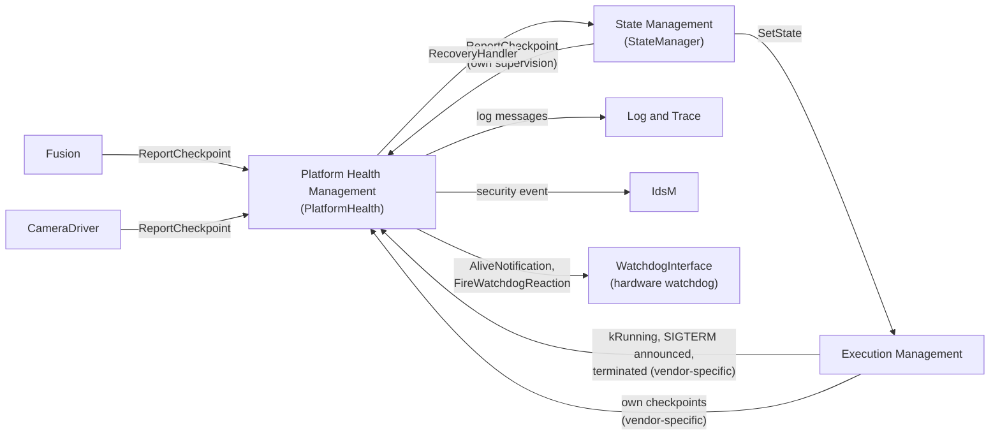

Read the diagram as a loop: the processes report checkpoints, PHM evaluates them, State Management reacts through EM, and EM tells PHM which processes now run. The watchdog closes the loop from outside.

### 3.5 Who Supervises the Supervisor?

PHM supervises State Management and Execution Management, but who supervises PHM? The **hardware watchdog**. PHM must call `AliveNotification` regularly, and the watchdog interface triggers the hardware watchdog correctly only as long as PHM does so (SWS, Section 7.5.2). If the PHM daemon crashes or hangs, the notifications stop and the watchdog resets the machine; the specification sees no need to define anything else for this case (SWS, Section 7.8.5). The *SW Architecture* sums it up: PHM controls the watchdog "that in turn supervises the Platform Health Management" (Section 9.6.1).

> **Key takeaways**
>
> - PHM is a daemon in the platform core; in `HPC` it is `PlatformHealth`.
> - PHM provides `SupervisedEntity` to applications and clusters and `RecoveryAction` to State Management.
> - PHM needs lifecycle information from EM, through a vendor-specific interface.
> - The hardware watchdog supervises PHM itself.

---

## 4. Configuration Overview

> **Why this matters:** PHM has no built-in knowledge of your system. Which checkpoints exist, which supervisions apply in which state and whom to notify all come from the manifest. This chapter gives the big picture; [Chapter 14](#14-configuration-reference-what-to-configure) lists every setting in detail.

### 4.1 Where the Configuration Lives

| Model part | Configured by | When | Main elements for PHM |
| --- | --- | --- | --- |
| Application design | Application developer | Design | `PhmSupervisedEntityInterface` with its `PhmCheckpoint`s; the R-port of the component typed by it |
| Application design of State Management | State Management developer | Design | `PhmSupervisionRecoveryNotificationInterface`; the P-port of State Management typed by it |
| Deployment (target configuration) | Integrator | Integration | `PlatformHealthManagementContribution` with checkpoints, Global Supervisions, modes and health channels; `PhmContributionToMachineMapping`; `RecoveryNotification`; `RecoveryNotificationToPPortPrototypeMapping` |
| Execution Manifest | Integrator | Integration | Settings PHM reads from processes: `reportingBehavior`, `functionClusterAffiliation`, `processExecutionError`, `terminationBehavior` |

PHM's configuration is distributed: the behavior of PHM "is determined by the sum of several contributions", and there is no single configuration entity (TPS, introduction of Chapter 12). Each Software Cluster can bring its own contribution. The PHM specification defines no default values for any attribute (SWS, Section 10.1).

### 4.2 How the Elements Relate

The following diagram shows the chain from the port in the code to the recovery notification.

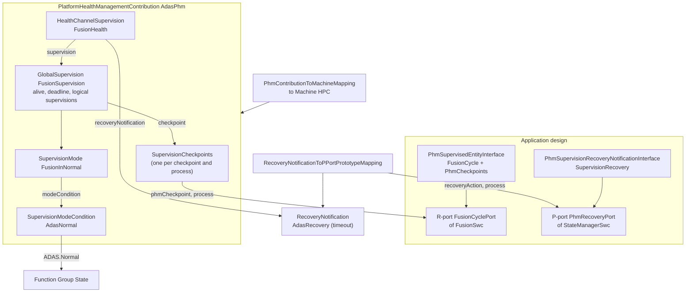

In words: the integrator creates one `SupervisionCheckpoint` for each checkpoint of each Supervised Entity Instance. Supervisions in a `GlobalSupervision` reference these checkpoints. A `SupervisionMode` says which supervisions are active when the Function Group is in which states. A `HealthChannelSupervision` connects the Global Supervision to a `RecoveryNotification`, and a mapping connects that notification to the State Management port that receives it. Finally, the contribution is enabled on the machine.

### 4.3 The Checkpoint ID Contract

A checkpoint has a number, and the number must match in three places (TPS, Section 12.3.2):

1. **Design:** `PhmCheckpoint.checkpointId` in the interface, for example `InputsRead` = 2.
2. **Code:** the generated enumerator `InputsRead = 2U`, which the code passes to `ReportCheckpoint` ([SWS_PHM_00425]).
3. **Deployment:** `SupervisionCheckpoint.checkpointId` in the contribution, which must have the same value ([TPS_MANI_03626]).

The value is replicated because the target configuration of PHM no longer has access to the design model. Keeping the three in sync is "a methodological task", which tooling can check (TPS, Section 12.3.2).

> **Key takeaways**
>
> - Design declares checkpoints and ports; deployment declares supervisions, modes and the recovery notification.
> - A contribution takes effect only when it is mapped to a Machine.
> - Checkpoint IDs are replicated from design to deployment and must match.
> - PHM defines no default values; everything that matters must be configured.

---

## 5. Supervised Entities and Checkpoints in Practice

> **Why this matters:** Every supervision starts with a call to `ReportCheckpoint` in your code. Where you place the calls, which process makes them and whether their IDs match the configuration decides whether PHM sees what really happens, or reports failures that are not there.

### 5.1 From Model to Code

For each `PhmSupervisedEntityInterface` in the model, the tooling generates a header with a C++ enumeration of its checkpoints:

- **Header path:** `ara/phm/supervised_entities/{<si-namespace-derived-directory-path-lower>}/{<phmssi-sn>}.h`, that is, one directory per namespace level and the short name of the interface in lower case as the file name ([SWS_PHM_01002]).
- **Namespace:** `ara::phm::supervised_entities::` followed by the namespaces of the interface, in lower case ([SWS_PHM_01005]). The interface must therefore have a namespace ([SWS_PHM_CONSTR_00001]).
- **Enumeration:** named after the interface, with the underlying type `std::uint32_t` ([SWS_PHM_00424]). Each enumerator is named after a `PhmCheckpoint` and has its `checkpointId` as value ([SWS_PHM_00425]).

For `FusionCycle` in the namespace `hpc::fusion`, the generated header could look like this:

```cpp
// ara/phm/supervised_entities/hpc/fusion/fusioncycle.h
// Generated from the model. Illustrative: the include guard and the layout are vendor-specific.
#ifndef HPC_FUSION_FUSIONCYCLE_H_
#define HPC_FUSION_FUSIONCYCLE_H_

#include <cstdint>

namespace ara::phm::supervised_entities::hpc::fusion {

enum class FusionCycle : std::uint32_t {
    CycleStart = 1U,
    InputsRead = 2U,
    ObjectsPublished = 3U,
    CycleEnd = 4U
};

}  // namespace ara::phm::supervised_entities::hpc::fusion

#endif  // HPC_FUSION_FUSIONCYCLE_H_
```

The following diagram shows how one checkpoint travels from the model through the code to the configuration of PHM.

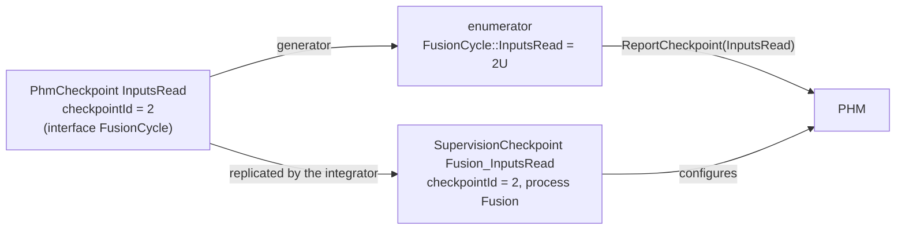

### 5.2 Creating a SupervisedEntity and Reporting Checkpoints

The class template `ara::phm::SupervisedEntity<EnumT>` represents one Supervised Entity Instance. `EnumT` is the generated enumeration ([SWS_PHM_01132]). You construct it with the instance specifier of the R-port ([SWS_PHM_01123]), and you call `ReportCheckpoint` with an enumerator ([SWS_PHM_01127]):

```cpp
explicit SupervisedEntity (const ara::core::InstanceSpecifier &instance) noexcept;  // [SWS_PHM_01123]
void ReportCheckpoint (EnumT checkpointId) noexcept;                                 // [SWS_PHM_01127]
```

The constructor checks the model. If something is wrong, it raises a **violation**, which terminates the process ([guide 03, Section 6.3](03_CoreAndGeneral.md#63-violations-fail-early)):

| Violation | Cause |
| --- | --- |
| `AraNotInitializedViolation` | `ara::core::Initialize` was not called before |
| `InstanceSpecifierMappingIntegrityViolation` | The specifier does not name a port of this executable |
| `PortInterfaceMappingViolation` | The port is typed by a `PhmSupervisedEntityInterface`, but no `SupervisionCheckpoint` references it |
| `ProcessMappingViolation` | No `SupervisionCheckpoint` of this port references the current process |
| `InstanceSpecifierAlreadyInUseViolation` | Another object of this process already uses the same specifier |

`ReportCheckpoint` returns nothing and cannot fail with an error. It is thread-safe, so several threads of the process may report checkpoints of the same object. The object can be moved but not copied ([SWS_PHM_01212] to [SWS_PHM_01215]).

### 5.3 Where to Place Checkpoints

The Foundation specification does not fix the granularity of checkpoints and names the trade-off (Foundation HM, Section 6.1.2):

- **Few, coarse checkpoints** keep the configuration small, but limit what PHM can detect. With a single checkpoint, PHM can only see that the code runs cyclically and check its timing.
- **Many, fine checkpoints**, for example at each block and branch, let PHM detect failures in the control flow, but make the configuration large and complex.

`Fusion` uses four checkpoints: the start and the end of a cycle, and two steps in between. This is enough to check the cycle rate (alive), the duration of the fusion step and of the whole cycle (deadline), and the order of the steps (logical).

### 5.4 Who May Report a Checkpoint

A `SupervisionCheckpoint` applies to one specific process ([TPS_MANI_03503]). If another process reports the checkpoint, PHM ignores the report for all supervisions ([SWS_PHM_01229]). The specification treats this as an access violation and a potential security threat: PHM reports the security event `SEV_ACCESS_CONTROL_PHM_IAM_ACCESS_DENIED` (ID 65) to the Intrusion Detection System Manager ([SWS_PHM_01339]). In addition, the API table of `ReportCheckpoint` lists the violation `InsufficientPermissionsViolation` for a call from a process that is not the one modeled for the checkpoint ([SWS_PHM_01127]). The specification does not explain how this violation relates to "ignore and report a security event". Either way, the report does not count.

Two further cases are worth knowing:

- **Excluded checkpoints.** A report of a checkpoint that is excluded from supervision in the current mode, by `NoCheckpointSupervision` or `NoSupervision`, is ignored ([SWS_PHM_01341]; [Section 11.3](#113-excluding-supervision-nosupervision-and-nocheckpointsupervision)).
- **Undefined checkpoints.** The behavior for a reported checkpoint that is not defined in the configuration is not specified in R25-11 (note to [SWS_PHM_01341]). The type-safe enumeration makes this unlikely, unless the code and the configuration come from different model versions.

### 5.5 Multiple Instances of a Supervised Entity

A Supervised Entity may be instantiated several times: a component may be instantiated twice in one process, or the same executable may run in several processes. Each instance is supervised on its own and has its own Elementary Supervision Statuses (SWS, Section 7.6). The code distinguishes the instances by their instance specifiers, and the configuration has one `SupervisionCheckpoint` per checkpoint, port instance and process ([TPS_MANI_03505], [constr_1764]).

The upstream requirements also allow a supervision that spans several threads of one process, and several Supervised Entities in one process or thread ([RS_PHM_00105], [RS_PHM_00106]). In `HPC`, each supervised process has exactly one instance.

### 5.6 Time Source

All timing of PHM is measured "in the context of the reporting process using the same time source" ([SWS_PHM_01334]). The reason is the delay of the inter-process communication to the PHM daemon: if the daemon took the time stamp when a report arrives, jitter in the communication would distort deadlines. The specification suggests `ara::core::SteadyClock` as the time source ([guide 03, Section 11.10](03_CoreAndGeneral.md#1110-steadyclock)). The same time base should be used to synchronize the start of alive supervision with `kRunning` (hint to [SWS_PHM_01332]).

> **Note (implementation example):** A typical implementation takes a `SteadyClock` time stamp inside `ReportCheckpoint`, in the calling process, and passes the checkpoint ID with the time stamp to the PHM daemon, for example through shared memory. This is why `ReportCheckpoint` returns immediately and has no error result.

### 5.7 Worked Example: Instrumenting Fusion and CameraDriver

The cycle of `Fusion` from [guide 03, Section 8.8](03_CoreAndGeneral.md#88-worked-example-fusion-checks-its-cycle-inputs) gets four checkpoints. When an input is late, `Fusion` skips the cycle; the checkpoints then go directly from `CycleStart` to `CycleEnd`, which the logical supervision allows ([Section 8.5](#85-worked-example-the-fusion-cycle-graph)).

```cpp
// Illustrative. Vendor headers may differ in detail.
#include "ara/core/instance_specifier.h"
#include "ara/core/steady_clock.h"
#include "ara/phm/supervised_entity.h"
#include "ara/phm/supervised_entities/hpc/fusion/fusioncycle.h"

namespace hpc::fusion {

using Checkpoint = ara::phm::supervised_entities::hpc::fusion::FusionCycle;

class SupervisedCycle {
public:
    explicit SupervisedCycle(const ara::core::InstanceSpecifier& port) : se_{port} {}

    // Called every 50 ms by the cycle thread (see guide 03, Section 8.8).
    void Run(const Calibration& calibration, ara::core::SteadyClock::time_point inputDeadline) {
        se_.ReportCheckpoint(Checkpoint::CycleStart);
        ara::core::Result<CycleInputs> inputs = CollectInputs(inputDeadline);
        if (inputs.HasValue()) {
            se_.ReportCheckpoint(Checkpoint::InputsRead);
            Publish(Fuse(inputs.Value(), calibration));
            se_.ReportCheckpoint(Checkpoint::ObjectsPublished);
        }
        // A late input (kInputTimeout) skips the cycle: CycleStart -> CycleEnd is a legal path.
        se_.ReportCheckpoint(Checkpoint::CycleEnd);
    }

private:
    ara::phm::SupervisedEntity<Checkpoint> se_;
};

}  // namespace hpc::fusion

// In main(), after ara::core::Initialize(argc, argv):
//   auto port = ara::core::InstanceSpecifier::Create("/fusion/Root/FusionCyclePort");
//   if (!port.HasValue()) { /* model and code disagree: log and end the process */ }
//   hpc::fusion::SupervisedCycle cycle{port.Value()};
```

`CameraDriver` needs only one checkpoint, reported once per captured image:

```cpp
// Illustrative.
using ImageCheckpoint = ara::phm::supervised_entities::hpc::camera::CameraImageLoop;

void ImageLoop(ara::phm::SupervisedEntity<ImageCheckpoint>& se) {
    while (Running()) {
        CameraImage image = CaptureImage();        // blocks until the next frame, about 33 ms
        se.ReportCheckpoint(ImageCheckpoint::ImageCaptured);
        SendImage(image);                          // event Image of CameraService
    }
}
```

> **Pitfall:** Report a checkpoint where the work really happens. If `CameraDriver` reported `ImageCaptured` from a separate timer thread, PHM would see a healthy rate even while the capture thread hangs.

> **Key takeaways**
>
> - The generator turns each Supervised Entity into an enumeration whose values are the checkpoint IDs.
> - Construct one `SupervisedEntity` per port with its instance specifier; configuration errors end the process with a violation.
> - `ReportCheckpoint` is cheap, thread-safe and has no error result; time is measured in the reporting process.
> - Only the configured process may report a checkpoint; other reports are ignored and raise a security event.
> - Place checkpoints where the work happens, and model every legal path, such as a skipped cycle.

---

## 6. Alive Supervision

> **Why this matters:** A cyclic process that hangs between two cycles reports nothing at all, so no deadline and no order can be checked. Only alive supervision notices silence. It is also the only supervision that tolerates occasional failures, which makes its parameters a trade-off between robustness and detection time.

### 6.1 What Alive Supervision Checks

**In plain words:** alive supervision counts how often a checkpoint is reported in a fixed time window and checks that the count is neither too low nor too high. Too few reports mean that the code runs too rarely or hangs; too many mean that it runs too often, for example in a tight error loop.

**Formally:** alive supervision is a "mechanism to check the timing constraints of cyclic Supervised Entities to be within the configured min and max limits" (SWS, Chapter 2). Its parameters belong to one checkpoint ([TPS_MANI_03508]).

### 6.2 The Algorithm: Alive Counter, Reference Cycle and Margins

The algorithm is defined in the Foundation specification (Foundation HM, Section 6.2.1):

1. Each `ReportCheckpoint` of the supervised checkpoint is an *Alive Indication* and increments the Alive Counter of that checkpoint.
2. At the end of every `aliveReferenceCycle`, PHM examines the counter ([ASWS_HM_00098]).
3. The result is **correct** if the counter lies within the tolerance from `expectedAliveIndications` − `minMargin` to `expectedAliveIndications` + `maxMargin`, otherwise **incorrect** ([ASWS_HM_00074]). If a Supervised Entity has several alive-supervised checkpoints and any of them fails, the result for the Supervised Entity is incorrect.
4. PHM examines only checkpoints that have an alive supervision in the current Supervision Mode ([ASWS_HM_00083]).

For `Fusion`, the reference cycle is 200 ms and the cycle is 50 ms, so 4 indications of `CycleStart` are expected. With both margins set to 1, any count from 3 to 5 is correct.

### 6.3 Debouncing with failedReferenceCyclesTolerance

A single incorrect reference cycle does not yet count as a failure. PHM keeps a second counter, the **counter for failed reference cycles**:

- It is incremented after each incorrect reference cycle ([ASWS_HM_00075]).
- It is decremented after each correct reference cycle, but not below zero ([ASWS_HM_00079]).

The Elementary Supervision Status follows this counter ([SWS_PHM_01346] to [SWS_PHM_01350]):

| Failed-cycle counter | Elementary Supervision Status | Meaning |
| --- | --- | --- |
| 0 | `kOK` | No failure present |
| 1 to `failedReferenceCyclesTolerance` | `kFAILED` | A failure was detected but is still tolerated |
| more than `failedReferenceCyclesTolerance` | `kEXPIRED` | The failure is qualified; the supervision stops |

`kFAILED` exists only for alive supervision (SWS, Section 7.4.1). With a tolerance of 0, the first incorrect reference cycle leads directly to `kEXPIRED`. Because the counter goes down again after correct cycles, the status returns from `kFAILED` to `kOK` once the failures are compensated ([SWS_PHM_01349]).

> **Pitfall:** Because the counter goes up and down, an alternating pattern of incorrect and correct cycles never exceeds a tolerance of 1. Intermittent failures can therefore stay in `kFAILED` forever without any notification. If such a pattern matters for your function, detect it with a deadline supervision or in the application.

### 6.4 Margins With a Special Meaning

Two values of the margins switch a check off:

- `minMargin` = 0 means that **no minimum** alive supervision is performed ([TPS_MANI_03575]).
- `maxMargin` = INF means that **no maximum** alive supervision is performed ([TPS_MANI_03576]).

The first rule is easy to misread. With the formula of [Section 6.2](#62-the-algorithm-alive-counter-reference-cycle-and-margins), `minMargin` = 0 would mean "not a single indication may be missing". The TPS gives it the opposite meaning: no lower limit at all. The two documents do not discuss this difference; follow the TPS, and use `minMargin` ≥ 1 whenever you need a lower limit. How the value INF is written for the type `PositiveInteger` is not specified.

### 6.5 Worked Example: Fusion and CameraDriver

In the following scenario, the cycle thread of `Fusion` is delayed *between* cycles, for example because a higher-priority thread uses the core. Every cycle that runs is complete, so the deadline and logical supervisions see nothing wrong. Only the alive supervision notices that cycles are missing. The tolerance is 1.

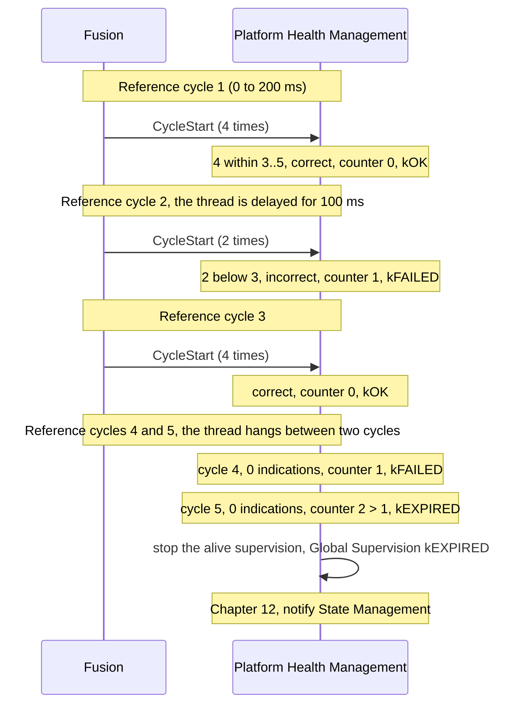

For `CameraDriver`, the reference cycle is 500 ms with 15 expected indications, margins of 2 and a tolerance of 2. The following table shows what happens when the camera drops to 20 images per second.

| Reference cycle | Images | Result | Failed-cycle counter | Status |
| --- | --- | --- | --- | --- |
| 1 | 15 | correct (13 to 17) | 0 | `kOK` |
| 2 | 10 | incorrect | 1 | `kFAILED` |
| 3 | 10 | incorrect | 2 | `kFAILED` |
| 4 | 10 | incorrect | 3 | `kEXPIRED` |

The failure is qualified 1.5 s after the frame rate dropped, at the end of the third incorrect reference cycle.

### 6.6 Choosing Alive Parameters

The specification gives no rules for choosing the values. The following points follow from the algorithm:

- **Make the reference cycle a multiple of the period** and long enough to contain several indications. The window is not synchronized with the cycle of the process, so jitter near a window boundary can move an indication into the next window.
- **Use margins of at least 1.** Even a perfect 50 ms loop can produce 3 or 5 indications in a 200 ms window when one indication falls on the boundary.
- **Compute the detection time.** A process that stops completely is detected after about (tolerance + 1) reference cycles, plus the evaluation delay of the implementation, which may be periodic or event-triggered ([SWS_PHM_00219]). For `Fusion`, this is about 400 ms. The project's safety concept must accept this time.
- **Think about startup.** Alive supervision starts when the process reports `kRunning` ([SWS_PHM_01331]; [Section 10.2](#102-when-supervision-starts)). The EM guide recommends reporting `kRunning` before waiting for other services ([EM guide, Section 5.3](04_ExecutionManagement.md#53-reporting-krunning)). The cycle must therefore run from that moment on. `Fusion` does this: while `CameraService` is not yet available, its cycles take the skip path.

> **Key takeaways**
>
> - Alive supervision counts the reports of one checkpoint per reference cycle and checks them against expected ± margins.
> - An up/down counter of failed cycles debounces failures; `kFAILED` is tolerated, `kEXPIRED` is a qualified failure.
> - `minMargin` = 0 and `maxMargin` = INF switch the lower or the upper check off.
> - Only alive supervision detects a process that hangs between checkpoints.
> - Detection takes about (tolerance + 1) reference cycles; size the values for jitter and for startup.

---

## 7. Deadline Supervision

> **Why this matters:** A step that takes too long can delay a safety function even while the process is alive. Deadline supervision measures single steps. It has no tolerance, so one late step is a qualified failure, and a deadline that is sized too tightly is a frequent cause of unexpected degradations.

### 7.1 What Deadline Supervision Checks

**In plain words:** deadline supervision measures the time from one checkpoint, the *source*, to another, the *target*, and checks that it lies within a minimum and a maximum.

**Formally:** deadline supervision is a "mechanism to check that the timing constraints for execution of the transition from a Deadline Start Checkpoint to a corresponding Deadline End Checkpoint are within the configured min and max limits" (SWS, Chapter 2).

### 7.2 Transitions and Time Windows

A deadline supervision references one `CheckpointTransition`, which defines a source and a target checkpoint ([TPS_MANI_03509], [TPS_MANI_03511]). The transitions are defined in the Global Supervision and can be used by deadline supervisions, logical supervisions or both. Deadline transitions do not have to form a graph, and they can be chained (Foundation HM, Section 6.2.2.1).

| Setting | Meaning | Special value |
| --- | --- | --- |
| `minDeadline` | The shortest allowed time from source to target | 0: no minimum check ([TPS_MANI_03573]) |
| `maxDeadline` | The longest allowed time from source to target | INF: no maximum check ([TPS_MANI_03574]) |

`Fusion` has two deadline supervisions: `ComputeDeadline` from `InputsRead` to `ObjectsPublished` (at most 25 ms, the fusion step), and `CycleDeadline` from `CycleStart` to `CycleEnd` (at most 45 ms, the whole cycle). Both have `minDeadline` = 0.

### 7.3 The Algorithm

The algorithm is defined in the Foundation specification (Foundation HM, Section 6.2.2.2):

| Situation | Result | Spec |
| --- | --- | --- |
| The target is reported, and the time since the source is below `minDeadline` or above `maxDeadline` | incorrect | [ASWS_HM_00294] |
| The target is not reported, and the time since the source has passed `maxDeadline` | incorrect, detected when `maxDeadline` expires | [ASWS_HM_00228] |
| The source is reported again before the target, within `maxDeadline` | incorrect | [ASWS_HM_00229] |
| The target is reported before its source | ignored | [ASWS_HM_00354] |
| Any other checkpoint is reported | ignored | [ASWS_HM_00299] |
| The target is reported within the window | correct | [ASWS_HM_00294] |

An incorrect result changes the Elementary Supervision Status directly to `kEXPIRED` and stops the supervision ([SWS_PHM_01346]). There is no tolerance. Intra-process deadline supervision starts with the first reported checkpoint, independently of `kRunning` (note to [SWS_PHM_01332]; [SWS_PHM_01354]).

### 7.4 Worked Example: Fusion's Compute Deadline

In this scenario, the fusion step of `Fusion` hangs, for example on a lock. PHM does not wait for `ObjectsPublished`: it detects the failure when `maxDeadline` expires.

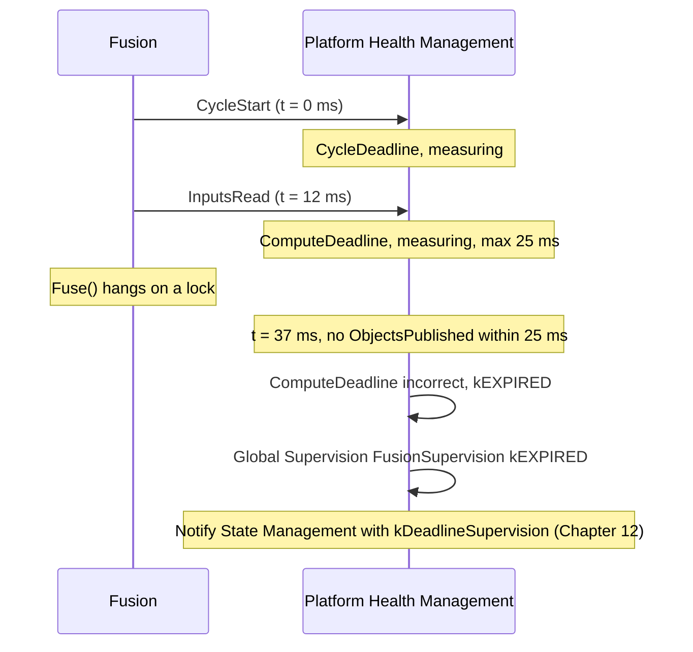

`CycleDeadline` would expire 8 ms later, at 45 ms. By then the Global Supervision is already `kEXPIRED`, so this changes nothing for the reaction. State Management learns which kind of supervision caused the transition to `kEXPIRED`, here `kDeadlineSupervision` ([SWS_PHM_00101]).

### 7.5 Pitfalls

- **No tolerance.** One late step is a qualified failure. Size `maxDeadline` for the worst case, including scheduling jitter on a loaded machine, not for the average.
- **Every legal path counts.** `CycleDeadline` also covers the skipped cycle, in which `CollectInputs` waits until the input deadline. Its 45 ms must be longer than that wait.
- **`minDeadline` detects shortcuts.** A step that finishes much faster than possible may have skipped its work. Use `minDeadline` > 0 only when the lower bound is reliable.
- **A repeated source is an error.** If the code can report the source twice without the target, for example in a retry loop, the supervision fails ([ASWS_HM_00229]).

> **Key takeaways**
>
> - Deadline supervision measures the time from a source to a target checkpoint against `minDeadline` and `maxDeadline`.
> - A missing target is detected when `maxDeadline` expires, not when the target finally arrives.
> - There is no tolerance: an incorrect result is `kEXPIRED` at once.
> - `minDeadline` = 0 and `maxDeadline` = INF switch a check off.
> - Size deadlines for the worst case and for every legal path.

---

## 8. Logical Supervision

> **Why this matters:** Control-flow errors, such as a skipped step or a jump into the wrong branch, can corrupt data without changing the timing. Logical supervision checks the order of checkpoints against a graph. Like deadline supervision it has no tolerance, so every legal path must be in the graph.

### 8.1 What Logical Supervision Checks

**In plain words:** logical supervision checks that the code passes its checkpoints in an order that the designer has allowed.

**Formally:** logical supervision is a "kind of online supervision of software that checks if the software (Supervised Entity or set of Supervised Entities) is executed in the sequence defined by the programmer" (SWS, Chapter 2). It focuses on control-flow errors: instructions processed in the wrong sequence or not at all (Foundation HM, Section 6.1.3.3).

### 8.2 Graphs: Initial and Final Checkpoints, Transitions

A logical supervision defines a directed graph: one or more **initial** checkpoints, a set of **transitions** and one or more **final** checkpoints ([TPS_MANI_03510]). Each part is mandatory: at least one initial checkpoint, one final checkpoint and one transition ([constr_1736], [constr_1737], [constr_1740]). A checkpoint may belong to only one graph in a Supervision Mode ([constr_3540]). Any sequence that starts with an initial checkpoint, follows the transitions and ends with a final checkpoint is correct; after a final checkpoint, the graph starts again with an initial checkpoint (Foundation HM, Section 6.1.2).

### 8.3 The Algorithm

PHM keeps an activity status for each graph, which is inactive at the start ([ASWS_HM_00271], [ASWS_HM_00296]). Because a checkpoint belongs to only one graph, PHM knows the graph of each reported checkpoint ([ASWS_HM_00295]). For each reported checkpoint of the graph, it checks ([ASWS_HM_00252]):

| Graph | Reported checkpoint | Result | Afterwards |
| --- | --- | --- | --- |
| inactive | an initial checkpoint | correct | the graph becomes active ([ASWS_HM_00273]) |
| inactive | any other checkpoint | incorrect | |
| active, all correct so far | a successor of the last checkpoint (a transition exists) | correct | a final checkpoint makes the graph inactive ([ASWS_HM_00331]) |
| active, all correct so far | no transition from the last checkpoint | incorrect | |
| active, an earlier report was incorrect | any | stays incorrect | |

Checkpoints that belong to no graph are ignored, because other supervisions may use them ([ASWS_HM_00297]). An initial checkpoint reported while the graph is active is correct only if a transition leads to it from the last checkpoint.

On the Adaptive Platform, an incorrect result changes the Elementary Supervision Status to `kEXPIRED` at once ([SWS_PHM_01346]). If the very first checkpoint is already wrong, the status goes from `kDEACTIVATED` directly to `kEXPIRED` ([SWS_PHM_01357]).

### 8.4 Graphs Across Processes and Restarts

The model allows a graph whose checkpoints belong to several processes of one Function Group ([TPS_MANI_03512]; [ASWS_HM_00460]). Two limitations make such graphs hard to use:

- A logical supervision always starts with the first reported checkpoint. The processes must coordinate their sequence, even if one of them restarts, or they must be configured to restart together on Function Group State changes (Foundation HM, Section 4.1).
- The state machine of the Elementary Supervision Status is specified only for intra-process supervision in R25-11 (SWS, Sections 4.1 and 7.4.1).

Keep graphs within one process unless you have a strong reason. `HPC` uses only intra-process graphs.

### 8.5 Worked Example: The Fusion Cycle Graph

The graph `CycleOrder` of `Fusion` allows two paths per cycle: the full cycle and the skipped cycle.

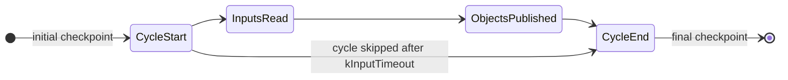

Now assume that a code change makes `Fusion` publish a cached object list *before* it reads the new inputs. The order of the reports changes, and the logical supervision fails at the first wrong report:

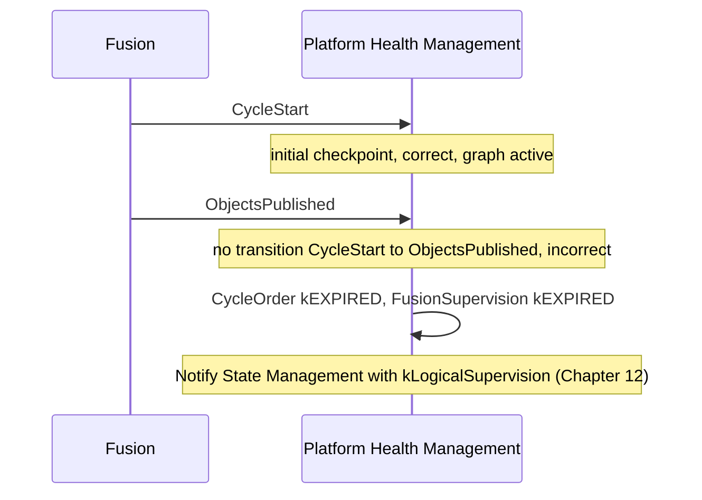

> **Pitfall:** If the skip path were missing from the graph, the first late radar frame would end in `kEXPIRED` and switch `ADAS` to `Degraded`. Logical supervision has no tolerance, so a legal path that is not modeled is a guaranteed false alarm.

### 8.6 Logical and Deadline Supervision on the Same Transitions

One `CheckpointTransition` can serve both kinds of supervision. The TPS shows an example in which some transitions are used only by the logical supervision, some by both, and one only by a deadline supervision across a chain of steps (TPS, Figure 12.15). `Fusion` uses the same pattern:

| Transition | Logical `CycleOrder` | Deadline |
| --- | --- | --- |
| `CycleStartToInputsRead` | yes | |
| `InputsReadToObjectsPublished` | yes | `ComputeDeadline` (max 25 ms) |
| `ObjectsPublishedToCycleEnd` | yes | |
| `CycleStartToCycleEnd` | yes, the skip path | `CycleDeadline` (max 45 ms) |

For `CycleDeadline`, the checkpoints between `CycleStart` and `CycleEnd` are ignored ([ASWS_HM_00299]), so the deadline measures the whole cycle on both paths.

> **Key takeaways**
>
> - Logical supervision checks the order of checkpoints against a graph of initial checkpoints, transitions and final checkpoints.
> - A wrong order is detected at the first wrong report and leads to `kEXPIRED` at once.
> - Model every legal path, including skip and error paths.
> - Keep graphs within one process; the status machine is specified only for intra-process supervision.
> - One transition can serve a logical and a deadline supervision at the same time.

---

## 9. Supervision Status: From Checkpoints to a Verdict

> **Why this matters:** The three supervisions produce results, but PHM reacts to a *status*. Two state machines stand between a checkpoint and a reaction: one per supervision and one per group of supervisions. Reading PHM's log messages and predicting its reaction requires knowing both.

### 9.1 Elementary Supervision Status

PHM tracks one Elementary Supervision Status for each alive, deadline and logical supervision ([SWS_PHM_01342]). Its states are `kOK`, `kDEACTIVATED`, `kEXPIRED` and `kFAILED`; `kFAILED` is used only by alive supervision ([SWS_PHM_01343]). The following diagram shows the transitions with the numbers of SWS Figure 7.4.

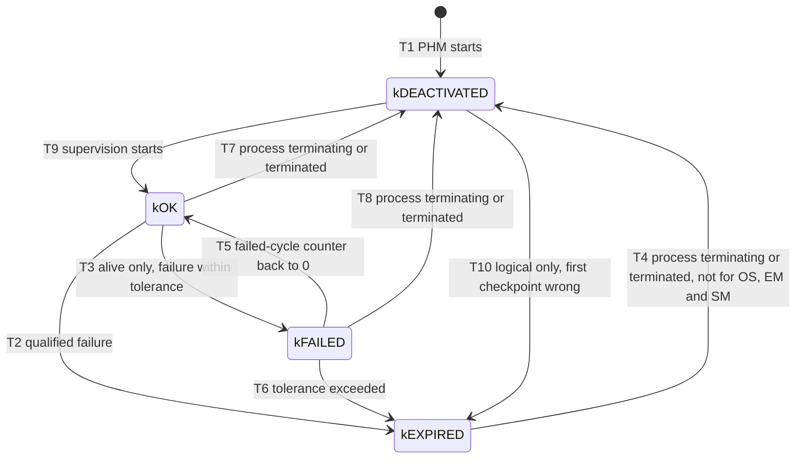

| Transition | When | Spec |
| --- | --- | --- |
| T1: start to `kDEACTIVATED` | PHM starts; the failed-cycle counter is 0 | [SWS_PHM_01344] |
| T9: `kDEACTIVATED` to `kOK` | A Supervision Mode in which the supervision is configured is active, and: alive, the process reports `kRunning`; deadline, the first checkpoint of the supervision is reported; logical, the first checkpoint is reported and is correct | [SWS_PHM_01353], [SWS_PHM_01354] |
| T3: `kOK` to `kFAILED` | Alive only: the failed-cycle counter is above 0 but within `failedReferenceCyclesTolerance` | [SWS_PHM_01347], [SWS_PHM_01348] |
| T5: `kFAILED` to `kOK` | The failed-cycle counter is 0 again | [SWS_PHM_01349] |
| T2: `kOK` to `kEXPIRED` | Alive: the counter exceeds the tolerance. Deadline or logical: the result is incorrect. The supervision stops. | [SWS_PHM_01346] |
| T6: `kFAILED` to `kEXPIRED` | The counter exceeds the tolerance. The supervision stops. | [SWS_PHM_01350] |
| T7, T8: to `kDEACTIVATED` | EM reports that the process is about to receive `SIGTERM`, or that it terminated. The counter is reset to 0. | [SWS_PHM_01351], [SWS_PHM_01352] |
| T4: `kEXPIRED` to `kDEACTIVATED` | As T7, but only for supervisions that do not belong to the operating system, EM or SM. For those, the way out of `kEXPIRED` is the watchdog reset. | [SWS_PHM_01355], [SWS_PHM_01356] |
| T10: `kDEACTIVATED` to `kEXPIRED` | Logical only: the first reported checkpoint is already wrong | [SWS_PHM_01357] |

Two facts are worth remembering. An expired supervision is stopped and stays `kEXPIRED` until its process terminates. And there is no transition from `kEXPIRED` back to `kOK`: recovery always goes through a termination of the process.

### 9.2 Global Supervision Status

A `GlobalSupervision` groups supervisions, and PHM calculates one Global Supervision Status for each ([SWS_PHM_00217], [SWS_PHM_00219]). It is the "worst-of" the Elementary Supervision Statuses it contains (SWS, Section 7.4.2). Its states are `kOK`, `kDEACTIVATED`, `kFAILED`, `kEXPIRED` and `kSTOPPED` ([SWS_PHM_00216]), and it starts in `kDEACTIVATED` ([SWS_PHM_00218]). Whether PHM evaluates the statuses periodically or on each new result is up to the vendor ([SWS_PHM_00219]).

The following diagram uses the transition numbers of SWS Figure 7.5. `kSTOPPED` has no transition out.

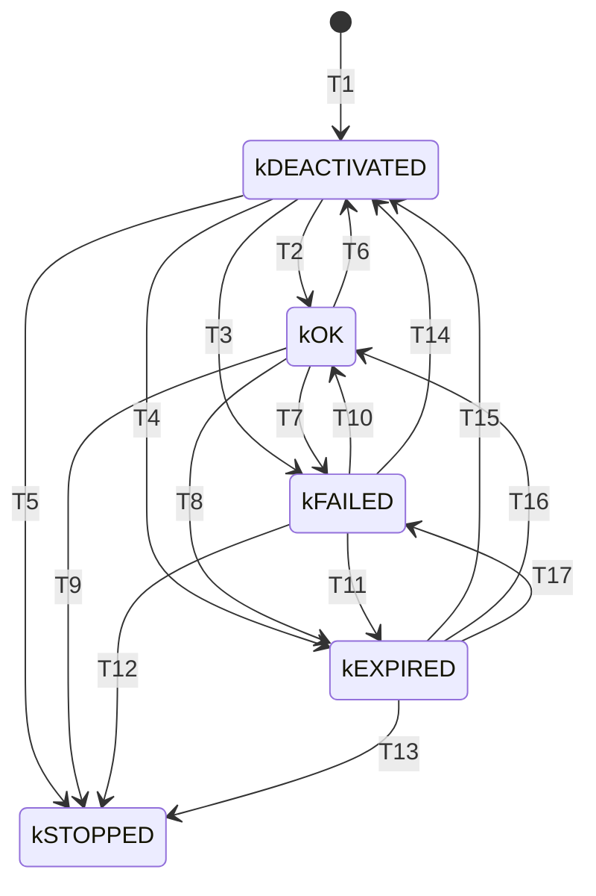

The rules are easier to read as a priority list. "Elementary" means the Elementary Supervision Statuses in the Global Supervision:

| Condition | Global Supervision Status | Transitions | Spec |
| --- | --- | --- | --- |
| All elementary statuses are `kDEACTIVATED` | `kDEACTIVATED`; the Expired Supervision Time stops | T6, T14, T15 | [SWS_PHM_00222] |
| At least one is `kEXPIRED`, and the Global Supervision does **not** belong to OS, EM or SM | `kEXPIRED`, as long as one is `kEXPIRED` | T4, T8, T11 | [SWS_PHM_00224], [SWS_PHM_00228], [SWS_PHM_00238], [SWS_PHM_00230] |
| At least one is `kEXPIRED`, the Global Supervision belongs to OS, EM or SM, and `expiredSupervisionTolerance` > 0 | `kEXPIRED`; the Expired Supervision Time starts | T4, T8, T11 | same |
| As before, and the Expired Supervision Time reaches the tolerance | `kSTOPPED` | T13 | [SWS_PHM_00231], [SWS_PHM_00232] |
| At least one is `kEXPIRED`, the Global Supervision belongs to OS, EM or SM, and the tolerance is 0 | `kSTOPPED` at once | T5, T9, T12 | [SWS_PHM_00225], [SWS_PHM_00229], [SWS_PHM_00239] |
| None is `kEXPIRED`, at least one is `kFAILED` | `kFAILED` | T3, T7, T17 | [SWS_PHM_00223], [SWS_PHM_00226], [SWS_PHM_00234], [SWS_PHM_00237] |
| None is `kFAILED` or `kEXPIRED`, at least one is `kOK` | `kOK` | T2, T10, T16 | [SWS_PHM_00220], [SWS_PHM_00221], [SWS_PHM_00227], [SWS_PHM_00233] |

The transitions out of `kEXPIRED` (T15, T16, T17) happen when State Management changes the Function Group State so that the failed process is terminated or restarted. They do not apply to Global Supervisions of OS, EM or SM, whose expired supervisions wait for the watchdog (notes to [SWS_PHM_00233] and [SWS_PHM_00234]).

> **Note:** The notes after [SWS_PHM_00231] and [SWS_PHM_00234] refer to "figure 7.4" for transitions 13, 15, 16 and 17. These transitions are in Figure 7.5, the Global Supervision Status; the reference is a typo in the specification.

### 9.3 kSTOPPED and the Expired Supervision Tolerance

`kSTOPPED` is the status for critical failures that need a direct reaction by the hardware watchdog. From the AUTOSAR point of view, these are failures in the supervision of the operating system, State Management or Execution Management. When a Global Supervision reaches `kSTOPPED`, PHM stops setting a correct watchdog trigger condition (SWS, Section 7.4.2; [SWS_PHM_00105]).

The parameter `expiredSupervisionTolerance` postpones this reaction. While the Global Supervision is in `kEXPIRED`, PHM still serves the watchdog, which leaves time for clean-up activities before the reset, such as writing the error cause or non-volatile data (SWS, Section 7.4.2). The tolerance therefore matters only for Global Supervisions of OS, EM or SM.

How does PHM know that a Global Supervision belongs to one of them? For State Management, through the processes: the supervisions reference `SupervisionCheckpoint`s, which reference a `Process`, whose `functionClusterAffiliation` is `STATE_MANAGEMENT` (note to [SWS_PHM_01355]). For Execution Management and the operating system, the mechanism is not standardized ([SWS_PHM_00239] note), because EM is not a modeled process and the operating system is not in the model.

The specification states that it is mandatory to configure `expiredSupervisionTolerance` only for Global Supervisions of OS, EM or SM, and that no constraint was added for this (SWS, Section 7.4.2). Since R25-11, however, the TPS requires the attribute for every Global Supervision ([constr_3823]). Configure it everywhere; for application supervisions, the value has no effect. `HPC` uses 0 for `FusionSupervision` and `CameraDriverSupervision`, and 200 ms for `StateManagerSupervision`.

### 9.4 Grouping Supervisions into Global Supervisions

A Global Supervision covers the whole or a part of one Function Group. The rules are (SWS, Section 7.2):

- All supervisions of a Global Supervision belong to processes of one Function Group ([constr_3629] to [constr_3631]).
- A supervision belongs to exactly one Global Supervision.
- All checkpoints of one Supervised Entity Instance are referenced only from one Global Supervision ([constr_3623]).

Within these rules, the grouping is free. The specification gives examples (SWS, Figures 7.1 and 7.2): the supervisions of processes A and B in one Global Supervision and those of process C in another; all supervisions of a Function Group in one; or all alive and deadline supervisions in one and all logical supervisions in another. A Global Supervision across two Function Groups is not allowed.

**Design advice: one Global Supervision per process.** PHM notifies State Management when a Global Supervision *switches* to `kEXPIRED` ([SWS_PHM_00101]). While it stays `kEXPIRED`, a second failure in the same Global Supervision raises no new notification. With one Global Supervision per process, a failure of `CameraDriver` cannot hide a later failure of `Fusion`. This is why `HPC` has `FusionSupervision` and `CameraDriverSupervision` instead of one Global Supervision for `ADAS`.

### 9.5 Worked Example: The Status of Fusion's Alive Failure

The following table follows the alive failure of [Section 6.5](#65-worked-example-fusion-and-cameradriver) through both state machines. The deadline and logical supervisions of `Fusion` stay `kOK`, because every cycle that runs is complete.

| Reference cycle | Indications | Failed-cycle counter | `FusionAlive` | Other supervisions | `FusionSupervision` |
| --- | --- | --- | --- | --- | --- |
| (before) | | 0 | `kOK` | `kOK` | `kOK` |
| 1 | 4 | 0 | `kOK` | `kOK` | `kOK` |
| 2 | 2 | 1 | `kFAILED` | `kOK` | `kFAILED` (T7) |
| 3 | 4 | 0 | `kOK` | `kOK` | `kOK` (T10) |
| 4 | 0 | 1 | `kFAILED` | `kOK` | `kFAILED` (T7) |
| 5 | 0 | 2 | `kEXPIRED` | `kOK` | `kEXPIRED` (T11): notify State Management |

> **Key takeaways**
>
> - Each supervision has an Elementary Supervision Status; an expired supervision stops and stays `kEXPIRED` until its process terminates.
> - A Global Supervision is the worst of its elementary statuses; its switch to `kEXPIRED` triggers the notification of State Management.
> - `kSTOPPED` exists only for OS, EM and SM supervisions and leads to the watchdog reaction, optionally delayed by `expiredSupervisionTolerance`.
> - Configure `expiredSupervisionTolerance` on every Global Supervision ([constr_3823]).
> - Use one Global Supervision per process, so that one failure cannot hide another.

---

## 10. Supervision and the Process Lifecycle

> **Why this matters:** PHM supervises a process only while it runs, so it must know when Execution Management starts and stops processes. If you know when each supervision starts and stops, you can avoid false alarms at startup and shutdown, and you know why some processes cannot be supervised at all.

### 10.1 What PHM Learns From EM

For every process with a configured supervision, PHM needs three pieces of information from Execution Management (SWS, Section 5.3):

- the process has reported the Execution State `kRunning`;
- the process is about to be told to terminate, that is, EM is about to send `SIGTERM`;
- the process has terminated.

EM provides them through a vendor-specific inter-cluster interface ([EM guide, Section 5.9](04_ExecutionManagement.md#59-synchronization-with-platform-health-management)). The last event also covers processes that terminate abruptly, without `SIGTERM`.

### 10.2 When Supervision Starts

| Supervision | Starts when | Checkpoints before the start | Spec |
| --- | --- | --- | --- |
| Alive | The process reports `kRunning`: PHM starts the first reference cycle | Ignored | [SWS_PHM_01331], [SWS_PHM_01332] |
| Deadline, intra-process | The first checkpoint of the supervision is reported; `kRunning` is not needed | (none) | note to [SWS_PHM_01332]; [SWS_PHM_01354] |
| Logical, intra-process | The first checkpoint is reported and is correct | (none) | [SWS_PHM_01354] |

In all cases, a Supervision Mode in which the supervision is configured must be active ([SWS_PHM_01353]). The rationale for alive supervision is that cyclic execution is expected only after `kRunning`, and EM already monitors that `kRunning` arrives within the start-up timeout ([SWS_PHM_01331]).

### 10.3 When Supervision Stops

As soon as PHM learns that EM is about to send `SIGTERM` to a supervised process, or that the process terminated, PHM stops all intra-process supervisions of that process ([SWS_PHM_01333]). Their results are set to correct and their status to `kDEACTIVATED` ([SWS_PHM_00240], [SWS_PHM_01351], [SWS_PHM_01352]). After `SIGTERM`, supervision is not needed: EM monitors the termination timeout itself.

The following diagram shows the start and the stop of the supervisions of `Fusion`.

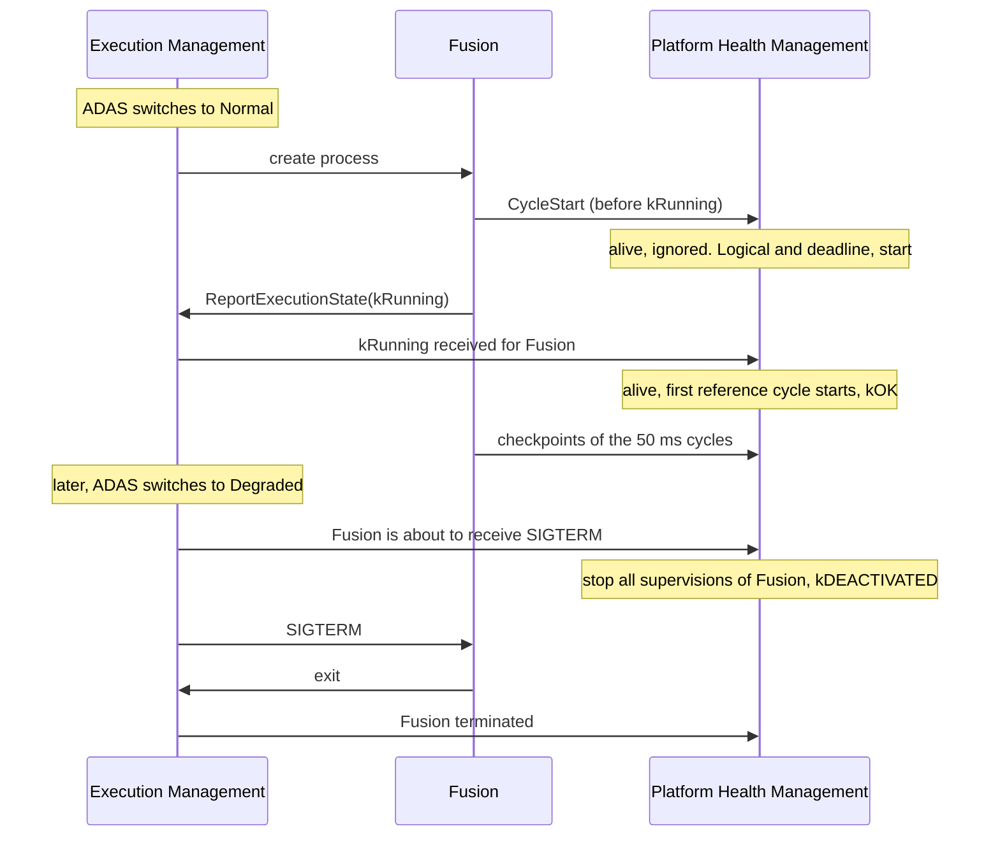

> **Pitfall:** In this diagram `Fusion` reports checkpoints before `kRunning`. Intra-process logical and deadline supervisions can start with them (note to [SWS_PHM_01332]), so these first cycles must already follow the graph. If the initialization reports checkpoints in another order, the logical supervision can fail before the process even reports `kRunning`.

### 10.4 Self-Terminating Processes and the Terminating Checkpoint

A self-terminating process may end on its own, without `SIGTERM` from EM. Alive supervision would then see silence and report a failure. To avoid this, the process announces its end by reporting a **terminating checkpoint**, and PHM monitors that the process really terminates within a timeout (SWS, Section 7.2.1.1).

| Rule | Spec |
| --- | --- |
| Alive supervision stops at the terminating checkpoint, or when EM announces `SIGTERM`, whichever comes first. | [SWS_PHM_01335] |
| After the terminating checkpoint, the process must terminate within `terminatingCheckpointTimeoutUntilTermination`; otherwise PHM notifies State Management through `RecoveryHandler`. | [SWS_PHM_01336] |
| If the process terminates without the terminating checkpoint and without `SIGTERM`, PHM notifies State Management of an alive supervision failure. | [SWS_PHM_01337] |
| If EM announces `SIGTERM` after the terminating checkpoint, PHM stops the timeout, because EM now monitors the termination. | [SWS_PHM_01338] |
| The terminating checkpoint is configured if and only if the process is self-terminating in the states of that Supervision Mode; it belongs to the same process; the timeout is then mandatory. | [constr_3709], [constr_3710], [constr_3711] |

**A hypothetical variant of the running example.** `CalibrationCheck` is the self-terminating process of `HPC`: it checks the calibration once at ADAS start and exits. It is not supervised in the running example. Assume for a moment that it reported a checkpoint `CheckStep` after each of its checks, with an alive supervision, and the terminating checkpoint `CheckDone` with a timeout of 100 ms:

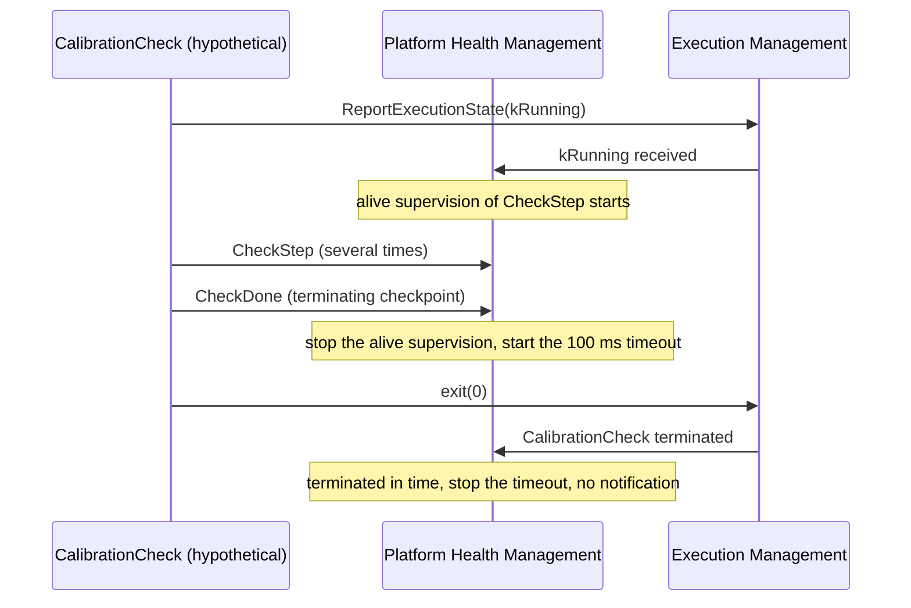

If `CalibrationCheck` hung after `CheckDone`, PHM would notify State Management after 100 ms ([SWS_PHM_01336]). The specification does not say which `TypeOfSupervision` PHM passes in that case.

### 10.5 Processes That Cannot or Need Not Be Supervised

- **Non-reporting processes.** Supervision depends on process states, and a non-reporting process does not report its Execution State, so EM cannot inform PHM (SWS, Section 4.1). The TPS forbids a supervised entity port in such an executable ([constr_3795]). In `HPC`, the third-party `LegacyLogger` therefore cannot be supervised; only its reporting companion `LoggerCompanion` could be ([EM guide, Section 5.4](04_ExecutionManagement.md#54-non-reporting-processes-and-the-companion-pattern)).
- **Processes started before PHM.** How supervision starts for processes that run before the PHM daemon, such as the process of Execution Management, is not standardized (SWS, Section 7.2.2).

### 10.6 Disabling Supervision at Run Time

Sometimes the whole system enters a phase in which monitoring must pause, for example Suspend-to-RAM (SWS, Section 7.2.3). R25-11 adds two functions for this, both with the status DRAFT:

| Call | Effect | Spec |
| --- | --- | --- |
| `Disable()` | Disables the supervision of this Supervised Entity Instance until `Enable()`. Checkpoints reported meanwhile are ignored. | [SWS_PHM_01380], [SWS_PHM_01364], [SWS_PHM_01365] |
| `Enable()` | Enables the supervision again, "if possible in the current function group state". Alive supervision restarts its reference cycle. Deadline and logical supervision keep ignoring checkpoints until a source checkpoint of a transition is reported. | [SWS_PHM_01130], [SWS_PHM_01366], [SWS_PHM_01367] |

Both return an `ara::core::Future<void>`; they fail with `PhmErrc::kServiceNotReady` while another `Enable` or `Disable` request is still ongoing. Disabling a supervision is critical: no monitoring takes place, so it must be covered by the safety case and synchronized with the safety functions (SWS, Section 7.2.3).

```cpp
// Illustrative: pause the supervision of a Supervised Entity around a low-power phase.
// HPC does not use Suspend-to-RAM; this is a generic sketch.
void EnterLowPower(ara::phm::SupervisedEntity<Checkpoint>& se) {
    ara::core::Result<void> disabled = se.Disable().GetResult();  // waits for PHM's answer
    if (!disabled.HasValue()) {
        // PhmErrc::kServiceNotReady: an Enable or Disable request is still ongoing
        return;
    }
    SuspendWork();
    static_cast<void>(se.Enable().GetResult());
}
```

> **Key takeaways**
>
> - EM tells PHM about `kRunning`, the coming `SIGTERM` and the termination of every supervised process.
> - Alive supervision starts at `kRunning`; intra-process deadline and logical supervision start with the first checkpoint.
> - Supervision stops as soon as EM announces `SIGTERM` or the process terminates; the status becomes `kDEACTIVATED`.
> - Self-terminating processes announce their end with a terminating checkpoint and must then exit within a timeout.
> - Non-reporting processes cannot be supervised; `Disable` and `Enable` (DRAFT) pause supervision and must be covered by the safety case.

---

## 11. Supervision Modes and Function Group State Changes

> **Why this matters:** A process may need different supervision in different states of the system, and a state change starts, stops or keeps processes running. PHM's rules for each case are simple, but one of them, "a process that keeps running keeps its parameters", surprises many integrators.

### 11.1 Supervision Modes and Mode Conditions

A `SupervisionMode` lists the supervisions that are active in it, in the role `activeSupervision`, and references exactly one `SupervisionModeCondition` ([TPS_MANI_03513], [TPS_MANI_03633], [constr_3640]). A condition contains at least one reference to a Function Group State ([constr_3627]). The TPS describes several references as "combined to provide a single logical state"; its example combines them with "or" (rationale of [constr_3628]). The mode is therefore active when the Function Group is in any of the referenced states.

Four rules keep the modes of a Global Supervision consistent:

| Rule | Spec |
| --- | --- |
| A Function Group State appears in at most one condition of a Global Supervision, so at most one mode is active at a time. | [constr_3628] |
| All conditions of a Global Supervision reference states of the same Function Group. | [constr_3629], [constr_3631] |
| The supervised processes run in states of that Function Group. | [constr_3630] |
| Every Supervised Entity Instance is covered, by supervisions or by `NoSupervision`, in every state in which its process runs. | [constr_3632] |

The last rule exists so that a state is not forgotten by mistake. For `CameraDriver`, which runs in `ADAS.Normal` and `ADAS.Degraded`, the condition `AdasNormalOrDegraded` references both states.

### 11.2 What Happens on a Function Group State Change

A Function Group State change terminates some processes, starts some, restarts some and lets the rest continue (SWS, Section 7.3.1). PHM handles the supervisions of each case as follows:

| The process ... | PHM | Spec |
| --- | --- | --- |
| is terminated | Stops its supervisions, sets their results to correct and their status to `kDEACTIVATED` | [SWS_PHM_00240] |
| is started | Supervises it with the parameters of the mode of the new state, or not at all if `NoSupervision` is configured there | [SWS_PHM_00241], [SWS_PHM_00244] |
| is restarted | Treats it as a termination followed by a start | [SWS_PHM_00242] |
| continues to run | Continues the supervisions with the **same** parameters, and a `NoSupervision` stays in force | [SWS_PHM_00243], [SWS_PHM_00245] |

The last row is a known limitation: if the parameters differ between two states in which a process keeps running, PHM keeps those of the old state (SWS, Section 4.1). The TPS therefore asks you to configure identical active supervisions for the modes of such states. If you really need different parameters, give the process different arguments in the two states, so that EM restarts it (TPS, note after Figure 12.14). Supervision that depends on "PowerMode" is not supported (SWS, Section 4.1).

### 11.3 Excluding Supervision: NoSupervision and NoCheckpointSupervision

Two elements switch supervision off explicitly, so that [constr_3632] can still be satisfied:

- **`NoSupervision`** excludes a whole Supervised Entity Instance, identified by its R-port and its process, in a mode ([constr_3674], [constr_3675]). For one instance and one mode, configure either checkpoint supervisions or `NoSupervision`, never both ([constr_3676]).
- **`NoCheckpointSupervision`** excludes a set of checkpoints from all supervisions in a mode ([TPS_MANI_03670]). These checkpoints must not be used by any other supervision of the same mode ([constr_3712]).

Reports of excluded checkpoints are ignored ([SWS_PHM_01341]). A `NoSupervision` applies from the state in which the process starts until it terminates; it cannot be switched on or off for a process that keeps running (SWS, Section 7.3.1, Figure 7.3). `HPC` does not need either element, because each supervised process is supervised in every state in which it runs.

### 11.4 Worked Example: ADAS From Normal to Degraded

When State Management switches `ADAS` from `Normal` to `Degraded`, EM terminates `Fusion`, starts `FusionLite` and lets `CameraDriver` run on.

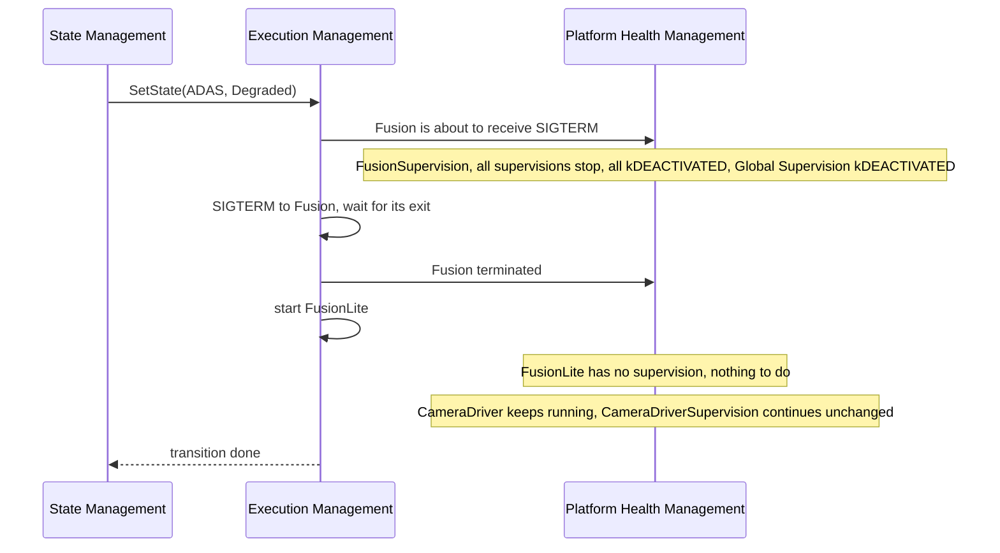

`FusionSupervision` goes to `kDEACTIVATED` because all its elementary statuses are deactivated ([SWS_PHM_00222]). When `ADAS` later returns to `Normal`, EM starts `Fusion` again and its supervisions start fresh ([SWS_PHM_00241]).

> **Key takeaways**
>
> - A Supervision Mode is active when its Function Group is in one of the states of its condition; modes of one Global Supervision are mutually exclusive.
> - Every Supervised Entity Instance must be covered in every state in which its process runs, by supervisions or by `NoSupervision`.
> - Terminated processes lose their supervision, started processes get the parameters of the new mode, restarted processes start fresh.
> - A process that keeps running keeps its old parameters; configure identical supervisions for such states.

---

## 12. Recovery: Notifying State Management

> **Why this matters:** Detection is only half of a safety mechanism; the other half is the reaction. PHM does not react itself, it hands the failure to State Management and checks that State Management takes it. Every link of this chain is configured or coded by someone, and a broken link ends in a watchdog reset.

### 12.1 The Recovery Chain

When the status of a Global Supervision switches to `kEXPIRED`, PHM notifies State Management through the method `ara::phm::RecoveryAction::RecoveryHandler` ([SWS_PHM_00101]). The chain behind this call is configured as follows:

1. A **`HealthChannelSupervision`** in the contribution references the Global Supervision in the role `supervision`, and one `RecoveryNotification` ([TPS_MANI_03516], [TPS_MANI_03672]).
2. The **`RecoveryNotification`** carries the timeout within which State Management must answer (SWS, Section 7.5.3).
3. A **`RecoveryNotificationToPPortPrototypeMapping`** connects the notification to a P-port of the State Management process, typed by a `PhmSupervisionRecoveryNotificationInterface` ([constr_3612], [constr_3613]).
4. In the State Management process, a class derived from **`RecoveryAction`** is constructed with the instance specifier of that P-port ([SWS_PHM_01141]) and calls `Offer()`.

In `HPC`, both Global Supervisions of `AdasPhm` use the same notification `AdasRecovery`; several health channels may share one notification ([TPS_MANI_03673]). The mapping `AdasRecoveryToStateManager` connects it to `/state_manager/Root/PhmRecoveryPort`.

### 12.2 What State Management Receives

```cpp
virtual ara::core::Future< void > RecoveryHandler (const ara::exec::ExecutionErrorEvent &executionError,
                                                   TypeOfSupervision supervision) noexcept=0;  // [SWS_PHM_01142]
```

- **`executionError`** contains the Function Group of the Global Supervision and the application error of the failed process ([SWS_PHM_00101]). The error comes from the `processExecutionError` of the `StartupConfig` that the process currently uses. If none is configured, PHM reports the value 1 ([SWS_PHM_01361]). This is the same `ExecutionErrorEvent` and the same encoding that EM uses for crashes ([EM guide, Section 14.6](04_ExecutionManagement.md#146-executionerrorevent-and-executionerror)).
- **`supervision`** is the `TypeOfSupervision` that caused the transition to `kEXPIRED`: `kAliveSupervision`, `kDeadlineSupervision` or `kLogicalSupervision` ([SWS_PHM_01138]).

In `HPC`, a failure of `Fusion` arrives as `ADAS` with 42 (`FusionFailed`). A failure of `CameraDriver` arrives as `ADAS` with 1, because `CameraDriver` has no `processExecutionError`.

> **Pitfall:** With the default value 1, State Management cannot tell which process failed, and a crash reported by EM looks the same as a supervision failure. Give every process that State Management must distinguish its own `processExecutionError`.

### 12.3 Offer, StopOffer and the Answer

PHM calls `RecoveryHandler` only between `Offer()` and `StopOffer()` ([SWS_PHM_01147], [SWS_PHM_01148]). `Offer()` returns `PhmErrc::kOfferFailed` if the PHM daemon cannot be reached ([SWS_PHM_01143]). State Management calls `StopOffer()` during its shutdown (*SW Architecture*, Section 11.5.1).

State Management answers through the `Future` it returns:

- **a value:** the recovery is handled; PHM takes no further action (note 2 to [SWS_PHM_00104]);
- **the error `PhmErrc::kSMCanNotHandleRecovery`:** State Management cannot handle the recovery, and PHM fires the watchdog ([SWS_PHM_01142], [SWS_PHM_00107]). State Management must return this error when the parameters are invalid, for example an unknown Function Group ([SWS_SM_00030]).

If a new failure is reported for the same State Machine while a recovery is still in progress (a *nested recovery*), State Management gives the same result to all these calls, when the latest recovery action is finished ([SWS_SM_00031]). [Section 15.4](#154-recoveryaction) shows the code.

### 12.4 When the Notification Fails

According to ISO 26262, PHM must make sure that a reaction follows a safety-relevant failure (SWS, Section 7.5.1). It therefore watches the call:

| Situation | PHM's reaction | Spec |
| --- | --- | --- |
| State Management answers with a value in time | Nothing more | [SWS_PHM_00104], note 2 |
| State Management answers `kSMCanNotHandleRecovery` | Stops `AliveNotification`, calls `FireWatchdogReaction` | [SWS_PHM_00107] |
| No acknowledgment within `recoveryNotificationTimeout` after the failure was detected, for example because the handler is not offered or the communication is broken | Same | [SWS_PHM_00104] |
| The Global Supervision expires before `Offer()` succeeded | Same | [SWS_PHM_01359] |
| The Global Supervision expires after `StopOffer()` | Same | [SWS_PHM_01360] |

The following diagram shows the decision.

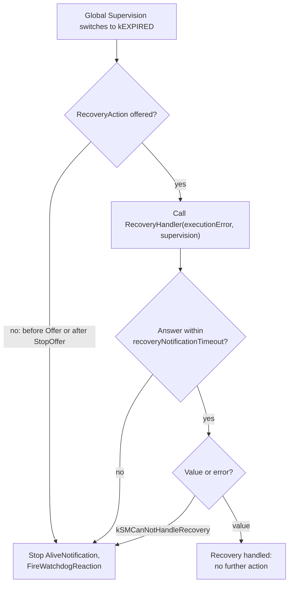

> **Pitfall:** The timeout runs from the detection of the failure until State Management's acknowledgment ([SWS_PHM_00104]). State Management may complete the `Future` only when its recovery action is finished ([SWS_SM_00031]). The timeout must then be longer than the slowest recovery, computed from the EM timeouts of every process that the recovery transition stops or starts. In `HPC`, the transition from `ADAS.Normal` to `ADAS.Degraded` terminates `Fusion` (termination timeout 500 ms) and then `LoggerCompanion` (1 s), which is restarted because it has a separate startup configuration per state. It then starts `LoggerCompanion` (start-up timeout 2 s) and, once it is *Running*, `FusionLite` (2 s) ([EM guide, Section 13.11](04_ExecutionManagement.md#1311-the-running-example-complete-configuration)). The worst case is therefore about 5.5 s, and `HPC` uses 6 s. A longer timeout also delays the watchdog reaction when State Management itself cannot recover; if it is too long for the safety goal, shorten the EM timeouts of the processes on the recovery path instead. The specification does not define more precisely what counts as the acknowledgment.

### 12.5 State Management's Side in Brief

What State Management does with the notification is project-specific and is the subject of [guide 05, Chapter 8](05_StateManagement.md#8-error-handling-and-recovery). Three rules of the State Management specification matter for PHM:

- With the StateMachine approach, the `executionError` from `RecoveryHandler` is used as the error code in the StateMachine that manages the Function Group of the failed process ([SWS_SM_00670]). Its `ErrorRecoveryTable` must contain an entry `ANY` for error codes that are not configured ([SWS_SM_CONSTR_00014]).
- During an update session, a StateMachine that is affected by the update ignores recovery requests from PHM and logs them ([SWS_SM_00664]).
- State Management must expect supervision failures to be reported before EM has confirmed that a requested Function Group State was reached (SWS SM, Section 7.6).

### 12.6 Worked Example: Fusion Stalls and ADAS Goes to Degraded

This is the continuation of the deadline failure of [Section 7.4](#74-worked-example-fusions-compute-deadline).

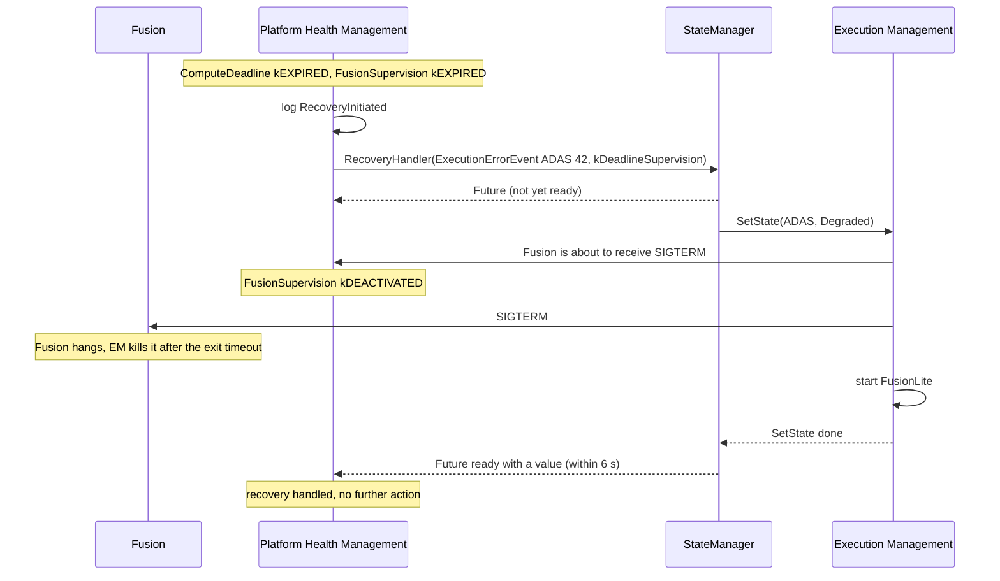

`ADAS` now runs in `Degraded` with `FusionLite`. `CameraDriver` was not affected and is still supervised.

### 12.7 Known Limitation: Successive Failures

PHM notifies State Management only when a Global Supervision *switches* to `kEXPIRED`. The specification itself names the consequence: if failures follow each other, the Global Supervision may stay in its failed state without a further notification, which can hinder the recovery (SWS, Section 4.1).

The running example shows a related case. Suppose the alive supervision of `CameraDriver` expires ([Section 6.5](#65-worked-example-fusion-and-cameradriver)). State Management switches `ADAS` to `Degraded`. But `CameraDriver` runs in `Degraded` too, with the same startup configuration, so EM does not restart it. Its supervision stays `kEXPIRED` ([SWS_PHM_01356]), and so does `CameraDriverSupervision` ([SWS_PHM_00230]). PHM no longer supervises `CameraDriver`, and it will not report another failure. Only a restart of `CameraDriver`, for example through `ADAS.Off`, clears the status. [Guide 05, Section 8.8](05_StateManagement.md#88-worked-example-a-stuck-cameradriver) shows how State Management handles it in `HPC`.

> **Key takeaways**
>
> - A `HealthChannelSupervision` connects a Global Supervision to a `RecoveryNotification`; a mapping connects the notification to State Management's P-port.
> - State Management receives the Function Group, the failed process's execution error (default 1) and the kind of supervision.
> - The `Future` that State Management returns is the acknowledgment; `kSMCanNotHandleRecovery`, a timeout or a missing `Offer` all end in the watchdog reaction.
> - Size `recoveryNotificationTimeout` for the slowest recovery.
> - A process that keeps running after a failure stays `kEXPIRED` and is not reported again.

---

## 13. The Hardware Watchdog and Critical Failures

> **Why this matters:** The normal recovery runs through State Management and Execution Management. When one of them fails, only the hardware watchdog can still bring the machine into a safe state. PHM is the cluster that serves it, and both the startup timing and the supervision of EM and SM depend on getting this right.

### 13.1 Why PHM Owns the Watchdog

PHM is the only functional cluster with an interface to the hardware watchdog. The watchdog therefore supervises PHM, and PHM can initiate a watchdog reaction by stopping the triggering or by sending a false trigger. Because the reaction usually resets the machine, it affects all functions and is meant as the last resort, to ensure freedom from interference. The failures that need it are supervision failures of State Management and Execution Management, because then the recovery through State Management is not possible (SWS, Section 7.5.2; [RS_PHM_00115], [RS_PHM_00116]).

### 13.2 WatchdogInterface: AliveNotification and FireWatchdogReaction

PHM handles the hardware watchdog through `apext::phm::WatchdogInterface`, a platform extension API that the platform vendor implements for its hardware (SWS, Appendix C):

| Function | Meaning | Spec |
| --- | --- | --- |
| `AliveNotification()` | Called cyclically by PHM. As long as PHM calls it in time, the interface triggers the hardware watchdog correctly; if PHM does not, the interface initiates the watchdog reaction. | [SWS_PHM_01255] |
| `FireWatchdogReaction()` | Fires the error reaction of the watchdog | [SWS_PHM_01256] |

PHM calls `AliveNotification` periodically as long as no Global Supervision of State Management or Execution Management has reached `kSTOPPED`, no notification to State Management has failed, and State Management has not answered `kSMCanNotHandleRecovery` ([SWS_PHM_00106]). The cycle of `AliveNotification` is "configurable" and may differ from the trigger cycle of the real hardware watchdog ([SWS_PHM_01255]), but R25-11 specifies no configuration attribute for it (SWS, Section 4.1). The handling of several hardware watchdogs is left to the implementation (SWS, Section 4.1). The upstream requirements ask for support of timeout, window and question-answer watchdogs ([RS_HM_09244], [RS_HM_09245], [RS_HM_09246]); hiding these differences is the job of the `WatchdogInterface` implementation.

> **Note (implementation example):** On Linux, a `WatchdogInterface` could open `/dev/watchdog`, which activates the watchdog, and set its timeout with the `WDIOC_SETTIMEOUT` ioctl. `AliveNotification` would then write to the device or call `WDIOC_KEEPALIVE`. `FireWatchdogReaction` could simply stop the keep-alive and close the device without the "magic close" character `'V'`, so that the driver keeps the watchdog running and the system reboots when the timeout expires [EXT-022]. A hardware-specific implementation may also force an immediate reset. All of this is outside AUTOSAR.

### 13.3 When PHM Fires the Watchdog

PHM stops `AliveNotification` and calls `FireWatchdogReaction` in exactly these five situations:

| # | Trigger | Spec |
| --- | --- | --- |
| 1 | A Global Supervision of State Management or Execution Management switches to `kSTOPPED` | [SWS_PHM_00105] |
| 2 | `RecoveryHandler` returns `kSMCanNotHandleRecovery` | [SWS_PHM_00107] |
| 3 | State Management does not acknowledge a notification within `recoveryNotificationTimeout` | [SWS_PHM_00104] |
| 4 | A mapped Global Supervision expires before `Offer()` succeeded | [SWS_PHM_01359] |
| 5 | A mapped Global Supervision expires after `StopOffer()` | [SWS_PHM_01360] |

Each time, PHM should also report the production error `PHM_E_WATCHDOG_RESET` as failed ([SWS_PHM_01363]; [Section 16.5](#165-production-error-phm_e_watchdog_reset)).

### 13.4 Supervising Execution Management and State Management

State Management and Execution Management are the fundamental functional clusters and must work in any case, so PHM "shall always supervise" their processes, and their supervision failures are recovered by a reset of the machine (*SW Architecture*, Section 9.6.1). Both clusters report checkpoints through `SupervisedEntity` (SWS, Table 5.1).

What is standardized differs between the two:

| | State Management | Execution Management |
| --- | --- | --- |
| Modeled process | Yes; `functionClusterAffiliation = STATE_MANAGEMENT` | No; EM is not a modeled process |
| `SupervisionCheckpoint.process` | Configured as usual | Cannot be configured, unless with a dummy process; the mechanism is vendor-specific (note to [TPS_MANI_03651]) |
| How PHM recognizes the Global Supervision | Through the processes of its checkpoints (note to [SWS_PHM_01355]) | Not standardized ([SWS_PHM_00239] note) |
| Start of supervision | As for applications | Vendor-specific, because EM starts before PHM (SWS, Section 7.2.2) |

A Global Supervision of State Management needs no recovery notification: notifying the failing State Management about its own failure would not help. Its expired supervision leads to `kSTOPPED` and the watchdog. In `HPC`, `StateManagerSupervision` therefore has no health channel. Its `expiredSupervisionTolerance` of 200 ms gives the platform time to store the error cause before the reset ([Section 9.3](#93-kstopped-and-the-expired-supervision-tolerance)). The State Management specification also recommends that State Management in a safety-critical platform uses alive, logical or deadline supervision (SWS SM, Section 7.2).

### 13.5 PHM's Own Startup and Shutdown

**Startup.** PHM calls `AliveNotification` *before* it reports `kRunning` to EM ([SWS_PHM_01252]). The intention is to take over the hardware watchdog as early as possible. The integrator must make sure that the time from enabling the watchdog until PHM serves it is shorter than the watchdog timeout ([guide 01, Section 6.5](01_PlatformOverview.md#65-walkthrough-the-platform-starts-and-stops)).

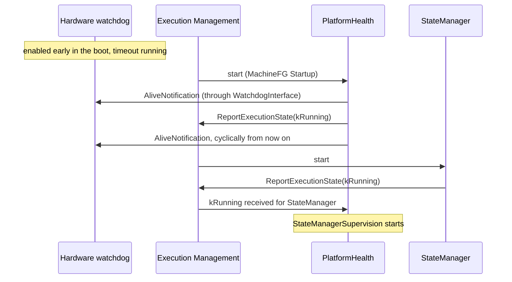

**Shutdown.** After receiving `SIGTERM`, PHM stops all configured supervisions and sets all Global Supervision Statuses to `kDEACTIVATED` ([SWS_PHM_01253], [SWS_PHM_01254]). How the watchdog is handled during and after the shutdown of PHM is not specified (SWS, Section 7.7.2.1). Once PHM has terminated, it can no longer serve the watchdog (note in SWS, Section 7.7.2.1). The platform must therefore handle the watchdog for the last steps of the shutdown in an implementation-specific way.

### 13.6 Worked Example: StateManager Hangs

`StateManager` reports `MainLoop` every 100 ms. Now its main loop blocks. The alive supervision has a reference cycle of 1 s, 10 expected indications, margins of 2 and a tolerance of 1.

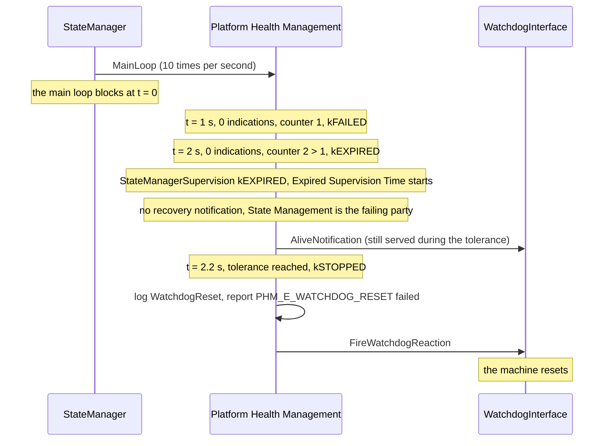

After the reset, the platform starts again. Because the watchdog reset terminates processes very quickly, the production error may not have been persisted; the specification suggests evaluating the hardware reset status register at the next startup ([Section 16.5](#165-production-error-phm_e_watchdog_reset)).

> **Key takeaways**
>
> - PHM is the only cluster with a watchdog interface; the watchdog supervises PHM in turn.
> - `AliveNotification` keeps the watchdog served; `FireWatchdogReaction` fires it in five well-defined situations.
> - Failures of State Management and Execution Management end in `kSTOPPED` and a reset; `expiredSupervisionTolerance` leaves time to store the error cause.
> - The supervision of EM is largely vendor-specific; that of State Management is configured like an application's.
> - PHM serves the watchdog before it reports `kRunning`; watchdog handling after PHM's shutdown is not specified.

---

## 14. Configuration Reference: What to Configure

> **Why this matters:** Most PHM problems in integration are configuration problems: a contribution that is never enabled, a checkpoint ID that differs from the code, a state in which a process runs without a mode, a recovery notification that points to the wrong port. This chapter lists everything that you must or can configure for PHM, what each setting means, and what happens at run time.

[Chapter 4](#4-configuration-overview) gave the map. This chapter goes through the elements one by one. Each section starts with the purpose of the element, where it lives and who typically configures it, followed by a table with these columns:

- **Meaning:** what the attribute says, in plain words.
- **Type and values:** the meta-model type. `TimeValue` is in seconds.
- **Mult.:** the multiplicity in the class table of the TPS (Sections 4.8 and 12.3). Many attributes are `0..1` in the class table and made mandatory by a constraint; the *Rules* column says so.
- **If absent:** the PHM specification defines no default values (SWS, Section 10.1). This column gives the behavior that a requirement states for a missing attribute, or "not specified".
- **Rules:** the constraints. The TPS constraints of this chapter have the imposition time `IT_Mani` or `IT_BefAraApiGen`, so the tooling checks them when the manifests or the API are generated.
- **Effect at run time:** what PHM does with the value, with a link to the section that explains it.

[Section 14.15](#1415-the-running-example-complete-configuration) shows all values of the running example as ARXML, with the XML names.

### 14.1 Minimal Configuration

The following checklist is the smallest configuration with which PHM supervises `Fusion` and notifies `StateManager`. Each step names the element and whether it is mandatory.

1. **Supervised Entity interface** (mandatory, application design). A `PhmSupervisedEntityInterface` with a namespace and one `PhmCheckpoint` with a `checkpointId` per checkpoint (`FusionCycle`; [Section 14.2](#142-phmsupervisedentityinterface-and-phmcheckpoint)).
2. **R-port** (mandatory, application design). An R-port of the component, typed by the interface (`FusionCyclePort` of `FusionSwc`). The executable must report its Execution State ([constr_3795]).
3. **Recovery port** (mandatory for a notification, design of State Management). A `PhmSupervisionRecoveryNotificationInterface` and a P-port of State Management typed by it (`SupervisionRecovery`, `PhmRecoveryPort`; [Section 14.3](#143-phmsupervisionrecoverynotificationinterface)).
4. **Contribution and supervision checkpoints** (mandatory, deployment). A `PlatformHealthManagementContribution` with one `SupervisionCheckpoint` per checkpoint, port and process, each with the same `checkpointId` as in the design (`AdasPhm`; [Section 14.5](#145-supervisioncheckpoint)).
5. **Global Supervision** (mandatory). At least one alive, deadline or logical supervision, the `CheckpointTransition`s they use, and `expiredSupervisionTolerance` (`FusionSupervision`; [Section 14.6](#146-globalsupervision) to [Section 14.10](#1410-logicalsupervision)).
6. **Supervision Mode** (mandatory). A `SupervisionModeCondition` with the states in which the process runs, and a `SupervisionMode` that references the condition and the active supervisions (`AdasNormal`, `FusionInNormal`; [Section 14.7](#147-supervisionmode-supervisionmodecondition-and-functiongroupphmstatereference)).
7. **Health channel and recovery notification** (mandatory for a notification). A `HealthChannelSupervision` that references the Global Supervision and a `RecoveryNotification` with `recoveryNotificationTimeout` (`FusionHealth`, `AdasRecovery`; [Section 14.12](#1412-healthchannelsupervision), [Section 14.13](#1413-recoverynotification-and-recoverynotificationtopportprototypemapping)).
8. **Recovery mapping** (mandatory for a notification). A `RecoveryNotificationToPPortPrototypeMapping` to the State Management process and its P-port (`AdasRecoveryToStateManager`).
9. **Machine mapping** (mandatory). A `PhmContributionToMachineMapping` that enables the contribution on the Machine (`AdasPhmToHpc`; [Section 14.4](#144-platformhealthmanagementcontribution-and-phmcontributiontomachinemapping)).
10. **Execution error** (optional, recommended). A `processExecutionError` in the `StartupConfig` of the supervised process, so that State Management can tell which process failed (`Fusion`: 42; [Section 14.14](#1414-related-settings-outside-phm)).
11. **Software Cluster** (mandatory where Software Clusters are used). The new elements belong to the Software Cluster of the supervised application ([Section 14.15](#1415-the-running-example-complete-configuration)).

> **Pitfall:** Steps 7 and 8 are easy to forget, because the supervision itself works without them. But for an application Global Supervision without a recovery notification, the specification defines no reaction at all: the supervision expires, and nobody is told.

### 14.2 PhmSupervisedEntityInterface and PhmCheckpoint

**Purpose:** declare a Supervised Entity and its checkpoints. **Lives in:** application design, recommended package `PlatformHealthManagementInterfaces`. **Configured by:** application developer. **Spec:** TPS Section 4.8.2, Tables 4.51 and 4.52; [TPS_MANI_03500].

| Attribute | Meaning | Type and values | Mult. | If absent | Rules | Effect at run time |
| --- | --- | --- | --- | --- | --- | --- |
| `PhmSupervisedEntityInterface.checkpoint` | The checkpoints that can be reported on this Supervised Entity | `PhmCheckpoint` (aggregation) | `*` | No checkpoints | | One enumerator each in the generated header ([SWS_PHM_00424]); [Section 5.1](#51-from-model-to-code) |
| `PhmSupervisedEntityInterface.namespace` (from `PortInterface`) | The C++ namespace of the generated enumeration | `SymbolProps`, ordered | `*` | Not specified | Shall exist ([SWS_PHM_CONSTR_00001]) | Namespace and header path ([SWS_PHM_01005], [SWS_PHM_01002]) |
| `PhmCheckpoint.checkpointId` | The number that identifies the checkpoint when it is reported | `PositiveInteger` | `0..1` | Not specified | Shall be defined ([constr_3530], [constr_10151]) | Value of the enumerator ([SWS_PHM_00425]); replicated in `SupervisionCheckpoint.checkpointId` |

The design declares no relation between checkpoints, such as an order or a timing. These are defined only in the target configuration (TPS, Section 4.8.2). In an executable of category `APPLICATION_LEVEL`, the interface may type only R-ports ([constr_1727]). The code constructs one `SupervisedEntity` per R-port, with the port's instance specifier.

### 14.3 PhmSupervisionRecoveryNotificationInterface

**Purpose:** the port interface on which State Management receives recovery notifications. **Lives in:** application design of State Management, recommended package `PlatformHealthManagementInterfaces`. **Configured by:** State Management developer. **Spec:** TPS Section 4.8.3, Table 4.53; [TPS_MANI_01280].

The interface has no attributes. A P-port typed by it is "the mechanism for activating the code on the level of State Management software" ([TPS_MANI_01280]). In an executable of category `APPLICATION_LEVEL`, it may type only P-ports ([constr_1729]). In the code, the class `ara::phm::RecoveryAction` is bound to this interface ([SWS_PHM_01140]); constructing a `RecoveryAction` with a port of another type raises a `PortInterfaceMappingViolation` ([SWS_PHM_01141]).

> **Note:** Two other names appear in the documents. The TPS also defines a draft `StateManagementPhmErrorInterface`, with which State Management would accept "error submissions from the platform health management" (TPS, Section 4.5.4). Neither the PHM nor the State Management specification uses it, and R25-11 does not explain how it relates to `PhmSupervisionRecoveryNotificationInterface`. The *SW Architecture* (Section 9.6.1) and the parameter description of [SWS_PHM_01141] name the interface `PhmRecoveryActionInterface`, which has no class table in the R25-11 TPS. This guide follows the PHM specification, Section 8.1.

### 14.4 PlatformHealthManagementContribution and PhmContributionToMachineMapping

**Purpose:** a self-contained part of the PHM configuration, and its activation on a Machine. **Lives in:** deployment, recommended packages `PlatformHealthManagementContributions` and `PhmContributionToMachineMappings`. **Configured by:** integrator. **Spec:** TPS Section 12.3.1, Tables 12.17 and 12.18; [TPS_MANI_03544].

| Attribute | Meaning | Type and values | Mult. | If absent | Rules | Effect at run time |
| --- | --- | --- | --- | --- | --- | --- |
| `checkpoint` | The supervision checkpoints of this contribution | `SupervisionCheckpoint` (aggregation, splitable) | `*` | None | | [Section 14.5](#145-supervisioncheckpoint) |
| `supervisionModeCondition` | The mode conditions | `SupervisionModeCondition` (aggregation, splitable) | `*` | None | | [Section 14.7](#147-supervisionmode-supervisionmodecondition-and-functiongroupphmstatereference) |
| `globalSupervision` | The Global Supervisions | `GlobalSupervision` (aggregation, splitable) | `*` | None | | [Section 14.6](#146-globalsupervision) |
| `healthChannel` | The links from Global Supervisions to recovery notifications | `HealthChannel`, in R25-11 always `HealthChannelSupervision` (aggregation, splitable) | `*` | None | | [Section 14.12](#1412-healthchannelsupervision) |
| `PhmContributionToMachineMapping.machine` | The Machine on which the contributions apply | Reference to `Machine` | `0..1` | Not specified | | |
| `PhmContributionToMachineMapping.phmContribution` | The contributions enabled on that Machine | References to `PlatformHealthManagementContribution` | `*` | None | A contribution takes effect only through such a mapping ([TPS_MANI_03502]) | Without it, PHM does not apply the contribution |

References from the elements of one contribution "shall only refer to elements that are part of the same" contribution ([constr_3568]). The constraint cannot mean the references to processes, ports and recovery notifications, which lie outside every contribution; read it as "the supervisions, transitions, modes and checkpoints of one contribution form a closed set". Both elements are uploadable, so they belong to a Software Cluster.

### 14.5 SupervisionCheckpoint

**Purpose:** the deployed representation of one checkpoint of one Supervised Entity Instance in one process. **Lives in:** a `PlatformHealthManagementContribution`. **Configured by:** integrator. **Spec:** TPS Section 12.3.3, Table 12.19.

| Attribute | Meaning | Type and values | Mult. | If absent | Rules | Effect at run time |
| --- | --- | --- | --- | --- | --- | --- |
| `checkpointId` | The number of the checkpoint, replicated from the design | `PositiveInteger` | `0..1` | Not specified | Same value as `PhmCheckpoint.checkpointId` ([TPS_MANI_03626]) | PHM matches reports by this number ([Section 4.3](#43-the-checkpoint-id-contract)) |
| `phmCheckpoint` | The checkpoint in its context: executable root, component prototypes, R-port | Instance reference `PhmCheckpointInExecutableInstanceRef` | `0..1` | Not specified | Shall exist ([constr_1742]); each checkpoint instance is represented once per process ([constr_1764]) | Identifies the Supervised Entity Instance |
| `process` | The process whose reports count | Reference to `Process` | `0..1` | Not specified | Mandatory, except for checkpoints of EM ([TPS_MANI_03651]); the process must run the executable of the port ([constr_3649]) | Reports from other processes are ignored ([SWS_PHM_01229]); [Section 5.4](#54-who-may-report-a-checkpoint) |

Every checkpoint that a process may report must have a `SupervisionCheckpoint` ([TPS_MANI_03505]). The instance reference has the context roles `contextRootSwComponentPrototype`, `contextComponentPrototype` and `contextRPortPrototype` and the target role `targetPhmCheckpoint` (TPS, Section D.6).

> **Note:** The text of [TPS_MANI_03626] says that the value of `SupervisionCheckpoint.phmCheckpoint` must equal `PhmCheckpoint.checkpointId`. `phmCheckpoint` is the instance reference, so the rule can only mean `SupervisionCheckpoint.checkpointId`, as TPS Figure 12.9 shows.

### 14.6 GlobalSupervision

**Purpose:** a group of supervisions with one aggregated status. **Lives in:** a `PlatformHealthManagementContribution`. **Configured by:** integrator. **Spec:** TPS Section 12.3.3.1, Table 12.20.

| Attribute | Meaning | Type and values | Mult. | If absent | Rules | Effect at run time |
| --- | --- | --- | --- | --- | --- | --- |
| `aliveSupervision` | The alive supervisions of the group | `AliveSupervision` | `*` | None | At least one alive, deadline or logical supervision ([constr_3624]) | [Chapter 6](#6-alive-supervision) |
| `deadlineSupervision` | The deadline supervisions | `DeadlineSupervision` | `*` | None | May use only transitions of this Global Supervision ([constr_3625]) | [Chapter 7](#7-deadline-supervision) |
| `logicalSupervision` | The logical supervisions | `LogicalSupervision` | `*` | None | May use only transitions of this Global Supervision ([constr_3626]) | [Chapter 8](#8-logical-supervision) |
| `noCheckpointSupervision` | Checkpoints excluded from supervision | `NoCheckpointSupervision` | `*` | None | | [Section 11.3](#113-excluding-supervision-nosupervision-and-nocheckpointsupervision) |
| `noSupervision` | Supervised Entity Instances excluded from supervision | `NoSupervision` | `*` | None | | [Section 11.3](#113-excluding-supervision-nosupervision-and-nocheckpointsupervision) |
| `transition` | The transitions between checkpoints | `CheckpointTransition` | `*` | None | | [Section 14.9](#149-checkpointtransition-and-deadlinesupervision) |
| `supervisionMode` | The modes of the group | `SupervisionMode` (splitable) | `*` | No mode: nothing is active | | [Chapter 11](#11-supervision-modes-and-function-group-state-changes) |
| `expiredSupervisionTolerance` | How long the group may stay `kEXPIRED` before it is `kSTOPPED` | `TimeValue` | `0..1` | Not specified | Shall exist ([constr_3823]); [TPS_MANI_03514] | Only for OS, EM and SM supervisions: delays the watchdog reaction ([Section 9.3](#93-kstopped-and-the-expired-supervision-tolerance)) |

Three constraints bind a Global Supervision to one Function Group: its mode conditions reference states of one Function Group, its processes run in states of that Function Group, and the two are the same Function Group ([constr_3629], [constr_3630], [constr_3631]). All checkpoints of one Supervised Entity Instance belong to one Global Supervision ([constr_3623]). The supervisions may refer to checkpoints of different processes ([TPS_MANI_03512]).

### 14.7 SupervisionMode, SupervisionModeCondition and FunctionGroupPhmStateReference

**Purpose:** which supervisions are active in which Function Group States. **Lives in:** a Global Supervision (modes) and the contribution (conditions). **Configured by:** integrator. **Spec:** TPS Sections 12.3.3.2 and 12.3.3.3, Tables 12.21 to 12.23.

| Attribute | Meaning | Type and values | Mult. | If absent | Rules | Effect at run time |
| --- | --- | --- | --- | --- | --- | --- |
| `SupervisionMode.activeSupervision` | The supervisions active in this mode | References to `PhmSupervision` (alive, deadline, logical, `NoSupervision`, `NoCheckpointSupervision`) | `*` | Nothing is supervised in this mode | A supervision may be active in several modes ([TPS_MANI_03633]); per mode, one alive supervision per checkpoint ([constr_3539]) | Evaluated for the Global Supervision status in this mode ([TPS_MANI_03513]) |
| `SupervisionMode.modeCondition` | When the mode is active | Reference to `SupervisionModeCondition` | `0..1` | Not specified | Shall exist ([constr_3640]) | |
| `SupervisionModeCondition.stateReference` | The Function Group States of the condition, any of which activates it | `FunctionGroupPhmStateReference` | `*` | Not specified | At least one ([constr_3627]); a state in at most one condition per Global Supervision ([constr_3628]) | [Section 11.1](#111-supervision-modes-and-mode-conditions) |
| `FunctionGroupPhmStateReference.functionGroupState` | One Function Group State | Instance reference `FunctionGroupStateInFunctionGroupSetInstanceRef` to a `ModeDeclaration` | `0..1` | Not specified | | |

Every Supervised Entity Instance must be covered in every Function Group State in which its process runs ([constr_3632]). If a process keeps running across two states, configure the same active supervisions for both (TPS, note after Figure 12.14; [Section 11.2](#112-what-happens-on-a-function-group-state-change)).

### 14.8 AliveSupervision

**Purpose:** alive supervision of one checkpoint. **Lives in:** a Global Supervision. **Configured by:** integrator. **Spec:** TPS Section 12.3.3.5, Table 12.25; [TPS_MANI_03508].

| Attribute | Meaning | Type and values | Mult. | If absent | Rules | Effect at run time |
| --- | --- | --- | --- | --- | --- | --- |
| `checkpoint` | The supervised checkpoint | Reference to `SupervisionCheckpoint` | `0..1` | Not specified | Mandatory ([constr_3633]) | Its reports are the Alive Indications |
| `aliveReferenceCycle` | The window in which the indications are counted | `TimeValue` | `0..1` | Not specified | Mandatory ([constr_3633]) | Examination period ([ASWS_HM_00098]) |
| `expectedAliveIndications` | The expected number of indications per window | `PositiveInteger` | `0..1` | Not specified | Mandatory ([constr_3633]) | [Section 6.2](#62-the-algorithm-alive-counter-reference-cycle-and-margins) |
| `minMargin` | How many indications may be missing | `PositiveInteger` | `0..1` | Not specified | Mandatory ([constr_3633]); 0 means no minimum check ([TPS_MANI_03575]) | Lower limit ([ASWS_HM_00074]); [Section 6.4](#64-margins-with-a-special-meaning) |
| `maxMargin` | How many extra indications are acceptable | `PositiveInteger` | `0..1` | Not specified | Mandatory ([constr_3633]); INF means no maximum check ([TPS_MANI_03576]) | Upper limit ([ASWS_HM_00074]) |
| `failedReferenceCyclesTolerance` | How many failed windows are tolerated | `PositiveInteger` | `0..1` | Not specified | Mandatory ([constr_3633]); [TPS_MANI_03515] | `kFAILED` up to this count, then `kEXPIRED` ([Section 6.3](#63-debouncing-with-failedreferencecyclestolerance)) |
| `terminatingCheckpoint` | The checkpoint with which a self-terminating process announces its end | Reference to `SupervisionCheckpoint` | `0..1` | No terminating checkpoint | Required if and only if the process is self-terminating in this mode ([constr_3709]); same process as `checkpoint` ([constr_3710]) | [Section 10.4](#104-self-terminating-processes-and-the-terminating-checkpoint) |
| `terminatingCheckpointTimeoutUntilTermination` | How soon the process must terminate after the terminating checkpoint | `TimeValue` | `0..1` | Not specified | Required with `terminatingCheckpoint` ([constr_3711]) | Otherwise PHM notifies State Management ([SWS_PHM_01336]) |

### 14.9 CheckpointTransition and DeadlineSupervision

**Purpose:** a transition between two checkpoints, and the timing of one transition. **Lives in:** a Global Supervision. **Configured by:** integrator. **Spec:** TPS Sections 12.3.3.6 and 12.3.3.8, Tables 12.26 and 12.28; [TPS_MANI_03509], [TPS_MANI_03511].

| Attribute | Meaning | Type and values | Mult. | If absent | Rules | Effect at run time |
| --- | --- | --- | --- | --- | --- | --- |
| `CheckpointTransition.source` | The checkpoint where the transition starts | Reference to `SupervisionCheckpoint` | `0..1` | Not specified | Exactly one ([constr_3634]) | Deadline: starts the measurement |
| `CheckpointTransition.target` | The checkpoint where it ends | Reference to `SupervisionCheckpoint` | `0..1` | Not specified | Exactly one ([constr_3634]) | Deadline: ends the measurement |
| `DeadlineSupervision.transition` | The supervised transition | Reference to `CheckpointTransition` | `0..1` | Not specified | Mandatory ([constr_3635]); of the same Global Supervision ([constr_3625]) | [Section 7.3](#73-the-algorithm) |
| `DeadlineSupervision.minDeadline` | The shortest allowed time | `TimeValue` | `0..1` | Not specified | Mandatory ([constr_3635]); 0 means no minimum check ([TPS_MANI_03573]) | Too early: incorrect ([ASWS_HM_00294]) |
| `DeadlineSupervision.maxDeadline` | The longest allowed time | `TimeValue` | `0..1` | Not specified | Mandatory ([constr_3635]); INF means no maximum check ([TPS_MANI_03574]) | Too late or missing: incorrect ([ASWS_HM_00294], [ASWS_HM_00228]) |

### 14.10 LogicalSupervision

**Purpose:** a graph of allowed checkpoint sequences. **Lives in:** a Global Supervision. **Configured by:** integrator. **Spec:** TPS Section 12.3.3.7, Table 12.27; [TPS_MANI_03510].

| Attribute | Meaning | Type and values | Mult. | If absent | Rules | Effect at run time |
| --- | --- | --- | --- | --- | --- | --- |
| `initialCheckpoint` | The checkpoints with which the graph may start | References to `SupervisionCheckpoint` | `*` | Not specified | At least one ([constr_1736]) | [Section 8.3](#83-the-algorithm) |
| `finalCheckpoint` | The checkpoints that end the graph | References to `SupervisionCheckpoint` | `*` | Not specified | At least one ([constr_1737]) | The graph becomes inactive ([ASWS_HM_00331]) |
| `transition` | The allowed transitions | References to `CheckpointTransition` | `*` | Not specified | At least one ([constr_1740]); of the same Global Supervision ([constr_3626]) | A report without a transition from the last checkpoint is incorrect ([ASWS_HM_00252]) |

A checkpoint belongs to at most one graph per mode ([constr_3540]).

### 14.11 NoSupervision and NoCheckpointSupervision

**Purpose:** explicit exclusion from supervision. **Lives in:** a Global Supervision. **Configured by:** integrator. **Spec:** TPS Sections 12.3.3.4 and 12.3.3.9, Tables 12.24 and 12.29.

| Attribute | Meaning | Type and values | Mult. | If absent | Rules | Effect at run time |
| --- | --- | --- | --- | --- | --- | --- |
| `NoSupervision.targetPhmSupervisedEntity` | The R-port of the excluded Supervised Entity Instance | Instance reference `RPortPrototypeInExecutableInstanceRef` | `0..1` | Not specified | Shall exist ([constr_3674]) | No supervision of the instance in the mode ([SWS_PHM_00244], [SWS_PHM_00245]) |
| `NoSupervision.process` | The process of that instance | Reference to `Process` | `0..1` | Not specified | Shall exist ([constr_3675]); not together with checkpoint supervisions of the same instance in a mode ([constr_3676]) | |
| `NoCheckpointSupervision.checkpoint` | The excluded checkpoints | References to `SupervisionCheckpoint` | `*` | None | Not used by any other supervision in the same mode ([constr_3712]) | Reports are ignored ([SWS_PHM_01341]) |

### 14.12 HealthChannelSupervision

**Purpose:** connect a Global Supervision to a recovery notification. **Lives in:** a `PlatformHealthManagementContribution`. **Configured by:** integrator. **Spec:** TPS Section 12.3.4, Tables 12.30 and 12.31.

| Attribute | Meaning | Type and values | Mult. | If absent | Rules | Effect at run time |
| --- | --- | --- | --- | --- | --- | --- |
| `supervision` | The Global Supervision whose status triggers the notification | Reference to `GlobalSupervision` | `0..1` | Not specified | | Its switch to `kEXPIRED` triggers the notification ([TPS_MANI_03516]; [SWS_PHM_00101]) |
| `recoveryNotification` (from `HealthChannel`) | The notification to trigger | References to `RecoveryNotification` | `*` | No notification | At most one ([constr_3730]); one notification may serve several health channels ([TPS_MANI_03673]) | [Section 12.1](#121-the-recovery-chain) |

The TPS states that the "only purpose" of `HealthChannel` and `HealthChannelSupervision` is this mapping and that they "carry no further semantics" (TPS, Section 12.3.4). The name is a remainder of the health channels that were removed in R24-11 ([Section 2.6](#26-health-monitoring-and-phm-who-specifies-what)).

### 14.13 RecoveryNotification and RecoveryNotificationToPPortPrototypeMapping

**Purpose:** the notification and its delivery to a State Management port. **Lives in:** deployment, recommended packages `RecoveryNotifications` and `RecoveryNotificationMappings`. **Configured by:** integrator. **Spec:** TPS Section 12.3.5, Tables 12.32 and 12.33.

| Attribute | Meaning | Type and values | Mult. | If absent | Rules | Effect at run time |
| --- | --- | --- | --- | --- | --- | --- |
| `RecoveryNotification.recoveryNotificationTimeout` | The longest time PHM waits for State Management's acknowledgment | `TimeValue` (seconds) | `0..1` | Not specified | | Exceeded: watchdog reaction ([SWS_PHM_00104]); [Section 12.4](#124-when-the-notification-fails) |
| `RecoveryNotificationToPPortPrototypeMapping.recoveryNotification` | The mapped notification | Reference to `RecoveryNotification` | `0..1` | Not specified | Shall exist ([constr_3612]) | |
| `RecoveryNotificationToPPortPrototypeMapping.process` | The State Management process that handles the recovery | Reference to `Process` | `0..1` | Not specified | Shall exist ([constr_3612]) | |
| `RecoveryNotificationToPPortPrototypeMapping.recoveryAction` | The P-port that receives the notification | Instance reference `PPortPrototypeInExecutableInstanceRef` | `0..1` | Not specified | Shall exist ([constr_3612]); typed by `PhmSupervisionRecoveryNotificationInterface` ([constr_3613]) | The `RecoveryAction` constructed for this port receives the call ([SWS_PHM_01141]) |

### 14.14 Related Settings Outside PHM

PHM also reads settings of other elements, which the EM guide and guide 02 describe in detail.

| Element and attribute | What PHM does with it | Spec |
| --- | --- | --- |
| `Executable.reportingBehavior` | A non-reporting executable must not have a supervised entity port; it cannot be supervised | [constr_3795]; [Section 10.5](#105-processes-that-cannot-or-need-not-be-supervised) |
| `Process.functionClusterAffiliation` | `STATE_MANAGEMENT` identifies the supervisions of State Management, which lead to `kSTOPPED` and the watchdog | [TPS_MANI_01337]; note to [SWS_PHM_01355] |
| `StartupConfig.processExecutionError` (status draft) | Passed to State Management in `RecoveryHandler`; 1 if absent | [SWS_PHM_00101], [SWS_PHM_01361] |
| `StartupConfig.terminationBehavior` | `processIsSelfTerminating` requires a terminating checkpoint in alive supervisions of that mode | [constr_3709] |
| `StateDependentStartupConfig.functionGroupState` | Defines the states in which a process runs, and therefore where it needs a Supervision Mode | [constr_3630], [constr_3632] |

### 14.15 The Running Example: Complete Configuration

The following three files contain the complete PHM configuration of `HPC`. They continue the seven files of [guide 02, Section 12.16](02_Manifests.md#1216-the-running-example-complete-configuration) and use their packages, executables, processes, Function Groups and the Machine. Each file validates against the R25-11 schema `AUTOSAR_00054.xsd`. Merged with the seven files of guide 02 and the standardized package `/AUTOSAR/StdTypes`, all references resolve to elements of the `DEST` type, and the model satisfies the constraints cited in this chapter.

The files rely on the splitting rules of [guide 02, Section 3.7](02_Manifests.md#37-many-files-one-model). Ports of a component type are splitable, so `08_PhmDesign.arxml` adds the PHM ports to `CameraDriverSwc` and `FusionSwc` without changing `02_ApplicationDesign.arxml` ([TPS_GST_00414], [TPS_GST_00415]). The contained elements of a Software Cluster are splitable too, so `09` and `10` add their elements to `AdasCluster` and `HpcPlatformCore`. Only the contained processes of a Software Cluster are not splitable. The new process `StateManager` must therefore be added to `HpcPlatformCore` in `07_SoftwareClusters.arxml` itself, after its `CONTAINED-PACKAGE-ELEMENT-REFS`:

```xml
<!-- Addition to HpcPlatformCore in 07_SoftwareClusters.arxml of guide 02 -->
              <CONTAINED-PROCESS-REFS>
                <CONTAINED-PROCESS-REF DEST="PROCESS">/HPC/Processes/StateManager</CONTAINED-PROCESS-REF>
              </CONTAINED-PROCESS-REFS>
```

Because guide 02 does not model `StateManager`, `10_PhmPlatformContribution.arxml` also contains the process `StateManager` with its startup configuration and its mapping to `HPC`, and `08_PhmDesign.arxml` its executable `state_manager`. Their content follows the EM guide ([Section 13.11](04_ExecutionManagement.md#1311-the-running-example-complete-configuration)); the State Client ports of `StateManagerSwc` are not part of this model. Open a file to see its content.

<details>
<summary><code>08_PhmDesign.arxml</code>: Supervised Entity interfaces, the recovery interface, the PHM ports and the executable `state_manager` (149 lines)</summary>

```xml
<?xml version="1.0" encoding="UTF-8"?>
<AUTOSAR xmlns="http://autosar.org/schema/r4.0" xmlns:xsi="http://www.w3.org/2001/XMLSchema-instance" xsi:schemaLocation="http://autosar.org/schema/r4.0 AUTOSAR_00054.xsd">
  <AR-PACKAGES>
    <AR-PACKAGE>
      <SHORT-NAME>HPC</SHORT-NAME>
      <AR-PACKAGES>
        <AR-PACKAGE>
          <SHORT-NAME>PlatformHealthManagementInterfaces</SHORT-NAME>
          <ELEMENTS>
            <PHM-SUPERVISED-ENTITY-INTERFACE>
              <SHORT-NAME>FusionCycle</SHORT-NAME>
              <NAMESPACES>
                <SYMBOL-PROPS>
                  <SHORT-NAME>Ns1</SHORT-NAME>
                  <SYMBOL>hpc</SYMBOL>
                </SYMBOL-PROPS>
                <SYMBOL-PROPS>
                  <SHORT-NAME>Ns2</SHORT-NAME>
                  <SYMBOL>fusion</SYMBOL>
                </SYMBOL-PROPS>
              </NAMESPACES>
              <CHECKPOINTS>
                <PHM-CHECKPOINT>
                  <SHORT-NAME>CycleStart</SHORT-NAME>
                  <CHECKPOINT-ID>1</CHECKPOINT-ID>
                </PHM-CHECKPOINT>
                <PHM-CHECKPOINT>
                  <SHORT-NAME>InputsRead</SHORT-NAME>
                  <CHECKPOINT-ID>2</CHECKPOINT-ID>
                </PHM-CHECKPOINT>
                <PHM-CHECKPOINT>
                  <SHORT-NAME>ObjectsPublished</SHORT-NAME>
                  <CHECKPOINT-ID>3</CHECKPOINT-ID>
                </PHM-CHECKPOINT>
                <PHM-CHECKPOINT>
                  <SHORT-NAME>CycleEnd</SHORT-NAME>
                  <CHECKPOINT-ID>4</CHECKPOINT-ID>
                </PHM-CHECKPOINT>
              </CHECKPOINTS>
            </PHM-SUPERVISED-ENTITY-INTERFACE>
            <PHM-SUPERVISED-ENTITY-INTERFACE>
              <SHORT-NAME>CameraImageLoop</SHORT-NAME>
              <NAMESPACES>
                <SYMBOL-PROPS>
                  <SHORT-NAME>Ns1</SHORT-NAME>
                  <SYMBOL>hpc</SYMBOL>
                </SYMBOL-PROPS>
                <SYMBOL-PROPS>
                  <SHORT-NAME>Ns2</SHORT-NAME>
                  <SYMBOL>camera</SYMBOL>
                </SYMBOL-PROPS>
              </NAMESPACES>
              <CHECKPOINTS>
                <PHM-CHECKPOINT>
                  <SHORT-NAME>ImageCaptured</SHORT-NAME>
                  <CHECKPOINT-ID>1</CHECKPOINT-ID>
                </PHM-CHECKPOINT>
              </CHECKPOINTS>
            </PHM-SUPERVISED-ENTITY-INTERFACE>
            <PHM-SUPERVISED-ENTITY-INTERFACE>
              <SHORT-NAME>StateManagerHeartbeat</SHORT-NAME>
              <NAMESPACES>
                <SYMBOL-PROPS>
                  <SHORT-NAME>Ns1</SHORT-NAME>
                  <SYMBOL>hpc</SYMBOL>
                </SYMBOL-PROPS>
                <SYMBOL-PROPS>
                  <SHORT-NAME>Ns2</SHORT-NAME>
                  <SYMBOL>sm</SYMBOL>
                </SYMBOL-PROPS>
              </NAMESPACES>
              <CHECKPOINTS>
                <PHM-CHECKPOINT>
                  <SHORT-NAME>MainLoop</SHORT-NAME>
                  <CHECKPOINT-ID>1</CHECKPOINT-ID>
                </PHM-CHECKPOINT>
              </CHECKPOINTS>
            </PHM-SUPERVISED-ENTITY-INTERFACE>
            <PHM-SUPERVISION-RECOVERY-NOTIFICATION-INTERFACE>
              <SHORT-NAME>SupervisionRecovery</SHORT-NAME>
            </PHM-SUPERVISION-RECOVERY-NOTIFICATION-INTERFACE>
          </ELEMENTS>
        </AR-PACKAGE>
        <AR-PACKAGE>
          <SHORT-NAME>AdaptiveApplicationSwComponentTypes</SHORT-NAME>
          <ELEMENTS>
            <ADAPTIVE-APPLICATION-SW-COMPONENT-TYPE>
              <SHORT-NAME>CameraDriverSwc</SHORT-NAME>
              <PORTS>
                <R-PORT-PROTOTYPE>
                  <SHORT-NAME>ImageLoopPort</SHORT-NAME>
                  <REQUIRED-INTERFACE-TREF DEST="PHM-SUPERVISED-ENTITY-INTERFACE">/HPC/PlatformHealthManagementInterfaces/CameraImageLoop</REQUIRED-INTERFACE-TREF>
                </R-PORT-PROTOTYPE>
              </PORTS>
            </ADAPTIVE-APPLICATION-SW-COMPONENT-TYPE>
            <ADAPTIVE-APPLICATION-SW-COMPONENT-TYPE>
              <SHORT-NAME>FusionSwc</SHORT-NAME>
              <PORTS>
                <R-PORT-PROTOTYPE>
                  <SHORT-NAME>FusionCyclePort</SHORT-NAME>
                  <REQUIRED-INTERFACE-TREF DEST="PHM-SUPERVISED-ENTITY-INTERFACE">/HPC/PlatformHealthManagementInterfaces/FusionCycle</REQUIRED-INTERFACE-TREF>
                </R-PORT-PROTOTYPE>
              </PORTS>
            </ADAPTIVE-APPLICATION-SW-COMPONENT-TYPE>
            <ADAPTIVE-APPLICATION-SW-COMPONENT-TYPE>
              <SHORT-NAME>StateManagerSwc</SHORT-NAME>
              <PORTS>
                <P-PORT-PROTOTYPE>
                  <SHORT-NAME>PhmRecoveryPort</SHORT-NAME>
                  <PROVIDED-INTERFACE-TREF DEST="PHM-SUPERVISION-RECOVERY-NOTIFICATION-INTERFACE">/HPC/PlatformHealthManagementInterfaces/SupervisionRecovery</PROVIDED-INTERFACE-TREF>
                </P-PORT-PROTOTYPE>
                <R-PORT-PROTOTYPE>
                  <SHORT-NAME>HeartbeatPort</SHORT-NAME>
                  <REQUIRED-INTERFACE-TREF DEST="PHM-SUPERVISED-ENTITY-INTERFACE">/HPC/PlatformHealthManagementInterfaces/StateManagerHeartbeat</REQUIRED-INTERFACE-TREF>
                </R-PORT-PROTOTYPE>
              </PORTS>
            </ADAPTIVE-APPLICATION-SW-COMPONENT-TYPE>
          </ELEMENTS>
        </AR-PACKAGE>
        <AR-PACKAGE>
          <SHORT-NAME>Executables</SHORT-NAME>
          <ELEMENTS>
            <EXECUTABLE>
              <SHORT-NAME>state_manager</SHORT-NAME>
              <CATEGORY>PLATFORM_LEVEL</CATEGORY>
              <REPORTING-BEHAVIOR>REPORTS-EXECUTION-STATE</REPORTING-BEHAVIOR>
              <ROOT-SW-COMPONENT-PROTOTYPE>
                <SHORT-NAME>Root</SHORT-NAME>
                <APPLICATION-TYPE-TREF DEST="ADAPTIVE-APPLICATION-SW-COMPONENT-TYPE">/HPC/AdaptiveApplicationSwComponentTypes/StateManagerSwc</APPLICATION-TYPE-TREF>
              </ROOT-SW-COMPONENT-PROTOTYPE>
              <VERSION>1.0.0</VERSION>
            </EXECUTABLE>
          </ELEMENTS>
        </AR-PACKAGE>
        <AR-PACKAGE>
          <SHORT-NAME>ProcessDesigns</SHORT-NAME>
          <ELEMENTS>
            <PROCESS-DESIGN>
              <SHORT-NAME>StateManagerDesign</SHORT-NAME>
              <EXECUTABLE-REFS>
                <EXECUTABLE-REF DEST="EXECUTABLE">/HPC/Executables/state_manager</EXECUTABLE-REF>
              </EXECUTABLE-REFS>
            </PROCESS-DESIGN>
          </ELEMENTS>
        </AR-PACKAGE>
      </AR-PACKAGES>
    </AR-PACKAGE>
  </AR-PACKAGES>
</AUTOSAR>
```

</details>

<details>
<summary><code>09_PhmAdasContribution.arxml</code>: the contribution `AdasPhm`, the recovery notification and the mappings of `AdasCluster` (275 lines)</summary>

```xml
<?xml version="1.0" encoding="UTF-8"?>
<AUTOSAR xmlns="http://autosar.org/schema/r4.0" xmlns:xsi="http://www.w3.org/2001/XMLSchema-instance" xsi:schemaLocation="http://autosar.org/schema/r4.0 AUTOSAR_00054.xsd">
  <AR-PACKAGES>
    <AR-PACKAGE>
      <SHORT-NAME>HPC</SHORT-NAME>
      <AR-PACKAGES>
        <AR-PACKAGE>
          <SHORT-NAME>PlatformHealthManagementContributions</SHORT-NAME>
          <ELEMENTS>
            <PLATFORM-HEALTH-MANAGEMENT-CONTRIBUTION>
              <SHORT-NAME>AdasPhm</SHORT-NAME>
              <CHECKPOINTS>
                <SUPERVISION-CHECKPOINT>
                  <SHORT-NAME>Fusion_CycleStart</SHORT-NAME>
                  <CHECKPOINT-ID>1</CHECKPOINT-ID>
                  <PHM-CHECKPOINT-IREF>
                    <CONTEXT-ROOT-SW-COMPONENT-PROTOTYPE-REF DEST="ROOT-SW-COMPONENT-PROTOTYPE">/HPC/Executables/fusion/Root</CONTEXT-ROOT-SW-COMPONENT-PROTOTYPE-REF>
                    <CONTEXT-R-PORT-PROTOTYPE-REF DEST="R-PORT-PROTOTYPE">/HPC/AdaptiveApplicationSwComponentTypes/FusionSwc/FusionCyclePort</CONTEXT-R-PORT-PROTOTYPE-REF>
                    <TARGET-PHM-CHECKPOINT-REF DEST="PHM-CHECKPOINT">/HPC/PlatformHealthManagementInterfaces/FusionCycle/CycleStart</TARGET-PHM-CHECKPOINT-REF>
                  </PHM-CHECKPOINT-IREF>
                  <PROCESS-REF DEST="PROCESS">/HPC/Processes/Fusion</PROCESS-REF>
                </SUPERVISION-CHECKPOINT>
                <SUPERVISION-CHECKPOINT>
                  <SHORT-NAME>Fusion_InputsRead</SHORT-NAME>
                  <CHECKPOINT-ID>2</CHECKPOINT-ID>
                  <PHM-CHECKPOINT-IREF>
                    <CONTEXT-ROOT-SW-COMPONENT-PROTOTYPE-REF DEST="ROOT-SW-COMPONENT-PROTOTYPE">/HPC/Executables/fusion/Root</CONTEXT-ROOT-SW-COMPONENT-PROTOTYPE-REF>
                    <CONTEXT-R-PORT-PROTOTYPE-REF DEST="R-PORT-PROTOTYPE">/HPC/AdaptiveApplicationSwComponentTypes/FusionSwc/FusionCyclePort</CONTEXT-R-PORT-PROTOTYPE-REF>
                    <TARGET-PHM-CHECKPOINT-REF DEST="PHM-CHECKPOINT">/HPC/PlatformHealthManagementInterfaces/FusionCycle/InputsRead</TARGET-PHM-CHECKPOINT-REF>
                  </PHM-CHECKPOINT-IREF>
                  <PROCESS-REF DEST="PROCESS">/HPC/Processes/Fusion</PROCESS-REF>
                </SUPERVISION-CHECKPOINT>
                <SUPERVISION-CHECKPOINT>
                  <SHORT-NAME>Fusion_ObjectsPublished</SHORT-NAME>
                  <CHECKPOINT-ID>3</CHECKPOINT-ID>
                  <PHM-CHECKPOINT-IREF>
                    <CONTEXT-ROOT-SW-COMPONENT-PROTOTYPE-REF DEST="ROOT-SW-COMPONENT-PROTOTYPE">/HPC/Executables/fusion/Root</CONTEXT-ROOT-SW-COMPONENT-PROTOTYPE-REF>
                    <CONTEXT-R-PORT-PROTOTYPE-REF DEST="R-PORT-PROTOTYPE">/HPC/AdaptiveApplicationSwComponentTypes/FusionSwc/FusionCyclePort</CONTEXT-R-PORT-PROTOTYPE-REF>
                    <TARGET-PHM-CHECKPOINT-REF DEST="PHM-CHECKPOINT">/HPC/PlatformHealthManagementInterfaces/FusionCycle/ObjectsPublished</TARGET-PHM-CHECKPOINT-REF>
                  </PHM-CHECKPOINT-IREF>
                  <PROCESS-REF DEST="PROCESS">/HPC/Processes/Fusion</PROCESS-REF>
                </SUPERVISION-CHECKPOINT>
                <SUPERVISION-CHECKPOINT>
                  <SHORT-NAME>Fusion_CycleEnd</SHORT-NAME>
                  <CHECKPOINT-ID>4</CHECKPOINT-ID>
                  <PHM-CHECKPOINT-IREF>
                    <CONTEXT-ROOT-SW-COMPONENT-PROTOTYPE-REF DEST="ROOT-SW-COMPONENT-PROTOTYPE">/HPC/Executables/fusion/Root</CONTEXT-ROOT-SW-COMPONENT-PROTOTYPE-REF>
                    <CONTEXT-R-PORT-PROTOTYPE-REF DEST="R-PORT-PROTOTYPE">/HPC/AdaptiveApplicationSwComponentTypes/FusionSwc/FusionCyclePort</CONTEXT-R-PORT-PROTOTYPE-REF>
                    <TARGET-PHM-CHECKPOINT-REF DEST="PHM-CHECKPOINT">/HPC/PlatformHealthManagementInterfaces/FusionCycle/CycleEnd</TARGET-PHM-CHECKPOINT-REF>
                  </PHM-CHECKPOINT-IREF>
                  <PROCESS-REF DEST="PROCESS">/HPC/Processes/Fusion</PROCESS-REF>
                </SUPERVISION-CHECKPOINT>
                <SUPERVISION-CHECKPOINT>
                  <SHORT-NAME>CameraDriver_ImageCaptured</SHORT-NAME>
                  <CHECKPOINT-ID>1</CHECKPOINT-ID>
                  <PHM-CHECKPOINT-IREF>
                    <CONTEXT-ROOT-SW-COMPONENT-PROTOTYPE-REF DEST="ROOT-SW-COMPONENT-PROTOTYPE">/HPC/Executables/camera_driver/Root</CONTEXT-ROOT-SW-COMPONENT-PROTOTYPE-REF>
                    <CONTEXT-R-PORT-PROTOTYPE-REF DEST="R-PORT-PROTOTYPE">/HPC/AdaptiveApplicationSwComponentTypes/CameraDriverSwc/ImageLoopPort</CONTEXT-R-PORT-PROTOTYPE-REF>
                    <TARGET-PHM-CHECKPOINT-REF DEST="PHM-CHECKPOINT">/HPC/PlatformHealthManagementInterfaces/CameraImageLoop/ImageCaptured</TARGET-PHM-CHECKPOINT-REF>
                  </PHM-CHECKPOINT-IREF>
                  <PROCESS-REF DEST="PROCESS">/HPC/Processes/CameraDriver</PROCESS-REF>
                </SUPERVISION-CHECKPOINT>
              </CHECKPOINTS>
              <SUPERVISION-MODE-CONDITIONS>
                <SUPERVISION-MODE-CONDITION>
                  <SHORT-NAME>AdasNormal</SHORT-NAME>
                  <STATE-REFERENCES>
                    <FUNCTION-GROUP-PHM-STATE-REFERENCE>
                      <FUNCTION-GROUP-STATE-IREF>
                        <CONTEXT-MODE-DECLARATION-GROUP-PROTOTYPE-REF DEST="MODE-DECLARATION-GROUP-PROTOTYPE">/HPC/FunctionGroupSets/AdasFunctionGroups/ADAS</CONTEXT-MODE-DECLARATION-GROUP-PROTOTYPE-REF>
                        <TARGET-MODE-DECLARATION-REF DEST="MODE-DECLARATION">/HPC/ModeDeclarationGroups/ADAS_States/Normal</TARGET-MODE-DECLARATION-REF>
                      </FUNCTION-GROUP-STATE-IREF>
                    </FUNCTION-GROUP-PHM-STATE-REFERENCE>
                  </STATE-REFERENCES>
                </SUPERVISION-MODE-CONDITION>
                <SUPERVISION-MODE-CONDITION>
                  <SHORT-NAME>AdasNormalOrDegraded</SHORT-NAME>
                  <STATE-REFERENCES>
                    <FUNCTION-GROUP-PHM-STATE-REFERENCE>
                      <FUNCTION-GROUP-STATE-IREF>
                        <CONTEXT-MODE-DECLARATION-GROUP-PROTOTYPE-REF DEST="MODE-DECLARATION-GROUP-PROTOTYPE">/HPC/FunctionGroupSets/AdasFunctionGroups/ADAS</CONTEXT-MODE-DECLARATION-GROUP-PROTOTYPE-REF>
                        <TARGET-MODE-DECLARATION-REF DEST="MODE-DECLARATION">/HPC/ModeDeclarationGroups/ADAS_States/Normal</TARGET-MODE-DECLARATION-REF>
                      </FUNCTION-GROUP-STATE-IREF>
                    </FUNCTION-GROUP-PHM-STATE-REFERENCE>
                    <FUNCTION-GROUP-PHM-STATE-REFERENCE>
                      <FUNCTION-GROUP-STATE-IREF>
                        <CONTEXT-MODE-DECLARATION-GROUP-PROTOTYPE-REF DEST="MODE-DECLARATION-GROUP-PROTOTYPE">/HPC/FunctionGroupSets/AdasFunctionGroups/ADAS</CONTEXT-MODE-DECLARATION-GROUP-PROTOTYPE-REF>
                        <TARGET-MODE-DECLARATION-REF DEST="MODE-DECLARATION">/HPC/ModeDeclarationGroups/ADAS_States/Degraded</TARGET-MODE-DECLARATION-REF>
                      </FUNCTION-GROUP-STATE-IREF>
                    </FUNCTION-GROUP-PHM-STATE-REFERENCE>
                  </STATE-REFERENCES>
                </SUPERVISION-MODE-CONDITION>
              </SUPERVISION-MODE-CONDITIONS>
              <GLOBAL-SUPERVISIONS>
                <GLOBAL-SUPERVISION>
                  <SHORT-NAME>FusionSupervision</SHORT-NAME>
                  <ALIVE-SUPERVISIONS>
                    <ALIVE-SUPERVISION>
                      <SHORT-NAME>FusionAlive</SHORT-NAME>
                      <ALIVE-REFERENCE-CYCLE>0.2</ALIVE-REFERENCE-CYCLE>
                      <CHECKPOINT-REF DEST="SUPERVISION-CHECKPOINT">/HPC/PlatformHealthManagementContributions/AdasPhm/Fusion_CycleStart</CHECKPOINT-REF>
                      <EXPECTED-ALIVE-INDICATIONS>4</EXPECTED-ALIVE-INDICATIONS>
                      <FAILED-REFERENCE-CYCLES-TOLERANCE>1</FAILED-REFERENCE-CYCLES-TOLERANCE>
                      <MAX-MARGIN>1</MAX-MARGIN>
                      <MIN-MARGIN>1</MIN-MARGIN>
                    </ALIVE-SUPERVISION>
                  </ALIVE-SUPERVISIONS>
                  <DEADLINE-SUPERVISIONS>
                    <DEADLINE-SUPERVISION>
                      <SHORT-NAME>ComputeDeadline</SHORT-NAME>
                      <MAX-DEADLINE>0.025</MAX-DEADLINE>
                      <MIN-DEADLINE>0</MIN-DEADLINE>
                      <TRANSITION-REF DEST="CHECKPOINT-TRANSITION">/HPC/PlatformHealthManagementContributions/AdasPhm/FusionSupervision/InputsReadToObjectsPublished</TRANSITION-REF>
                    </DEADLINE-SUPERVISION>
                    <DEADLINE-SUPERVISION>
                      <SHORT-NAME>CycleDeadline</SHORT-NAME>
                      <MAX-DEADLINE>0.045</MAX-DEADLINE>
                      <MIN-DEADLINE>0</MIN-DEADLINE>
                      <TRANSITION-REF DEST="CHECKPOINT-TRANSITION">/HPC/PlatformHealthManagementContributions/AdasPhm/FusionSupervision/CycleStartToCycleEnd</TRANSITION-REF>
                    </DEADLINE-SUPERVISION>
                  </DEADLINE-SUPERVISIONS>
                  <EXPIRED-SUPERVISION-TOLERANCE>0</EXPIRED-SUPERVISION-TOLERANCE>
                  <LOGICAL-SUPERVISIONS>
                    <LOGICAL-SUPERVISION>
                      <SHORT-NAME>CycleOrder</SHORT-NAME>
                      <INITIAL-CHECKPOINT-REFS>
                        <INITIAL-CHECKPOINT-REF DEST="SUPERVISION-CHECKPOINT">/HPC/PlatformHealthManagementContributions/AdasPhm/Fusion_CycleStart</INITIAL-CHECKPOINT-REF>
                      </INITIAL-CHECKPOINT-REFS>
                      <FINAL-CHECKPOINT-REFS>
                        <FINAL-CHECKPOINT-REF DEST="SUPERVISION-CHECKPOINT">/HPC/PlatformHealthManagementContributions/AdasPhm/Fusion_CycleEnd</FINAL-CHECKPOINT-REF>
                      </FINAL-CHECKPOINT-REFS>
                      <TRANSITION-REFS>
                        <TRANSITION-REF DEST="CHECKPOINT-TRANSITION">/HPC/PlatformHealthManagementContributions/AdasPhm/FusionSupervision/CycleStartToInputsRead</TRANSITION-REF>
                        <TRANSITION-REF DEST="CHECKPOINT-TRANSITION">/HPC/PlatformHealthManagementContributions/AdasPhm/FusionSupervision/InputsReadToObjectsPublished</TRANSITION-REF>
                        <TRANSITION-REF DEST="CHECKPOINT-TRANSITION">/HPC/PlatformHealthManagementContributions/AdasPhm/FusionSupervision/ObjectsPublishedToCycleEnd</TRANSITION-REF>
                        <TRANSITION-REF DEST="CHECKPOINT-TRANSITION">/HPC/PlatformHealthManagementContributions/AdasPhm/FusionSupervision/CycleStartToCycleEnd</TRANSITION-REF>
                      </TRANSITION-REFS>
                    </LOGICAL-SUPERVISION>
                  </LOGICAL-SUPERVISIONS>
                  <SUPERVISION-MODES>
                    <SUPERVISION-MODE>
                      <SHORT-NAME>FusionInNormal</SHORT-NAME>
                      <ACTIVE-SUPERVISION-REFS>
                        <ACTIVE-SUPERVISION-REF DEST="ALIVE-SUPERVISION">/HPC/PlatformHealthManagementContributions/AdasPhm/FusionSupervision/FusionAlive</ACTIVE-SUPERVISION-REF>
                        <ACTIVE-SUPERVISION-REF DEST="DEADLINE-SUPERVISION">/HPC/PlatformHealthManagementContributions/AdasPhm/FusionSupervision/ComputeDeadline</ACTIVE-SUPERVISION-REF>
                        <ACTIVE-SUPERVISION-REF DEST="DEADLINE-SUPERVISION">/HPC/PlatformHealthManagementContributions/AdasPhm/FusionSupervision/CycleDeadline</ACTIVE-SUPERVISION-REF>
                        <ACTIVE-SUPERVISION-REF DEST="LOGICAL-SUPERVISION">/HPC/PlatformHealthManagementContributions/AdasPhm/FusionSupervision/CycleOrder</ACTIVE-SUPERVISION-REF>
                      </ACTIVE-SUPERVISION-REFS>
                      <MODE-CONDITION-REF DEST="SUPERVISION-MODE-CONDITION">/HPC/PlatformHealthManagementContributions/AdasPhm/AdasNormal</MODE-CONDITION-REF>
                    </SUPERVISION-MODE>
                  </SUPERVISION-MODES>
                  <TRANSITIONS>
                    <CHECKPOINT-TRANSITION>
                      <SHORT-NAME>CycleStartToInputsRead</SHORT-NAME>
                      <SOURCE-REF DEST="SUPERVISION-CHECKPOINT">/HPC/PlatformHealthManagementContributions/AdasPhm/Fusion_CycleStart</SOURCE-REF>
                      <TARGET-REF DEST="SUPERVISION-CHECKPOINT">/HPC/PlatformHealthManagementContributions/AdasPhm/Fusion_InputsRead</TARGET-REF>
                    </CHECKPOINT-TRANSITION>
                    <CHECKPOINT-TRANSITION>
                      <SHORT-NAME>InputsReadToObjectsPublished</SHORT-NAME>
                      <SOURCE-REF DEST="SUPERVISION-CHECKPOINT">/HPC/PlatformHealthManagementContributions/AdasPhm/Fusion_InputsRead</SOURCE-REF>
                      <TARGET-REF DEST="SUPERVISION-CHECKPOINT">/HPC/PlatformHealthManagementContributions/AdasPhm/Fusion_ObjectsPublished</TARGET-REF>
                    </CHECKPOINT-TRANSITION>
                    <CHECKPOINT-TRANSITION>
                      <SHORT-NAME>ObjectsPublishedToCycleEnd</SHORT-NAME>
                      <SOURCE-REF DEST="SUPERVISION-CHECKPOINT">/HPC/PlatformHealthManagementContributions/AdasPhm/Fusion_ObjectsPublished</SOURCE-REF>
                      <TARGET-REF DEST="SUPERVISION-CHECKPOINT">/HPC/PlatformHealthManagementContributions/AdasPhm/Fusion_CycleEnd</TARGET-REF>
                    </CHECKPOINT-TRANSITION>
                    <CHECKPOINT-TRANSITION>
                      <SHORT-NAME>CycleStartToCycleEnd</SHORT-NAME>
                      <SOURCE-REF DEST="SUPERVISION-CHECKPOINT">/HPC/PlatformHealthManagementContributions/AdasPhm/Fusion_CycleStart</SOURCE-REF>
                      <TARGET-REF DEST="SUPERVISION-CHECKPOINT">/HPC/PlatformHealthManagementContributions/AdasPhm/Fusion_CycleEnd</TARGET-REF>
                    </CHECKPOINT-TRANSITION>
                  </TRANSITIONS>
                </GLOBAL-SUPERVISION>
                <GLOBAL-SUPERVISION>
                  <SHORT-NAME>CameraDriverSupervision</SHORT-NAME>
                  <ALIVE-SUPERVISIONS>
                    <ALIVE-SUPERVISION>
                      <SHORT-NAME>ImageLoopAlive</SHORT-NAME>
                      <ALIVE-REFERENCE-CYCLE>0.5</ALIVE-REFERENCE-CYCLE>
                      <CHECKPOINT-REF DEST="SUPERVISION-CHECKPOINT">/HPC/PlatformHealthManagementContributions/AdasPhm/CameraDriver_ImageCaptured</CHECKPOINT-REF>
                      <EXPECTED-ALIVE-INDICATIONS>15</EXPECTED-ALIVE-INDICATIONS>
                      <FAILED-REFERENCE-CYCLES-TOLERANCE>2</FAILED-REFERENCE-CYCLES-TOLERANCE>
                      <MAX-MARGIN>2</MAX-MARGIN>
                      <MIN-MARGIN>2</MIN-MARGIN>
                    </ALIVE-SUPERVISION>
                  </ALIVE-SUPERVISIONS>
                  <EXPIRED-SUPERVISION-TOLERANCE>0</EXPIRED-SUPERVISION-TOLERANCE>
                  <SUPERVISION-MODES>
                    <SUPERVISION-MODE>
                      <SHORT-NAME>CameraInNormalOrDegraded</SHORT-NAME>
                      <ACTIVE-SUPERVISION-REFS>
                        <ACTIVE-SUPERVISION-REF DEST="ALIVE-SUPERVISION">/HPC/PlatformHealthManagementContributions/AdasPhm/CameraDriverSupervision/ImageLoopAlive</ACTIVE-SUPERVISION-REF>
                      </ACTIVE-SUPERVISION-REFS>
                      <MODE-CONDITION-REF DEST="SUPERVISION-MODE-CONDITION">/HPC/PlatformHealthManagementContributions/AdasPhm/AdasNormalOrDegraded</MODE-CONDITION-REF>
                    </SUPERVISION-MODE>
                  </SUPERVISION-MODES>
                </GLOBAL-SUPERVISION>
              </GLOBAL-SUPERVISIONS>
              <HEALTH-CHANNELS>
                <HEALTH-CHANNEL-SUPERVISION>
                  <SHORT-NAME>FusionHealth</SHORT-NAME>
                  <RECOVERY-NOTIFICATION-REFS>
                    <RECOVERY-NOTIFICATION-REF DEST="RECOVERY-NOTIFICATION">/HPC/RecoveryNotifications/AdasRecovery</RECOVERY-NOTIFICATION-REF>
                  </RECOVERY-NOTIFICATION-REFS>
                  <SUPERVISION-REF DEST="GLOBAL-SUPERVISION">/HPC/PlatformHealthManagementContributions/AdasPhm/FusionSupervision</SUPERVISION-REF>
                </HEALTH-CHANNEL-SUPERVISION>
                <HEALTH-CHANNEL-SUPERVISION>
                  <SHORT-NAME>CameraDriverHealth</SHORT-NAME>
                  <RECOVERY-NOTIFICATION-REFS>
                    <RECOVERY-NOTIFICATION-REF DEST="RECOVERY-NOTIFICATION">/HPC/RecoveryNotifications/AdasRecovery</RECOVERY-NOTIFICATION-REF>
                  </RECOVERY-NOTIFICATION-REFS>
                  <SUPERVISION-REF DEST="GLOBAL-SUPERVISION">/HPC/PlatformHealthManagementContributions/AdasPhm/CameraDriverSupervision</SUPERVISION-REF>
                </HEALTH-CHANNEL-SUPERVISION>
              </HEALTH-CHANNELS>
            </PLATFORM-HEALTH-MANAGEMENT-CONTRIBUTION>
          </ELEMENTS>
        </AR-PACKAGE>
        <AR-PACKAGE>
          <SHORT-NAME>RecoveryNotifications</SHORT-NAME>
          <ELEMENTS>
            <RECOVERY-NOTIFICATION>
              <SHORT-NAME>AdasRecovery</SHORT-NAME>
              <RECOVERY-NOTIFICATION-TIMEOUT>6.0</RECOVERY-NOTIFICATION-TIMEOUT>
            </RECOVERY-NOTIFICATION>
          </ELEMENTS>
        </AR-PACKAGE>
        <AR-PACKAGE>
          <SHORT-NAME>RecoveryNotificationMappings</SHORT-NAME>
          <ELEMENTS>
            <RECOVERY-NOTIFICATION-TO-P-PORT-PROTOTYPE-MAPPING>
              <SHORT-NAME>AdasRecoveryToStateManager</SHORT-NAME>
              <PROCESS-REF DEST="PROCESS">/HPC/Processes/StateManager</PROCESS-REF>
              <RECOVERY-ACTION-IREF>
                <CONTEXT-ROOT-SW-COMPONENT-PROTOTYPE-REF DEST="ROOT-SW-COMPONENT-PROTOTYPE">/HPC/Executables/state_manager/Root</CONTEXT-ROOT-SW-COMPONENT-PROTOTYPE-REF>
                <TARGET-P-PORT-PROTOTYPE-REF DEST="P-PORT-PROTOTYPE">/HPC/AdaptiveApplicationSwComponentTypes/StateManagerSwc/PhmRecoveryPort</TARGET-P-PORT-PROTOTYPE-REF>
              </RECOVERY-ACTION-IREF>
              <RECOVERY-NOTIFICATION-REF DEST="RECOVERY-NOTIFICATION">/HPC/RecoveryNotifications/AdasRecovery</RECOVERY-NOTIFICATION-REF>
            </RECOVERY-NOTIFICATION-TO-P-PORT-PROTOTYPE-MAPPING>
          </ELEMENTS>
        </AR-PACKAGE>
        <AR-PACKAGE>
          <SHORT-NAME>PhmContributionToMachineMappings</SHORT-NAME>
          <ELEMENTS>
            <PHM-CONTRIBUTION-TO-MACHINE-MAPPING>
              <SHORT-NAME>AdasPhmToHpc</SHORT-NAME>
              <MACHINE-REF DEST="MACHINE">/HPC/Machines/HPC</MACHINE-REF>
              <PHM-CONTRIBUTION-REFS>
                <PHM-CONTRIBUTION-REF DEST="PLATFORM-HEALTH-MANAGEMENT-CONTRIBUTION">/HPC/PlatformHealthManagementContributions/AdasPhm</PHM-CONTRIBUTION-REF>
              </PHM-CONTRIBUTION-REFS>
            </PHM-CONTRIBUTION-TO-MACHINE-MAPPING>
          </ELEMENTS>
        </AR-PACKAGE>
        <AR-PACKAGE>
          <SHORT-NAME>SoftwareClusters</SHORT-NAME>
          <ELEMENTS>
            <SOFTWARE-CLUSTER>
              <SHORT-NAME>AdasCluster</SHORT-NAME>
              <CONTAINED-AR-ELEMENT-REFS>
                <CONTAINED-AR-ELEMENT-REF DEST="PHM-SUPERVISED-ENTITY-INTERFACE">/HPC/PlatformHealthManagementInterfaces/FusionCycle</CONTAINED-AR-ELEMENT-REF>
                <CONTAINED-AR-ELEMENT-REF DEST="PHM-SUPERVISED-ENTITY-INTERFACE">/HPC/PlatformHealthManagementInterfaces/CameraImageLoop</CONTAINED-AR-ELEMENT-REF>
              </CONTAINED-AR-ELEMENT-REFS>
              <CONTAINED-PACKAGE-ELEMENT-REFS>
                <CONTAINED-PACKAGE-ELEMENT-REF DEST="PLATFORM-HEALTH-MANAGEMENT-CONTRIBUTION">/HPC/PlatformHealthManagementContributions/AdasPhm</CONTAINED-PACKAGE-ELEMENT-REF>
                <CONTAINED-PACKAGE-ELEMENT-REF DEST="RECOVERY-NOTIFICATION">/HPC/RecoveryNotifications/AdasRecovery</CONTAINED-PACKAGE-ELEMENT-REF>
                <CONTAINED-PACKAGE-ELEMENT-REF DEST="RECOVERY-NOTIFICATION-TO-P-PORT-PROTOTYPE-MAPPING">/HPC/RecoveryNotificationMappings/AdasRecoveryToStateManager</CONTAINED-PACKAGE-ELEMENT-REF>
                <CONTAINED-PACKAGE-ELEMENT-REF DEST="PHM-CONTRIBUTION-TO-MACHINE-MAPPING">/HPC/PhmContributionToMachineMappings/AdasPhmToHpc</CONTAINED-PACKAGE-ELEMENT-REF>
              </CONTAINED-PACKAGE-ELEMENT-REFS>
            </SOFTWARE-CLUSTER>
          </ELEMENTS>
        </AR-PACKAGE>
      </AR-PACKAGES>
    </AR-PACKAGE>
  </AR-PACKAGES>
</AUTOSAR>
```

</details>

<details>
<summary><code>10_PhmPlatformContribution.arxml</code>: the process `StateManager` and the contribution `PlatformPhm` of `HpcPlatformCore` (189 lines)</summary>

```xml
<?xml version="1.0" encoding="UTF-8"?>
<AUTOSAR xmlns="http://autosar.org/schema/r4.0" xmlns:xsi="http://www.w3.org/2001/XMLSchema-instance" xsi:schemaLocation="http://autosar.org/schema/r4.0 AUTOSAR_00054.xsd">
  <AR-PACKAGES>
    <AR-PACKAGE>
      <SHORT-NAME>HPC</SHORT-NAME>
      <AR-PACKAGES>
        <AR-PACKAGE>
          <SHORT-NAME>StartupConfigs</SHORT-NAME>
          <ELEMENTS>
            <STARTUP-CONFIG>
              <SHORT-NAME>platform_cfg</SHORT-NAME>
            </STARTUP-CONFIG>
          </ELEMENTS>
        </AR-PACKAGE>
        <AR-PACKAGE>
          <SHORT-NAME>Processes</SHORT-NAME>
          <ELEMENTS>
            <PROCESS>
              <SHORT-NAME>StateManager</SHORT-NAME>
              <DESIGN-REF DEST="PROCESS-DESIGN">/HPC/ProcessDesigns/StateManagerDesign</DESIGN-REF>
              <EXECUTABLE-REFS>
                <EXECUTABLE-REF DEST="EXECUTABLE">/HPC/Executables/state_manager</EXECUTABLE-REF>
              </EXECUTABLE-REFS>
              <FUNCTION-CLUSTER-AFFILIATION>STATE_MANAGEMENT</FUNCTION-CLUSTER-AFFILIATION>
              <STATE-DEPENDENT-STARTUP-CONFIGS>
                <STATE-DEPENDENT-STARTUP-CONFIG>
                  <FUNCTION-GROUP-STATE-IREFS>
                    <FUNCTION-GROUP-STATE-IREF>
                      <CONTEXT-MODE-DECLARATION-GROUP-PROTOTYPE-REF DEST="MODE-DECLARATION-GROUP-PROTOTYPE">/HPC/FunctionGroupSets/MachineFunctionGroups/MachineFG</CONTEXT-MODE-DECLARATION-GROUP-PROTOTYPE-REF>
                      <TARGET-MODE-DECLARATION-REF DEST="MODE-DECLARATION">/HPC/ModeDeclarationGroups/MachineFG_States/Startup</TARGET-MODE-DECLARATION-REF>
                    </FUNCTION-GROUP-STATE-IREF>
                    <FUNCTION-GROUP-STATE-IREF>
                      <CONTEXT-MODE-DECLARATION-GROUP-PROTOTYPE-REF DEST="MODE-DECLARATION-GROUP-PROTOTYPE">/HPC/FunctionGroupSets/MachineFunctionGroups/MachineFG</CONTEXT-MODE-DECLARATION-GROUP-PROTOTYPE-REF>
                      <TARGET-MODE-DECLARATION-REF DEST="MODE-DECLARATION">/HPC/ModeDeclarationGroups/MachineFG_States/Driving</TARGET-MODE-DECLARATION-REF>
                    </FUNCTION-GROUP-STATE-IREF>
                    <FUNCTION-GROUP-STATE-IREF>
                      <CONTEXT-MODE-DECLARATION-GROUP-PROTOTYPE-REF DEST="MODE-DECLARATION-GROUP-PROTOTYPE">/HPC/FunctionGroupSets/MachineFunctionGroups/MachineFG</CONTEXT-MODE-DECLARATION-GROUP-PROTOTYPE-REF>
                      <TARGET-MODE-DECLARATION-REF DEST="MODE-DECLARATION">/HPC/ModeDeclarationGroups/MachineFG_States/Shutdown</TARGET-MODE-DECLARATION-REF>
                    </FUNCTION-GROUP-STATE-IREF>
                    <FUNCTION-GROUP-STATE-IREF>
                      <CONTEXT-MODE-DECLARATION-GROUP-PROTOTYPE-REF DEST="MODE-DECLARATION-GROUP-PROTOTYPE">/HPC/FunctionGroupSets/MachineFunctionGroups/MachineFG</CONTEXT-MODE-DECLARATION-GROUP-PROTOTYPE-REF>
                      <TARGET-MODE-DECLARATION-REF DEST="MODE-DECLARATION">/HPC/ModeDeclarationGroups/MachineFG_States/Restart</TARGET-MODE-DECLARATION-REF>
                    </FUNCTION-GROUP-STATE-IREF>
                    <FUNCTION-GROUP-STATE-IREF>
                      <CONTEXT-MODE-DECLARATION-GROUP-PROTOTYPE-REF DEST="MODE-DECLARATION-GROUP-PROTOTYPE">/HPC/FunctionGroupSets/MachineFunctionGroups/MachineFG</CONTEXT-MODE-DECLARATION-GROUP-PROTOTYPE-REF>
                      <TARGET-MODE-DECLARATION-REF DEST="MODE-DECLARATION">/HPC/ModeDeclarationGroups/MachineFG_States/Verify</TARGET-MODE-DECLARATION-REF>
                    </FUNCTION-GROUP-STATE-IREF>
                  </FUNCTION-GROUP-STATE-IREFS>
                  <RESOURCE-GROUP-REF DEST="RESOURCE-GROUP">/HPC/Machines/HPC/Os/platform_rg</RESOURCE-GROUP-REF>
                  <STARTUP-CONFIG-REF DEST="STARTUP-CONFIG">/HPC/StartupConfigs/platform_cfg</STARTUP-CONFIG-REF>
                </STATE-DEPENDENT-STARTUP-CONFIG>
              </STATE-DEPENDENT-STARTUP-CONFIGS>
            </PROCESS>
          </ELEMENTS>
        </AR-PACKAGE>
        <AR-PACKAGE>
          <SHORT-NAME>ProcessToMachineMappings</SHORT-NAME>
          <ELEMENTS>
            <PROCESS-TO-MACHINE-MAPPING-SET>
              <SHORT-NAME>PlatformProcessesOnHpc</SHORT-NAME>
              <PROCESS-TO-MACHINE-MAPPINGS>
                <PROCESS-TO-MACHINE-MAPPING>
                  <SHORT-NAME>StateManagerOnHpc</SHORT-NAME>
                  <MACHINE-REF DEST="MACHINE">/HPC/Machines/HPC</MACHINE-REF>
                  <PROCESS-REF DEST="PROCESS">/HPC/Processes/StateManager</PROCESS-REF>
                </PROCESS-TO-MACHINE-MAPPING>
              </PROCESS-TO-MACHINE-MAPPINGS>
            </PROCESS-TO-MACHINE-MAPPING-SET>
          </ELEMENTS>
        </AR-PACKAGE>
        <AR-PACKAGE>
          <SHORT-NAME>PlatformHealthManagementContributions</SHORT-NAME>
          <ELEMENTS>
            <PLATFORM-HEALTH-MANAGEMENT-CONTRIBUTION>
              <SHORT-NAME>PlatformPhm</SHORT-NAME>
              <CHECKPOINTS>
                <SUPERVISION-CHECKPOINT>
                  <SHORT-NAME>StateManager_MainLoop</SHORT-NAME>
                  <CHECKPOINT-ID>1</CHECKPOINT-ID>
                  <PHM-CHECKPOINT-IREF>
                    <CONTEXT-ROOT-SW-COMPONENT-PROTOTYPE-REF DEST="ROOT-SW-COMPONENT-PROTOTYPE">/HPC/Executables/state_manager/Root</CONTEXT-ROOT-SW-COMPONENT-PROTOTYPE-REF>
                    <CONTEXT-R-PORT-PROTOTYPE-REF DEST="R-PORT-PROTOTYPE">/HPC/AdaptiveApplicationSwComponentTypes/StateManagerSwc/HeartbeatPort</CONTEXT-R-PORT-PROTOTYPE-REF>
                    <TARGET-PHM-CHECKPOINT-REF DEST="PHM-CHECKPOINT">/HPC/PlatformHealthManagementInterfaces/StateManagerHeartbeat/MainLoop</TARGET-PHM-CHECKPOINT-REF>
                  </PHM-CHECKPOINT-IREF>
                  <PROCESS-REF DEST="PROCESS">/HPC/Processes/StateManager</PROCESS-REF>
                </SUPERVISION-CHECKPOINT>
              </CHECKPOINTS>
              <SUPERVISION-MODE-CONDITIONS>
                <SUPERVISION-MODE-CONDITION>
                  <SHORT-NAME>MachineFgActive</SHORT-NAME>
                  <STATE-REFERENCES>
                    <FUNCTION-GROUP-PHM-STATE-REFERENCE>
                      <FUNCTION-GROUP-STATE-IREF>
                        <CONTEXT-MODE-DECLARATION-GROUP-PROTOTYPE-REF DEST="MODE-DECLARATION-GROUP-PROTOTYPE">/HPC/FunctionGroupSets/MachineFunctionGroups/MachineFG</CONTEXT-MODE-DECLARATION-GROUP-PROTOTYPE-REF>
                        <TARGET-MODE-DECLARATION-REF DEST="MODE-DECLARATION">/HPC/ModeDeclarationGroups/MachineFG_States/Startup</TARGET-MODE-DECLARATION-REF>
                      </FUNCTION-GROUP-STATE-IREF>
                    </FUNCTION-GROUP-PHM-STATE-REFERENCE>
                    <FUNCTION-GROUP-PHM-STATE-REFERENCE>
                      <FUNCTION-GROUP-STATE-IREF>
                        <CONTEXT-MODE-DECLARATION-GROUP-PROTOTYPE-REF DEST="MODE-DECLARATION-GROUP-PROTOTYPE">/HPC/FunctionGroupSets/MachineFunctionGroups/MachineFG</CONTEXT-MODE-DECLARATION-GROUP-PROTOTYPE-REF>
                        <TARGET-MODE-DECLARATION-REF DEST="MODE-DECLARATION">/HPC/ModeDeclarationGroups/MachineFG_States/Driving</TARGET-MODE-DECLARATION-REF>
                      </FUNCTION-GROUP-STATE-IREF>
                    </FUNCTION-GROUP-PHM-STATE-REFERENCE>
                    <FUNCTION-GROUP-PHM-STATE-REFERENCE>
                      <FUNCTION-GROUP-STATE-IREF>
                        <CONTEXT-MODE-DECLARATION-GROUP-PROTOTYPE-REF DEST="MODE-DECLARATION-GROUP-PROTOTYPE">/HPC/FunctionGroupSets/MachineFunctionGroups/MachineFG</CONTEXT-MODE-DECLARATION-GROUP-PROTOTYPE-REF>
                        <TARGET-MODE-DECLARATION-REF DEST="MODE-DECLARATION">/HPC/ModeDeclarationGroups/MachineFG_States/Shutdown</TARGET-MODE-DECLARATION-REF>
                      </FUNCTION-GROUP-STATE-IREF>
                    </FUNCTION-GROUP-PHM-STATE-REFERENCE>
                    <FUNCTION-GROUP-PHM-STATE-REFERENCE>
                      <FUNCTION-GROUP-STATE-IREF>
                        <CONTEXT-MODE-DECLARATION-GROUP-PROTOTYPE-REF DEST="MODE-DECLARATION-GROUP-PROTOTYPE">/HPC/FunctionGroupSets/MachineFunctionGroups/MachineFG</CONTEXT-MODE-DECLARATION-GROUP-PROTOTYPE-REF>
                        <TARGET-MODE-DECLARATION-REF DEST="MODE-DECLARATION">/HPC/ModeDeclarationGroups/MachineFG_States/Restart</TARGET-MODE-DECLARATION-REF>
                      </FUNCTION-GROUP-STATE-IREF>
                    </FUNCTION-GROUP-PHM-STATE-REFERENCE>
                    <FUNCTION-GROUP-PHM-STATE-REFERENCE>
                      <FUNCTION-GROUP-STATE-IREF>
                        <CONTEXT-MODE-DECLARATION-GROUP-PROTOTYPE-REF DEST="MODE-DECLARATION-GROUP-PROTOTYPE">/HPC/FunctionGroupSets/MachineFunctionGroups/MachineFG</CONTEXT-MODE-DECLARATION-GROUP-PROTOTYPE-REF>
                        <TARGET-MODE-DECLARATION-REF DEST="MODE-DECLARATION">/HPC/ModeDeclarationGroups/MachineFG_States/Verify</TARGET-MODE-DECLARATION-REF>
                      </FUNCTION-GROUP-STATE-IREF>
                    </FUNCTION-GROUP-PHM-STATE-REFERENCE>
                  </STATE-REFERENCES>
                </SUPERVISION-MODE-CONDITION>
              </SUPERVISION-MODE-CONDITIONS>
              <GLOBAL-SUPERVISIONS>
                <GLOBAL-SUPERVISION>
                  <SHORT-NAME>StateManagerSupervision</SHORT-NAME>
                  <ALIVE-SUPERVISIONS>
                    <ALIVE-SUPERVISION>
                      <SHORT-NAME>MainLoopAlive</SHORT-NAME>
                      <ALIVE-REFERENCE-CYCLE>1.0</ALIVE-REFERENCE-CYCLE>
                      <CHECKPOINT-REF DEST="SUPERVISION-CHECKPOINT">/HPC/PlatformHealthManagementContributions/PlatformPhm/StateManager_MainLoop</CHECKPOINT-REF>
                      <EXPECTED-ALIVE-INDICATIONS>10</EXPECTED-ALIVE-INDICATIONS>
                      <FAILED-REFERENCE-CYCLES-TOLERANCE>1</FAILED-REFERENCE-CYCLES-TOLERANCE>
                      <MAX-MARGIN>2</MAX-MARGIN>
                      <MIN-MARGIN>2</MIN-MARGIN>
                    </ALIVE-SUPERVISION>
                  </ALIVE-SUPERVISIONS>
                  <EXPIRED-SUPERVISION-TOLERANCE>0.2</EXPIRED-SUPERVISION-TOLERANCE>
                  <SUPERVISION-MODES>
                    <SUPERVISION-MODE>
                      <SHORT-NAME>StateManagerActive</SHORT-NAME>
                      <ACTIVE-SUPERVISION-REFS>
                        <ACTIVE-SUPERVISION-REF DEST="ALIVE-SUPERVISION">/HPC/PlatformHealthManagementContributions/PlatformPhm/StateManagerSupervision/MainLoopAlive</ACTIVE-SUPERVISION-REF>
                      </ACTIVE-SUPERVISION-REFS>
                      <MODE-CONDITION-REF DEST="SUPERVISION-MODE-CONDITION">/HPC/PlatformHealthManagementContributions/PlatformPhm/MachineFgActive</MODE-CONDITION-REF>
                    </SUPERVISION-MODE>
                  </SUPERVISION-MODES>
                </GLOBAL-SUPERVISION>
              </GLOBAL-SUPERVISIONS>
            </PLATFORM-HEALTH-MANAGEMENT-CONTRIBUTION>
          </ELEMENTS>
        </AR-PACKAGE>
        <AR-PACKAGE>
          <SHORT-NAME>PhmContributionToMachineMappings</SHORT-NAME>
          <ELEMENTS>
            <PHM-CONTRIBUTION-TO-MACHINE-MAPPING>
              <SHORT-NAME>PlatformPhmToHpc</SHORT-NAME>
              <MACHINE-REF DEST="MACHINE">/HPC/Machines/HPC</MACHINE-REF>
              <PHM-CONTRIBUTION-REFS>
                <PHM-CONTRIBUTION-REF DEST="PLATFORM-HEALTH-MANAGEMENT-CONTRIBUTION">/HPC/PlatformHealthManagementContributions/PlatformPhm</PHM-CONTRIBUTION-REF>
              </PHM-CONTRIBUTION-REFS>
            </PHM-CONTRIBUTION-TO-MACHINE-MAPPING>
          </ELEMENTS>
        </AR-PACKAGE>
        <AR-PACKAGE>
          <SHORT-NAME>SoftwareClusters</SHORT-NAME>
          <ELEMENTS>
            <SOFTWARE-CLUSTER>
              <SHORT-NAME>HpcPlatformCore</SHORT-NAME>
              <CONTAINED-AR-ELEMENT-REFS>
                <CONTAINED-AR-ELEMENT-REF DEST="PHM-SUPERVISED-ENTITY-INTERFACE">/HPC/PlatformHealthManagementInterfaces/StateManagerHeartbeat</CONTAINED-AR-ELEMENT-REF>
                <CONTAINED-AR-ELEMENT-REF DEST="PHM-SUPERVISION-RECOVERY-NOTIFICATION-INTERFACE">/HPC/PlatformHealthManagementInterfaces/SupervisionRecovery</CONTAINED-AR-ELEMENT-REF>
                <CONTAINED-AR-ELEMENT-REF DEST="ADAPTIVE-APPLICATION-SW-COMPONENT-TYPE">/HPC/AdaptiveApplicationSwComponentTypes/StateManagerSwc</CONTAINED-AR-ELEMENT-REF>
              </CONTAINED-AR-ELEMENT-REFS>
              <CONTAINED-PACKAGE-ELEMENT-REFS>
                <CONTAINED-PACKAGE-ELEMENT-REF DEST="EXECUTABLE">/HPC/Executables/state_manager</CONTAINED-PACKAGE-ELEMENT-REF>
                <CONTAINED-PACKAGE-ELEMENT-REF DEST="STARTUP-CONFIG">/HPC/StartupConfigs/platform_cfg</CONTAINED-PACKAGE-ELEMENT-REF>
                <CONTAINED-PACKAGE-ELEMENT-REF DEST="PROCESS-TO-MACHINE-MAPPING-SET">/HPC/ProcessToMachineMappings/PlatformProcessesOnHpc</CONTAINED-PACKAGE-ELEMENT-REF>
                <CONTAINED-PACKAGE-ELEMENT-REF DEST="PLATFORM-HEALTH-MANAGEMENT-CONTRIBUTION">/HPC/PlatformHealthManagementContributions/PlatformPhm</CONTAINED-PACKAGE-ELEMENT-REF>
                <CONTAINED-PACKAGE-ELEMENT-REF DEST="PHM-CONTRIBUTION-TO-MACHINE-MAPPING">/HPC/PhmContributionToMachineMappings/PlatformPhmToHpc</CONTAINED-PACKAGE-ELEMENT-REF>
              </CONTAINED-PACKAGE-ELEMENT-REFS>
            </SOFTWARE-CLUSTER>
          </ELEMENTS>
        </AR-PACKAGE>
      </AR-PACKAGES>
    </AR-PACKAGE>
  </AR-PACKAGES>
</AUTOSAR>
```

</details>

The following table explains the values and why they were chosen. All values are illustrative.

| Value | Element | Why |
| --- | --- | --- |
| Namespaces `hpc::fusion`, `hpc::camera`, `hpc::sm` | The three `PhmSupervisedEntityInterface`s | Required for the generated header ([SWS_PHM_CONSTR_00001]); the same namespaces as the services of the example |
| `checkpointId` 1 to 4, and 1 | `PhmCheckpoint` and `SupervisionCheckpoint` | The same values in design, code and deployment ([TPS_MANI_03626]) |
| `PLATFORM_LEVEL` for `state_manager` | `Executable` | State Management is software at the level of the middleware ([constr_1605]) |
| Alive 200 ms, 4 expected, margins 1 and 1, tolerance 1 | `FusionAlive` | Four 50 ms cycles per window; the margins absorb a boundary effect; detection after about 400 ms ([Section 6.6](#66-choosing-alive-parameters)) |
| `ComputeDeadline` 25 ms, `CycleDeadline` 45 ms, both `minDeadline` 0 | `DeadlineSupervision` | Upper bounds for the fusion step and for the whole cycle, including the skip path; no lower bound ([Section 7.5](#75-pitfalls)) |
| Graph with the transition `CycleStartToCycleEnd` | `CycleOrder` | Allows the skipped cycle; the same transition serves `CycleDeadline` ([Section 8.6](#86-logical-and-deadline-supervision-on-the-same-transitions)) |
| Alive 500 ms, 15 expected, margins 2 and 2, tolerance 2 | `ImageLoopAlive` | 30 images per second; a frame-rate drop is qualified after about 1.5 s |
| Condition `AdasNormalOrDegraded` | `CameraDriverSupervision` | `CameraDriver` runs in both states ([constr_3632]) |
| Alive 1 s, 10 expected, margins 2 and 2, tolerance 1 | `MainLoopAlive` | A 100 ms main loop; a hang is qualified after about 2 s |
| `expiredSupervisionTolerance` 0, 0 and 0.2 s | Global Supervisions | Mandatory everywhere ([constr_3823]); effective only for State Management, where it leaves 200 ms to store the error cause |
| Condition `MachineFgActive` with five states | `StateManagerSupervision` | `StateManager` runs in every `MachineFG` state except `Off` |
| No health channel for `StateManagerSupervision` | `PlatformPhm` | A failure of State Management ends in the watchdog reaction ([Section 13.4](#134-supervising-execution-management-and-state-management)) |
| One `RecoveryNotification` for two health channels | `AdasRecovery` | Both ADAS failures go to the same State Management port ([TPS_MANI_03673]) |
| `recoveryNotificationTimeout` 6 s | `AdasRecovery` | Longer than the slowest `ADAS` recovery ([Section 12.4](#124-when-the-notification-fails)) |
| Two contributions, two machine mappings | `AdasPhm`, `PlatformPhm` | Each Software Cluster brings its own part; each part takes effect only when mapped to `HPC` ([TPS_MANI_03502]) |

> **Key takeaways**
>
> - Design declares Supervised Entities, checkpoint IDs and ports; deployment declares checkpoints per process, Global Supervisions, modes, health channels and the recovery notification.
> - Many attributes are `0..1` in the class tables and mandatory by constraint, for example all six main attributes of alive supervision and `expiredSupervisionTolerance`.
> - PHM defines no defaults; the only absence behavior is `executionError` 1, and `0`/INF switch single checks off.
> - Without a `PhmContributionToMachineMapping`, a contribution has no effect; without a health channel and a mapping, nobody is notified.
> - The complete PHM model of `HPC` is about 600 lines of validated ARXML on top of the model of guide 02.

---

## 15. API Reference and Usage Guide (ara::phm)

> **Why this matters:** The PHM API is small: one class to report checkpoints, one class to receive recovery notifications, a few enumerations and an error domain. Its details, such as what may be moved, what is thread-safe and when a callback can arrive, decide whether the code is robust. All declarations follow Chapter 8 and Appendix C of the R25-11 specification. The code examples are illustrative, so check your vendor's headers for details.

### 15.1 API Overview

| Header | Contents | Typical user |
| --- | --- | --- |
| `ara/phm/supervised_entities/<namespace path>/<interface>.h` | The generated checkpoint enumeration of one Supervised Entity | Application |
| `ara/phm/supervised_entity.h` | `SupervisedEntity`, `ElementarySupervisionStatus`, `GlobalSupervisionStatus` | Application, functional clusters |
| `ara/phm/recovery_action.h` | `RecoveryAction`, `TypeOfSupervision` | State Management |
| `ara/phm/phm_error_domain.h` | `PhmErrc`, `PhmErrorDomain`, `PhmException`, `GetPhmDomain`, `MakeErrorCode` | All |
| `ara/phm/phm_fwd.h` | Forward declarations | All |
| `apext/phm/watchdog_interface.h` (forwarding header `apext/phm/phm_fwd.h`) | `apext::phm::WatchdogInterface` | Platform vendor |

### 15.2 Generated Checkpoint Enumerations

```cpp
// #include "ara/phm/supervised_entities/{<si-namespace-derived-directory-path-lower>}/{<phmssi-sn>}.h"  [SWS_PHM_01002]
namespace ara::phm::supervised_entities::{<hierarchical-namespace-list-lower-skeleton>} {   // [SWS_PHM_01005]
enum class {<phmssi-sn>} : std::uint32_t {...};                                             // [SWS_PHM_00424]
// one enumerator per PhmCheckpoint:  {<symbol-phm-checkpoint>} = {<phm-checkpoint-value>};   [SWS_PHM_00425]
}
```

The placeholders are filled from the model as [Section 5.1](#51-from-model-to-code) explains; the forwarding header is `ara/phm/phm_fwd.h`. For `HPC`, the generator produces `FusionCycle`, `CameraImageLoop` and `StateManagerHeartbeat`.

### 15.3 SupervisedEntity

```cpp
// #include "ara/phm/supervised_entity.h"
namespace ara::phm {

template <typename EnumT>
class SupervisedEntity final {                                                            // [SWS_PHM_01132]
public:
    explicit SupervisedEntity (const ara::core::InstanceSpecifier &instance) noexcept;    // [SWS_PHM_01123]
    SupervisedEntity (const SupervisedEntity &se)=delete;                                 // [SWS_PHM_01212]
    SupervisedEntity (SupervisedEntity &&se) noexcept;                                    // [SWS_PHM_01214]
    SupervisedEntity & operator= (const SupervisedEntity &se)=delete;                     // [SWS_PHM_01213]
    SupervisedEntity & operator= (SupervisedEntity &&se) noexcept;                        // [SWS_PHM_01215]
    ~SupervisedEntity () noexcept;                                                        // [SWS_PHM_01211]
    void ReportCheckpoint (EnumT checkpointId) noexcept;                                  // [SWS_PHM_01127]
    ara::core::Future< void > Enable () noexcept;                                         // [SWS_PHM_01130], DRAFT
    ara::core::Future< void > Disable () noexcept;                                        // [SWS_PHM_01380], DRAFT
};

}  // namespace ara::phm
```

| Member | Thread safety | Errors and violations | Notes |
| --- | --- | --- | --- |
| Constructor | thread-safe | `AraNotInitializedViolation`, `InstanceSpecifierMappingIntegrityViolation`, `PortInterfaceMappingViolation`, `ProcessMappingViolation`, `InstanceSpecifierAlreadyInUseViolation` | [Section 5.2](#52-creating-a-supervisedentity-and-reporting-checkpoints) |
| Move constructor and move assignment | thread-safe | | Copying is deleted |
| Destructor | not thread-safe | | |
| `ReportCheckpoint` | thread-safe | `InsufficientPermissionsViolation` | No return value ([Section 5.4](#54-who-may-report-a-checkpoint)) |
| `Enable`, `Disable` | not thread-safe | `PhmErrc::kServiceNotReady` | [Section 10.6](#106-disabling-supervision-at-run-time) |

The usage was shown in [Section 5.7](#57-worked-example-instrumenting-fusion-and-cameradriver).

### 15.4 RecoveryAction

`RecoveryAction` is an abstract class. State Management derives from it and implements `RecoveryHandler`.

```cpp
// #include "ara/phm/recovery_action.h"
namespace ara::phm {

class RecoveryAction {                                                                    // [SWS_PHM_01140]
public:
    explicit RecoveryAction (const ara::core::InstanceSpecifier &instance) noexcept;      // [SWS_PHM_01141]
    RecoveryAction (const RecoveryAction &)=delete;                                       // [SWS_PHM_01150]
    RecoveryAction (RecoveryAction &&ra)=delete;                                          // [SWS_PHM_01149]
    RecoveryAction & operator= (const RecoveryAction &)=delete;                           // [SWS_PHM_01152]
    RecoveryAction & operator= (RecoveryAction &&ra)=delete;                              // [SWS_PHM_01151]
    virtual ~RecoveryAction () noexcept;                                                  // [SWS_PHM_01145]
    ara::core::Result< void > Offer () noexcept;                                          // [SWS_PHM_01143]
    void StopOffer () noexcept;                                                           // [SWS_PHM_01144]
    virtual ara::core::Future< void > RecoveryHandler (const ara::exec::ExecutionErrorEvent &executionError,
                                                       TypeOfSupervision supervision) noexcept=0;  // [SWS_PHM_01142]
};

}  // namespace ara::phm
```

| Member | Thread safety | Errors and violations | Notes |
| --- | --- | --- | --- |
| Constructor | thread-safe | The five violations of `SupervisedEntity`; here `PortInterfaceMappingViolation` means that the port is not typed by `PhmSupervisionRecoveryNotificationInterface` | The specifier names the P-port of the recovery mapping |
| Copy and move | deleted | | Moving after `Offer()` could invoke `RecoveryHandler` before the derived class is fully constructed ([SWS_PHM_01149]) |
| Destructor | not thread-safe | | |
| `Offer` | not thread-safe | `PhmErrc::kOfferFailed` | Enables calls of `RecoveryHandler` ([SWS_PHM_01147]) |
| `StopOffer` | not thread-safe | | Disables them ([SWS_PHM_01148]) |
| `RecoveryHandler` | thread-safe | Your answer: `PhmErrc::kSMCanNotHandleRecovery` | Implemented by State Management; it must be thread-safe |

The following class is a sketch of the recovery class of `StateManager`. It hands the notification to the project-specific logic, which completes the `Promise` when `ADAS` has reached the recovery state.

```cpp
// Illustrative: the recovery class of StateManager. Vendor headers may differ in detail.
#include <utility>
#include "ara/core/future.h"
#include "ara/core/instance_specifier.h"
#include "ara/exec/execution_error_event.h"
#include "ara/phm/phm_error_domain.h"
#include "ara/phm/recovery_action.h"

namespace hpc::sm {

class SupervisionRecoveryHandler final : public ara::phm::RecoveryAction {
public:
    SupervisionRecoveryHandler(const ara::core::InstanceSpecifier& port, RecoveryLogic& logic)
        : ara::phm::RecoveryAction{port}, logic_{logic} {}

    // Called by PHM in a PHM-library thread; keep it short and thread-safe.
    ara::core::Future<void> RecoveryHandler(const ara::exec::ExecutionErrorEvent& executionError,
                                            ara::phm::TypeOfSupervision supervision) noexcept override {
        ara::core::Promise<void> promise;
        ara::core::Future<void> answer = promise.get_future();
        if (!logic_.Controls(executionError.functionGroup)) {
            // Invalid parameters, for example an unknown Function Group ([SWS_SM_00030]):
            // PHM will fire the watchdog.
            promise.SetError(ara::phm::MakeErrorCode(ara::phm::PhmErrc::kSMCanNotHandleRecovery, 0));
            return answer;
        }
        // The logic chooses the recovery (here: ADAS -> Degraded) and calls
        // promise.set_value() when the transition is done.
        logic_.StartRecovery(executionError.executionError, supervision, std::move(promise));
        return answer;
    }

private:
    RecoveryLogic& logic_;
};

}  // namespace hpc::sm

// In StateManager, after ara::core::Initialize(argc, argv) and after the object is fully constructed:
//   auto port = ara::core::InstanceSpecifier::Create("/state_manager/Root/PhmRecoveryPort");
//   hpc::sm::SupervisionRecoveryHandler handler{port.Value(), logic};   // check port.HasValue() first
//   if (!handler.Offer().HasValue()) { /* kOfferFailed: the PHM daemon is not reachable */ }
//   ...
//   handler.StopOffer();   // during the shutdown of State Management
```

Call `Offer()` only when the derived object is fully constructed, never from its constructor, and call `StopOffer()` before the object is destroyed. `executionError.functionGroup` is an `ara::exec::FunctionGroup`, which cannot be copied; compare it with your own `FunctionGroup` objects ([EM guide, Section 14.6](04_ExecutionManagement.md#146-executionerrorevent-and-executionerror)).

### 15.5 TypeOfSupervision, ElementarySupervisionStatus and GlobalSupervisionStatus

All three are scoped enumerations with the underlying type `std::uint32_t`.

| Enumeration | Header | Values | Spec |
| --- | --- | --- | --- |
| `TypeOfSupervision` | `ara/phm/recovery_action.h` | `kAliveSupervision` = 0, `kDeadlineSupervision` = 1, `kLogicalSupervision` = 2 | [SWS_PHM_01138] |
| `ElementarySupervisionStatus` | `ara/phm/supervised_entity.h` | `kOK` = 0, `kFailed` = 1, `kExpired` = 2, `kDeactivated` = 4 | [SWS_PHM_01358] |
| `GlobalSupervisionStatus` | `ara/phm/supervised_entity.h` | `kOK` = 0, `kFailed` = 1, `kExpired` = 2, `kStopped` = 3, `kDeactivated` = 4 | [SWS_PHM_01137] |

The state machines of [Chapter 9](#9-supervision-status-from-checkpoints-to-a-verdict) write the states in capitals (`kFAILED`), while the enumerators are written `kFailed`; they mean the same. Their numeric values were aligned with the types of the Classic Watchdog Manager in R21-11 (SWS, change history). No function of the R25-11 API returns a supervision status: the getters were removed in R21-11 and R22-11 (Appendix D). The status enumerations document the states and can be used, for example, in log output.

### 15.6 Error Handling: PhmErrc, PhmErrorDomain and PhmException

| Error | Value | Meaning | Returned by | Spec |
| --- | --- | --- | --- | --- |
| `PhmErrc::kOfferFailed` | 2 | The service could not be offered because the communication with the PHM daemon failed | `RecoveryAction::Offer` | [SWS_PHM_01240], [SWS_PHM_01143] |
| `PhmErrc::kSMCanNotHandleRecovery` | 3 | State Management cannot handle the recovery; PHM takes over by firing the watchdog | The `Future` of `RecoveryHandler`, written by State Management | [SWS_PHM_01240], [SWS_PHM_01142] |
| `PhmErrc::kServiceNotReady` | 4 | An `Enable` or `Disable` request is already ongoing | `SupervisedEntity::Enable`, `Disable` | [SWS_PHM_01240], [SWS_PHM_01130], [SWS_PHM_01380] |

```cpp
// #include "ara/phm/phm_error_domain.h"
namespace ara::phm {

enum class PhmErrc : ara::core::ErrorDomain::CodeType {...};                              // [SWS_PHM_01240]
constexpr const ara::core::ErrorDomain & GetPhmDomain () noexcept;                       // [SWS_PHM_01251]
constexpr ara::core::ErrorCode MakeErrorCode (PhmErrc code,
                                              ara::core::ErrorDomain::SupportDataType data) noexcept;  // [SWS_PHM_01244]

class PhmErrorDomain final : public ara::core::ErrorDomain {                              // [SWS_PHM_01241]
public:
    using Errc = PhmErrc;                                                                 // [SWS_PHM_01245]
    using Exception = PhmException;                                                       // [SWS_PHM_01246]
    PhmErrorDomain () noexcept;                                                           // [SWS_PHM_01247]
    const char * Name () const noexcept override;                                         // [SWS_PHM_01248]
    const char * Message (CodeType errorCode) const noexcept override;                    // [SWS_PHM_01249]
    void ThrowAsException (const ara::core::ErrorCode &errorCode) const override;         // [SWS_PHM_01250]
};

class PhmException : public ara::core::Exception {                                        // [SWS_PHM_01242]
public:
    explicit PhmException (ara::core::ErrorCode errorCode) noexcept;                      // [SWS_PHM_01243]
};

}  // namespace ara::phm
```

The domain identifier and the name of `PhmErrorDomain` are fixed by SWS Core ([SWS_CORE_90023]): `0x8000'0000'0000'0602` and `Phm` ([guide 03, Section 7.4](03_CoreAndGeneral.md#74-error-domain-identifiers)). As in every cluster, `ThrowAsException` is available only when the toolchain supports exceptions. A typical check looks like this:

```cpp
// Illustrative.
ara::core::Result<void> offered = handler.Offer();
if (!offered.HasValue() && offered.Error() == ara::phm::PhmErrc::kOfferFailed) {
    // The PHM daemon is not reachable. Retry later; until Offer() succeeds,
    // any expired supervision ends in a watchdog reaction ([SWS_PHM_01359]).
}
```

### 15.7 WatchdogInterface (Platform Extension)

```cpp
// #include "apext/phm/watchdog_interface.h"
namespace apext::phm {

class WatchdogInterface {                     // [SWS_PHM_01257]
public:
    void AliveNotification ();               // [SWS_PHM_01255]
    void FireWatchdogReaction ();            // [SWS_PHM_01256]
};

}  // namespace apext::phm
```

`WatchdogInterface` is a platform extension: it is identifiable as an interface in the code, but it is not a modeled interface ([SWS_PHM_01257]). PHM calls it; the platform vendor implements it for the hardware. Both functions are thread-safe and not exception safe, and neither is `noexcept`. [Section 13.2](#132-watchdoginterface-alivenotification-and-firewatchdogreaction) explains when PHM calls them.

### 15.8 Thread Safety and Exception Safety Summary

| Function | Thread safety | `noexcept` |
| --- | --- | --- |
| `SupervisedEntity` constructor, move operations, `ReportCheckpoint` | thread-safe | yes |
| `SupervisedEntity` destructor | not thread-safe | yes |
| `SupervisedEntity::Enable`, `Disable` | not thread-safe | yes |
| `RecoveryAction` constructor | thread-safe | yes |
| `RecoveryAction` destructor, `Offer`, `StopOffer` | not thread-safe | yes |
| `RecoveryAction::RecoveryHandler` (implemented by State Management) | thread-safe | yes |
| `GetPhmDomain`, `MakeErrorCode`, `PhmErrorDomain` members, `PhmException` constructor | thread-safe | yes, except `ThrowAsException` |
| `WatchdogInterface::AliveNotification`, `FireWatchdogReaction` | thread-safe | no |

### 15.9 Common API Pitfalls

1. **Constructing a `SupervisedEntity` before `ara::core::Initialize`.** The constructor raises `AraNotInitializedViolation` and the process ends.
2. **A port or a process missing in the PHM configuration.** The constructor raises `PortInterfaceMappingViolation` or `ProcessMappingViolation`. The code and the contribution must be delivered together.
3. **Two objects for one port.** `InstanceSpecifierAlreadyInUseViolation`. Create one `SupervisedEntity` per port and share it between threads; `ReportCheckpoint` is thread-safe.
4. **Expecting an error from `ReportCheckpoint`.** It returns nothing. A wrong report shows only in PHM's reaction.
5. **Calling `Offer()` from the constructor of the derived recovery class.** PHM may call `RecoveryHandler` before the object is complete.
6. **Doing the recovery inside `RecoveryHandler`.** The handler runs in a thread of the PHM library and must be thread-safe. Start the recovery and return a `Future`.
7. **Forgetting `StopOffer()` on shutdown**, or never completing the `Future`. Both end in the watchdog reaction ([Section 12.4](#124-when-the-notification-fails)).
8. **Mixing up the status spellings.** `kFAILED` in the state machines and `kFailed` in the enumeration are the same state.

> **Key takeaways**
>
> - Applications need only the generated enumeration and `SupervisedEntity<EnumT>` with `ReportCheckpoint`.
> - State Management derives from `RecoveryAction`, implements a short, thread-safe `RecoveryHandler`, and answers through a `Future`.
> - `PhmErrc` has three errors: `kOfferFailed`, `kSMCanNotHandleRecovery` and `kServiceNotReady`.
> - No API returns a supervision status in R25-11; the status enumerations only name the states.
> - `apext::phm::WatchdogInterface` is implemented by the platform vendor and called by PHM.

---

## 16. Logging, Tracing and Reporting

> **Why this matters:** When `ADAS` degrades or the machine resets, the first question is "which supervision failed, and why?". PHM's standardized reports answer it, if you know where to look and how much you can rely on them.

### 16.1 Reporting Channels

| Channel | What PHM reports | Section |
| --- | --- | --- |
| Log messages (DLT) | Supervision started, supervision state changed, recovery initiated, watchdog reset | [16.2](#162-log-messages) |
| Violation messages | Configuration and usage errors in the calling process | [16.3](#163-violation-messages) |
| Security event | A checkpoint reported by the wrong process | [16.4](#164-security-event) |
| Production error | PHM triggered a watchdog reset | [16.5](#165-production-error-phm_e_watchdog_reset) |

PHM uses the `Logger` of Log and Trace for its standardized messages (SWS, Table 5.2). In addition, a change of a Global Supervision Status "can be logged" for test and debugging (SWS, Section 7.4.2). Guide 03 lists the DLT context ID `#PHM` and the message ID range `0x8000'9000` to `0x8000'9fff` of this cluster ([guide 03, Section 12.5](03_CoreAndGeneral.md#125-logging-and-tracing-conventions)).

### 16.2 Log Messages

All four log messages have the status DRAFT.

| Message | Message ID | Level | Emitted when | Arguments | Spec |
| --- | --- | --- | --- | --- | --- |
| `SupervisionStarted` | `0x80009000` | `DLT_LOG_INFO` | Right after PHM has started the supervision of a process | `phmSupervisionStarted` (text), `modeledProcessId` (short-name path of the process) | [SWS_PHM_01370] |
| `SupervisionStateChanged` | `0x80009001` | `DLT_LOG_INFO` | When a state of a process changes; the description mentions the states of the process supervision | `executionStateOfProcess`, `modeledProcessId`, `hasChangedFrom`, `prevExecutionState` (`uint32`), `to`, `currExecutionState` (`uint32`) | [SWS_PHM_01371] |
| `RecoveryInitiated` | `0x80009002` | `DLT_LOG_ERROR` | When a Global Supervision Status has reached `kEXPIRED` and PHM has invoked State Management through `RecoveryHandler` | `phmInitiatedRecoveryAction` (text), `modeledProcessId` | [SWS_PHM_01372] |
| `WatchdogReset` | `0x80009003` | `DLT_LOG_ERROR` | When PHM initiates a watchdog reset | `phmRequestedWatchdog` (text), `modeledProcessId` | [SWS_PHM_01373] |

> **Note:** The description of `SupervisionStateChanged` and its argument names speak of the *Execution State* of the process, while the message is about the states of the supervision. The specification does not say which state values the two `uint32` arguments carry. Treat the values as implementation-specific until this is clarified.

### 16.3 Violation Messages

PHM uses the standardized violation messages of SWS Core (SWS, Section 7.8.3). Each one ends the calling process ([guide 03, Section 15.3](03_CoreAndGeneral.md#153-violation-messages)).

| Violation | Message ID | Raised by | Spec |
| --- | --- | --- | --- |
| `InsufficientPermissionsViolation` | `0x80001fff` | `ReportCheckpoint` from a process that is not modeled for the checkpoint | [SWS_CORE_13000], [SWS_PHM_01127] |
| `InstanceSpecifierMappingIntegrityViolation` | `0x80001ffc` | Constructors of `SupervisedEntity` and `RecoveryAction` | [SWS_CORE_13003] |
| `PortInterfaceMappingViolation` | `0x80001ffb` | Same | [SWS_CORE_13004] |
| `ProcessMappingViolation` | `0x80001ffa` | Same | [SWS_CORE_13005] |
| `InstanceSpecifierAlreadyInUseViolation` | `0x80001ff9` | Same | [SWS_CORE_13006] |
| `AraNotInitializedViolation` | `0x80001ff8` | Same | [SWS_CORE_13007] |

Implementations may raise further, non-standardized violations (SWS, Section 7.8.3).

### 16.4 Security Event

| Name | ID | Status | Context data | Spec |
| --- | --- | --- | --- | --- |
| `SEV_ACCESS_CONTROL_PHM_IAM_ACCESS_DENIED` | 65 | DRAFT | Version 1: `UserId` (`uint32`) | [SWS_PHM_01340], [SWS_PHM_01375] |

PHM reports it to the Intrusion Detection System Manager when it ignores a checkpoint that the wrong process reported ([SWS_PHM_01339]). How security events are qualified and forwarded is the subject of guide 16.

### 16.5 Production Error PHM_E_WATCHDOG_RESET

| Property | Value |
| --- | --- |
| Name | `PHM_E_WATCHDOG_RESET`: PHM has triggered a watchdog reset ([SWS_PHM_01362]) |
| Monitoring condition | Continuously |
| Failed | A supervision failure happened which actively triggered a watchdog reset |
| Passed | A clean machine start which is not caused by a watchdog reset |
| When reported | PHM should report it as failed whenever it calls `FireWatchdogReaction` ([SWS_PHM_01363]) |

The requirement is a recommendation ("should"), not a must, for a practical reason: the watchdog reset can terminate the processes so quickly that the production error cannot be persisted. The specification therefore suggests evaluating the hardware reset status register at the next startup, and storing the failure cause in retention RAM before the reset (note to [SWS_PHM_01363]). The interface between PHM and Diagnostic Management is not specified in R25-11 (SWS, Section 4.1), so how the production error reaches the diagnostic event memory is implementation-specific. The production error is also part of the standardized AUTOSAR models (*Standardized M1 Models used for the Definition of AUTOSAR*, Foundation R25-11).

> **Note (implementation example):** On Linux, a platform can read the reset reason at the next start with the ioctl `WDIOC_GETBOOTSTATUS`; the flag `WDIOF_CARDRESET` means that the watchdog caused the last reboot [EXT-022]. The platform could then report `PHM_E_WATCHDOG_RESET` as failed, or as passed after a clean start.

### 16.6 Using PHM Reports in Practice

The following illustrative trace shows the deadline failure of `Fusion` from [Section 12.6](#126-worked-example-fusion-stalls-and-adas-goes-to-degraded) together with the messages of EM ([EM guide, Section 15.2](04_ExecutionManagement.md#152-process-lifecycle-trace-messages)). The layout depends on the DLT viewer; only the message names and IDs are standardized.

```text
# Illustrative DLT excerpt (layout simplified)
0x80004001  EM   ProcessCreated            /HPC/Processes/Fusion is created
0x80004002  EM   ProcessKRunningReceived   received kRunning
0x80009000  PHM  SupervisionStarted        /HPC/Processes/Fusion
            ...  50 ms cycles ...
0x80009002  PHM  RecoveryInitiated         /HPC/Processes/Fusion
0x80004003  EM   ProcessTerminationRequest Execution Management requested to terminate
0x80004004  EM   ProcessTerminated         is terminated
0x80004001  EM   ProcessCreated            /HPC/Processes/FusionLite is created
```

Read such a trace in three steps: find `RecoveryInitiated` or `WatchdogReset` and the process they name; look backwards for the last `SupervisionStarted` of that process, which tells you how long the supervision ran; then look forwards for the EM messages that show what State Management did. Which supervision failed is not part of the standardized messages; State Management receives it as `TypeOfSupervision` and can log it.

> **Key takeaways**
>
> - PHM has four standardized log messages (DRAFT): `SupervisionStarted`, `SupervisionStateChanged`, `RecoveryInitiated` and `WatchdogReset`.
> - Configuration errors in the calling process appear as standardized violation messages and end the process.
> - A checkpoint from the wrong process raises the security event 65.
> - `PHM_E_WATCHDOG_RESET` may be lost in the reset; evaluate the reset reason at the next start.

---

## 17. End-to-End Walkthrough: A Drive Under Supervision

> **Why this matters:** The previous chapters looked at one mechanism at a time. This chapter follows `HPC` through one drive and shows how they work together, from power on to shutdown.

### 17.1 Power On: PHM Takes Over the Watchdog

The hardware watchdog is enabled early in the boot. The operating system starts EM, and EM starts the processes of `MachineFG.Startup`, among them `PlatformHealth` and `StateManager`. `PlatformHealth` calls `AliveNotification` before it reports `kRunning` ([SWS_PHM_01252]), within the watchdog timeout. When `StateManager` reports `kRunning`, the alive supervision `MainLoopAlive` of `StateManagerSupervision` starts, and PHM logs `SupervisionStarted` ([Section 13.5](#135-phms-own-startup-and-shutdown)). `StateManager` constructs its recovery handler for `PhmRecoveryPort` and calls `Offer()`.

### 17.2 ADAS Starts: Supervisions Activate

The driver switches the vehicle on. State Management requests `MachineFG.Driving` and then `ADAS.Normal`. EM starts the ADAS processes. `CameraDriver` reports `kRunning`, and `ImageLoopAlive` starts. `Fusion` starts after `CalibrationCheck` has terminated; its first `CycleStart` starts `CycleOrder` and `CycleDeadline`, and its `kRunning` starts `FusionAlive` ([Section 10.2](#102-when-supervision-starts)). The mode `FusionInNormal` is active, because `ADAS` is in `Normal`.

### 17.3 Normal Operation: One Fusion Cycle

Every 50 ms, `Fusion` reports `CycleStart`, `InputsRead`, `ObjectsPublished` and `CycleEnd`. PHM counts `CycleStart` for `FusionAlive` (4 per 200 ms), measures `InputsRead` to `ObjectsPublished` against 25 ms and `CycleStart` to `CycleEnd` against 45 ms, and checks the order against the graph `CycleOrder`. All Elementary Supervision Statuses are `kOK`, and so are the two ADAS Global Supervisions.

### 17.4 A Late Input Is Not a Failure

One radar frame arrives too late. `CollectInputs` returns `kInputTimeout`, and `Fusion` skips the cycle: it reports `CycleStart` and then `CycleEnd` ([guide 03, Section 16.4](03_CoreAndGeneral.md#164-a-late-input)). The graph allows this path, `CycleDeadline` measures the shorter cycle, and `FusionAlive` still counts the `CycleStart`. PHM sees nothing wrong. This is the result of modeling the skip path ([Section 8.5](#85-worked-example-the-fusion-cycle-graph)).

### 17.5 Fusion Stalls: Recovery to Degraded

Later, the fusion step hangs on a lock. 25 ms after `InputsRead`, `ComputeDeadline` expires, and `FusionSupervision` switches to `kEXPIRED`. PHM logs `RecoveryInitiated` and calls `RecoveryHandler` with `ADAS`, 42 and `kDeadlineSupervision`. `StateManager` switches `ADAS` to `Degraded`. EM announces the termination of `Fusion` to PHM, which deactivates `FusionSupervision`, then terminates `Fusion` and starts `FusionLite`. When the transition is done, `StateManager` completes the `Future`, well within the 6 s of `AdasRecovery` ([Section 12.6](#126-worked-example-fusion-stalls-and-adas-goes-to-degraded)). The following diagram condenses the drive.

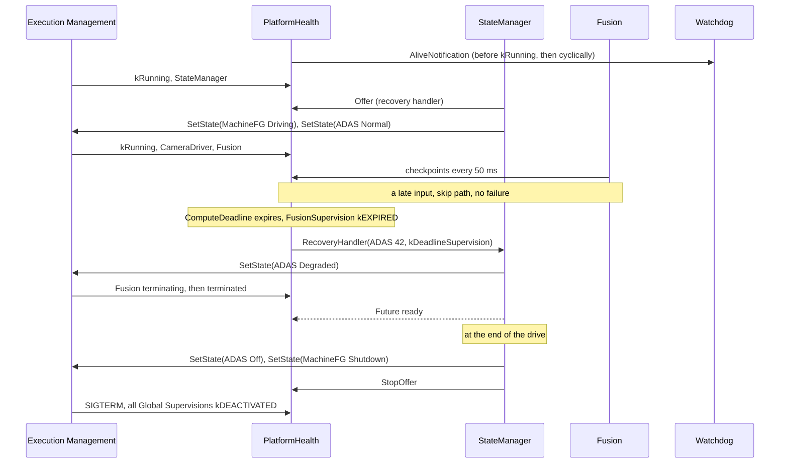

### 17.6 Shutdown

The driver switches the vehicle off. State Management switches `ADAS` to `Off`: EM announces the termination of `FusionLite` and `CameraDriver`, and `CameraDriverSupervision` goes to `kDEACTIVATED`. Then State Management requests `MachineFG.Shutdown`, calls `StopOffer()` and ends. PHM terminates after State Management (SWS SM, Section 7.8.2). On `SIGTERM`, PHM stops all supervisions and sets all Global Supervision Statuses to `kDEACTIVATED` ([SWS_PHM_01253], [SWS_PHM_01254]). The handling of the watchdog for the rest of the shutdown is implementation-specific ([Section 13.5](#135-phms-own-startup-and-shutdown)).

### 17.7 Supervision State Overview

| Phase | `StateManagerSupervision` | `CameraDriverSupervision` | `FusionSupervision` | Watchdog |
| --- | --- | --- | --- | --- |
| Startup, before `kRunning` of `StateManager` | `kDEACTIVATED` | `kDEACTIVATED` | `kDEACTIVATED` | Served by PHM |
| `MachineFG.Driving`, `ADAS.Normal` | `kOK` | `kOK` | `kOK` | Served |
| Late input | `kOK` | `kOK` | `kOK` | Served |
| `ComputeDeadline` expired | `kOK` | `kOK` | `kEXPIRED`, notification | Served |
| `ADAS.Degraded` | `kOK` | `kOK` | `kDEACTIVATED` | Served |
| `ADAS.Off`, `MachineFG.Shutdown` | `kOK` until `StateManager` ends | `kDEACTIVATED` | `kDEACTIVATED` | Implementation-specific after PHM ends |

> **Key takeaways**
>
> - PHM serves the watchdog from its own start; supervisions start with `kRunning` or with the first checkpoint.
> - A legal path such as the skipped cycle must not trigger anything, and it does not when it is modeled.
> - A deadline failure of `Fusion` is reported within 25 ms of the stall, and State Management recovers to `Degraded`.
> - Function Group changes deactivate the supervisions of terminated processes, so nothing is reported for them.

---

## 18. Best Practices, Pitfalls and Troubleshooting

> **Why this matters:** Most PHM problems in the field are false alarms caused by parameters or graphs that do not match the real behavior, or missing links in the recovery chain. The following checklists and the troubleshooting table collect them.

### 18.1 Checklist for Application Developers

- [ ] Call `ara::core::Initialize(argc, argv)` before you construct any `SupervisedEntity`.
- [ ] Create one `SupervisedEntity` per R-port, with `InstanceSpecifier::Create`, and share it between threads.
- [ ] Report checkpoints in the thread that does the work, at the places agreed with the integrator.
- [ ] Tell the integrator every legal path through your checkpoints, including skip, retry and error paths.
- [ ] Start the cyclic work, or at least its checkpoints, when you report `kRunning`, because alive supervision starts then.
- [ ] If the process is self-terminating and alive-supervised, report the terminating checkpoint just before it exits.
- [ ] Give the integrator measured cycle times and worst-case durations, not estimates from the design.
- [ ] Keep the checkpoint IDs of the design, the code and the deployment in sync; regenerate the header when the model changes.

### 18.2 Checklist for Integrators

- [ ] Create one `SupervisionCheckpoint` per checkpoint, port and process, with the design's `checkpointId`.
- [ ] Use one Global Supervision per process, so that one failure cannot hide another.
- [ ] Cover every Function Group State in which a supervised process runs with a Supervision Mode or a `NoSupervision`; give a process that keeps running the same supervisions in both modes.
- [ ] Size alive margins of at least 1, alive tolerances for the expected jitter, and deadlines for the worst case; compute the detection time against the safety concept.
- [ ] Model every legal path in logical supervision graphs.
- [ ] Set `expiredSupervisionTolerance` on every Global Supervision; use a non-zero value only for OS, EM and SM supervisions.
- [ ] Connect every application Global Supervision to a `RecoveryNotification` through a `HealthChannelSupervision`, and map the notification to State Management's P-port.
- [ ] Size `recoveryNotificationTimeout` for the slowest recovery of State Management.
- [ ] Map every contribution to the Machine, and add all elements to the Software Cluster.
- [ ] Give every supervised process a distinct `processExecutionError`.
- [ ] Check the watchdog timing at startup: PHM must serve the watchdog before its timeout.

### 18.3 Checklist for State Management and Platform Developers

- [ ] Derive from `RecoveryAction`, construct it with the instance specifier of the mapped P-port, and call `Offer()` once the object is complete.
- [ ] Keep `RecoveryHandler` short and thread-safe; start the recovery and return a `Future`.
- [ ] Complete the `Future` with a value when the recovery is done, or with `kSMCanNotHandleRecovery` when you cannot handle it; never leave it pending.
- [ ] Give the same answer to nested notifications for the same State Machine ([SWS_SM_00031]).
- [ ] Call `StopOffer()` during the shutdown of State Management.
- [ ] Let State Management and Execution Management report their own checkpoints, and configure their supervisions with a tolerance that leaves time to store the error cause.
- [ ] Implement `WatchdogInterface` so that a missing `AliveNotification` reliably leads to the watchdog reaction, and record the reset reason for `PHM_E_WATCHDOG_RESET`.

### 18.4 Troubleshooting Guide

| Symptom | Likely cause | What to check |
| --- | --- | --- |
| The process ends at startup with a violation message from `SupervisedEntity` | The port has no `SupervisionCheckpoint`, the process is not referenced, `Initialize` was not called, or the specifier is wrong | The violation message ID and its `instanceSpecifier` argument ([Section 16.3](#163-violation-messages)) |
| A supervision never starts; no `SupervisionStarted` | The contribution is not mapped to the Machine, no Supervision Mode covers the current state, or the process does not report `kRunning` | `PhmContributionToMachineMapping`; the mode conditions; EM's `ProcessKRunningReceived` |
| Supervision fails right after startup | The cyclic work starts long after `kRunning`, or the initialization reports checkpoints in an order the graph does not allow | Time between `kRunning` and the first `CycleStart`; the graph |
| `ADAS` degrades now and then without a visible error | A legal path is missing from a logical graph, or a deadline is too tight; neither has a tolerance | The `TypeOfSupervision` that State Management logs; worst-case durations; the graph |
| A process hangs but nothing is reported | Only deadline or logical supervision is configured and the process hangs between checkpoints; or the Global Supervision is already `kEXPIRED` | Add alive supervision; [Section 12.7](#127-known-limitation-successive-failures) |
| A second failure of a process is never reported | The process kept running after the first failure, so its supervision stays `kEXPIRED` | Whether State Management restarted the process |
| The machine resets after a supervision failure of an application | State Management answered `kSMCanNotHandleRecovery`, did not answer within `recoveryNotificationTimeout`, or the handler was not offered | `WatchdogReset` and `RecoveryInitiated` messages; the `Offer` result; the timeout ([Section 13.3](#133-when-phm-fires-the-watchdog)) |
| The machine resets without any application failure | A supervision of State Management or EM reached `kSTOPPED`, or the PHM daemon itself stopped | `WatchdogReset`; the reset reason; the supervision parameters of SM and EM |
| The machine resets during startup | PHM served the watchdog too late | Time from enabling the watchdog to the first `AliveNotification` ([guide 01, Section 6.5](01_PlatformOverview.md#65-walkthrough-the-platform-starts-and-stops)) |
| A security event 65 appears | A process reports a checkpoint that is configured for another process | `SupervisionCheckpoint.process`; process and executable deployment |

> **Key takeaways**
>
> - Model every legal path and size deadlines for the worst case; logical and deadline supervision have no tolerance.
> - One Global Supervision per process, a mode for every state, and a recovery notification for every application supervision.
> - State Management must always answer the `Future`, in time.
> - Machine resets point to SM, EM, PHM itself, a missing answer from State Management, or the startup timing.

---

## 19. Summary and Self-Check Quiz

### 19.1 Summary

Platform Health Management supervises the software of the Adaptive Platform from the inside. Supervised processes report checkpoints through `ara::phm::SupervisedEntity`. Alive supervision counts them per reference cycle, deadline supervision measures the time between two of them, and logical supervision checks their order against a graph. The algorithms come from the Foundation *Specification of Health Monitoring*; only alive supervision tolerates failures.

Each supervision has an Elementary Supervision Status, and a Global Supervision takes the worst of them. When a Global Supervision switches to `kEXPIRED`, PHM notifies State Management through `RecoveryHandler`, with the Function Group, the execution error of the failed process and the kind of supervision. State Management answers through a `Future`; a refusal, a missing answer or a missing `Offer` ends in the watchdog reaction. Supervisions of State Management and Execution Management end in `kSTOPPED` and a reset through the hardware watchdog, which PHM serves and which supervises PHM in turn.

PHM follows the platform: supervisions start with `kRunning` or the first checkpoint, stop when EM terminates a process, and follow the Supervision Modes that the Function Group States select. The configuration is split into design (Supervised Entities, checkpoint IDs, ports) and deployment (contributions with checkpoints, Global Supervisions, modes and health channels, the recovery notification and its mappings). PHM defines no defaults, so everything that matters must be configured.

### 19.2 Self-Check Quiz

Try to answer each question first, then expand the answer.

<details>
<summary>1. Who decides that ADAS switches to Degraded after a supervision failure: PHM or State Management?</summary>

State Management. PHM only detects the failure and notifies State Management through `RecoveryHandler`; State Management chooses the recovery and requests it from EM. See [Section 1.2](#12-what-phm-does-not-do) and [Section 12.1](#121-the-recovery-chain).

</details>

<details>
<summary>2. Which supervision detects a process that hangs between two cycles, and why do the other two not?</summary>

Alive supervision, because it counts reports in a time window and notices silence. Deadline supervision measures only after a source checkpoint, and a logical graph is inactive after its final checkpoint, so neither runs between cycles. See [Section 6.5](#65-worked-example-fusion-and-cameradriver).

</details>

<details>
<summary>3. Fusion's alive supervision has 4 expected indications, margins 1 and 1, and a tolerance of 1. The reference cycles contain 4, 2, 4, 0, 0 indications. When is the failure qualified?</summary>

At the end of the fifth reference cycle. The failed-cycle counter goes 0, 1, 0, 1, 2; it exceeds the tolerance of 1 only at the fifth cycle, which changes the status from `kFAILED` to `kEXPIRED`. See [Section 9.5](#95-worked-example-the-status-of-fusions-alive-failure).

</details>

<details>
<summary>4. What does minMargin = 0 mean for an alive supervision?</summary>

That no minimum alive supervision is performed ([TPS_MANI_03575]), not that no indication may be missing. Use `minMargin` of at least 1 when you need a lower limit. See [Section 6.4](#64-margins-with-a-special-meaning).

</details>

<details>
<summary>5. Fusion reports InputsRead, then hangs. When does PHM detect the deadline failure?</summary>

When `maxDeadline` of `ComputeDeadline` (25 ms) has elapsed after `InputsRead`, without waiting for `ObjectsPublished` ([ASWS_HM_00228]). See [Section 7.4](#74-worked-example-fusions-compute-deadline).

</details>

<details>
<summary>6. Why must the graph of Fusion contain the transition CycleStart to CycleEnd?</summary>

Because `Fusion` skips a cycle when an input is late and then reports `CycleStart` directly followed by `CycleEnd`. Logical supervision has no tolerance, so a legal path that is missing from the graph is reported as a failure at once. See [Section 8.5](#85-worked-example-the-fusion-cycle-graph).

</details>

<details>
<summary>7. What is the difference between kEXPIRED and kSTOPPED?</summary>

`kEXPIRED` is a qualified failure; for an application supervision it leads to the notification of State Management. `kSTOPPED` is used only for supervisions of the operating system, EM and SM; it leads to the watchdog reaction, after the `expiredSupervisionTolerance`. See [Section 9.3](#93-kstopped-and-the-expired-supervision-tolerance).

</details>

<details>
<summary>8. Why does HPC use one Global Supervision per process instead of one for the whole ADAS Function Group?</summary>

PHM notifies State Management only when a Global Supervision switches to `kEXPIRED`. While it stays `kEXPIRED`, a further failure in the same Global Supervision is not reported. Separate Global Supervisions keep the failures of `Fusion` and `CameraDriver` apart. See [Section 9.4](#94-grouping-supervisions-into-global-supervisions).

</details>

<details>
<summary>9. When does the alive supervision of Fusion start, and what happens to checkpoints reported before?</summary>

When EM informs PHM that `Fusion` has reported `kRunning` ([SWS_PHM_01331]). Earlier reports of the alive checkpoint are ignored ([SWS_PHM_01332]); intra-process deadline and logical supervision can start before. See [Section 10.2](#102-when-supervision-starts).

</details>

<details>
<summary>10. Can PHM supervise LegacyLogger? Why or why not?</summary>

No. `LegacyLogger` is non-reporting, so EM cannot tell PHM when it runs, and the TPS forbids a supervised entity port in such an executable ([constr_3795]). See [Section 10.5](#105-processes-that-cannot-or-need-not-be-supervised).

</details>

<details>
<summary>11. ADAS switches from Normal to Degraded. What happens to the supervisions of Fusion and CameraDriver?</summary>

`Fusion` is terminated, so its supervisions stop and become `kDEACTIVATED` ([SWS_PHM_00240]). `CameraDriver` keeps running, so its supervision continues with the same parameters ([SWS_PHM_00243]). See [Section 11.4](#114-worked-example-adas-from-normal-to-degraded).

</details>

<details>
<summary>12. CameraDriver's supervision expires and ADAS goes to Degraded. Later CameraDriver fails again. Is the second failure reported?</summary>

No. `CameraDriver` was not restarted, so its supervision stays `kEXPIRED` and `CameraDriverSupervision` does not switch to `kEXPIRED` again. Only a restart of `CameraDriver` clears it. See [Section 12.7](#127-known-limitation-successive-failures).

</details>

<details>
<summary>13. Which execution error does State Management receive when CameraDriver fails, and why?</summary>

The value 1 for the Function Group `ADAS`, because `CameraDriver` has no `processExecutionError` ([SWS_PHM_01361]). See [Section 12.2](#122-what-state-management-receives).

</details>

<details>
<summary>14. Name three situations in which an application supervision failure ends in a watchdog reset.</summary>

State Management answers `kSMCanNotHandleRecovery`; State Management does not answer within `recoveryNotificationTimeout`; the supervision expires before `Offer()` succeeded or after `StopOffer()`. See [Section 13.3](#133-when-phm-fires-the-watchdog).

</details>

<details>
<summary>15. Why does StateManagerSupervision have no recovery notification, and what is its expiredSupervisionTolerance for?</summary>

A failure of State Management cannot be handled by State Management, so it ends in `kSTOPPED` and the watchdog reaction. The tolerance of 200 ms keeps the watchdog served for a moment, so that the platform can store the error cause before the reset. See [Section 13.4](#134-supervising-execution-management-and-state-management).

</details>

<details>
<summary>16. A PHM contribution is complete and valid, but PHM supervises nothing. What is the most likely cause?</summary>

The contribution is not enabled on the Machine: a `PhmContributionToMachineMapping` is missing ([TPS_MANI_03502]). See [Section 14.4](#144-platformhealthmanagementcontribution-and-phmcontributiontomachinemapping).

</details>

<details>
<summary>17. Why must State Management call Offer() only after its recovery object is fully constructed?</summary>

PHM may call `RecoveryHandler` as soon as `Offer()` succeeded. If the derived object is not complete, the call can reach an incomplete object; this is also why `RecoveryAction` cannot be moved ([SWS_PHM_01149]). See [Section 15.4](#154-recoveryaction).

</details>

<details>
<summary>18. A PHM_E_WATCHDOG_RESET was expected after a reset, but the event memory does not show it. Is that a bug?</summary>

Not necessarily. The reset can be so fast that the production error is not persisted; reporting it is only recommended ([SWS_PHM_01363]). The platform should evaluate the reset reason at the next start. See [Section 16.5](#165-production-error-phm_e_watchdog_reset).

</details>

<details>
<summary>19. The integrator types checkpointId 3 for Fusion_InputsRead, while the design gives InputsRead the value 2. What goes wrong, and which rule prevents it?</summary>

The code reports `InputsRead` with the generated value 2, which no longer matches the configured checkpoint, so PHM does not recognize the reports as intended and the supervisions of `Fusion` fail or behave in an unspecified way. The value of `SupervisionCheckpoint.checkpointId` must equal `PhmCheckpoint.checkpointId` ([TPS_MANI_03626]). See [Section 4.3](#43-the-checkpoint-id-contract).

</details>

---

## Appendix A. Glossary and Acronyms

### A.1 Acronyms

| Acronym | Meaning |
| --- | --- |
| ASIL | Automotive Safety Integrity Level (ISO 26262) |
| DLT | Diagnostic Log and Trace |
| E2E | End-to-end communication protection |
| EM | Execution Management |
| FC | Functional Cluster |
| HM | Health Monitoring |
| IdsM | Intrusion Detection System Manager |
| PHM | Platform Health Management |
| SE | Supervised Entity |
| SEooC | Safety Element out of Context |
| SM | State Management |
| UCM | Update and Configuration Management |

### A.2 Glossary

| Term | Definition |
| --- | --- |
| Alive Indication | One report of a checkpoint that is used for alive supervision. |
| Alive Supervision | A PHM supervision that counts the reports of a checkpoint in each reference cycle and checks them against an expected number with margins. |
| Checkpoint | A point in the control flow of a Supervised Entity where the activity is reported to PHM. |
| Deadline Supervision | A PHM supervision that checks that the time from a source to a target checkpoint lies between a minimum and a maximum. |
| Elementary Supervision Status | The status of one alive, deadline or logical supervision: `kOK`, `kFAILED`, `kEXPIRED` or `kDEACTIVATED`. |
| Expired Supervision Time | The time that a Global Supervision of OS, EM or SM has spent in `kEXPIRED`. |
| Global Supervision | A group of supervisions of processes of one Function Group, with one aggregated status. |
| Global Supervision Status | The worst of the Elementary Supervision Statuses of a Global Supervision; additionally `kSTOPPED`. |
| Health Monitoring | Supervision of the software behavior for correct timing and sequence; the Foundation concept shared by the Classic and the Adaptive Platform. |
| Logical Supervision | A PHM supervision that checks the order of checkpoints against a graph of allowed transitions. |
| Platform Health Management | Health Monitoring for the Adaptive Platform; the functional cluster described in this guide. |
| Recovery notification | The call of State Management's `RecoveryHandler` when a Global Supervision expires, and its configuration. |
| Supervised Entity | A whole or a part of a software component type that is supervised; a collection of checkpoints. |
| Supervised Entity Instance | One occurrence of a Supervised Entity, identified by its port in an executable and its process. |
| Supervision Mode | A state of the machine or a Function Group in which supervisions are performed with a specific set of parameters. |
| Terminating checkpoint | The checkpoint with which a self-terminating process announces that it is about to exit. |
| Watchdog | A hardware timer that resets the machine if it is not triggered in time. PHM serves it. |

## Appendix B. Quick Reference Cheat Sheet

### B.1 Supervisions at a Glance

| | Alive | Deadline | Logical |
| --- | --- | --- | --- |
| Checks | Rate of one checkpoint | Time from source to target | Order of checkpoints |
| Parameters | `aliveReferenceCycle`, `expectedAliveIndications`, `minMargin`, `maxMargin`, `failedReferenceCyclesTolerance` | `transition`, `minDeadline`, `maxDeadline` | `initialCheckpoint`, `transition`, `finalCheckpoint` |
| Switch a check off | `minMargin` = 0, `maxMargin` = INF | `minDeadline` = 0, `maxDeadline` = INF | |
| Starts | At `kRunning` | At the first checkpoint | At the first checkpoint |
| Tolerance | Up/down counter of failed cycles | None | None |
| `HPC` | `FusionAlive`, `ImageLoopAlive`, `MainLoopAlive` | `ComputeDeadline`, `CycleDeadline` | `CycleOrder` |

### B.2 Status Values

| Status | Elementary | Global | Meaning |
| --- | --- | --- | --- |
| `kOK` (0) | yes | yes | Supervised, no failure |
| `kFAILED` (1) | alive only | yes | Failure within the tolerance |
| `kEXPIRED` (2) | yes | yes | Qualified failure; application supervisions notify State Management |
| `kSTOPPED` (3) | no | OS, EM, SM only | Watchdog reaction |
| `kDEACTIVATED` (4) | yes | yes | Not supervised, for example the process is not running |

### B.3 Watchdog Triggers

| Trigger | Spec |
| --- | --- |
| Global Supervision of SM or EM in `kSTOPPED` | [SWS_PHM_00105] |
| `RecoveryHandler` answers `kSMCanNotHandleRecovery` | [SWS_PHM_00107] |
| No answer within `recoveryNotificationTimeout` | [SWS_PHM_00104] |
| Expired before `Offer()` | [SWS_PHM_01359] |
| Expired after `StopOffer()` | [SWS_PHM_01360] |
| PHM itself stops calling `AliveNotification`, for example because it crashed | SWS, Section 7.8.5 |

### B.4 Error Codes and Enumerations

| Name | Values |
| --- | --- |
| `PhmErrc` | `kOfferFailed` = 2, `kSMCanNotHandleRecovery` = 3, `kServiceNotReady` = 4 |
| `TypeOfSupervision` | `kAliveSupervision` = 0, `kDeadlineSupervision` = 1, `kLogicalSupervision` = 2 |
| `ElementarySupervisionStatus` | `kOK` = 0, `kFailed` = 1, `kExpired` = 2, `kDeactivated` = 4 |
| `GlobalSupervisionStatus` | `kOK` = 0, `kFailed` = 1, `kExpired` = 2, `kStopped` = 3, `kDeactivated` = 4 |
| `PhmErrorDomain` | ID `0x8000'0000'0000'0602`, name `Phm` |

### B.5 DLT Message IDs

| ID | Message | Level |
| --- | --- | --- |
| `0x80009000` | `SupervisionStarted` | Info |
| `0x80009001` | `SupervisionStateChanged` | Info |
| `0x80009002` | `RecoveryInitiated` | Error |
| `0x80009003` | `WatchdogReset` | Error |
| `0x80001fff`, `0x80001ff8` to `0x80001ffc` | Violation messages of [Section 16.3](#163-violation-messages) | Fatal |

## Appendix C. Spec Traceability

Use this table to find the normative text for each topic of this guide. "SWS" is the PHM specification, "HM" the Foundation *Specification of Health Monitoring*, "TPS" the *Manifest Specification* and "SM" the State Management specification, all R25-11.

| Topic | Guide | Specification section | Key requirement IDs |
| --- | --- | --- | --- |
| Overview and safety | [1](#1-introduction-to-platform-health-management) | SWS 1, 7.1; PD 17 | [RS_PHM_00114], [RS_SAF_10031] |
| Terminology | [2](#2-core-concepts-and-terminology) | SWS 2; HM 2 | (definitions) |
| Interfaces | [3](#3-phm-in-the-system-architecture) | SWS 5 | [SWS_PHM_01132], [SWS_PHM_01140], [SWS_PHM_01252] |
| Configuration overview | [4](#4-configuration-overview) | TPS 4.8, 12.3; SWS 10 | [TPS_MANI_03500], [TPS_MANI_03544], [TPS_MANI_03626] |
| Checkpoints and Supervised Entities | [5](#5-supervised-entities-and-checkpoints-in-practice) | SWS 7.2, 7.6, 8.2, 8.5 | [SWS_PHM_00424], [SWS_PHM_00425], [SWS_PHM_01123], [SWS_PHM_01127], [SWS_PHM_01229], [SWS_PHM_01334], [SWS_PHM_01339], [SWS_PHM_01341] |
| Alive supervision | [6](#6-alive-supervision) | HM 6.2.1; TPS 12.3.3.5 | [ASWS_HM_00074], [ASWS_HM_00075], [ASWS_HM_00079], [ASWS_HM_00083], [ASWS_HM_00098], [TPS_MANI_03575], [TPS_MANI_03576] |
| Deadline supervision | [7](#7-deadline-supervision) | HM 6.2.2; TPS 12.3.3.6, 12.3.3.8 | [ASWS_HM_00228], [ASWS_HM_00229], [ASWS_HM_00294], [ASWS_HM_00299], [ASWS_HM_00354] |
| Logical supervision | [8](#8-logical-supervision) | HM 6.2.3, 4.1; TPS 12.3.3.7 | [ASWS_HM_00252], [ASWS_HM_00271], [ASWS_HM_00273], [ASWS_HM_00295], [ASWS_HM_00296], [ASWS_HM_00297], [ASWS_HM_00331], [ASWS_HM_00460] |
| Elementary Supervision Status | [9.1](#91-elementary-supervision-status) | SWS 7.4.1 | [SWS_PHM_01342] to [SWS_PHM_01357] |
| Global Supervision Status | [9.2](#92-global-supervision-status), [9.3](#93-kstopped-and-the-expired-supervision-tolerance) | SWS 7.4.2 | [SWS_PHM_00216] to [SWS_PHM_00234], [SWS_PHM_00237] to [SWS_PHM_00239] |
| Grouping | [9.4](#94-grouping-supervisions-into-global-supervisions) | SWS 7.2; TPS 12.3.3.1 | [constr_3623], [constr_3629], [constr_3630], [constr_3631] |
| Process lifecycle | [10](#10-supervision-and-the-process-lifecycle) | SWS 5.3, 7.2.1 to 7.2.3 | [SWS_PHM_01331] to [SWS_PHM_01338], [SWS_PHM_01364] to [SWS_PHM_01367] |
| Supervision Modes | [11](#11-supervision-modes-and-function-group-state-changes) | SWS 7.3; TPS 12.3.3.2 to 12.3.3.4, 12.3.3.9 | [SWS_PHM_00240] to [SWS_PHM_00245], [constr_3628], [constr_3632] |
| Recovery | [12](#12-recovery-notifying-state-management) | SWS 7.5.1; SM 7.2, 7.7.13 | [SWS_PHM_00101], [SWS_PHM_00104], [SWS_PHM_01147], [SWS_PHM_01148], [SWS_PHM_01361], [SWS_SM_00030], [SWS_SM_00031], [SWS_SM_00670] |
| Hardware watchdog | [13](#13-the-hardware-watchdog-and-critical-failures) | SWS 7.5.2, 7.7, Appendix C | [SWS_PHM_00105], [SWS_PHM_00106], [SWS_PHM_00107], [SWS_PHM_01252] to [SWS_PHM_01254], [SWS_PHM_01359], [SWS_PHM_01360], [RS_PHM_00115], [RS_PHM_00116] |
| Configuration reference | [14](#14-configuration-reference-what-to-configure) | TPS 4.8, 12.3, D.6; SWS 10, Appendix A | [constr_3530], [constr_3612], [constr_3613], [constr_3624], [constr_3633], [constr_3635], [constr_3823], [SWS_PHM_CONSTR_00001] |
| API | [15](#15-api-reference-and-usage-guide-araphm) | SWS 8, Appendix C | [SWS_PHM_01002], [SWS_PHM_01005], [SWS_PHM_00424], [SWS_PHM_00425], [SWS_PHM_01123], [SWS_PHM_01127], [SWS_PHM_01130], [SWS_PHM_01132], [SWS_PHM_01137], [SWS_PHM_01138], [SWS_PHM_01140] to [SWS_PHM_01145], [SWS_PHM_01149] to [SWS_PHM_01152], [SWS_PHM_01211] to [SWS_PHM_01215], [SWS_PHM_01240] to [SWS_PHM_01251], [SWS_PHM_01255] to [SWS_PHM_01257], [SWS_PHM_01358], [SWS_PHM_01380] |
| Reporting | [16](#16-logging-tracing-and-reporting) | SWS 7.8 | [SWS_PHM_01340], [SWS_PHM_01362], [SWS_PHM_01363], [SWS_PHM_01370] to [SWS_PHM_01373], [SWS_PHM_01375] |

## Appendix D. Notable Changes in Recent Releases

This summary is based on the change history and the history of specification items of the PHM specification and of the TPS. It lists only the changes that matter most when you port code or material from an older release.

| Release | Change | Specification items |
| --- | --- | --- |
| R20-11 | The role of PHM changed to a monitor that notifies State Management; logic and interfaces were reworked. | (rework of logic and interfaces) |
| R21-11 | Health channels declared obsolete; the retry after a failed notification to State Management removed; the getters of the local and global supervision status removed from `SupervisedEntity`; mode-dependent configuration; `PhmErrorDomain` and `WatchdogInterface` introduced. | Deleted: [SWS_PHM_00103], [SWS_PHM_01160], [SWS_PHM_01161] |
| R22-11 | *Local Supervision* replaced by *Elementary Supervision*; the Global Supervision Status machine reworked; `GetGlobalSupervisionStatus()` removed from `RecoveryAction`; start and stop of supervisions specified. | Added: [SWS_PHM_01331] to [SWS_PHM_01358], [SWS_PHM_01252] to [SWS_PHM_01254] |
| R23-11 | Thread safety specified for all APIs; the PHM security event renamed; the `k` prefix added to the literals of `TypeOfSupervision`. | Added: [SWS_PHM_01340] |
| R24-11 | Health channels removed, including `HealthChannel` in the API and `HealthChannelExternalStatus` in the TPS; `RecoveryHandler` returns `ara::core::Future`; `SupervisedEntity` and `RecoveryAction` set to final; violation messages for `ReportCheckpoint` and the constructors; `kSMCanNotHandleRecovery` makes PHM fire the watchdog. | Added: [SWS_PHM_00107], [SWS_PHM_CONSTR_00001]. Deleted: [SWS_PHM_00457], [SWS_PHM_01128], [SWS_PHM_01328] |
| R25-11 | `Enable()` and `Disable()` (DRAFT); `WatchdogInterface` specified as a platform extension API (Appendix C); watchdog reaction when a supervision expires before `Offer()` or after `StopOffer()`; default execution error 1; standardized log messages; security event context data; the TPS requires `expiredSupervisionTolerance` for every Global Supervision and forbids supervision of non-reporting executables. | Added: [SWS_PHM_01130], [SWS_PHM_01255] to [SWS_PHM_01257], [SWS_PHM_01359] to [SWS_PHM_01361], [SWS_PHM_01363] to [SWS_PHM_01367], [SWS_PHM_01370] to [SWS_PHM_01373], [SWS_PHM_01375], [SWS_PHM_01380]; TPS: [constr_3795], [constr_3823] |

> **Pitfall:** Material written for releases before R24-11 often shows health channels, `ReportHealthStatus` or a `RecoveryHandler` that returns `void`. None of these exist in R25-11.

## Appendix E. References

**AUTOSAR specifications (R25-11):**

- *Specification of Platform Health Management* (`AUTOSAR_AP_SWS_PlatformHealthManagement`)
- *Requirements on Platform Health Management* (`AUTOSAR_AP_RS_PlatformHealthManagement`)
- *Specification of Health Monitoring* (`AUTOSAR_FO_ASWS_HealthMonitoring`, Foundation), for the supervision algorithms
- *Requirements on Health Monitoring* (`AUTOSAR_FO_RS_HealthMonitoring`, Foundation)
- *Specification of Manifest* (`AUTOSAR_AP_TPS_ManifestSpecification`), for the configuration in [Chapter 14](#14-configuration-reference-what-to-configure)
- *Specification of State Management* (`AUTOSAR_AP_SWS_StateManagement`), for the receiving side of the recovery notification
- *Specification of Adaptive Platform Core* (`AUTOSAR_AP_SWS_Core`), for `Future`, `Promise`, error domains and violation messages
- *Explanation of Adaptive Platform Design* (`AUTOSAR_AP_EXP_PlatformDesign`) and *Explanation of Adaptive Platform Software Architecture* (`AUTOSAR_AP_EXP_SWArchitecture`)
- *Safety Requirements for AUTOSAR Adaptive Platform and AUTOSAR Classic Platform* (`AUTOSAR_FO_RS_Safety`, Foundation)
- *Generic Structure Template* (`AUTOSAR_FO_TPS_GenericStructureTemplate`, Foundation), for splitting the model into files
- *Standardized M1 Models used for the Definition of AUTOSAR* (`AUTOSAR_FO_MOD_GeneralDefinitions`, Foundation), for the standardized production error
- *XML Schema* `AUTOSAR_00054.xsd` (`AUTOSAR_FO_MMOD_XMLSchema`, Foundation), against which the ARXML of [Section 14.15](#1415-the-running-example-complete-configuration) validates

**Other sources:**

- [EXT-006] *ISO 26262-6:2018 Road vehicles, Functional safety, Part 6: Product development at the software level*, ISO. <https://www.iso.org/standard/68388.html> (accessed 2026-10-25)
- [EXT-022] *The Linux Watchdog driver API*, Linux kernel documentation. <https://docs.kernel.org/watchdog/watchdog-api.html> (accessed 2026-10-27)
- [EXT-023] *sd_notify(3): notify service manager about start-up completion and other service status changes*, systemd project. <https://www.freedesktop.org/software/systemd/man/latest/sd_notify.html> (accessed 2026-10-27)
- [EXT-024] *ISO 26262-1:2018 Road vehicles, Functional safety, Part 1: Vocabulary*, ISO. <https://www.iso.org/standard/68383.html> (accessed 2026-10-27)

---

*End of the training guide. For normative details, always refer to `AUTOSAR_AP_SWS_PlatformHealthManagement` (R25-11) and to the specifications it references: Health Monitoring, the Manifest Specification, State Management and Core.*
