# AUTOSAR Adaptive Platform: Communication Management Part 1, `ara::com` Concepts and API

<!-- markdownlint-disable MD013 MD033 -->

> **Source specification:** *Specification of Communication Management* (`AUTOSAR_AP_SWS_CommunicationManagement`) and *Explanation of ara::com API* (`AUTOSAR_AP_EXP_ARAComAPI`), AUTOSAR Adaptive Platform **R25-11**. Also based on *Specification of Manifest* (`AUTOSAR_AP_TPS_ManifestSpecification`), *Specification of Adaptive Platform Core* (`AUTOSAR_AP_SWS_Core`) and *Specification of Language Binding for modeled AP data types* (`AUTOSAR_AP_SWS_LanguageBindingForModeledAPdatatypes`), Adaptive Platform R25-11.
>
> **Document type:** training material.
>
> **Author:** Hieu Do Minh/Claude
>
> **Version:** 1.0 (draft, pending review)
>
> **Part of the series:** [AUTOSAR Adaptive Platform Training Guides](00_LearningPath.md). Previous: [06 Platform Health Management](06_PlatformHealthManagement.md). Next: [08a Communication Management Part 2: Network Bindings (SOME/IP, Signal-Based, DDS)](08a_NetworkBindings.md).

## About This Guide

Adaptive applications rarely work alone. A camera driver delivers images, a fusion algorithm turns them into objects, a recorder stores the objects, and a display shows them. On the Adaptive Platform, all of these exchanges are *services*: a provider offers a service, consumers find it and use its events, methods and fields. The functional cluster that makes this work is Communication Management (CM), and its C++ API is `ara::com`. Questions like "why does my proxy never see the service?", "why do I lose samples?", "why does `OfferService` fail with a field error?" or "is this handler called from another thread?" are all questions about `ara::com`. This guide explains the service model, the generated proxy and skeleton classes, every part of the `ara::com` API, and the configuration behind them. It stays independent of the network protocol: SOME/IP, DDS and signal-to-service translation are the topic of [guide 08a](08a_NetworkBindings.md), end-to-end protection and secure communication of [guide 08b](08b_SecureAndSafeCommunication.md).

### Who This Guide Is For

- **Application developers** who write service providers (skeletons) and consumers (proxies) in C++.
- **Integrators** who connect ports to service instances, choose bindings and analyze communication problems.
- **Platform developers** who implement or adapt a Communication Management stack, or who need to know exactly what the API promises.

Assumed background: modern C++ (C++17: smart pointers, `std::function`, move semantics), plus basic Linux/POSIX knowledge (processes, threads, sockets). You do not need prior AUTOSAR Adaptive knowledge. Three guides of the series make this one easier: [02 Manifests and Methodology](02_Manifests.md) for service interfaces and their deployment in the model, [03 `ara::core` and General Conventions](03_CoreAndGeneral.md) for `Result`, `Future`, `ErrorCode`, `InstanceSpecifier` and violations, and [04 Execution Management](04_ExecutionManagement.md) for the process lifecycle in which services are offered.

### Learning Objectives

After working through this guide you will be able to:

1. Explain service-oriented communication on the Adaptive Platform and what Communication Management does and does not do.
2. Read the C++ code that the generator creates from a service interface: header files, namespaces, proxy and skeleton classes.
3. Offer a service with a skeleton, and find and connect to it with a proxy, using an `InstanceSpecifier`.
4. Send and receive events, choose between polling and event-driven reception, and manage samples with `SamplePtr`.
5. Call methods asynchronously with `ara::core::Future`, implement them in a skeleton, and choose a method call processing mode.
6. Provide and use fields correctly: initial values, getters, setters and notifications.
7. Predict in which thread a handler runs, and what R25-11 does and does not promise about thread safety.
8. Handle every error and violation of `ara::com`, including the Minimum Send Interval and transport fault conditions.
9. Read the E2E status of received data from the API.
10. Explain how local communication and multi-binding are configured and implemented.
11. Configure the model elements that `ara::com` reads, and know what each setting means.
12. Find the R25-11 definition of any `ara::com` API element.

### How to Read This Guide

The chapters build on each other. Chapters 1 and 2 introduce the concepts. Chapter 3 places Communication Management in the platform, and Chapter 4 gives the big picture of its configuration. Chapter 5 shows what the generator makes of a service interface. Chapters 6 to 13 explain the mechanisms: discovery, events and triggers, methods, fields, threading, errors, the API side of E2E protection, and local communication. Chapter 14 lists every configuration setting, and Chapter 15 covers the complete API and ends with three complete programs. Chapters 16 to 18 are practical, and the appendices are for quick reference.

If you write application code, read Chapters 1, 2, 5 to 11 and 15. If you integrate, read Chapters 1 to 4, 6, 11, 13 and 14 first.

| Convention | Meaning |
| --- | --- |
| `[SWS_CM_00141]` | A requirement ID in the Communication Management specification. Search for it in the specification to read the exact normative text. |
| `[SWS_CORE_13003]`, `[SWS_LBAP_00027]` | A requirement of SWS Core or of the language binding specification. |
| `[constr_10029]`, `[TPS_MANI_03045]` | A constraint or requirement of the *Manifest Specification* (TPS). |
| `{<event-name>}`, `{<SI>}` | A placeholder in a generated name, as in the API tables of the specification. `{<SI>}` is short for the service interface name. |
| **Note (implementation example)** | How a typical implementation, often on Linux, *might* realize something. This is not mandated by AUTOSAR. |
| **Pitfall** | A common mistake seen in real projects. |
| **Key takeaways** | A short summary at the end of each chapter. |
| Diagrams | Written in Mermaid. They render natively on GitHub and GitLab. In VS Code, install the *Markdown Preview Mermaid Support* extension. |

> **Note:** The code in this guide is illustrative C++17. It follows the R25-11 API tables of the specification exactly, but generated and vendor headers may differ in detail, for example in the types that the specification allows a vendor to replace. Where the explanatory document (EXP) shows an older form of a signature, the guide uses the form of the specification and says so ([Section 1.5](#15-the-two-documents-behind-this-guide)).

### The Running Example

All guides of the series use the same invented system. A high-performance ECU called **`HPC`** runs an ADAS feature. [Guide 00, Chapter 6](00_LearningPath.md#6-the-running-example-the-hpc-reference-system) defines the complete example; this section recaps the part that `ara::com` needs. All values are illustrative.

- **`CameraDriver`** drives the front camera and provides **`CameraService`**: the event `Image` (30 images per second), the method `SetExposureMode` and the field `CameraStatus`.
- **`Fusion`** fuses camera, radar and vehicle data in a **50 ms cycle**. It uses `CameraService` and `CalibrationDataService` and provides **`ObjectListService`**. It runs only in `ADAS.Normal`.
- **`FusionLite`** replaces `Fusion` in `ADAS.Degraded` and provides a reduced `ObjectListService`.
- **`Storage`** keeps the calibration, provides **`CalibrationDataService`**, and records the object lists of `ObjectListService`.
- **`CalibrationCheck`** reads the calibration once at the start of `ADAS` and terminates.

This guide adds the following elements to the running example (guide 00 lists them as well):

| Element | What it is | Used in |
| --- | --- | --- |
| `ObjectListService` contract | Namespace `hpc::fusion`, version 1.0: event `ObjectList` (type `ObjectListData`), field `FusionMode` (type `FusionModeType`: `Full`, `RadarOnly`; getter and notifier) | [Section 7.8](#78-worked-example-images-for-fusion-object-lists-for-storage), [Section 9.6](#96-worked-example-camerastatus-and-fusionmode) |
| `CalibrationDataService` contract | Namespace `hpc::storage`, version 1.0: methods `GetCalibration` and `SetCalibration`, trigger `CalibrationUpdated` | [Section 7.7](#77-triggers), [Section 13.5](#135-worked-example-calibrationdataservice-over-local-ipc) |
| Error domain `CalibrationErrors` | `0x1004`, namespace `hpc::storage`: `CalibrationNotFound` (1), `CalibrationRejected` (2) | [Section 8.8](#88-application-errors) |
| New ports | `ObjectListPPort` and `CalibrationRPort` of `FusionSwc` and `FusionLiteSwc`; `CalibrationRPort` of `CameraDriverSwc` and `CalibrationCheckSwc`; `CalibrationPPort` and `ObjectListRPort` of `StorageSwc` | [Section 14.11](#1411-the-running-example-complete-configuration) |
| Local IPC deployment | `CalibrationDataService_Ipc` on the connector `HpcIpcConnector` | [Section 13.5](#135-worked-example-calibrationdataservice-over-local-ipc) |

> **Note:** Two API features have no element in `HPC`: fire-and-forget methods and fields with a setter. The guide shows them with short snippets that are explicitly marked "not part of `HPC`" ([Section 8.5](#85-fire-and-forget-methods), [Section 9.4](#94-set-and-the-mandatory-sethandler)).

## Table of Contents

- [1. Introduction to Communication Management](#1-introduction-to-communication-management)
    - [1.1 What Is Communication Management?](#11-what-is-communication-management)
    - [1.2 What `ara::com` Does Not Do](#12-what-aracom-does-not-do)
    - [1.3 Why AUTOSAR Defined Its Own API](#13-why-autosar-defined-its-own-api)
    - [1.4 Analogies](#14-analogies)
    - [1.5 The Two Documents Behind This Guide](#15-the-two-documents-behind-this-guide)
- [2. Core Concepts and Terminology](#2-core-concepts-and-terminology)
    - [2.1 Service Interface, Service Instance, Provider and Consumer](#21-service-interface-service-instance-provider-and-consumer)
    - [2.2 Skeleton and Proxy](#22-skeleton-and-proxy)
    - [2.3 The Four Means of Communication](#23-the-four-means-of-communication)
    - [2.4 Service Discovery](#24-service-discovery)
    - [2.5 Instance Identifiers and Instance Specifiers](#25-instance-identifiers-and-instance-specifiers)
    - [2.6 Subscription, Samples and the Local Cache](#26-subscription-samples-and-the-local-cache)
    - [2.7 Language Binding, Network Binding and Multi-Binding](#27-language-binding-network-binding-and-multi-binding)
    - [2.8 Other Key Terms](#28-other-key-terms)
- [3. Communication Management in the System Architecture](#3-communication-management-in-the-system-architecture)
    - [3.1 Where Communication Management Sits in the Platform](#31-where-communication-management-sits-in-the-platform)
    - [3.2 Interfaces Provided and Required](#32-interfaces-provided-and-required)
    - [3.3 Service Discovery Inside the Machine](#33-service-discovery-inside-the-machine)
    - [3.4 Lifecycle of Communication Management](#34-lifecycle-of-communication-management)
    - [3.5 Interaction Map](#35-interaction-map)
- [4. Configuration Overview](#4-configuration-overview)
    - [4.1 Where the Configuration Lives](#41-where-the-configuration-lives)
    - [4.2 How the Elements Relate](#42-how-the-elements-relate)
    - [4.3 What You Can Change Without Recompiling](#43-what-you-can-change-without-recompiling)
- [5. From Service Interface to Generated Code](#5-from-service-interface-to-generated-code)
    - [5.1 What the Generator Produces](#51-what-the-generator-produces)
    - [5.2 File Names, Namespaces and Names](#52-file-names-namespaces-and-names)
    - [5.3 The Common Header: Service Identifier and Contract Version](#53-the-common-header-service-identifier-and-contract-version)
    - [5.4 How Arguments Are Passed](#54-how-arguments-are-passed)
    - [5.5 Data Types](#55-data-types)
    - [5.6 Worked Example: The Generated API of `CameraService`](#56-worked-example-the-generated-api-of-cameraservice)
- [6. Service Discovery: Offering and Finding Services](#6-service-discovery-offering-and-finding-services)
    - [6.1 Creating a Skeleton](#61-creating-a-skeleton)
    - [6.2 Offering and Stopping an Offer](#62-offering-and-stopping-an-offer)
    - [6.3 Finding a Service Once](#63-finding-a-service-once)
    - [6.4 Finding Continuously](#64-finding-continuously)
    - [6.5 From Handle to Proxy](#65-from-handle-to-proxy)
    - [6.6 When the Service Goes Away](#66-when-the-service-goes-away)
    - [6.7 InstanceSpecifier, InstanceIdentifier and ResolveInstanceIDs](#67-instancespecifier-instanceidentifier-and-resolveinstanceids)
    - [6.8 Service Contract Versioning](#68-service-contract-versioning)
    - [6.9 Worked Example: `Fusion` Finds `CameraService`](#69-worked-example-fusion-finds-cameraservice)
- [7. Events and Triggers](#7-events-and-triggers)
    - [7.1 Sending an Event](#71-sending-an-event)
    - [7.2 Subscribing to an Event](#72-subscribing-to-an-event)
    - [7.3 Receiving Samples](#73-receiving-samples)
    - [7.4 SamplePtr: Who Owns a Sample](#74-sampleptr-who-owns-a-sample)
    - [7.5 Polling or Event-Driven Reception](#75-polling-or-event-driven-reception)
    - [7.6 Buffering and Zero-Copy](#76-buffering-and-zero-copy)
    - [7.7 Triggers](#77-triggers)
    - [7.8 Worked Example: Images for `Fusion`, Object Lists for `Storage`](#78-worked-example-images-for-fusion-object-lists-for-storage)
- [8. Methods](#8-methods)
    - [8.1 Calling a Method](#81-calling-a-method)
    - [8.2 Getting the Result](#82-getting-the-result)
    - [8.3 No Timeout Supervision](#83-no-timeout-supervision)
    - [8.4 Canceling a Call](#84-canceling-a-call)
    - [8.5 Fire-and-Forget Methods](#85-fire-and-forget-methods)
    - [8.6 Implementing a Method in the Skeleton](#86-implementing-a-method-in-the-skeleton)
    - [8.7 Method Call Processing Modes](#87-method-call-processing-modes)
    - [8.8 Application Errors](#88-application-errors)
    - [8.9 Worked Example: `SetExposureMode` From `Fusion` to `CameraDriver`](#89-worked-example-setexposuremode-from-fusion-to-cameradriver)
- [9. Fields](#9-fields)
    - [9.1 A Field Is an Event Plus Get and Set](#91-a-field-is-an-event-plus-get-and-set)
    - [9.2 The Value Before the Offer](#92-the-value-before-the-offer)
    - [9.3 Get and the Optional GetHandler](#93-get-and-the-optional-gethandler)
    - [9.4 Set and the Mandatory SetHandler](#94-set-and-the-mandatory-sethandler)
    - [9.5 Subscribing to Field Notifications](#95-subscribing-to-field-notifications)
    - [9.6 Worked Example: `CameraStatus` and `FusionMode`](#96-worked-example-camerastatus-and-fusionmode)
- [10. Threading, Execution Context and Handlers](#10-threading-execution-context-and-handlers)
    - [10.1 What R25-11 Says About Thread Safety](#101-what-r25-11-says-about-thread-safety)
    - [10.2 Which Calls May Switch Context](#102-which-calls-may-switch-context)
    - [10.3 Handlers and Their Rules](#103-handlers-and-their-rules)
    - [10.4 Choosing the Execution Context](#104-choosing-the-execution-context)
    - [10.5 Patterns That Work](#105-patterns-that-work)
- [11. Errors, Rate Limits and Transport Faults](#11-errors-rate-limits-and-transport-faults)
    - [11.1 Three Kinds of Errors](#111-three-kinds-of-errors)
    - [11.2 ComErrorDomain and ComErrc](#112-comerrordomain-and-comerrc)
    - [11.3 Violations in ara::com](#113-violations-in-aracom)
    - [11.4 The Minimum Send Interval](#114-the-minimum-send-interval)
    - [11.5 Transport Fault Conditions](#115-transport-fault-conditions)
    - [11.6 Worked Example: Every Error `Fusion` Can See From `CameraService`](#116-worked-example-every-error-fusion-can-see-from-cameraservice)
- [12. End-to-End Protection: The API Side](#12-end-to-end-protection-the-api-side)
    - [12.1 E2E in Plain Words](#121-e2e-in-plain-words)
    - [12.2 Events: Check Status per Sample, State per Event](#122-events-check-status-per-sample-state-per-event)
    - [12.3 Methods and Fields](#123-methods-and-fields)
    - [12.4 What You Can Switch Off, and Other Limits](#124-what-you-can-switch-off-and-other-limits)
    - [12.5 Worked Example: `Storage` Checks the E2E Status of `ObjectList`](#125-worked-example-storage-checks-the-e2e-status-of-objectlist)
- [13. Local Communication and Multi-Binding](#13-local-communication-and-multi-binding)
    - [13.1 Local Communication Is Implementation-Specific](#131-local-communication-is-implementation-specific)
    - [13.2 Serialization and Zero-Copy Between Local Processes](#132-serialization-and-zero-copy-between-local-processes)
    - [13.3 Multi-Binding](#133-multi-binding)
    - [13.4 Typical Implementations on Linux](#134-typical-implementations-on-linux)
    - [13.5 Worked Example: `CalibrationDataService` Over Local IPC](#135-worked-example-calibrationdataservice-over-local-ipc)
- [14. Configuration Reference: What to Configure](#14-configuration-reference-what-to-configure)
    - [14.1 Minimal Configuration](#141-minimal-configuration)
    - [14.2 ServiceInterface and Its Elements](#142-serviceinterface-and-its-elements)
    - [14.3 PortPrototype and RPortPrototypeProps](#143-portprototype-and-rportprototypeprops)
    - [14.4 Sender and Receiver ComSpecs](#144-sender-and-receiver-comspecs)
    - [14.5 Client and Server ComSpecs](#145-client-and-server-comspecs)
    - [14.6 EndToEndTransformationComSpecProps](#146-endtoendtransformationcomspecprops)
    - [14.7 ServiceInterfaceDeployment and minimumSendInterval](#147-serviceinterfacedeployment-and-minimumsendinterval)
    - [14.8 User-Defined Deployment for Local IPC](#148-user-defined-deployment-for-local-ipc)
    - [14.9 Service Instances and Their Mappings](#149-service-instances-and-their-mappings)
    - [14.10 CmModuleInstantiation](#1410-cmmoduleinstantiation)
    - [14.11 The Running Example: Complete Configuration](#1411-the-running-example-complete-configuration)
- [15. API Reference and Usage Guide (`ara::com`)](#15-api-reference-and-usage-guide-aracom)
    - [15.1 API Overview](#151-api-overview)
    - [15.2 The Proxy Class and HandleType](#152-the-proxy-class-and-handletype)
    - [15.3 Proxy Events, Fields, Methods and Triggers](#153-proxy-events-fields-methods-and-triggers)
    - [15.4 The Skeleton Class](#154-the-skeleton-class)
    - [15.5 Skeleton Events, Fields and Triggers](#155-skeleton-events-fields-and-triggers)
    - [15.6 Types in ara/com/types.h](#156-types-in-aracomtypesh)
    - [15.7 InstanceIdentifier, ResolveInstanceIDs and Service Identifiers](#157-instanceidentifier-resolveinstanceids-and-service-identifiers)
    - [15.8 SamplePtr and SampleAllocateePtr](#158-sampleptr-and-sampleallocateeptr)
    - [15.9 Error Domains and Exceptions](#159-error-domains-and-exceptions)
    - [15.10 E2E Status Types and Transport Fault Types](#1510-e2e-status-types-and-transport-fault-types)
    - [15.11 Complete Example: `CameraDriver`](#1511-complete-example-cameradriver)
    - [15.12 Complete Example: `Fusion`](#1512-complete-example-fusion)
    - [15.13 Complete Example: `Storage`](#1513-complete-example-storage)
- [16. Logging, Security Events and Violations](#16-logging-security-events-and-violations)
    - [16.1 Security Event](#161-security-event)
    - [16.2 Log Messages and Violation Messages](#162-log-messages-and-violation-messages)
    - [16.3 What an Integrator Sees When an InstanceSpecifier Is Wrong](#163-what-an-integrator-sees-when-an-instancespecifier-is-wrong)
- [17. End-to-End Walkthrough: A Drive Seen Through `ara::com`](#17-end-to-end-walkthrough-a-drive-seen-through-aracom)
    - [17.1 The Sequence](#171-the-sequence)
    - [17.2 Step by Step](#172-step-by-step)
- [18. Best Practices, Pitfalls and Troubleshooting](#18-best-practices-pitfalls-and-troubleshooting)
    - [18.1 Best Practices](#181-best-practices)
    - [18.2 Common Pitfalls](#182-common-pitfalls)
    - [18.3 Troubleshooting Guide](#183-troubleshooting-guide)
- [19. Summary and Self-Check Quiz](#19-summary-and-self-check-quiz)
    - [19.1 Summary](#191-summary)
    - [19.2 Self-Check Quiz](#192-self-check-quiz)
- [Appendix A. Glossary and Acronyms](#appendix-a-glossary-and-acronyms)
    - [A.1 Acronyms](#a1-acronyms)
    - [A.2 Glossary](#a2-glossary)
- [Appendix B. Quick Reference Cheat Sheet](#appendix-b-quick-reference-cheat-sheet)
    - [B.1 Provider and Consumer in Five Steps](#b1-provider-and-consumer-in-five-steps)
    - [B.2 Enumerations](#b2-enumerations)
    - [B.3 Error Codes](#b3-error-codes)
    - [B.4 Defaults and Limits](#b4-defaults-and-limits)
- [Appendix C. Spec Traceability](#appendix-c-spec-traceability)
- [Appendix D. Notable Changes in Recent Releases](#appendix-d-notable-changes-in-recent-releases)
- [Appendix E. References](#appendix-e-references)

---

## 1. Introduction to Communication Management

> **Why this matters:** Almost every Adaptive application talks to another process, often on another machine. If you understand what Communication Management promises, and what it leaves to you, you design services that work the same on a laptop, in an integration rack and in the vehicle. This chapter gives the big picture before the details.

### 1.1 What Is Communication Management?

**In plain words:** Communication Management lets one application offer a *service*, and lets other applications find that service and use it, without caring whether the provider runs in the same process, in another process on the same machine, or on another machine.

**Formally:** Communication Management is a functional cluster of the AUTOSAR Runtime for Adaptive Applications (ARA). It "is responsible for the construction and supervision of communication paths between applications, both local and remote" (SWS CM, Section 7.1). It realizes *Service-Oriented Communication* (SoC) between Adaptive Applications "for all levels of communication, e.g. IntraProcess, InterProcess, InterMachine" (SWS CM, Chapter 1). The public C++ API is `ara::com`. Communication paths can be established at design time, at start-up or at run time.

The specification divides Communication Management into four logical parts (SWS CM, Section 7.1.1):

| Part | What it does | Where it runs |
| --- | --- | --- |
| Language binding | The generated C++ classes (proxies, skeletons, data types) that applications use | Inside the application process |
| End-to-end communication protection | Optional E2E checks that detect corrupted, lost or repeated data | Inside the application process, in the `ara::com` calls |
| Communication (network) binding | Maps the service to a transport: SOME/IP, DDS, signal-based, or a local IPC mechanism; serializes the data | Inside the application process |
| Communication Management software | Optional shared parts, such as service discovery and brokering, for example a daemon | Implementation-specific |

The language binding and the communication binding are configured by the integrator but are deployed *within the application binary*, so serialization runs in the execution context of the application (SWS CM, Section 7.1.1). The following diagram shows the structure of Figure 7.1 of the specification.

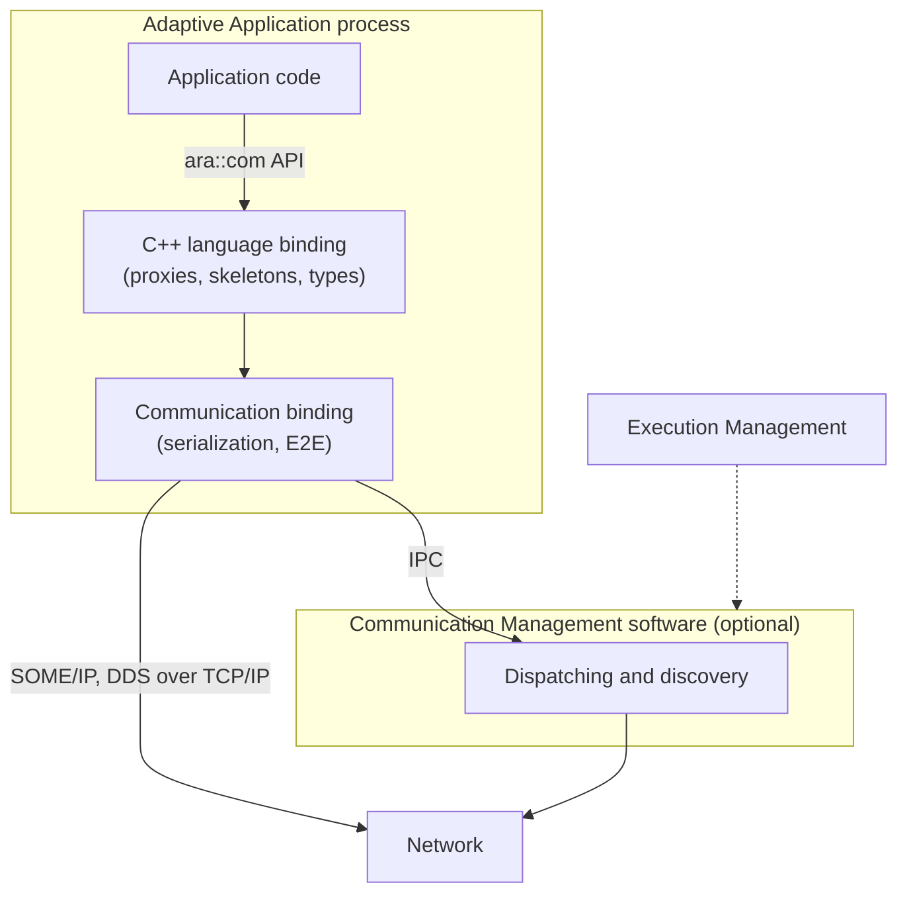

### 1.2 What `ara::com` Does Not Do

Knowing the limits saves time when something does not work:

- **No component model.** `ara::com` does not create objects for you, call your code cyclically or manage program flow. It only provides the communication API, on top of which such frameworks could be built (EXP, Section 3.2).
- **No wire protocol in the API.** The same application code runs over SOME/IP, DDS or a local binding. The integrator chooses the binding in the manifest ([Section 4.3](#43-what-you-can-change-without-recompiling)); [guide 08a](08a_NetworkBindings.md) explains the bindings.
- **No timeout supervision of method calls.** A lost response can block a waiting `Future` forever. Protecting the caller is the application's job ([Section 8.3](#83-no-timeout-supervision)).
- **No thread-safety guarantee.** R25-11 does not define the thread safety of the `ara::com` API (SWS CM, Section 4.1.7). Only some handler calls are serialized ([Chapter 10](#10-threading-execution-context-and-handlers)).
- **No standardized local IPC.** Communication between processes on one machine is implementation-specific ([Chapter 13](#13-local-communication-and-multi-binding)).
- **No access policy.** Communication Management *enforces* access rights, but the policy and its configuration belong to Identity and Access Management (guide 15).

### 1.3 Why AUTOSAR Defined Its Own API

Before designing `ara::com`, AUTOSAR evaluated existing middleware, among them the ROS API, the DDS API and CommonAPI. None met all of its key requirements (EXP, Section 3.1):

- **Protocol independence.** The API must support SOME/IP, but must not be bound to it.
- **The AUTOSAR service model.** Services with methods, events and fields must map naturally to the API.
- **Polling and event-driven access, equally well.** Real-time applications poll to avoid unnecessary context switches; other applications prefer callbacks.
- **Built-in end-to-end protection,** so that safety requirements up to ASIL can be met.
- **Static and dynamic selection of service instances.**

The result is a deliberately *lean* API: it handles methods, events, fields and triggers on the consumer and the provider side, and little else. Where a problem can be solved efficiently above the API, `ara::com` leaves it to the application (EXP, Section 3.2). Several design decisions follow from this (SWS CM, Section 7.1.2): the proxy/skeleton pattern, callbacks on data reception, zero-copy capabilities, `Future` and `Promise` for method calls, full service discovery on the API level, and support for service contract versioning.

### 1.4 Analogies

Three familiar technologies help, if you keep their limits in mind:

| Analogy | What fits | Where it breaks down |
| --- | --- | --- |
| The Classic Platform RTE (`Rte_Write`, `Rte_Read`, `Rte_Call`, `Rte_Result`) | `ara::com` fulfils similar functional needs on the Adaptive Platform (EXP, Section 3.1) | The RTE connects ports statically at build time. `ara::com` finds providers at run time through service discovery. |
| RPC stubs and skeletons (CORBA, Java RMI) | The proxy is the local stand-in of a remote object; the skeleton connects your implementation to the transport | `ara::com` also has events, fields and triggers, and supports polling without callbacks. |
| Publish/subscribe middleware (DDS, ROS topics) | Events are published and received from local queues | A service bundles events with methods and fields, and has a provider that can be found, can go away and can come back. |

In general terms, the OASIS *Reference Model for Service Oriented Architecture* describes a service as "the means by which the needs of a consumer are brought together with the capabilities of a provider" [EXT-027]. The specification cites this model as background (SWS CM, Section 7.1.3).

### 1.5 The Two Documents Behind This Guide

Communication Management has two main documents. The SWS recommends reading the explanatory document first (SWS CM, Chapter 1):

- **Explanation of ara::com API (EXP).** It explains the design: why handles exist, how samples are buffered, why there are three processing modes. It uses an example service called `RadarService`.
- **Specification of Communication Management (SWS).** It contains the normative requirements and, since R24-11, API tables that are derived from header files.

Several code listings in the EXP are older than the API tables of the SWS. The guide always follows the SWS. The following table lists the differences you will meet if you read both.

| Topic | EXP listing | R25-11 SWS | ID |
| --- | --- | --- | --- |
| `SetReceiveHandler`, `UnsetReceiveHandler`, `SetSubscriptionStateChangeHandler` | Return `ara::core::Result<void>` | Return `void`, `noexcept` | [SWS_CM_00181], [SWS_CM_00183], [SWS_CM_00333] |
| Fire-and-forget method on the proxy | `ara::core::Result<void> operator()()` | `void operator()(...) noexcept`; no errors | [SWS_CM_90435], [SWS_CM_90436] |
| Fire-and-forget method on the skeleton | `virtual ara::core::Result<void> ...() = 0` | `virtual void ...(...) noexcept = 0` | [SWS_CM_90434] |
| Named constructor `Create` of the skeleton | Exists | Does not exist; three `noexcept` constructors | [SWS_CM_00130], [SWS_CM_00152], [SWS_CM_00153] |
| `Allocate()` of a skeleton event | Returns `Result<SampleAllocateePtr<...>>` | Returns `SampleAllocateePtr<SampleType>`; failures are violations | [SWS_CM_90438] |
| Error names | `kSetHandlerNotSet`, `kFieldValueIsNotValid`, `kNetworkBindingFailure` | `kFieldSetHandlerNotSet`, `kFieldValueNotInitialized`, `kCommunicationFailure` | [SWS_CM_10432] |
| `InstanceIdentifier` | `Create` returns a `Result`; `ToString()` | `Create` returns an `InstanceIdentifier`; `toString()` | [SWS_CM_11520], [SWS_CM_11522] |
| Proxy constructor | Takes `HandleType&` | Takes `const HandleType&` | [SWS_CM_00131] |

> **Key takeaways**
>
> - Communication Management realizes service-oriented communication inside a process, between processes and between machines, with one C++ API: `ara::com`.
> - The language binding and the communication binding run inside your process; discovery and brokering may run in a daemon.
> - `ara::com` is lean on purpose: no component model, no protocol in the API, no method timeouts, no defined thread safety.
> - Read the EXP for the ideas and the SWS for the exact API; where they differ, the SWS wins.

---

## 2. Core Concepts and Terminology

> **Why this matters:** `ara::com` uses a small set of terms very precisely: instance, handle, specifier, identifier, sample, subscription. Most misunderstandings in projects come from mixing them up. This chapter defines each term once, in plain words first.

### 2.1 Service Interface, Service Instance, Provider and Consumer

**In plain words:** a *service interface* is the contract: which events, methods, fields and triggers a service has, and their data types. A *service instance* is one concrete provider of that contract. There can be several instances of the same interface, for example one per camera.

**Formally:** a `ServiceInterface` is a model element that aggregates events (`VariableDataPrototype`), methods (`ClientServerOperation`), fields (`Field`) and triggers (`Trigger`) ([guide 02, Section 6.1](02_Manifests.md#61-events-methods-fields-and-triggers)). An `AdaptivePlatformServiceInstance` "makes the functionality of a `ServiceInterface` available" on the platform; several instances may exist for the same interface, for different purposes or users (TPS, Section 13.3).

- The **service provider** (server) implements the interface and *offers* an instance.
- The **service consumer** (client) *finds* an instance and *uses* it.

In the model, a provider has a P-port typed by the service interface and a consumer has an R-port ([TPS_MANI_01039], [TPS_MANI_01040]). A port cannot be both: a `PRPortPrototype` typed by a service interface is not allowed ([constr_1473]).

### 2.2 Skeleton and Proxy

**In plain words:** from one service interface, a generator creates two C++ classes. The *skeleton* is the provider's base class: you derive from it and implement the methods. The *proxy* is the consumer's local stand-in for the possibly remote service: you call its members as if the service were local.

**Formally:** "The (service) proxy is the representative of the possibly remote (i.e. other process, other core, other node) service"; "the (service) skeleton is the connection of the user provided service implementation to the middleware transport infrastructure. Service implementation class is derived from the (service) skeleton" (SWS CM, Section 7.1.2). The specification standardizes the interface of the generated classes; the vendor's toolchain generates their implementation (EXP, Sections 5.3 and 5.4).

The following diagram shows the pattern of EXP Figure 4.1.

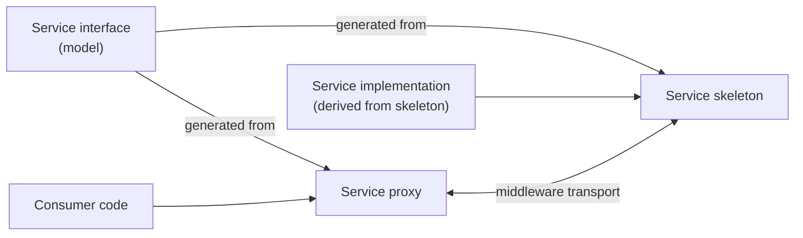

| Property | Proxy | Skeleton |
| --- | --- | --- |
| Generated class | `proxy::{<SI>}Proxy`, declared `final` ([SWS_CM_00004]) | `skeleton::{<SI>}Skeleton`, not `final`, with a virtual destructor ([SWS_CM_00002], [SWS_CM_11370]) |
| Created from | A handle found by service discovery ([SWS_CM_00131]) | An `InstanceSpecifier`, an `InstanceIdentifier` or a container of identifiers ([SWS_CM_00152], [SWS_CM_00130], [SWS_CM_00153]) |
| Copyable | No; movable | No; movable |
| Methods | Call objects with `operator()` | Pure virtual functions that you implement |

### 2.3 The Four Means of Communication

`ara::com` defines four mechanisms between a server and a client (EXP, Section 4.2):

| Mechanism | In plain words | Data | Initiated by | Classic Platform analogue |
| --- | --- | --- | --- | --- |
| **Event** | The provider tells subscribers that something happened, with data | Yes, one sample per event | Provider | Sender/receiver, queued |
| **Method** | The consumer asks the provider to do something and, usually, to answer | In arguments, out arguments, errors | Consumer | Client/server |
| **Fire-and-forget method** | A method call without any answer | In arguments only | Consumer | Client/server without response |
| **Field** | A value that the provider holds at any time; consumers can read it (getter), change it (setter) and be notified of changes (notifier) | Yes, the current value | Both | No direct analogue |
| **Trigger** | An event without data: "it happened" | No | Provider | Trigger interface |

**Formally:** an event "is a notification mechanism that is used by the Service Skeleton to inform the Service Proxy that a specific condition or state change occurred. The notification includes the data related to the event"; a trigger is the same, but "does not include any data" (SWS CM, Section 2.2). Both are delivered only to subscribed proxies. A field has getter, setter and notifier, each optional (`Field.hasGetter`, `hasSetter`, `hasNotifier`). A method is fire-and-forget when `ClientServerOperation.fireAndForget` is `true` ([SWS_CM_99332]).

### 2.4 Service Discovery

**In plain words:** a provider *offers* its instance. A consumer *finds* instances and gets *handles*. From a handle, it creates a proxy. When the provider stops, the proxy notices; when the provider comes back, the proxy reconnects by itself.

**Formally:** service discovery "decides whether external and internal service-oriented communication is established" and can return either a specific instance or all available instances, local or remote (SWS CM, Section 7.1.3). The skeleton offers with `OfferService` and withdraws with `StopOfferService`. The proxy class offers one-shot `FindService` and continuous `StartFindService`, both returning handles of type `{<SI>}Proxy::HandleType` ([SWS_CM_00122], [SWS_CM_00123]). After a temporary unavailability, Communication Management re-establishes the connection on the next offer ([SWS_CM_10491]). [Chapter 6](#6-service-discovery-offering-and-finding-services) explains the details.

### 2.5 Instance Identifiers and Instance Specifiers

**In plain words:** an *instance specifier* is the name that *you* use in the code: the path of your port in the model, such as `/fusion/Root/CameraRPort`. An *instance identifier* is the technical address of one instance in one binding, such as a SOME/IP instance ID. The manifest maps one to the other, so your code never contains binding-specific IDs.

**Formally:**

- `ara::core::InstanceSpecifier` is defined in SWS Core. For application ports, it is the path of short names `/Executable/RootSwComponentPrototype/.../PortPrototype` ([SWS_CORE_10200]); [guide 03, Section 11.11](03_CoreAndGeneral.md#1111-instancespecifier) explains it.
- `ara::com::InstanceIdentifier` is the "unique identifier of a specific instance of a service, needed to distinguish different instances of exactly the same service in the system" ([SWS_CM_00302], SWS CM, Section 7.5.22.1). Its string form is vendor-specific ([SWS_CM_00088]).
- Communication Management translates a specifier into zero, one or several identifiers ([SWS_CM_10452]), through the `ServiceInstanceToPortPrototypeMapping` of the process ([guide 02, Section 9.4](02_Manifests.md#94-from-port-to-instancespecifier)).

> **Note:** SWS CM still describes the specifier of an abstract network binding as `<port context>::<port name>` ([SWS_CM_10590]). SWS Core and the EXP use the `/`-separated path ([SWS_CORE_10200]; EXP, Section 4.8.1). The series uses the SWS Core form.

### 2.6 Subscription, Samples and the Local Cache

**In plain words:** to receive an event, a consumer *subscribes* and says how many samples it wants to hold at most. Communication Management then reserves a *local cache* of that size. Received data is put into the cache, and the application gets a smart pointer, a `SamplePtr`, to each sample. Every `SamplePtr` occupies a slot until the application releases it.

**Formally:**

- An *active subscriber* is an application that has called `Subscribe` and not yet `Unsubscribe` ([SWS_CM_12002]); with SOME/IP, the subscription must also not have expired ([SWS_CM_12003]).
- `Subscribe(maxSampleCount)` ensures that `maxSampleCount` samples can be accessed concurrently ([SWS_CM_00700]).
- The *subscription state* is `kSubscribed`, `kNotSubscribed` or `kSubscriptionPending` ([SWS_CM_00310]).
- `ara::com::SamplePtr<T>` behaves like a `std::unique_ptr` to a read-only sample ([SWS_CM_00306]).

### 2.7 Language Binding, Network Binding and Multi-Binding

- The **language binding** maps the model to C++: generated classes, data types and error domains ([Chapter 5](#5-from-service-interface-to-generated-code)).
- A **network binding** (also *communication binding*) maps the service to a transport: SOME/IP, DDS, signal-based, or a user-defined binding such as a local IPC mechanism. The `ServiceInterfaceDeployment` in the manifest selects it ([SWS_CM_00103]).
- **Multi-binding** describes setups "having multiple connections implemented by different technical transport layers and protocol between different instances of a single proxy or skeleton class" (SWS CM, Section 2.2), for example one skeleton that is reachable over a local IPC binding and over SOME/IP ([Section 13.3](#133-multi-binding)).

### 2.8 Other Key Terms

| Term | Meaning | Where |
| --- | --- | --- |
| Method Call Processing Mode | How a skeleton executes incoming method calls: `kEvent` (concurrent, default), `kEventSingleThread` (one at a time) or `kPoll` (only when the application asks) | [Section 8.7](#87-method-call-processing-modes) |
| Minimum Send Interval | The minimum time between two transmissions of one event, trigger, field update or method call; new in R25-11 | [Section 11.4](#114-the-minimum-send-interval) |
| Transport fault condition | A transport-related fault (sample rejected, deadline missed, sample lost) reported to a handler | [Section 11.5](#115-transport-fault-conditions) |
| E2E status | The result of the end-to-end check of a sample (`ProfileCheckStatus`) and of the event or method as a whole (`SMState`) | [Chapter 12](#12-end-to-end-protection-the-api-side) |
| Callable | A C++ type for which the `INVOKE` operation applies, such as a lambda or a `std::function` (SWS CM, Section 2.2) | Handlers, `GetNewSamples` |
| Orphaned response | A response or error message for a method call that the caller has already canceled (SWS CM, Section 2.2) | [Section 8.4](#84-canceling-a-call) |
| Service contract version | The `majorVersion` and `minorVersion` of a service interface | [Section 6.8](#68-service-contract-versioning) |

> **Key takeaways**
>
> - A service interface is the contract; a service instance is one provider of it; a skeleton offers it and a proxy uses it.
> - Events, methods (including fire-and-forget), fields and triggers are the four means of communication.
> - Your code uses an `InstanceSpecifier` (a model path); the manifest maps it to binding-specific `InstanceIdentifier`s.
> - Subscribing reserves a local cache; every `SamplePtr` you hold occupies one slot of it.

---

## 3. Communication Management in the System Architecture

> **Why this matters:** When a service is not found, you need to know which parts are involved: your process, a discovery daemon, the network stack, Identity and Access Management. This chapter shows where Communication Management sits, which other clusters it depends on, and when it is available during the life of the machine.

### 3.1 Where Communication Management Sits in the Platform

Communication Management is a *daemon-based* functional cluster (SWS CM, Figure 5.1), but a large part of it lives inside each application: the generated language binding, the communication binding with its serialization, and the E2E checks ([Section 1.1](#11-what-is-communication-management)). The specification does not prescribe the internal architecture. A "Runtime" singleton class, a central daemon or a fully distributed design are all allowed (SWS CM, Sections 7.1 and 7.1.2).

| Part | Typical location | Standardized? |
| --- | --- | --- |
| `ara::com` API (proxies, skeletons, types) | Application process | Yes: the C++ API (SWS CM, Chapter 8) |
| Serialization, E2E check, binding logic | Application process | Behavior yes, implementation no |
| Service registry and local discovery | Daemon, or distributed over the applications | No ([Section 3.3](#33-service-discovery-inside-the-machine)) |
| Network discovery (SOME/IP-SD, DDS discovery) | Daemon or binding library | Yes, the protocols ([guide 08a](08a_NetworkBindings.md)) |

### 3.2 Interfaces Provided and Required

Communication Management provides **no interfaces to other functional clusters** (SWS CM, Table 5.1). Other clusters use it like applications do: through `ara::com` service interfaces. For example, the services of State Management ([guide 05, Section 13](05_StateManagement.md#13-api-reference-and-usage-guide-arasm)) are ordinary `ara::com` services. The only services that Communication Management itself defines are three SecOC services in the namespace `ara::com::secoc` (SWS CM, Chapter 9), which [guide 08b](08b_SecureAndSafeCommunication.md) covers.

Communication Management requires the following interfaces (SWS CM, Table 5.2):

| Functional cluster | Interface | Purpose |
| --- | --- | --- |
| Cryptography | `CryptoStack` | Encrypted connections, checksums such as message authentication codes |
| Execution Management | `ExecutionClient` | No purpose stated; it is the interface with which a process reports its execution state ([EM guide, Section 14.3](04_ExecutionManagement.md#143-executionclient)) |
| Intrusion Detection System Manager | `EventReporter` | Report security events ([Section 16.1](#161-security-event)) |
| Log and Trace | `Logger` | Log standardized messages, such as violation messages |
| Operating System Interface | `OperatingSystemInterface` | Create and control the threads of the implementation |

In addition, Communication Management depends on the E2E protocol (SWS CM, Section 5.3), and it enforces the access rights that Identity and Access Management configures (SWS CM, Section 7.3.1; guide 15).

### 3.3 Service Discovery Inside the Machine

For offers and searches *over the network*, the protocol is fixed by the binding, for example SOME/IP-SD. For offers and searches *between processes on the same machine*, "the protocol implementation for service discovery taking place locally is totally up to the AP product vendor" (EXP, Section 7.2).

> **Note (implementation example):** The EXP sketches two designs (Section 7.2.1). In a **central** design, one daemon keeps the registry of all service instances, answers every `OfferService`, `StopOfferService` and `FindService` of local applications, and bridges to SOME/IP-SD on the network. In a **distributed** design, each application keeps its own copy of the registry, and offers and searches are broadcast to all local applications. Even then, one process must own the SOME/IP-SD port towards the network. Most commercial stacks use a central daemon.

### 3.4 Lifecycle of Communication Management

Communication Management provides the communication infrastructure that State Management uses, and AUTOSAR assumes it is available in the Machine States `Startup` and `Shutdown` "to the extent necessary to perform these states" (SWS CM, Section 7.6).

- **Startup.** No special handling is needed, but it is recommended to start Communication Management in parallel with or after Execution Management, and before State Management. Once both are running, they "should take control of the Communication Management lifecycle" (SWS CM, Section 7.6.1).
- **Shutdown.** Communication Management should keep the functions that State Management needs for as long as necessary. The integrator decides when its parts terminate, and "should provide a concept how to notify application processes still holding `ara::com::SamplePtr`'s to memory elements of communication management" (SWS CM, Section 7.6.2).

On `HPC`, the Communication Management daemon is one of the platform daemons of `HpcPlatformCore` that Execution Management starts in `MachineFG.Startup` ([guide 00, Section 6.3](00_LearningPath.md#63-the-hpc-machine)).

> **Pitfall:** An application process that reports `kRunning` to Execution Management before it has offered its services makes the Execution Dependencies of others meaningless. Offer first, then report `kRunning` ([EM guide, Section 6.6](04_ExecutionManagement.md#66-prefer-service-discovery-for-applications)).

### 3.5 Interaction Map

The following diagram summarizes who talks to Communication Management, and how.

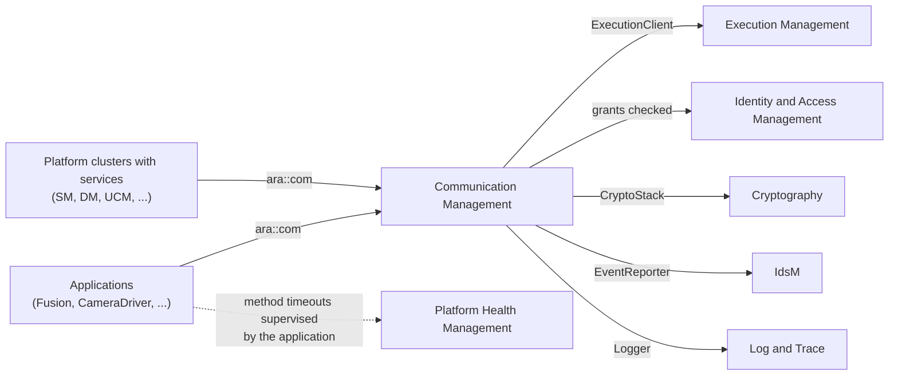

> **Key takeaways**
>
> - Much of Communication Management runs inside your process; local discovery and brokering are implementation-specific.
> - Communication Management offers no internal interfaces to other clusters; platform services are ordinary `ara::com` services.
> - It needs Execution Management, Log and Trace, Cryptography, IdsM and the OS interface, and it enforces IAM grants.
> - It starts early and stops late, because State Management needs it to change Machine States.

---

## 4. Configuration Overview

> **Why this matters:** In `ara::com`, the code says *what* to communicate and the manifest says *how* and *with whom*. A consumer finds nothing if a single mapping is missing. This chapter gives you the mental model of the configuration; [Chapter 14](#14-configuration-reference-what-to-configure) lists every setting.

### 4.1 Where the Configuration Lives

The configuration that `ara::com` reads is spread over three kinds of work products. [Guide 02](02_Manifests.md#4-configuration-overview) explains the manifests in general; the table shows the `ara::com` view.

| Level | Elements | Who configures, when | What it decides |
| --- | --- | --- | --- |
| Service interface design | `ServiceInterface` with events, methods, fields, triggers, namespace and version; C++ implementation data types; application errors | Service designer, before code generation | The generated C++ API ([Chapter 5](#5-from-service-interface-to-generated-code)) |
| Application design | Components with P-ports and R-ports typed by the interface; ComSpecs on the ports; the `Executable` and its root prototype | Application developer | The `InstanceSpecifier`s; port-specific settings such as field initial values and E2E switches |
| Deployment (Service Instance Manifest) | `ServiceInterfaceDeployment` (binding), provided and required service instances, `ServiceInstanceToPortPrototypeMapping`, `ServiceInstanceToMachineMapping` | Software cluster integrator, finalized by the machine integrator | Which binding, which instance IDs, which network endpoints, and which process uses which instance |
| Machine | Communication connectors of the `MachineDesign`; `CmModuleInstantiation` of the `Machine` | Machine integrator | Network interfaces, local IPC domains, access control switches |

SWS CM itself defines no default values for these attributes (SWS CM, Section 10.1) and only one semantic constraint: every `ServiceInterface` shall have a namespace ([SWS_CM_CONSTR_00008]). The defaults that do exist come from individual requirements, such as the Minimum Send Interval ([Section 11.4](#114-the-minimum-send-interval)).

### 4.2 How the Elements Relate

The following diagram shows the two chains that matter for `ara::com`: from the service interface to the generated code, and from the port in the code to a concrete service instance on a transport.

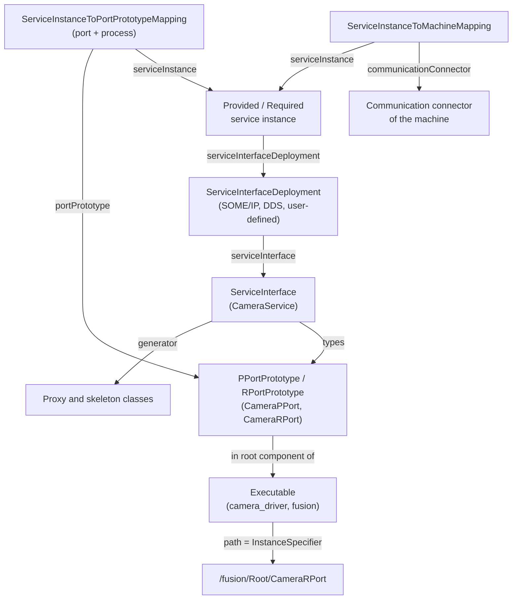

At run time, a constructor or `FindService` call with an `InstanceSpecifier` makes Communication Management look up the mapping of the *current process* for that port, take the service instance it points to, and use that instance's deployment and connector ([SWS_CM_10452]; [guide 02, Section 9.3](02_Manifests.md#93-connecting-a-port-to-a-service-instance)). If one of these links is missing or wrong, the call raises a violation ([Section 11.3](#113-violations-in-aracom)).

### 4.3 What You Can Change Without Recompiling

The choice of a binding is an integration decision, so it must not force developers to rebuild. The specification requires that the following changes need at most a re-link, not a recompilation, of the involved applications (SWS CM, Section 7.2):

| Change | Example | ID |
| --- | --- | --- |
| Type of the service interface deployment, or its attributes | A `SomeipServiceInterfaceDeployment` becomes a `UserDefinedServiceInterfaceDeployment`; a different `separationTime` | [SWS_CM_10384] |
| Type of the service instances, or their attributes | `ProvidedSomeipServiceInstance` becomes `ProvidedUserDefinedServiceInstance`; a different offer time to live | [SWS_CM_10385] |
| Network configuration | A different UDP or TCP port in the `SomeipServiceInstanceToMachineMapping` | [SWS_CM_10386] |
| Backwards-compatible change of the binding's service version | SOME/IP minor version | [SWS_CM_10384], [SWS_CM_10385] |

The exception is the major version of the SOME/IP deployment: a change of `SomeipServiceVersion.majorVersion` indicates an incompatible interface change, and the applications must be recompiled (SWS CM, Section 7.2).

> **Key takeaways**
>
> - The service interface shapes the code; the deployment decides the binding and the instance; the machine provides the connectors.
> - Your code knows only the `InstanceSpecifier`; the mapping of the current process resolves it to an instance.
> - A complete chain is needed: port, mapping, service instance, deployment, machine mapping and connector.
> - Binding and network changes need at most a re-link; a new major version needs a recompile.

---

## 5. From Service Interface to Generated Code

> **Why this matters:** You never write a proxy or a skeleton by hand. A generator creates them from the model, and their names, namespaces and signatures follow fixed rules. Knowing these rules lets you predict the code from the ARXML, find the right header, and understand compiler errors after a model change.

### 5.1 What the Generator Produces

The `ara::com` header files are "either statically defined or generated by processing the ARXML configuration" (SWS CM, Section 7.5.23):

| Header | Kind | Content | ID |
| --- | --- | --- | --- |
| `ara/com/types.h` | Static | Handler types, containers, enumerations of `ara::com` | [SWS_CM_01013], [SWS_CM_01018] |
| `ara/com/runtime.h` | Static | `ara::com::runtime::ResolveInstanceIDs` | [SWS_CM_11379], [SWS_CM_11377] |
| `ara/com/com_error_domain.h`, `ara/com/e2e/e2e_error_domain.h`, `ara/com/e2e/transport_fault_condition.h` | Static | Error domains and E2E types | [SWS_CM_10432], [SWS_CM_10474], [SWS_CM_00091] |
| `{ns-path}/{si}_common.h` | Generated, one per service interface | Common definitions, service identifier and version; includes the type and error headers | [SWS_CM_01012] |
| `{ns-path}/{si}_proxy.h` | Generated | The proxy class and its event, field, method and trigger classes | [SWS_CM_11503] |
| `{ns-path}/{si}_skeleton.h` | Generated | The skeleton class and its event, field and trigger classes | [SWS_CM_01002] |
| `{ns-path}/impl_type_{type}.h` | Generated, one per data type | The C++ data types of the interface | [SWS_LBAP_00033] |
| `{ns-path}/{domain}_error_domain.h` | Generated, one per application error domain | The error domain of the methods' application errors ([guide 03, Section 7.8](03_CoreAndGeneral.md#78-generated-error-domains)) | SWS LBAP |

Each generated header has a forward-declaration variant, for example `{si}_proxy/{si}_proxy_fwd.h`. The common header includes `ara/com/types.h`, the data type headers, `ara/com/com_error_domain.h` and the application error headers ([SWS_CM_01012]); the proxy and skeleton headers include the common header. The following diagram shows the include structure for `CameraService`.

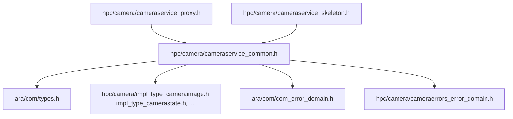

### 5.2 File Names, Namespaces and Names

**In plain words:** the path of the header and the C++ namespace both come from the namespace that the service designer attached to the service interface. Class and member names are the short names of the model, unchanged.

**Formally:**

- The `SymbolProps` aggregated in `ServiceInterface.namespace` form the namespace hierarchy, each element converted to lower case; each element is also one directory level of the header path ([SWS_CM_11500], [SWS_CM_01012]). The proxy and skeleton headers use the same namespace ([SWS_CM_11504], [SWS_CM_01005]). The file name is the short name of the interface in lower case.
- Inside the service namespace, the proxy header uses the inner namespaces `proxy`, `proxy::events`, `proxy::fields`, `proxy::methods` and `proxy::triggers` ([SWS_CM_01007], [SWS_CM_98447], [SWS_CM_98444], [SWS_CM_01015], [SWS_CM_11505]). The skeleton header uses `skeleton`, `skeleton::events`, `skeleton::fields` and `skeleton::triggers`, but no `methods` namespace: on the skeleton side, methods are virtual functions of the skeleton class ([SWS_CM_01006], [SWS_CM_01009], [SWS_CM_01031], [SWS_CM_11502]). The common definitions are in `common` ([SWS_CM_11501]).
- The classes are named after the short names: `{<SI>}Proxy`, `{<SI>}Skeleton`, and one class per event, field, method and trigger. R25-11 removed the automatic conversion of these names to upper camel case (SWS CM, change history R25-11): a short name `image` stays `image`.

| Model element (`CameraService`) | Generated C++ |
| --- | --- |
| `ServiceInterface.namespace` = `hpc`, `camera` | `namespace hpc::camera`; directory `hpc/camera/` |
| `ServiceInterface` `CameraService` | `hpc::camera::proxy::CameraServiceProxy`, `hpc::camera::skeleton::CameraServiceSkeleton`, `hpc::camera::common::CameraService` |
| Event `Image` | `proxy::events::Image`, `skeleton::events::Image`; members named `Image` |
| Field `CameraStatus` | `proxy::fields::CameraStatus`, `skeleton::fields::CameraStatus`; members named `CameraStatus` |
| Method `SetExposureMode` | `proxy::methods::SetExposureMode`; virtual function `CameraServiceSkeleton::SetExposureMode` |

> **Pitfall:** If two service interfaces share a namespace and both have an element with the same short name, the generated classes clash. The specification recommends a dedicated namespace for each service interface ([SWS_CM_11500]). `HPC` uses `hpc::camera`, `hpc::fusion` and `hpc::storage`.

### 5.3 The Common Header: Service Identifier and Contract Version

The common header defines a class named after the service interface, in the namespace `common` ([SWS_CM_01010]). It carries four static members ([SWS_CM_11506] to [SWS_CM_11509]):

```cpp
// In hpc/camera/cameraservice_common.h (shape from the API tables).
namespace hpc::camera::common {
class CameraService {
public:
    static const ara::com::ServiceIdentifierType serviceIdentifier;
    static const ara::com::ServiceVersionType serviceVersion;
    static std::uint32_t serviceContractVersionMajor;  // from ServiceInterface.majorVersion
    static std::uint32_t serviceContractVersionMinor;  // from ServiceInterface.minorVersion
};
}  // namespace hpc::camera::common
```

The contract versions come from `majorVersion` and `minorVersion` of the service interface ([SWS_CM_99029]). The string form of the service identifier is vendor-specific ([SWS_CM_00088]). These members are mainly useful for logging and diagnostics.

### 5.4 How Arguments Are Passed

**In plain words:** small built-in types are passed by value; everything else is passed as a `const` reference. Out arguments are returned together in a structure.

**Formally:** the parameter type of a method argument, of an event sample in `Send`, and of a field value in `Update` and `Set` is the *derived type* of its C++ data type ([SWS_CM_00191]):

1. If the type resolves to one of the eleven basic types `int8_t`, `int16_t`, `int32_t`, `int64_t`, `uint8_t`, `uint16_t`, `uint32_t`, `uint64_t`, `bool`, `float` or `double`, the parameter is passed **by value**. This includes enumerations, because they are type references to an integer type.
2. Otherwise, it is passed as a **`const` lvalue reference**.

In and inout arguments become parameters of the method call; out and inout arguments become members of an output structure: `methods::{<method>}::Output` on the proxy ([SWS_CM_99333]) and `{<method>}Output` in the skeleton ([SWS_CM_99556], [SWS_CM_11550]). An inout argument therefore appears twice: once as a parameter and once in the output (EXP, Section 5.3.6).

| `CalibrationDataService` method | Proxy call | Skeleton function |
| --- | --- | --- |
| `GetCalibration(in key, out record)` | `Future<methods::GetCalibration::Output> operator()(CalibrationKey key)`; `Output` has `record` | `Future<GetCalibrationOutput> GetCalibration(CalibrationKey key)` |
| `SetCalibration(in key, in record)` | `Future<methods::SetCalibration::Output> operator()(CalibrationKey key, const CalibrationRecord& record)` | `Future<SetCalibrationOutput> SetCalibration(CalibrationKey key, const CalibrationRecord& record)` |

> **Note:** The specification does not say what `Output` contains when a method has no out argument, such as `SetCalibration` or `SetExposureMode`. The return type is still `ara::core::Future<Output>`; the structure is typically empty. Check your generator. ([Guide 03, Section 9.7](03_CoreAndGeneral.md#97-worked-example-fusion-requests-the-night-exposure-mode) simplified this to `Future<void>`.)

### 5.5 Data Types

The data types of a service interface are generated by the *ARA language binding generator* according to SWS LBAP (SWS CM, Section 7.5.23.1). The category of each `CppImplementationDataType` selects the C++ form ([guide 02, Section 6.4](02_Manifests.md#64-data-types)):

| Category | Generated C++ | Example in `HPC` | ID |
| --- | --- | --- | --- |
| `STRUCTURE` | `struct` with one member per sub-element | `CameraImage`, `ObjectListData`, `DetectedObject`, `CalibrationRecord` | SWS LBAP |
| `VECTOR` | `using X = ara::core::Vector<T>;` | `PixelVector`, `DetectedObjectVector`, `FloatVector` | SWS LBAP |
| `TYPE_REFERENCE` with a `TEXTTABLE` CompuMethod | `enum class X : std::uint8_t { ... };` with one enumerator per scale | `ExposureMode`, `CameraState`, `ObjectKind`, `FusionModeType`, `CalibrationKey` | [SWS_LBAP_00027], [SWS_LBAP_00028] |
| `STRING` | `using X = ara::core::String;` | none | [SWS_LBAP_00015] |

For the enumeration `ObjectKind` of `HPC`, the generator creates `enum class ObjectKind : std::uint8_t { Unknown = 0U, Vehicle = 1U, Pedestrian = 2U, Cyclist = 3U };` in `hpc/fusion/impl_type_objectkind.h`. The suffix `U` appears because the underlying type is unsigned ([SWS_LBAP_00028]).

> **Note:** The specifications disagree on where an enumerator's name comes from. The TPS requires the scales of a `TEXTTABLE` CompuMethod in `compuInternalToPhys`, with the name in `vt`, `shortLabel` or `symbol` (TPS, Section 3.3.3.8). SWS LBAP reads the names from `compuPhysToInternal` ([SWS_LBAP_00028]). The series model follows the TPS. Check which form your generator expects.

Two more features matter for service data:

- **Optional record elements.** A structure element can be declared optional in the model. It is then generated as `ara::core::Optional<T>`, and serialized with tags (EXP, Section 5.5.1). Consumers must check `has_value()` before use. Optional elements let new versions add members without breaking old consumers.
- **Invalid values.** If a data type has an `invalidValue`, its header also defines `constexpr static <SourceDataType> kInvalidValue<DataType> = <InvalidValue>;` ([SWS_CM_10453]). Providers send it to signal "no valid value"; consumers compare against it. This works only for types of category `TYPE_REFERENCE` and `STRING`.

### 5.6 Worked Example: The Generated API of `CameraService`

The following sketch shows the shape of the two generated headers for `CameraService` ([guide 02, Section 6.6](02_Manifests.md#66-worked-example-cameraservice-as-arxml) gives its model). It shows only what this chapter discussed; [Chapter 15](#15-api-reference-and-usage-guide-aracom) lists every member.

```cpp
// hpc/camera/cameraservice_proxy.h: shape of the generated proxy header (illustrative).
#include "hpc/camera/cameraservice_common.h"

namespace hpc::camera::proxy {
namespace events {
class Image final {
public:
    using SampleType = hpc::camera::CameraImage;
    ara::core::Result<void> Subscribe(std::size_t maxSampleCount) noexcept;
    template <typename F>
    ara::core::Result<std::size_t> GetNewSamples(
        F&& f, std::size_t maxNumberOfSamples = std::numeric_limits<std::size_t>::max()) noexcept;
    // ... further members: Section 15.3
};
}  // namespace events
namespace fields {
class CameraStatus final {
public:
    using FieldType = hpc::camera::CameraState;
    ara::core::Future<FieldType> Get() noexcept;  // hasGetter = true; no Set(): hasSetter = false
    // ... notifier members as for events
};
}  // namespace fields
namespace methods {
class SetExposureMode final {
public:
    struct Output {};  // no out arguments (content not specified, Section 5.4)
    ara::core::Future<Output> operator()(hpc::camera::ExposureMode mode) noexcept;
};
}  // namespace methods

class CameraServiceProxy final {
public:
    class HandleType;  // Section 6.5
    static ara::core::Result<ara::com::ServiceHandleContainer<HandleType>>
    FindService(ara::core::InstanceSpecifier instance) noexcept;
    explicit CameraServiceProxy(const HandleType& handle);
    static ara::core::Result<CameraServiceProxy> Create(const HandleType& handle) noexcept;

    events::Image Image;
    fields::CameraStatus CameraStatus;
    methods::SetExposureMode SetExposureMode;
    // ... further members: Section 15.2
};
}  // namespace hpc::camera::proxy
```

```cpp
// hpc/camera/cameraservice_skeleton.h: shape of the generated skeleton header (illustrative).
#include "hpc/camera/cameraservice_common.h"

namespace hpc::camera::skeleton {
namespace events {
class Image {
public:
    using SampleType = hpc::camera::CameraImage;
    ara::core::Result<void> Send(const SampleType& data) noexcept;  // derived type: const&
    ara::core::Result<void> Send(ara::com::SampleAllocateePtr<SampleType> data) noexcept;
    ara::com::SampleAllocateePtr<SampleType> Allocate();
};
}  // namespace events
namespace fields {
class CameraStatus {
public:
    using FieldType = hpc::camera::CameraState;
    ara::core::Result<void> Update(FieldType value) noexcept;  // enumeration: by value
    void RegisterGetHandler(std::function<ara::core::Future<FieldType>()> handler) noexcept;
};
}  // namespace fields

class CameraServiceSkeleton {
public:
    struct SetExposureModeOutput {};
    CameraServiceSkeleton(ara::core::InstanceSpecifier instanceSpec,
        ara::com::MethodCallProcessingMode mode = ara::com::MethodCallProcessingMode::kEvent) noexcept;
    virtual ~CameraServiceSkeleton();

    ara::core::Result<void> OfferService() noexcept;
    void StopOfferService() noexcept;
    virtual ara::core::Future<SetExposureModeOutput> SetExposureMode(hpc::camera::ExposureMode mode) noexcept = 0;

    events::Image Image;
    fields::CameraStatus CameraStatus;
    // ... further members: Section 15.4
};
}  // namespace hpc::camera::skeleton
```

> **Key takeaways**
>
> - For each service interface, the generator creates a common, a proxy and a skeleton header, plus data type and error domain headers.
> - The namespace of the interface gives the C++ namespace and the header directory; names are the model's short names verbatim since R25-11.
> - Basic types are passed by value, all others by `const` reference; out arguments come back in an `Output` structure.
> - Enumerations, structures and vectors follow SWS LBAP; optional elements become `ara::core::Optional`.

---

## 6. Service Discovery: Offering and Finding Services

> **Why this matters:** Before any data flows, a provider must offer and a consumer must find. Most "it does not communicate" problems happen here: a wrong `InstanceSpecifier`, an offer that silently did not start, a proxy created too early, or a handler that runs in an unexpected thread. This chapter covers both sides and the life of a connection when the provider restarts.

### 6.1 Creating a Skeleton

**In plain words:** your service implementation is a class derived from the generated skeleton. You construct it with the name of your P-port and, optionally, the mode in which it should execute incoming method calls. After construction, nobody can see it yet.

**Formally:** the skeleton has three constructors, all `noexcept` ([SWS_CM_00152], [SWS_CM_00130], [SWS_CM_00153]):

| Constructor argument | Use | Typical user |
| --- | --- | --- |
| `ara::core::InstanceSpecifier instanceSpec` | The normal case: the port path; the manifest gives the instance(s) | Application developers |
| `ara::com::InstanceIdentifier instanceID` | Exactly one binding-specific instance | Power users, tests |
| `ara::com::InstanceIdentifierContainer instanceIDs` | Several instances, for example over several bindings (multi-binding) | Power users |

Each takes a second parameter `ara::com::MethodCallProcessingMode mode` with the default `kEvent` ([Section 8.7](#87-method-call-processing-modes)). Problems in the arguments are violations, not errors:

- The identifier, the specifier or the identifiers of the container must be unique for skeletons of the same service; a duplicate is a violation ([SWS_CM_10410], [SWS_CM_10450], [SWS_CM_10451]). The container must not be empty.
- A specifier that cannot be resolved, maps to the wrong interface or to another process, or is already in use raises one of the standardized `InstanceSpecifier` violations ([SWS_CORE_13003] to [SWS_CORE_13006]).
- `kEvent` for a service with E2E-protected methods raises `WrongMethodCallProcessingModeViolation` ([SWS_CM_10467]).
- Missing access rights raise `InsufficientPermissionsViolation` ([SWS_CORE_13000]).

Directly after construction, the instance is not visible to consumers, and no method is called on it (EXP, Section 5.4.3).

### 6.2 Offering and Stopping an Offer

**In plain words:** once your object is ready to serve, call `OfferService()`. From that moment, consumers can find it, and method calls can arrive, even before `OfferService()` returns. Call `StopOfferService()` when you no longer want to serve; after it returns, no more calls arrive.

**Formally:** `ara::core::Result<void> OfferService() noexcept` ([SWS_CM_00101]) and `void StopOfferService() noexcept` ([SWS_CM_00111]).

| Rule | ID |
| --- | --- |
| The binding used for the offer follows from the class of the `ServiceInterfaceDeployment` (SOME/IP, DDS, user-defined) | [SWS_CM_00103], [SWS_CM_00104] |
| `OfferService` returns `kFieldValueNotInitialized` if a field with notifier, or with getter but no GetHandler, has not been given a value with `Update()` | [SWS_CM_00128] |
| `OfferService` returns `kFieldSetHandlerNotSet` if a field with setter has no SetHandler | [SWS_CM_00129] |
| `OfferService` returns `kCommunicationFailure` if the network binding reports a recoverable error | [SWS_CM_00101] |
| If the same instance (same instance ID, interface ID and major version on the same VLAN) is already offered on the machine, the offer does not start, **and the function returns positively** | [SWS_CM_00102] |
| After `StopOfferService`, requests from proxies are ignored | [SWS_CM_00811] |
| No callback is invoked after `StopOfferService` has completed; if a callback is running, `StopOfferService` blocks until it has finished | [SWS_CM_00814] |
| Repeated `StopOfferService` calls without an `OfferService` in between are ignored | [SWS_CM_00815] |
| The skeleton destructor calls `StopOfferService` itself | [SWS_CM_00813] |

> **Pitfall:** A duplicate offer is not an error. If two processes offer the same instance at the same time, for example `Fusion` and `FusionLite` during a faulty state transition, the second `OfferService()` returns success but is not visible ([SWS_CM_00102]). The design of `HPC` avoids this by running the two providers in different `ADAS` states.

Three rules protect the destruction of a skeleton:

- Destroying a skeleton while a method call is still running in `kEvent` mode is undefined behavior. Call `StopOfferService()` first, for example in the destructor of your derived class ([SWS_CM_00083]).
- Setting the value or error of a `Promise` from a method implementation after the skeleton is destroyed is undefined behavior ([SWS_CM_00084]).
- Every sample allocated with `Allocate()` must be sent or released before the skeleton is destroyed; otherwise a violation is raised ([SWS_CM_00086]).

The following code shows how `CameraDriver` creates and offers its skeleton. `CameraServiceImpl` is the class derived from the skeleton ([Section 15.11](#1511-complete-example-cameradriver) shows it in full).

```cpp
// CameraDriver: create, prepare and offer CameraService (illustrative).
auto spec = ara::core::InstanceSpecifier::Create("/camera_driver/Root/CameraPPort");
if (!spec.HasValue()) { return EXIT_FAILURE; }  // syntax error in the path

// The constructor of CameraServiceImpl passes kEventSingleThread to the skeleton (Section 8.7).
CameraServiceImpl camera{spec.Value(), sensor};

// The field CameraStatus has a getter and a notifier: give it a value before the offer.
camera.CameraStatus.Update(hpc::camera::CameraState::NotAvailable);

ara::core::Result<void> offered = camera.OfferService();
if (!offered.HasValue()) {
    // kFieldValueNotInitialized, kFieldSetHandlerNotSet or kCommunicationFailure
    return EXIT_FAILURE;
}
executionClient.ReportExecutionState(ara::exec::ExecutionState::kRunning);  // after the offer
```

### 6.3 Finding a Service Once

**In plain words:** `FindService` asks "which instances are available right now?" and returns at once with a list of handles, which may be empty.

**Formally:** the proxy class has two static, `noexcept` overloads ([SWS_CM_00622], [SWS_CM_00122]):

```cpp
static ara::core::Result<ara::com::ServiceHandleContainer<HandleType>>
FindService(ara::core::InstanceSpecifier instance) noexcept;
static ara::core::Result<ara::com::ServiceHandleContainer<HandleType>>
FindService(ara::com::InstanceIdentifier instance) noexcept;
```

- The result reflects availability at the time of the call; no background search continues (EXP, Section 5.3.2).
- Only the bindings that the service instance manifest configures for the interface are searched (EXP, Section 5.3.4).
- An error result carries `kCommunicationFailure`. The `InstanceSpecifier` overload raises the `InstanceSpecifier` violations on a wrong specifier, and `InsufficientPermissionsViolation` when access is not granted.
- `ServiceHandleContainer<T>` is `ara::core::Vector<T>` by default, and a vendor may replace it with another sequence container ([SWS_CM_00304]).

`CalibrationCheck` is a good user of `FindService`: it runs once at the start of `ADAS`, after `Storage` is running (its Execution Dependency), reads the calibration and terminates.

```cpp
// CalibrationCheck: one-shot search for CalibrationDataService (illustrative).
using CalibrationProxy = hpc::storage::proxy::CalibrationDataServiceProxy;

auto spec = ara::core::InstanceSpecifier::Create("/calib_check/Root/CalibrationRPort");
auto handles = CalibrationProxy::FindService(spec.Value());
if (!handles.HasValue() || handles.Value().empty()) {
    return kCheckFailed;  // Storage should be running; report and terminate
}
auto proxy = CalibrationProxy::Create(handles.Value().front());
```

### 6.4 Finding Continuously

**In plain words:** `StartFindService` keeps searching in the background. It calls your handler once with the instances available now, and again every time this set changes. `StopFindService` ends the search.

**Formally:** the static, `noexcept` overloads take a handler and a specifier or identifier ([SWS_CM_00623], [SWS_CM_00123]):

```cpp
static ara::core::Result<ara::com::FindServiceHandle>
StartFindService(ara::com::FindServiceHandler<HandleType> handler,
                 ara::core::InstanceSpecifier instance) noexcept;
void StopFindService(ara::com::FindServiceHandle handle) noexcept;
```

- The handler type is `std::function<void(ServiceHandleContainer<T>, FindServiceHandle)>` ([SWS_CM_00383]). It first receives "the initially known matches, if there are any", then is called "every time the availability of any of the services matching the given instance criteria changes" ([SWS_CM_00124]). The first call may carry an empty list (EXP, Section 5.3.4).
- The returned `FindServiceHandle` identifies the search; pass it to `StopFindService` ([SWS_CM_99030], [SWS_CM_00125]). The handler also receives it, so it can stop the search from inside (EXP, Section 5.3.4). Stopping an already stopped search is silently ignored ([SWS_CM_10382]).
- The handler need not be re-entrant: the implementation serializes calls to it (EXP, Section 5.3.4).
- A null handler is a violation ([SWS_CM_10417]).
- Two further overloads take an executor as third argument and run the handler in that context ([SWS_CM_11365], [SWS_CM_11352]; [Section 10.4](#104-choosing-the-execution-context)).

> **Note:** The executor overloads return a plain `FindServiceHandle`, not a `Result` ([SWS_CM_11352], [SWS_CM_11365]), so they cannot report `kCommunicationFailure`. The SWS table also does not mark `StopFindService` as `static`, although it is called without a proxy object (EXP, Listing 5.2). Check your vendor's header.

### 6.5 From Handle to Proxy

**In plain words:** a handle is the address of one found instance. You create a proxy from it. You can create several proxies for the same handle, but you cannot copy a proxy.

**Formally:** `{<SI>}Proxy::HandleType` "contains the information that is needed to create a service proxy" ([SWS_CM_00312]). It is copyable and movable, has no default constructor, can be compared with `==` and `<`, and returns its instance identifier with `GetInstanceId()` ([SWS_CM_00317], [SWS_CM_00318], [SWS_CM_00349], [SWS_CM_11529] to [SWS_CM_11531]). There are two ways to create the proxy:

| Function | On failure | ID |
| --- | --- | --- |
| `explicit {<SI>}Proxy(const HandleType& handle);` | Throws `ara::com::ComException` with `kServiceNotAvailable` | [SWS_CM_00131] |
| `static ara::core::Result<{<SI>}Proxy> Create(const HandleType& handle) noexcept;` | Returns `kServiceNotAvailable` or `kCommunicationFailure` | [SWS_CM_10438] |

Both raise `ErroneousServiceHandleViolation` for a null or corrupt handle, and `InsufficientPermissionsViolation` when access is refused. `GetHandle()` returns the handle a proxy was created from ([SWS_CM_10383]).

Why the detour through handles? A proxy holds state: event caches, registered handlers, subscriptions. Some applications want one shared proxy per instance, others want several independent ones. With handles, the application decides (EXP, Section 5.3.3). Proxies are also expensive, so they are not copyable; this prevents accidental copies.

### 6.6 When the Service Goes Away

**In plain words:** providers restart. When that happens, you do not need a new proxy. Calls fail while the provider is away; subscriptions show "pending"; when the provider is back, the proxy reconnects and re-subscribes by itself.

**Formally:** if a service becomes temporarily unavailable, "due to restart, network problem or so", Communication Management retries the connection when the next offer arrives ([SWS_CM_10491]) and re-establishes active subscriptions ([SWS_CM_00315]). The following sequence diagram shows the timeline of EXP Figure 5.1 for `Fusion` and `CameraDriver`.

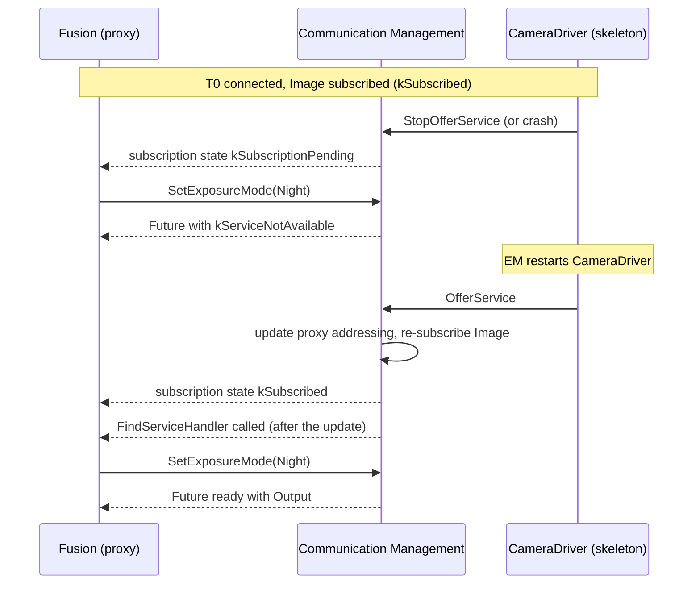

- Method calls on a proxy whose instance is gone fail with `kServiceNotAvailable` ([SWS_CM_00196]).
- The proxy-side subscription state becomes `kSubscriptionPending` when the server is unavailable, and `kSubscribed` again when the subscription is re-established ([SWS_CM_00313], [SWS_CM_00314]).
- If a `FindServiceHandler` is registered, the implementation updates existing proxies *before* calling it, so the handler can use them at once (EXP, Section 5.3.4.1).

Since R22-11, a proxy can also report the availability of its service directly:

```cpp
ara::core::Result<ara::com::ServiceState> GetServiceState() noexcept;            // DRAFT
void SetServiceStateChangeHandler(ara::com::ServiceStateHandler handler) noexcept;
void UnsetServiceStateChangeHandler() noexcept;
```

`ServiceState` is `kNotAvailable` (0) or `kAvailable` (1) ([SWS_CM_01071]); the handler is called "as soon as the service availability state has changed" ([SWS_CM_01074]). `GetServiceState` is marked DRAFT in R25-11 ([SWS_CM_01073]).

### 6.7 InstanceSpecifier, InstanceIdentifier and ResolveInstanceIDs

Most applications only use `InstanceSpecifier`s; every function that needs an instance has an overload for it (EXP, Section 4.8.2). The translation to identifiers is also available directly:

```cpp
namespace ara::com::runtime {
ara::core::Result<ara::com::InstanceIdentifierContainer>
ResolveInstanceIDs(ara::core::InstanceSpecifier metaModelIdentifier) noexcept;
}
```

`ResolveInstanceIDs` looks up the specifier in the service instance manifest of the process and returns zero, one or several identifiers ([SWS_CM_00118], [SWS_CM_10452]). Its error is `kInstanceIDNotResolvable` when the specifier is valid but cannot be mapped. The EXP interprets the result (Section 4.8.1):

| Result | Meaning |
| --- | --- |
| Empty | The integrator did not map the specifier. Most likely a configuration error. |
| One identifier | The common case. |
| Several identifiers | Multi-binding: the port is mapped to several instances, possibly over several bindings ([Section 13.3](#133-multi-binding)). |

`ara::com::InstanceIdentifier` can be built from its string form, with `InstanceIdentifier::Create(serializedFormat)` or the constructor, and turned back into a string with `toString()` ([SWS_CM_11520] to [SWS_CM_11522]). A corrupt or duplicated string raises `InvalidInstanceIdentifierStringViolation`.

When would you use identifiers? Because an identifier contains all binding information, it can be passed to another process and used there without a manifest lookup (EXP, Section 4.8.2). This is risky: the binding may no longer exist, or another vendor's stack may interpret the string differently (EXP, Section 4.8.2.1). Use identifiers only for logging and for rare power-user cases.

Because the mapping is per process, the same executable can be started several times, each process with a different mapping of the same specifier (EXP, Section 4.8.1; [guide 02, Section 9.3](02_Manifests.md#93-connecting-a-port-to-a-service-instance)).

### 6.8 Service Contract Versioning

The contract between provider and consumer can evolve. A service interface carries a `majorVersion` and a `minorVersion` (SWS CM, Section 7.1.4):

- A **backwards-incompatible** change increases the major version and resets the minor version to 0.
- A **backwards-compatible** change increases the minor version.

The contract version is mapped, manually, to a version of each service interface deployment; one interface may have several deployments with different versions. Service discovery evaluates the version of the deployment for backwards compatibility, according to the binding ([SWS_CM_99003]). As a result, a proxy finds only compatible instances (EXP, Listing 5.2). With a static SOME/IP connection, service discovery is bypassed, and versions are not checked at run time ([SWS_CM_02203]; [guide 08a](08a_NetworkBindings.md)).

### 6.9 Worked Example: `Fusion` Finds `CameraService`

`Fusion` does not have an Execution Dependency on `CameraDriver` ([guide 00, Section 6.5](00_LearningPath.md#65-processes)). It searches continuously, creates its proxy when the first instance appears, and subscribes. Later availability changes need no action, because the proxy updates itself. The following sequence diagram shows the startup.

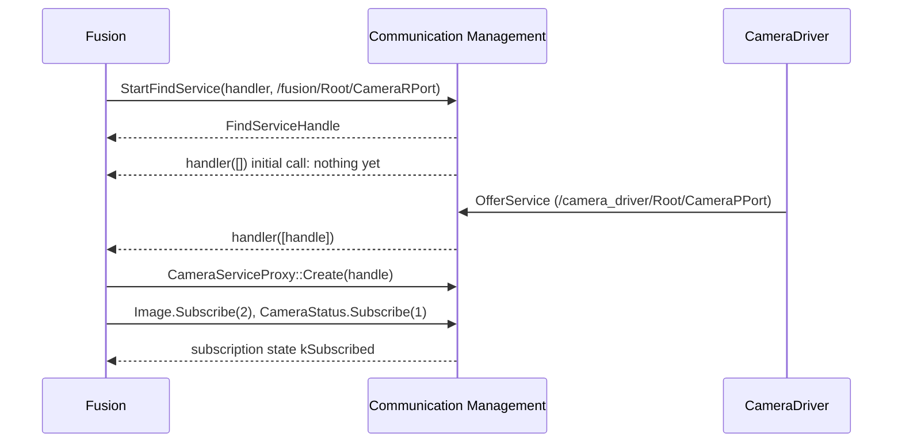

```cpp
// Fusion: continuous search for CameraService (illustrative).
#include "hpc/camera/cameraservice_proxy.h"
#include "ara/core/instance_specifier.h"

#include <mutex>
#include <optional>

namespace hpc::fusion {

using CameraProxy = hpc::camera::proxy::CameraServiceProxy;

class CameraConnection {
public:
    // Called once, after ara::core::Initialize.
    ara::core::Result<void> Start() {
        auto spec = ara::core::InstanceSpecifier::Create("/fusion/Root/CameraRPort");
        if (!spec.HasValue()) { return ara::core::Result<void>::FromError(spec.Error()); }
        auto search = CameraProxy::StartFindService(
            [this](ara::com::ServiceHandleContainer<CameraProxy::HandleType> handles,
                   ara::com::FindServiceHandle) { OnAvailability(handles); },
            spec.Value());
        if (!search.HasValue()) { return ara::core::Result<void>::FromError(search.Error()); }
        search_.emplace(search.Value());
        return {};
    }

    // The cycle thread calls this; the lock protects proxy_ against the handler (Chapter 10).
    template <typename F>
    void WithProxy(F&& f) {
        std::lock_guard<std::mutex> lock(mutex_);
        if (proxy_) { f(*proxy_); }
    }

private:
    // Runs in a context of Communication Management, serialized with itself.
    void OnAvailability(const ara::com::ServiceHandleContainer<CameraProxy::HandleType>& handles) {
        std::lock_guard<std::mutex> lock(mutex_);
        if (proxy_ || handles.empty()) { return; }  // existing proxies update themselves
        auto created = CameraProxy::Create(handles.front());
        if (!created.HasValue()) { return; }         // try again at the next change
        proxy_.emplace(std::move(created).Value());
        proxy_->Image.Subscribe(2);                  // Section 7.2
        proxy_->CameraStatus.Subscribe(1);           // Section 9.5
    }

    std::mutex mutex_;
    std::optional<CameraProxy> proxy_;
    std::optional<ara::com::FindServiceHandle> search_;  // FindServiceHandle has no default constructor
};

}  // namespace hpc::fusion
```

> **Key takeaways**
>
> - Construct the skeleton, give every field a value, register every SetHandler, then call `OfferService()`; report `kRunning` after that.
> - A duplicate offer of the same instance returns success but does not start.
> - Use `FindService` for a one-time check and `StartFindService` to react to providers that come and go.
> - Create proxies from handles, with the constructor or the exception-free `Create`; a proxy reconnects and re-subscribes by itself after a provider restart.
> - Use `InstanceSpecifier`s; `InstanceIdentifier`s and `ResolveInstanceIDs` are for special cases.

---

## 7. Events and Triggers

> **Why this matters:** Events carry most of the data in an ADAS system: images, object lists, vehicle dynamics. The event API decides how much memory you reserve, whether your process is woken up for every sample, and when samples are lost. Triggers are the same mechanism without data. This chapter covers the provider side, the consumer side and the ownership of samples.

### 7.1 Sending an Event

**In plain words:** the provider has two ways to send. Either it fills its own object and lets Communication Management copy it, or it asks Communication Management for memory, fills that memory, and hands it over. The second way can avoid a copy.

**Formally:** the skeleton event class `skeleton::events::{<event>}` offers ([SWS_CM_00162], [SWS_CM_90438], [SWS_CM_90437]):

```cpp
ara::core::Result<void> Send(const SampleType& data) noexcept;   // derived type; const& for structures
ara::com::SampleAllocateePtr<SampleType> Allocate();
ara::core::Result<void> Send(ara::com::SampleAllocateePtr<SampleType> data) noexcept;
```

| Variant | Who owns the data | When to use | ID |
| --- | --- | --- | --- |
| `Send(data)` | The application. Communication Management makes a copy. | The application keeps working with the data after sending. | [SWS_CM_99031] |
| `Allocate()` then `Send(std::move(ptr))` | Communication Management. The application must not touch the data after sending. | The data is created only for sending, especially large data. | [SWS_CM_99032], [SWS_CM_99033] |

- `SampleAllocateePtr<T>` is `std::unique_ptr<T>` by default; a vendor may replace it ([SWS_CM_00308]). Ownership must be transferred with `std::move` to make zero-copy possible (SWS CM, Section 7.5.5).
- `Allocate()` raises `SampleAllocationViolation` if not enough memory is available, and `AllocateUsageViolation` if it is used through an illegal custom allocator ([SWS_CM_90438]).
- `Send` returns `kServiceNotOffered` if the service is not offered, and `kMinimumSendIntervalViolationError` if it is called faster than the configured Minimum Send Interval ([Section 11.4](#114-the-minimum-send-interval)).

> **Note (implementation example):** A stack can implement `Allocate()` so that it returns memory in a region that both the provider and the consumers can read, typically POSIX shared memory [EXT-030]. `Send(std::move(ptr))` then only publishes a reference, and no payload is copied (EXP, Section 5.4.7). Eclipse iceoryx is an open-source IPC framework built on this principle [EXT-028]. Whether a copy is really avoided depends on serialization ([Section 7.6](#76-buffering-and-zero-copy)).

### 7.2 Subscribing to an Event

**In plain words:** a proxy receives nothing until it subscribes. When it subscribes, it says how many samples it wants to hold at the same time. The subscription is established in the background: `Subscribe()` returning success does not mean you are subscribed yet.

**Formally:** the proxy event class `proxy::events::{<event>}` offers ([SWS_CM_00141], [SWS_CM_00151], [SWS_CM_00316]):

```cpp
ara::core::Result<void> Subscribe(std::size_t maxSampleCount) noexcept;
void Unsubscribe() noexcept;
ara::com::SubscriptionState GetSubscriptionState() const noexcept;
void SetSubscriptionStateChangeHandler(ara::com::SubscriptionStateChangeHandler handler) noexcept;
void UnsetSubscriptionStateChangeHandler() noexcept;
```

- After `Subscribe` returns, memory for `maxSampleCount` samples is available ([SWS_CM_00700]).
- Calling `Subscribe` again while subscribed or pending, with the same `maxSampleCount`, does nothing. With a different count, it fails with `kMaxSampleCountNotRealizable` ([SWS_CM_00141]).
- Applications "shall assume asynchronous operation when calling Subscribe": success is only reached when `GetSubscriptionState()` or the handler report `kSubscribed` ([SWS_CM_12006]).
- `Unsubscribe` ends the subscription: no further samples are delivered, no receive handler is called, and the queue of delivered samples is cleared ([SWS_CM_00812]). All `SamplePtr`s must be released before; otherwise `DanglingSamplesViolation` is raised ([SWS_CM_00085]).
- Subscribing can raise `InsufficientPermissionsViolation` when Identity and Access Management refuses it.

The following state diagram shows the proxy-side subscription state ([SWS_CM_00310], [SWS_CM_00313], [SWS_CM_00314]).

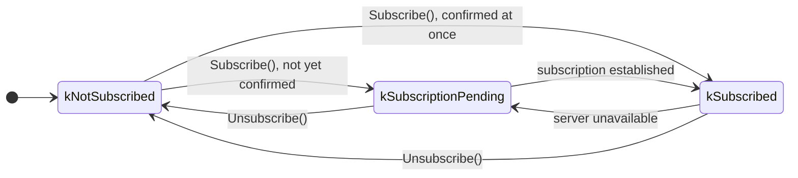

The subscription state change handler, `std::function<void(SubscriptionState)>` ([SWS_CM_00311]), is called as soon as the state changes ([SWS_CM_99035]). Its calls are serialized; if several changes happen while it runs, they are aggregated into one call with the last state (EXP, Section 5.3.5.2). It can be called even before `Subscribe()` returns, so register it *before* subscribing. Local bindings with instant feedback may skip `kSubscriptionPending` (EXP, Section 5.3.5.2).

**The provider side.** Since R23-11, the skeleton event class can tell whether anybody listens ([SWS_CM_12011], [SWS_CM_12008], [SWS_CM_12010]). Its `GetSubscriptionState()` returns `kSubscribed` while at least one active subscription exists and `kNotSubscribed` otherwise; it never returns `kSubscriptionPending` ([SWS_CM_12015]). A handler is called when the number of subscribers changes between 0 and more than 0 ([SWS_CM_12013], [SWS_CM_12014]). A provider can use this to skip expensive work that nobody would receive.

### 7.3 Receiving Samples

**In plain words:** received data waits in buffers of Communication Management. When the application calls `GetNewSamples`, Communication Management moves new samples into the local cache, one by one, and calls your function with a pointer to each of them. Your function decides whether to keep a sample or to drop it.

**Formally:**

```cpp
template <typename F>
ara::core::Result<std::size_t> GetNewSamples(
    F&& f, std::size_t maxNumberOfSamples = std::numeric_limits<std::size_t>::max()) noexcept;
std::size_t GetFreeSampleCount() const noexcept;
```

`f` is a Callable with the signature `void(ara::com::SamplePtr<SampleType const>)` ([SWS_CM_00701]). In the call, Communication Management repeats the following steps ([SWS_CM_00703]): take the next received sample from the underlying buffer; if it is E2E-protected, check it ([Chapter 12](#12-end-to-end-protection-the-api-side)); deserialize it; place it in the local cache; call `f` with a `SamplePtr` to it. It stops when any of these is true:

- `maxNumberOfSamples` samples have been fetched in this call;
- the application holds exactly `maxSampleCount` `SamplePtr`s of this event, as committed in `Subscribe()`;
- no new sample is available.

The result is the number of samples passed to `f`, or `kMaxSamplesExceeded` when the application already holds more `SamplePtr`s than it committed; in that case, samples may have been skipped ([SWS_CM_00701]).

A message that a network binding identifies as malformed is discarded; the error is not propagated to the application ([SWS_CM_10416]).

`GetFreeSampleCount()` returns the free slots of the local cache: `maxSampleCount` right after `Subscribe`, minus one for every `SamplePtr` created by `GetNewSamples`, plus one for every `SamplePtr` destroyed or set to `nullptr` ([SWS_CM_00707]). Buffering between sender and receiver has FIFO semantics ([SWS_CM_00709]).

> **Note:** What happens when the buffers fill up because the application reads more slowly than data arrives is not specified in R25-11 (SWS CM, Section 4.1.1). Size `maxSampleCount` and your reading rate so that this does not happen.

### 7.4 SamplePtr: Who Owns a Sample

**In plain words:** a `SamplePtr` is like a `std::unique_ptr` to a read-only sample. As long as you hold it, the sample stays valid and its slot stays occupied. To keep a sample, move the pointer somewhere; to drop it, let the pointer go out of scope.

**Formally:** `ara::com::SamplePtr<T>` "emulates a `std::unique_ptr` to an event sample" ([SWS_CM_00306]):

| Operation | Signature | ID |
| --- | --- | --- |
| Construct empty | `constexpr SamplePtr() noexcept;`, `constexpr SamplePtr(std::nullptr_t) noexcept;` | [SWS_CM_11534], [SWS_CM_11535] |
| Move only | Move constructor and move assignment; copy deleted | [SWS_CM_11537], [SWS_CM_11540], [SWS_CM_11536], [SWS_CM_11538] |
| Access | `T* Get() const noexcept;`, `T& operator*() const noexcept;`, `T* operator->() const noexcept;` | [SWS_CM_11546], [SWS_CM_11541], [SWS_CM_11542] |
| Test | `explicit operator bool() const noexcept;` | [SWS_CM_11543] |
| Release | `void Reset(std::nullptr_t) noexcept;`, `SamplePtr& operator=(std::nullptr_t) noexcept;`, destructor | [SWS_CM_11545], [SWS_CM_11539], [SWS_CM_11547] |
| Exchange | `void Swap(SamplePtr& other) noexcept;` | [SWS_CM_11544] |
| E2E result | `ara::com::e2e::ProfileCheckStatus GetProfileCheckStatus() const noexcept;` | [SWS_CM_90420] |

The sample is always read-only: `GetNewSamples` passes `SamplePtr<SampleType const>` ([SWS_CM_00306]). The `SamplePtr` behaves like a `std::unique_ptr` only while the event is subscribed and the proxy exists. Release every `SamplePtr` before `Unsubscribe()` and before destroying the proxy; otherwise a violation is raised ([SWS_CM_00085], [SWS_CM_00087]).

> **Note:** The specification of `operator bool` says it returns `TRUE` "if the stored pointer is null" ([SWS_CM_11543]). This is the opposite of `std::unique_ptr` and of the function's name ("Checks if the stored pointer is null"); it is most likely an editorial error. Test with `if (ptr.Get() != nullptr)` if you want to be independent of it.

> **Pitfall:** Holding a `SamplePtr` occupies a slot. If you subscribe with `maxSampleCount` 1 and keep the last sample in a member variable, `GetNewSamples` can never deliver a new one, because no slot is free. Subscribe with one slot more than you intend to keep.

### 7.5 Polling or Event-Driven Reception

**In plain words:** you choose how you learn about new data. A cyclic, real-time application calls `GetNewSamples` once per cycle and is never interrupted. An event-driven application registers a *receive handler* that Communication Management calls when new data has arrived; the handler then calls `GetNewSamples`.

**Formally:**

```cpp
void SetReceiveHandler(ara::com::EventReceiveHandler handler) noexcept;  // std::function<void()>
void UnsetReceiveHandler() noexcept;
```

| Rule | ID |
| --- | --- |
| Without a receive handler, samples are received only by calling `GetNewSamples`. Reception does not cause an implicit context switch in the receiving process. With a handler, a context switch is enforced to call it. | [SWS_CM_00710] |
| Calls to the receive handler are serialized, because it need not be re-entrant. | [SWS_CM_00182] |
| If new samples arrive while the handler runs, the next call is postponed until the current call has finished. | [SWS_CM_12007] |
| After a handler call, the next `GetNewSamples` delivers at least one sample, unless no slot is free. | [SWS_CM_00711] |
| A null handler is a violation. | [SWS_CM_10417] |

The handler may be set, overwritten and removed at any time, so an application can switch between the two styles at run time (EXP, Section 5.3.5.5). An overload with an executor chooses the context in which the handler runs ([SWS_CM_11356]; [Section 10.4](#104-choosing-the-execution-context)). The following sequence diagram shows event-driven reception.

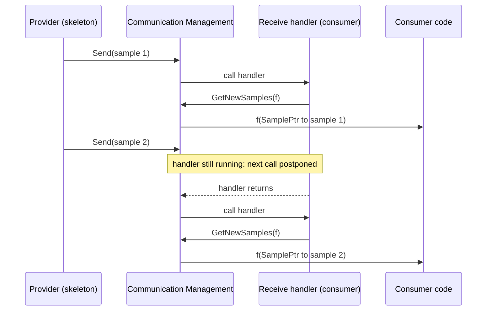

### 7.6 Buffering and Zero-Copy

Applications run in separate processes with protected memory. Event data therefore cannot stay in the provider's private memory; otherwise every access of a consumer would force a context switch into the provider (EXP, Section 5.3.5.6). The EXP names three typical places for the buffers between `Send` and `GetNewSamples`:

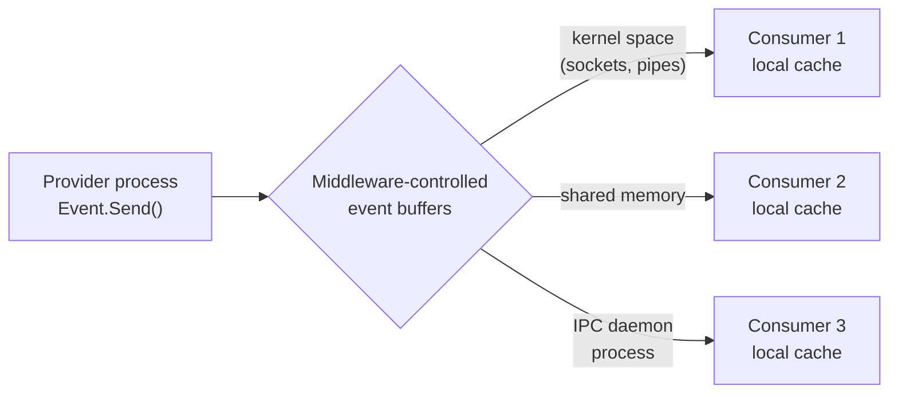

Each option has different trade-offs in buffer size, access speed and protection against malicious writes. Because the API hands out `SamplePtr`s instead of values, an implementation can keep pointers into a central buffer in the local cache instead of copies (EXP, Section 5.3.5.6).

However, data exchanged between processes generally must be serialized, even on one machine: executables are built at different times, maybe with different alignment settings, and types such as vectors and maps are not contiguous in memory. If the provider and consumer must convert the data, "copying must be done anyhow", and a shared memory transport gains little (EXP, Sections 7.1 and 7.1.1). Real zero-copy needs data layouts that both sides can read directly.

> **Note (implementation example):** Zero-copy stacks typically restrict event types to fixed-layout data, allocate samples in POSIX shared memory segments [EXT-030], and pass only offsets between processes. Eclipse iceoryx follows this design: a producer writes a message once into shared memory, and consumers receive references to it [EXT-028]. With such a stack, `Allocate()` and `Send(std::move(ptr))` deliver the full benefit.

### 7.7 Triggers

**In plain words:** a trigger is an event without data. It says "something happened". The consumer does not receive samples; it only learns how many triggers arrived since it last asked.

**Formally:** triggers use the same subscription and notification mechanisms as events (EXP, Section 4.3):

| Side | Function | ID |
| --- | --- | --- |
| Skeleton | `ara::core::Result<void> Send() noexcept;` (`kServiceNotOffered`, `kMinimumSendIntervalViolationError`) | [SWS_CM_00721] |
| Skeleton | `GetSubscriptionState`, `SetSubscriptionStateChangeHandler`, `UnsetSubscriptionStateChangeHandler` | [SWS_CM_01109] to [SWS_CM_01112] |
| Proxy | `void Subscribe() noexcept;` (no `maxSampleCount`: there is no cache) | [SWS_CM_00723] |
| Proxy | `void Unsubscribe() noexcept;`: also resets the trigger counter | [SWS_CM_00810], [SWS_CM_00802] |
| Proxy | `std::size_t GetNewTriggers() noexcept;`: the number of triggers since the last call; 0 means none | [SWS_CM_00226], [SWS_CM_00227] |
| Proxy | `void SetReceiveHandler(ara::com::TriggerReceiveHandler handler) noexcept;`, `void UnsetReceiveHandler();` | [SWS_CM_00250], [SWS_CM_11614] |
| Proxy | Subscription state functions as for events | [SWS_CM_01105] to [SWS_CM_01108] |

E2E protection of triggers is not supported in R25-11 ([SWS_CM_CONSTR_00007]).

> **Note:** R25-11 defines the proxy trigger class, "one for each Trigger defined in the ServiceInterface" ([SWS_CM_00727]), and a trigger member of the *skeleton* class ([SWS_CM_99559]), but it lists no trigger member of the *proxy* class: only members for events, fields and methods ([SWS_CM_99445] to [SWS_CM_99447]). Generators provide one, named after the trigger like the other members. The code below assumes this.

`HPC` uses one trigger: `CalibrationUpdated` of `CalibrationDataService`. `Storage` sends it after every successful `SetCalibration`. `Fusion` checks the counter once per cycle and re-reads the camera calibration when it is not zero:

```cpp
// Fusion, once per 50 ms cycle (illustrative). calibration_ is the proxy of CalibrationDataService.
if (calibration_.CalibrationUpdated.GetNewTriggers() > 0) {
    pendingCalibration_ = calibration_.GetCalibration(hpc::storage::CalibrationKey::CameraExtrinsics);
}
// pendingCalibration_ is polled with is_ready() in later cycles (Section 8.2).
```

### 7.8 Worked Example: Images for `Fusion`, Object Lists for `Storage`

**`CameraDriver` sends images.** Images are large and are created only for sending, so `CameraDriver` uses `Allocate()` and `Send(std::move(...))`. If nobody is subscribed, it skips the copy of the frame.

```cpp
// CameraDriver: publish one camera frame (illustrative; Frame is the driver's own type).
void CameraServiceImpl::Publish(const Frame& frame) {
    if (Image.GetSubscriptionState() != ara::com::SubscriptionState::kSubscribed) {
        return;  // no active subscriber: nothing to send
    }
    ara::com::SampleAllocateePtr<hpc::camera::CameraImage> sample = Image.Allocate();
    sample->timestamp = frame.vehicleTimeNs;  // VehicleTime, guide 09
    sample->width = frame.width;
    sample->height = frame.height;
    sample->pixels.assign(frame.data, frame.data + frame.size);
    ara::core::Result<void> sent = Image.Send(std::move(sample));  // sample is empty afterwards
    if (!sent.HasValue()) {
        // kServiceNotOffered (shutting down) or kMinimumSendIntervalViolationError: drop the frame
    }
}
```

**`Fusion` polls images.** `Fusion` runs a 50 ms cycle and receives about 1.5 images per cycle at 30 images per second. It needs only the newest image, so it keeps one `SamplePtr` and replaces it whenever a newer one arrives. It subscribed with `maxSampleCount` 2: one slot for the kept image, one for the new one.

```cpp
// Fusion, at the start of each cycle (illustrative).
void FusionCycle::ReadCamera(CameraProxy& camera) {
    camera.Image.GetNewSamples(
        [this](ara::com::SamplePtr<const hpc::camera::CameraImage> sample) {
            latestImage_ = std::move(sample);  // the previous sample is released here
        });
    // latestImage_ (SamplePtr<const CameraImage>) is now the newest image, or still the old one.
}
```

**`Storage` records object lists.** `Storage` has no cycle; it reacts to each object list. It registers a receive handler and records every sample immediately, so it never holds `SamplePtr`s.

```cpp
// Storage: event-driven reception of ObjectList (illustrative).
using ObjectListProxy = hpc::fusion::proxy::ObjectListServiceProxy;

void Recorder::Connect(ObjectListProxy& objects) {
    objects.ObjectList.SetReceiveHandler([this, &objects]() {
        objects.ObjectList.GetNewSamples(
            [this](ara::com::SamplePtr<const hpc::fusion::ObjectListData> list) {
                Append(*list);  // copy into the current recording file; list is released on return
            });
    });
    objects.ObjectList.Subscribe(10);  // up to 10 lists in flight
}
```

> **Key takeaways**
>
> - Send with a copy when you keep the data; use `Allocate()` and `Send(std::move(ptr))` for data made only for sending.
> - `Subscribe()` is asynchronous; trust only `kSubscribed`. Register the state handler before subscribing.
> - `GetNewSamples` moves samples into the local cache and passes `SamplePtr`s to your function; each held `SamplePtr` occupies one of `maxSampleCount` slots.
> - Without a receive handler, reception never interrupts your process; with one, handler calls are serialized.
> - Triggers are dataless events: `Send()` on the skeleton, a counter read with `GetNewTriggers()` on the proxy.

---

## 8. Methods

> **Why this matters:** A method call looks like a function call, but the provider may be in another process or on another machine, may be busy, may have restarted, or may never answer. `ara::com` makes every call asynchronous and leaves waiting, timeouts and threading to you. This chapter shows how to call methods safely, how to implement them, and how to control when the provider executes them.

### 8.1 Calling a Method

**In plain words:** you call a method through the method member of the proxy, like a function. The call returns at once with an `ara::core::Future`. The answer, or an error, arrives in the future later.

**Formally:** for each method that is not fire-and-forget, the proxy has a member of class `proxy::methods::{<method>}` ([SWS_CM_00006]) with:

```cpp
struct Output { /* one member per out or inout argument */ };
ara::core::Future<Output> operator()(/* in and inout arguments, derived types */) noexcept;
```

The call "will return immediately" ([SWS_CM_00196]). At that moment, Communication Management does not yet know whether you will wait synchronously or asynchronously, so it must not do anything that causes an uncontrolled context switch for the caller ([SWS_CM_10414]). The future can complete with:

| Result | Meaning | ID |
| --- | --- | --- |
| A value of type `Output` | The call succeeded | [SWS_CM_00196] |
| An application error of the method | The provider set one of the `possibleApError`s | [Section 8.8](#88-application-errors) |
| `ComErrc::kServiceNotAvailable` | The instance is no longer offered | [SWS_CM_00196] |
| `ComErrc::kCommunicationFailure` | A locally detected failure: sending failed, or the response is malformed but identifiable; also secure communication failures and transport faults | [SWS_CM_10440], [SWS_CM_00090] |
| `ComErrc::kUnknownApplicationError` | The provider returned an application error that is not configured for this method | [SWS_CM_00048] |
| `ComErrc::kMinimumSendIntervalViolationError` | The call came too soon after the previous one and was discarded | [SWS_CM_00822] |
| `ComE2EErrc::...` | E2E check of request or response failed | [SWS_CM_00049], [SWS_CM_90477] |
| `FutureErrc::kBrokenPromise` | The proxy was destroyed while the call was pending | [SWS_CM_10446] |

A call to a service that the process may not use raises `InsufficientPermissionsViolation` instead.

### 8.2 Getting the Result

The returned `ara::core::Future` is the AUTOSAR version of `std::future`, with `GetResult()`, `then()` and `is_ready()` added ([guide 03, Chapter 9](03_CoreAndGeneral.md#9-future-and-promise-asynchronous-results)). Your choice of function decides the style of the call:

| Style | Functions | Behavior | ID |
| --- | --- | --- | --- |
| Synchronous | `get()`, `GetResult()`, `wait()`, `wait_for()`, `wait_until()` | Block until the result is there or, for the timed waits, until the timeout. While blocked, the implementation may switch context. | [SWS_CM_00192], [SWS_CM_00195] |
| Asynchronous, polling | `is_ready()`, then `GetResult()` | `is_ready()` never blocks; after it returned `true`, `GetResult()` returns at once. No middleware overhead and no unexpected context switches. | [SWS_CM_00193] |
| Asynchronous, notification | `then(func)` | `func` is called when the result is there, possibly in another thread | [SWS_CM_00197] |

`GetResult()` returns an `ara::core::Result<Output>` and never throws; `get()` returns the `Output` or throws the error as an exception ([SWS_CM_00195]). All errors of the call arrive this way ([SWS_CM_10371]).

### 8.3 No Timeout Supervision

`ara::com` does not supervise the duration of a method call. The blocking functions of the future "will block forever" when the request or the response is lost, or when the provider's implementation hangs (SWS CM, Section 7.5.19). The caller must protect itself:

- A cyclic application polls with `is_ready()` and counts cycles.
- A blocking caller uses `wait_for()` or `wait_until()` instead of `get()`.
- A safety-relevant caller can supervise the call with a checkpoint of Platform Health Management ([guide 06](06_PlatformHealthManagement.md#5-supervised-entities-and-checkpoints-in-practice)); the specification recommends this for E2E-protected methods (SWS CM, Section 7.4.1.2.6).

The client does get an error, `kCommunicationFailure`, when the implementation *knows* that the call cannot succeed: when sending failed locally, or when a response arrived that is malformed but can still be assigned to the call ([SWS_CM_10440]).

> **Note:** The TPS defines `ClientComSpec.endToEndCallResponseTimeout`, the maximum time in which the application "shall expect" the server's response. No requirement of SWS CM uses it, so it does not make `ara::com` time out a call. Treat it as a design value for your own supervision.

### 8.4 Canceling a Call

If you no longer need the result, destroy the future. "Deleting the returned `ara::core::Future` object shall result in the abort of the method call and ensure that any related buffers are released and no result is returned to the caller" ([SWS_CM_00194]). If you keep the future in a member variable, assign a default-constructed future to it (EXP, Section 5.3.6.3). A response that arrives afterwards is an *orphaned response* and is discarded.

Cancellation is local to the client. Whether the provider learns about it depends on the binding and is optional (SWS CM, Section 7.5.19). The provider may therefore still execute the method.

When the proxy itself is destroyed, it destroys the promises of all pending calls, so their futures become ready with `FutureErrc::kBrokenPromise` ([SWS_CM_10446]).

### 8.5 Fire-and-Forget Methods

**In plain words:** a fire-and-forget method is a one-way call. The consumer does not get an answer, not even an error. It is light-weight, and it is enough when "best effort" is acceptable.

**Formally:** when `ClientServerOperation.fireAndForget` is `true`, the method has only in arguments and no possible errors ([constr_3374], [constr_3375]; guide 02). The generated API is ([SWS_CM_90435], [SWS_CM_90434]):

```cpp
// Proxy: proxy::methods::{<fnfmethod>}
void operator()(/* in arguments */) noexcept;
// Skeleton
virtual void {<fnfmethod>}(/* in arguments */) noexcept = 0;
```

- There are no checked errors ([SWS_CM_90436]).
- If the call violates the Minimum Send Interval, it is discarded without any feedback ([SWS_CM_00822]).
- With E2E protection, the server checks the request and calls its E2E error handler on failure, but no client-side state machine exists and no error response is sent ([SWS_CM_00127]).

```cpp
// Not part of HPC: a fire-and-forget method ResetTracks() on a hypothetical tracking service.
tracker.ResetTracks();  // returns at once; no Future, no error, no confirmation
```

### 8.6 Implementing a Method in the Skeleton

**In plain words:** in your class derived from the skeleton, you override one virtual function per method. It does not return the result directly; it returns a future. You can fulfill it at once, or later from another thread.

**Formally:** the skeleton declares ([SWS_CM_00191]):

```cpp
virtual ara::core::Future<{<method>}Output> {<method>}(/* in and inout arguments */) noexcept = 0;
```

The function returns a future of the output structure. The specification does not define standardized errors for it; the future carries either the output, or an `ara::com::ComErrc` or an application error ([SWS_CM_00191]). Returning a future, instead of the output, means that the entry function does not have to block while a worker thread computes the result (EXP, Section 5.4.6). Two patterns are common:

- **Synchronous:** compute the result in the function, call `set_value()` on an `ara::core::Promise`, and return `promise.get_future()`. The caller's future is ready at once.
- **Deferred:** start the work elsewhere, move the promise there, and return the future immediately.

Arguments passed by reference are provided by Communication Management only until the promise is set; copy them if you need them longer (EXP, Section 5.4.6, footnote). `Storage` implements `GetCalibration` synchronously:

```cpp
// Storage: implementation of CalibrationDataService::GetCalibration (illustrative).
ara::core::Future<CalibrationService::GetCalibrationOutput>
CalibrationService::GetCalibration(hpc::storage::CalibrationKey key) noexcept {
    ara::core::Promise<GetCalibrationOutput> promise;
    auto record = store_.Read(key);  // reads CalibrationKvs (guide 11)
    if (record.HasValue()) {
        promise.set_value(GetCalibrationOutput{std::move(record).Value()});
    } else {
        promise.SetError(ara::core::ErrorCode(hpc::storage::CalibrationErrorsErrc::CalibrationNotFound));
    }
    return promise.get_future();
}
```

### 8.7 Method Call Processing Modes

**In plain words:** the provider chooses when its method implementations run. Either Communication Management calls them as soon as requests arrive, in parallel or one after the other, or the provider fetches each request itself when it has time.

**Formally:** the mode is the second argument of the skeleton constructor, applies to all methods of that skeleton instance, and is fixed for its lifetime ([SWS_CM_00301]; SWS CM, Section 7.5.6; EXP, Section 5.4.5):

| Mode | Behavior | Choose it when | ID |
| --- | --- | --- | --- |
| `kEvent` (default) | "Event-driven, concurrent": calls are executed when they arrive, concurrent calls in different threads | Methods are independent or synchronize themselves; low latency matters | [SWS_CM_10411] |
| `kEventSingleThread` | "Event-driven, sequential": calls are executed when they arrive, one after the other | Most methods would lock the same data anyway; you want no synchronization code | [SWS_CM_10411] |
| `kPoll` | Calls are queued; the application executes the next one with `ProcessNextMethodCall()` | A real-time application that must control every activation | [SWS_CM_10411], [SWS_CM_00199] |

```cpp
bool ProcessNextMethodCall() noexcept;  // only for kPoll
```

`ProcessNextMethodCall()` triggers the execution of the next pending call. Its result tells whether there is at least one pending invocation ([SWS_CM_00199]). In any other mode it raises `WrongMethodCallProcessingModeViolation`. With `kPoll`, the queue of pending calls must live outside the provider's address space, for example in kernel buffers or in a daemon, so that callers can fill it without waking the provider (EXP, Section 5.4.5.1).

`kEventSingleThread` exists for efficiency: if almost every method needs the same lock, letting N threads run into it only to block N-1 of them wastes resources (EXP, Section 5.4.5.2). `kEvent` is not supported for E2E-protected methods; passing it raises `WrongMethodCallProcessingModeViolation` ([SWS_CM_10467]).

The following diagram summarizes the choice.

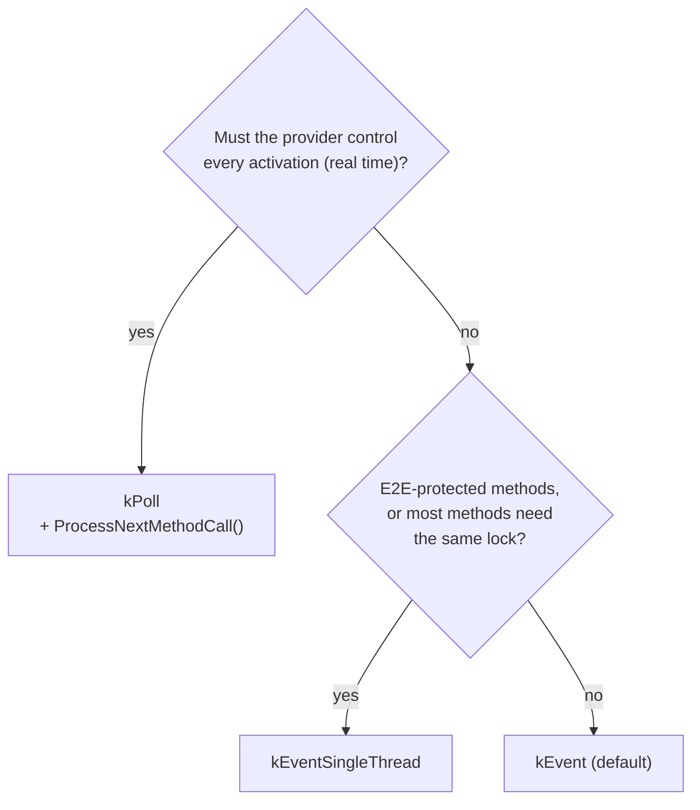

```cpp
// Not part of HPC: a kPoll provider serves at most two calls per 10 ms cycle (illustrative).
for (int i = 0; i < 2; ++i) {
    if (!service.ProcessNextMethodCall()) {
        break;  // queue empty
    }
}
```

`HPC` uses `kEventSingleThread` for both of its method providers: `CameraDriver` (one method that changes the sensor) and `Storage` (methods that read and write one key-value storage).

> **Note:** The TPS defines `ServerComSpec.queueLength`, the "length of call queue on the server side". SWS CM does not refer to it, so its effect, for example on the `kPoll` queue, is not specified.

### 8.8 Application Errors

**In plain words:** a method can fail for a reason that belongs to the service itself, such as "this exposure mode is not supported". Such *application errors* are modeled with the interface and reach the caller as ordinary error codes.

**Formally:** the model lists the possible errors of a method in `ClientServerOperation.possibleApError` and `possibleApErrorSet`. Each `ApApplicationError` belongs to an error domain, for which the generator creates a C++ error domain ([guide 03, Section 7.8](03_CoreAndGeneral.md#78-generated-error-domains)). To report one, the provider stores the corresponding `ara::core::ErrorCode` in the promise with `SetError`; the binding transports it in the response (SWS CM, Section 7.5.19). An application error that is not configured for the method reaches the caller as `kUnknownApplicationError` ([SWS_CM_00048]). Errors of `ara::com` itself are in `ComErrorDomain` ([Section 11.2](#112-comerrordomain-and-comerrc)).

`HPC` has two modeled application error domains for its services:

| Domain | Identifier | Errors (code) | Method |
| --- | --- | --- | --- |
| `CameraErrors` (`hpc::camera`) | `0x1001` | `ExposureModeNotSupported` (1) | `CameraService::SetExposureMode` |
| `CalibrationErrors` (`hpc::storage`) | `0x1004` | `CalibrationNotFound` (1), `CalibrationRejected` (2) | `CalibrationDataService::GetCalibration`, `SetCalibration` |

### 8.9 Worked Example: `SetExposureMode` From `Fusion` to `CameraDriver`

[Guide 03, Section 9.7](03_CoreAndGeneral.md#97-worked-example-fusion-requests-the-night-exposure-mode) showed how `Fusion` polls the future of `SetExposureMode(Night)` once per cycle, with a stand-in function. With the generated proxy, the call and the type of the future become:

```cpp
// Fusion: request the Night exposure mode (illustrative; HandleReply as in guide 03, Section 9.7).
using ExposureFuture = ara::core::Future<hpc::camera::proxy::methods::SetExposureMode::Output>;

void ExposureControl::OnCycle(CameraProxy& camera, bool imageIsDark) {
    if (imageIsDark && !done_ && !pending_.valid()) {
        pending_ = camera.SetExposureMode(hpc::camera::ExposureMode::Night);  // returns at once
    }
    if (pending_.valid() && pending_.is_ready()) {
        HandleReply(pending_.GetResult());  // Result<Output>; pending_ is invalid afterwards
    }
}
```

`CameraDriver` implements the method. Its skeleton runs in `kEventSingleThread` mode, so two requests never change the sensor at the same time.

```cpp
// CameraDriver: implementation of SetExposureMode (illustrative; sensor_ is the driver's own object).
ara::core::Future<CameraServiceImpl::SetExposureModeOutput>
CameraServiceImpl::SetExposureMode(hpc::camera::ExposureMode mode) noexcept {
    ara::core::Promise<SetExposureModeOutput> promise;
    if (!sensor_.Supports(mode)) {
        promise.SetError(ara::core::ErrorCode(hpc::camera::CameraErrorsErrc::ExposureModeNotSupported));
    } else {
        sensor_.SetExposure(mode);
        promise.set_value(SetExposureModeOutput{});
    }
    return promise.get_future();
}
```

The following sequence diagram shows the call when the sensor does not support `Night`.

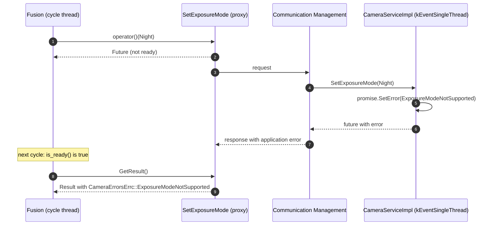

> **Key takeaways**
>
> - A method call returns a `Future<Output>` at once; choose blocking, polling or a continuation to get the result.
> - `ara::com` never times out a call; protect the caller with `is_ready()`, `wait_for()` or PHM.
> - Destroying the future cancels the call locally; the provider may still execute it.
> - Implement methods by returning a future from a promise; report service errors with `SetError` and a modeled application error.
> - The processing mode decides when implementations run: concurrently, sequentially, or only when the provider polls.

---

## 9. Fields

> **Why this matters:** A field promises that a value exists at any time. `ara::com` enforces this promise: an offer fails if a field has no value or no SetHandler. Fields also hide two traps: a GetHandler that silently disagrees with notifications, and a setter that changes the value for every consumer. This chapter explains both sides.

### 9.1 A Field Is an Event Plus Get and Set

**In plain words:** a field is a value held by the provider, for example the status of the camera. Consumers can read it (getter), ask to change it (setter), and subscribe to changes (notifier). Each of the three is optional and chosen in the model.

**Formally:** "the field concept is roughly an aggregation of an event with correlated get()/set() methods" (EXP, Section 5.3.7). The model attributes `Field.hasGetter`, `hasSetter` and `hasNotifier` decide what is generated:

| Attribute | Proxy (`proxy::fields::{<field>}`) | Skeleton (`skeleton::fields::{<field>}`) |
| --- | --- | --- |
| always | `using FieldType` ([SWS_CM_11403]) | `using FieldType` ([SWS_CM_11402]); `Result<void> Update(value) noexcept` ([SWS_CM_00119]) |
| `hasGetter = true` | `ara::core::Future<FieldType> Get() noexcept` ([SWS_CM_00112]) | `RegisterGetHandler(...)`, optional to call ([SWS_CM_00114]) |
| `hasSetter = true` | `ara::core::Future<FieldType> Set(value) noexcept` ([SWS_CM_00113]) | `RegisterSetHandler(...)`, mandatory to call ([SWS_CM_00116]) |
| `hasNotifier = true` | `Subscribe`, `Unsubscribe`, `GetNewSamples`, `GetFreeSampleCount`, `SetReceiveHandler`, subscription state functions, as for events ([SWS_CM_00120]) | Notifications are sent by `Update` |

The specification states explicitly that `Get` and `Set` and the two Register functions exist only when the corresponding attribute is `true`. The notifier part of the proxy class follows the event API "except that the corresponding methods reside in the Field class" ([SWS_CM_00120]).

### 9.2 The Value Before the Offer

**In plain words:** before a field becomes visible, it must have a value. You give it one with `Update()` before `OfferService()`.

**Formally:** if `OfferService()` is called while `Update()` has never been called, and the field has a notifier, or a getter without a GetHandler, `OfferService()` returns `kFieldValueNotInitialized` ([SWS_CM_00128]). `Update()` sets the field's internal value and sends a notification to subscribers if the field has a notifier ([SWS_CM_00119]). Like `Send`, it can fail with `kMinimumSendIntervalViolationError` ([SWS_CM_00143]).

The model has a place for the initial value: `FieldSenderComSpec.initValue` on the provider's P-port, which must exist whenever the ComSpec exists ([TPS_MANI_03212], [constr_10152]). Communication Management does **not** apply it automatically. The application code, or a framework above `ara::com`, "may use the defined `initValue` to call `Field.Update(initValue)`" (TPS, Section 3.2.5.1.2). In `HPC`, the initial value of `CameraStatus` is `NotAvailable` (2), and `CameraDriver` calls `Update` with it before offering ([Section 6.2](#62-offering-and-stopping-an-offer)).

### 9.3 Get and the Optional GetHandler

On the proxy, `Get()` returns a future, exactly like a method call ([SWS_CM_00112]). It can fail with `kCommunicationFailure` or `kMinimumSendIntervalViolationError`; the Minimum Send Interval is checked on the client side ([SWS_CM_00824]).

On the skeleton, registering a GetHandler is optional. If one is registered, Communication Management calls it for every incoming `Get()` ([SWS_CM_10412]):

```cpp
void RegisterGetHandler(std::function<ara::core::Future<FieldType>()> handler) noexcept;
```

Without a GetHandler, Communication Management answers `Get()` itself with the last value from `Update()` (EXP, Section 5.4.8.1). This is the normal case. The EXP calls a GetHandler "rather an exotic use case":

- It is inefficient: every `Get()` needs a call into the application and a new serialization.
- It is not synchronized with notifications. If the handler returns a value without calling `Update()` with the same value, subscribers and getters see different values. Communication Management does not call `Update()` for you.

### 9.4 Set and the Mandatory SetHandler

**In plain words:** a consumer can only *ask* to change a field. The provider's SetHandler decides: it can accept, correct or reject the value. Whatever the handler returns becomes the new value, is sent back to the caller and is notified to all subscribers.

**Formally:**

```cpp
// Skeleton
void RegisterSetHandler(std::function<ara::core::Future<FieldType>(FieldType value)> handler) noexcept;
// Proxy
ara::core::Future<FieldType> Set(FieldType value) noexcept;  // derived types: const& for structures
```

| Rule | ID |
| --- | --- |
| `OfferService()` returns `kFieldSetHandlerNotSet` if a field with setter has no SetHandler | [SWS_CM_00129] |
| The SetHandler is called for every `Set()` that Communication Management receives | [SWS_CM_10413] |
| The effective value returned by the SetHandler is sent back as the result of `Set()` and to all subscribers as a notification | [SWS_CM_10415] |
| A null handler is a violation | [SWS_CM_10417] |
| The Minimum Send Interval of `Set()` is checked on the client side | [SWS_CM_00826] |

The SetHandler is mandatory because "the server implementation will always need to check the validity" of a value that any anonymous client sends (EXP, Section 5.4.8.2). Calling `Update()` inside the SetHandler is unnecessary: the returned value is taken over as if `Update()` had been called. The current value is known only to the middleware; if the handler needs it for validation, the skeleton implementation must keep a replica (SWS CM, Section 7.5.9).

The following sequence diagram and code show a settable field. Neither is part of `HPC`, whose fields have no setter.

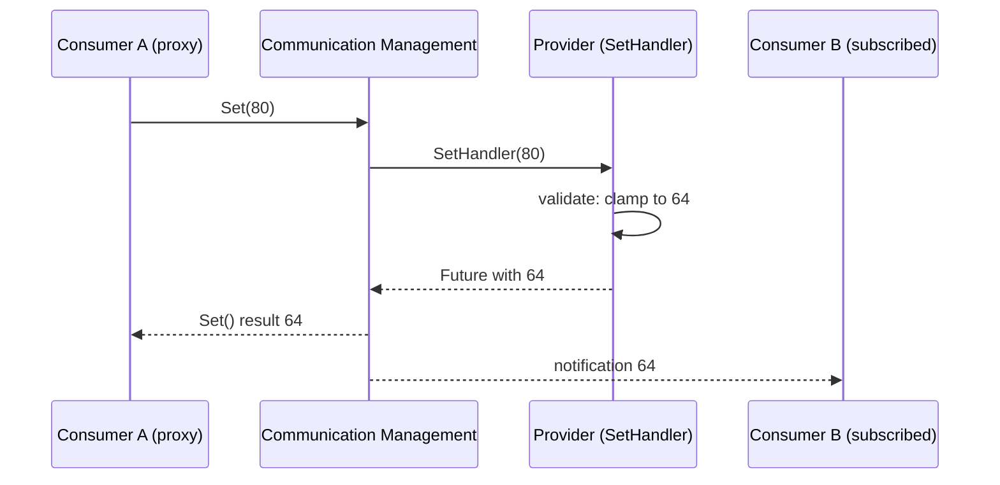

```cpp
// Not part of HPC: a settable field MaxObjects (std::uint16_t) with range 1 to 64 (illustrative).
service.MaxObjects.RegisterSetHandler([this](std::uint16_t requested) {
    const std::uint16_t effective = std::clamp<std::uint16_t>(requested, 1, 64);
    maxObjects_ = effective;  // replica for the application's own use
    ara::core::Promise<std::uint16_t> promise;
    promise.set_value(effective);  // becomes the field value; notified to all subscribers
    return promise.get_future();
});
```

> **Pitfall:** A field has one value per service instance, shared by all consumers. If one consumer sets it, every other consumer is affected. Use a setter only for values that really belong to the provider, and validate them.

### 9.5 Subscribing to Field Notifications

Subscribing to a field works like subscribing to an event, with one difference: the subscription "leads immediately to a service event that contains the initial field value send from provider side to the consumer" ([SWS_CM_00120]). A new subscriber therefore receives the current value without asking.

Register the receive handler **before** calling `Subscribe()`. Otherwise the initial notification may arrive before the handler exists, and you miss it (EXP, Listing 5.5). The field receive handler type is `ara::com::FieldReceiveHandler`, a `std::function<void()>` ([SWS_CM_11615]).

> **Note:** The API table declares the field's `GetNewSamples` without `noexcept` and as "not exception safe" ([SWS_CM_11610]), unlike the event version ([SWS_CM_00701]). This is probably editorial; your vendor's header decides.

### 9.6 Worked Example: `CameraStatus` and `FusionMode`

**`CameraStatus`** has a getter and a notifier. `CameraDriver` gives it the initial value `NotAvailable` before the offer, sets `Ok` when the first image is captured, and `Blocked` when its monitor detects a dark or frozen image (guide 12b):

```cpp
// CameraDriver (illustrative).
camera.CameraStatus.Update(hpc::camera::CameraState::NotAvailable);  // before OfferService
// ... later, from the image loop:
camera.CameraStatus.Update(hpc::camera::CameraState::Ok);
camera.CameraStatus.Update(hpc::camera::CameraState::Blocked);       // camera blocked
```

`Fusion` subscribed to `CameraStatus` with one slot ([Section 6.9](#69-worked-example-fusion-finds-cameraservice)). It polls the notifications once per cycle and keeps only the value, not the `SamplePtr`, so the slot stays free:

```cpp
// Fusion, at the start of each cycle (illustrative).
camera.CameraStatus.GetNewSamples(
    [this](ara::com::SamplePtr<const hpc::camera::CameraState> state) {
        cameraState_ = *state;  // copy the small value; the SamplePtr is released on return
    });
const bool useCamera = (cameraState_ == hpc::camera::CameraState::Ok);
```

**`FusionMode`** of `ObjectListService` has a getter and a notifier, too. The two providers of the service use different initial values, as the `initValue`s of their ports state: `Fusion` calls `Update(FusionModeType::Full)` and `FusionLite` calls `Update(FusionModeType::RadarOnly)` before offering. `Storage` uses the notification to mark in each recording which kind of object lists it contains. Because `Fusion` and `FusionLite` never run at the same time, `Storage` keeps one proxy; after a switch of the `ADAS` state, the proxy reconnects to the new provider, re-subscribes, and receives the new initial value at once.

> **Key takeaways**
>
> - `hasGetter`, `hasSetter` and `hasNotifier` decide which field functions exist.
> - Call `Update()` before `OfferService()`; `initValue` in the model is not applied for you.
> - Do not register a GetHandler unless you must; Communication Management answers `Get()` from the last `Update()`.
> - The SetHandler is mandatory for settable fields; its return value becomes the field value for everybody.
> - Register the field receive handler before subscribing, to receive the initial value.

---

## 10. Threading, Execution Context and Handlers

> **Why this matters:** `ara::com` calls your code from contexts you do not own: receive handlers, find service handlers, method implementations, continuations. At the same time, your own threads call the same proxy and skeleton objects. R25-11 says very little about thread safety, so you must know exactly what *is* specified and design the rest yourself.

### 10.1 What R25-11 Says About Thread Safety

"Thread-safety for the `ara::com` API is not defined within this release" (SWS CM, Section 4.1.7). Earlier releases had explicit re-entrancy and thread-safety requirements for each function; R24-11 deleted them ([Appendix D](#appendix-d-notable-changes-in-recent-releases)). The API tables of Chapter 8 have a *Thread Safety* row in their format (SWS CM, Table 8.1), but the `ara::com` tables leave it empty.

What *is* specified is how Communication Management calls *your* handlers: it serializes many of them ([Section 10.3](#103-handlers-and-their-rules)). For everything else, assume the safe minimum:

- Treat each proxy and each skeleton object as **not thread-safe**. Use it from one thread, or protect it with a mutex.
- Assume that handlers run in **a thread of Communication Management**, not in your thread, unless you pass an executor ([Section 10.4](#104-choosing-the-execution-context)).
- Assume that a handler can run **before the registering call returns**. For example, the subscription state handler can be called while `Subscribe()` has not yet returned (EXP, Section 5.3.5.2).

> **Note (implementation example):** Commercial stacks usually document stronger guarantees, for example that different event objects of one proxy may be used from different threads. Rely on such guarantees only if your vendor documents them, and record them as a platform assumption.

### 10.2 Which Calls May Switch Context

The specification controls *when* Communication Management may take the CPU away from the caller or wake up a process:

| Situation | Context switch? | ID |
| --- | --- | --- |
| Calling a method (`operator()`) | No uncontrolled context switch at the call | [SWS_CM_10414] |
| Waiting on the method's future with `get()`, `wait()`, `wait_for()`, `wait_until()` | Allowed while the result is pending | [SWS_CM_00192] |
| Polling the future with `is_ready()` | No overhead and no uncontrolled switches | [SWS_CM_00193] |
| Receiving events without a receive handler | No implicit context switch in the receiving process | [SWS_CM_00710] |
| Receiving events with a receive handler | A context switch is enforced to call the handler | [SWS_CM_00710] |
| Incoming method calls in `kEvent` or `kEventSingleThread` | The provider process is activated by the caller | [SWS_CM_10411] |
| Incoming method calls in `kPoll` | Only when the provider calls `ProcessNextMethodCall()` | [SWS_CM_10411], [SWS_CM_00199] |

A strictly cyclic real-time process can therefore avoid all asynchronous activations: it polls events, polls method futures with `is_ready()`, and, as a provider, uses `kPoll`.

### 10.3 Handlers and Their Rules

The following table lists every callback that `ara::com` calls, and what the specification says about its context.

| Callback | Registered with | Called when | Concurrency rule | ID |
| --- | --- | --- | --- | --- |
| Event, field or trigger receive handler | `SetReceiveHandler` | New data or triggers arrived since the last read | Serialized; the next call waits until the current one returns | [SWS_CM_00182], [SWS_CM_12007] |
| Subscription state change handler (proxy and skeleton) | `SetSubscriptionStateChangeHandler` | The subscription state changed | Serialized; changes during a call are aggregated into one call with the last state (EXP) | [SWS_CM_99035], [SWS_CM_12012] |
| Find service handler | `StartFindService` | First with the initial matches, then on every availability change | Serialized (EXP); proxies are updated before it is called | [SWS_CM_00124] |
| Service state handler | `SetServiceStateChangeHandler` | The availability of the proxy's service changed | Not specified | [SWS_CM_01074] |
| Transport fault condition handler | `SetTransportFaultConditionHandler` | A transport fault was detected | Serialized per event, trigger, notifier, and for all methods or all field get/set of an instance | [SWS_CM_00089] |
| GetHandler, SetHandler | `RegisterGetHandler`, `RegisterSetHandler` | A `Get()` or `Set()` arrived | Not specified | [SWS_CM_10412], [SWS_CM_10413] |
| Method implementation | Virtual function of the skeleton | A call arrived (or `ProcessNextMethodCall()`) | By processing mode: concurrent, sequential or polled | [SWS_CM_10411] |
| E2E error handler | Virtual `E2EErrorHandler` of the skeleton | The E2E check of a method request failed | Invoked from a separate thread; need not be re-entrant | [SWS_CM_00034], [SWS_CM_10470] |
| Continuation | `Future::then` | The method result is ready | May run in another thread ([guide 03, Section 9.5](03_CoreAndGeneral.md#95-continuations-with-then)) | SWS Core |

Rules that apply to all registration functions:

- Passing a `nullptr` or an empty `std::function` is a violation ([SWS_CM_10417]).
- Handlers may be overwritten at run time ([SWS_CM_99035], [SWS_CM_12012], [SWS_CM_01074]); the `Unset...` functions remove them.
- After `Unsubscribe()`, no receive handler of that event is called anymore ([SWS_CM_00812]).
- After `StopOfferService()` has completed, no callback of the skeleton is invoked; if one is running, `StopOfferService()` waits for it ([SWS_CM_00814]).

> **Pitfall:** Because `StopOfferService()` waits for running callbacks ([SWS_CM_00814]), calling it from inside a method implementation or handler of the same skeleton can block forever. Stop offers from your own control thread.

> **Pitfall:** Serialized handlers share one line. A receive handler that blocks, for example on file I/O, delays every later call of the same handler, and the samples pile up in the buffers. Keep handlers short and hand heavy work to your own thread.

### 10.4 Choosing the Execution Context

Most registration functions have a second overload with an additional `executor` argument. The handler then runs in the context that the executor provides, instead of a context chosen by Communication Management. The template parameter is described as a "wrapper type providing methods for asynchronous execution of Callables. AUTOSAR provides a standardized `ara::core::Executor` or implementations may use a custom type which provides the same interface" ([SWS_CM_11360]).

| Function | Executor overload |
| --- | --- |
| Proxy: `SetReceiveHandler` (event, field, trigger) | [SWS_CM_11356], [SWS_CM_11611], [SWS_CM_00352] |
| Proxy: `SetSubscriptionStateChangeHandler` (event, field, trigger) | [SWS_CM_11354], [SWS_CM_11608], [SWS_CM_01106] |
| Proxy: `StartFindService` (identifier, specifier) | [SWS_CM_11352], [SWS_CM_11365] |
| Proxy: `SetServiceStateChangeHandler` | [SWS_CM_01076] |
| Skeleton: `SetSubscriptionStateChangeHandler` (event, trigger) | [SWS_CM_12009], [SWS_CM_01111] |
| Skeleton: `RegisterGetHandler`, `RegisterSetHandler` | [SWS_CM_11360], [SWS_CM_11362] |
| `SetTransportFaultConditionHandler` (proxy event, field, trigger; skeleton field, skeleton) | [SWS_CM_00100], [SWS_CM_00110], [SWS_CM_00107], [SWS_CM_00097], [SWS_CM_00094] |

[Guide 03, Section 11.12](03_CoreAndGeneral.md#1112-executor) explains `ara::core::Executor`. SWS Core gives it no public constructor besides copy and move, so how an application obtains one depends on the API that hands it out or on the vendor.

```cpp
// Run Storage's receive handler in an executor that the application controls (illustrative;
// recorderExecutor is an ara::core::Executor obtained in a vendor-specific way).
objects.ObjectList.SetReceiveHandler([this, &objects]() { ReadObjectLists(objects); },
                                     recorderExecutor);
```

### 10.5 Patterns That Work

> **Note (implementation example):** Three designs cover most applications. None of them relies on thread safety that R25-11 does not guarantee.
>
> 1. **One cyclic thread** (as in `Fusion`). The cycle thread polls all events with `GetNewSamples`, polls method futures with `is_ready()`, and never registers receive handlers. Only the `FindServiceHandler` runs elsewhere; it creates the proxy under a mutex that the cycle also takes ([Section 6.9](#69-worked-example-fusion-finds-cameraservice)).
> 2. **Event-driven with a queue** (as in `Storage`). The receive handler copies the data out of the sample, or moves the `SamplePtr`, into a queue and returns. A worker thread empties the queue. Only the queue needs a mutex.
> 3. **A provider with a thread pool.** A skeleton in `kEvent` mode lets Communication Management call methods concurrently. Each method protects the data it shares with others. If nearly all methods lock the same data, switch to `kEventSingleThread` ([Section 8.7](#87-method-call-processing-modes)).

> **Key takeaways**
>
> - R25-11 does not define the thread safety of `ara::com`; protect proxy and skeleton objects yourself.
> - Polling never causes context switches; receive handlers and event-driven method modes do.
> - Most handlers are serialized and may be called before the registering function returns.
> - Executor overloads let you choose the context in which handlers run.
> - Never call `StopOfferService()` from a callback of the same skeleton.

---

## 11. Errors, Rate Limits and Transport Faults

> **Why this matters:** Every `ara::com` call can fail, and the failure tells you what to do: retry later, fix the configuration, or stop. This chapter lists all errors and violations of `ara::com`, explains the Minimum Send Interval that R25-11 introduced, and the transport fault conditions added in R24-11.

### 11.1 Three Kinds of Errors

`ara::com` follows the error model of SWS Core ([guide 03, Chapter 6](03_CoreAndGeneral.md#6-the-error-handling-model)): recoverable errors are returned as an `ara::core::ErrorCode` inside a `Result` or a `Future` ([SWS_CM_11265]); broken contracts are violations that end the process. There are three kinds of errors (SWS CM, Section 7.5.22.6):

| Kind | Error domain | Defined by | Example |
| --- | --- | --- | --- |
| General `ara::com` errors | `ara::com::ComErrorDomain` | SWS CM | `kServiceNotAvailable` |
| E2E errors | `ara::com::e2e::ComE2EErrorDomain` | SWS CM | `kWrongSequence` |
| Application errors | The generated domain of each `ApApplicationErrorDomain` | The service interface model | `CameraErrorsErrc::ExposureModeNotSupported` |

Vendors may add their own error codes to any function (SWS CM, Table 8.1). Exceptions are thrown only for violations and corruptions (EXP, Section 4.7), with one exception: the proxy constructor throws `ComException` when the service is not available ([SWS_CM_00131]). Use the named constructor `Create` if your code runs without exceptions.

### 11.2 ComErrorDomain and ComErrc

`ara::com::ComErrorDomain` has the identifier `0x8000'0000'0000'1267` and the name `Com` ([SWS_CORE_90023], [SWS_CM_11329]). Its codes are ([SWS_CM_10432]):

| Value | Code | Meaning | Returned by |
| --- | --- | --- | --- |
| 1 | `kServiceNotAvailable` | Service is not available after being previously offered | Method calls, proxy `Create` and constructor |
| 2 | `kMaxSamplesExceeded` | Application holds more `SamplePtr`s than committed in `Subscribe()`; samples were possibly skipped | `GetNewSamples` |
| 3 | `kCommunicationFailure` | The network binding reported a recoverable communications error or a secure communication failure | `FindService`, `StartFindService`, `OfferService`, method calls, `Get`, `Set`, `Create`, `GetServiceState` |
| 6 | `kFieldValueNotInitialized` | Field value has not yet been initialized via `Update()` | `OfferService` |
| 7 | `kFieldSetHandlerNotSet` | Field SetHandler has not been registered | `OfferService` |
| 11 | `kServiceNotOffered` | Service has not yet been offered via `OfferService()` | Skeleton event and trigger `Send` |
| 15 | `kInstanceIDNotResolvable` | The `InstanceSpecifier` is valid but could not be mapped to an `InstanceIdentifier` | `ResolveInstanceIDs` |
| 16 | `kMaxSampleCountNotRealizable` | `maxSampleCount` of a re-subscription differs from the current subscription | `Subscribe` |
| 22 | `kUnknownApplicationError` | A remote service returned an unconfigured application error | Method calls |
| 23 | `kMinimumSendIntervalViolationError` | The element was sent or called faster than its Minimum Send Interval allows | `Send`, `Update`, trigger `Send`, method calls, `Get`, `Set` |

The API tables also mark each error with its recoverability class ([RS_AP_00160]; [guide 03, Section 6.6](03_CoreAndGeneral.md#66-recoverability-classes)). Most `ara::com` errors have rollback semantics: nothing happened, and you can retry. `kCommunicationFailure` of a method call or of `Set` has **no** rollback semantics: "In case of a communication timeout this could lead to an uncertain state on the remote server side" ([SWS_CM_00196], [SWS_CM_00113]). Do not blindly retry non-idempotent calls after it.

The domain class follows the pattern of all error domains: `Errc` and `Exception` aliases, `Name()`, `Message()`, `ThrowAsException()`, and the free functions `GetComErrorDomain()` and `MakeErrorCode()` ([SWS_CM_11329] to [SWS_CM_11337]). Its exception class is `ara::com::ComException` ([SWS_CM_11327]).

### 11.3 Violations in ara::com

A violation is a broken rule that the caller cannot handle sensibly; the platform logs a message and terminates the process ([guide 03, Section 6.3](03_CoreAndGeneral.md#63-violations-fail-early)). `ara::com` raises the following violations. The first group has a standardized log message (SWS CM, Section 7.7.3).

| Violation | Raised when | Message ID | ID |
| --- | --- | --- | --- |
| `InstanceSpecifierMappingIntegrityViolation` | The specifier cannot be resolved in the context of the executable, or does not refer to a `PortPrototype` | `0x80001ffc` | [SWS_CORE_13003] |
| `PortInterfaceMappingViolation` | The mapping does not match the expected port interface | `0x80001ffb` | [SWS_CORE_13004] |
| `ProcessMappingViolation` | A mapping exists, but not for the current process | `0x80001ffa` | [SWS_CORE_13005] |
| `InstanceSpecifierAlreadyInUseViolation` | A constructor was called with a specifier already in use in this process | `0x80001ff9` | [SWS_CORE_13006] |
| `InsufficientPermissionsViolation` | Identity and Access Management refused the operation ("Refused by Grant Enforcement") | `0x80001fff` | [SWS_CORE_13000] |
| `WrongMethodCallProcessingModeViolation` | Wrong processing mode in the skeleton constructor (`kEvent` with E2E methods), or `ProcessNextMethodCall` outside `kPoll` | `0x80000fff` | [SWS_CM_12100], [SWS_CM_10467], [SWS_CM_00199] |
| `ErroneousServiceHandleViolation` | A null or corrupt handle was passed to the proxy constructor or `Create` | `0x80000ffe` | [SWS_CM_12101], [SWS_CM_00131] |

The second group is named in the API tables, but R25-11 defines no log message for it:

| Violation | Raised when | ID |
| --- | --- | --- |
| `InvalidHandlerViolation` | A null or empty handler is passed to a registration function | [SWS_CM_10417] |
| `DanglingSamplesViolation` | `Unsubscribe()` or the proxy destructor is called while `SamplePtr`s are held; the skeleton destructor is called while allocated samples are held | [SWS_CM_00085], [SWS_CM_00087], [SWS_CM_00086] |
| `SampleAllocationViolation`, `AllocateUsageViolation` | `Allocate()` cannot get memory, or is used through an illegal custom allocator | [SWS_CM_90438] |
| `InvalidInstanceIdentifierStringViolation` | An `InstanceIdentifier` string is corrupted, non-compliant or duplicated | [SWS_CM_11520], [SWS_CM_11521] |
| Duplicate skeleton identifier | The same identifier or specifier is used for two skeletons of the same service | [SWS_CM_10410], [SWS_CM_10450], [SWS_CM_10451] |

> **Note:** `WrongMethodCallProcessingModeViolation` and `ErroneousServiceHandleViolation` are DRAFT in R25-11. The message of `ErroneousServiceHandleViolation` carries the arguments `processingMode` and "name of the skeleton class", copied from the other message ([SWS_CM_12101]); expect vendors to log the proxy class instead.

### 11.4 The Minimum Send Interval

**In plain words:** a sender can flood its receivers by sending too often. Since R25-11, the integrator can configure a minimum time between two transmissions of each event, trigger, field update and method call. `ara::com` then rejects calls that come too soon.

**Formally:** each element has a "configurable Minimum Send Interval", set in `ServiceInterfaceDeploymentElement.minimumSendInterval` ([SWS_CM_00138]). When the application sends or calls, `ara::com` checks whether the time since the last successful handover to the transmission layer is greater than the interval:

- If the element has never been sent, the check passes.
- If the check passes, the request is handed over, and the handover time starts the next interval.
- If the check fails, the request is discarded and the error `kMinimumSendIntervalViolationError` is returned; for methods, `Get` and `Set`, through the future.
- For fire-and-forget methods, the call is discarded **without any feedback** ([SWS_CM_00822]).
- For methods, `Get` and `Set`, the check is done only on the client side, not by the provider ([SWS_CM_00822], [SWS_CM_00824], [SWS_CM_00826]).
- The value 0 disables the check. 0 is the default value for every element ([SWS_CM_00139]).

| Element | Checked in | ID (check, default) |
| --- | --- | --- |
| Event | Skeleton `Send` | [SWS_CM_00138], [SWS_CM_00139] |
| Trigger | Skeleton trigger `Send` | [SWS_CM_00140], [SWS_CM_00142] |
| Field notification | Skeleton `Update` | [SWS_CM_00143], [SWS_CM_00144] |
| Method (including fire-and-forget) | Proxy `operator()` | [SWS_CM_00822], [SWS_CM_00823] |
| Field getter | Proxy `Get` | [SWS_CM_00824], [SWS_CM_00825] |
| Field setter | Proxy `Set` | [SWS_CM_00826], [SWS_CM_00827] |

The TPS restricts the value to the range 0 to 10 seconds ([constr_10655]).

> **Note:** SWS CM, Section 10.1, says that the cluster "does not define any default values". The individual requirements above nevertheless state 0 as the default. The guide follows the individual requirements.

In `HPC`, the local deployment of `CalibrationDataService` sets a Minimum Send Interval of 1 s for `SetCalibration` ([Section 13.5](#135-worked-example-calibrationdataservice-over-local-ipc)). Writing the calibration is rare and expensive, and the interval protects `Storage` from a client that calls in a loop:

| Time | Call by `CameraDriver` | Result |
| --- | --- | --- |
| 0.0 s | `SetCalibration(CameraExtrinsics, r1)` | Handed over; the interval starts |
| 0.4 s | `SetCalibration(CameraExtrinsics, r2)` | Discarded; the future holds `kMinimumSendIntervalViolationError` |
| 1.2 s | `SetCalibration(CameraExtrinsics, r2)` | Handed over |

### 11.5 Transport Fault Conditions

**In plain words:** some transports can tell that something went wrong below the application, for example that a sample was lost or arrived too late. Since R24-11, an application can register a handler to learn about such faults.

**Formally:** the type and handler are defined in `ara/com/e2e/transport_fault_condition.h` ([SWS_CM_00091], [SWS_CM_00092]):

```cpp
namespace ara::com::e2e {
enum class TransportFaultCondition : std::uint8_t { kSampleRejected, kDeadlineMissed, kSampleLost };
using TransportFaultConditionHandler = std::function<void(TransportFaultCondition, std::size_t)>;
}
```

The second argument is the number of fault conditions detected. Handlers can be set on proxy events, fields and triggers, on the skeleton for all methods, and on skeleton fields for their getter and setter (`SetTransportFaultConditionHandler`, `UnsetTransportFaultConditionHandler`; [Section 15.3](#153-proxy-events-fields-methods-and-triggers)). Calls are serialized per element ([SWS_CM_00089]). On the client side, methods, `Get` and `Set` report transport faults as `kCommunicationFailure` in their future ([SWS_CM_00090]).

R25-11 defines the mapping of the three conditions only for the DDS binding, as DRAFT: `kSampleRejected` for the DDS status `SAMPLE_REJECTED`, `kDeadlineMissed` for `REQUESTED_DEADLINE_MISSED`, and `kSampleLost` for `SAMPLE_LOST` ([SWS_CM_00211]; [guide 08a](08a_NetworkBindings.md)). For other bindings, it is not specified when the handler is called.

### 11.6 Worked Example: Every Error `Fusion` Can See From `CameraService`

The following table lists what `Fusion` can meet when it uses `CameraService`, and how it reacts.

| Situation | What `Fusion` sees | Reaction |
| --- | --- | --- |
| Port path wrong in the code or the model | `InstanceSpecifierMappingIntegrityViolation` at `StartFindService` | None at run time: the process ends; fix the model or the code ([guide 03, Section 6.7](03_CoreAndGeneral.md#67-worked-example-a-wrong-instancespecifier-in-fusion)) |
| `Fusion` not allowed to use the service | `InsufficientPermissionsViolation` | None at run time: fix the IAM configuration (guide 15) |
| `CameraDriver` not yet offered | Find service handler with an empty list | Wait; no proxy yet |
| `CameraDriver` restarts | Subscription state `kSubscriptionPending`; method futures with `kServiceNotAvailable` | Treat the camera as unavailable; retry the method later |
| Network or binding problem | `kCommunicationFailure` | Log; retry later; do not assume the method was not executed |
| `SetExposureMode(Night)` not supported | `CameraErrorsErrc::ExposureModeNotSupported` | Keep `Auto`; do not ask again |
| Requests sent too often | `kMinimumSendIntervalViolationError` | Ask again in a later cycle |
| Proxy destroyed with a pending call | `FutureErrc::kBrokenPromise` | Ignore during shutdown |

```cpp
// Fusion: reaction to the result of SetExposureMode (illustrative; extends guide 03, Section 9.7).
void ExposureControl::HandleReply(
        const ara::core::Result<hpc::camera::proxy::methods::SetExposureMode::Output>& reply) {
    if (reply.HasValue()) {
        done_ = true;  // the camera now uses Night
        return;
    }
    const ara::core::ErrorCode& error = reply.Error();
    if (error == hpc::camera::CameraErrorsErrc::ExposureModeNotSupported) {
        done_ = true;  // application error: keep Auto, do not ask again
    } else if (error == ara::com::ComErrc::kServiceNotAvailable ||
               error == ara::com::ComErrc::kMinimumSendIntervalViolationError) {
        // retry in a later cycle (pending_ is invalid now)
    } else if (error == ara::com::ComErrc::kCommunicationFailure) {
        // no rollback semantics: the camera may have switched; log and re-check CameraStatus first
    } else if (error.Domain() == ara::com::e2e::GetComE2EErrorDomain()) {
        // E2E check failed (if guide 08b protects the method): log and retry
    } else {
        // kUnknownApplicationError, kBrokenPromise or a vendor-specific error: log
    }
}
```

> **Key takeaways**
>
> - Errors come in three domains: `ComErrorDomain`, `ComE2EErrorDomain` and the generated application error domains.
> - `kCommunicationFailure` of a method or `Set` has no rollback semantics: the provider may have executed it.
> - Configuration and access problems are violations that end the process; some of them have no standardized log message.
> - The Minimum Send Interval (default 0, off) limits how often each element may be sent; fire-and-forget calls are dropped silently.
> - Transport fault handlers report lost, rejected or late samples; R25-11 maps them only for DDS.

---

## 12. End-to-End Protection: The API Side

> **Why this matters:** Safety-relevant data, such as object lists that a braking function relies on, must not be used when it is corrupted, repeated or stale. End-to-end (E2E) protection detects this, and `ara::com` reports the result to the application. This chapter shows how to read and use these results. How E2E works on the wire, which profiles exist and how they are configured are covered in [guide 08b](08b_SecureAndSafeCommunication.md).

### 12.1 E2E in Plain Words

**In plain words:** the sender adds a small header to each message: a counter, a checksum (CRC) and an identifier of the data. The receiver checks the header. A *check status* says what happened to one message; a *state machine* looks at the recent history of checks and says whether the communication as a whole can be trusted right now.

**Formally:** Communication Management provides "a built-in safety mechanism (E2E protection), which can be used for all levels of communication for events and methods" (SWS CM, Chapter 1). The E2E functions follow the AUTOSAR E2E protocol ([SWS_CM_90433], [SWS_CM_90485]). The protection of an event is configured in `End2EndEventProtectionProps` and `E2EProfileConfiguration`, that of a method in `End2EndMethodProtectionProps` and `E2EProfileConfiguration` ([SWS_CM_90402], [SWS_CM_10460]); these elements belong to the service instance ([guide 08b](08b_SecureAndSafeCommunication.md)).

For the application, the checks are invisible until it asks for the result:

- **Events and field notifications:** the check runs inside `GetNewSamples`, for each sample before it is deserialized ([SWS_CM_90406], [SWS_CM_00703]).
- **Methods, `Get` and `Set`:** the server checks the request before calling your implementation; the client checks the response before making the future ready (SWS CM, Section 7.4.1.2).

### 12.2 Events: Check Status per Sample, State per Event

Two results are available for an E2E-protected event:

| Result | Granularity | Read with | ID |
| --- | --- | --- | --- |
| `ara::com::e2e::ProfileCheckStatus` | One sample | `SamplePtr::GetProfileCheckStatus()` | [SWS_CM_00042], [SWS_CM_90420] |
| `ara::com::e2e::SMState` | The event as a whole, after the last `GetNewSamples` | `GetE2EStateMachineState()` of the proxy event | [SWS_CM_10475], [SWS_CM_11554] |

| `ProfileCheckStatus` | Meaning | From E2E result |
| --- | --- | --- |
| `kOk` | All checks of the sample in this cycle were successful, including the counter | OK |
| `kRepeated` | The sample has a repeated counter | REPEATED |
| `kWrongSequence` | Checks were successful, except that the counter jumped by more than the allowed delta | WRONGSEQUENCE |
| `kError` | An error not related to counters, such as a wrong CRC, length or data ID | WRONGCRC |
| `kCheckDisabled` | No check: `disableEndToEndCheck` is `true` | (none) |

| `SMState` | Meaning | From E2E state |
| --- | --- | --- |
| `kValid` | Communication of this event is functioning properly; samples can be used | VALID |
| `kNoData` | No data has been received from the publisher at all | NODATA, DEINIT |
| `kInit` | Not enough correct data since initialization; samples cannot be used | INIT |
| `kInvalid` | Too little correct, or too much wrong data in the E2E window; samples cannot be used | INVALID |
| `kStateMDisabled` | No state machine: `disableEndToEndStateMachine` is `true` | (none) |
| `kIncompatibleQoS` | The QoS policies of the two ends do not match; only some bindings report it | (DDS) |

The values and mappings are defined in [SWS_CM_90421], [SWS_CM_12021], [SWS_CM_90422] and [SWS_CM_12022]. The rule for using a sample is simple: "If `SMState == kValid`, and the `SamplePtr::GetProfileCheckStatus` did not result in an Error then, the last checked sample can be used" ([SWS_CM_90422]). Note that the state "mirrors the current state of the E2E supervision, but is not necessarily applicable to all samples received during the last update" (SWS CM, Section 7.5.22.7).

If `GetNewSamples` finds no new sample at all, it still runs the E2E check with an empty input and updates the state machine ([SWS_CM_90415] to [SWS_CM_90417]). A consumer that polls regularly therefore notices when data stops arriving.

> **Note:** `SMState` is marked DRAFT in R25-11 ([SWS_CM_90422]).

### 12.3 Methods and Fields

**Client side.** If the E2E check of the response fails, the future of the call becomes ready with an error of `ara::com::e2e::ComE2EErrorDomain`, whose value is the check result ([SWS_CM_90477]). If the *server* detected an E2E error in the request, it sends an E2E error response, and the client's future contains the server-side check result ([SWS_CM_90477]); a server-reported error without a known E2E code becomes `ComE2EErrc::kUnspecifiedE2EError` ([SWS_CM_00049]). The E2E state of the last response is available per method and per field accessor:

| Function | For | ID |
| --- | --- | --- |
| `SMState GetE2EStateMachineState() const noexcept;` | A method (also defined for fire-and-forget methods) | [SWS_CM_00148], [SWS_CM_00147], [SWS_CM_90484] |
| `GetE2EStateMachineStateGetter()`, `GetE2EStateMachineStateSetter()`, `GetE2EStateMachineStateNotifier()` | The getter, setter and notifier of a field | [SWS_CM_00145], [SWS_CM_00146], [SWS_CM_11612] |

`ComE2EErrc` has the values `kRepeated` (1), `kWrongSequence` (2), `kError` (3), `kNoNewData` (5) and `kUnspecifiedE2EError` (13) ([SWS_CM_10474]); [SWS_CM_12026] maps the E2E check results to them. Its domain has the identifier `0x8000'0000'0000'1268` ([SWS_CORE_90023]). The state of a method is updated with every checked response, and an E2E error response of the server is handled before deserialization ([SWS_CM_90478], [SWS_CM_90482], [SWS_CM_10473]).

> **Note:** SWS Core lists this domain as `ara::com::e2e::ComE2eErrorDomain` with the name `ComE2e` ([SWS_CORE_90023]); SWS CM defines the class as `ComE2EErrorDomain` ([SWS_CM_12503]). The guide uses the SWS CM spelling.

**Server side.** When the check of a request fails, Communication Management calls the skeleton's E2E error handler instead of the method ([SWS_CM_00034]):

```cpp
virtual void E2EErrorHandler(ara::com::e2e::ComE2EErrc errorCode,
                             ara::com::e2e::DataID dataID,
                             ara::com::e2e::MessageCounter messageCounter);
```

- You register it by overriding it in your derived class; registration is static, not dynamic (SWS CM, Section 7.4.1.2.3.3).
- It is called "from within a separate thread" and need not be re-entrant ([SWS_CM_00034], [SWS_CM_10470]).
- If a request arrived, it receives the check result, the configured `dataId` and the counter of the request ([SWS_CM_10471]). If no new request arrived, it receives `kNoNewData`, 0 and 0 ([SWS_CM_00047]).
- After a CRC error, the received data ID may itself be corrupt, so the handler cannot rely on it ([SWS_CM_10470]).

> **Note:** R25-11 defines no types `ara::com::e2e::DataID` and `ara::com::e2e::MessageCounter`, although the handler uses them. Your vendor's header defines them.

For fire-and-forget methods, the server checks the request and calls the error handler on failure, but no client-side state machine exists and no error response is sent ([SWS_CM_00127]).

The sections above follow the SOME/IP binding (SWS CM, Section 7.4.1). The DDS binding maps the same API functions, the error handler and the transport fault conditions in the same way; these mappings are DRAFT in R25-11 ([SWS_CM_00210] to [SWS_CM_00221]).

### 12.4 What You Can Switch Off, and Other Limits

A consumer port can switch off parts of the E2E processing with `EndToEndTransformationComSpecProps` on its ComSpec ([Section 14.6](#146-endtoendtransformationcomspecprops)):

| Attribute | Effect on the API |
| --- | --- |
| `disableEndToEndCheck = true` | No check; `GetProfileCheckStatus()` returns `kCheckDisabled`. The E2E header is still removed from the payload. If the check is disabled, `disableEndToEndStateMachine` is ignored ([TPS_MANI_01327]). |
| `disableEndToEndStateMachine = true` | Only the check runs; `GetE2EStateMachineState()` returns `kStateMDisabled` |

The other attributes of `EndToEndTransformationComSpecProps`, such as window sizes and counter deltas, are **not supported** by Communication Management in R25-11 (SWS CM, Sections 7.4.1.1.1 and 7.4.1.2.1). Further limits:

- `kEvent` is not allowed for a skeleton with E2E-protected methods; use `kEventSingleThread` or `kPoll` ([SWS_CM_10467]).
- Triggers cannot be E2E-protected ([SWS_CM_CONSTR_00007]).
- `ara::com` does not supervise method timeouts, even with E2E; the specification recommends supervision by the application, for example with Platform Health Management (SWS CM, Section 7.4.1.2.6).

### 12.5 Worked Example: `Storage` Checks the E2E Status of `ObjectList`

Whether `ObjectListService` is E2E-protected in `HPC` is decided in [guide 08b, Section 13.3](08b_SecureAndSafeCommunication.md#133-worked-example-what-storage-sees-for-objectlist): `ObjectListService` uses the DDS binding, which has no E2E profile, and its `SMState` follows DDS liveliness. The following code shows how `Storage` uses the results. It collects the new object lists, drops samples that failed the check, and marks the recording as not trustworthy while the state machine is not `kValid`.

```cpp
// Storage: read ObjectList with E2E status (illustrative; called from the receive handler).
void Recorder::ReadObjectLists(ObjectListProxy& objects) {
    using ara::com::e2e::ProfileCheckStatus;
    using ara::com::e2e::SMState;
    std::vector<ara::com::SamplePtr<const hpc::fusion::ObjectListData>> batch;  // at most 10
    objects.ObjectList.GetNewSamples(
        [&batch](ara::com::SamplePtr<const hpc::fusion::ObjectListData> list) {
            const ProfileCheckStatus status = list.GetProfileCheckStatus();
            if (status != ProfileCheckStatus::kError && status != ProfileCheckStatus::kRepeated) {
                batch.push_back(std::move(list));
            }
        });
    const SMState state = objects.ObjectList.GetE2EStateMachineState();
    const bool trusted = (state == SMState::kValid || state == SMState::kStateMDisabled);
    for (const auto& list : batch) {
        Append(*list, trusted);
    }
}  // batch is destroyed here: all SamplePtrs are released
```

> **Key takeaways**
>
> - E2E checks run inside `GetNewSamples` and inside method calls; your code only reads the results.
> - Use a sample when the event's `SMState` is `kValid` and the sample's `ProfileCheckStatus` is not an error.
> - Failed method checks arrive as `ComE2EErrc` errors in the future; the server sees them in its `E2EErrorHandler`.
> - Only `disableEndToEndCheck` and `disableEndToEndStateMachine` are supported as port-specific E2E settings.
> - E2E-protected methods need `kEventSingleThread` or `kPoll`; triggers cannot be protected.

---

## 13. Local Communication and Multi-Binding

> **Why this matters:** Most service communication on an ECU never leaves the machine. Yet AUTOSAR standardizes only the network bindings; the local transport is the vendor's choice. This chapter shows what the model offers for local communication, why serialization still matters locally, and how one service can be reachable over several bindings at once.

### 13.1 Local Communication Is Implementation-Specific

**In plain words:** for communication between processes on the same machine, AUTOSAR provides an empty frame in the model. The vendor's stack fills it with its own mechanism and its own settings.

**Formally:** a `UserDefinedServiceInterfaceDeployment` binds a service interface "to a middleware technology that is not standardized by AUTOSAR", and "can for example also be used to describe a machine local IPC communication" ([TPS_MANI_03045]; TPS, Section 13.2.3). The AUTOSAR standard reserves the category value `SERVICE_INTERFACE_DEPLOYMENT_IPC` for this purpose ([TPS_MANI_01165]). The other model elements of a user-defined binding are:

| Element | Purpose | ID |
| --- | --- | --- |
| `UserDefinedEventDeployment`, `UserDefinedMethodDeployment`, `UserDefinedFieldDeployment` | Per-element deployment; the field deployment aggregates `get`, `set` and `notifier` | [TPS_MANI_03046] to [TPS_MANI_03048] |
| `ProvidedUserDefinedServiceInstance`, `RequiredUserDefinedServiceInstance` | The service instances | [TPS_MANI_03032] |
| `UserDefinedServiceInstanceToMachineMapping` | Maps the instances to the machine | TPS, Section 13.2.3 |
| `UserDefinedCommunicationConnector` | A connector of the machine design; for IPC it represents an "IPC domain" with its own global settings | TPS, Section 13.2.3 |

None of these classes has standardized attributes beyond the inherited ones. Vendor settings go into *special data* (`sdg`), which every identifiable element can carry. An instance of an IPC deployment must be mapped with a `UserDefinedServiceInstanceToMachineMapping` to a `UserDefinedCommunicationConnector` ([constr_1570]). On the API side, nothing changes: for a user-defined deployment, "the Communication Management implementer is responsible for implementing the `OfferService()` method in an appropriate way" ([SWS_CM_00103]).

> **Note:** Normally, one AP product uses one local IPC mechanism for all applications (EXP, Section 7.3.1). Mixing local mechanisms is possible, but unusual.

### 13.2 Serialization and Zero-Copy Between Local Processes

On the Classic Platform, ECU-internal communication can copy memory directly, because one image is built with consistent compiler settings. On the Adaptive Platform, executables are built and deployed independently, possibly with different alignment settings, and data types such as vectors, strings and maps are not contiguous in memory. "Therefore an AP product (more concrete its IPC binding implementation) has to use/support serialization of exchanged event/field/method data" (EXP, Section 7.1). How local data is serialized is up to the vendor.

The EXP mentions ways to reduce the cost: the integrator declares that the alignment of both sides is compatible, the stack verifies it with a check pattern at connection time, or special container implementations keep data contiguous (EXP, Section 7.1). Only when no conversion is needed can shared memory deliver true zero-copy ([Section 7.6](#76-buffering-and-zero-copy)).

### 13.3 Multi-Binding

**In plain words:** one service instance can be reachable over several bindings at the same time, for example over local IPC for consumers on the same machine and over SOME/IP for consumers on other machines. The provider's code does not change; only the manifest does.

**Formally:** multi-binding describes setups with "multiple connections implemented by different technical transport layers and protocol between different instances of a single proxy or skeleton class" (SWS CM, Section 2.2). It is possible to specify multiple technology bindings for one port ([SWS_CM_10590]). Technically, the port of a process is mapped to several service instances, each with its own deployment; `ResolveInstanceIDs` then returns several identifiers ([Section 6.7](#67-instancespecifier-instanceidentifier-and-resolveinstanceids)).

| Side | How | How common |
| --- | --- | --- |
| Skeleton | Construct with the `InstanceSpecifier` (all mapped instances are offered) or with an `InstanceIdentifierContainer` | Common: each client uses its preferred binding (EXP, Section 4.8.1) |
| Proxy | `FindService` returns handles for several instances, possibly over different bindings | "Rather exotic", for example for fail-over (EXP, Section 4.8.1) |

The EXP distinguishes three cases (Section 7.3):

1. **Process-local optimization.** A proxy and a skeleton in the same process communicate by direct function calls instead of IPC. This is an optimization of one binding, not real multi-binding.
2. **Local and network.** Instance 1 is local and reached over IPC; instance 2 runs on another ECU and is reached over SOME/IP. The handles of the two instances look completely different inside.
3. **SOME/IP through a daemon.** Applications usually do not open network sockets themselves; a daemon owns them, and applications reach it over local IPC.

The following diagram shows how `CameraService` *could* be deployed with multi-binding: `Fusion` on `HPC` over local IPC, `Cockpit` over SOME/IP. Whether `HPC` does this is decided in [guide 08a](08a_NetworkBindings.md); guide 02 models only the SOME/IP binding.

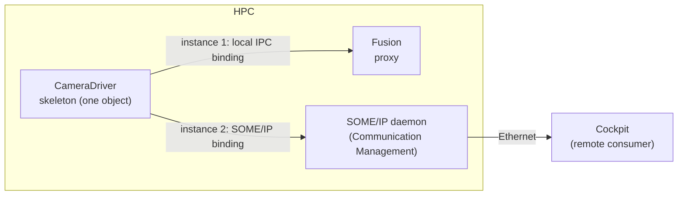

### 13.4 Typical Implementations on Linux

> **Note (implementation example):** Common building blocks of local bindings on Linux are:
>
> - **Unix domain sockets** (`AF_UNIX`), "sockets for local interprocess communication" [EXT-029]. The EXP uses them as its example: each skeleton gets a socket endpoint, which it registers with the discovery during `OfferService`; the handle that a proxy receives contains the socket name. If the provider's process ID is part of the address, a proxy can detect that the provider runs in its own process and switch to direct calls (EXP, Section 7.3.1).
> - **POSIX shared memory**, which lets processes "exchange information by mapping a common region of memory" [EXT-030]. It carries event payloads; a socket, an eventfd or a futex carries the notifications.
> - **Shared-memory middleware** such as Eclipse iceoryx, which writes each message once into shared memory and gives consumers references to it [EXT-028].
> - **A central daemon**, which keeps the registry, routes local messages or only brokers the connection, and bridges to SOME/IP-SD and DDS discovery (EXP, Sections 7.2 and 7.3.3).

### 13.5 Worked Example: `CalibrationDataService` Over Local IPC

`CalibrationDataService` exists only on `HPC`: `Storage` provides it, and `CalibrationCheck`, `Fusion`, `FusionLite` and `CameraDriver` use it. It is therefore deployed only with a local IPC binding. The following conceptual view summarizes the deployment; [Section 14.11](#1411-the-running-example-complete-configuration) shows it as ARXML.

```yaml
# Conceptual view of the local IPC deployment of CalibrationDataService. NOT real ARXML syntax.
UserDefinedServiceInterfaceDeployment CalibrationDataService_Ipc:
  category: SERVICE_INTERFACE_DEPLOYMENT_IPC
  serviceInterface: CalibrationDataService
  eventDeployment:  [CalibrationUpdated (trigger)]
  methodDeployment: [GetCalibration, SetCalibration (minimumSendInterval: 1.0 s)]
ProvidedUserDefinedServiceInstance CalibrationDataProvided:  {deployment: CalibrationDataService_Ipc}
RequiredUserDefinedServiceInstance CalibrationDataRequired:  {deployment: CalibrationDataService_Ipc}
ServiceInstanceToPortPrototypeMapping:
  - /storage/Root/CalibrationPPort        in process Storage          -> CalibrationDataProvided
  - /camera_driver/Root/CalibrationRPort  in process CameraDriver     -> CalibrationDataRequired
  - /fusion/Root/CalibrationRPort         in process Fusion           -> CalibrationDataRequired
  - /fusion_lite/Root/CalibrationRPort    in process FusionLite       -> CalibrationDataRequired
  - /calib_check/Root/CalibrationRPort    in process CalibrationCheck -> CalibrationDataRequired
UserDefinedServiceInstanceToMachineMapping CalibrationDataOnHpc:
  connector: HpcDesign/HpcIpcConnector (UserDefinedCommunicationConnector)
  instances: [CalibrationDataProvided, CalibrationDataRequired]
```

`Storage` implements the two methods with `kEventSingleThread`, because both access the same key-value storage. After a successful write, it sends the trigger `CalibrationUpdated`, so that `Fusion` and `FusionLite` re-read the value ([Section 7.7](#77-triggers)).

```cpp
// Storage: implementation of SetCalibration (illustrative; IsPlausible and store_ are Storage's own).
ara::core::Future<CalibrationService::SetCalibrationOutput>
CalibrationService::SetCalibration(hpc::storage::CalibrationKey key,
                                   const hpc::storage::CalibrationRecord& record) noexcept {
    ara::core::Promise<SetCalibrationOutput> promise;
    if (!IsPlausible(key, record) || !store_.Write(key, record).HasValue()) {
        promise.SetError(ara::core::ErrorCode(hpc::storage::CalibrationErrorsErrc::CalibrationRejected));
    } else {
        promise.set_value(SetCalibrationOutput{});
        CalibrationUpdated.Send();  // skeleton trigger member: readers re-read the calibration
    }
    return promise.get_future();
}
```

`CameraDriver` calls `SetCalibration` at the end of the diagnostic routine `CalibrateCamera` (guide 12a). The routine waits for the result with a timeout, because `ara::com` does not time out calls ([Section 8.3](#83-no-timeout-supervision)):

```cpp
// CameraDriver: store a new camera calibration (illustrative).
auto future = calibration.SetCalibration(hpc::storage::CalibrationKey::CameraExtrinsics, measured);
if (future.wait_for(std::chrono::milliseconds(500)) != ara::core::future_status::kReady) {
    return RoutineResult::kTimeout;  // the call may still be executed by Storage
}
auto result = future.GetResult();
if (!result.HasValue()) {
    // CalibrationRejected, kMinimumSendIntervalViolationError (second call within 1 s), ...
    return RoutineResult::kFailed;
}
return RoutineResult::kOk;
```

> **Key takeaways**
>
> - Local IPC is configured with a `UserDefinedServiceInterfaceDeployment` of category `SERVICE_INTERFACE_DEPLOYMENT_IPC`; vendor settings go into special data.
> - IPC instances are mapped to a `UserDefinedCommunicationConnector`, which stands for an IPC domain.
> - Data is serialized even between local processes; real zero-copy needs layouts that both sides can read directly.
> - Multi-binding makes one instance reachable over several bindings; it is common on the provider side and rare on the consumer side.

---

## 14. Configuration Reference: What to Configure

> **Why this matters:** This chapter answers the question "what do I have to configure for `ara::com`, and what does each setting mean?". It covers the binding-independent elements that Communication Management reads. The SOME/IP, DDS and signal-based settings of the deployment are covered in [guide 08a, Chapter 14](08a_NetworkBindings.md#14-configuration-reference-what-to-configure), the E2E protection and secure communication settings in [guide 08b](08b_SecureAndSafeCommunication.md); the general manifest structure is in [guide 02, Chapter 12](02_Manifests.md#12-configuration-reference-what-to-configure).

The tables use the column *Default* only for values that a specification states. SWS CM itself defines no default values (SWS CM, Section 10.1); the only defaults below come from individual requirements and from the TPS.

### 14.1 Minimal Configuration

To make one service work between a provider process and a consumer process, configure the following. The *Section* column points to the details.

| # | What | Who | Section |
| --- | --- | --- | --- |
| 1 | A `ServiceInterface` with a `namespace`, `majorVersion` and `minorVersion`, and its events, fields, methods and triggers | Service designer | [14.2](#142-serviceinterface-and-its-elements) |
| 2 | The C++ implementation data types and application errors that the interface uses | Service designer | [Guide 02, 12.5 and 12.6](02_Manifests.md#125-cppimplementationdatatype) |
| 3 | A provider component with a `PPortPrototype` typed by the interface, and a `FieldSenderComSpec` with `initValue` for each field | Application developer | [14.3](#143-portprototype-and-rportprototypeprops), [14.4](#144-sender-and-receiver-comspecs) |
| 4 | A consumer component with an `RPortPrototype` typed by the interface | Application developer | [14.3](#143-portprototype-and-rportprototypeprops) |
| 5 | An `Executable` for each component, with the component in its root prototype; a `Process` for each executable, mapped to the machine | Application developer, integrator | [Guide 02, Chapter 8](02_Manifests.md#8-the-execution-manifest) |
| 6 | A `ServiceInterfaceDeployment` that covers every element of the interface, for the chosen binding | Software cluster integrator | [14.7](#147-serviceinterfacedeployment-and-minimumsendinterval), [14.8](#148-user-defined-deployment-for-local-ipc) |
| 7 | A provided and a required service instance that reference the deployment | Software cluster integrator | [14.9](#149-service-instances-and-their-mappings) |
| 8 | A `ServiceInstanceToPortPrototypeMapping` for each port in each process | Integrator | [14.9](#149-service-instances-and-their-mappings) |
| 9 | A `ServiceInstanceToMachineMapping` that maps the instances to a communication connector of the machine | Machine integrator | [14.9](#149-service-instances-and-their-mappings) |
| 10 | If access control is enabled: grants for the processes | Integrator | [14.10](#1410-cmmoduleinstantiation), guide 15 |

### 14.2 ServiceInterface and Its Elements

**Purpose:** the contract of the service; it determines the generated C++ API. **Lives in:** service interface design. **Configured by:** service designer. **Spec:** TPS 4.2; [guide 02, Section 12.4](02_Manifests.md#124-serviceinterface-and-its-elements) has the complete attribute table. The table below adds the effect on `ara::com`.

| Element.attribute | Meaning | Type and values | Mult. | Default | Rules | Effect at run time |
| --- | --- | --- | --- | --- | --- | --- |
| `ServiceInterface.namespace` | Namespace of the generated code | `SymbolProps` (ordered) | `*` | not specified; shall exist | Shall exist ([SWS_CM_CONSTR_00008]); order kept ([TPS_MANI_01006]) | C++ namespace and header directory ([SWS_CM_11500], [Section 5.2](#52-file-names-namespaces-and-names)) |
| `ServiceInterface.majorVersion`, `minorVersion` | Contract version | `PositiveInteger` | `0..1` each | not specified | Semantic versioning ([TPS_MANI_03616]) | `serviceContractVersionMajor/Minor` ([SWS_CM_99029]); compatibility check by service discovery ([SWS_CM_99003]) |
| `ServiceInterface.event` | Events | `VariableDataPrototype` | `*` | not specified | | Event classes and members ([SWS_CM_99445], [SWS_CM_99557]) |
| `ServiceInterface.field` | Fields | `Field` | `*` | not specified | | Field classes and members ([SWS_CM_99446], [SWS_CM_99558]) |
| `Field.hasGetter`, `hasSetter`, `hasNotifier` | Which accessors exist | `Boolean` | `0..1` each | not specified | All three shall exist, at least one `true` ([constr_1673]) | Generates `Get`/`RegisterGetHandler`, `Set`/`RegisterSetHandler` and the notifier; `OfferService` checks ([SWS_CM_00128], [SWS_CM_00129]) |
| `ServiceInterface.method` | Methods | `ClientServerOperation` | `*` | not specified | | Method classes of the proxy, virtual functions of the skeleton |
| `ClientServerOperation.fireAndForget` | One-way call | `Boolean` | `0..1` | absent: no fire-and-forget semantics ([TPS_MANI_03119]) | No out or inout arguments, no errors ([constr_3374], [constr_3375]) | `void operator()`, no errors ([SWS_CM_90435]) |
| `ClientServerOperation.argument` | Arguments, with `direction` `in`, `out` or `inout` | `ArgumentDataPrototype` | `*` (ordered) | not specified | | In and inout: parameters; out and inout: members of `Output` ([Section 5.4](#54-how-arguments-are-passed)) |
| `ClientServerOperation.possibleApError`, `possibleApErrorSet` | Application errors of the method | `ApApplicationError`, `ApApplicationErrorSet` (ref) | `*` each | not specified | Domain values unique per method ([constr_10574]) | Errors in the future; unconfigured errors become `kUnknownApplicationError` ([SWS_CM_00048]) |
| `ServiceInterface.trigger` | Triggers | `Trigger` | `*` | not specified | No E2E protection ([SWS_CM_CONSTR_00007]) | Trigger classes ([SWS_CM_00726], [SWS_CM_00727]) |
| `SwDataDefProps.invalidValue` (of a `CppImplementationDataType`) | A value that means "not valid" | `ValueSpecification` | `0..1` | not specified | Only for categories `TYPE_REFERENCE` and `STRING` ([constr_3569]; SWS CM, Section 7.5.22.5) | Generated constant `kInvalidValue<DataType>` ([SWS_CM_10453]) |

### 14.3 PortPrototype and RPortPrototypeProps

**Purpose:** the endpoints of a component; each becomes an `InstanceSpecifier`. **Lives in:** application design. **Configured by:** application developer. **Spec:** TPS 3.2.4.

| Element.attribute | Meaning | Type and values | Mult. | Default | Rules | Effect at run time |
| --- | --- | --- | --- | --- | --- | --- |
| `PPortPrototype.providedInterface` | The provided service | `ServiceInterface` (tref) | `0..1` | not specified | [TPS_MANI_01039] | Skeleton; `InstanceSpecifier` of the port ([SWS_CORE_10200]) |
| `RPortPrototype.requiredInterface` | The required service | `ServiceInterface` (tref) | `0..1` | not specified | [TPS_MANI_01040] | Proxy; `InstanceSpecifier` of the port |
| (no `PRPortPrototype`) | A port cannot be both | | | | No `PRPortPrototype` typed by a service interface ([constr_1473]) | |
| `RPortPrototypeProps.searchIntention` (in `PortPrototype.portPrototypeProps`) | Whether the developer intends to search for one instance or for all | `searchForAllInstances`, `searchForSpecificInstance` | `0..1` | not specified | Only in R-ports of components in an executable ([constr_3359], [constr_3642]); not a binding contract ([TPS_MANI_01057]) | None: the search is defined by the service instance manifest |

### 14.4 Sender and Receiver ComSpecs

**Purpose:** port-specific settings for events and field notifiers. **Lives in:** application design, in `PPortPrototype.providedComSpec` and `RPortPrototype.requiredComSpec`. **Configured by:** application developer. **Spec:** TPS 3.2.5.1.1, 3.2.5.1.2, 3.2.5.1.5; on the Adaptive Platform, only a limited selection of ComSpec attributes is supported ([TPS_MANI_01053]).

| Element.attribute | Meaning | Type and values | Mult. | Default | Rules | Effect at run time |
| --- | --- | --- | --- | --- | --- | --- |
| `SenderComSpec.dataElement` | The event or field the settings apply to | `AutosarDataPrototype` (ref) | `0..1` | not specified | | Identifies the element |
| `QueuedSenderComSpec` | Sender settings of an event | (class) | | | For events ([TPS_MANI_03210]) | |
| `FieldSenderComSpec.initValue` | Initial value of a field | `ValueSpecification` | `0..1` | not specified | Shall exist for each `FieldSenderComSpec` ([constr_10152]) | Not applied automatically; the application calls `Update()` with it before `OfferService()` ([TPS_MANI_03212], [Section 9.2](#92-the-value-before-the-offer)) |
| `SenderComSpec.senderIntent` | Whether the software intends to send the element | `willSend`, `wontSend` | `0..1` | not specified | DRAFT ([TPS_MANI_01107]) | An expressed intent, relevant for IAM |
| `SenderComSpec.usesEndToEndProtection` | The element is transmitted with E2E protection | `Boolean` (variation point) | `0..1` | not specified | | [Guide 08b](08b_SecureAndSafeCommunication.md) |
| `SenderComSpec.transmissionProps` (`TransmissionComSpecProps`: `dataUpdatePeriod`, `minimumSendInterval`, `transmissionMode`, `onChangeDataPrototype`) | How often the *application* sends | `TimeValue`; `cyclic`, `triggered`, `onChange`, `cyclicAndOnChange` | `0..1` | not specified | Behavior to be implemented by the application (TPS, Section 3.2.5.1.5) | None by Communication Management; a contract for the application and for test tools |
| `ReceiverComSpec.dataElement` | The event or field the settings apply to | `AutosarDataPrototype` (ref) | `0..1` | not specified | | Identifies the element |
| `QueuedReceiverComSpec` | Receiver settings of an event | (class) | | | | |
| `ReceiverComSpec.receiverIntent` | Whether the software intends to receive the element | `willReceive`, `wontReceive` | `0..1` | not specified | DRAFT ([TPS_MANI_01106]) | An expressed intent, relevant for IAM |
| `ReceiverComSpec.receptionProps` (`ReceptionComSpecProps`: `dataUpdatePeriod`, `timeout`) | How often the *application* reads, and when it assumes a timeout | `TimeValue` | `0..1` | not specified | Behavior to be implemented by the application | None by Communication Management |
| `ReceiverComSpec.transformationComSpecProps` | Port-specific E2E settings | `EndToEndTransformationComSpecProps` | `*` | not specified | For events and notifiers ([TPS_MANI_03132]) | [Section 14.6](#146-endtoendtransformationcomspecprops) |

> **Note:** `TransmissionComSpecProps.minimumSendInterval` (application behavior) is a different attribute from `ServiceInterfaceDeploymentElement.minimumSendInterval`, which `ara::com` enforces ([Section 14.7](#147-serviceinterfacedeployment-and-minimumsendinterval)).

### 14.5 Client and Server ComSpecs

**Purpose:** port-specific settings for methods and for field getters and setters. **Lives in:** application design. **Configured by:** application developer. **Spec:** TPS 3.2.5.1.3, 3.2.5.1.4.

| Element.attribute | Meaning | Type and values | Mult. | Default | Rules | Effect at run time |
| --- | --- | --- | --- | --- | --- | --- |
| `ClientComSpec.operation` / `getter` / `setter` | The method, or the field whose getter or setter is meant | `ClientServerOperation`, `Field` (ref) | `0..1` each | not specified | | Identifies the element |
| `ClientComSpec.clientIntent` | Whether the software intends to call the method | `willCall`, `wontCall` | `0..1` | not specified | DRAFT ([TPS_MANI_01108]) | An expressed intent, relevant for IAM |
| `ClientComSpec.endToEndCallResponseTimeout` | Maximum time in which the application expects the response | `TimeValue` | `0..1` | not specified | | Not used by SWS CM: `ara::com` does not time out calls ([Section 8.3](#83-no-timeout-supervision)) |
| `ClientComSpec.transformationComSpecProps` | Port-specific E2E settings for methods | `EndToEndTransformationComSpecProps` | `*` | not specified | [TPS_MANI_01324] | [Section 14.6](#146-endtoendtransformationcomspecprops) |
| `ServerComSpec.operation` / `getter` / `setter` | The method, or the field accessor | (ref) | `0..1` each | not specified | | Identifies the element |
| `ServerComSpec.queueLength` | "Length of call queue on the server side" | `PositiveInteger` | `0..1` | not specified | | Not referenced by SWS CM; effect not specified ([Section 8.7](#87-method-call-processing-modes)) |
| `ServerComSpec.transformationComSpecProps` | Port-specific E2E settings for methods | `EndToEndTransformationComSpecProps` | `*` | not specified | [TPS_MANI_01325] | [Section 14.6](#146-endtoendtransformationcomspecprops) |

### 14.6 EndToEndTransformationComSpecProps

**Purpose:** port-specific E2E settings. **Lives in:** the `transformationComSpecProps` of a receiver, client or server ComSpec. **Configured by:** application developer, with the safety engineer. **Spec:** TPS 3.2.5, Table 3.18; SWS CM 7.4.1.1.1 and 7.4.1.2.1.

| Element.attribute | Meaning | Type and values | Mult. | Default | Rules | Effect at run time |
| --- | --- | --- | --- | --- | --- | --- |
| `disableEndToEndCheck` | Switch the E2E check off | `Boolean` | `0..1` | not specified | If `true`, `disableEndToEndStateMachine` is ignored ([TPS_MANI_01327]) | `ProfileCheckStatus::kCheckDisabled`; the E2E header is still removed ([Section 12.4](#124-what-you-can-switch-off-and-other-limits)) |
| `disableEndToEndStateMachine` | Switch only the state machine off | `Boolean` | `0..1` | not specified | | `SMState::kStateMDisabled` |
| `maxDeltaCounter`, `maxErrorStateInit`, `maxErrorStateInvalid`, `maxErrorStateValid`, `minOkStateInit`, `minOkStateInvalid`, `minOkStateValid`, `windowSizeInit`, `windowSizeInvalid`, `windowSizeValid`, `clearFromValidToInvalid`, `e2eProfileCompatibilityProps` | Port-specific parameters of the E2E check and state machine | `PositiveInteger`, `Boolean`, ref | `0..1` each | not specified | **Not supported** by Communication Management in R25-11 (SWS CM, Sections 7.4.1.1.1, 7.4.1.2.1) | None; the instance-level E2E configuration applies ([guide 08b, Section 15.9](08b_SecureAndSafeCommunication.md#159-e2e-for-service-instances)) |

### 14.7 ServiceInterfaceDeployment and minimumSendInterval

**Purpose:** the transport-specific form of a service interface. **Lives in:** Service Instance Manifest. **Configured by:** software cluster integrator. **Spec:** TPS 13.2, Tables 13.6 to 13.10; [guide 02, Section 12.13](02_Manifests.md#1213-serviceinterfacedeployment-and-service-instances).

| Element.attribute | Meaning | Type and values | Mult. | Default | Rules | Effect at run time |
| --- | --- | --- | --- | --- | --- | --- |
| `ServiceInterfaceDeployment` (subclasses `SomeipServiceInterfaceDeployment`, `DdsServiceInterfaceDeployment`, `UserDefinedServiceInterfaceDeployment`) | The binding | (class) | | | | The class decides which binding offers and stops the service ([SWS_CM_00103], [SWS_CM_00104]); can change without recompiling ([SWS_CM_10384]) |
| `ServiceInterfaceDeployment.serviceInterface` | The deployed interface | `ServiceInterface` (ref) | `0..1` | not specified | | |
| `ServiceInterfaceDeployment.eventDeployment`, `fieldDeployment`, `methodDeployment` | One deployment per element | `ServiceEventDeployment`, `ServiceFieldDeployment`, `ServiceMethodDeployment` | `*` each | not specified | All elements shall be covered, except for DDS ([constr_10029]); only elements of the same interface ([constr_3300] to [constr_3302]) | |
| `ServiceEventDeployment.event`, `trigger` | The event or trigger deployed | `VariableDataPrototype`, `Trigger` (ref) | `0..1` each | not specified | Either an event or a trigger, not both ([constr_5317], [constr_5316]) | |
| `ServiceMethodDeployment.method` | The method deployed | `ClientServerOperation` (ref) | `0..1` | not specified | [constr_3300] | |
| `ServiceFieldDeployment.field` | The field deployed | `Field` (ref) | `0..1` | not specified | Shall exist ([constr_10251]) | |
| `ServiceInterfaceDeploymentElement.minimumSendInterval` | Minimum time between two transmissions of an event, field, trigger or method call | `TimeValue` (seconds) | `0..1` | 0 ([SWS_CM_00139], [SWS_CM_00142], [SWS_CM_00144], [SWS_CM_00823], [SWS_CM_00825], [SWS_CM_00827]) | 0.0 to 10.0 ([constr_10655]); 0 means no limit | Minimum Send Interval check ([Section 11.4](#114-the-minimum-send-interval)) |

### 14.8 User-Defined Deployment for Local IPC

**Purpose:** a binding that AUTOSAR does not standardize, typically the local IPC of the stack. **Lives in:** Service Instance Manifest and machine design. **Configured by:** software cluster integrator and machine integrator. **Spec:** TPS 13.2.3, 13.3; Tables 13.22 to 13.27, 13.67, 13.68.

| Element.attribute | Meaning | Type and values | Mult. | Default | Rules | Effect at run time |
| --- | --- | --- | --- | --- | --- | --- |
| `UserDefinedServiceInterfaceDeployment.category` | The kind of user-defined binding | `SERVICE_INTERFACE_DEPLOYMENT_IPC` (reserved) or a custom value that cannot clash with future standard values | `0..1` | not specified | [TPS_MANI_01165]; IPC instances only through a user-defined machine mapping to a user-defined connector ([constr_1570]) | Selects the vendor's local IPC binding |
| `UserDefinedEventDeployment` | Deployment of an event or trigger | (class; vendor data in `sdg`) | | | [TPS_MANI_03046] | Vendor-specific |
| `UserDefinedEventDeployment.eventReceptionDefaultValue` | Value to fill an incomplete event | `ValueSpecification` | `0..1` | not specified | Marked obsolete; the related behavior requirements were deleted in R25-11 | None |
| `UserDefinedMethodDeployment` | Deployment of a method, or of a field getter or setter | (class) | | | [TPS_MANI_03047]; as `get`/`set` it does not reference a method ([constr_3418]) | Vendor-specific |
| `UserDefinedFieldDeployment.get`, `set`, `notifier` | Deployments of the field's accessors | `UserDefinedMethodDeployment`, `UserDefinedEventDeployment` | `0..1` each | not specified | [TPS_MANI_03048]; the notifier does not reference an event ([constr_3417]) | Vendor-specific |
| `ProvidedUserDefinedServiceInstance`, `RequiredUserDefinedServiceInstance` | The instances of the binding | (classes; vendor data in `sdg`) | | | [TPS_MANI_03032] | Vendor-specific |
| `UserDefinedServiceInstanceToMachineMapping` | Maps user-defined instances to the machine | (class) | | | [constr_1570] | |
| `UserDefinedCommunicationConnector` (in `MachineDesign.communicationConnector`) | An "IPC domain" with its global settings | (class; vendor data in `sdg`) | | | | Vendor-specific, for example the discovery settings of the domain |

### 14.9 Service Instances and Their Mappings

**Purpose:** connect ports to instances, and instances to the machine. **Lives in:** Service Instance Manifest. **Configured by:** integrators. **Spec:** TPS 13.3, Tables 13.28 to 13.32; [guide 02, Section 12.14](02_Manifests.md#1214-serviceinstancetoportprototypemapping-and-serviceinstancetomachinemapping) gives the binding-specific attributes.

| Element.attribute | Meaning | Type and values | Mult. | Default | Rules | Effect at run time |
| --- | --- | --- | --- | --- | --- | --- |
| `AdaptivePlatformServiceInstance.serviceInterfaceDeployment` | The deployment the instance uses | `ServiceInterfaceDeployment` (ref) | `0..1` | not specified | | Binding and IDs of the instance |
| `AdaptivePlatformServiceInstance.e2eEventProtectionProps`, `e2eMethodProtectionProps`, `secureComConfig` | E2E protection and secure communication of the instance | (aggr) | `*` each | not specified | [SWS_CM_90402], [SWS_CM_10460] | [Guide 08b, Section 15.9](08b_SecureAndSafeCommunication.md#159-e2e-for-service-instances) |
| `ProvidedApServiceInstance`, `RequiredApServiceInstance` | Provider side, consumer side | (abstract classes) | | | Subclasses per binding | A provided instance is offered by a skeleton (P-port); a required instance is what a proxy searches (R-port) |
| `ServiceInstanceToPortPrototypeMapping.portPrototype` | The port in the executable | `PortPrototype` (iref `PortPrototypeInExecutableInstanceRef`) | `0..1` | not specified | [TPS_MANI_03000] | Resolves the `InstanceSpecifier` ([SWS_CM_10452]) |
| `ServiceInstanceToPortPrototypeMapping.serviceInstance` | The instance of the port | `AdaptivePlatformServiceInstance` (ref) | `0..1` | not specified | | What the skeleton offers or the proxy searches |
| `ServiceInstanceToPortPrototypeMapping.process` | The process in which the mapping applies | `Process` (ref) | `0..1` | not specified | Deployment level; overrides `processDesign` ([TPS_MANI_01317]) | Wrong or missing: `ProcessMappingViolation` ([SWS_CORE_13005]) |
| `ServiceInstanceToPortPrototypeMapping.processDesign` | Design-level pre-assignment | `ProcessDesign` (ref) | `0..1` | not specified | Design level only ([TPS_MANI_01316]) | |
| `ServiceInstanceToMachineMapping.communicationConnector` | The connector of the machine | `CommunicationConnector` (ref) | `0..1` | not specified | | Network interface, or IPC domain |
| `ServiceInstanceToMachineMapping.serviceInstance` | The mapped instances | `AdaptivePlatformServiceInstance` (ref) | `*` | not specified | A TCP endpoint serves either provided or required instances ([constr_3487]) | |
| `ServiceInstanceToMachineMapping.secureComPropsForTcp`, `secureComPropsForUdp`, `secOcComPropsForMulticast` | Security of the endpoints | (ref) | `0..1`, `0..1`, `*` | not specified | | Guides 08, 14 |

### 14.10 CmModuleInstantiation

**Purpose:** machine-wide settings of Communication Management. **Lives in:** Machine Manifest (`Machine.moduleInstantiation`). **Configured by:** machine integrator. **Spec:** TPS, Figure 12.36. All attributes are tagged *candidate*.

| Element.attribute | Meaning | Type and values | Mult. | Default | Rules | Effect at run time |
| --- | --- | --- | --- | --- | --- | --- |
| `CmModuleInstantiation.grant` | The grants that Communication Management enforces | `Grant` (ref) | `*` | not specified | Candidate | Access control (guide 15); a refused operation raises `InsufficientPermissionsViolation` |
| `CmModuleInstantiation.localComAccessControlEnabled` | Enforce policies for local applications | `Boolean` | `0..1` | not specified | Candidate | Guide 15 |
| `CmModuleInstantiation.remoteAccessControlEnabled` | Enforce policies for remote access | `Boolean` | `0..1` | not specified | Candidate | Guide 15 |
| `CmModuleInstantiation.secOCIgnoreVerificationResult` | Ignore the SecOC verification result | `Boolean` | `0..1` | not specified | Candidate | [Guide 08b, Section 7.6](08b_SecureAndSafeCommunication.md#76-receiving-verification-retries-bypass-and-ignore) |

### 14.11 The Running Example: Complete Configuration

The following conceptual view shows every `ara::com`-relevant element of `HPC` in one place. The SOME/IP deployment of `CameraService` is in [guide 02, Section 9.6](02_Manifests.md#96-worked-example-cameraservice-between-cameradriver-and-fusion); the DDS deployment of `ObjectListService` is added in [guide 08a](08a_NetworkBindings.md).

```yaml
# Conceptual view of the ara::com configuration of HPC. NOT real ARXML syntax.
ServiceInterfaces:
  CameraService:          {namespace: hpc::camera,  version: 1.0,       # guide 02
                           event: Image (CameraImage), method: SetExposureMode(in mode),
                           field: CameraStatus (CameraState; getter, notifier)}
  ObjectListService:      {namespace: hpc::fusion,  version: 1.0,
                           event: ObjectList (ObjectListData),
                           field: FusionMode (FusionModeType; getter, notifier)}
  CalibrationDataService: {namespace: hpc::storage, version: 1.0,
                           methods: [GetCalibration(in key, out record) raises CalibrationNotFound,
                                     SetCalibration(in key, in record) raises CalibrationRejected],
                           trigger: CalibrationUpdated}
Ports (executable/Root/port):
  /camera_driver/Root/CameraPPort       P CameraService           initValue CameraStatus = NotAvailable
  /camera_driver/Root/CalibrationRPort  R CalibrationDataService
  /fusion/Root/CameraRPort              R CameraService
  /fusion/Root/ObjectListPPort          P ObjectListService       initValue FusionMode = Full
  /fusion/Root/CalibrationRPort         R CalibrationDataService
  /fusion_lite/Root/ObjectListPPort     P ObjectListService       initValue FusionMode = RadarOnly
  /fusion_lite/Root/CalibrationRPort    R CalibrationDataService
  /storage/Root/CalibrationPPort        P CalibrationDataService
  /storage/Root/ObjectListRPort         R ObjectListService
  /calib_check/Root/CalibrationRPort    R CalibrationDataService
Deployments:
  CameraService_Someip:       SOME/IP (guide 02, guide 08a)
  ObjectListService:          DDS (guide 08a)
  CalibrationDataService_Ipc: user-defined, SERVICE_INTERFACE_DEPLOYMENT_IPC; SetCalibration minimumSendInterval 1.0 s
Instances and mappings (CalibrationDataService):
  CalibrationDataProvided  <- /storage/Root/CalibrationPPort in Storage
  CalibrationDataRequired  <- the four R-ports, each in its own process
  CalibrationDataOnHpc     -> HpcDesign/HpcIpcConnector
Code-level decisions (not in the model):
  CameraDriver skeleton: kEventSingleThread       Storage skeleton: kEventSingleThread
  Fusion: StartFindService; Image maxSampleCount 2; CameraStatus 1; polls once per 50 ms cycle
  Storage: ObjectList maxSampleCount 10, receive handler      CalibrationCheck: one-shot FindService
```

The following diagram shows how the elements of `CalibrationDataService` connect.

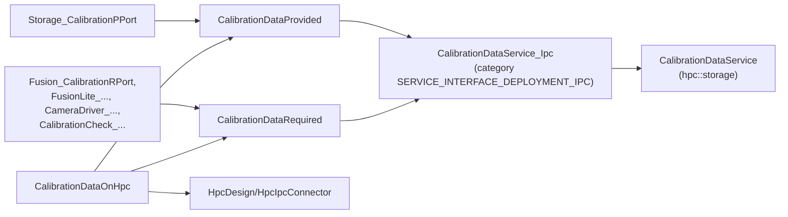

The new elements are written as ARXML in the file `12_Communication.arxml` of the series model. It continues the files of guides 02, 05 and 06, and it validates against the R25-11 schema (`AUTOSAR_00054.xsd`). The following excerpts are copied from it. [Guide 02, Chapter 3](02_Manifests.md#3-reading-arxml) explains how to read ARXML.

The service interface `CalibrationDataService`, with two methods, their application errors and the trigger:

```xml
<SERVICE-INTERFACE>
  <SHORT-NAME>CalibrationDataService</SHORT-NAME>
  <NAMESPACES>
    <SYMBOL-PROPS>
      <SHORT-NAME>Ns1</SHORT-NAME>
      <SYMBOL>hpc</SYMBOL>
    </SYMBOL-PROPS>
    <SYMBOL-PROPS>
      <SHORT-NAME>Ns2</SHORT-NAME>
      <SYMBOL>storage</SYMBOL>
    </SYMBOL-PROPS>
  </NAMESPACES>
  <MAJOR-VERSION>1</MAJOR-VERSION>
  <MINOR-VERSION>0</MINOR-VERSION>
  <METHODS>
    <CLIENT-SERVER-OPERATION>
      <SHORT-NAME>GetCalibration</SHORT-NAME>
      <ARGUMENTS>
        <ARGUMENT-DATA-PROTOTYPE>
          <SHORT-NAME>key</SHORT-NAME>
          <TYPE-TREF DEST="STD-CPP-IMPLEMENTATION-DATA-TYPE">/HPC/CppImplementationDataTypes/CalibrationKey</TYPE-TREF>
          <DIRECTION>IN</DIRECTION>
        </ARGUMENT-DATA-PROTOTYPE>
        <ARGUMENT-DATA-PROTOTYPE>
          <SHORT-NAME>record</SHORT-NAME>
          <TYPE-TREF DEST="STD-CPP-IMPLEMENTATION-DATA-TYPE">/HPC/CppImplementationDataTypes/CalibrationRecord</TYPE-TREF>
          <DIRECTION>OUT</DIRECTION>
        </ARGUMENT-DATA-PROTOTYPE>
      </ARGUMENTS>
      <POSSIBLE-AP-ERROR-REFS>
        <POSSIBLE-AP-ERROR-REF DEST="AP-APPLICATION-ERROR">/HPC/ApplicationErrors/CalibrationNotFound</POSSIBLE-AP-ERROR-REF>
      </POSSIBLE-AP-ERROR-REFS>
    </CLIENT-SERVER-OPERATION>
    <CLIENT-SERVER-OPERATION>
      <SHORT-NAME>SetCalibration</SHORT-NAME>
      <ARGUMENTS>
        <ARGUMENT-DATA-PROTOTYPE>
          <SHORT-NAME>key</SHORT-NAME>
          <TYPE-TREF DEST="STD-CPP-IMPLEMENTATION-DATA-TYPE">/HPC/CppImplementationDataTypes/CalibrationKey</TYPE-TREF>
          <DIRECTION>IN</DIRECTION>
        </ARGUMENT-DATA-PROTOTYPE>
        <ARGUMENT-DATA-PROTOTYPE>
          <SHORT-NAME>record</SHORT-NAME>
          <TYPE-TREF DEST="STD-CPP-IMPLEMENTATION-DATA-TYPE">/HPC/CppImplementationDataTypes/CalibrationRecord</TYPE-TREF>
          <DIRECTION>IN</DIRECTION>
        </ARGUMENT-DATA-PROTOTYPE>
      </ARGUMENTS>
      <POSSIBLE-AP-ERROR-REFS>
        <POSSIBLE-AP-ERROR-REF DEST="AP-APPLICATION-ERROR">/HPC/ApplicationErrors/CalibrationRejected</POSSIBLE-AP-ERROR-REF>
      </POSSIBLE-AP-ERROR-REFS>
    </CLIENT-SERVER-OPERATION>
  </METHODS>
  <TRIGGERS>
    <TRIGGER>
      <SHORT-NAME>CalibrationUpdated</SHORT-NAME>
    </TRIGGER>
  </TRIGGERS>
</SERVICE-INTERFACE>
```

The service interface `ObjectListService`:

```xml
<SERVICE-INTERFACE>
  <SHORT-NAME>ObjectListService</SHORT-NAME>
  <NAMESPACES>
    <SYMBOL-PROPS>
      <SHORT-NAME>Ns1</SHORT-NAME>
      <SYMBOL>hpc</SYMBOL>
    </SYMBOL-PROPS>
    <SYMBOL-PROPS>
      <SHORT-NAME>Ns2</SHORT-NAME>
      <SYMBOL>fusion</SYMBOL>
    </SYMBOL-PROPS>
  </NAMESPACES>
  <MAJOR-VERSION>1</MAJOR-VERSION>
  <MINOR-VERSION>0</MINOR-VERSION>
  <EVENTS>
    <VARIABLE-DATA-PROTOTYPE>
      <SHORT-NAME>ObjectList</SHORT-NAME>
      <TYPE-TREF DEST="STD-CPP-IMPLEMENTATION-DATA-TYPE">/HPC/CppImplementationDataTypes/ObjectListData</TYPE-TREF>
    </VARIABLE-DATA-PROTOTYPE>
  </EVENTS>
  <FIELDS>
    <FIELD>
      <SHORT-NAME>FusionMode</SHORT-NAME>
      <TYPE-TREF DEST="STD-CPP-IMPLEMENTATION-DATA-TYPE">/HPC/CppImplementationDataTypes/FusionModeType</TYPE-TREF>
      <HAS-GETTER>true</HAS-GETTER>
      <HAS-NOTIFIER>true</HAS-NOTIFIER>
      <HAS-SETTER>false</HAS-SETTER>
    </FIELD>
  </FIELDS>
</SERVICE-INTERFACE>
```

The ports that this guide adds to `FusionSwc`. The component is split over several files, which the model merges ([guide 02, Section 3.7](02_Manifests.md#37-many-files-one-model)); the `FieldSenderComSpec` gives `FusionMode` its initial value 0 (`Full`):

```xml
<ADAPTIVE-APPLICATION-SW-COMPONENT-TYPE>
  <SHORT-NAME>FusionSwc</SHORT-NAME>
  <PORTS>
    <P-PORT-PROTOTYPE>
      <SHORT-NAME>ObjectListPPort</SHORT-NAME>
      <PROVIDED-COM-SPECS>
        <FIELD-SENDER-COM-SPEC>
          <DATA-ELEMENT-REF DEST="FIELD">/HPC/ServiceInterfaces/ObjectListService/FusionMode</DATA-ELEMENT-REF>
          <INIT-VALUE>
            <NUMERICAL-VALUE-SPECIFICATION>
              <VALUE>0</VALUE>
            </NUMERICAL-VALUE-SPECIFICATION>
          </INIT-VALUE>
        </FIELD-SENDER-COM-SPEC>
      </PROVIDED-COM-SPECS>
      <PROVIDED-INTERFACE-TREF DEST="SERVICE-INTERFACE">/HPC/ServiceInterfaces/ObjectListService</PROVIDED-INTERFACE-TREF>
    </P-PORT-PROTOTYPE>
    <R-PORT-PROTOTYPE>
      <SHORT-NAME>CalibrationRPort</SHORT-NAME>
      <PORT-PROTOTYPE-PROPS>
        <R-PORT-PROTOTYPE-PROPS>
          <SEARCH-INTENTION>SEARCH-FOR-SPECIFIC-INSTANCE</SEARCH-INTENTION>
        </R-PORT-PROTOTYPE-PROPS>
      </PORT-PROTOTYPE-PROPS>
      <REQUIRED-INTERFACE-TREF DEST="SERVICE-INTERFACE">/HPC/ServiceInterfaces/CalibrationDataService</REQUIRED-INTERFACE-TREF>
    </R-PORT-PROTOTYPE>
  </PORTS>
</ADAPTIVE-APPLICATION-SW-COMPONENT-TYPE>
```

The local IPC deployment, with the Minimum Send Interval of `SetCalibration`:

```xml
<USER-DEFINED-SERVICE-INTERFACE-DEPLOYMENT>
  <SHORT-NAME>CalibrationDataService_Ipc</SHORT-NAME>
  <CATEGORY>SERVICE_INTERFACE_DEPLOYMENT_IPC</CATEGORY>
  <EVENT-DEPLOYMENTS>
    <USER-DEFINED-EVENT-DEPLOYMENT>
      <SHORT-NAME>CalibrationUpdated</SHORT-NAME>
      <TRIGGER-REF DEST="TRIGGER">/HPC/ServiceInterfaces/CalibrationDataService/CalibrationUpdated</TRIGGER-REF>
    </USER-DEFINED-EVENT-DEPLOYMENT>
  </EVENT-DEPLOYMENTS>
  <METHOD-DEPLOYMENTS>
    <USER-DEFINED-METHOD-DEPLOYMENT>
      <SHORT-NAME>GetCalibration</SHORT-NAME>
      <METHOD-REF DEST="CLIENT-SERVER-OPERATION">/HPC/ServiceInterfaces/CalibrationDataService/GetCalibration</METHOD-REF>
    </USER-DEFINED-METHOD-DEPLOYMENT>
    <USER-DEFINED-METHOD-DEPLOYMENT>
      <SHORT-NAME>SetCalibration</SHORT-NAME>
      <MINIMUM-SEND-INTERVAL>1.0</MINIMUM-SEND-INTERVAL>
      <METHOD-REF DEST="CLIENT-SERVER-OPERATION">/HPC/ServiceInterfaces/CalibrationDataService/SetCalibration</METHOD-REF>
    </USER-DEFINED-METHOD-DEPLOYMENT>
  </METHOD-DEPLOYMENTS>
  <SERVICE-INTERFACE-REF DEST="SERVICE-INTERFACE">/HPC/ServiceInterfaces/CalibrationDataService</SERVICE-INTERFACE-REF>
</USER-DEFINED-SERVICE-INTERFACE-DEPLOYMENT>
```

The provided instance, one of the five port mappings, and the machine mapping to the IPC connector:

```xml
<PROVIDED-USER-DEFINED-SERVICE-INSTANCE>
  <SHORT-NAME>CalibrationDataProvided</SHORT-NAME>
  <SERVICE-INTERFACE-DEPLOYMENT-REF DEST="USER-DEFINED-SERVICE-INTERFACE-DEPLOYMENT">/HPC/ServiceInterfaceDeployments/CalibrationDataService_Ipc</SERVICE-INTERFACE-DEPLOYMENT-REF>
</PROVIDED-USER-DEFINED-SERVICE-INSTANCE>
```

```xml
<SERVICE-INSTANCE-TO-PORT-PROTOTYPE-MAPPING>
  <SHORT-NAME>Fusion_CalibrationRPort</SHORT-NAME>
  <PORT-PROTOTYPE-IREF>
    <CONTEXT-ROOT-SW-COMPONENT-PROTOTYPE-REF DEST="ROOT-SW-COMPONENT-PROTOTYPE">/HPC/Executables/fusion/Root</CONTEXT-ROOT-SW-COMPONENT-PROTOTYPE-REF>
    <TARGET-PORT-PROTOTYPE-REF DEST="R-PORT-PROTOTYPE">/HPC/AdaptiveApplicationSwComponentTypes/FusionSwc/CalibrationRPort</TARGET-PORT-PROTOTYPE-REF>
  </PORT-PROTOTYPE-IREF>
  <PROCESS-REF DEST="PROCESS">/HPC/Processes/Fusion</PROCESS-REF>
  <SERVICE-INSTANCE-REF DEST="REQUIRED-USER-DEFINED-SERVICE-INSTANCE">/HPC/ServiceInstances/CalibrationDataRequired</SERVICE-INSTANCE-REF>
</SERVICE-INSTANCE-TO-PORT-PROTOTYPE-MAPPING>
```

```xml
<USER-DEFINED-SERVICE-INSTANCE-TO-MACHINE-MAPPING>
  <SHORT-NAME>CalibrationDataOnHpc</SHORT-NAME>
  <COMMUNICATION-CONNECTOR-REF DEST="USER-DEFINED-COMMUNICATION-CONNECTOR">/HPC/MachineDesigns/HpcDesign/HpcIpcConnector</COMMUNICATION-CONNECTOR-REF>
  <SERVICE-INSTANCE-REFS>
    <SERVICE-INSTANCE-REF DEST="PROVIDED-USER-DEFINED-SERVICE-INSTANCE">/HPC/ServiceInstances/CalibrationDataProvided</SERVICE-INSTANCE-REF>
    <SERVICE-INSTANCE-REF DEST="REQUIRED-USER-DEFINED-SERVICE-INSTANCE">/HPC/ServiceInstances/CalibrationDataRequired</SERVICE-INSTANCE-REF>
  </SERVICE-INSTANCE-REFS>
</USER-DEFINED-SERVICE-INSTANCE-TO-MACHINE-MAPPING>
```

> **Key takeaways**
>
> - The service interface shapes the API; ports give the `InstanceSpecifier`s; the deployment, instances and mappings connect them to a binding.
> - ComSpecs carry intents, timing contracts for the application, the initial value of fields and two E2E switches; most of them do not change `ara::com` behavior.
> - The only `ara::com` default is the Minimum Send Interval: 0, no limit.
> - Local IPC uses user-defined deployments, instances, machine mappings and a user-defined connector; vendor settings go into special data.

---

## 15. API Reference and Usage Guide (`ara::com`)

> **Why this matters:** This chapter is the reference you return to while coding. It lists every element of the R25-11 `ara::com` API with its exact signature and requirement ID, grouped by class, and ends with three complete programs of the running example.

### 15.1 API Overview

The `ara::com` API consists of generated classes, which depend on the service interface, and fixed types in the namespace `ara::com` (SWS CM, Chapter 8). The tables use the placeholders of the specification: `{<SI>}` for the service interface name, `{<event>}`, `{<field>}`, `{<method>}`, `{<fnfmethod>}` and `{<trigger>}` for element names, and "derived type" for the parameter rule of [Section 5.4](#54-how-arguments-are-passed). Unless stated otherwise, functions are `noexcept`.

| Header | Namespace | Content |
| --- | --- | --- |
| `{ns-path}/{si}_common.h` | `{ns}::common` | Service identifier and version ([Section 5.3](#53-the-common-header-service-identifier-and-contract-version)) |
| `{ns-path}/{si}_proxy.h` | `{ns}::proxy`, `::events`, `::fields`, `::methods`, `::triggers` | Proxy classes ([Section 15.2](#152-the-proxy-class-and-handletype), [Section 15.3](#153-proxy-events-fields-methods-and-triggers)) |
| `{ns-path}/{si}_skeleton.h` | `{ns}::skeleton`, `::events`, `::fields`, `::triggers` | Skeleton classes ([Section 15.4](#154-the-skeleton-class), [Section 15.5](#155-skeleton-events-fields-and-triggers)) |
| `ara/com/types.h` | `ara::com` | Handler types, containers, enumerations ([Section 15.6](#156-types-in-aracomtypesh)) |
| `ara/com/runtime.h` | `ara::com::runtime` | `ResolveInstanceIDs` ([Section 15.7](#157-instanceidentifier-resolveinstanceids-and-service-identifiers)) |
| `ara/com/com_error_domain.h` | `ara::com` | `ComErrc`, `ComErrorDomain`, `ComException` ([Section 15.9](#159-error-domains-and-exceptions)) |
| `ara/com/e2e/e2e_error_domain.h`, `ara/com/e2e/transport_fault_condition.h` | `ara::com::e2e` | E2E types and transport faults ([Section 15.10](#1510-e2e-status-types-and-transport-fault-types)) |
| `ara/com/com_fwd.h` | `ara::com` | Forward declarations |

| Task | Use |
| --- | --- |
| Offer a service | `{<SI>}Skeleton` constructor, `OfferService`, `StopOfferService` |
| Find a service | `{<SI>}Proxy::FindService`, `StartFindService`, `StopFindService` |
| Connect to a found instance | `{<SI>}Proxy` constructor or `Create` |
| Send or receive data | Skeleton event `Send`/`Allocate`; proxy event `Subscribe`/`GetNewSamples` |
| Call or implement a method | Proxy method `operator()`; skeleton virtual function |
| Provide or use a field | Skeleton field `Update`, Register handlers; proxy field `Get`, `Set`, notifier |
| Signal without data | Skeleton trigger `Send`; proxy trigger `Subscribe`/`GetNewTriggers` |

### 15.2 The Proxy Class and HandleType

`class {<SI>}Proxy final` ([SWS_CM_00004]), in `proxy`:

| Member | Signature | ID |
| --- | --- | --- |
| Event, field, method members | `events::{<event>} {<event>};` `fields::{<field>} {<field>};` `methods::{<method>} {<method>};` | [SWS_CM_99445], [SWS_CM_99446], [SWS_CM_99447] |
| Constructor | `explicit {<SI>}Proxy(const HandleType& handle);` (not `noexcept`; throws `ComException` for `kServiceNotAvailable`; `ErroneousServiceHandleViolation`, `InsufficientPermissionsViolation`) | [SWS_CM_00131] |
| Named constructor | `static ara::core::Result<{<SI>}Proxy> Create(const HandleType& handle) noexcept;` (`kServiceNotAvailable`, `kCommunicationFailure`) | [SWS_CM_10438] |
| Copy | Copy constructor and copy assignment deleted | [SWS_CM_00136], [SWS_CM_11551] |
| Move | `{<SI>}Proxy({<SI>}Proxy&& other);` (not `noexcept`, not exception safe), `{<SI>}Proxy& operator=({<SI>}Proxy&& other) noexcept;` | [SWS_CM_00137], [SWS_CM_11552] |
| Destructor | `~{<SI>}Proxy();` (not `noexcept`; `DanglingSamplesViolation` if `SamplePtr`s are held) | [SWS_CM_99444] |
| One-shot search | `static Result<ServiceHandleContainer<HandleType>> FindService(ara::com::InstanceIdentifier instance);` and with `ara::core::InstanceSpecifier` | [SWS_CM_00122], [SWS_CM_00622] |
| Continuous search | `static Result<FindServiceHandle> StartFindService(FindServiceHandler<HandleType> handler, InstanceIdentifier instance);` and with `InstanceSpecifier` | [SWS_CM_00123], [SWS_CM_00623] |
| Continuous search, executor | `template <typename ExecutorT> static FindServiceHandle StartFindService(handler, instance, ExecutorT&& executor);` (identifier, specifier) | [SWS_CM_11352], [SWS_CM_11365] |
| Stop search | `void StopFindService(ara::com::FindServiceHandle handle);` | [SWS_CM_00125] |
| Handle | `HandleType GetHandle() const;` | [SWS_CM_10383] |
| Service state (DRAFT) | `Result<ara::com::ServiceState> GetServiceState();` | [SWS_CM_01073] |
| Service state handler | `void SetServiceStateChangeHandler(ara::com::ServiceStateHandler handler);`, executor overload, `void UnsetServiceStateChangeHandler();` | [SWS_CM_01074], [SWS_CM_01076], [SWS_CM_01075] |

`class {<SI>}Proxy::HandleType` ([SWS_CM_00312]) "satisfies the equality comparable and less than comparable requirements":

| Member | Signature | ID |
| --- | --- | --- |
| Construction | Copy and move constructors, copy and move assignment (all not `noexcept`); default constructor deleted; `~HandleType() noexcept;` | [SWS_CM_00317], [SWS_CM_00318], [SWS_CM_00349], [SWS_CM_11532], [SWS_CM_11533], [SWS_CM_11371] |
| Instance | `const ara::com::InstanceIdentifier& GetInstanceId() const;` (not `noexcept`) | [SWS_CM_11531] |
| Comparison | `bool operator==(const HandleType& other) const;`, `bool operator<(const HandleType& other) const;` (not `noexcept`) | [SWS_CM_11529], [SWS_CM_11530] |

### 15.3 Proxy Events, Fields, Methods and Triggers

**`class events::{<event>} final`** ([SWS_CM_00005]):

| Member | Signature | ID |
| --- | --- | --- |
| Sample type | `using SampleType = ...;` | [SWS_CM_11401] |
| Subscribe | `Result<void> Subscribe(std::size_t maxSampleCount);` (`kMaxSampleCountNotRealizable`; `InsufficientPermissionsViolation`) | [SWS_CM_00141] |
| Unsubscribe | `void Unsubscribe();` (`DanglingSamplesViolation`) | [SWS_CM_00151] |
| State | `SubscriptionState GetSubscriptionState() const;` | [SWS_CM_00316] |
| State handler | `void SetSubscriptionStateChangeHandler(SubscriptionStateChangeHandler handler);`, executor overload, `void UnsetSubscriptionStateChangeHandler();` | [SWS_CM_00333], [SWS_CM_11354], [SWS_CM_00334] |
| Free slots | `std::size_t GetFreeSampleCount() const;` | [SWS_CM_00705] |
| Read samples | `template <typename F> Result<std::size_t> GetNewSamples(F&& f, std::size_t maxNumberOfSamples = std::numeric_limits<std::size_t>::max());` (`kMaxSamplesExceeded`) | [SWS_CM_00701] |
| Receive handler | `void SetReceiveHandler(EventReceiveHandler handler);`, executor overload, `void UnsetReceiveHandler();` | [SWS_CM_00181], [SWS_CM_11356], [SWS_CM_00183] |
| E2E state | `ara::com::e2e::SMState GetE2EStateMachineState() const;` | [SWS_CM_11554] |
| Transport faults | `void SetTransportFaultConditionHandler(ara::com::e2e::TransportFaultConditionHandler handler);`, executor overload, `void UnsetTransportFaultConditionHandler();` | [SWS_CM_00099], [SWS_CM_00100], [SWS_CM_00105] |

**`class fields::{<field>} final`** ([SWS_CM_00008]):

| Member | Signature | ID |
| --- | --- | --- |
| Field type | `using FieldType = ...;` | [SWS_CM_11403] |
| Getter (if `hasGetter`) | `ara::core::Future<FieldType> Get();` (`kCommunicationFailure`, `kMinimumSendIntervalViolationError`) | [SWS_CM_00112] |
| Setter (if `hasSetter`) | `ara::core::Future<FieldType> Set(derived type value);` | [SWS_CM_00113] |
| Notifier: subscription | `Subscribe(std::size_t maxSampleCount)`, `Unsubscribe()`, `GetSubscriptionState()`, `SetSubscriptionStateChangeHandler` (and executor overload), `UnsetSubscriptionStateChangeHandler` | [SWS_CM_11601], [SWS_CM_11602], [SWS_CM_11604], [SWS_CM_11607], [SWS_CM_11608], [SWS_CM_11609] |
| Notifier: reading | `GetFreeSampleCount() const`, `template <typename F> Result<std::size_t> GetNewSamples(F&& f, std::size_t maxNumberOfSamples = ...)` (not `noexcept`) | [SWS_CM_11603], [SWS_CM_11610] |
| Notifier: handler | `void SetReceiveHandler(FieldReceiveHandler handler);`, executor overload, `void UnsetReceiveHandler();` | [SWS_CM_11605], [SWS_CM_11611], [SWS_CM_11606] |
| E2E state | `GetE2EStateMachineStateGetter() const`, `GetE2EStateMachineStateSetter() const`, `GetE2EStateMachineStateNotifier() const`, each returning `SMState` | [SWS_CM_00145], [SWS_CM_00146], [SWS_CM_11612] |
| Transport faults | `SetTransportFaultConditionHandler` (and executor overload), `UnsetTransportFaultConditionHandler` | [SWS_CM_00109], [SWS_CM_00110], [SWS_CM_00126] |

**`class methods::{<method>} final`** ([SWS_CM_00006]) and **`class methods::{<fnfmethod>}`** ([SWS_CM_99332]):

| Member | Signature | ID |
| --- | --- | --- |
| Output | `struct Output {...};` with one member per out or inout argument | [SWS_CM_99333] |
| Call | `ara::core::Future<Output> operator()(in and inout arguments as derived types);` | [SWS_CM_00196] |
| E2E state | `ara::com::e2e::SMState GetE2EStateMachineState() const;` | [SWS_CM_00148] |
| Fire-and-forget call | `void operator()(in arguments);` | [SWS_CM_90435] |
| Fire-and-forget E2E state | `ara::com::e2e::SMState GetE2EStateMachineState() const;` | [SWS_CM_00147] |

**`class triggers::{<trigger>} final`** ([SWS_CM_00727]):

| Member | Signature | ID |
| --- | --- | --- |
| Subscribe | `void Subscribe();` (`InsufficientPermissionsViolation`), `void Unsubscribe();` | [SWS_CM_00723], [SWS_CM_00810] |
| Count | `std::size_t GetNewTriggers();` | [SWS_CM_00226] |
| State | `GetSubscriptionState() const`, `SetSubscriptionStateChangeHandler` (and executor overload), `UnsetSubscriptionStateChangeHandler` | [SWS_CM_01105], [SWS_CM_01107], [SWS_CM_01106], [SWS_CM_01108] |
| Receive handler | `void SetReceiveHandler(TriggerReceiveHandler handler);`, executor overload, `void UnsetReceiveHandler();` (not `noexcept`) | [SWS_CM_00250], [SWS_CM_00352], [SWS_CM_11614] |
| Transport faults | `SetTransportFaultConditionHandler` (and executor overload), `UnsetTransportFaultConditionHandler` | [SWS_CM_00106], [SWS_CM_00107], [SWS_CM_00108] |

### 15.4 The Skeleton Class

`class {<SI>}Skeleton` ([SWS_CM_00002]), in `skeleton`. [SWS_CM_00152] is the function designated to construct it from a port (SWS CM, Table 8.2).

| Member | Signature | ID |
| --- | --- | --- |
| Event, field, trigger members | `events::{<event>} {<event>};`, `fields::{<field>} {<field>};`, `triggers::{<trigger>} {<trigger>};` | [SWS_CM_99557], [SWS_CM_99558], [SWS_CM_99559] |
| Output structures | `struct {<method>}Output {...};` with members for out arguments | [SWS_CM_99556], [SWS_CM_11550] |
| Constructor from a port | `{<SI>}Skeleton(ara::core::InstanceSpecifier instanceSpec, MethodCallProcessingMode mode = MethodCallProcessingMode::kEvent);` | [SWS_CM_00152] |
| Constructor from an identifier | `{<SI>}Skeleton(ara::com::InstanceIdentifier instanceID, MethodCallProcessingMode mode = kEvent);` | [SWS_CM_00130] |
| Constructor from several identifiers | `{<SI>}Skeleton(ara::com::InstanceIdentifierContainer instanceIDs, MethodCallProcessingMode mode = kEvent);` | [SWS_CM_00153] |
| Copy | Copy constructor and copy assignment deleted | [SWS_CM_00134], [SWS_CM_11548] |
| Move | `{<SI>}Skeleton({<SI>}Skeleton&& other);` (not `noexcept`, not exception safe), `{<SI>}Skeleton& operator=({<SI>}Skeleton&& other) noexcept;` | [SWS_CM_00135], [SWS_CM_11549] |
| Destructor | `virtual ~{<SI>}Skeleton();` (not `noexcept`; `DanglingSamplesViolation`) | [SWS_CM_11370] |
| Offer | `Result<void> OfferService();` (`kFieldValueNotInitialized`, `kFieldSetHandlerNotSet`, `kCommunicationFailure`) | [SWS_CM_00101] |
| Stop offer | `void StopOfferService();` | [SWS_CM_00111] |
| Polling mode | `bool ProcessNextMethodCall();` (`WrongMethodCallProcessingModeViolation` outside `kPoll`) | [SWS_CM_00199] |
| Method | `virtual ara::core::Future<{<method>}Output> {<method>}(in and inout arguments as derived types) noexcept = 0;` | [SWS_CM_00191] |
| Fire-and-forget method | `virtual void {<fnfmethod>}(in arguments) noexcept = 0;` | [SWS_CM_90434] |
| E2E error handler | `virtual void E2EErrorHandler(ara::com::e2e::ComE2EErrc errorCode, ara::com::e2e::DataID dataID, ara::com::e2e::MessageCounter messageCounter);` (not `noexcept`) | [SWS_CM_10470] |
| Transport faults of all methods | `SetTransportFaultConditionHandler` (and executor overload), `UnsetTransportFaultConditionHandler` | [SWS_CM_00093], [SWS_CM_00094], [SWS_CM_00095] |

### 15.5 Skeleton Events, Fields and Triggers

**`class events::{<event>}`** ([SWS_CM_00003]):

| Member | Signature | ID |
| --- | --- | --- |
| Sample type | `using SampleType = ...;` | [SWS_CM_11400] |
| Send a copy | `Result<void> Send(derived type data);` (`kServiceNotOffered`, `kMinimumSendIntervalViolationError`) | [SWS_CM_00162] |
| Allocate | `ara::com::SampleAllocateePtr<SampleType> Allocate();` (not `noexcept`; `SampleAllocationViolation`, `AllocateUsageViolation`) | [SWS_CM_90438] |
| Send allocated | `Result<void> Send(ara::com::SampleAllocateePtr<SampleType> data);` | [SWS_CM_90437] |
| Subscription state | `GetSubscriptionState() const`, `SetSubscriptionStateChangeHandler` (and executor overload), `UnsetSubscriptionStateChangeHandler` | [SWS_CM_12011], [SWS_CM_12008], [SWS_CM_12009], [SWS_CM_12010] |

**`class fields::{<field>}`** ([SWS_CM_00007]):

| Member | Signature | ID |
| --- | --- | --- |
| Field type | `using FieldType = ...;` | [SWS_CM_11402] |
| Update | `Result<void> Update(derived type value);` (`kMinimumSendIntervalViolationError`) | [SWS_CM_00119] |
| Get handler (if `hasGetter`) | `void RegisterGetHandler(std::function<ara::core::Future<FieldType>()> handler);`, executor overload | [SWS_CM_00114], [SWS_CM_11360] |
| Set handler (if `hasSetter`) | `void RegisterSetHandler(std::function<ara::core::Future<FieldType>(derived type value)> handler);`, executor overload | [SWS_CM_00116], [SWS_CM_11362] |
| Transport faults of get and set | `SetTransportFaultConditionHandler` (and executor overload), `UnsetTransportFaultConditionHandler` | [SWS_CM_00096], [SWS_CM_00097], [SWS_CM_00098] |

**`class triggers::{<trigger>}`** ([SWS_CM_00726]):

| Member | Signature | ID |
| --- | --- | --- |
| Send | `Result<void> Send();` (`kServiceNotOffered`, `kMinimumSendIntervalViolationError`) | [SWS_CM_00721] |
| Subscription state | `GetSubscriptionState() const`, `SetSubscriptionStateChangeHandler` (and executor overload), `UnsetSubscriptionStateChangeHandler` | [SWS_CM_01109], [SWS_CM_01110], [SWS_CM_01111], [SWS_CM_01112] |

### 15.6 Types in ara/com/types.h

| Type | Definition (default) | ID |
| --- | --- | --- |
| `EventReceiveHandler` | `using EventReceiveHandler = std::function<void()>;` | [SWS_CM_00309] |
| `FieldReceiveHandler` | `using FieldReceiveHandler = std::function<void()>;` | [SWS_CM_11615] |
| `TriggerReceiveHandler` | `using TriggerReceiveHandler = std::function<void()>;` | [SWS_CM_00351] |
| `FindServiceHandler<T>` | `using FindServiceHandler = std::function<void(ServiceHandleContainer<T>, FindServiceHandle)>;` | [SWS_CM_00383] |
| `ServiceHandleContainer<T>` | `using ServiceHandleContainer = ara::core::Vector<T>;` (replaceable by the vendor) | [SWS_CM_00304] |
| `InstanceIdentifierContainer` | `using InstanceIdentifierContainer = ara::core::Vector<InstanceIdentifier>;` (replaceable) | [SWS_CM_00319] |
| `SampleAllocateePtr<T>` | `using SampleAllocateePtr = std::unique_ptr<T>;` (replaceable) | [SWS_CM_00308] |
| `MethodCallProcessingMode` | `enum class MethodCallProcessingMode : std::uint8_t { kPoll, kEvent, kEventSingleThread };` | [SWS_CM_00301] |
| `ServiceState` | `enum class ServiceState : std::uint8_t { kNotAvailable = 0, kAvailable = 1 };` | [SWS_CM_01071] |
| `ServiceStateHandler` | `using ServiceStateHandler = std::function<void(ServiceState)>;` | [SWS_CM_01072] |
| `SubscriptionState` | `enum class SubscriptionState : std::uint8_t { kSubscribed, kNotSubscribed, kSubscriptionPending };` | [SWS_CM_00310] |
| `SubscriptionStateChangeHandler` | `using SubscriptionStateChangeHandler = std::function<void(SubscriptionState)>;` | [SWS_CM_00311] |

The handler types are "general purpose function aliases"; `std::function` is the recommended default (SWS CM, Section 7.5.22.2).

### 15.7 InstanceIdentifier, ResolveInstanceIDs and Service Identifiers

| Element | Signature | ID |
| --- | --- | --- |
| `class InstanceIdentifier` | Equality and less-than comparable | [SWS_CM_00302] |
| Construction | `explicit InstanceIdentifier(ara::core::StringView serializedFormat);` (not `noexcept`), `static InstanceIdentifier Create(ara::core::StringView serializedFormat) noexcept;` (`InvalidInstanceIdentifierStringViolation`) | [SWS_CM_11521], [SWS_CM_11520] |
| Copy and move | Copy and move constructors and assignments (`noexcept`), `~InstanceIdentifier() noexcept;` | [SWS_CM_00053] to [SWS_CM_00056], [SWS_CM_11525] |
| String form | `ara::core::StringView toString() const noexcept;` | [SWS_CM_11522] |
| Comparison | `operator==`, `operator<` | [SWS_CM_11523], [SWS_CM_11524] |
| `runtime::ResolveInstanceIDs` | `Result<InstanceIdentifierContainer> ResolveInstanceIDs(ara::core::InstanceSpecifier metaModelIdentifier) noexcept;` (`kInstanceIDNotResolvable`) | [SWS_CM_00118] |
| `struct FindServiceHandle` | Implementation-specific; default constructor deleted; `operator==`, `operator<`, copy assignment (not `noexcept`) | [SWS_CM_00303], [SWS_CM_00353], [SWS_CM_11526] to [SWS_CM_11528] |
| `class ServiceIdentifierType` | `operator==`, `operator<`, copy assignment, `ara::core::StringView toString() const;` (none `noexcept`; replaceable) | [SWS_CM_11510] to [SWS_CM_11514] |
| `class ServiceVersionType` | `operator==`, `operator<`, copy assignment, `ara::core::StringView ToString() const;` (none `noexcept`; replaceable) | [SWS_CM_11515] to [SWS_CM_11519] |

> **Note:** `InstanceIdentifier` and `ServiceIdentifierType` spell `toString()`, but `ServiceVersionType` spells `ToString()` ([SWS_CM_11522], [SWS_CM_11514], [SWS_CM_11519]).

### 15.8 SamplePtr and SampleAllocateePtr

`template <typename T> class SamplePtr` ([SWS_CM_00306]) is listed in full in [Section 7.4](#74-sampleptr-who-owns-a-sample) ([SWS_CM_11534] to [SWS_CM_11547], [SWS_CM_90420]). `SampleAllocateePtr<T>` is `std::unique_ptr<T>` by default ([SWS_CM_00308]); a vendor may provide its own type with the same semantics. Both behave like `std::unique_ptr`: single ownership, transferred with `std::move` [EXT-031].

### 15.9 Error Domains and Exceptions

| Element | Signature | ID |
| --- | --- | --- |
| `enum class ComErrc : ara::core::ErrorDomain::CodeType` | Values in [Section 11.2](#112-comerrordomain-and-comerrc) | [SWS_CM_10432] |
| `class ComErrorDomain final : public ara::core::ErrorDomain` | `using Errc = ComErrc;`, `using Exception = ComException;`, `const char* Name() const noexcept override;`, `const char* Message(CodeType errorCode) const noexcept override;`, `void ThrowAsException(const ara::core::ErrorCode& errorCode) const noexcept(false) override;`; default constructor deleted | [SWS_CM_11329] to [SWS_CM_11333], [SWS_CM_11336], [SWS_CM_11337] |
| `GetComErrorDomain` | `constexpr const ara::core::ErrorDomain& GetComErrorDomain() noexcept;` | [SWS_CM_11334] |
| `MakeErrorCode` | `constexpr ara::core::ErrorCode MakeErrorCode(ara::com::ComErrc code, ara::core::ErrorDomain::SupportDataType data) noexcept;` | [SWS_CM_11335] |
| `class ComException final : public ara::core::Exception` | `explicit ComException(ara::core::ErrorCode errorCode) noexcept;` | [SWS_CM_11327], [SWS_CM_11328] |
| `enum class e2e::ComE2EErrc : ara::core::ErrorDomain::CodeType` | `kRepeated` = 1, `kWrongSequence` = 2, `kError` = 3, `kNoNewData` = 5, `kUnspecifiedE2EError` = 13 | [SWS_CM_10474] |
| `class e2e::ComE2EErrorDomain final : public ara::core::ErrorDomain` | Same members as `ComErrorDomain`; `constexpr ComE2EErrorDomain() noexcept;` | [SWS_CM_12503] to [SWS_CM_12509] |
| `e2e::GetComE2EErrorDomain`, `e2e::MakeErrorCode` | As for `ComErrorDomain` | [SWS_CM_12510], [SWS_CM_12511] |
| `class e2e::ComE2EException final : public ara::core::Exception` | `explicit ComE2EException(ara::core::ErrorCode errorCode) noexcept;` | [SWS_CM_12501], [SWS_CM_12502] |

`ThrowAsException` does not take part in overload resolution when exceptions are disabled in the toolchain ([SWS_CORE_10304]).

### 15.10 E2E Status Types and Transport Fault Types

| Element | Definition | ID |
| --- | --- | --- |
| `enum class e2e::ProfileCheckStatus : std::uint8_t` | `kOk`, `kRepeated`, `kWrongSequence`, `kError`, `kCheckDisabled` | [SWS_CM_90421] |
| `enum class e2e::SMState : std::uint8_t` (DRAFT) | `kValid`, `kNoData`, `kInit`, `kInvalid`, `kStateMDisabled`, `kIncompatibleQoS` | [SWS_CM_90422] |
| `enum class e2e::TransportFaultCondition : std::uint8_t` | `kSampleRejected`, `kDeadlineMissed`, `kSampleLost` | [SWS_CM_00091] |
| `e2e::TransportFaultConditionHandler` | `using TransportFaultConditionHandler = std::function<void(TransportFaultCondition, std::size_t)>;` | [SWS_CM_00092] |

[Chapter 12](#12-end-to-end-protection-the-api-side) explains the E2E types and [Section 11.5](#115-transport-fault-conditions) the transport faults.

### 15.11 Complete Example: `CameraDriver`

The three programs of this and the next two sections form one consistent sample. They follow the R25-11 signatures; types such as `Sensor`, `Frame`, `RadarInput` and `RecordingFile` stand for the application's own code. Supervision checkpoints (guide 06) and logging (guide 10) are left out. All programs initialize ARA first, offer their services before they report `kRunning`, and stop their offers before they end ([guide 03, Section 5.6](03_CoreAndGeneral.md#56-worked-example-the-main-function-of-fusion); [EM guide, Section 14.3](04_ExecutionManagement.md#143-executionclient)).

```cpp
// camera_driver: provider of CameraService (illustrative, simplified).
#include "hpc/camera/cameraservice_skeleton.h"
#include "ara/core/initialization.h"
#include "ara/core/instance_specifier.h"
#include "ara/core/promise.h"
#include "ara/exec/execution_client.h"
#include "sensor.h"  // Sensor and Frame: the driver's own hardware abstraction

#include <atomic>
#include <cstdlib>
#include <utility>

namespace hpc::camera {

class CameraServiceImpl final : public skeleton::CameraServiceSkeleton {
public:
    CameraServiceImpl(ara::core::InstanceSpecifier spec, Sensor& sensor)
        : skeleton::CameraServiceSkeleton(std::move(spec),
                                          ara::com::MethodCallProcessingMode::kEventSingleThread),
          sensor_(sensor) {}

    ~CameraServiceImpl() override { StopOfferService(); }  // before members are destroyed

    ara::core::Future<SetExposureModeOutput> SetExposureMode(ExposureMode mode) noexcept override {
        ara::core::Promise<SetExposureModeOutput> promise;
        if (!sensor_.Supports(mode)) {
            promise.SetError(ara::core::ErrorCode(CameraErrorsErrc::ExposureModeNotSupported));
        } else {
            sensor_.SetExposure(mode);
            promise.set_value(SetExposureModeOutput{});
        }
        return promise.get_future();
    }

    void Publish(const Frame& frame) {
        if (Image.GetSubscriptionState() != ara::com::SubscriptionState::kSubscribed) {
            return;  // nobody listens
        }
        ara::com::SampleAllocateePtr<CameraImage> sample = Image.Allocate();
        sample->timestamp = frame.vehicleTimeNs;
        sample->width = frame.width;
        sample->height = frame.height;
        sample->pixels.assign(frame.data, frame.data + frame.size);
        static_cast<void>(Image.Send(std::move(sample)));  // errors: frame is dropped
    }

private:
    Sensor& sensor_;
};

}  // namespace hpc::camera

static int Run() {
    std::atomic<bool> stop{false};
    auto client = ara::exec::ExecutionClient::Create([&stop]() { stop = true; });
    auto spec = ara::core::InstanceSpecifier::Create("/camera_driver/Root/CameraPPort");
    if (!client.HasValue() || !spec.HasValue()) { return EXIT_FAILURE; }

    Sensor sensor;
    hpc::camera::CameraServiceImpl camera{spec.Value(), sensor};
    camera.CameraStatus.Update(hpc::camera::CameraState::NotAvailable);  // initValue of the port
    if (!camera.OfferService().HasValue()) { return EXIT_FAILURE; }
    client.Value().ReportExecutionState(ara::exec::ExecutionState::kRunning);

    hpc::camera::CameraState reported = hpc::camera::CameraState::NotAvailable;
    while (!stop) {
        const Frame frame = sensor.WaitForFrame();  // about every 33 ms
        const hpc::camera::CameraState state =
            frame.blocked ? hpc::camera::CameraState::Blocked : hpc::camera::CameraState::Ok;
        if (state != reported) {
            camera.CameraStatus.Update(state);  // notifies Fusion and Cockpit
            reported = state;
        }
        camera.Publish(frame);
    }
    camera.StopOfferService();
    return EXIT_SUCCESS;
}

int main(int argc, char* argv[]) {
    if (!ara::core::Initialize(argc, argv).HasValue()) { return EXIT_FAILURE; }
    const int exitCode = Run();
    return ara::core::Deinitialize().HasValue() ? exitCode : EXIT_FAILURE;
}
```

### 15.12 Complete Example: `Fusion`

`Fusion` is a consumer of `CameraService` and `CalibrationDataService` and the provider of `ObjectListService`. It uses one cyclic thread and polls everything ([Section 10.5](#105-patterns-that-work)). Before its proxies are destroyed, it releases every `SamplePtr` ([SWS_CM_00087]).

```cpp
// fusion: consumer of CameraService and CalibrationDataService, provider of ObjectListService
// (illustrative, simplified). CameraConnection is the class of Section 6.9; ExposureControl
// is the class of Section 8.9 and Section 11.6.
#include "hpc/camera/cameraservice_proxy.h"
#include "hpc/fusion/objectlistservice_skeleton.h"
#include "hpc/storage/calibrationdataservice_proxy.h"
#include "ara/core/initialization.h"
#include "ara/core/instance_specifier.h"
#include "ara/exec/execution_client.h"
#include "camera_connection.h"
#include "exposure_control.h"
#include "fusion_algorithm.h"  // FusionAlgorithm, RadarInput: Fusion's own code

#include <atomic>
#include <chrono>
#include <cstdlib>
#include <thread>

namespace hpc::fusion {

using CalibrationProxy = hpc::storage::proxy::CalibrationDataServiceProxy;
using CalibrationFuture =
    ara::core::Future<hpc::storage::proxy::methods::GetCalibration::Output>;

class FusionCycle {
public:
    void Read(CameraConnection& camera, ExposureControl& exposure) {
        camera.WithProxy([this, &exposure](CameraProxy& proxy) {
            proxy.Image.GetNewSamples(
                [this](ara::com::SamplePtr<const hpc::camera::CameraImage> image) {
                    latestImage_ = std::move(image);  // keep only the newest image
                });
            proxy.CameraStatus.GetNewSamples(
                [this](ara::com::SamplePtr<const hpc::camera::CameraState> state) {
                    cameraState_ = *state;
                });
            exposure.OnCycle(proxy, algorithm_.ImageIsDark(latestImage_.Get()));
        });
    }

    void UpdateCalibration(CalibrationProxy& calibration) {
        if (calibration.CalibrationUpdated.GetNewTriggers() > 0 && !pending_.valid()) {
            pending_ = calibration.GetCalibration(hpc::storage::CalibrationKey::CameraExtrinsics);
        }
        if (pending_.valid() && pending_.is_ready()) {
            auto result = pending_.GetResult();
            if (result.HasValue()) { algorithm_.SetCameraCalibration(result.Value().record); }
        }
    }

    ObjectListData Fuse(const RadarInput& radar) {
        const bool useCamera = (cameraState_ == hpc::camera::CameraState::Ok);
        return algorithm_.Fuse(useCamera ? latestImage_.Get() : nullptr, radar);
    }

    void ReleaseSamples() { latestImage_ = nullptr; }  // before the proxy is destroyed

private:
    FusionAlgorithm algorithm_;
    ara::com::SamplePtr<const hpc::camera::CameraImage> latestImage_;
    hpc::camera::CameraState cameraState_ = hpc::camera::CameraState::NotAvailable;
    CalibrationFuture pending_;
};

}  // namespace hpc::fusion

static int Run() {
    using namespace hpc::fusion;
    using namespace std::chrono_literals;
    std::atomic<bool> stop{false};
    auto client = ara::exec::ExecutionClient::Create([&stop]() { stop = true; });
    auto objectsSpec = ara::core::InstanceSpecifier::Create("/fusion/Root/ObjectListPPort");
    auto calibSpec = ara::core::InstanceSpecifier::Create("/fusion/Root/CalibrationRPort");
    if (!client.HasValue() || !objectsSpec.HasValue() || !calibSpec.HasValue()) { return EXIT_FAILURE; }

    // Storage runs before Fusion (Execution Dependencies via CalibrationCheck): one search suffices.
    auto calibHandles = CalibrationProxy::FindService(calibSpec.Value());
    if (!calibHandles.HasValue() || calibHandles.Value().empty()) { return EXIT_FAILURE; }
    auto calibration = CalibrationProxy::Create(calibHandles.Value().front());
    if (!calibration.HasValue()) { return EXIT_FAILURE; }
    calibration.Value().CalibrationUpdated.Subscribe();

    CameraConnection camera;  // StartFindService, Section 6.9
    if (!camera.Start().HasValue()) { return EXIT_FAILURE; }

    skeleton::ObjectListServiceSkeleton objects{objectsSpec.Value()};  // no methods: default mode
    objects.FusionMode.Update(FusionModeType::Full);                   // initValue of the port
    if (!objects.OfferService().HasValue()) { return EXIT_FAILURE; }
    client.Value().ReportExecutionState(ara::exec::ExecutionState::kRunning);

    FusionCycle cycle;
    ExposureControl exposure;
    RadarInput radar;  // raw data stream from FrontRadar (guide 09)
    auto next = std::chrono::steady_clock::now();
    while (!stop) {
        next += 50ms;
        cycle.Read(camera, exposure);
        cycle.UpdateCalibration(calibration.Value());
        auto sample = objects.ObjectList.Allocate();
        *sample = cycle.Fuse(radar.Latest());
        static_cast<void>(objects.ObjectList.Send(std::move(sample)));
        std::this_thread::sleep_until(next);
    }
    objects.StopOfferService();
    cycle.ReleaseSamples();  // SamplePtrs must not outlive the CameraService proxy
    return EXIT_SUCCESS;
}  // destruction: cycle, objects, camera (proxy), calibration (proxy)

int main(int argc, char* argv[]) {
    if (!ara::core::Initialize(argc, argv).HasValue()) { return EXIT_FAILURE; }
    const int exitCode = Run();
    return ara::core::Deinitialize().HasValue() ? exitCode : EXIT_FAILURE;
}
```

### 15.13 Complete Example: `Storage`

`Storage` provides `CalibrationDataService` and records `ObjectListService`. Its receive handler only queues the samples; its main thread writes them ([Section 10.5](#105-patterns-that-work)).

```cpp
// storage: provider of CalibrationDataService, consumer of ObjectListService
// (illustrative, simplified). CalibrationStore and RecordingFile are Storage's own code.
#include "hpc/fusion/objectlistservice_proxy.h"
#include "hpc/storage/calibrationdataservice_skeleton.h"
#include "ara/core/initialization.h"
#include "ara/core/instance_specifier.h"
#include "ara/core/promise.h"
#include "ara/exec/execution_client.h"
#include "calibration_store.h"
#include "recording_file.h"

#include <atomic>
#include <cstdlib>
#include <deque>
#include <mutex>
#include <optional>

namespace hpc::storage {

class CalibrationService final : public skeleton::CalibrationDataServiceSkeleton {
public:
    CalibrationService(ara::core::InstanceSpecifier spec, CalibrationStore& store)
        : skeleton::CalibrationDataServiceSkeleton(std::move(spec),
              ara::com::MethodCallProcessingMode::kEventSingleThread),
          store_(store) {}
    ~CalibrationService() override { StopOfferService(); }

    ara::core::Future<GetCalibrationOutput> GetCalibration(CalibrationKey key) noexcept override {
        ara::core::Promise<GetCalibrationOutput> promise;
        auto record = store_.Read(key);
        if (record.HasValue()) {
            promise.set_value(GetCalibrationOutput{std::move(record).Value()});
        } else {
            promise.SetError(ara::core::ErrorCode(CalibrationErrorsErrc::CalibrationNotFound));
        }
        return promise.get_future();
    }

    ara::core::Future<SetCalibrationOutput> SetCalibration(
            CalibrationKey key, const CalibrationRecord& record) noexcept override {
        ara::core::Promise<SetCalibrationOutput> promise;
        if (!store_.IsPlausible(key, record) || !store_.Write(key, record).HasValue()) {
            promise.SetError(ara::core::ErrorCode(CalibrationErrorsErrc::CalibrationRejected));
        } else {
            promise.set_value(SetCalibrationOutput{});
            static_cast<void>(CalibrationUpdated.Send());
        }
        return promise.get_future();
    }

private:
    CalibrationStore& store_;
};

using ObjectListProxy = hpc::fusion::proxy::ObjectListServiceProxy;

class Recorder {
public:
    // Find service handler: runs in a context of Communication Management.
    void OnAvailability(const ara::com::ServiceHandleContainer<ObjectListProxy::HandleType>& handles) {
        std::lock_guard<std::mutex> lock(mutex_);
        if (proxy_ || handles.empty()) { return; }  // the proxy follows Fusion and FusionLite
        auto created = ObjectListProxy::Create(handles.front());
        if (!created.HasValue()) { return; }
        proxy_.emplace(std::move(created).Value());
        proxy_->FusionMode.SetReceiveHandler([this]() {        // before Subscribe (Section 9.5)
            proxy_->FusionMode.GetNewSamples(
                [this](ara::com::SamplePtr<const hpc::fusion::FusionModeType> mode) {
                    std::lock_guard<std::mutex> l(queueMutex_);
                    mode_ = *mode;
                });
        });
        proxy_->FusionMode.Subscribe(1);
        proxy_->ObjectList.SetReceiveHandler([this]() {
            proxy_->ObjectList.GetNewSamples(
                [this](ara::com::SamplePtr<const hpc::fusion::ObjectListData> list) {
                    std::lock_guard<std::mutex> l(queueMutex_);
                    queue_.push_back(*list);  // copy; the SamplePtr is released on return
                });
        });
        proxy_->ObjectList.Subscribe(10);
    }

    // Main thread: write queued object lists to the current recording.
    void Flush(RecordingFile& file) {
        std::lock_guard<std::mutex> l(queueMutex_);
        while (!queue_.empty()) {
            file.Append(queue_.front(), mode_);
            queue_.pop_front();
        }
    }

private:
    std::mutex mutex_;
    std::optional<ObjectListProxy> proxy_;
    std::mutex queueMutex_;
    std::deque<hpc::fusion::ObjectListData> queue_;
    hpc::fusion::FusionModeType mode_ = hpc::fusion::FusionModeType::Full;
};

}  // namespace hpc::storage

static int Run() {
    using namespace hpc::storage;
    std::atomic<bool> stop{false};
    auto client = ara::exec::ExecutionClient::Create([&stop]() { stop = true; });
    auto calibSpec = ara::core::InstanceSpecifier::Create("/storage/Root/CalibrationPPort");
    auto objectsSpec = ara::core::InstanceSpecifier::Create("/storage/Root/ObjectListRPort");
    if (!client.HasValue() || !calibSpec.HasValue() || !objectsSpec.HasValue()) { return EXIT_FAILURE; }

    CalibrationStore store;  // CalibrationKvs (guide 11)
    CalibrationService calibration{calibSpec.Value(), store};
    if (!calibration.OfferService().HasValue()) { return EXIT_FAILURE; }
    client.Value().ReportExecutionState(ara::exec::ExecutionState::kRunning);  // CalibrationCheck may start

    Recorder recorder;
    auto search = ObjectListProxy::StartFindService(
        [&recorder](ara::com::ServiceHandleContainer<ObjectListProxy::HandleType> handles,
                    ara::com::FindServiceHandle) { recorder.OnAvailability(handles); },
        objectsSpec.Value());
    if (!search.HasValue()) { return EXIT_FAILURE; }

    RecordingFile file;  // Recordings (guide 11)
    while (!stop) {
        recorder.Flush(file);
        file.WaitShortly();  // for example 100 ms
    }
    ObjectListProxy::StopFindService(search.Value());
    calibration.StopOfferService();
    return EXIT_SUCCESS;
}

int main(int argc, char* argv[]) {
    if (!ara::core::Initialize(argc, argv).HasValue()) { return EXIT_FAILURE; }
    const int exitCode = Run();
    return ara::core::Deinitialize().HasValue() ? exitCode : EXIT_FAILURE;
}
```

> **Note:** The skeleton classes of R25-11 have no `Create` named constructor; their constructors are `noexcept`, and problems are violations ([Section 6.1](#61-creating-a-skeleton)). The proxy has both a throwing constructor and `Create`; the examples use `Create`.

> **Key takeaways**
>
> - Generated proxy and skeleton classes follow fixed patterns: learn one, and you can read all.
> - The fixed `ara::com` types are few: handler aliases, containers, three enumerations, `InstanceIdentifier`, `SamplePtr`, two error domains and the E2E and transport fault types.
> - A typical provider: derive from the skeleton, initialize fields, offer, report `kRunning`, stop the offer before destruction.
> - A typical consumer: search with `StartFindService`, create the proxy with `Create`, register handlers, subscribe, and release every `SamplePtr` before the proxy goes away.

---

## 16. Logging, Security Events and Violations

> **Why this matters:** When communication fails at integration time, the first evidence is in the DLT log and in the security event log. This chapter lists what Communication Management reports in a standardized way, so that you know what to look for.

### 16.1 Security Event

Communication Management defines one security event (SWS CM, Section 7.7.1). It is DRAFT in R25-11.

| Name | ID | Raised when | Context data | Spec |
| --- | --- | --- | --- | --- |
| `SEV_ACCESS_CONTROL_COM_IAM_ACCESS_DENIED` | 135 | Access of an application to a resource provided by Communication Management was denied by the access control checks | `UserId` (`uint32`), context data version 1 | [SWS_CM_00601], [SWS_CM_00602], [SWS_CM_00603] |

Communication Management reports it through the `EventReporter` interface of the Intrusion Detection System Manager (SWS CM, Table 5.2). In `HPC`, this is the event that appears when the misconfigured `FusionLite` tries to subscribe to `CameraService` ([guide 00, Section 6.12](00_LearningPath.md#612-security)); guide 15 configures the rights and guide 16 shows how IdsM qualifies the event.

### 16.2 Log Messages and Violation Messages

Communication Management defines no non-verbose (modeled) log messages and no production errors (SWS CM, Sections 7.7.2 and 7.7.4). It does define violation messages, which are logged with `DLT_LOG_FATAL` before the process is terminated (SWS CM, Section 7.7.3):

| Message | Message ID | Arguments | Spec |
| --- | --- | --- | --- |
| `InstanceSpecifierMappingIntegrityViolation` | `0x80001ffc` | `modeledProcessId`, `location`, `instanceSpecifier`, `className` | [SWS_CORE_13003] |
| `PortInterfaceMappingViolation` | `0x80001ffb` | as above | [SWS_CORE_13004] |
| `ProcessMappingViolation` | `0x80001ffa` | as above | [SWS_CORE_13005] |
| `InstanceSpecifierAlreadyInUseViolation` | `0x80001ff9` | as above | [SWS_CORE_13006] |
| `InsufficientPermissionsViolation` | `0x80001fff` | `modeledProcessId`, `location`, `message` | [SWS_CORE_13000] |
| `WrongMethodCallProcessingModeViolation` (DRAFT) | `0x80000fff` | `modeledProcessId`, `location`, `processingMode`, `className` | [SWS_CM_12100] |
| `ErroneousServiceHandleViolation` (DRAFT) | `0x80000ffe` | as above | [SWS_CM_12101] |

`modeledProcessId` is the short name path of the process with `/` as separator; `location` is an implementation-defined place such as `{filename}:{linenumber}`. Implementations may add non-standardized violations (SWS CM, Section 7.7.3), which is what the violations without a message in [Section 11.3](#113-violations-in-aracom) become in practice.

### 16.3 What an Integrator Sees When an InstanceSpecifier Is Wrong

Suppose the model renames the port `CameraRPort` of `FusionSwc`, but the code of `fusion` still uses `/fusion/Root/CameraRPort`. `InstanceSpecifier::Create` succeeds, because the syntax is valid. The call `CameraProxy::StartFindService(handler, spec)` then cannot resolve the path and raises `InstanceSpecifierMappingIntegrityViolation` ([SWS_CM_00623]). The DLT log of `HPC` shows one fatal message with the ID `0x80001ffc`, the process `/HPC/Processes/Fusion`, the specifier `/fusion/Root/CameraRPort` and the class name, and Execution Management reports the abnormal termination of `Fusion`. [Guide 03, Section 6.7](03_CoreAndGeneral.md#67-worked-example-a-wrong-instancespecifier-in-fusion) follows the same failure through State Management and Platform Health Management.

> **Key takeaways**
>
> - One DRAFT security event, ID 135, reports denied access; it needs IAM to be configured.
> - Communication Management has no modeled log messages and no production errors.
> - Configuration errors show up as fatal violation messages with fixed message IDs; search the DLT log for them first.

---

## 17. End-to-End Walkthrough: A Drive Seen Through `ara::com`

> **Why this matters:** The previous chapters explained each mechanism alone. This chapter follows `HPC` through one drive and shows how discovery, events, methods, fields, triggers and error handling work together on the running example.

### 17.1 The Sequence

The following sequence diagram shows the main steps. Execution Management starts and stops the processes as guide 04 describes; State Management requests the `ADAS` states as guide 05 describes.

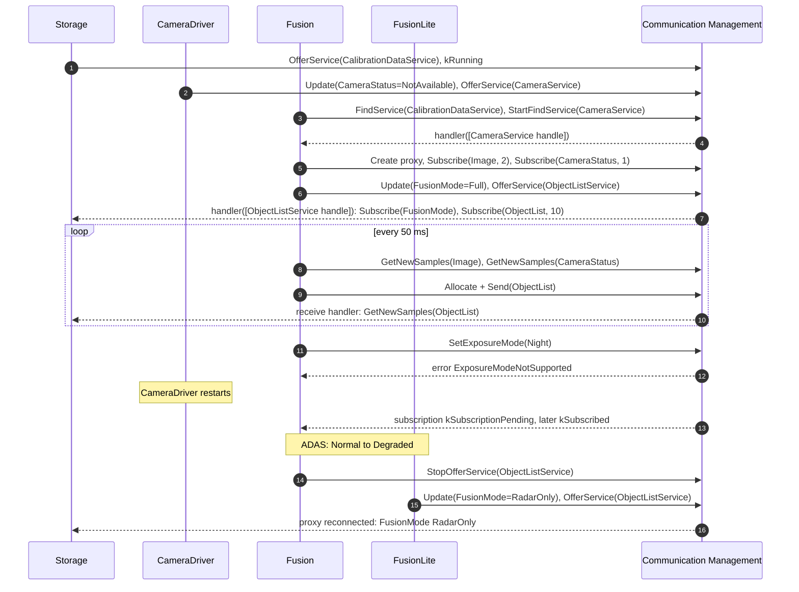

### 17.2 Step by Step

| # | Situation | What happens in `ara::com` | Section |
| --- | --- | --- | --- |
| 1 | `MachineFG.Startup`: the Communication Management daemon starts with the other platform daemons | Local discovery is available before State Management runs | [3.4](#34-lifecycle-of-communication-management) |
| 2 | `ADAS` enters `Normal`: `Storage` starts first | `Storage` offers `CalibrationDataService` over local IPC, then reports `kRunning`; this releases the Execution Dependency of `CalibrationCheck` | [13.5](#135-worked-example-calibrationdataservice-over-local-ipc) |
| 3 | `CalibrationCheck` runs | One-shot `FindService`, `GetCalibration` for both keys, then the process terminates | [6.3](#63-finding-a-service-once) |
| 4 | `CameraDriver` starts | Gives `CameraStatus` the value `NotAvailable`, offers `CameraService`; later sets `Ok` | [9.6](#96-worked-example-camerastatus-and-fusionmode) |
| 5 | `Fusion` starts | Finds `CalibrationDataService` once; searches `CameraService` continuously, creates its proxy and subscribes; offers `ObjectListService` with `FusionMode` `Full` | [6.9](#69-worked-example-fusion-finds-cameraservice), [15.12](#1512-complete-example-fusion) |
| 6 | `Storage` finds `ObjectListService` | Creates the proxy, registers receive handlers, subscribes to `FusionMode` and `ObjectList` | [15.13](#1513-complete-example-storage) |
| 7 | Driving | Every 50 ms, `Fusion` polls images and status and sends an object list with `Allocate` and `Send`; `Storage`'s handler queues the lists | [7.8](#78-worked-example-images-for-fusion-object-lists-for-storage) |
| 8 | Dusk | `Fusion` calls `SetExposureMode(Night)` and polls the future; the camera does not support it, so `Fusion` keeps `Auto` | [8.9](#89-worked-example-setexposuremode-from-fusion-to-cameradriver) |
| 9 | Workshop recalibrates the camera (guide 12a) | `CameraDriver` calls `SetCalibration`; `Storage` writes the key and sends `CalibrationUpdated`; `Fusion` sees the trigger and re-reads the calibration | [7.7](#77-triggers), [13.5](#135-worked-example-calibrationdataservice-over-local-ipc) |
| 10 | `CameraDriver` crashes and is restarted by Execution Management | `Fusion`'s subscription goes to `kSubscriptionPending`; method calls fail with `kServiceNotAvailable`; after the new offer, the proxy reconnects and re-subscribes by itself | [6.6](#66-when-the-service-goes-away) |
| 11 | A supervision of `Fusion` fails; `ADAS` goes to `Degraded` (guides 05, 06) | `Fusion` is stopped: its skeleton destructor stops the offer; `FusionLite` offers the same `ObjectListService` instance with `FusionMode` `RadarOnly`; `Storage`'s proxy reconnects and receives the new initial value | [9.6](#96-worked-example-camerastatus-and-fusionmode) |
| 12 | The vehicle is switched off | Applications stop their offers and release their samples; the daemon stays until State Management has finished `MachineFG.Shutdown` | [3.4](#34-lifecycle-of-communication-management) |

> **Pitfall:** Step 11 works only because `Fusion` and `FusionLite` never offer at the same time. If a faulty configuration ran both, the second offer would return success but not start ([SWS_CM_00102]), and `Storage` would keep receiving from the first.

> **Key takeaways**
>
> - Offer before reporting `kRunning`; Execution Dependencies and service discovery then work together.
> - Proxies survive provider restarts and even a change of the providing process.
> - Fields deliver their current value to every new or reconnected subscriber.
> - Triggers and methods combine well: a trigger says "something changed", a method fetches it.

---

## 18. Best Practices, Pitfalls and Troubleshooting

> **Why this matters:** Most `ara::com` problems in projects repeat. This chapter collects the rules that prevent them, the pitfalls that this guide pointed out, and a table that maps typical symptoms to their causes.

### 18.1 Best Practices

1. **Use `InstanceSpecifier`s everywhere.** Keep binding-specific identifiers out of the code; let the manifest decide ([Section 6.7](#67-instancespecifier-instanceidentifier-and-resolveinstanceids)).
2. **Prefer service discovery to start-up order.** Search with `StartFindService` and let proxies reconnect, instead of relying on Execution Dependencies for services ([EM guide, Section 6.6](04_ExecutionManagement.md#66-prefer-service-discovery-for-applications)).
3. **Prepare, then offer, then report `kRunning`.** Give every field a value and register every SetHandler before `OfferService()`; report `kRunning` after it ([Section 6.2](#62-offering-and-stopping-an-offer)).
4. **Use the exception-free API.** Create proxies with `Create`, and read results with `GetResult()` ([Section 6.5](#65-from-handle-to-proxy)).
5. **Size `maxSampleCount` deliberately:** the number of samples you keep, plus the ones you want to receive per read ([Section 7.4](#74-sampleptr-who-owns-a-sample)).
6. **Choose polling for cyclic real-time code** and receive handlers for reactive code; do not mix both styles on one event ([Section 7.5](#75-polling-or-event-driven-reception)).
7. **Never block without a limit.** Poll futures with `is_ready()` or wait with `wait_for()` ([Section 8.3](#83-no-timeout-supervision)).
8. **Keep handlers short** and move heavy work to your own threads ([Section 10.3](#103-handlers-and-their-rules)).
9. **Do not assume thread safety.** Protect proxy and skeleton objects that several threads use ([Section 10.1](#101-what-r25-11-says-about-thread-safety)).
10. **Give each service interface its own namespace** ([Section 5.2](#52-file-names-namespaces-and-names)).
11. **Use `kEventSingleThread`** when most methods share data, and always for E2E-protected methods ([Section 8.7](#87-method-call-processing-modes)).
12. **Release all samples** before `Unsubscribe()`, before destroying a proxy, and before destroying a skeleton that allocated samples ([Section 7.4](#74-sampleptr-who-owns-a-sample)).

### 18.2 Common Pitfalls

| Pitfall | Consequence | Avoid it by | Section |
| --- | --- | --- | --- |
| Treating `Subscribe()` success as "subscribed" | Code waits for data that cannot arrive yet, or misses state changes | Wait for `kSubscribed` from the state or the handler | [7.2](#72-subscribing-to-an-event) |
| Keeping the last `SamplePtr` with `maxSampleCount` 1 | `GetNewSamples` never delivers new samples | Subscribe with one more slot | [7.4](#74-sampleptr-who-owns-a-sample) |
| Holding `SamplePtr`s at `Unsubscribe()` or proxy destruction | `DanglingSamplesViolation`; the process ends | Release samples first | [7.4](#74-sampleptr-who-owns-a-sample) |
| Calling `OfferService()` before `Update()` of a notifier field | `kFieldValueNotInitialized` | `Update()` first, with the `initValue` | [9.2](#92-the-value-before-the-offer) |
| Forgetting the SetHandler of a settable field | `kFieldSetHandlerNotSet` | Register it before the offer | [9.4](#94-set-and-the-mandatory-sethandler) |
| Two processes offering the same instance | The second offer "succeeds" but is not visible | Make providers mutually exclusive | [6.2](#62-offering-and-stopping-an-offer) |
| Blocking `get()` on a method future | The thread hangs forever if the response is lost | `is_ready()` or `wait_for()` | [8.3](#83-no-timeout-supervision) |
| Retrying after `kCommunicationFailure` of a non-idempotent method | The action may run twice | Check the provider's state first | [11.2](#112-comerrordomain-and-comerrc) |
| Registering a GetHandler on a field with notifier | Getters and subscribers see different values | Do not register one; use `Update()` | [9.3](#93-get-and-the-optional-gethandler) |
| Registering the field receive handler after `Subscribe()` | The initial value is missed | Register first | [9.5](#95-subscribing-to-field-notifications) |
| Calling fire-and-forget methods in a tight loop with a Minimum Send Interval | Calls are dropped without feedback | Respect the interval, or use a normal method | [11.4](#114-the-minimum-send-interval) |
| `kEvent` mode with E2E-protected methods | `WrongMethodCallProcessingModeViolation` | `kEventSingleThread` or `kPoll` | [8.7](#87-method-call-processing-modes) |
| `StopOfferService()` inside a callback of the same skeleton | Deadlock | Stop from a control thread | [10.3](#103-handlers-and-their-rules) |
| Expecting `ClientComSpec.endToEndCallResponseTimeout` to time out calls | Calls still wait forever | Supervise in the application | [8.3](#83-no-timeout-supervision) |
| Using an EXP code listing literally | Compile errors against an R25-11 header | Follow the SWS signatures | [1.5](#15-the-two-documents-behind-this-guide) |

### 18.3 Troubleshooting Guide

| Symptom | Likely causes | What to check |
| --- | --- | --- |
| The process ends at start-up with `InstanceSpecifierMappingIntegrityViolation` | Port renamed, wrong path in the code, executable not mapped | DLT message `0x80001ffc`; compare the path with the model ([Section 16.3](#163-what-an-integrator-sees-when-an-instancespecifier-is-wrong)) |
| `ProcessMappingViolation` | The `ServiceInstanceToPortPrototypeMapping` names another process | `ServiceInstanceToPortPrototypeMapping.process` ([Section 14.9](#149-service-instances-and-their-mappings)) |
| The find handler only ever gets empty lists | Provider not running, different binding or version, missing machine mapping, IAM refusal | Provider's offer; both deployments; `ServiceInstanceToMachineMapping`; IdsM event 135 |
| `OfferService()` returns an error | Field without value or SetHandler; binding failure | `kFieldValueNotInitialized`, `kFieldSetHandlerNotSet`, `kCommunicationFailure` ([Section 6.2](#62-offering-and-stopping-an-offer)) |
| Offer succeeds but nobody finds the service | Duplicate instance already offered | Other providers of the same instance on the machine ([SWS_CM_00102]) |
| Subscription stays `kSubscriptionPending` | Provider not reachable, or not offering | Provider state; network; for SOME/IP, event group configuration ([guide 08a](08a_NetworkBindings.md)) |
| `GetNewSamples` returns 0 although data is sent | All slots held by the application; not subscribed | `GetFreeSampleCount()`; `GetSubscriptionState()` |
| `kMaxSamplesExceeded` | The application holds more samples than committed | Where `SamplePtr`s are stored |
| Samples are missing | Reader too slow (buffer behavior unspecified), Minimum Send Interval at the provider, E2E drops | Reading rate; `kMinimumSendIntervalViolationError` at the provider; `ProfileCheckStatus` |
| A method future never becomes ready | Lost request or response, provider hangs, `kPoll` provider not polling | Use `wait_for`; provider's processing mode and `ProcessNextMethodCall` calls |
| `kUnknownApplicationError` | Provider and consumer built from different versions of the interface | `possibleApError` of both sides; contract version |
| Handler runs "at the wrong time" | Handler serialization, or handler called before the registering call returned | [Section 10.3](#103-handlers-and-their-rules); use an executor |
| Process ends at proxy destruction | `SamplePtr`s still held | Release samples before destroying the proxy |

> **Key takeaways**
>
> - Most failures are configuration chains (port, mapping, instance, deployment, connector) or sample ownership.
> - Violations end the process with a fixed message ID: search the DLT log first.
> - A missing service is usually a missing offer, a mismatch of deployment or version, or an access refusal.

---

## 19. Summary and Self-Check Quiz

### 19.1 Summary

- Communication Management realizes service-oriented communication inside a process, between processes and between machines. Applications use it through `ara::com`, and much of it runs inside the application process ([Chapters 1](#1-introduction-to-communication-management) and [3](#3-communication-management-in-the-system-architecture)).
- A generator turns each service interface into a proxy for consumers and a skeleton for providers. The namespace and the short names of the model define the C++ names ([Chapter 5](#5-from-service-interface-to-generated-code)).
- Providers construct a skeleton from an `InstanceSpecifier` and offer it; consumers find it, get handles and create proxies, which reconnect by themselves when the provider restarts ([Chapter 6](#6-service-discovery-offering-and-finding-services)).
- Events are received into a local cache of `maxSampleCount` slots and accessed through `SamplePtr`s, either by polling or from a receive handler; triggers are dataless events ([Chapter 7](#7-events-and-triggers)).
- Methods return a `Future`; `ara::com` never times them out. Providers choose between concurrent, sequential and polled execution ([Chapter 8](#8-methods)).
- Fields need a value before the offer and a SetHandler if they are settable; subscribers receive the current value at once ([Chapter 9](#9-fields)).
- Thread safety is not defined in R25-11; handler calls are serialized, and executors choose their context ([Chapter 10](#10-threading-execution-context-and-handlers)).
- Errors come from `ComErrorDomain`, `ComE2EErrorDomain` and generated application domains; configuration problems are violations. R25-11 adds the Minimum Send Interval ([Chapter 11](#11-errors-rate-limits-and-transport-faults)).
- E2E results are read per sample (`ProfileCheckStatus`) and per element (`SMState`) ([Chapter 12](#12-end-to-end-protection-the-api-side)).
- Local IPC is a user-defined, vendor-specific binding; one instance can be reachable over several bindings ([Chapter 13](#13-local-communication-and-multi-binding)).

### 19.2 Self-Check Quiz

<details>
<summary>1. What is the difference between a service interface, a service instance, a skeleton and a proxy?</summary>

The service interface is the contract (events, methods, fields, triggers). A service instance is one concrete provider of it. The skeleton is the generated base class that the provider derives from to implement and offer an instance; the proxy is the generated class with which a consumer uses a found instance. See [Section 2.1](#21-service-interface-service-instance-provider-and-consumer) and [Section 2.2](#22-skeleton-and-proxy).

</details>

<details>
<summary>2. Your service interface has the namespace `hpc`, `storage` and the short name `CalibrationDataService`. Which header and which class does a consumer use?</summary>

`#include "hpc/storage/calibrationdataservice_proxy.h"` and the class `hpc::storage::proxy::CalibrationDataServiceProxy`. See [Section 5.2](#52-file-names-namespaces-and-names).

</details>

<details>
<summary>3. A method has the arguments `in CalibrationKey key` (an enumeration) and `in CalibrationRecord record` (a structure). How are they passed to the proxy's `operator()`?</summary>

`key` by value, because an enumeration resolves to `uint8_t`; `record` as `const CalibrationRecord&`. See [Section 5.4](#54-how-arguments-are-passed).

</details>

<details>
<summary>4. A developer calls `OfferService()` and gets `kFieldValueNotInitialized`. What is wrong, and why does the `initValue` in the model not help?</summary>

A field with a notifier, or with a getter but no GetHandler, has never been given a value with `Update()`. The `initValue` of the `FieldSenderComSpec` is not applied automatically; the application must call `Update()` with it before the offer. See [Section 9.2](#92-the-value-before-the-offer).

</details>

<details>
<summary>5. `FusionLite` is wrongly started while `Fusion` still offers `ObjectListService`. `FusionLite`'s `OfferService()` returns success. What happens?</summary>

The offer does not start, because the same instance is already offered on the machine; the function still returns positively ([SWS_CM_00102]). Consumers keep using `Fusion`. See [Section 6.2](#62-offering-and-stopping-an-offer).

</details>

<details>
<summary>6. When should you use `FindService` and when `StartFindService`?</summary>

`FindService` returns the instances available at the moment of the call, for a one-time check (like `CalibrationCheck`). `StartFindService` keeps searching and calls a handler with the initial matches and on every change; use it for providers that may come and go (like `Fusion` for `CameraService`). See [Section 6.3](#63-finding-a-service-once) and [Section 6.4](#64-finding-continuously).

</details>

<details>
<summary>7. `CameraDriver` crashes and is restarted. Does `Fusion` have to create a new proxy and subscribe again?</summary>

No. The subscription state becomes `kSubscriptionPending`, method calls fail with `kServiceNotAvailable`, and when the new offer arrives, Communication Management updates the proxy and re-establishes the subscription ([SWS_CM_10491], [SWS_CM_00315]). See [Section 6.6](#66-when-the-service-goes-away).

</details>

<details>
<summary>8. `Fusion` subscribes to `Image` with `maxSampleCount` 1 and stores the newest `SamplePtr` in a member. After the first image, it never receives another one. Why?</summary>

The stored `SamplePtr` occupies the only slot of the local cache, so `GetNewSamples` stops at once. Subscribe with one more slot than you keep. See [Section 7.3](#73-receiving-samples) and [Section 7.4](#74-sampleptr-who-owns-a-sample).

</details>

<details>
<summary>9. What does a receive handler change compared with polling, in terms of context switches?</summary>

Without a handler, reception causes no implicit context switch in the receiving process; with one, a context switch is enforced to call the handler ([SWS_CM_00710]). Handler calls are serialized. See [Section 7.5](#75-polling-or-event-driven-reception).

</details>

<details>
<summary>10. A method response is lost on the network. What happens to a caller that called `get()` on the future?</summary>

It blocks forever: `ara::com` has no timeout supervision for method calls. Use `is_ready()`, `wait_for()` or `wait_until()`, or supervise with PHM. See [Section 8.3](#83-no-timeout-supervision).

</details>

<details>
<summary>11. What is the difference between `kEvent`, `kEventSingleThread` and `kPoll`, and which one is not allowed with E2E-protected methods?</summary>

`kEvent` executes incoming calls concurrently, `kEventSingleThread` one after the other, and `kPoll` only when the provider calls `ProcessNextMethodCall()`. `kEvent` is not allowed with E2E-protected methods; it raises `WrongMethodCallProcessingModeViolation`. See [Section 8.7](#87-method-call-processing-modes).

</details>

<details>
<summary>12. `SetCalibration` fails with `kCommunicationFailure`. Can `CameraDriver` simply call it again?</summary>

Not blindly. For method calls, this error has no rollback semantics: the provider may already have executed the call. Here, a repeated write of the same value is harmless, but a second call within 1 s would also fail with `kMinimumSendIntervalViolationError`. See [Section 11.2](#112-comerrordomain-and-comerrc) and [Section 11.4](#114-the-minimum-send-interval).

</details>

<details>
<summary>13. Why is registering a GetHandler for `CameraStatus` a bad idea?</summary>

Communication Management answers `Get()` from the last `Update()` value anyway. A GetHandler costs a call into the application and a new serialization for every `Get()`, and its result is not synchronized with the notifications that subscribers receive. See [Section 9.3](#93-get-and-the-optional-gethandler).

</details>

<details>
<summary>14. Which thread safety does R25-11 guarantee for proxy and skeleton objects?</summary>

None: thread safety of the `ara::com` API is not defined in R25-11 (SWS CM, Section 4.1.7). Only the serialization of certain handler calls is specified. See [Section 10.1](#101-what-r25-11-says-about-thread-safety).

</details>

<details>
<summary>15. What is the Minimum Send Interval, where is it configured, and what is its default?</summary>

The minimum time between two transmissions of one event, trigger, field update, method call, `Get` or `Set`. It is configured in `ServiceInterfaceDeploymentElement.minimumSendInterval` (0 to 10 s). The default is 0, which disables the check. See [Section 11.4](#114-the-minimum-send-interval).

</details>

<details>
<summary>16. `Storage` receives an `ObjectList` sample whose `GetProfileCheckStatus()` is `kOk`, but `GetE2EStateMachineState()` returns `kInit`. May it use the sample?</summary>

No. A sample can be used when the state is `kValid` and the check status is not an error ([SWS_CM_90422]). In `kInit`, not enough correct data has been received since initialization. See [Section 12.2](#122-events-check-status-per-sample-state-per-event).

</details>

<details>
<summary>17. How is a local IPC binding configured in the model, and where do the vendor's settings go?</summary>

With a `UserDefinedServiceInterfaceDeployment` of category `SERVICE_INTERFACE_DEPLOYMENT_IPC`, user-defined service instances, and a `UserDefinedServiceInstanceToMachineMapping` to a `UserDefinedCommunicationConnector` ([constr_1570]). Vendor settings go into special data (`sdg`). See [Section 13.1](#131-local-communication-is-implementation-specific) and [Section 14.8](#148-user-defined-deployment-for-local-ipc).

</details>

<details>
<summary>18. The integrator changes `CameraService` from SOME/IP to a local binding for `Fusion`. Must `fusion` be recompiled?</summary>

No. A change of the deployment type or of its attributes needs at most a re-link ([SWS_CM_10384], [SWS_CM_10385]). Only a new major version of the SOME/IP deployment would require a recompile. See [Section 4.3](#43-what-you-can-change-without-recompiling).

</details>

---

## Appendix A. Glossary and Acronyms

### A.1 Acronyms

| Acronym | Meaning |
| --- | --- |
| ARA | AUTOSAR Runtime for Adaptive Applications |
| CM | Communication Management |
| CRC | Cyclic Redundancy Check |
| DDS | Data Distribution Service |
| DLT | Diagnostic Log and Trace |
| E2E | End-to-end communication protection |
| EM | Execution Management |
| EXP | Explanatory document of AUTOSAR |
| F&F | Fire-and-forget (method) |
| IAM | Identity and Access Management |
| IdsM | Intrusion Detection System Manager |
| IPC | Inter-Process Communication |
| LBAP | Language Binding for modeled AP data types (SWS LBAP) |
| MSI | Minimum Send Interval |
| PHM | Platform Health Management |
| QoS | Quality of Service |
| SD | Service Discovery |
| SEV | Security Event |
| SI | Service Interface |
| SM | State Management |
| SOA | Service-Oriented Architecture |
| SoC | Service-Oriented Communication |
| SOME/IP | Scalable service-Oriented MiddlewarE over IP |
| SWS | Software Specification of AUTOSAR |
| TPS | Template Specification of AUTOSAR (here: the Manifest Specification) |

### A.2 Glossary

| Term | Definition |
| --- | --- |
| Active subscriber | An application that has called `Subscribe` on an event, field or trigger and has not called `Unsubscribe`. |
| Callable | A C++ type for which the `INVOKE` operation applies, such as a function, a lambda or a `std::function`. |
| ComSpec | A qualification of the use of one element of an interface at one port, for example the initial value of a field. |
| Event (service element) | A message that a service provider sends to all subscribed consumers. |
| Executor | An `ara::core` object that runs callables asynchronously in a thread-safe context. |
| Field | A service element that holds a value. Consumers can get it, set it and be notified when it changes. |
| Find service handle | The `ara::com::FindServiceHandle` that identifies a running `StartFindService` search, used to stop it. |
| Fire-and-forget method | A method without out arguments and without errors; the caller gets no answer. |
| Getter | The accessor of a field with which a consumer reads its current value (`Get`). |
| Handle | A `{<SI>}Proxy::HandleType` returned by service discovery; it identifies one found service instance and is used to create a proxy. |
| InstanceIdentifier | The binding-specific identifier of one service instance, `ara::com::InstanceIdentifier`. |
| InstanceSpecifier | A path in the model that identifies a configured element, such as a port, from code. Example: `/fusion/Root/CameraRPort`. |
| Language Binding | How a service is presented to the programmer, for example as generated C++ proxy and skeleton classes. |
| Local cache | The memory that `Subscribe(maxSampleCount)` reserves in the consumer for the samples of one event or field. |
| Method | A service element that a consumer calls and the provider executes, possibly returning a result. |
| Method Call Processing Mode | How a skeleton executes incoming method calls: `kEvent` (concurrent), `kEventSingleThread` (sequential) or `kPoll` (on request of the provider). |
| Minimum Send Interval | The configurable minimum time between two transmissions of one event, trigger, field update, method call, `Get` or `Set`. |
| Multi-binding | One proxy or skeleton class communicating over several transports or protocols, for example one instance offered over local IPC and SOME/IP. |
| Network Binding | How a service is represented on a specific transport, for example SOME/IP or DDS: serialization and protocol. |
| Notifier | The part of a field that notifies subscribers of value changes, like an event. |
| Orphaned response | A response or error message for a method call that the caller has already canceled. |
| Profile check status | The result of the E2E check of one received sample, `ara::com::e2e::ProfileCheckStatus`. |
| Proxy (Service Proxy) | The generated class with which a consumer uses a service, as if it were a local object. |
| Receive handler | A callback that Communication Management calls when new event data, field notifications or triggers have arrived. |
| Sample | One received value of an event or field notification, held in the local cache. |
| SampleAllocateePtr | The smart pointer to memory that a provider gets from `Allocate()` and hands over with `Send`. |
| SamplePtr | The smart pointer, similar to `std::unique_ptr`, through which a consumer accesses one read-only sample. |
| Service Discovery | The Communication Management mechanism with which applications find each other's services. It is the preferred way to sequence applications. |
| Service Instance | One concrete provision of a service interface, with its own identity. |
| Service Interface | The definition of a service: its events, methods and fields. |
| Service contract version | The `majorVersion` and `minorVersion` of a service interface; an incompatible change increases the major version. |
| Setter | The accessor of a field with which a consumer asks the provider to change its value (`Set`). |
| Skeleton (Service Skeleton) | The generated base class from which a provider implements a service and connects it to Communication Management. |
| State machine state (E2E) | The state of the E2E supervision of an event or method, `ara::com::e2e::SMState`, derived from the history of check results. |
| Subscription state | The state of a subscription: `kSubscribed`, `kNotSubscribed` or `kSubscriptionPending`. |
| Transport fault condition | A transport-related fault reported to a handler: sample rejected, deadline missed or sample lost. |
| Trigger | A service element like an event, but without data. |

## Appendix B. Quick Reference Cheat Sheet

### B.1 Provider and Consumer in Five Steps

| Step | Provider (skeleton) | Consumer (proxy) |
| --- | --- | --- |
| 1 | `MySkeletonImpl s{spec, mode};` | `auto r = Proxy::StartFindService(handler, spec);` |
| 2 | `s.Field.Update(initial);` for each field; `RegisterSetHandler` for settable fields | In the handler: `auto p = Proxy::Create(handles.front());` |
| 3 | `s.OfferService();` then report `kRunning` | `p.Event.SetReceiveHandler(...)` (optional), `p.Event.Subscribe(n);` |
| 4 | `s.Event.Send(data)` or `Allocate()` + `Send(std::move(ptr))`; implement methods | `p.Event.GetNewSamples(f);` `auto fut = p.Method(args);` |
| 5 | `s.StopOfferService();` before destruction | Release all `SamplePtr`s; `Proxy::StopFindService(r.Value());` |

### B.2 Enumerations

| Type | Values |
| --- | --- |
| `SubscriptionState` | `kSubscribed`, `kNotSubscribed`, `kSubscriptionPending` (never on the skeleton side) |
| `MethodCallProcessingMode` | `kPoll`, `kEvent` (default), `kEventSingleThread` |
| `ServiceState` | `kNotAvailable` (0), `kAvailable` (1) |
| `e2e::ProfileCheckStatus` | `kOk`, `kRepeated`, `kWrongSequence`, `kError`, `kCheckDisabled` |
| `e2e::SMState` | `kValid`, `kNoData`, `kInit`, `kInvalid`, `kStateMDisabled`, `kIncompatibleQoS` |
| `e2e::TransportFaultCondition` | `kSampleRejected`, `kDeadlineMissed`, `kSampleLost` |

### B.3 Error Codes

| Domain | Codes (value) |
| --- | --- |
| `ComErrorDomain` (`0x8000'0000'0000'1267`) | `kServiceNotAvailable` (1), `kMaxSamplesExceeded` (2), `kCommunicationFailure` (3), `kFieldValueNotInitialized` (6), `kFieldSetHandlerNotSet` (7), `kServiceNotOffered` (11), `kInstanceIDNotResolvable` (15), `kMaxSampleCountNotRealizable` (16), `kUnknownApplicationError` (22), `kMinimumSendIntervalViolationError` (23) |
| `ComE2EErrorDomain` (`0x8000'0000'0000'1268`) | `kRepeated` (1), `kWrongSequence` (2), `kError` (3), `kNoNewData` (5), `kUnspecifiedE2EError` (13) |

### B.4 Defaults and Limits

| Item | Value | Source |
| --- | --- | --- |
| Skeleton processing mode | `kEvent` | Constructor default ([SWS_CM_00130]) |
| `maxNumberOfSamples` of `GetNewSamples` | `std::numeric_limits<std::size_t>::max()` | [SWS_CM_00701] |
| `minimumSendInterval` | 0 (off); range 0 to 10 s | [SWS_CM_00139], [constr_10655] |
| `fireAndForget` | absent: not fire-and-forget | [TPS_MANI_03119] |
| Method timeout | none | SWS CM, Section 7.5.19 |
| Thread safety | not defined | SWS CM, Section 4.1.7 |

## Appendix C. Spec Traceability

Use this table to find the normative text for each topic of this guide. "SWS" is the Communication Management specification, "EXP" the *Explanation of ara::com API* and "TPS" the *Manifest Specification*, all R25-11.

| Topic | Guide | Specification section | Key requirement IDs |
| --- | --- | --- | --- |
| Overview and design | [1](#1-introduction-to-communication-management) | SWS 1, 7.1; EXP 3 | (section references) |
| Terminology | [2](#2-core-concepts-and-terminology) | SWS 2, 7.1.3, 7.5.22; EXP 4 | [SWS_CM_12002], [SWS_CM_12003], [SWS_CM_00302], [SWS_CM_10452] |
| Architecture and lifecycle | [3](#3-communication-management-in-the-system-architecture) | SWS 5, 7.6; EXP 7.2 | (sections 5.1 to 5.3, 7.6.1, 7.6.2) |
| Configuration overview | [4](#4-configuration-overview) | SWS 7.2, 10; TPS 13 | [SWS_CM_10384], [SWS_CM_10385], [SWS_CM_10386], [SWS_CM_CONSTR_00008] |
| Generated code | [5](#5-from-service-interface-to-generated-code) | SWS 7.5.23, 8.1 to 8.4; SWS LBAP 8 | [SWS_CM_01012], [SWS_CM_11500], [SWS_CM_01010], [SWS_CM_00191], [SWS_CM_10453], [SWS_LBAP_00027], [SWS_LBAP_00028] |
| Offer and skeleton lifecycle | [6.1](#61-creating-a-skeleton), [6.2](#62-offering-and-stopping-an-offer) | SWS 7.5.1 to 7.5.3 | [SWS_CM_00102], [SWS_CM_00103], [SWS_CM_00811], [SWS_CM_00813] to [SWS_CM_00815], [SWS_CM_10410], [SWS_CM_10450], [SWS_CM_10451], [SWS_CM_10467], [SWS_CM_00083], [SWS_CM_00084], [SWS_CM_00086] |
| Finding and proxies | [6.3](#63-finding-a-service-once) to [6.7](#67-instancespecifier-instanceidentifier-and-resolveinstanceids) | SWS 7.5.10 to 7.5.12, 7.5.21; EXP 4.8, 5.3.3, 5.3.4 | [SWS_CM_00124], [SWS_CM_10382], [SWS_CM_10491], [SWS_CM_10446], [SWS_CM_00087], [SWS_CM_00118], [SWS_CM_00088] |
| Versioning | [6.8](#68-service-contract-versioning) | SWS 7.1.4, 7.5.22.1 | [SWS_CM_99003], [SWS_CM_99029], [SWS_CM_02203] |
| Events | [7.1](#71-sending-an-event) to [7.6](#76-buffering-and-zero-copy) | SWS 7.5.4, 7.5.5, 7.5.13, 7.5.14; EXP 5.3.5, 5.4.7 | [SWS_CM_99031] to [SWS_CM_99033], [SWS_CM_00700], [SWS_CM_12006], [SWS_CM_00313] to [SWS_CM_00315], [SWS_CM_00812], [SWS_CM_00703], [SWS_CM_00707], [SWS_CM_00709] to [SWS_CM_00711], [SWS_CM_00182], [SWS_CM_12007], [SWS_CM_12012] to [SWS_CM_12015] |
| Triggers | [7.7](#77-triggers) | SWS 7.5.15 to 7.5.18; EXP 5.3.8, 5.4.9 | [SWS_CM_01101] to [SWS_CM_01104], [SWS_CM_00802], [SWS_CM_00227], [SWS_CM_CONSTR_00007] |
| Methods | [8](#8-methods) | SWS 7.5.6, 7.5.19; EXP 5.3.6, 5.4.5, 5.4.6 | [SWS_CM_10414], [SWS_CM_10371], [SWS_CM_90436], [SWS_CM_00194], [SWS_CM_00195], [SWS_CM_00192], [SWS_CM_10440], [SWS_CM_00048], [SWS_CM_00049], [SWS_CM_00193], [SWS_CM_00197], [SWS_CM_10411], [SWS_CM_00199] |
| Fields | [9](#9-fields) | SWS 7.5.8, 7.5.9, 7.5.20; EXP 5.3.7, 5.4.8; TPS 3.2.5.1.2 | [SWS_CM_10412], [SWS_CM_10413], [SWS_CM_10415], [SWS_CM_00128], [SWS_CM_00129], [SWS_CM_00120], [TPS_MANI_03212] |
| Threading | [10](#10-threading-execution-context-and-handlers) | SWS 4.1.7, 7.5.7; SWS Core 7.4.1.2 | [SWS_CM_10417], [SWS_CM_11360], [SWS_CM_00089], [SWS_CM_00034] |
| Errors and violations | [11.1](#111-three-kinds-of-errors) to [11.3](#113-violations-in-aracom) | SWS 7.5.22.6, 7.7.3, 8.12 | [SWS_CM_11265], [SWS_CM_10432], [SWS_CM_12100], [SWS_CM_12101], [SWS_CORE_13000], [SWS_CORE_13003] to [SWS_CORE_13006] |
| Minimum Send Interval | [11.4](#114-the-minimum-send-interval) | SWS 7.5.5, 7.5.8, 7.5.9, 7.5.16, 7.5.19, 7.5.20 | [SWS_CM_00138] to [SWS_CM_00140], [SWS_CM_00142] to [SWS_CM_00144], [SWS_CM_00822] to [SWS_CM_00827], [constr_10655] |
| Transport faults | [11.5](#115-transport-fault-conditions) | SWS 7.4, 7.4.2, 8.16 | [SWS_CM_00089], [SWS_CM_00090], [SWS_CM_00091], [SWS_CM_00092], [SWS_CM_00211] |
| E2E, API side | [12](#12-end-to-end-protection-the-api-side) | SWS 7.4.1, 7.5.22.7, 8.13 to 8.15 | [SWS_CM_90402], [SWS_CM_90406], [SWS_CM_00042], [SWS_CM_10475], [SWS_CM_90415] to [SWS_CM_90417], [SWS_CM_90477], [SWS_CM_00127], [SWS_CM_10471], [SWS_CM_00047], [SWS_CM_12021], [SWS_CM_12022] |
| Local communication | [13](#13-local-communication-and-multi-binding) | SWS 7.2; TPS 13.2.3, 13.3; EXP 7.1, 7.3 | [SWS_CM_10590], [TPS_MANI_03045], [TPS_MANI_01165], [constr_1570], [TPS_MANI_03032] |
| Configuration reference | [14](#14-configuration-reference-what-to-configure) | TPS 3.2.4, 3.2.5, 4.2, 13.2, 13.3; SWS 10 | [constr_1673], [constr_10152], [constr_10029], [constr_10655], [TPS_MANI_01053], [TPS_MANI_01327], [TPS_MANI_01057], [TPS_MANI_03119] |
| API | [15](#15-api-reference-and-usage-guide-aracom) | SWS 8 | [SWS_CM_00004], [SWS_CM_00002], [SWS_CM_00005] to [SWS_CM_00008], [SWS_CM_00726], [SWS_CM_00727], [SWS_CM_00301] to [SWS_CM_00311], [SWS_CM_10432], [SWS_CM_90421], [SWS_CM_90422] |
| Reporting | [16](#16-logging-security-events-and-violations) | SWS 7.7 | [SWS_CM_00601] to [SWS_CM_00603], [SWS_CM_12100], [SWS_CM_12101] |

## Appendix D. Notable Changes in Recent Releases

This summary is based on the change history of SWS CM and EXP ARAComAPI. It lists the changes that matter most when you port code or material from an older release.

| Release | Change | Specification items |
| --- | --- | --- |
| R20-11 | Standardized error codes and unique error domain identifiers; the named constructor approach; an optional execution context (executor) parameter for asynchronous callbacks; `kCapabilityEnforcementError` renamed `kGrantEnforcementError`. | (change history) |
| R21-11 | New service interface element *trigger*; E2E protection for fields. | (change history) |
| R22-11 | Static service connections (SOME/IP); the service state API (`GetServiceState`, `SetServiceStateChangeHandler`); `SampleType` and `FieldType`; shutdown behavior clarified. EXP fully reworked. | (change history) |
| R23-11 | **Communication Groups declared obsolete**; Raw Data Stream removed from `ara::com` (guide 09 covers the Raw Data Stream); subscription state on the skeleton side; harmonized error codes; access management grants reworked; lifetime requirements for sample data. | (change history) |
| R24-11 | Transport fault conditions; API descriptions reworked from header files, with generated API tables; harmonized errors and violations. All explicit re-entrancy and thread-safety requirements were deleted; thread safety is now undefined. | Added: [SWS_CM_00085] to [SWS_CM_00087] (sample lifetime preconditions), [SWS_CM_00089] to [SWS_CM_00092]. Deleted: [SWS_CM_00009] to [SWS_CM_00032], [SWS_CM_00035], [SWS_CM_00714] |
| R25-11 | **Minimum Send Interval** for events, triggers, fields and methods; `kNetworkBindingFailure` renamed `kCommunicationFailure`; security event for denied IAM access; no automatic conversion of names to upper camel case; E2E for fire-and-forget methods; behavior of `StopOfferService` and `Unsubscribe` specified; subscription state of triggers on the skeleton side; violation messages for wrong processing mode and erroneous handle. EXP: obsolete Communication Groups content removed. | Added: [SWS_CM_00127], [SWS_CM_00138], [SWS_CM_00601], [SWS_CM_00811] to [SWS_CM_00815], [SWS_CM_00822] to [SWS_CM_00827], [SWS_CM_01101] to [SWS_CM_01112], [SWS_CM_12100], [SWS_CM_12101] |

> **Pitfall:** Material written for releases before R25-11 may use `kNetworkBindingFailure`, `Create` named constructors on skeletons, `Result` return types of handler registrations, or Communication Groups. None of these exist in R25-11.

## Appendix E. References

**AUTOSAR specifications (R25-11):**

- *Specification of Communication Management* (`AUTOSAR_AP_SWS_CommunicationManagement`)
- *Explanation of ara::com API* (`AUTOSAR_AP_EXP_ARAComAPI`)
- *Specification of Manifest* (`AUTOSAR_AP_TPS_ManifestSpecification`), for the configuration in [Chapter 14](#14-configuration-reference-what-to-configure)
- *Specification of Adaptive Platform Core* (`AUTOSAR_AP_SWS_Core`), for `Future`, `Promise`, `ErrorCode`, `InstanceSpecifier`, `Executor`, error domain identifiers and violation messages
- *Specification of Language Binding for modeled AP data types* (`AUTOSAR_AP_SWS_LanguageBindingForModeledAPdatatypes`), for the generated data types and error domains
- *Requirements on AUTOSAR Adaptive Platform (General)* (`AUTOSAR_AP_RS_General`), for recoverability classes
- *XML Schema* `AUTOSAR_00054.xsd` (`AUTOSAR_FO_MMOD_XMLSchema`, Foundation), against which the ARXML of [Section 14.11](#1411-the-running-example-complete-configuration) validates
- *Standardized M1 Models used for the Definition of AUTOSAR* (`AUTOSAR_FO_MOD_GeneralDefinitions`, Foundation), for `/AUTOSAR/StdTypes`

**Other sources:**

- [EXT-027] *Reference Model for Service Oriented Architecture 1.0*, OASIS Standard, 12 October 2006. <https://docs.oasis-open.org/soa-rm/v1.0/soa-rm.html> (accessed 2026-10-28)
- [EXT-028] *Eclipse iceoryx*, Eclipse Foundation. <https://iceoryx.io/> (accessed 2026-10-28)
- [EXT-029] *unix(7): sockets for local interprocess communication*, Linux man-pages project. <https://man7.org/linux/man-pages/man7/unix.7.html> (accessed 2026-10-28)
- [EXT-030] *shm_overview(7): overview of POSIX shared memory*, Linux man-pages project. <https://man7.org/linux/man-pages/man7/shm_overview.7.html> (accessed 2026-10-28)
- [EXT-031] *std::unique_ptr* and *std::function*, cppreference.com. <https://en.cppreference.com/w/cpp/memory/unique_ptr>, <https://en.cppreference.com/w/cpp/utility/functional/function> (accessed 2026-10-28)

---

*End of the training guide. For normative details, always refer to `AUTOSAR_AP_SWS_CommunicationManagement` and `AUTOSAR_AP_EXP_ARAComAPI` (R25-11) and to the specifications they reference: the Manifest Specification, Core and the language binding.*
