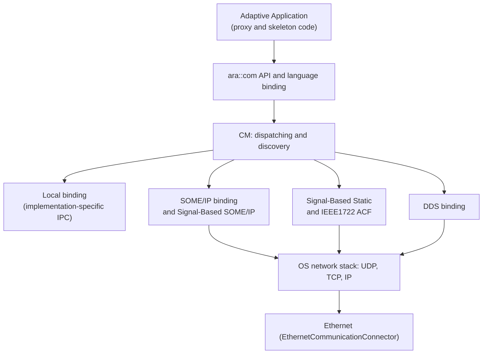
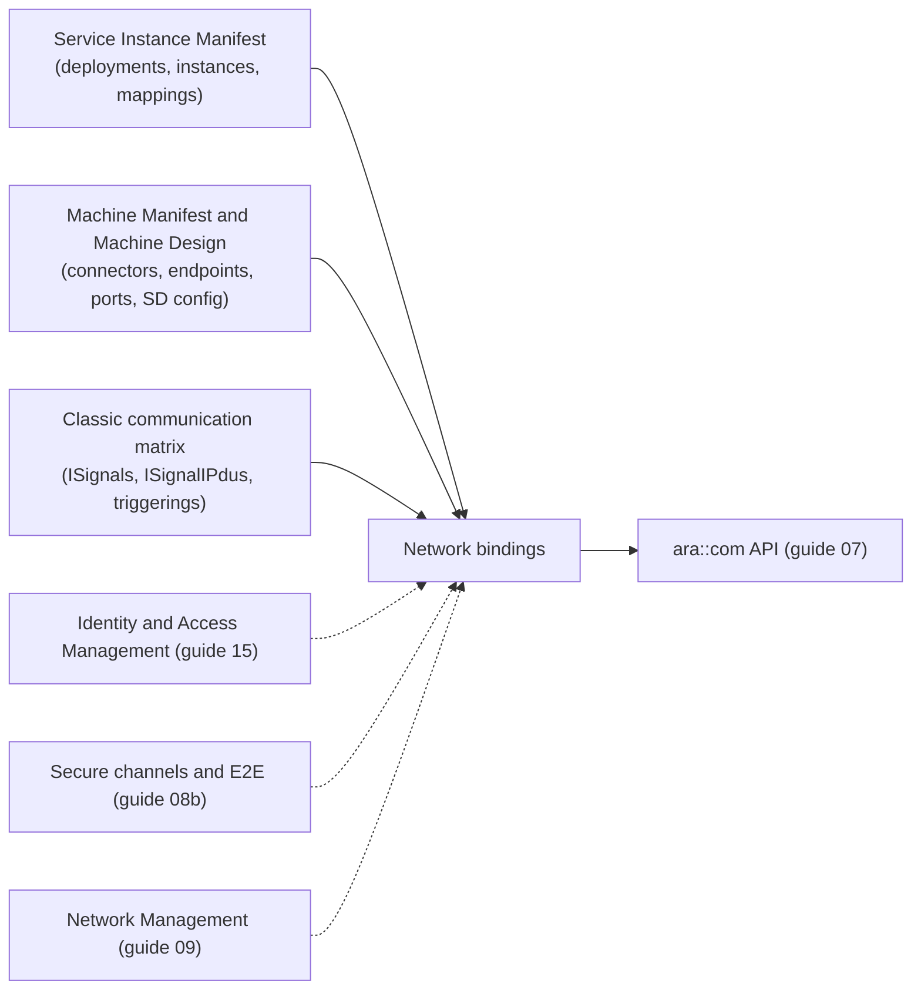
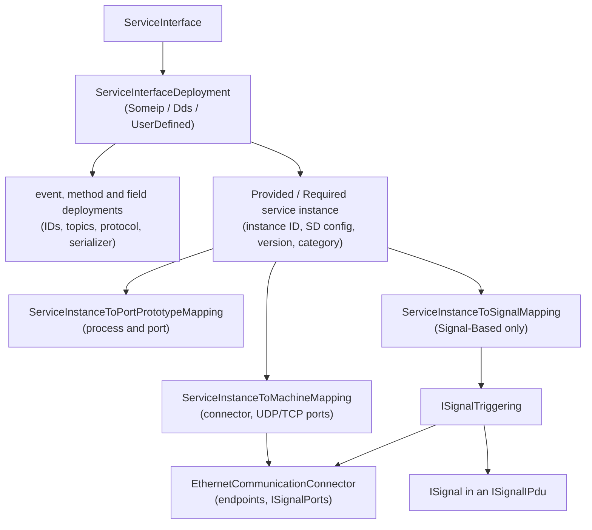
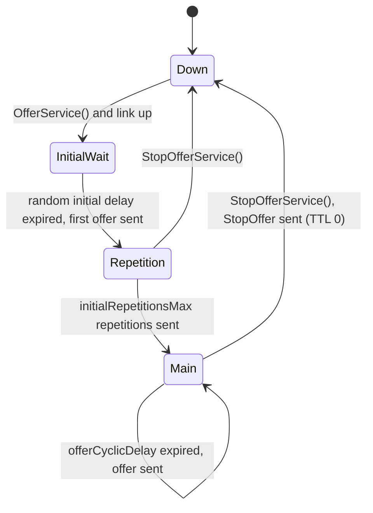
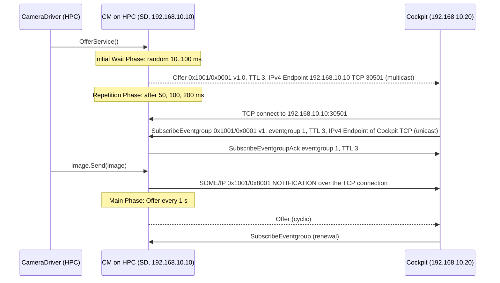
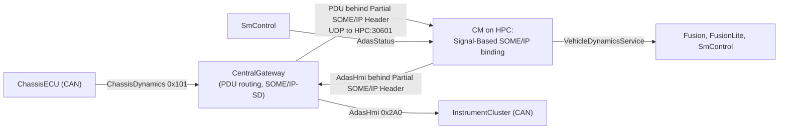
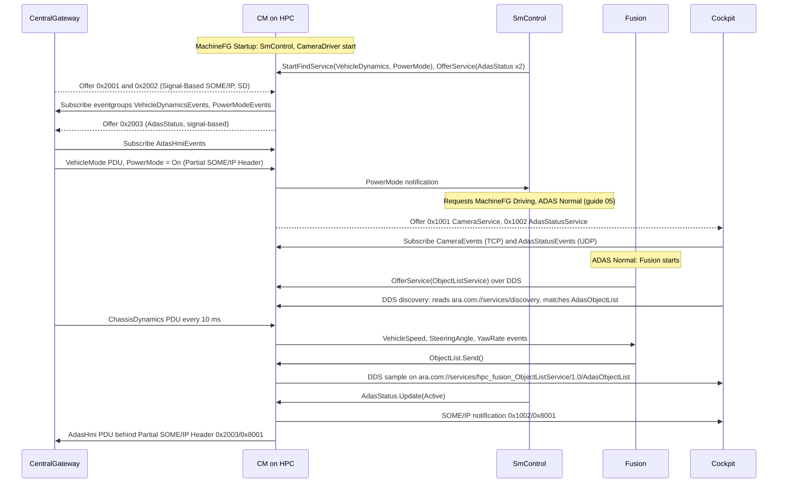

# AUTOSAR Adaptive Platform: Communication Management Part 2, Network Bindings (SOME/IP, Signal-Based, DDS)

<!-- markdownlint-disable MD013 MD033 -->

> **Source specification:** *Specification of Communication Management* (`AUTOSAR_AP_SWS_CommunicationManagement`) and *Specification of Manifest* (`AUTOSAR_AP_TPS_ManifestSpecification`), AUTOSAR Adaptive Platform **R25-11**. Also based on the Foundation **R25-11** protocol specifications *SOME/IP Protocol Specification* (`AUTOSAR_FO_PRS_SOMEIPProtocol`), *SOME/IP Service Discovery Protocol Specification* (`AUTOSAR_FO_PRS_SOMEIPServiceDiscoveryProtocol`), *Specification of DDS Service Communication Protocol* (`AUTOSAR_FO_PRS_DDSCommunicationProtocol`) and *Specification of DDS Service Discovery Protocol* (`AUTOSAR_FO_PRS_DDSServiceDiscoveryProtocol`), and on *Methodology for Adaptive Platform* (`AUTOSAR_AP_TR_Methodology`).
>
> **Document type:** training material.
>
> **Author:** Hieu Do Minh/Claude
>
> **Version:** 1.0 (draft, pending review)
>
> **Part of the series:** [AUTOSAR Adaptive Platform Training Guides](00_LearningPath.md). Previous: [07 Communication Management Part 1: `ara::com` Concepts and API](07_CommunicationManagement.md). Next: [08b Communication Management Part 3: Secure Communication and End-to-End Protection](08b_SecureAndSafeCommunication.md).

## About This Guide

[Guide 07](07_CommunicationManagement.md) showed how an application offers, finds and uses services with `ara::com`. It left one question open on purpose: what happens below the API? When `CameraDriver` calls `Image.Send()` and the consumer `Cockpit` sits on another ECU, the image must become bytes on an Ethernet cable, and the bytes must become a sample again on the other side. When the vehicle speed is a CAN signal of a Classic ECU, something must turn the signal into an event of a service.

This is the job of the **network bindings** of Communication Management (CM). R25-11 specifies three of them: **SOME/IP**, the **Signal-Based** binding (which performs the Signal-to-Service translation) and **DDS**. This guide explains each binding as specified: what goes on the wire, how service discovery works, how events, methods and fields are mapped, how data is serialized, and what you configure. How communication is protected (TLS, SecOC, IPsec, MACsec, DDS Security and end-to-end protection on the wire) is the topic of the next guide, [08b](08b_SecureAndSafeCommunication.md).

### Who This Guide Is For

- **Integrators and network designers** who choose bindings, assign IDs and ports, tune service discovery and connect the HPC to the rest of the vehicle network.
- **Application developers** who want to understand what their `Send()`, `Subscribe()` or method call does on the network, and why a remote service sometimes "is not there".
- **Platform developers** who implement or adapt a binding and need to know exactly what the specification requires.

Assumed background: the concepts of [guide 07](07_CommunicationManagement.md) (service interface, skeleton and proxy, events, methods, fields, service discovery, instance specifiers), the manifest structure of [guide 02](02_Manifests.md), and basic networking (IP addresses, UDP and TCP ports, multicast). You do not need prior knowledge of SOME/IP, DDS or the Classic Platform; this guide introduces them.

### Learning Objectives

After working through this guide you will be able to:

1. Explain what a network binding is, what AUTOSAR standardizes about it, and why changing a binding needs no recompilation.
2. Read a SOME/IP message byte by byte, and explain Message ID, Request ID, message types and return codes.
3. Explain how SOME/IP Service Discovery offers, finds and subscribes, which manifest attribute fills which field of an SD entry, and how its timing phases work.
4. Explain how events, triggers, methods and fields are mapped to SOME/IP, and how their payload is serialized.
5. Explain why Signal-to-Service translation is needed, which architectures R25-11 supports, and how signals are mapped to service elements.
6. Choose between the Signal-Based SOME/IP, Signal-Based Static and Signal-Based IEEE1722 ACF variants, and know what each of them can carry.
7. Explain how the DDS binding maps services to DDS topics, and its two discovery types.
8. Configure the deployment of a service instance for each binding, and know what each setting means.

### How to Read This Guide

Chapters 1 to 4 introduce the bindings, the terms, the architecture and the configuration model. Chapters 5 to 9 explain SOME/IP: the message format, service discovery, the mapping of service elements, serialization, segmentation and static connections. Chapters 10 to 12 explain the Signal-Based binding and the translation between signals and services. Chapter 13 explains DDS. Chapter 14 is the configuration reference. Chapters 15 to 17 are practical: observing traffic, an end-to-end walkthrough, best practices and troubleshooting.

If you only need to deploy services over SOME/IP, read Chapters 1 to 7, 9 and 14. If you connect Classic ECUs, read Chapters 1 to 6 first, then 10 to 12. If you work with DDS, read Chapters 1 to 4 and 13.

| Convention | Meaning |
| --- | --- |
| `[SWS_CM_00203]` | A requirement ID in the Communication Management specification. Search for it in the specification to read the exact normative text. |
| `[PRS_SOMEIP_00030]`, `[PRS_SOMEIPSD_00251]`, `[FO_PRS_DDS_00105]` | A requirement of a Foundation protocol specification. |
| `[TPS_MANI_03654]`, `[constr_3408]` | A requirement or constraint of the *Manifest Specification* (TPS). |
| `0x8001` | A hexadecimal value. Multi-byte values on the wire are written most significant byte first, as SOME/IP sends them. |
| **Note (implementation example)** | How a typical implementation *might* realize something. This is not mandated by AUTOSAR. |
| **Note (Classic Platform background)** | Background about the Classic Platform, given only to help readers without a Classic background. The normative content of this guide comes from the Adaptive specifications. |
| **Pitfall** | A common mistake seen in real projects. |
| **Key takeaways** | A short summary at the end of each chapter. |
| Diagrams | Written in Mermaid. They render natively on GitHub and GitLab. In VS Code, install the *Markdown Preview Mermaid Support* extension. |

> **Note:** All IDs, ports, addresses and signal layouts in this guide belong to the invented running example and are illustrative. Byte layouts are taken from the R25-11 protocol specifications. Configuration excerpts in ARXML are taken from a model of the running example that was validated against the R25-11 XML schema.

### The Running Example

All guides of the series use the same invented system. A high-performance ECU called **`HPC`** runs an ADAS feature. [Guide 00, Chapter 6](00_LearningPath.md#6-the-running-example-the-hpc-reference-system) defines the complete example; this section recaps the part that the network bindings need.

- **`HPC`** (`192.168.10.10`) sits on the Ethernet backbone together with **`CentralGateway`** (`192.168.10.1`) and **`Cockpit`** (`192.168.10.20`). SOME/IP Service Discovery uses UDP port 30490 and the multicast address `239.192.255.251`.
- **`CameraDriver`** provides **`CameraService`** (event `Image`, method `SetExposureMode`, field `CameraStatus`) over SOME/IP on TCP port 30501. `Fusion` on `HPC` and `Cockpit` consume it.
- **`Fusion`** and **`FusionLite`** provide **`ObjectListService`**; `Storage` records it and `Cockpit` displays it.
- **`SmControl`** provides **`AdasStatusService`** (field `AdasStatus`) for `Cockpit` and for the Classic ECU **`InstrumentCluster`** on CAN.
- The Classic ECU **`ChassisECU`** sends `VehicleSpeed`, `SteeringAngle` and `YawRate` on CAN; **`CentralGateway`** sends `PowerMode`. On `HPC`, they become **`VehicleDynamicsService`** (for `Fusion`, `FusionLite` and `SmControl`) and **`PowerModeService`** (for `SmControl`).

This guide adds the following elements to the running example (guide 00 lists them as well):

| Element | What it is | Used in |
| --- | --- | --- |
| Event IDs of `CameraService` | Manifest event IDs 1 (`Image`) and 2 (notifier of `CameraStatus`); `0x8001` and `0x8002` on the wire | [Section 5.6](#56-worked-example-one-image-event-in-bytes) |
| SOME/IP deployment of `AdasStatusService` | Service ID `0x1002`, instance `0x0001`, UDP port 30502 on `HPC`, notifier event ID 1, event group `AdasStatusEvents` 1 | [Section 7.5](#75-fields-notifier-getter-and-setter) |
| DDS deployment of `ObjectListService` | Domain 1, topics `AdasObjectList` and `AdasFusionMode`, discovery type `TOPIC`, QoS profile `AdasReliable` | [Section 13.9](#139-worked-example-objectlistservice-to-cockpit-over-dds) |
| Signal layout | PDUs `ChassisDynamics` (`0x101`), `VehicleMode` (`0x120`) and `AdasHmi` (`0x2A0`) with their signals | [Section 10.2](#102-classic-background-signals-pdus-and-update-bits) |
| Translated services | `VehicleDynamicsService` (`0x2001`), `PowerModeService` (`0x2002`) and the signal-based deployment of `AdasStatusService` (`0x2003`), all over the Signal-Based SOME/IP binding with the Partial SOME/IP Header | [Section 12.11](#1211-worked-example-chassisdynamics-becomes-vehicledynamicsservice) |
| Service interfaces | `VehicleDynamicsService`, `PowerModeService` (namespace `hpc::vehicle`) and `AdasStatusService` (namespace `hpc::smcontrol`); the fields `PowerMode` and `AdasStatus` have a notifier only | [Section 12.3](#123-events-triggers-fields-and-fire-and-forget-methods) |

## Table of Contents

- [1. Introduction to Network Bindings](#1-introduction-to-network-bindings)
    - [1.1 What Is a Network Binding?](#11-what-is-a-network-binding)
    - [1.2 What the Binding Does Not Do](#12-what-the-binding-does-not-do)
    - [1.3 Three Bindings, One API](#13-three-bindings-one-api)
    - [1.4 Analogies](#14-analogies)
- [2. Core Concepts and Terminology](#2-core-concepts-and-terminology)
    - [2.1 Service, Instance and Element on the Wire](#21-service-instance-and-element-on-the-wire)
    - [2.2 Serialization and Byte Order](#22-serialization-and-byte-order)
    - [2.3 Service Discovery: Dynamic and Static](#23-service-discovery-dynamic-and-static)
    - [2.4 Unicast, Multicast and the Multicast Threshold](#24-unicast-multicast-and-the-multicast-threshold)
    - [2.5 Signals, PDUs and Frames](#25-signals-pdus-and-frames)
    - [2.6 Other Key Terms](#26-other-key-terms)
- [3. Network Bindings in the System Architecture](#3-network-bindings-in-the-system-architecture)
    - [3.1 Where the Bindings Sit](#31-where-the-bindings-sit)
    - [3.2 The Network the Bindings See](#32-the-network-the-bindings-see)
    - [3.3 Change the Binding Without Recompiling](#33-change-the-binding-without-recompiling)
    - [3.4 Interaction Map](#34-interaction-map)
- [4. Configuration Overview](#4-configuration-overview)
    - [4.1 Where the Configuration Lives](#41-where-the-configuration-lives)
    - [4.2 How the Elements Relate](#42-how-the-elements-relate)
    - [4.3 Who Configures What, and When](#43-who-configures-what-and-when)
- [5. SOME/IP: The Message Format](#5-someip-the-message-format)
    - [5.1 The 16-Byte Header, Field by Field](#51-the-16-byte-header-field-by-field)
    - [5.2 Message Types and Return Codes](#52-message-types-and-return-codes)
    - [5.3 Request ID and Session Handling](#53-request-id-and-session-handling)
    - [5.4 UDP or TCP](#54-udp-or-tcp)
    - [5.5 Data Accumulation for UDP](#55-data-accumulation-for-udp)
    - [5.6 Worked Example: One `Image` Event in Bytes](#56-worked-example-one-image-event-in-bytes)
- [6. SOME/IP Service Discovery](#6-someip-service-discovery)
    - [6.1 The SD Message: Header, Entries and Options](#61-the-sd-message-header-entries-and-options)
    - [6.2 How the Manifest Fills an Entry](#62-how-the-manifest-fills-an-entry)
    - [6.3 The Three Phases on the Server](#63-the-three-phases-on-the-server)
    - [6.4 The Client Side: Find, and Why `FindService` Does Not Wait](#64-the-client-side-find-and-why-findservice-does-not-wait)
    - [6.5 Versions on the Wire: Major, Minor, Blocklist](#65-versions-on-the-wire-major-minor-blocklist)
    - [6.6 Subscribing to Eventgroups: Subscribe, Ack, Nack, Renewal](#66-subscribing-to-eventgroups-subscribe-ack-nack-renewal)
    - [6.7 Stopping: StopOffer, StopSubscribe and TTL Expiry](#67-stopping-stopoffer-stopsubscribe-and-ttl-expiry)
    - [6.8 Reboot Detection and Link Loss](#68-reboot-detection-and-link-loss)
    - [6.9 What R25-11 Does Not Support](#69-what-r25-11-does-not-support)
    - [6.10 Worked Example: `Cockpit` Finds and Subscribes to `CameraService`](#610-worked-example-cockpit-finds-and-subscribes-to-cameraservice)
- [7. Mapping Events, Triggers, Methods and Fields to SOME/IP](#7-mapping-events-triggers-methods-and-fields-to-someip)
    - [7.1 Events: When They Are Sent, Where To, With What Header](#71-events-when-they-are-sent-where-to-with-what-header)
    - [7.2 Triggers](#72-triggers)
    - [7.3 Methods: Request, Response and Error](#73-methods-request-response-and-error)
    - [7.4 Fire-and-Forget Methods](#74-fire-and-forget-methods)
    - [7.5 Fields: Notifier, Getter and Setter](#75-fields-notifier-getter-and-setter)
    - [7.6 What the Receiver Checks, and Silent Discards](#76-what-the-receiver-checks-and-silent-discards)
    - [7.7 Service Interfaces Without Elements](#77-service-interfaces-without-elements)
    - [7.8 Worked Example: `Cockpit` Reads `CameraStatus` With the Getter](#78-worked-example-cockpit-reads-camerastatus-with-the-getter)
- [8. SOME/IP Serialization](#8-someip-serialization)
    - [8.1 The Rules in One Page](#81-the-rules-in-one-page)
    - [8.2 Basic Types, Enumerations and Bitfields](#82-basic-types-enumerations-and-bitfields)
    - [8.3 Structs and Their Length Fields](#83-structs-and-their-length-fields)
    - [8.4 Strings](#84-strings)
    - [8.5 Vectors, Arrays and Maps](#85-vectors-arrays-and-maps)
    - [8.6 Variants](#86-variants)
    - [8.7 TLV: Extensible Structs and Optional Members](#87-tlv-extensible-structs-and-optional-members)
    - [8.8 Robust De-serialization: Too Little, Too Much, Missing](#88-robust-de-serialization-too-little-too-much-missing)
    - [8.9 Worked Example: `ObjectListData` If It Went Over SOME/IP](#89-worked-example-objectlistdata-if-it-went-over-someip)
- [9. Large Messages and Static Connections](#9-large-messages-and-static-connections)
    - [9.1 SOME/IP-TP: Segmenting Large UDP Messages](#91-someip-tp-segmenting-large-udp-messages)
    - [9.2 Burst Size and Separation Time](#92-burst-size-and-separation-time)
    - [9.3 Static Service Connection: SOME/IP Without Service Discovery](#93-static-service-connection-someip-without-service-discovery)
    - [9.4 Worked Example: Why `CameraService` Uses TCP for `Image`](#94-worked-example-why-cameraservice-uses-tcp-for-image)
- [10. Signal-to-Service Translation: Why and Where](#10-signal-to-service-translation-why-and-where)
    - [10.1 The Problem: Service-Oriented HPC, Signal-Based Vehicle](#101-the-problem-service-oriented-hpc-signal-based-vehicle)
    - [10.2 Classic Background: Signals, PDUs and Update Bits](#102-classic-background-signals-pdus-and-update-bits)
    - [10.3 Four Architectures](#103-four-architectures)
    - [10.4 Terms: Signal-Service Translation and S2S](#104-terms-signal-service-translation-and-s2s)
    - [10.5 Where the Translation Runs](#105-where-the-translation-runs)
- [11. The Signal-Based Binding: Three Variants](#11-the-signal-based-binding-three-variants)
    - [11.1 The Message Header: Partial SOME/IP, Arbitrary or None](#111-the-message-header-partial-someip-arbitrary-or-none)
    - [11.2 Signal-Based SOME/IP: `serializer = signalBased`](#112-signal-based-someip-serializer--signalbased)
    - [11.3 Signal-Based Static: Sockets Without Service Discovery](#113-signal-based-static-sockets-without-service-discovery)
    - [11.4 Signal-Based IEEE1722 ACF (DRAFT)](#114-signal-based-ieee1722-acf-draft)
    - [11.5 What Each Variant Can Carry](#115-what-each-variant-can-carry)
    - [11.6 Comparison and How to Choose](#116-comparison-and-how-to-choose)
- [12. Translation Mapping and Behavior](#12-translation-mapping-and-behavior)
    - [12.1 `ServiceInstanceToSignalMapping`: One Element, One Signal Triggering](#121-serviceinstancetosignalmapping-one-element-one-signal-triggering)
    - [12.2 Direction From Port and Instance Kind](#122-direction-from-port-and-instance-kind)
    - [12.3 Events, Triggers, Fields and Fire-and-Forget Methods](#123-events-triggers-fields-and-fire-and-forget-methods)
    - [12.4 Signal Groups, and One PDU to Several Events](#124-signal-groups-and-one-pdu-to-several-events)
    - [12.5 When the Translated Service Appears: `translationStart` or `serviceDiscovery`](#125-when-the-translated-service-appears-translationstart-or-servicediscovery)
    - [12.6 Optional Members, Update Bits and Transmission Triggers](#126-optional-members-update-bits-and-transmission-triggers)
    - [12.7 Data Filters](#127-data-filters)
    - [12.8 One Source, Several Sources, Several Targets](#128-one-source-several-sources-several-targets)
    - [12.9 What the Classic Side Must Provide](#129-what-the-classic-side-must-provide)
    - [12.10 Timing and Consistency Pitfalls](#1210-timing-and-consistency-pitfalls)
    - [12.11 Worked Example: `ChassisDynamics` Becomes `VehicleDynamicsService`](#1211-worked-example-chassisdynamics-becomes-vehicledynamicsservice)
- [13. DDS Binding](#13-dds-binding)
    - [13.1 DDS in Plain Words](#131-dds-in-plain-words)
    - [13.2 What AUTOSAR Requires From DDS](#132-what-autosar-requires-from-dds)
    - [13.3 Two Ways to Discover: USER_DATA QoS or Discovery Topic](#133-two-ways-to-discover-user_data-qos-or-discovery-topic)
    - [13.4 Topics and Their Names](#134-topics-and-their-names)
    - [13.5 Events and Triggers on Topics](#135-events-and-triggers-on-topics)
    - [13.6 Methods and Field Get/Set over Request and Reply Topics](#136-methods-and-field-getset-over-request-and-reply-topics)
    - [13.7 Serialization by XTypes](#137-serialization-by-xtypes)
    - [13.8 SOME/IP or DDS?](#138-someip-or-dds)
    - [13.9 Worked Example: `ObjectListService` to `Cockpit` over DDS](#139-worked-example-objectlistservice-to-cockpit-over-dds)
- [14. Configuration Reference: What to Configure](#14-configuration-reference-what-to-configure)
    - [14.1 Minimal Configuration](#141-minimal-configuration)
    - [14.2 Network Connection](#142-network-connection)
    - [14.3 `SomeipServiceInterfaceDeployment` and Its Elements](#143-someipserviceinterfacedeployment-and-its-elements)
    - [14.4 `ProvidedSomeipServiceInstance` and Provided Eventgroups](#144-providedsomeipserviceinstance-and-provided-eventgroups)
    - [14.5 `RequiredSomeipServiceInstance` and Required Eventgroups](#145-requiredsomeipserviceinstance-and-required-eventgroups)
    - [14.6 SD Timing](#146-sd-timing)
    - [14.7 `SomeipServiceInstanceToMachineMapping`, Collection and Static Peers](#147-someipserviceinstancetomachinemapping-collection-and-static-peers)
    - [14.8 Serialization Properties: `ApSomeipTransformationProps`](#148-serialization-properties-apsomeiptransformationprops)
    - [14.9 Signal-Based Translation](#149-signal-based-translation)
    - [14.10 DDS](#1410-dds)
    - [14.11 The Running Example: Complete Configuration](#1411-the-running-example-complete-configuration)
- [15. Observing the Bindings: Tools, Traces and Reporting](#15-observing-the-bindings-tools-traces-and-reporting)
    - [15.1 Reading SOME/IP and SD in Wireshark](#151-reading-someip-and-sd-in-wireshark)
    - [15.2 Reading DDS Traffic](#152-reading-dds-traffic)
    - [15.3 What the Application Sees When the Network Misbehaves](#153-what-the-application-sees-when-the-network-misbehaves)
- [16. End-to-End Walkthrough: From Ignition to the First Object List on the Cockpit](#16-end-to-end-walkthrough-from-ignition-to-the-first-object-list-on-the-cockpit)
    - [16.1 The Sequence](#161-the-sequence)
    - [16.2 Step by Step](#162-step-by-step)
- [17. Best Practices, Pitfalls and Troubleshooting](#17-best-practices-pitfalls-and-troubleshooting)
    - [17.1 Best Practices](#171-best-practices)
    - [17.2 Common Pitfalls](#172-common-pitfalls)
    - [17.3 Troubleshooting Guide](#173-troubleshooting-guide)
- [18. Summary and Self-Check Quiz](#18-summary-and-self-check-quiz)
    - [18.1 Summary](#181-summary)
    - [18.2 Self-Check Quiz](#182-self-check-quiz)
- [Appendix A. Glossary and Acronyms](#appendix-a-glossary-and-acronyms)
    - [A.1 Acronyms](#a1-acronyms)
    - [A.2 Glossary](#a2-glossary)
- [Appendix B. Quick Reference Cheat Sheet](#appendix-b-quick-reference-cheat-sheet)
    - [B.1 SOME/IP Header (16 bytes, big endian)](#b1-someip-header-16-bytes-big-endian)
    - [B.2 SOME/IP-SD](#b2-someip-sd)
    - [B.3 ID Rules](#b3-id-rules)
    - [B.4 Signal-Based Variants](#b4-signal-based-variants)
    - [B.5 Defaults](#b5-defaults)
- [Appendix C. Spec Traceability](#appendix-c-spec-traceability)
- [Appendix D. Notable Changes in Recent Releases](#appendix-d-notable-changes-in-recent-releases)
- [Appendix E. References](#appendix-e-references)

---

## 1. Introduction to Network Bindings

> **Why this matters:** Every remote service call, every event that leaves the HPC and every CAN signal that reaches an application passes through a network binding. When a remote consumer does not see a service, when data arrives garbled, or when the gateway team asks "which ID do you use?", the answer lies in the binding and its configuration.

### 1.1 What Is a Network Binding?

In plain words, a **network binding** is the part of Communication Management that turns `ara::com` calls into network messages and back. The application only sees the API of [guide 07](07_CommunicationManagement.md): it calls `OfferService()`, `Send()`, `Subscribe()` or a method. The binding decides how this looks on the wire: which protocol, which header, which IDs, which bytes, which ports, and how the partners find each other.

Follow one call to see the layers. `CameraDriver` calls `Image.Send(image)`:

1. The **language binding** (the generated C++ code) hands the sample to Communication Management.
2. The **network binding** configured for this service instance serializes the sample into bytes, puts a protocol header in front of it, and decides where to send it (to which subscribers, over UDP or TCP, unicast or multicast).
3. The TCP/IP stack of the operating system sends the bytes over Ethernet.
4. On the receiving machine, the network binding checks the header, de-serializes the bytes and makes the sample available to the proxy.

Formally, the binding is defined by the *deployment* of a service interface and of its service instances in the manifest. The SWS calls the selection of a binding "an integrator driven deployment decision" (SWS CM, Section 7.2), and this is the central idea of this guide: the same application code can use SOME/IP, DDS or a signal-based binding, depending only on the deployment.

### 1.2 What the Binding Does Not Do

| Topic | Where it is covered |
| --- | --- |
| The `ara::com` API: proxies, skeletons, handlers, errors, threading | [Guide 07](07_CommunicationManagement.md) |
| Communication between processes on the same Machine (local IPC) | [Guide 07, Chapter 13](07_CommunicationManagement.md#13-local-communication-and-multi-binding); the local mechanism is implementation-specific |
| Protection of the communication: TLS, DTLS, SecOC, IPsec, MACsec, DDS Security, end-to-end protection on the wire | [Guide 08b](08b_SecureAndSafeCommunication.md) |
| Access control for services (who may offer or use what) | Guide 15 |
| Waking up and shutting down the network (partial networks), time synchronization, raw data streams | Guide 09 |
| The Classic Platform COM stack, CAN drivers and the gateway configuration | Outside the Adaptive specifications; only background in this guide |

### 1.3 Three Bindings, One API

R25-11 specifies three network bindings (SWS CM, Section 7.2). The following table compares them.

| | SOME/IP | Signal-Based | DDS |
| --- | --- | --- | --- |
| Typical partner | Other Adaptive Machines, Classic ECUs that speak SOME/IP | Classic ECUs that exchange signals (CAN, LIN, FlexRay), behind a gateway | Other DDS systems, ROS 2-like environments, high-bandwidth data |
| Protocol | SOME/IP over UDP or TCP ([SWS_CM_10000]) | SOME/IP or plain sockets with a small header, or IEEE 1722 streams; payload in the Classic signal layout | OMG DDS with the RTPS wire protocol ([SWS_CM_11000]) |
| Service discovery | SOME/IP-SD, or static configuration | SOME/IP-SD for one variant; static for the others | DDS discovery, two variants |
| Serialization | SOME/IP serialization rules | Signal-based (bit positions in a PDU) | DDS-XTypes rules |
| Supported service elements | All | Events, triggers, field notifiers, fire-and-forget methods (details in [Section 11.5](#115-what-each-variant-can-carry)) | All |
| Specification | SWS CM 7.2.1, PRS SOME/IP, PRS SOME/IP-SD | SWS CM 7.2.2, TPS Chapter 9 | SWS CM 7.2.3, PRS DDS |

A fourth option, the *user-defined* deployment, is a frame for vendor-specific bindings. Guide 07 used it for local IPC. The Signal-Based Static and IEEE1722 ACF variants also use the user-defined deployment elements, with standardized categories ([Section 11.3](#113-signal-based-static-sockets-without-service-discovery)).

### 1.4 Analogies

- **SOME/IP is a standardized envelope.** Every letter has the same envelope layout: sender, recipient, a reference number and the type of letter. The contents follow strict packing rules. A central notice board (service discovery) tells everyone who offers what.
- **The Signal-Based binding is a translation office.** Classic ECUs send telegrams with fixed fields at fixed positions. The translation office reads the fields it was told about and writes them into the forms (events) that the Adaptive applications understand, and the other way round.
- **DDS is a newspaper subscription.** Publishers write to named topics, readers subscribe to topics. The quality-of-service settings say, for example, whether a missed issue is delivered again.

> **Key takeaways**
>
> - A network binding turns `ara::com` calls into network messages and back; the application code does not change between bindings.
> - R25-11 specifies three bindings: SOME/IP, Signal-Based and DDS.
> - The binding is chosen by the integrator in the deployment, not by the application developer.
> - Protection of the communication is covered in [guide 08b](08b_SecureAndSafeCommunication.md); local IPC in guide 07.

---

## 2. Core Concepts and Terminology

> **Why this matters:** Network people, Classic people and Adaptive people use different words for similar things. This chapter fixes the terms that the rest of the guide uses.

### 2.1 Service, Instance and Element on the Wire

On the API level, a consumer uses a *service instance* through an `InstanceSpecifier`. On the wire, every binding needs numbers or names instead:

| API concept ([guide 07](07_CommunicationManagement.md)) | SOME/IP | DDS |
| --- | --- | --- |
| Service interface | **Service ID**, 16 bit (`serviceInterfaceId`) | `serviceInterfaceId` (a string) and topic names |
| Service instance | **Instance ID**, 16 bit (`serviceInstanceId`) | `serviceInstanceId` and a DDS domain |
| Method, getter, setter | **Method ID**, 16 bit, highest bit 0 | Request and reply topics |
| Event, field notifier | **Event ID** with the highest bit set (event ID plus `0x8000`) | A topic per event or notifier |
| Group of events for subscription | **Eventgroup** (`eventGroupId`) | Each topic is subscribed separately |
| Contract version | Major version (in every message) and minor version (in SD) | Contract version in the discovery data |

A **SOME/IP eventgroup** is a set of events and field notifiers that a client subscribes to together. Every event and notifier belongs to at least one eventgroup ([PRS_SOMEIP_00366]).

### 2.2 Serialization and Byte Order

**Serialization** turns a C++ value into a sequence of bytes, and **de-serialization** turns it back. The rules must be identical on both sides, otherwise the receiver reads garbage. Each binding has its own rules: SOME/IP serialization (Chapter 8), the bit layout of a Classic PDU (Chapter 10), or the DDS-XTypes rules (Chapter 13). **Byte order** says whether the most significant byte comes first (big endian, "network byte order") or last (little endian).

### 2.3 Service Discovery: Dynamic and Static

**Dynamic service discovery** means that providers announce their service instances on the network and consumers look for them at run time. SOME/IP uses SOME/IP-SD; DDS uses its own discovery. **Static** configuration means that the addresses and ports of the partners are written into the manifest; no discovery messages are exchanged. Static configuration is faster at startup and simpler for the partner, but it cannot detect that a partner is gone.

### 2.4 Unicast, Multicast and the Multicast Threshold

**Unicast** sends a message to one receiver; **multicast** sends one message that every member of a multicast group receives. SOME/IP can switch automatically: below a configured number of subscribers it sends events by unicast to each subscriber, at or above this **multicast threshold** it sends one multicast message ([PRS_SOMEIPSD_00134], [SWS_CM_10290]).

### 2.5 Signals, PDUs and Frames

> **Note (Classic Platform background):** Classic ECUs on CAN do not exchange services. They exchange **signals**: small values such as a speed or a switch position, packed at fixed bit positions into a **PDU** (Protocol Data Unit), which is sent in a bus **frame**. In the AUTOSAR model, a signal on a bus is an `ISignal`, a PDU with signals is an `ISignalIPdu`, and the placement of a signal in a PDU is an `ISignalToIPduMapping`. Several signals that must be consistent can form an `ISignalGroup`. [Section 10.2](#102-classic-background-signals-pdus-and-update-bits) gives more detail.

### 2.6 Other Key Terms

| Term | Meaning | Section |
| --- | --- | --- |
| Message ID | 32-bit SOME/IP field: Service ID and Method ID | [5.1](#51-the-16-byte-header-field-by-field) |
| Request ID | 32-bit SOME/IP field: Client ID and Session ID; pairs a response with its request | [5.3](#53-request-id-and-session-handling) |
| Session handling | Counting Session IDs; active for requests, responses and segmented messages | [5.3](#53-request-id-and-session-handling) |
| Data accumulation | Collecting several messages into one UDP datagram | [5.5](#55-data-accumulation-for-udp) |
| TTL | Time to live: how long an SD entry is valid, in seconds | [6.1](#61-the-sd-message-header-entries-and-options) |
| SOME/IP-TP | Segmentation of large SOME/IP messages over UDP | [9.1](#91-someip-tp-segmenting-large-udp-messages) |
| TLV | Tag-Length-Value serialization of extensible structs | [8.7](#87-tlv-extensible-structs-and-optional-members) |
| Static service connection | SOME/IP without service discovery | [9.3](#93-static-service-connection-someip-without-service-discovery) |
| Signal/service translation | The conversion between signal-based and service-oriented communication | [10.4](#104-terms-signal-service-translation-and-s2s) |
| Domain, participant, topic, QoS | Basic DDS terms | [13.1](#131-dds-in-plain-words) |

> **Key takeaways**
>
> - On the wire, services are identified by numbers (SOME/IP) or names (DDS), all taken from the deployment.
> - On SOME/IP, an event is identified by its event ID with the highest bit set; subscriptions work per eventgroup.
> - Discovery can be dynamic (SOME/IP-SD, DDS discovery) or static.
> - Classic ECUs exchange signals packed into PDUs; translating them into services is the job of the Signal-Based binding.

---

## 3. Network Bindings in the System Architecture

> **Why this matters:** To configure a binding, you must know which model elements it reads: the service deployment, the machine's network connectors and endpoints, and for signals the Classic communication matrix. This chapter shows how these fit together.

### 3.1 Where the Bindings Sit

The bindings are part of Communication Management. They sit between the API of guide 07 and the operating system's network stack, as the following diagram shows.



A binding has three kinds of work: **discovery** (offer, find, subscribe), **transport** (sending and receiving messages on sockets) and **serialization**. How these are organized inside an implementation is not specified.

> **Note (implementation example):** Many SOME/IP implementations use a central daemon (a "routing manager") that owns the sockets of the Machine and runs service discovery, while each application process links a library that talks to the daemon over local IPC. The COVESA project `vsomeip` works this way. The specification neither requires nor forbids this design.

### 3.2 The Network the Bindings See

The Adaptive Platform communicates over Ethernet only (TPS, Section 9.2: "the sole communication network currently supported is Ethernet"). The model describes the network of a Machine as follows:

- An **`EthernetCluster`** with an **`EthernetPhysicalChannel`** describes a network segment or VLAN. In `HPC`, this is the cluster `Backbone` with the channel `BackboneChannel`.
- A **`NetworkEndpoint`** holds an IP address configuration. `HPC` has `HpcUnicast` (`192.168.10.10`) and `SdMulticast` (`239.192.255.251`).
- The `MachineDesign` has an **`EthernetCommunicationConnector`** per channel. It references the unicast endpoint and holds the **`ApApplicationEndpoint`s**, which define the UDP and TCP ports ([TPS_MANI_03280]).
- A **`ServiceInstanceToMachineMapping`** puts service instances on a connector and selects their ports ([TPS_MANI_03001]).

Guide 02 introduced this structure ([guide 02, Section 9.5](02_Manifests.md#95-mapping-service-instances-to-the-machine)). This guide adds the details that each binding needs.

### 3.3 Change the Binding Without Recompiling

The SWS requires that the deployment can change without recompiling the applications; at most a re-link is needed ([SWS_CM_10384], [SWS_CM_10385], [SWS_CM_10386]). This includes:

- changing the type of deployment, for example from SOME/IP to a user-defined binding;
- changing attributes such as `SomeipEventDeployment.separationTime` or SD timings;
- changing ports and other attributes of the machine mapping;
- backwards-compatible changes of the service version.

The one exception is the SOME/IP major version: a new `SomeipServiceVersion.majorVersion` means an incompatible interface and requires recompilation. A port can also have several bindings at the same time (**multi-binding**, [SWS_CM_10590]); guide 07 explained this, and [Section 12.11](#1211-worked-example-chassisdynamics-becomes-vehicledynamicsservice) uses it for `AdasStatusService`.

### 3.4 Interaction Map

The following diagram shows what the bindings read and whom they serve.



Every binding discards a message that it identifies as malformed, and does not report the error to the application ([SWS_CM_10416]). This is worth remembering when "nothing arrives".

> **Key takeaways**
>
> - The bindings sit between `ara::com` and the network stack; their internal structure is implementation-specific.
> - The Adaptive Platform uses Ethernet only; connectors, network endpoints and application endpoints describe the network of a Machine.
> - Deployments can change without recompiling the applications, except for a new SOME/IP major version.
> - Malformed messages are discarded silently.

---

## 4. Configuration Overview

> **Why this matters:** The configuration of a binding is spread over several manifests and, for signals, over the system description. A mental map of the elements saves hours of searching.

### 4.1 Where the Configuration Lives

| Configuration | Where | Typical owner |
| --- | --- | --- |
| Service interface (events, methods, fields) | Service interface description (guide 02) | Application or function architect |
| Service interface deployment: IDs, eventgroups, transport protocol, serializer, topic names | Service Instance Manifest | Communication designer |
| Service instances: instance IDs, SD settings, versions, QoS profiles | Service Instance Manifest | Integrator |
| Port mapping (which process uses which instance) | Service Instance Manifest | Integrator |
| Machine mapping: connector, ports | Service Instance Manifest, referring to the Machine Design | Integrator, network designer |
| Network: clusters, channels, endpoints, IP addresses | System Design and Machine Manifest | Network designer |
| Signals and PDUs, and the mapping of service elements to signals | System Design (communication matrix) and Service Instance Manifest | Communication designer of the vehicle |

The *Methodology* TR describes the design of signal/service translation as a task of its own: *Define Signal to Service Translation* produces a *Signal to Service Translation Description* from the service interfaces and the Classic communication matrix ([TR_AMETH_00208]; TR Methodology, Section 2.2.4). It is needed only if the Classic side does not already speak SOME/IP.

### 4.2 How the Elements Relate

The following diagram shows the elements of a SOME/IP or DDS deployment and, at the bottom, the extra elements of the Signal-Based binding.



### 4.3 Who Configures What, and When

1. The **function architect** defines the service interface. It is binding-independent.
2. The **communication designer** chooses the binding per instance and assigns the IDs: service IDs must be unique in the system, method IDs, event IDs and eventgroup IDs unique within the deployment (guide 02).
3. The **network designer** defines the network: VLANs, IP addresses, ports, the SD multicast address.
4. For Classic partners, the **vehicle communication designer** provides the communication matrix and, together with the Adaptive team, the signal/service translation mapping.
5. The **integrator** maps instances to processes and to the Machine, and tunes SD timing.

> **Key takeaways**
>
> - The service interface is binding-independent; the deployment, the instances and the machine mapping define the binding.
> - Signals and PDUs come from the communication matrix; the translation mapping connects them to service elements.
> - Signal/service translation is a design task of its own in the methodology, needed only if the Classic side does not speak SOME/IP.

---

## 5. SOME/IP: The Message Format

> **Why this matters:** SOME/IP (Scalable service-Oriented MiddlewarE over IP) is the most common binding for Adaptive services in vehicles today. When you read a network trace, check an interface with a supplier or debug a lost message, you need to know the header by heart.

### 5.1 The 16-Byte Header, Field by Field

Every SOME/IP message starts with a 16-byte header, followed by the payload ([PRS_SOMEIP_00030]). All header fields are in network byte order (big endian) ([PRS_SOMEIP_00368]). The layout is identical in all implementations ([PRS_SOMEIP_00031]).

| Bytes | Field | Size | Content |
| --- | --- | --- | --- |
| 0-1 | Service ID | 16 bit | Identifies the service interface ([PRS_SOMEIP_00245]) |
| 2-3 | Method ID | 16 bit | Identifies the method or event; together with the Service ID it forms the 32-bit **Message ID** ([PRS_SOMEIP_00034]) |
| 4-7 | Length | 32 bit | Number of bytes from the Request ID to the end of the payload, that is, payload length plus 8 ([PRS_SOMEIP_00042]) |
| 8-9 | Client ID | 16 bit | Identifies the calling client within its ECU ([PRS_SOMEIP_00702]) |
| 10-11 | Session ID | 16 bit | Distinguishes sequential messages or requests ([PRS_SOMEIP_00703]); Client ID and Session ID form the **Request ID** |
| 12 | Protocol Version | 8 bit | Always `0x01` ([PRS_SOMEIP_00051]) |
| 13 | Interface Version | 8 bit | The major version of the service interface ([PRS_SOMEIP_00053]) |
| 14 | Message Type | 8 bit | Request, response, notification, error; see [Section 5.2](#52-message-types-and-return-codes) |
| 15 | Return Code | 8 bit | `0x00` (E_OK) or an error; see [Section 5.2](#52-message-types-and-return-codes) |
| 16 ... | Payload | variable | The serialized arguments or event data (Chapter 8) |

The Method ID space is shared by methods and events. Methods use Method IDs with the highest bit 0; events and field notifiers use Method IDs with the highest bit 1. Communication Management sets this bit itself: the Method ID of an event message is the configured `eventId` plus `0x8000` ([SWS_CM_10291]). This is why the manifest value of an event ID must lie between 0 and 32767 ([constr_3408]); the same range applies to method IDs ([constr_3409]). Service ID `0xFFFF` and the Method IDs `0x0000`, `0x7FFF`, `0x8000` and `0xFFFF` are reserved ([PRS_SOMEIPSD_00515], [PRS_SOMEIPSD_00517]).

> **Pitfall:** Writing the wire value into the manifest, for example `eventId` `0x8001` for an event that should appear as `0x8001` on the wire, violates [constr_3408]. The correct manifest value is 1. A tool may accept the wrong value silently, and the event then appears with a Method ID that no partner expects.

### 5.2 Message Types and Return Codes

The message type says what kind of message this is ([PRS_SOMEIP_00055]):

| Value | Name | Used for |
| --- | --- | --- |
| `0x00` | REQUEST | A method call (or getter, setter) that expects a response |
| `0x01` | REQUEST_NO_RETURN | A fire-and-forget method call |
| `0x02` | NOTIFICATION | An event or a field notification |
| `0x80` | RESPONSE | The response to a request |
| `0x81` | ERROR | A response that contains an error |
| `0x20`, `0x21`, `0x22`, `0xA0`, `0xA1` | TP_... | The same types for a segment of a segmented message: the TP flag (`0x20`) is set ([PRS_SOMEIP_00367]) |

The return code says whether a request was processed successfully ([PRS_SOMEIP_00058]). The values are defined in [PRS_SOMEIP_00191]:

| Value | Name | Meaning |
| --- | --- | --- |
| `0x00` | E_OK | No error |
| `0x01` | E_NOT_OK | Unspecified error |
| `0x02` | E_UNKNOWN_SERVICE | Unknown Service ID |
| `0x03` | E_UNKNOWN_METHOD | Unknown Method ID |
| `0x04` to `0x06` | E_NOT_READY, E_NOT_REACHABLE, E_TIMEOUT | Deprecated |
| `0x07` | E_WRONG_PROTOCOL_VERSION | Unsupported protocol version |
| `0x08` | E_WRONG_INTERFACE_VERSION | Interface version mismatch |
| `0x09` | E_MALFORMED_MESSAGE | The payload cannot be de-serialized |
| `0x0A` | E_WRONG_MESSAGE_TYPE | Unexpected message type |
| `0x0B` to `0x0F` | E_E2E_... | End-to-end protection errors ([guide 08b](08b_SecureAndSafeCommunication.md)) |
| `0x10` to `0x1F` | | Reserved for generic SOME/IP errors |
| `0x20` to `0x5E` | | Reserved for errors of a specific service; Communication Management uses this range for application errors ([Section 7.3](#73-methods-request-response-and-error)) |

### 5.3 Request ID and Session Handling

The Request ID (Client ID plus Session ID) pairs a response with its request: the server copies it from the request into the response ([PRS_SOMEIP_00704]). The Client ID must be unique for the calling client within the Machine ([SWS_CM_10301]); how an implementation assigns it is not specified.

**Session handling** means that the Session ID counts messages: it starts at 1, is incremented for each message and wraps from `0xFFFF` back to `0x0001` ([PRS_SOMEIP_00933], [PRS_SOMEIP_00521]). If session handling is inactive, the Session ID is 0 ([PRS_SOMEIP_00932]). Communication Management activates session handling for requests, responses and errors of methods and field getters and setters, and for messages that are segmented. For everything else, in particular ordinary events and fire-and-forget calls, it is inactive ([SWS_CM_10240]; [PRS_SOMEIP_00939]).

### 5.4 UDP or TCP

Each event and each method of a SOME/IP deployment has its own `transportProtocol`, either `udp` or `tcp` ([TPS_MANI_03050], [TPS_MANI_03051]). The service instance must then provide the matching port in its machine mapping: a UDP port for UDP elements, a TCP port for TCP elements ([constr_5156], [constr_3308]).

| | UDP | TCP |
| --- | --- | --- |
| Delivery | Best effort, no retransmission | Reliable, ordered |
| Large messages | Need SOME/IP-TP segmentation above one datagram ([Section 9.1](#91-someip-tp-segmenting-large-udp-messages)) | Any size, but head-of-line blocking |
| Multicast | Possible ([Section 2.4](#24-unicast-multicast-and-the-multicast-threshold)) | Not possible ([constr_5333]) |
| Connection | None | The client opens a TCP connection to the server before it subscribes ([PRS_SOMEIPSD_00486]) |
| Typical use | Cyclic, small, latest-value data | Large data, method calls that must not be lost |

The PRS gives guidance for the choice in its Section 7.1 ("Choosing the transport protocol").

### 5.5 Data Accumulation for UDP

Many small UDP messages cost overhead. Communication Management can therefore collect several SOME/IP messages into one UDP datagram ([SWS_CM_10387]). This **data accumulation** is enabled when `SomeipServiceInstanceToMachineMapping.udpCollectionBufferSizeThreshold` is set ([SWS_CM_10388]). Each event (in `eventProps`) and each method (in `methodResponseProps` or `methodRequestProps`) then says with `udpCollectionTrigger` whether it starts the transmission (`always`) or waits in the buffer (`never`), and with `udpCollectionBufferTimeout` how long it may wait at most. The buffer is sent when a message with `always` arrives, when a timeout expires, when the size threshold is reached, or before the buffer would exceed the maximum size, such as the MTU ([SWS_CM_10389], [SWS_CM_10390]).

> **Pitfall:** Data accumulation adds latency of up to `udpCollectionBufferTimeout`. An event that must arrive quickly should have `udpCollectionTrigger` set to `always`.

### 5.6 Worked Example: One `Image` Event in Bytes

`CameraService` (service ID `0x1001`, major version 1) sends `Image` over TCP. Its manifest event ID is 1. The type `CameraImage` is a struct with `timestamp` (`uint64_t`), `width` and `height` (`uint16_t`) and `pixels` (a vector of `uint8_t`). With the default serialization settings, a struct has no length field and a vector has a 4-byte length field ([SWS_CM_00255], [SWS_CM_10258]; PRS SOME/IP, Table of [PRS_SOMEIP_00004]); [Chapter 8](#8-someip-serialization) explains these rules. For an illustrative image of 4 × 2 pixels, `CameraDriver` sends:

| Bytes | Value | Meaning |
| --- | --- | --- |
| `10 01` | Service ID `0x1001` | `CameraService` |
| `80 01` | Method ID `0x8001` | Event ID 1 plus `0x8000` ([SWS_CM_10291]) |
| `00 00 00 20` | Length 32 | Payload 24 bytes plus 8 |
| `00 00` | Client ID 0 | Unused for events |
| `00 00` | Session ID 0 | Session handling inactive for events ([SWS_CM_10240]) |
| `01` | Protocol Version 1 | |
| `01` | Interface Version 1 | `majorVersion` of the deployment |
| `02` | NOTIFICATION | |
| `00` | E_OK | |
| `00 00 01 92 6C 1B 3E 80` | `timestamp` | 8 bytes, big endian |
| `00 04` | `width` 4 | |
| `00 02` | `height` 2 | |
| `00 00 00 08` | Length of `pixels`: 8 bytes | 4-byte length field |
| `12 34 56 78 9A BC DE F0` | `pixels` | 8 bytes of image data |

A real image of 1280 × 720 bytes simply has a larger `pixels` length. Over TCP, size is no problem; over UDP, it would need segmentation ([Section 9.4](#94-worked-example-why-cameraservice-uses-tcp-for-image)).

> **Key takeaways**
>
> - The SOME/IP header has 16 bytes: Message ID (Service ID, Method ID), Length, Request ID (Client ID, Session ID), Protocol Version, Interface Version, Message Type and Return Code.
> - Events use the Method ID `eventId + 0x8000`; manifest event IDs must lie in 0..32767.
> - Session handling is active for requests, responses and segmented messages, and inactive for ordinary events.
> - Each element chooses UDP or TCP; UDP messages can be accumulated into one datagram.

---

## 6. SOME/IP Service Discovery

> **Why this matters:** Before any event flows, the partners must find each other. Most "the service is not available" problems are SD problems: wrong IDs, wrong versions, timing, TTL, or a subscription that was never acknowledged.

### 6.1 The SD Message: Header, Entries and Options

SOME/IP Service Discovery (SOME/IP-SD) is itself transported in SOME/IP messages over UDP ([PRS_SOMEIPSD_00220], [PRS_SOMEIPSD_00250]). An SD message has the Message ID `0xFFFF8100`, Client ID 0, Protocol and Interface Version `0x01`, message type NOTIFICATION and return code E_OK ([PRS_SOMEIPSD_00251]). The Session ID counts SD messages and is never 0 ([PRS_SOMEIPSD_00157], [PRS_SOMEIPSD_00159]). After the SOME/IP header follow:

| Field | Size | Content |
| --- | --- | --- |
| Flags | 8 bit | Highest bit: **Reboot flag**, set after a restart until the Session ID wraps for the first time ([PRS_SOMEIPSD_00254], [PRS_SOMEIPSD_00255]). Second bit: Unicast flag, set to 1 ([PRS_SOMEIPSD_00259], [PRS_SOMEIPSD_00540]) |
| Reserved | 24 bit | 0 |
| Length of Entries Array | 32 bit | Bytes of the entries that follow |
| Entries | 16 bytes each | Find, Offer, Subscribe, and so on |
| Length of Options Array | 32 bit | Bytes of the options that follow |
| Options | variable | Endpoints, multicast addresses, configuration |

There are two entry formats ([PRS_SOMEIPSD_00268], [PRS_SOMEIPSD_00270]):

| Bytes | Service entry (type 1) | Eventgroup entry (type 2) |
| --- | --- | --- |
| 0 | Type: `0x00` FindService, `0x01` OfferService and StopOfferService | Type: `0x06` Subscribe and StopSubscribeEventgroup, `0x07` SubscribeAck and SubscribeEventgroupNack |
| 1-3 | Index of first and second option run, number of options in each run (4 bit each) | Same |
| 4-5 | Service ID | Service ID |
| 6-7 | Instance ID | Instance ID |
| 8 | Major Version | Major Version |
| 9-11 | TTL in seconds (24 bit) | TTL in seconds (24 bit) |
| 12-15 | Minor Version (32 bit) | Reserved (12 bit), Counter (4 bit), Eventgroup ID (16 bit) |

The "stop" variants use the same type with TTL 0: StopOffer ([PRS_SOMEIPSD_00364]), StopSubscribe ([PRS_SOMEIPSD_00389]) and the negative acknowledgment SubscribeEventgroupNack ([PRS_SOMEIPSD_00394]).

The options that Communication Management uses most often are:

| Option | Type | Length | Content |
| --- | --- | --- | --- |
| Configuration Option | `0x01` | variable | Key/value strings ([PRS_SOMEIPSD_00276]) |
| IPv4 Endpoint Option | `0x04` | `0x0009` | IPv4 address, protocol (`0x06` TCP, `0x11` UDP), port ([PRS_SOMEIPSD_00305], [PRS_SOMEIPSD_00307]) |
| IPv6 Endpoint Option | `0x06` | `0x0015` | The same for IPv6 ([PRS_SOMEIPSD_00315]) |
| IPv4 Multicast Option | `0x14` | `0x0009` | Multicast address and UDP port for events ([PRS_SOMEIPSD_00324], [PRS_SOMEIPSD_00326]) |
| IPv6 Multicast Option | `0x16` | `0x0015` | The same for IPv6 ([PRS_SOMEIPSD_00333]) |

### 6.2 How the Manifest Fills an Entry

Communication Management fills every field of an SD entry from the manifest. The following table summarizes [SWS_CM_00202] (FindService) and [SWS_CM_00203] (OfferService):

| Field | FindService (consumer) | OfferService (provider) |
| --- | --- | --- |
| TTL | Unused; any value | `SomeipSdServerServiceInstanceConfig.serviceOfferTimeToLive` |
| Service ID | `SomeipServiceInterfaceDeployment.serviceInterfaceId` | Same |
| Instance ID | `RequiredSomeipServiceInstance.requiredServiceInstanceId`; `ALL` becomes `0xFFFF` | `ProvidedSomeipServiceInstance.serviceInstanceId` |
| Major Version | `serviceInterfaceVersion.majorVersion` of the deployment | Same |
| Minor Version | From `requiredMinorVersion` and `versionDrivenFindBehavior` ([Section 6.5](#65-versions-on-the-wire-major-minor-blocklist)) | `serviceInterfaceVersion.minorVersion` |
| Options | Configuration Option if a `capabilityRecord` is defined | IPv4 or IPv6 Endpoint Option from the unicast `NetworkEndpoint` of the connector; protocol and port from `udpPort` or `tcpPort` of the machine mapping; port 0 means an ephemeral port |

The SD messages themselves use the SD port and the SD multicast address of the Machine, `SomeipServiceDiscovery.someipServiceDiscoveryPort` and `multicastSdIpAddress` (in `HPC`: 30490 and `239.192.255.251`).

### 6.3 The Three Phases on the Server

For each service instance, SD goes through three phases ([PRS_SOMEIPSD_00395]):



- **Initial Wait Phase:** when the application calls `OfferService()` and the link is up, SD waits a random time between `initialDelayMinValue` and `initialDelayMaxValue`, then sends the first offer ([SWS_CM_00201], [TPS_MANI_03012]; [PRS_SOMEIPSD_00133]). The random delay avoids that all ECUs send at the same moment after power-up.
- **Repetition Phase:** SD repeats the offer up to `initialRepetitionsMax` times, waiting `initialRepetitionsBaseDelay` before the first repetition and doubling the wait each time ([TPS_MANI_03013]; example in [PRS_SOMEIPSD_00416]).
- **Main Phase:** SD sends the offer cyclically every `offerCyclicDelay` ([SWS_CM_11373], [TPS_MANI_03014]). If `offerCyclicDelay` is 0 or not set, no cyclic offers are sent, and the TTL of the offer is set to infinite (`0xFFFFFF`) ([TPS_MANI_03015]).

When a multicast FindService arrives, the server answers after a random delay between the `minValue` and `maxValue` of `requestResponseDelay` ([TPS_MANI_03016]; [PRS_SOMEIPSD_00420], [PRS_SOMEIPSD_00421]).

> **Pitfall:** The TTL must be longer than the cyclic delay, otherwise the offer expires between two cyclic offers and consumers see the service disappear and come back. A common choice is a TTL of about three times `offerCyclicDelay`, as in `HPC` (1 s cyclic, 3 s TTL).

### 6.4 The Client Side: Find, and Why `FindService` Does Not Wait

On the client side, the Initial Wait and Repetition phases are configured in `SomeipSdClientServiceInstanceConfig.initialFindBehavior` ([TPS_MANI_03026], [TPS_MANI_03027]). They start when the application calls `FindService()` or `StartFindService()` ([SWS_CM_00209]).

An important detail for application developers: **`FindService()` does not wait for offers.** It only checks what the local Communication Management already knows from received offers ([SWS_CM_00209]). Right after startup, a one-shot `FindService()` may therefore return an empty list even though the service is about to be offered. Use `StartFindService()` with a handler, as guide 07 recommends ([guide 07, Section 6.4](07_CommunicationManagement.md#64-finding-continuously)).

### 6.5 Versions on the Wire: Major, Minor, Blocklist

The **major version** of the deployment is sent in every SOME/IP header (Interface Version) and in every SD entry. A different major version means an incompatible service. The **minor version** is sent in SD only. The consumer decides with `versionDrivenFindBehavior` how to search ([SWS_CM_00202]):

| `versionDrivenFindBehavior` | Minor Version in FindService | Accepted offers |
| --- | --- | --- |
| `exactOrAnyMinorVersion` | `requiredMinorVersion` (or `0xFFFFFFFF` if `ALL`) | Exactly this minor version, or any if `ALL` |
| `minimumMinorVersion` | `0xFFFFFFFF` (any) | Offers with a minor version not smaller than `requiredMinorVersion` |

In addition, `RequiredSomeipServiceInstance.blocklistedVersion` lists versions that must never be used, for example a version with a known bug ([SWS_CM_10202]). Service discovery evaluates the version per binding ([SWS_CM_99003]).

### 6.6 Subscribing to Eventgroups: Subscribe, Ack, Nack, Renewal

When the application calls `Subscribe()` on an event of the proxy, Communication Management sends a SubscribeEventgroup entry for the eventgroup that contains the event, once the service is found ([SWS_CM_10377]). The entry carries the eventgroup ID from the manifest and the TTL from `SomeipSdClientEventGroupTimingConfig.timeToLive`, together with an endpoint option that says where the client wants to receive the events ([SWS_CM_00205]). For TCP, this is the endpoint of the TCP connection that the client has opened before ([PRS_SOMEIPSD_00362], [PRS_SOMEIPSD_00486]).

The server answers with a **SubscribeEventgroupAck**, which repeats the IDs and the TTL ([SWS_CM_00206]), or with a **SubscribeEventgroupNack**, which has TTL 0 ([SWS_CM_00208]). For TCP, a client that receives a Nack checks and, if needed, restarts its TCP connection ([PRS_SOMEIPSD_00527]). If the eventgroup is sent by multicast, the Ack contains the Multicast Option with the address and port to listen to ([SWS_CM_10290]).

A subscription expires after its TTL. The client renews it each time it receives an offer of the service, as long as the subscription is still active ([SWS_CM_10381]). Initial subscriptions are not repeated on their own ([SWS_CM_05382]).

### 6.7 Stopping: StopOffer, StopSubscribe and TTL Expiry

- `StopOfferService()` sends an OfferService entry with TTL 0 ([SWS_CM_00204]). Consumers see the service go away at once.
- `Unsubscribe()` of the last subscriber of an eventgroup sends a StopSubscribeEventgroup entry ([SWS_CM_10378], [SWS_CM_00207]).
- If a provider dies without a StopOffer, consumers notice it only when the TTL of the last offer expires.

### 6.8 Reboot Detection and Link Loss

If an ECU restarts, its partners must forget the old subscriptions. SD detects this with the Reboot flag and the Session ID: when the Session ID of a sender jumps back, or the Reboot flag reappears, the receiver treats the sender as rebooted ([SWS_CM_00050]; [PRS_SOMEIPSD_00258]). The client then subscribes again ([SWS_CM_00051]).

Communication Management also monitors the link state of its network interfaces periodically ([SWS_CM_11374]). On link loss, the service discovery of both the client and the server side enters the *Down Phase*. When the link is up again, it starts over with the Initial Wait Phase, provided the service is still requested (client) or still available (server) ([SWS_CM_11375], [SWS_CM_11376]).

### 6.9 What R25-11 Does Not Support

The SWS lists SD features that Communication Management does not support in R25-11:

| Feature | Constraint |
| --- | --- |
| Setting or evaluating the *Discardable* flag of options | [SWS_CM_CONSTR_00002] |
| Using configuration options (`capabilityRecord`) when matching offers and finds; they are sent, but ignored for matching | [SWS_CM_CONSTR_00003] |
| Load balancing options (`loadBalancingPriority`, `loadBalancingWeight`) in sent offers or in matching | [SWS_CM_CONSTR_00004] |
| Sending IPv4 or IPv6 SD Endpoint Options | [SWS_CM_CONSTR_00005] |

> **Pitfall:** `loadBalancingPriority` and `loadBalancingWeight` exist in the meta-model, but Communication Management ignores them in R25-11. Do not rely on them for redundancy.

### 6.10 Worked Example: `Cockpit` Finds and Subscribes to `CameraService`

`HPC` offers `CameraService` with the SD timing of guide 02: initial delay 10 to 100 ms, repetition base delay 50 ms, three repetitions, cyclic offers every 1 s, TTL 3 s. `Cockpit` looks for the service and subscribes to the eventgroup `CameraEvents` (ID 1), which contains `Image` and the notifier of `CameraStatus`. Both elements use TCP. The following sequence shows a typical startup.



The OfferService entry in this sequence contains, field by field:

| Field | Value | Source |
| --- | --- | --- |
| Type | `0x01` OfferService | |
| Service ID | `0x1001` | `serviceInterfaceId` |
| Instance ID | `0x0001` | `serviceInstanceId` |
| Major Version | `0x01` | `serviceInterfaceVersion.majorVersion` |
| TTL | 3 | `serviceOfferTimeToLive` |
| Minor Version | `0x00000000` | `serviceInterfaceVersion.minorVersion` |
| IPv4 Endpoint Option | `192.168.10.10`, `0x06` (TCP), port 30501 | `HpcUnicast` and `CameraServiceServerTcp` |

> **Key takeaways**
>
> - SOME/IP-SD runs over UDP with Message ID `0xFFFF8100`; entries offer, find and subscribe, options carry endpoints.
> - Every field of an SD entry comes from the manifest: IDs, versions, TTL, endpoint and port.
> - A server goes through Initial Wait, Repetition and Main phases; the TTL must exceed the cyclic delay.
> - `FindService()` does not wait for offers; use `StartFindService()`.
> - Subscriptions are acknowledged or rejected per eventgroup and renewed with each offer; load balancing and SD endpoint options are not supported in R25-11.

---

## 7. Mapping Events, Triggers, Methods and Fields to SOME/IP

> **Why this matters:** Each `ara::com` call becomes a specific SOME/IP message, sent to a specific place under specific conditions. Knowing these rules explains, for example, why an event is not sent at all, or why an error from a server does not reach a Classic client as expected.

### 7.1 Events: When They Are Sent, Where To, With What Header

A call of `Send()` on a skeleton event leads to a SOME/IP message only under one of these conditions ([SWS_CM_10287]):

- there is a static service connection ([Section 9.3](#93-static-service-connection-someip-without-service-discovery)), or
- there is at least one active subscriber, and the offer of the service is still valid (not stopped, TTL not expired).

Without a subscriber, `Send()` produces no network traffic. The message uses the transport protocol of the event deployment ([SWS_CM_10288]). The source is the server's endpoint from the offer; the destination is the endpoint from the client's Subscribe entry (unicast), or the multicast address of the provided eventgroup once its `multicastThreshold` is reached ([SWS_CM_10289], [SWS_CM_10290]). The header content is defined field by field in [SWS_CM_10291], as shown in [Section 5.6](#56-worked-example-one-image-event-in-bytes).

On the receiving side, Communication Management checks the protocol version, the message type and length, the Service ID and Method ID against the manifest, the Client ID, the interface version and the return code ([SWS_CM_10292]), finds the event ([SWS_CM_10293]), and silently discards messages for events to which the application is not subscribed ([SWS_CM_10379]). It then calls the receive handler, if any, and de-serializes the payload ([SWS_CM_10296], [SWS_CM_10294], [SWS_CM_10295]). When the de-serialization takes place (at reception or at `GetNewSamples()`) is not specified; the only rule is that the receive handler does not run inside `GetNewSamples()` (SWS CM, Section 7.2.1.4).

### 7.2 Triggers

A trigger is an event without data. On SOME/IP, it is a NOTIFICATION message without payload ([SWS_CM_10511], [SWS_CM_10512]). Reception follows the same rules as for events ([SWS_CM_10513] to [SWS_CM_10516]).

### 7.3 Methods: Request, Response and Error

A method call sends a REQUEST message (`0x00`) with the method ID of the deployment, the serialized input arguments and an active Session ID; the Client ID identifies the client within the Machine ([SWS_CM_10297], [SWS_CM_10301]). If the request cannot be sent, the returned `Future` becomes ready with an error ([SWS_CM_10441]). The server checks the request ([SWS_CM_10302]), finds the method ([SWS_CM_10303]), de-serializes the arguments ([SWS_CM_10304]) and calls the implementation, event-driven or by polling depending on the method call processing mode ([SWS_CM_10306], [SWS_CM_10307]).

The server then sends a response with the same Client ID and Session ID ([SWS_CM_10308], [SWS_CM_10312]):

| Result of the method | Message Type | Return Code | Payload |
| --- | --- | --- | --- |
| Success | RESPONSE `0x80` | E_OK `0x00` | The output arguments |
| A modeled application error | ERROR `0x81` | `(errorCode + 0x1F) & 0xFF` if this lies in `0x20` to `0x5E`, otherwise E_NOT_OK | A union with type `0x01` containing a struct of the error domain value (`uint64`) and the error code (`int32`) ([SWS_CM_10428]) |
| An application error that is not modeled | No response at all; the server raises a violation | | ([SWS_CM_10447]) |

The client distinguishes normal responses from errors by message type and return code ([SWS_CM_10357]), maps the error back to an `ara::core::ErrorCode` ([SWS_CM_10358], [SWS_CM_10429]) and makes the `Future` ready ([SWS_CM_10317]). Responses to calls that the client has cancelled are ignored ([SWS_CM_10315]).

> **Pitfall:** The SWS notes that using ERROR (`0x81`) for application errors "is in fact an incompatibility with the AUTOSAR classic platform", which uses RESPONSE (`0x80`) in this case (SWS CM, footnote to [SWS_CM_10312]). If an Adaptive server answers a Classic client, check with the Classic team how such errors are handled.

For example, if `SetExposureMode` fails with `ExposureModeNotSupported` (error code 1 of `CameraErrors`, domain value `0x1001`), the response has message type `0x81` and return code `0x20` (1 + `0x1F`).

### 7.4 Fire-and-Forget Methods

A fire-and-forget method sends a REQUEST_NO_RETURN message (`0x01`) without session handling ([PRS_SOMEIP_00939]). No response is sent. `HPC` has no fire-and-forget method; guide 07 shows the API ([guide 07, Section 8.5](07_CommunicationManagement.md#85-fire-and-forget-methods)).

### 7.5 Fields: Notifier, Getter and Setter

A field is mapped to up to three SOME/IP elements, configured in the `SomeipFieldDeployment`: the **notifier** is an event (with its own event ID), the **getter** and the **setter** are methods (with their own method IDs). The notifier is sent like an event, also when the value is set by the setter ([SWS_CM_10319] to [SWS_CM_10328]); getter and setter calls are requests and responses like methods ([SWS_CM_10329] to [SWS_CM_10350]).

In `HPC`, `AdasStatusService` has a field `AdasStatus` with a notifier only. Its SOME/IP deployment for `Cockpit` uses service ID `0x1002`, notifier event ID 1 (Method ID `0x8001` on the wire), UDP, and the eventgroup `AdasStatusEvents` (ID 1):

```xml
<SOMEIP-SERVICE-INTERFACE-DEPLOYMENT>
  <SHORT-NAME>AdasStatusService_Someip</SHORT-NAME>
  <FIELD-DEPLOYMENTS>
    <SOMEIP-FIELD-DEPLOYMENT>
      <SHORT-NAME>AdasStatus</SHORT-NAME>
      <FIELD-REF DEST="FIELD">/HPC/ServiceInterfaces/AdasStatusService/AdasStatus</FIELD-REF>
      <NOTIFIER>
        <SHORT-NAME>Notifier</SHORT-NAME>
        <EVENT-ID>1</EVENT-ID>
        <SERIALIZER>SOMEIP</SERIALIZER>
        <TRANSPORT-PROTOCOL>UDP</TRANSPORT-PROTOCOL>
      </NOTIFIER>
    </SOMEIP-FIELD-DEPLOYMENT>
  </FIELD-DEPLOYMENTS>
  <SERVICE-INTERFACE-REF DEST="SERVICE-INTERFACE">/HPC/ServiceInterfaces/AdasStatusService</SERVICE-INTERFACE-REF>
  <EVENT-GROUPS>
    <SOMEIP-EVENT-GROUP>
      <SHORT-NAME>AdasStatusEvents</SHORT-NAME>
      <EVENT-GROUP-ID>1</EVENT-GROUP-ID>
      <EVENT-REFS>
        <EVENT-REF DEST="SOMEIP-EVENT-DEPLOYMENT">/HPC/ServiceInterfaceDeployments/AdasStatusService_Someip/AdasStatus/Notifier</EVENT-REF>
      </EVENT-REFS>
    </SOMEIP-EVENT-GROUP>
  </EVENT-GROUPS>
  <SERVICE-INTERFACE-ID>0x1002</SERVICE-INTERFACE-ID>
  <SERVICE-INTERFACE-VERSION>
    <MAJOR-VERSION>1</MAJOR-VERSION>
    <MINOR-VERSION>0</MINOR-VERSION>
  </SERVICE-INTERFACE-VERSION>
</SOMEIP-SERVICE-INTERFACE-DEPLOYMENT>
```

### 7.6 What the Receiver Checks, and Silent Discards

Messages that fail the checks of the receiving side are discarded. Malformed messages are discarded without notifying the application ([SWS_CM_10416]). The application sees only the effect: no new sample, or a method `Future` that never becomes ready (guide 07 explains why `ara::com` has no built-in method timeout, [guide 07, Section 8.3](07_CommunicationManagement.md#83-no-timeout-supervision)).

### 7.7 Service Interfaces Without Elements

A service interface may have no events, methods or fields at all, for example to signal "I am here". Such a service is offered over SOME/IP-SD with an endpoint option as usual, but the server does not open a socket for it ([SWS_CM_10458]).

### 7.8 Worked Example: `Cockpit` Reads `CameraStatus` With the Getter

`Cockpit` calls the getter of `CameraStatus` (method ID `0x0002`). The getter request has no payload. `CameraStatus` is of type `CameraState`, an enumeration with `uint8_t` as underlying type, so it is serialized as one byte ([SWS_CM_10361]).

| | Request (Cockpit to HPC) | Response (HPC to Cockpit) |
| --- | --- | --- |
| Message ID | `10 01 00 02` | `10 01 00 02` |
| Length | `00 00 00 08` (no payload) | `00 00 00 09` (1 byte payload) |
| Request ID | `00 1F 00 05` (Client ID `0x001F`, Session ID 5; illustrative) | `00 1F 00 05` (copied) |
| Protocol, Interface Version | `01 01` | `01 01` |
| Message Type, Return Code | `00 00` (REQUEST, E_OK) | `80 00` (RESPONSE, E_OK) |
| Payload | none | `01` (the current `CameraState` value) |

> **Key takeaways**
>
> - An event is sent only if there is a subscriber (or a static connection) and the offer is valid.
> - Methods use REQUEST and RESPONSE with an active Session ID; application errors use ERROR with a return code in `0x20` to `0x5E`, which differs from the Classic Platform.
> - A field maps to a notifier event and getter and setter methods, each with its own ID.
> - Invalid and unsubscribed messages are discarded silently.

---

## 8. SOME/IP Serialization

> **Why this matters:** If two implementations disagree by one length field or one byte of padding, every value after it is wrong. Most interoperability problems between suppliers are serialization settings that differ on the two sides.

### 8.1 The Rules in One Page

The SOME/IP binding serializes data based on the definition of the service interface ([SWS_CM_10034]): arguments in their order, structs member by member in depth-first order ([SWS_CM_10042]). The settings that change the layout are the **serialization properties** in `ApSomeipTransformationProps` (TPS, Section 3.4). They can be set for a whole service interface element (`TransformationPropsToServiceInterfaceElementMapping`) or for a single data element (`SomeipDataPrototypeTransformationProps`, which takes precedence). If nothing is configured, the defaults of the PRS apply ([PRS_SOMEIP_00004]):

| Property | Meaning | PRS default |
| --- | --- | --- |
| `byteOrder` | Byte order of the payload | Big endian ([SWS_CM_10172]; [PRS_SOMEIP_00369]) |
| `alignment` | Padding after a variable-length element, in bytes | 1 (no padding) |
| `sizeOfStructLengthField` | Length field in front of a struct: 0, 1, 2 or 4 bytes | 0 (no length field) |
| `sizeOfStringLengthField` | Length field in front of a string | 4 |
| `sizeOfArrayLengthField` | Length field in front of an array or vector (also used for maps) | 4 for dynamic arrays |
| `sizeOfUnionLengthField` | Length field in front of a variant | 4 |
| `sizeOfUnionTypeSelectorField` | Type field of a variant | see PRS, [PRS_SOMEIP_00004] |
| `isDynamicLengthFieldSize` | For TLV: choose the length field size from the wire type | true |

Three rules apply to all types:

- Padding is added only after variable-length elements that are not the last element, according to the configured alignment ([SWS_CM_10259], [SWS_CM_10260], [SWS_CM_11262]). After fixed-length elements, no padding is added automatically ([SWS_CM_10263]).
- Alignment is always calculated from the start of the SOME/IP message ([SWS_CM_10037]).
- Length fields, and some other fields in the payload, are always big endian, whatever `byteOrder` says ([SWS_CM_10270]; [PRS_SOMEIP_00759]).

### 8.2 Basic Types, Enumerations and Bitfields

| C++ type | Size on the wire |
| --- | --- |
| `bool` | 1 byte: `0x00` false, `0x01` true |
| `std::uint8_t`, `std::int8_t` | 1 byte |
| `std::uint16_t`, `std::int16_t` | 2 bytes |
| `std::uint32_t`, `std::int32_t` | 4 bytes |
| `std::uint64_t`, `std::int64_t` | 8 bytes |
| `float` | 4 bytes, IEEE 754 binary32 |
| `double` | 8 bytes, IEEE 754 binary64 |

This is the table of [SWS_CM_10036]. An enumeration is serialized as its underlying integer type ([SWS_CM_10361]). New in R25-11, **bitfields** are serialized as their underlying unsigned integer, with bit *i* of the bitfield at bit *i* of the integer ([SWS_CM_12102]); for bitfields, the configured byte order is ignored ([SWS_CM_12103]).

### 8.3 Structs and Their Length Fields

A struct is serialized member by member. By default, there is no length field in front of it. If `sizeOfStructLengthField` is 1, 2 or 4, a length field of this size is inserted, containing the size of the serialized struct without the length field itself ([SWS_CM_00252], [SWS_CM_10252], [SWS_CM_10253], [SWS_CM_10218]). A length field lets an older receiver skip members that a newer sender has added at the end.

> **Pitfall:** The Classic Platform and many tools have their own defaults. Write the serialization properties of each interface explicitly into the deployment rather than relying on defaults when you exchange data with another supplier.

### 8.4 Strings

Strings are Unicode, terminated with `\0` ([SWS_CM_10053]). UTF-8, UTF-16BE and UTF-16LE are supported ([SWS_CM_10054]). Every string starts with a **byte order mark** (BOM), which the sender adds ([SWS_CM_10058], [SWS_CM_10060]). A string is serialized as length field, BOM, characters and terminator; the length field counts the bytes including BOM and terminator ([SWS_CM_10245]). The default length field has 4 bytes ([SWS_CM_10275]).

For example, the UTF-8 string `"HPC"` becomes `00 00 00 07 EF BB BF 48 50 43 00`: length 7, the UTF-8 BOM `EF BB BF`, the three characters and the terminator.

### 8.5 Vectors, Arrays and Maps

A **vector** (`CppImplementationDataType` of category `VECTOR`) is a dynamic-length array on SOME/IP; an **array** (category `ARRAY`) is a fixed-length array ([SWS_CM_10234], [SWS_CM_10235]). A dynamic array always has a length field, by default 4 bytes, which counts the bytes of the elements, not the number of elements ([SWS_CM_10258]; [PRS_SOMEIP_00004]). For fixed-length arrays, the length field can be omitted by setting `sizeOfArrayLengthField` to 0 ([SWS_CM_00257]). If the vector type has an allocator with a maximum size, this size is the maximum number of elements; otherwise the vector is unbounded ([SWS_CM_00270]).

An **associative map** is serialized as a length field (in bytes) followed by key-value pairs, key first, without padding between them ([SWS_CM_10261], [SWS_CM_10265]).

### 8.6 Variants

A variant (`ara::core::Variant`) is serialized as an optional length field, a type field and the element ([SWS_CM_10088]). The type field contains the index of the held alternative plus 1; the value 0 means an empty variant ([SWS_CM_10251], [SWS_CM_10098]). A receiver that gets the type 0 discards the whole payload ([SWS_CM_00052]).

### 8.7 TLV: Extensible Structs and Optional Members

With **Tag-Length-Value** (TLV) serialization, each member carries a tag with a *data ID* and a *wire type*, so that a receiver can skip members it does not know and members can be optional. A tag is inserted when a data ID is defined in `TlvDataIdDefinition` ([SWS_CM_90446], [SWS_CM_01046]). `isDynamicLengthFieldSize` selects between fixed-size length fields (wire type 4) and length fields whose size follows from the wire type (5, 6, 7) ([SWS_CM_90443], [SWS_CM_90444]). A receiver must handle wire types 4 to 7 ([SWS_CM_90445]) and aborts on an invalid wire type or a duplicate member ([SWS_CM_01383], [SWS_CM_01384]).

R25-11 does not support optional *method arguments* with TLV ([SWS_CM_CONSTR_00001]).

### 8.8 Robust De-serialization: Too Little, Too Much, Missing

The receiver is designed to tolerate interface evolution:

| Situation | Behavior |
| --- | --- |
| More data than expected | The extra data is discarded; the known part is used ([SWS_CM_10016]). Parameters added at the end of a known list are ignored ([SWS_CM_10169]) |
| Less data than expected, on the skeleton side | The data is discarded; a request is answered with ERROR and E_MALFORMED_MESSAGE ([SWS_CM_11411]) |
| Less data than expected, on the proxy side, for a field with an `initValue` | The `initValue` replaces the missing data ([SWS_CM_10017]) |
| Less data than expected, on the proxy side, otherwise | The data is discarded ([SWS_CM_11412], [SWS_CM_11413]) |
| A struct or variant length larger than expected | The unknown part is skipped ([SWS_CM_10219], [SWS_CM_10227]) |

### 8.9 Worked Example: `ObjectListData` If It Went Over SOME/IP

`ObjectListService` goes to `Cockpit` over DDS (Chapter 13), but its data type is a good exercise. `ObjectListData` is a struct of `timestamp` (`uint64_t`) and `objects`, a vector of `DetectedObject`. Each `DetectedObject` has `id` (`uint16_t`), `kind` (`ObjectKind`, an enumeration over `uint8_t`), and `x`, `y`, `vx`, `vy` (`float`). With the defaults, one object takes 2 + 1 + 4 × 4 = 19 bytes, and a list with two objects is serialized as:

| Bytes | Content |
| --- | --- |
| 8 | `timestamp` |
| 4 | Length of `objects`: `00 00 00 26` (38 bytes) |
| 19 | First `DetectedObject` (no struct length field by default) |
| 19 | Second `DetectedObject` |

The payload has 50 bytes. If the communication designer sets `sizeOfStructLengthField` to 2 for `DetectedObject`, each object grows to 21 bytes and the vector length becomes 42; both sides must use the same setting.

> **Key takeaways**
>
> - The serialization properties (`ApSomeipTransformationProps`) decide the layout; the PRS defaults are big endian, alignment 1, no struct length field, 4-byte length fields for strings, dynamic arrays and variants.
> - Strings carry a BOM and a terminator; vectors and maps carry a length field in bytes; variants carry a type field (index plus 1).
> - TLV allows extensible structs, but not optional method arguments in R25-11.
> - De-serialization tolerates extra data; missing data is discarded or replaced by a field's `initValue`.

---

## 9. Large Messages and Static Connections

> **Why this matters:** A UDP datagram cannot carry a camera image, and some partners cannot run service discovery. SOME/IP-TP and static connections solve these two problems, and both have configuration that is easy to get wrong.

### 9.1 SOME/IP-TP: Segmenting Large UDP Messages

**SOME/IP-TP** splits a SOME/IP message that is too large for one UDP datagram into segments. Each segment carries the SOME/IP header with the TP flag set in the message type, followed by a 4-byte TP header: a 28-bit *Offset* (the position of the segment in the original message in bytes; it is always a multiple of 16, so only its upper 28 bits are sent), three reserved bits and the *More Segments* flag, which is 1 for all but the last segment ([PRS_SOMEIP_00722], [PRS_SOMEIP_00723], [PRS_SOMEIP_00724], [PRS_SOMEIP_00727]). All segments carry the Session ID of the original message, so session handling is active ([PRS_SOMEIP_00720], [PRS_SOMEIP_00721]; [SWS_CM_10240]).

Communication Management segments a message when the corresponding `maximumSegmentLength` is set and the data is larger ([SWS_CM_10454], [SWS_CM_10455], [SWS_CM_99038]). Messages that fit into one segment are sent without a TP header ([SWS_CM_10457]). The attributes are:

| Element | Events | Method requests | Method responses |
| --- | --- | --- | --- |
| Maximum segment length | `SomeipEventDeployment.maximumSegmentLength` | `SomeipMethodDeployment.maximumSegmentLengthRequest` | `maximumSegmentLengthResponse` |
| Time between segments | `separationTime` ([SWS_CM_99036]) | `separationTimeRequest` ([SWS_CM_99037]) | `separationTimeResponse` ([SWS_CM_99039]) |
| Reassembly timeout on the receiver | `segmentReceptionTimeoutTime` ([SWS_CM_12023]) | `segmentReceptionTimeoutTimeRequest` ([SWS_CM_12024]) | `segmentReceptionTimeoutTimeResponse` ([SWS_CM_12025]) |

For fields, the getter and setter use the method attributes and the notifier the event attributes ([SWS_CM_10456]). Segmentation is allowed only for UDP elements ([constr_3351], [constr_3352]).

### 9.2 Burst Size and Separation Time

The `separationTime` spaces the segments so that the receiver and switches are not flooded. `burstSize` (and `burstSizeRequest`, `burstSizeResponse`) allows a number of segments to be sent back to back before the separation time applies; if it is not set, the separation time applies between all segments ([SWS_CM_10445]).

### 9.3 Static Service Connection: SOME/IP Without Service Discovery

A **static service connection** connects SOME/IP partners through pre-configured endpoints instead of SD ([SWS_CM_02201]). Service discovery is then bypassed ([SWS_CM_02202]), and versions are not checked at run time ([SWS_CM_02203]). The API does not change: the application still calls `OfferService()`, `FindService()` and `Subscribe()`.

The configuration lives in the machine mapping: for a provided instance, `SomeipRemoteUnicastConfig` lists the remote peers (IP address, port) and the eventgroups they receive ([TPS_MANI_03312], [TPS_MANI_03313]); for a required instance, it gives the address of the provider, and `SomeipRemoteMulticastConfig` the multicast addresses to listen to ([TPS_MANI_03314], [TPS_MANI_03315], [TPS_MANI_03316]). An event is sent to statically configured peers without a subscription ([SWS_CM_10287]).

> **Note:** In the R25-11 XML schema, the references `remoteUnicastConfig` and `remoteMulticastConfig` of `SomeipServiceInstanceToMachineMapping` are marked as *candidate*, that is, not yet fully released. Check with your tool vendor before you rely on them.

> **Pitfall:** Without SD, a consumer cannot detect that the provider has gone away: there is no TTL and no StopOffer. Use E2E protection with a timeout ([guide 08b](08b_SecureAndSafeCommunication.md)) or an application-level heartbeat if you need to know.

### 9.4 Worked Example: Why `CameraService` Uses TCP for `Image`

An image of `CameraDriver` has about 1 MB. Over UDP, it would need SOME/IP-TP with several hundred segments per image, 30 times per second, and the loss of one segment would lose the whole image. `HPC` therefore sends `Image` over TCP: one SOME/IP message per image, reliable delivery, no segmentation configuration. The price is that TCP does not allow multicast, so each subscriber receives its own copy, and a lost TCP packet delays the following images (head-of-line blocking). With one remote consumer (`Cockpit`), this is acceptable.

> **Key takeaways**
>
> - SOME/IP-TP segments large UDP messages; it is configured per event and method with a maximum segment length, a separation time, a burst size and a reassembly timeout.
> - Segmentation is allowed for UDP only; messages that fit one segment have no TP header.
> - A static service connection replaces SD with configured peers; versions are not checked and provider loss is not detected.
> - Large data such as images is often simpler over TCP, at the cost of multicast.

---

## 10. Signal-to-Service Translation: Why and Where

> **Why this matters:** Most vehicles still contain many Classic ECUs that communicate with signals on CAN, LIN or FlexRay. An Adaptive HPC that needs the vehicle speed or must show a status on the instrument cluster has to bridge the two worlds. Where and how this bridge is built is an architecture decision with consequences for latency, safety and the work of several teams.

### 10.1 The Problem: Service-Oriented HPC, Signal-Based Vehicle

Adaptive applications communicate in a service-oriented way. Classic software components that use signal-based communication exchange signals in PDUs. When the two must talk, "a conversion between this signal-based communication and the service-oriented communication needs to take place" (SWS CM, Section 7.2.2). Received signals are made available to the Adaptive side as elements of a service interface; elements of a service interface that the Adaptive side sends become signals.

No translation is needed if the Classic ECU itself speaks SOME/IP with the SOME/IP transformer: then it can communicate with the Adaptive Machine directly (TPS, Section 9.1; TR Methodology, Section 2.2.4).

### 10.2 Classic Background: Signals, PDUs and Update Bits

> **Note (Classic Platform background):** The following terms come from the Classic Platform System Template. They are explained here only as far as the Signal-Based binding uses them.
>
> - An **`ISignal`** is a signal as it is sent on a bus, with a length in bits and an initial value.
> - An **`ISignalIPdu`** is a PDU that carries signals. Each signal is placed by an **`ISignalToIPduMapping`** at a start bit position, with a packing byte order (`mostSignificantByteFirst` is big endian, `mostSignificantByteLast` is little endian).
> - An **`ISignalGroup`** groups signals that must be consistent with each other, for example for end-to-end protection.
> - An **update bit** is an extra bit in the PDU that tells whether a signal was actually updated in this transmission or is just repeated because the whole PDU was sent.
> - An **invalid value** is a reserved signal value that means "the sender has no valid value".
> - PDUs are often sent **cyclically** (for example every 10 ms) so that the receiver can detect a lost sender: if no PDU arrives within a deadline, the data is stale.
> - The **communication matrix** (the System Description) defines all signals, PDUs and frames of a vehicle network.

In `HPC`, three PDUs are relevant (illustrative values from guide 00):

| PDU (CAN ID, cycle) | Direction | Signals (start bit, length, scaling) |
| --- | --- | --- |
| `ChassisDynamics` (`0x101`, 10 ms, 8 bytes) | `ChassisECU` → `HPC` | `VehicleSpeed` (0, 16 bit, 0.01 km/h), `SteeringAngle` (16, 16 bit signed, 0.1 degree), `YawRate` (32, 16 bit signed, 0.01 degree/s) |
| `VehicleMode` (`0x120`, 100 ms, 1 byte) | `CentralGateway` → `HPC` | `PowerMode` (0, 2 bit: 0 `Off`, 1 `On`) |
| `AdasHmi` (`0x2A0`, 100 ms, 1 byte) | `HPC` → `InstrumentCluster` | `AdasStatus` (0, 3 bit: 0 `Off`, 1 `Active`, 2 `Degraded`, 3 `Unavailable`) |

All signals are little endian, as is common on CAN.

### 10.3 Four Architectures

The TPS describes four ways to connect the worlds (TPS, Section 9.1, Figures 9.1 to 9.4). It is "up to the vehicle architecture design" to choose.

| Architecture | How it works | Pros | Cons |
| --- | --- | --- | --- |
| **A. Translation on a Classic gateway** | A Classic gateway ECU translates CAN signals into SOME/IP services. The Adaptive Machine sees ordinary SOME/IP. | No translation on the HPC; standard SOME/IP binding | Configured with Classic means, outside the Adaptive specifications; the gateway must know all services |
| **B. Translation on the Adaptive Machine behind a PDU gateway** | A Classic gateway routes the PDUs unchanged from CAN to Ethernet. Communication Management on the HPC translates them (Signal-Based binding). | The HPC team controls the mapping; the gateway only routes PDUs | The HPC needs the communication matrix; the gateway configuration must match |
| **C. IEEE 1722 ACF stream** | A stream producer puts whole CAN or LIN frames into IEEE 1722 ACF messages; the HPC extracts the PDUs and translates them. | No PDU gateway logic; frames are tunneled as they are | DRAFT in R25-11; no service discovery |
| **D. Classic and Adaptive on one hypervisor** | A Classic instance and an Adaptive instance on the same hardware exchange PDUs over IPC. | No network hop | The IPC is implementation-specific; whether a message header is needed is not defined |

`HPC` uses **architecture B**: `CentralGateway` routes the PDUs between CAN and the backbone, and the translation runs on `HPC` (guide 00, Section 6.8).



### 10.4 Terms: Signal-Service Translation and S2S

The specifications use these terms (TPS, Section 9.1):

- **Signal/service translation** is the feature as a whole, without a direction.
- **Signal-service-translation** is the direction from signals to a service (for example `ChassisDynamics` to `VehicleDynamicsService`).
- **Service-signal-translation** is the direction from a service to signals (for example `AdasStatus` to `AdasHmi`).

The abbreviation **S2S** ("Signal2Service") appears only in an overview table of the *Platform Design* explanation. The SWS and the TPS do not use it, and they do not define a separate "S2S" component: the translation is a **network binding**, the **Signal-Based Network binding** of Communication Management (SWS CM, Section 7.2.2). This guide uses "Signal-to-Service translation" as the everyday name, as the rest of the series does.

### 10.5 Where the Translation Runs

The translation "is designed as a network binding similar to the binding of SOME/IP" (TPS, Section 9.1). It runs in the process that uses the translated service, as part of its Communication Management library. The direction follows from the port: an application that receives translated signals has an `RPortPrototype` with a required service instance; an application that sends has a `PPortPrototype` with a provided service instance.

An Executable that uses the signal/service translation is an ordinary application: its category must be `APPLICATION_LEVEL` ([TPS_MANI_03643]). The communication matrix and the translation mapping may be interpreted at run time or used off-board to generate the binding code (TPS, Section 9.1).

If several applications need the same translated data, there are two options (TPS, Figure 9.4):

- each application binds the translated service instance itself (`HPC` does this for `Fusion`, `FusionLite` and `SmControl`); or
- one **translation Executable** receives the translated service and re-offers it, either with its own code (functional routing) or through a **pass-through composition** with `PassThroughSwConnector`s, for which the forwarding code can be generated (TPS, Section 9.7). The translation is then performed only once.

> **Note (implementation example):** With the first option, three processes on `HPC` receive the same PDUs. A SOME/IP implementation with a central routing daemon receives them once and distributes them locally; an implementation without such a daemon needs socket sharing. Both are implementation choices.

> **Key takeaways**
>
> - Translation is needed only if the Classic side does not speak SOME/IP.
> - The TPS describes four architectures; `HPC` translates on the Adaptive Machine behind a PDU gateway.
> - The translation is the Signal-Based network binding of CM, not a separate "S2S" component; it runs in an `APPLICATION_LEVEL` Executable.
> - Several consumers can each bind the translated instance, or one translation Executable can re-offer it through a pass-through composition.

---

## 11. The Signal-Based Binding: Three Variants

> **Why this matters:** The three variants differ in what goes on the wire, whether service discovery works, and which service elements they can carry. Choosing the wrong one forces a redesign later.

### 11.1 The Message Header: Partial SOME/IP, Arbitrary or None

To share one socket, each PDU on Ethernet needs an identification and a length. This **message header** has 64 bits: a 32-bit Message ID and a 32-bit Message Length, in big endian ([TPS_MANI_03652], [TPS_MANI_03653]). There are three variants (TPS, Section 9.2.1):

| Variant | Message ID | Defined by |
| --- | --- | --- |
| **Partial SOME/IP Header** | SOME/IP rules: `serviceInterfaceId` and `eventId + 0x8000` of the deployment | [TPS_MANI_03654]: a SOME/IP service instance of category `SIGNALBASED_WITH_HEADER` |
| **Arbitrary Message Header** | Any 32-bit ID, for example the CAN ID, taken from `SoConIPduIdentifier.headerId` | [TPS_MANI_03577] (DRAFT): a user-defined service instance of category `SIGNALBASED_WITH_HEADER` |
| **No Message Header** | None; the identification comes from a dedicated channel or from the IPC technology | [TPS_MANI_03655], [TPS_MANI_03656] (both DRAFT): category `SIGNALBASED_NO_HEADER` |

The Partial SOME/IP Header is the first 8 bytes of a SOME/IP header. The remaining 8 bytes of a full SOME/IP header (Request ID, versions, message type, return code) are not sent, because the PDU goes to a Classic COM stack, not to a SOME/IP transformer. Unlike in a full SOME/IP message, the Length field contains only the payload length ([SWS_CM_80026]).

| Full SOME/IP header (16 bytes) | Partial SOME/IP Header (8 bytes) |
| --- | --- |
| Message ID (32 bit) | Message ID (32 bit) |
| Length = payload + 8 | Length = payload |
| Request ID (32 bit) | not present |
| Protocol Version, Interface Version, Message Type, Return Code | not present |

### 11.2 Signal-Based SOME/IP: `serializer = signalBased`

The **Signal-Based SOME/IP** binding "is currently a specialization of the SOME/IP network binding" (SWS CM, Section 7.2.2.1). It is configured with an ordinary `SomeipServiceInterfaceDeployment` ([TPS_MANI_03578]), in which `SomeipEventDeployment.serializer` selects the serialization per event ([SWS_CM_11269], [TPS_MANI_03579]):

- `someip`: the SOME/IP serializer and a full SOME/IP header, as in Chapters 5 to 8;
- `signalBased`: the signal/service translation serializes the payload in the PDU layout, with the Partial SOME/IP Header.

One service may mix both: some events with `someip`, others with `signalBased`, sharing service discovery (SWS CM, Figure 7.9). Signal-based PDUs and SOME/IP messages may even share one UDP datagram or TCP stream ([SWS_CM_10174]; [TPS_MANI_03555]). The binding implements SOME/IP and SOME/IP-SD as before, except for the serialization ([SWS_CM_80001]). Signal-based payload uses the byte order of the signal mapping (`ISignalToIPduMapping.packingByteOrder`), not `ApSomeipTransformationProps.byteOrder` ([SWS_CM_80003], [SWS_CM_80004]).

Service discovery is handled with SOME/IP-SD for instances of category `SIGNALBASED_WITH_HEADER` ([TPS_MANI_03657], [TPS_MANI_03658]). For signals that come from CAN, it is the gateway that offers the service and answers subscriptions (TPS, Section 9.5). Instances of category `SIGNALBASED_NO_HEADER` do not use SD ([TPS_MANI_03659], [TPS_MANI_03660], both DRAFT).

### 11.3 Signal-Based Static: Sockets Without Service Discovery

The **Signal-Based Static** binding is enabled when a `ServiceInstanceToSignalMapping` refers to a `ProvidedUserDefinedServiceInstance` or `RequiredUserDefinedServiceInstance` of category `SIGNALBASED_WITH_HEADER` or `SIGNALBASED_NO_HEADER` (SWS CM, Section 7.2.2.2). It uses plain UDP or TCP sockets with the Arbitrary Message Header ([SWS_CM_80506]) or without header ([SWS_CM_80507]). The application still calls `OfferService()`, `FindService()` and `Subscribe()`, but they map to socket operations:

| API call | Effect ([SWS_CM_80501] to [SWS_CM_80513]) |
| --- | --- |
| `OfferService()` | Create or reuse a socket per remote peer (UDP), or a listening socket (TCP) |
| `StopOfferService()` | Close the connection if no other instance uses it |
| `FindService()` | Returns immediately a handle with the static connection information |
| `Subscribe()` | Create or reuse the socket and, for TCP, connect to the server |
| `Unsubscribe()` | Close the connection if no other instance uses it |

The SWS lists the information needed (local UDP or TCP port, the connector, the remote peers, a multicast address), and the TPS lists the same elements for the server and client sides (TPS, Sections 9.5.4.1, 9.5.4.2). However, "the actual representation of the required information is not standardized": it is provided through the model extension mechanism (TPS, Section 9.5.4). This is the main reason why `HPC` uses the Signal-Based SOME/IP variant.

> **Pitfall:** Under the Signal-Based Static binding, `FindService()` always succeeds at once. The service "exists" even if the gateway is switched off. Data timeouts must be detected by the application or by end-to-end protection (TPS, Section 9.8.6; [guide 08b](08b_SecureAndSafeCommunication.md)).

### 11.4 Signal-Based IEEE1722 ACF (DRAFT)

The **Signal-Based IEEE1722 ACF** binding receives and sends CAN and LIN frames inside an IEEE 1722 stream with ACF (AVTP Control Format) messages (SWS CM, Section 7.2.2.3). All its requirements are DRAFT in R25-11. It uses user-defined instances of category `SIGNALBASED_IEEE1722_ACF`, and the connector comes from `UserDefinedServiceInstanceToMachineMapping.communicationConnector` ([TPS_MANI_03684]). A stream is relevant for the translation if one of its CAN or LIN parts carries a mapped `ISignalIPdu` ([TPS_MANI_03682]); a PDU is identified by the stream IDs, the bus ID and the CAN or LIN identifier ([TPS_MANI_03683]).

There is no service discovery ([SWS_CM_CONSTR_00009]): offer, find, subscribe and their counterparts only create, reuse or close the socket ([SWS_CM_00057] to [SWS_CM_00061]). Messages are sent in the Non-Time-Synchronous or the Time-Synchronous Control Format, depending on whether `IEEE1722TpAcfConnection.acfMaxTransitTime` is defined ([SWS_CM_00070], [SWS_CM_00071]). Every `Send()` of a mapped event is transmitted ([SWS_CM_00076]).

### 11.5 What Each Variant Can Carry

| Service element | Signal-Based SOME/IP | Signal-Based Static | Signal-Based IEEE1722 ACF |
| --- | --- | --- | --- |
| Event | Yes, translated | Yes | Yes |
| Trigger | Yes, translated ([SWS_CM_10518] to [SWS_CM_10523]) | Not mentioned | Not mentioned |
| Field notifier | Yes, translated | Yes, only the notifier ([SWS_CM_80509]) | Yes, only the notifier ([SWS_CM_00069]) |
| Field getter and setter | Ordinary SOME/IP, not translated | Not supported ([SWS_CM_80509]) | Not supported ([SWS_CM_00069]) |
| Method with response | Ordinary SOME/IP, not translated ([TPS_MANI_03627]) | Not supported ([SWS_CM_80508]) | Not supported ([SWS_CM_00068]) |
| Fire-and-forget method | Translated to signals ([TPS_MANI_03665]) | Not supported ([SWS_CM_80508]) | Not supported ([SWS_CM_00068]) |
| Service discovery | SOME/IP-SD | None; static | None; static |

Methods and getter/setter calls "are already serialized using the someip serialization", so there is no need to translate them ([TPS_MANI_03627]). This is why the R25-11 schema removed the method mappings and the getter/setter signal references of the translation mapping (Appendix D).

In `HPC`, the fields `PowerMode` and `AdasStatus` have a notifier only, so every variant could carry them.

### 11.6 Comparison and How to Choose

| Question | Signal-Based SOME/IP | Signal-Based Static | Signal-Based IEEE1722 ACF |
| --- | --- | --- | --- |
| Does the partner support SOME/IP-SD? | Required (the gateway offers and subscribes) | Not needed | Not needed |
| Is the configuration fully standardized? | Yes | No: socket configuration through model extensions | Yes, but DRAFT |
| Header on Ethernet | Partial SOME/IP Header | Arbitrary header (DRAFT) or none | IEEE 1722 ACF |
| Can it detect a lost partner? | Yes, through SD (TTL, StopOffer) | No | No |
| Mixed with SOME/IP elements in one service | Yes | No | No |

A practical rule: use **Signal-Based SOME/IP** if the gateway supports SOME/IP-SD for routed PDUs; use **Signal-Based Static** if the gateway only routes PDUs with a header and you accept a vendor extension for the sockets; consider **IEEE1722 ACF** where frames are already tunneled over 1722 streams and DRAFT status is acceptable.

> **Key takeaways**
>
> - PDUs on Ethernet carry a 64-bit header: Partial SOME/IP (Message ID from the deployment), Arbitrary (for example the CAN ID; DRAFT) or none.
> - Signal-Based SOME/IP is SOME/IP with `serializer = signalBased` per event; it keeps SOME/IP-SD and can mix with ordinary SOME/IP elements.
> - Signal-Based Static uses plain sockets; its socket configuration is not standardized; `FindService()` succeeds at once.
> - IEEE1722 ACF tunnels CAN and LIN frames; DRAFT, no SD.
> - Only events, triggers, field notifiers and fire-and-forget methods are translated; methods and getter/setter calls are never translated.

---

## 12. Translation Mapping and Behavior

> **Why this matters:** The mapping between signals and service elements is where the Classic and the Adaptive teams meet. Its rules decide which data arrives, when an event is raised, and what happens with invalid or stale signals.

### 12.1 `ServiceInstanceToSignalMapping`: One Element, One Signal Triggering

A **`ServiceInstanceToSignalMapping`** connects the elements of one service instance with signals. Each mapping inside it takes one element of the service interface (an event, a field, a trigger, or an argument of a fire-and-forget method) and one `ISignalTriggering`, that is, a signal on a specific physical channel ([TPS_MANI_03124]). The TPS advises one `ServiceInstanceToSignalMapping` per member of the service instance ([advisory_02000]). The signal-based communication then takes place on the communication connector to which the service instance is mapped ([TPS_MANI_03629]).

### 12.2 Direction From Port and Instance Kind

The mapping itself has no direction. The direction follows from the `communicationDirection` of the `ISignalPort` that the `ISignalTriggering` references, and from the kind of service instance ([TPS_MANI_03635]):

| Service instance | `ISignalPort.communicationDirection` | Direction |
| --- | --- | --- |
| Required (the application has an R-port) | `in` ([constr_3636]) | signal-service-translation |
| Provided (the application has a P-port) | `out` ([constr_3637]) | service-signal-translation |

In `HPC`, the connector `BackboneConnector` has the ISignalPorts `VehicleSpeedIn`, `SteeringAngleIn`, `YawRateIn` and `PowerModeIn` with direction `in`, and `AdasStatusOut` with direction `out`.

### 12.3 Events, Triggers, Fields and Fire-and-Forget Methods

| Element | Mapping class | Rules |
| --- | --- | --- |
| Event | `SignalBasedEventElementToISignalTriggeringMapping` (`dataPrototypeInServiceInterfaceRef`, `iSignalTriggering`) | Every event with `serializer = signalBased` needs a mapping ([constr_3550]); for an outgoing signal group, every signal of the group must be mapped ([constr_3551]); the target event must be fully mapped ([constr_3552]) |
| Trigger | `SignalBasedTriggerToISignalTriggeringMapping` | Every trigger with signal-based serialization needs a mapping ([constr_5318]; [TPS_MANI_03287]) |
| Field notifier | `SignalBasedFieldToISignalTriggeringMapping` (`notifierSignalTriggering`) | Every field whose notifier uses `signalBased` needs a mapping ([constr_3553]) |
| Fire-and-forget method | `SignalBasedFireAndForgetMethodToISignalTriggeringMapping` | All arguments must be covered ([constr_10540]; [TPS_MANI_03665]) |

The reference `dataPrototypeInServiceInterfaceRef` can point to a whole event or, for a struct, to one element inside it. This is how one event of type struct can collect several signals.

The data type of the service element must be able to hold the signal. In `HPC`, the events of `VehicleDynamicsService` carry the raw signal values (`VehicleSpeedRaw` is a `uint16_t`, `SteeringAngleRaw` and `YawRateRaw` are `int16_t`), and linear `CompuMethod`s document the scaling. The fields `PowerMode` and `AdasStatus` use enumerations over `uint8_t`.

### 12.4 Signal Groups, and One PDU to Several Events

Signal groups do not need to be mapped explicitly: they are covered by the mappings of their signals ([advisory_02001]). The signals of one `ISignalIPdu` can be mapped to several events or field notifiers ([TPS_MANI_03667]). This is even required when a PDU contains several signal groups of which some are end-to-end protected, because the E2E status is available per event (TPS, Section 9.6.6; [guide 08b, Section 14.4](08b_SecureAndSafeCommunication.md#144-one-pdu-several-events-e2e-status-per-event)).

If such a PDU is translated with service discovery, all events that take signals from it must share the same `serviceInterfaceId`, the same `eventId` and the same `transportProtocol`, and must all use `signalBased` serialization ([TPS_MANI_03666]). The reason is simple: the PDU arrives behind one Partial SOME/IP Header, so it has one Message ID. The SOME/IP rule that event IDs are unique within a deployment has an explicit exception for `signalBased` events ([constr_3305]).

### 12.5 When the Translated Service Appears: `translationStart` or `serviceDiscovery`

`SignalServiceTranslationProps.serviceControl` decides when a translated service instance is offered or found and subscribed (TPS, Section 9.5.1; the attribute is mandatory, [constr_10255]):

| `serviceControl` | Provided translated instance | Required translated instance |
| --- | --- | --- |
| `translationStart` | Offered right after the translation software starts ([TPS_MANI_03580]) | Found and subscribed right after start ([TPS_MANI_03581]) |
| `serviceDiscovery` | Offered with SOME/IP-SD when the translation starts ([TPS_MANI_03606]) | Found with SOME/IP-SD, then all eventgroups subscribed ([TPS_MANI_03582], [TPS_MANI_03583]) |

`SignalServiceTranslationEventProps` adds per mapping whether the translation must be *safe* and *secure* (`safeTranslation`, `secureTranslation`, both mandatory: [constr_10230], [constr_10231]). If `safeTranslation` is true, the translation software must fulfill a sufficient ASIL ([TPS_MANI_03612]). [Guide 08b, Section 14.1](08b_SecureAndSafeCommunication.md#141-safetranslation-and-securetranslation) explains them; in `HPC`, the vehicle dynamics are translated safely and `PowerMode` securely.

> **Note:** The R25-11 XML schema allows further values of `serviceControl` (`partialNetwork`, `anyPartialNetworkActive`, `allPartialNetworksActive`) that are not described in TPS Section 9.5. They relate to partial networks (guide 09).

### 12.6 Optional Members, Update Bits and Transmission Triggers

Because of update bits and filters, a received PDU may update only some of the mapped data. A struct element that receives a signal with an update bit or a filter must therefore be **optional** (`isOptional`) in the service interface (TPS, Section 9.6.1.1). In the other direction, an optional member of an outgoing event needs an update bit in the PDU (TPS, Section 9.6.1.2). For received signals with an update bit, the signal is considered only if the update bit is set ([TPS_MANI_03595]).

When several signals feed one target, `transmissionTrigger` decides which of them raise the event. If a mapping has `transmissionTrigger` true, the reception of its signal causes the sending of the target, after all mapped signals of the PDU have been processed ([TPS_MANI_03646] to [TPS_MANI_03649]). If no mapping is a trigger, the reception does not raise the event. Transmission triggers exist only for the signal-service direction ([constr_3644]).

> **Pitfall:** If a struct event is fed by several signals and none of its mappings has `transmissionTrigger` set, the event may never be raised. For simple one-signal events, the arrival of the signal is the trigger (TPS, Section 9.6.4).

### 12.7 Data Filters

A mapping in the signal-service direction may have a `filter` (`DataFilter`). If the filter does not pass, the element is not translated ([TPS_MANI_03621], [TPS_MANI_03645]). Supported filter types are `always`, `maskedNewEqualsX`, `maskedNewDiffersX` and `maskedNewDiffersMaskedOld` ([TPS_MANI_03644]). Filters are not allowed in the service-signal direction ([constr_3643]), and a `dataFilter` on the `ISignalPort` is ignored ([TPS_MANI_03589]).

### 12.8 One Source, Several Sources, Several Targets

- **One source:** the target (for example a primitive event) has one signal source; every arrival is translated and forwarded (TPS, Section 9.6.4; [TPS_MANI_03620]).
- **Several sources:** a struct event is filled from signals of different PDUs; transmission triggers decide when it is sent (TPS, Section 9.6.5).
- **Several targets:** one PDU is split into several events or notifiers ([TPS_MANI_03667]).

### 12.9 What the Classic Side Must Provide

The translation reproduces some features of the Classic COM stack, with the same processing order ([TPS_MANI_03585]). The TPS lists them in Section 9.8:

| Feature | Behavior of the translation |
| --- | --- |
| Invalid values | `ISignalPort.handleInvalid` `dontInvalidate`: no handling; `replace`: an invalid value is replaced by the `initValue` ([TPS_MANI_03592] to [TPS_MANI_03594]) |
| Update bits | Signals are considered only with the update bit set ([TPS_MANI_03595]) |
| Transmission modes (outgoing) | The supported filters of a transmission mode condition are `always`, `never`, `maskedNewEqualsX`, `maskedNewDiffersX` ([TPS_MANI_03590]) |
| Deadline monitoring | "The application software is responsible for the deadline monitoring" (TPS, Section 9.8.6) |
| Periodic transmission | "The application software is responsible for the periodic production of data and triggering of sending" (TPS, Section 9.8.7) |
| Multiplexed PDUs | Supported; exactly one alternative of the dynamic part is present at run time ([TPS_MANI_03597], [TPS_MANI_03642]) |

The last two rows are easy to miss: the translation does not detect a missing cyclic PDU, and it does not send a PDU cyclically on its own.

### 12.10 Timing and Consistency Pitfalls

| Pitfall | Why it happens | What to do |
| --- | --- | --- |
| Stale data looks fresh | A cyclic PDU stops, but the last event sample stays in the proxy cache | Monitor the arrival of events in the application, or use E2E with a timeout ([guide 08b](08b_SecureAndSafeCommunication.md)) |
| Too many events | A 10 ms PDU becomes 100 events per second for each consumer | Use `GetNewSamples()` with a cycle, or filters such as `maskedNewDiffersMaskedOld` |
| The instrument cluster shows an old status | `SmControl` publishes `AdasStatus` only on change, but the CAN PDU is expected every 100 ms | The application (or the gateway) must provide the cycle (TPS, Section 9.8.7) |
| Wrong values | Byte order of signals (little endian on CAN) confused with SOME/IP big endian | The signal mapping's `packingByteOrder` applies ([SWS_CM_80004]) |
| Missing data | The PDU is shorter than expected | Missing data of a field is replaced by its `initValue` if defined, otherwise discarded ([SWS_CM_80103]); extra data is ignored ([SWS_CM_80104]) |
| Migration problems | A new signal in the PDU is not mapped yet | Unmapped signals are ignored ([SWS_CM_80102]) |

### 12.11 Worked Example: `ChassisDynamics` Becomes `VehicleDynamicsService`

`CentralGateway` receives `ChassisDynamics` from `ChassisECU` every 10 ms and sends it to `HPC` with a Partial SOME/IP Header. It offers `VehicleDynamicsService` (service ID `0x2001`) with SOME/IP-SD; `Fusion`, `FusionLite` and `SmControl` each have a required instance of category `SIGNALBASED_WITH_HEADER` and subscribe to the eventgroup `VehicleDynamicsEvents`.

The deployment declares the three events with the same event ID 1 and `signalBased` serialization, as [TPS_MANI_03666] requires:

```xml
<SOMEIP-SERVICE-INTERFACE-DEPLOYMENT>
  <SHORT-NAME>VehicleDynamicsService_SignalBased</SHORT-NAME>
  <EVENT-DEPLOYMENTS>
    <SOMEIP-EVENT-DEPLOYMENT>
      <SHORT-NAME>VehicleSpeed</SHORT-NAME>
      <EVENT-REF DEST="VARIABLE-DATA-PROTOTYPE">/HPC/ServiceInterfaces/VehicleDynamicsService/VehicleSpeed</EVENT-REF>
      <EVENT-ID>1</EVENT-ID>
      <SERIALIZER>SIGNAL-BASED</SERIALIZER>
      <TRANSPORT-PROTOCOL>UDP</TRANSPORT-PROTOCOL>
    </SOMEIP-EVENT-DEPLOYMENT>
    <SOMEIP-EVENT-DEPLOYMENT>
      <SHORT-NAME>SteeringAngle</SHORT-NAME>
      <EVENT-REF DEST="VARIABLE-DATA-PROTOTYPE">/HPC/ServiceInterfaces/VehicleDynamicsService/SteeringAngle</EVENT-REF>
      <EVENT-ID>1</EVENT-ID>
      <SERIALIZER>SIGNAL-BASED</SERIALIZER>
      <TRANSPORT-PROTOCOL>UDP</TRANSPORT-PROTOCOL>
    </SOMEIP-EVENT-DEPLOYMENT>
    <SOMEIP-EVENT-DEPLOYMENT>
      <SHORT-NAME>YawRate</SHORT-NAME>
      <EVENT-REF DEST="VARIABLE-DATA-PROTOTYPE">/HPC/ServiceInterfaces/VehicleDynamicsService/YawRate</EVENT-REF>
      <EVENT-ID>1</EVENT-ID>
      <SERIALIZER>SIGNAL-BASED</SERIALIZER>
      <TRANSPORT-PROTOCOL>UDP</TRANSPORT-PROTOCOL>
    </SOMEIP-EVENT-DEPLOYMENT>
  </EVENT-DEPLOYMENTS>
  <SERVICE-INTERFACE-REF DEST="SERVICE-INTERFACE">/HPC/ServiceInterfaces/VehicleDynamicsService</SERVICE-INTERFACE-REF>
  <EVENT-GROUPS>
    <SOMEIP-EVENT-GROUP>
      <SHORT-NAME>VehicleDynamicsEvents</SHORT-NAME>
      <EVENT-GROUP-ID>1</EVENT-GROUP-ID>
      <EVENT-REFS>
        <EVENT-REF DEST="SOMEIP-EVENT-DEPLOYMENT">/HPC/ServiceInterfaceDeployments/VehicleDynamicsService_SignalBased/VehicleSpeed</EVENT-REF>
        <EVENT-REF DEST="SOMEIP-EVENT-DEPLOYMENT">/HPC/ServiceInterfaceDeployments/VehicleDynamicsService_SignalBased/SteeringAngle</EVENT-REF>
        <EVENT-REF DEST="SOMEIP-EVENT-DEPLOYMENT">/HPC/ServiceInterfaceDeployments/VehicleDynamicsService_SignalBased/YawRate</EVENT-REF>
      </EVENT-REFS>
    </SOMEIP-EVENT-GROUP>
  </EVENT-GROUPS>
  <SERVICE-INTERFACE-ID>0x2001</SERVICE-INTERFACE-ID>
  <SERVICE-INTERFACE-VERSION>
    <MAJOR-VERSION>1</MAJOR-VERSION>
    <MINOR-VERSION>0</MINOR-VERSION>
  </SERVICE-INTERFACE-VERSION>
</SOMEIP-SERVICE-INTERFACE-DEPLOYMENT>
```

The required instance of `Fusion` has the category `SIGNALBASED_WITH_HEADER`:

```xml
<REQUIRED-SOMEIP-SERVICE-INSTANCE>
  <SHORT-NAME>VehicleDynamics_Fusion</SHORT-NAME>
  <CATEGORY>SIGNALBASED_WITH_HEADER</CATEGORY>
  <SERVICE-INTERFACE-DEPLOYMENT-REF DEST="SOMEIP-SERVICE-INTERFACE-DEPLOYMENT">/HPC/ServiceInterfaceDeployments/VehicleDynamicsService_SignalBased</SERVICE-INTERFACE-DEPLOYMENT-REF>
  <REQUIRED-EVENT-GROUPS>
    <SOMEIP-REQUIRED-EVENT-GROUP>
      <SHORT-NAME>VehicleDynamicsEvents</SHORT-NAME>
      <EVENT-GROUP-REF DEST="SOMEIP-EVENT-GROUP">/HPC/ServiceInterfaceDeployments/VehicleDynamicsService_SignalBased/VehicleDynamicsEvents</EVENT-GROUP-REF>
      <SD-CLIENT-EVENT-GROUP-TIMING-CONFIG-REF DEST="SOMEIP-SD-CLIENT-EVENT-GROUP-TIMING-CONFIG">/HPC/SomeipSdTimingConfigs/SignalEventsSdClient</SD-CLIENT-EVENT-GROUP-TIMING-CONFIG-REF>
    </SOMEIP-REQUIRED-EVENT-GROUP>
  </REQUIRED-EVENT-GROUPS>
  <REQUIRED-MINOR-VERSION>0</REQUIRED-MINOR-VERSION>
  <REQUIRED-SERVICE-INSTANCE-ID>0x0001</REQUIRED-SERVICE-INSTANCE-ID>
  <SD-CLIENT-CONFIG-REF DEST="SOMEIP-SD-CLIENT-SERVICE-INSTANCE-CONFIG">/HPC/SomeipSdTimingConfigs/SignalServicesSdClient</SD-CLIENT-CONFIG-REF>
</REQUIRED-SOMEIP-SERVICE-INSTANCE>
```

The PDU and its signals come from the communication matrix. The signal group `ChassisDynamicsGroup` and the three E2E header signals in bytes 6 and 7 belong to the E2E protection of the PDU ([guide 08b, Section 14.6](08b_SecureAndSafeCommunication.md#146-worked-example-chassisdynamics-with-profile_11-becomes-vehicledynamicsservice)). Each signal has a triggering on the backbone channel, which references the ISignalPort of `HPC`:

```xml
<I-SIGNAL-I-PDU>
  <SHORT-NAME>ChassisDynamics</SHORT-NAME>
  <LENGTH>8</LENGTH>
  <I-SIGNAL-TO-PDU-MAPPINGS>
    <I-SIGNAL-TO-I-PDU-MAPPING>
      <SHORT-NAME>ChassisDynamicsGroup</SHORT-NAME>
      <I-SIGNAL-GROUP-REF DEST="I-SIGNAL-GROUP">/HPC/ISignalGroups/ChassisDynamicsGroup</I-SIGNAL-GROUP-REF>
    </I-SIGNAL-TO-I-PDU-MAPPING>
    <I-SIGNAL-TO-I-PDU-MAPPING>
      <SHORT-NAME>VehicleSpeed</SHORT-NAME>
      <I-SIGNAL-REF DEST="I-SIGNAL">/HPC/ISignals/VehicleSpeed</I-SIGNAL-REF>
      <PACKING-BYTE-ORDER>MOST-SIGNIFICANT-BYTE-LAST</PACKING-BYTE-ORDER>
      <START-POSITION>0</START-POSITION>
      <TRANSFER-PROPERTY>PENDING</TRANSFER-PROPERTY>
    </I-SIGNAL-TO-I-PDU-MAPPING>
    <I-SIGNAL-TO-I-PDU-MAPPING>
      <SHORT-NAME>SteeringAngle</SHORT-NAME>
      <I-SIGNAL-REF DEST="I-SIGNAL">/HPC/ISignals/SteeringAngle</I-SIGNAL-REF>
      <PACKING-BYTE-ORDER>MOST-SIGNIFICANT-BYTE-LAST</PACKING-BYTE-ORDER>
      <START-POSITION>16</START-POSITION>
      <TRANSFER-PROPERTY>PENDING</TRANSFER-PROPERTY>
    </I-SIGNAL-TO-I-PDU-MAPPING>
    <I-SIGNAL-TO-I-PDU-MAPPING>
      <SHORT-NAME>YawRate</SHORT-NAME>
      <I-SIGNAL-REF DEST="I-SIGNAL">/HPC/ISignals/YawRate</I-SIGNAL-REF>
      <PACKING-BYTE-ORDER>MOST-SIGNIFICANT-BYTE-LAST</PACKING-BYTE-ORDER>
      <START-POSITION>32</START-POSITION>
      <TRANSFER-PROPERTY>PENDING</TRANSFER-PROPERTY>
    </I-SIGNAL-TO-I-PDU-MAPPING>
    <I-SIGNAL-TO-I-PDU-MAPPING>
      <SHORT-NAME>ChassisDynamicsCrc</SHORT-NAME>
      <I-SIGNAL-REF DEST="I-SIGNAL">/HPC/ISignals/ChassisDynamicsCrc</I-SIGNAL-REF>
      <PACKING-BYTE-ORDER>MOST-SIGNIFICANT-BYTE-LAST</PACKING-BYTE-ORDER>
      <START-POSITION>48</START-POSITION>
      <TRANSFER-PROPERTY>PENDING</TRANSFER-PROPERTY>
    </I-SIGNAL-TO-I-PDU-MAPPING>
    <I-SIGNAL-TO-I-PDU-MAPPING>
      <SHORT-NAME>ChassisDynamicsCounter</SHORT-NAME>
      <I-SIGNAL-REF DEST="I-SIGNAL">/HPC/ISignals/ChassisDynamicsCounter</I-SIGNAL-REF>
      <PACKING-BYTE-ORDER>MOST-SIGNIFICANT-BYTE-LAST</PACKING-BYTE-ORDER>
      <START-POSITION>56</START-POSITION>
      <TRANSFER-PROPERTY>PENDING</TRANSFER-PROPERTY>
    </I-SIGNAL-TO-I-PDU-MAPPING>
    <I-SIGNAL-TO-I-PDU-MAPPING>
      <SHORT-NAME>ChassisDynamicsDataIdNibble</SHORT-NAME>
      <I-SIGNAL-REF DEST="I-SIGNAL">/HPC/ISignals/ChassisDynamicsDataIdNibble</I-SIGNAL-REF>
      <PACKING-BYTE-ORDER>MOST-SIGNIFICANT-BYTE-LAST</PACKING-BYTE-ORDER>
      <START-POSITION>60</START-POSITION>
      <TRANSFER-PROPERTY>PENDING</TRANSFER-PROPERTY>
    </I-SIGNAL-TO-I-PDU-MAPPING>
  </I-SIGNAL-TO-PDU-MAPPINGS>
</I-SIGNAL-I-PDU>
```

```xml
<I-SIGNAL-TRIGGERING>
  <SHORT-NAME>VehicleSpeedTriggering</SHORT-NAME>
  <I-SIGNAL-PORT-REFS>
    <I-SIGNAL-PORT-REF DEST="I-SIGNAL-PORT">/HPC/MachineDesigns/HpcDesign/BackboneConnector/VehicleSpeedIn</I-SIGNAL-PORT-REF>
  </I-SIGNAL-PORT-REFS>
  <I-SIGNAL-REF DEST="I-SIGNAL">/HPC/ISignals/VehicleSpeed</I-SIGNAL-REF>
</I-SIGNAL-TRIGGERING>
```

One `ServiceInstanceToSignalMapping` per member and consumer connects the event `VehicleSpeed` of `Fusion`'s instance with the signal `VehicleSpeed`:

```xml
<SERVICE-INSTANCE-TO-SIGNAL-MAPPING>
  <SHORT-NAME>VehicleDynamics_Fusion_VehicleSpeed</SHORT-NAME>
  <EVENT-ELEMENT-MAPPINGS>
    <SIGNAL-BASED-EVENT-ELEMENT-TO-I-SIGNAL-TRIGGERING-MAPPING>
      <SHORT-NAME>VehicleSpeed</SHORT-NAME>
      <DATA-PROTOTYPE-IN-SERVICE-INTERFACE-REF>
        <DATA-PROTOTYPE-IREF>
          <TARGET-DATA-PROTOTYPE-REF DEST="VARIABLE-DATA-PROTOTYPE">/HPC/ServiceInterfaces/VehicleDynamicsService/VehicleSpeed</TARGET-DATA-PROTOTYPE-REF>
        </DATA-PROTOTYPE-IREF>
      </DATA-PROTOTYPE-IN-SERVICE-INTERFACE-REF>
      <I-SIGNAL-TRIGGERING-REF DEST="I-SIGNAL-TRIGGERING">/HPC/Topology/Backbone/BackboneChannel/VehicleSpeedTriggering</I-SIGNAL-TRIGGERING-REF>
    </SIGNAL-BASED-EVENT-ELEMENT-TO-I-SIGNAL-TRIGGERING-MAPPING>
  </EVENT-ELEMENT-MAPPINGS>
  <SERVICE-INSTANCE-REF DEST="REQUIRED-SOMEIP-SERVICE-INSTANCE">/HPC/ServiceInstances/VehicleDynamics_Fusion</SERVICE-INSTANCE-REF>
</SERVICE-INSTANCE-TO-SIGNAL-MAPPING>
```

On the wire, at 50.00 km/h, a steering angle of -2.5 degrees and a yaw rate of 1.20 degree/s, the UDP datagram from `CentralGateway` to `HPC` port 30601 contains:

| Bytes | Value | Meaning |
| --- | --- | --- |
| `20 01 80 01` | Message ID | Service ID `0x2001`, event ID 1 plus `0x8000` ([TPS_MANI_03654]) |
| `00 00 00 08` | Length 8 | Payload length only ([SWS_CM_80026]) |
| `88 13` | `VehicleSpeed` = 5000 | 50.00 km/h; little endian |
| `E7 FF` | `SteeringAngle` = -25 | -2.5 degrees |
| `78 00` | `YawRate` = 120 | 1.20 degree/s |
| `00 00` | unused | |

Communication Management on `HPC` finds the deployment by the Message ID, extracts the three signals by bit position and byte order, and delivers three events. `SmControl`, for example, then reads the vehicle speed with the proxy API of guide 07.

In the other direction, `SmControl` provides `AdasStatusService` with two bindings on the same P-port (multi-binding): `AdasStatus_ToCockpit` uses the ordinary SOME/IP deployment of [Section 7.5](#75-fields-notifier-getter-and-setter); `AdasStatus_ToInstrumentCluster` uses a second, signal-based deployment with service ID `0x2003`, whose notifier is mapped to the signal `AdasStatus`:

```xml
<SERVICE-INSTANCE-TO-SIGNAL-MAPPING>
  <SHORT-NAME>AdasStatus_ToInstrumentCluster_AdasStatus</SHORT-NAME>
  <FIELD-MAPPINGS>
    <SIGNAL-BASED-FIELD-TO-I-SIGNAL-TRIGGERING-MAPPING>
      <SHORT-NAME>AdasStatus</SHORT-NAME>
      <DATA-PROTOTYPE-IN-SERVICE-INTERFACE-REF>
        <DATA-PROTOTYPE-IREF>
          <TARGET-DATA-PROTOTYPE-REF DEST="FIELD">/HPC/ServiceInterfaces/AdasStatusService/AdasStatus</TARGET-DATA-PROTOTYPE-REF>
        </DATA-PROTOTYPE-IREF>
      </DATA-PROTOTYPE-IN-SERVICE-INTERFACE-REF>
      <NOTIFIER-SIGNAL-TRIGGERING-REF DEST="I-SIGNAL-TRIGGERING">/HPC/Topology/Backbone/BackboneChannel/AdasStatusTriggering</NOTIFIER-SIGNAL-TRIGGERING-REF>
    </SIGNAL-BASED-FIELD-TO-I-SIGNAL-TRIGGERING-MAPPING>
  </FIELD-MAPPINGS>
  <SERVICE-INSTANCE-REF DEST="PROVIDED-SOMEIP-SERVICE-INSTANCE">/HPC/ServiceInstances/AdasStatus_ToInstrumentCluster</SERVICE-INSTANCE-REF>
</SERVICE-INSTANCE-TO-SIGNAL-MAPPING>
```

`CentralGateway` subscribes to the eventgroup `AdasHmiEvents` and routes the PDU `AdasHmi` to CAN.

> **Pitfall:** `AdasHmi` is a 100 ms PDU on CAN, but `SmControl` updates `AdasStatus` only when the state changes. Because the translation does not send cyclically on its own (TPS, Section 9.8.7), either `SmControl` must call `Update()` every 100 ms or `CentralGateway` must repeat the last value on CAN. This is a project decision; in `HPC`, `SmControl` publishes `AdasStatus` on every change and at least every 100 ms, which the E2E protection towards `Cockpit` needs anyway ([guide 08b](08b_SecureAndSafeCommunication.md)).

> **Key takeaways**
>
> - A `ServiceInstanceToSignalMapping` maps each service element of an instance to an `ISignalTriggering`; the direction follows from the ISignalPort and the instance kind.
> - Events from one PDU translated with SD share service ID, event ID and transport protocol.
> - `serviceControl` decides when translated instances are offered or found; safe and secure translation are flags per mapping.
> - Update bits, filters and transmission triggers decide which data is translated and when an event is raised.
> - Deadline monitoring and cyclic sending are the application's job.

---

## 13. DDS Binding

> **Why this matters:** DDS (Data Distribution Service) is the middleware of many robotics and high-performance systems, and it is the basis of ROS 2. With the DDS binding, an Adaptive service can be consumed by a DDS application that knows nothing about AUTOSAR, as long as both follow the same mapping rules.

### 13.1 DDS in Plain Words

DDS is a publish/subscribe middleware standardized by the OMG. Its main terms are:

| Term | Meaning |
| --- | --- |
| **Domain** | An isolated communication space, identified by a number. Only participants in the same domain see each other. |
| **DomainParticipant** | The entry point of an application into a domain. |
| **Topic** | A named, typed data channel, for example "the object list". |
| **DataWriter**, **DataReader** | The objects that write samples to a topic and read samples from it, owned by a Publisher and a Subscriber. |
| **QoS (Quality of Service)** | Policies such as reliability, history depth, durability and deadline that control how samples are delivered. Groups of policies are often stored as named **QoS profiles**. |
| **Partition** | A QoS policy with names that further separate writers and readers inside a domain. |
| **RTPS** | The wire protocol of DDS (DDSI-RTPS), usually over UDP. It includes the built-in discovery of participants, writers and readers. |

### 13.2 What AUTOSAR Requires From DDS

The DDS binding complies with the DDS Minimum Profile of DDS 1.4, the DDSI-RTPS 2.2 wire protocol and the minimal profiles of DDS-XTypes 1.2 ([SWS_CM_11000]; SWS CM, Section 3.1). Methods use the RPC over DDS specification ([TPS_MANI_03556]). The detailed mapping rules are in two Foundation documents: the *DDS Service Communication Protocol* (events, triggers, methods, fields, data types) and the *DDS Service Discovery Protocol* (how service instances are advertised and found). Which transports DDS uses below RTPS is up to the DDS vendor ([TPS_MANI_03622]).

### 13.3 Two Ways to Discover: USER_DATA QoS or Discovery Topic

The deployment selects one of two discovery protocols with `discoveryType`. Provider and consumer must use the same value ([SWS_CM_90500]):

| `discoveryType` | How a service instance is advertised | Pros and cons |
| --- | --- | --- |
| `domainParticipantUserDataQos` | The DomainParticipant of the instance carries the service ID, instance ID and contract version in its USER_DATA QoS policy ([SWS_CM_11001], [SWS_CM_09004]). Consumers inspect the discovered participants ([SWS_CM_11006]). | Fast and light: no extra DDS entities. |
| `topic` | The provider publishes the instance on a dedicated topic `ara.com://services/discovery` ([SWS_CM_90508]); consumers read this topic ([SWS_CM_90510]). | More resources (one writer or reader more), but better interoperability and access to DDS features such as durability and routing. |

In both cases, the binding assigns a DomainParticipant to each service instance, with the `domainId` and the `qosProfile` of the instance ([SWS_CM_11002], [SWS_CM_90503]), reusing an existing participant of the process with the same settings. `StartFindService()` installs a listener on the discovery data; `FindService()` checks what has already been discovered (SWS CM, Sections 7.2.3.1 and 7.2.3.2). The value `discovery` is reserved and must not be used as a `serviceInterfaceId` ([constr_3690]).

### 13.4 Topics and Their Names

Each event is mapped to a topic ([SWS_CM_11015]; [FO_PRS_DDS_00100]). The `topicName` of the `DdsEventDeployment` is only the last part of the real topic name. The full name depends on `resourceIdentifierType` of the provided instance ([FO_PRS_DDS_00100]):

| `resourceIdentifierType` | Topic name on the wire | How instances are separated |
| --- | --- | --- |
| `partition` | `ara.com://services/<svcId>/<major>.<minor>/<topicName>` | By the PARTITION QoS `ara.com://services/<svcId>/<instanceId>` |
| `instanceId` | `ara.com://services/<svcId>/<major>.<minor>/<topicName>` | By the key `instance_id` in each sample |
| `topicPrefix` | `ara.com://services/<svcId>/<instanceId>/<topicName>` | By the topic name itself |

With `domainParticipantUserDataQos` discovery, the partition scheme is always used ([SWS_CM_90501]). The topic names of a deployment must be unique within the service interface ([constr_3563]).

> **Pitfall:** A non-AUTOSAR DDS application that wants to read an Adaptive event must subscribe to the full topic name, in the right partition, with the right data type. Configuring only `topicName` `AdasObjectList` on the non-AUTOSAR side does not work.

### 13.5 Events and Triggers on Topics

The data type of an event topic is a struct with a key `instance_id` (`uint16`) and the event data ([SWS_CM_11016]; [FO_PRS_DDS_00101]). `Send()` writes a sample with the instance ID of the provider ([SWS_CM_11017]; [FO_PRS_DDS_00102]). `Subscribe()` creates a DataReader with a listener; `GetNewSamples()`, `GetFreeSampleCount()`, the receive handler and the subscription state are mapped to the DataReader ([SWS_CM_11018] to [SWS_CM_11028]). The QoS of the writer and the reader comes from `DdsEventQosProps.qosProfile` for the event, or from the instance. Triggers work the same way, with a topic type without data ([SWS_CM_10524] to [SWS_CM_10537]).

### 13.6 Methods and Field Get/Set over Request and Reply Topics

Methods use the Basic Service Mapping of RPC over DDS: each service interface with methods gets one **request topic** and one **reply topic**, named by `methodRequestTopicName` and `methodReplyTopicName` of the interface deployment ([SWS_CM_11100]; [FO_PRS_DDS_00300]). The client writes requests and reads replies; the server reads requests (event-driven or by polling) and writes replies ([SWS_CM_11101] to [SWS_CM_11112]). An `ara::core::ErrorCode` returned by the method is mapped into the reply ([SWS_CM_10431]). Field getters and setters use a second pair of topics, `fieldRequestTopicName` and `fieldReplyTopicName`; the notifier is an event topic ([SWS_CM_11130] to [SWS_CM_11156]).

There is no DDS method deployment element: the topic names for methods and field get/set are attributes of the `DdsServiceInterfaceDeployment` itself.

### 13.7 Serialization by XTypes

The payload is serialized with the DDS standard serialization rules of DDS-XTypes ([SWS_CM_11040]). The SWS defines how each kind of C++ implementation data type is represented: basic types, enumerations, structs, strings, vectors and arrays, associative maps and variants ([SWS_CM_11041] to [SWS_CM_11050]). The `ApSomeipTransformationProps` of Chapter 8 do not apply to DDS.

### 13.8 SOME/IP or DDS?

| Criterion | SOME/IP | DDS |
| --- | --- | --- |
| Typical partners | Automotive ECUs, Classic Platform | Robotics, ROS 2, other DDS systems, simulation |
| Discovery | SOME/IP-SD, per service instance and eventgroup | RTPS discovery plus the AUTOSAR discovery data |
| QoS | Few settings (UDP/TCP, SD timing, TP) | Rich QoS: reliability, history, durability, deadline, liveliness |
| Footprint | Small; implementations for small ECUs exist | Larger; more entities per service |
| Methods | Native request/response | RPC over DDS |
| Signal-based partners | Signal-Based SOME/IP | Not supported |
| Security | TLS, DTLS, SecOC, IPsec ([guide 08b](08b_SecureAndSafeCommunication.md)) | TLS, DTLS or DDS Security ([guide 08b](08b_SecureAndSafeCommunication.md)) |

### 13.9 Worked Example: `ObjectListService` to `Cockpit` over DDS

`Fusion` and `FusionLite` provide `ObjectListService` to `Cockpit` over DDS. Both offer the same instance (instance ID 1), but never at the same time, because they run in different `ADAS` states (guide 00). `Storage` on `HPC` reads the object lists through the same DDS instance. The deployment names the topics of the event `ObjectList` and of the notifier of `FusionMode`, and the request and reply topics of the `FusionMode` getter:

```xml
<DDS-SERVICE-INTERFACE-DEPLOYMENT>
  <SHORT-NAME>ObjectListService_Dds</SHORT-NAME>
  <EVENT-DEPLOYMENTS>
    <DDS-EVENT-DEPLOYMENT>
      <SHORT-NAME>ObjectList</SHORT-NAME>
      <EVENT-REF DEST="VARIABLE-DATA-PROTOTYPE">/HPC/ServiceInterfaces/ObjectListService/ObjectList</EVENT-REF>
      <TOPIC-NAME>AdasObjectList</TOPIC-NAME>
    </DDS-EVENT-DEPLOYMENT>
  </EVENT-DEPLOYMENTS>
  <FIELD-DEPLOYMENTS>
    <DDS-FIELD-DEPLOYMENT>
      <SHORT-NAME>FusionMode</SHORT-NAME>
      <FIELD-REF DEST="FIELD">/HPC/ServiceInterfaces/ObjectListService/FusionMode</FIELD-REF>
      <NOTIFIER>
        <SHORT-NAME>Notifier</SHORT-NAME>
        <TOPIC-NAME>AdasFusionMode</TOPIC-NAME>
      </NOTIFIER>
    </DDS-FIELD-DEPLOYMENT>
  </FIELD-DEPLOYMENTS>
  <SERVICE-INTERFACE-REF DEST="SERVICE-INTERFACE">/HPC/ServiceInterfaces/ObjectListService</SERVICE-INTERFACE-REF>
  <FIELD-REPLY-TOPIC-NAME>AdasFusionModeReply</FIELD-REPLY-TOPIC-NAME>
  <FIELD-REQUEST-TOPIC-NAME>AdasFusionModeRequest</FIELD-REQUEST-TOPIC-NAME>
  <SERVICE-INTERFACE-ID>hpc_fusion_ObjectListService</SERVICE-INTERFACE-ID>
</DDS-SERVICE-INTERFACE-DEPLOYMENT>
```

The provided instance selects domain 1, the QoS profile `AdasReliable`, discovery by topic (`topic`) and the partition scheme (`partition`):

```xml
<DDS-PROVIDED-SERVICE-INSTANCE>
  <SHORT-NAME>ObjectList_Dds</SHORT-NAME>
  <SERVICE-INTERFACE-DEPLOYMENT-REF DEST="DDS-SERVICE-INTERFACE-DEPLOYMENT">/HPC/ServiceInterfaceDeployments/ObjectListService_Dds</SERVICE-INTERFACE-DEPLOYMENT-REF>
  <QOS-PROFILE>AdasReliable</QOS-PROFILE>
  <DOMAIN-ID>1</DOMAIN-ID>
  <DISCOVERY-TYPE>TOPIC</DISCOVERY-TYPE>
  <RESOURCE-IDENTIFIER-TYPE>PARTITION</RESOURCE-IDENTIFIER-TYPE>
  <SERVICE-INSTANCE-ID>1</SERVICE-INSTANCE-ID>
</DDS-PROVIDED-SERVICE-INSTANCE>
```

On the wire, `Cockpit` therefore finds the instance on the topic `ara.com://services/discovery` and reads the topic `ara.com://services/hpc_fusion_ObjectListService/1.0/AdasObjectList` in the partition `ara.com://services/hpc_fusion_ObjectListService/1`.

> **Note (implementation example):** The content of the QoS profile `AdasReliable` is not part of the AUTOSAR model; the name refers to a profile in the configuration of the DDS implementation, for example an XML QoS profile file. For an object list, a typical profile would use reliable delivery with a history depth of 1 ("keep last"), so that a late reader gets the latest list.

> **Key takeaways**
>
> - The DDS binding follows DDS 1.4, RTPS 2.2 and XTypes 1.2; the mapping rules are in two Foundation PRS documents.
> - Discovery uses either the USER_DATA QoS of participants or the topic `ara.com://services/discovery`; both sides must agree.
> - Real topic names are composed from service ID, version or instance, and `topicName`; instances are separated by partition, key or topic prefix.
> - Methods and field get/set use request and reply topics (RPC over DDS); the payload uses XTypes serialization.

---

## 14. Configuration Reference: What to Configure

> **Why this matters:** This chapter answers the integrator's question "what do I have to configure for this binding, and what does each setting mean?". It lists the standardized elements and attributes that the bindings read, with their rules and run-time effects.

The tables use the meta-model names of the TPS. "Mult." is the multiplicity in the meta-model; a multiplicity constraint can make an optional attribute mandatory (column *Rules*). "Default" is given only where the specification defines one; otherwise it says "not specified". Attributes that concern protection (secure communication, E2E, topic access rules) are listed as "see 08b". The service interface, the general deployment rules and `minimumSendInterval` are in [guide 07, Chapter 14](07_CommunicationManagement.md#14-configuration-reference-what-to-configure).

### 14.1 Minimal Configuration

**SOME/IP provider** (for example `AdasStatus_ToCockpit`):

1. A `SomeipServiceInterfaceDeployment` with `serviceInterfaceId` and `serviceInterfaceVersion.majorVersion`, one event, method or field deployment for every element of the interface, each event with `eventId` and `transportProtocol`, each method with `methodId`, and at least one eventgroup per event ([constr_10212], [constr_10213], [constr_10215], [constr_10216], [constr_10029]; [PRS_SOMEIP_00366]).
2. A `ProvidedSomeipServiceInstance` with `serviceInstanceId`, `sdServerConfig` and a `SomeipProvidedEventGroup` with `multicastThreshold` per eventgroup ([constr_10218], [constr_10219], [constr_10220], [constr_5338]).
3. A `SomeipSdServerServiceInstanceConfig` with the SD timing.
4. A `ServiceInstanceToPortPrototypeMapping` to the P-port of the process.
5. A `SomeipServiceInstanceToMachineMapping` with the connector and a `udpPort` and/or `tcpPort` matching the transport protocols of the elements ([constr_3290]).
6. On the Machine: a connector with a unicast `NetworkEndpoint` and the `ApApplicationEndpoint`s, and a `SomeipServiceDiscovery` with port and multicast address.

**SOME/IP consumer:** the same deployment, a `RequiredSomeipServiceInstance` with `requiredServiceInstanceId`, `requiredMinorVersion`, `sdClientConfig` ([constr_10221]) and a `SomeipRequiredEventGroup` per eventgroup it needs, the port mapping and the machine mapping.

**Signal-Based SOME/IP translation (signal to service):** in addition to the consumer configuration, set `serializer` to `signalBased` on the translated events, the category `SIGNALBASED_WITH_HEADER` on the required instance, and define the `ISignal`s, the `ISignalIPdu`, the `ISignalPort`s with direction `in`, the `ISignalTriggering`s and `PduTriggering`s, one `ServiceInstanceToSignalMapping` per member, and the `SignalServiceTranslationProps`.

**DDS provider:** a `DdsServiceInterfaceDeployment` with `serviceInterfaceId` ([constr_10217]) and topic names, a `DdsProvidedServiceInstance` with `serviceInstanceId`, `domainId`, `discoveryType` and `qosProfile`, the port mapping, and a `DdsServiceInstanceToMachineMapping`.

### 14.2 Network Connection

| Element and attribute | Meaning | Type and values | Mult. | Default | Rules | Effect |
| --- | --- | --- | --- | --- | --- | --- |
| `EthernetCommunicationConnector.unicastNetworkEndpoint` | The IP address of the Machine on this channel | ref `NetworkEndpoint` | 0..* | not specified | At most one ([constr_3721]) | Source of the Endpoint Option ([SWS_CM_00203]) |
| `EthernetCommunicationConnector.apApplicationEndpoint` | The UDP and TCP ports offered on this connector | `ApApplicationEndpoint` with a TCP or UDP port number | * | not specified | [TPS_MANI_03280] | Selected by the machine mappings |
| `EthernetCommunicationConnector.ecuCommPortInstance` | The `ISignalPort`s of the Machine for signal-based communication | `ISignalPort` (`communicationDirection` `in`/`out`, `handleInvalid`) | * | not specified | Direction must match the instance kind ([constr_3636], [constr_3637]) | [Section 12.2](#122-direction-from-port-and-instance-kind) |
| `EthernetCommunicationConnector.maximumTransmissionUnit` | MTU of the connector | PositiveInteger | 0..1 | not specified | | Limits UDP accumulation ([SWS_CM_10389]) |
| `NetworkEndpoint.networkEndpointAddress` | IPv4 or IPv6 configuration | `Ipv4Configuration`, `Ipv6Configuration` | * | not specified | | Address used for offers and subscriptions |
| `SomeipServiceDiscovery.someipServiceDiscoveryPort` | UDP port of SOME/IP-SD | PositiveInteger | 0..1 | not specified | | SD socket |
| `SomeipServiceDiscovery.multicastSdIpAddress` | SD multicast group | ref `NetworkEndpoint` | 0..1 | not specified | | Destination of multicast offers and finds |
| `SomeipServiceDiscovery.unicastSecureComProps`, `multicastSecureComProps` | Protection of SD messages | refs | * / 0..1 | not specified | | See [08b, Section 15.2](08b_SecureAndSafeCommunication.md#152-endpoint-security-references) |

### 14.3 `SomeipServiceInterfaceDeployment` and Its Elements

| Attribute | Meaning | Type and values | Mult. | Default | Rules | Effect |
| --- | --- | --- | --- | --- | --- | --- |
| `serviceInterfaceId` | Service ID | PositiveInteger 0..65535 | 0..1 | not specified | Mandatory ([constr_10212]); range [constr_3410]; reserved values [PRS_SOMEIPSD_00515] | Service ID in every message and SD entry |
| `serviceInterfaceVersion.majorVersion`, `.minorVersion` | Interface version on SOME/IP | PositiveInteger | 0..1 each | not specified | Version mandatory ([constr_10213]), `majorVersion` mandatory ([constr_3557]) | Interface Version field; SD versions ([Section 6.5](#65-versions-on-the-wire-major-minor-blocklist)) |
| `eventGroup` | Eventgroups | `SomeipEventGroup` (`eventGroupId`, `event` refs) | * | | `eventGroupId` mandatory and unique ([constr_10214], [constr_3304]) | Unit of subscription |
| `SomeipEventDeployment.eventId` | Event ID | PositiveInteger 0..32767 | 0..1 | not specified | Mandatory ([constr_10215]); range [constr_3408]; unique unless `signalBased` ([constr_3305]) | Method ID = `eventId` + `0x8000` ([SWS_CM_10291]) |
| `SomeipEventDeployment.transportProtocol` | UDP or TCP | `udp`, `tcp` | 0..1 | not specified | Mandatory ([constr_10216]); port must exist ([constr_5156], [constr_3308]) | [Section 5.4](#54-udp-or-tcp) |
| `SomeipEventDeployment.serializer` | Serialization technology | `someip`, `signalBased` | 0..1 | not specified | `signalBased` needs a signal mapping ([constr_3550]) | [Section 11.2](#112-signal-based-someip-serializer--signalbased) |
| `SomeipEventDeployment.maximumSegmentLength`, `separationTime`, `burstSize`, `segmentReceptionTimeoutTime` | SOME/IP-TP settings | PositiveInteger, TimeValue | 0..1 each | not specified; no segmentation if absent | UDP only ([constr_3351], [constr_9327]) | [Section 9.1](#91-someip-tp-segmenting-large-udp-messages) |
| `SomeipEventDeployment.eventReceptionDefaultValue` | Default value for missing data | ValueSpecification | 0..1 | | Marked *obsolete* in the R25-11 schema | |
| `SomeipMethodDeployment.methodId` | Method ID | PositiveInteger 0..32767 | 0..1 | not specified | Range [constr_3409]; unique ([constr_3306]) | Method ID of requests and responses |
| `SomeipMethodDeployment.transportProtocol` | UDP or TCP | `udp`, `tcp` | 0..1 | not specified | [constr_3309], [constr_3310] | |
| `SomeipMethodDeployment` TP attributes (`...Request`, `...Response`) | SOME/IP-TP for requests and responses | as for events | 0..1 each | not specified | UDP only ([constr_3352]) | [Section 9.1](#91-someip-tp-segmenting-large-udp-messages) |
| `SomeipFieldDeployment.get`, `.set`, `.notifier` | Getter, setter (method deployments) and notifier (event deployment) | | 0..1 each | | Must match `hasGetter`, `hasSetter`, `hasNotifier` ([constr_3362], [constr_3363]) | [Section 7.5](#75-fields-notifier-getter-and-setter) |

### 14.4 `ProvidedSomeipServiceInstance` and Provided Eventgroups

| Attribute | Meaning | Type and values | Mult. | Default | Rules | Effect |
| --- | --- | --- | --- | --- | --- | --- |
| `serviceInstanceId` | Instance ID | PositiveInteger | 0..1 | not specified | Mandatory ([constr_10219], [constr_3287]); 0..65534 ([constr_1770]); unique with service ID and version ([constr_1723]) | Instance ID in offers |
| `sdServerConfig` | SD timing of the server | ref `SomeipSdServerServiceInstanceConfig` | 0..1 | | Mandatory ([constr_10218]) | [Section 6.3](#63-the-three-phases-on-the-server) |
| `providedEventGroup` | Server settings per eventgroup | `SomeipProvidedEventGroup` | * | | All eventgroups offered ([constr_5338]) | |
| `SomeipProvidedEventGroup.multicastThreshold` | Number of subscribers from which events go by multicast | PositiveInteger | 0..1 | not specified | Mandatory ([constr_10220]); not 0 needs a multicast endpoint ([constr_5332]); 0 for TCP ([constr_5333]) | [TPS_MANI_03018] |
| `SomeipProvidedEventGroup.eventMulticastUdpPort`, `ipv4MulticastIpAddress`, `ipv6MulticastIpAddress` | Multicast destination | PositiveInteger, address strings | 0..1 each | not specified | | Multicast Option in the Ack |
| `SomeipProvidedEventGroup.sdServerEventGroupTimingConfig` | Server timing for the eventgroup: `requestResponseDelay` before the SubscribeEventgroupAck to a subscription triggered by a multicast offer | ref `SomeipSdServerEventGroupTimingConfig` | 0..1 | not specified | The text of [TPS_MANI_03020] names the *client* timing config here; this looks like an editorial error in the TPS | [TPS_MANI_03020] |
| `eventProps`, `methodResponseProps` | UDP accumulation per event or method response | `SomeipEventProps`, `SomeipMethodProps` with `collectionProps` | * | not specified | | [Section 5.5](#55-data-accumulation-for-udp) |
| `capabilityRecord` | Configuration Option content | key/value | * | | Ignored for matching ([SWS_CM_CONSTR_00003]) | Sent in offers |
| `loadBalancingPriority`, `loadBalancingWeight` | Load balancing | PositiveInteger | 0..1 | | Not supported in R25-11 ([SWS_CM_CONSTR_00004]) | None |
| `e2eEventProtectionProps`, `e2eMethodProtectionProps`, `secureComConfig` | Protection | | * | | | See [08b, Section 15.9](08b_SecureAndSafeCommunication.md#159-e2e-for-service-instances) |

### 14.5 `RequiredSomeipServiceInstance` and Required Eventgroups

| Attribute | Meaning | Type and values | Mult. | Default | Rules | Effect |
| --- | --- | --- | --- | --- | --- | --- |
| `requiredServiceInstanceId` | Instance searched for | `AnyServiceInstanceId`: 0..65534 or `ALL` | 0..1 | not specified | [TPS_MANI_03059], [constr_10070] | `ALL` becomes `0xFFFF` ([SWS_CM_00202]) |
| `requiredMinorVersion` | Minor version searched for | `AnyVersionString` | 0..1 | not specified | Not `ANY` with `minimumMinorVersion` ([constr_3561]) | [Section 6.5](#65-versions-on-the-wire-major-minor-blocklist) |
| `versionDrivenFindBehavior` | How the minor version is matched | `exactOrAnyMinorVersion`, `minimumMinorVersion` | 0..1 | not specified | [TPS_MANI_03619] | [SWS_CM_00202] |
| `blocklistedVersion` | Versions never used | `SomeipServiceVersion` | * | | Minor version only ([constr_3558]) | [SWS_CM_10202] |
| `sdClientConfig` | SD timing of the client | ref `SomeipSdClientServiceInstanceConfig` | 0..1 | | Mandatory ([constr_10221]) | [Section 6.4](#64-the-client-side-find-and-why-findservice-does-not-wait) |
| `requiredEventGroup` | Eventgroups to subscribe | `SomeipRequiredEventGroup` (`eventGroup`, `sdClientEventGroupTimingConfig`) | * | | Each eventgroup at most once ([constr_5339]) | SubscribeEventgroup entries ([SWS_CM_00205]) |
| `methodRequestProps` | UDP accumulation of requests | `SomeipMethodProps` | * | not specified | | [SWS_CM_10390] |
| `capabilityRecord` | Configuration Option content | | * | | Ignored for matching ([SWS_CM_CONSTR_00003]) | Sent in finds |
| `category` | Signal-based variant | `SIGNALBASED_WITH_HEADER`, `SIGNALBASED_NO_HEADER` | 0..1 | none (ordinary SOME/IP) | | [TPS_MANI_03654], [TPS_MANI_03657] |

The `category` attribute also exists on `ProvidedSomeipServiceInstance` with the same values, for the service-signal direction ([TPS_MANI_03658]).

### 14.6 SD Timing

| Element and attribute | Meaning | Type | Mult. | Default | Rules | Effect |
| --- | --- | --- | --- | --- | --- | --- |
| `SomeipSdServerServiceInstanceConfig.initialOfferBehavior` | Initial Wait and Repetition phases of the server | `InitialSdDelayConfig` | 0..1 | not specified | | [TPS_MANI_03012], [TPS_MANI_03013] |
| `InitialSdDelayConfig.initialDelayMinValue`, `initialDelayMaxValue` | Range of the random initial delay | TimeValue (s) | 0..1 each | not specified | | First offer or find |
| `InitialSdDelayConfig.initialRepetitionsBaseDelay`, `initialRepetitionsMax` | Repetition delay (doubling) and number of repetitions | TimeValue, PositiveInteger | 0..1 each | not specified | | Repetition phase |
| `SomeipSdServerServiceInstanceConfig.offerCyclicDelay` | Interval of cyclic offers | TimeValue (s) | 0..1 | absent or 0: no cyclic offers | | [SWS_CM_11373], [TPS_MANI_03014] |
| `SomeipSdServerServiceInstanceConfig.serviceOfferTimeToLive` | TTL of offers | PositiveInteger (s) | 0..1 | Infinite (`0xFFFFFF`) if `offerCyclicDelay` is absent or 0 | Should exceed `offerCyclicDelay` | [TPS_MANI_03015] |
| `SomeipSdServerServiceInstanceConfig.requestResponseDelay` | Delay before answering a multicast find | `RequestResponseDelay` (`minValue`, `maxValue`) | 0..1 | not specified | | [TPS_MANI_03016] |
| `SomeipSdClientServiceInstanceConfig.initialFindBehavior` | Initial Wait and Repetition phases of the client | `InitialSdDelayConfig` | 0..1 | not specified | | [TPS_MANI_03026], [TPS_MANI_03027] |
| `SomeipSdClientServiceInstanceConfig.serviceFindTimeToLive` | TTL of find entries | PositiveInteger | 0..1 | not specified | TTL of finds is not used on the wire ([SWS_CM_00202]) | |
| `SomeipSdClientEventGroupTimingConfig.timeToLive` | TTL of subscriptions | PositiveInteger (s) | 0..1 | not specified | | [SWS_CM_00205] |
| `SomeipSdClientEventGroupTimingConfig.subscribeEventgroupRetryDelay`, `subscribeEventgroupRetryMax` | Retry of unanswered subscriptions | TimeValue, PositiveInteger | 0..1 each | not specified | Not for initial subscriptions ([SWS_CM_05382]) | |
| `priority` (server and client configs) | Priority of the configuration | PositiveInteger | 0..1 | not specified | | |

### 14.7 `SomeipServiceInstanceToMachineMapping`, Collection and Static Peers

| Attribute | Meaning | Type | Mult. | Default | Rules | Effect |
| --- | --- | --- | --- | --- | --- | --- |
| `communicationConnector` | Connector (network) of the instances | ref | 0..1 | | One mapping per technology and connector ([constr_3538]) | |
| `serviceInstance` | The instances on this connector | refs | * | | One address family ([constr_5155]) | |
| `udpPort`, `tcpPort` | Ports of the instances | ref `ApApplicationEndpoint` | 0..1 each | Port 0: ephemeral port ([TPS_MANI_03227]) | At least one for provided instances ([constr_3290]); a TCP endpoint serves either provided or required instances ([constr_3487]) | [TPS_MANI_03292], [TPS_MANI_03293] |
| `udpCollectionBufferSizeThreshold` | Enables UDP accumulation | PositiveInteger (bytes) | 0..1 | not specified; no accumulation if absent | | [SWS_CM_10388] |
| `SomeipCollectionProps.udpCollectionTrigger`, `udpCollectionBufferTimeout` | Per element: trigger the send, maximum wait | `always`, `never`; TimeValue | 0..1 each | not specified | | [SWS_CM_10389] |
| `remoteUnicastConfig`, `remoteMulticastConfig` | Static peers | `SomeipRemoteUnicastConfig` (`ipv4Address`, `ipv6Address`, `udpPort`, `tcpPort`, `eventGroup`), `SomeipRemoteMulticastConfig` | * | | *Candidate* in the R25-11 schema | [Section 9.3](#93-static-service-connection-someip-without-service-discovery) |
| `secureComPropsForTcp`, `secureComPropsForUdp`, `secOcComPropsForMulticast` | Protection | refs | | | | See [08b, Section 15.2](08b_SecureAndSafeCommunication.md#152-endpoint-security-references) |

### 14.8 Serialization Properties: `ApSomeipTransformationProps`

| Attribute | Meaning | Values | Default ([PRS_SOMEIP_00004]) | Effect |
| --- | --- | --- | --- | --- |
| `byteOrder` | Payload byte order | `mostSignificantByteFirst`, `mostSignificantByteLast`, `opaque` | Big endian ([SWS_CM_10172]) | [Section 8.1](#81-the-rules-in-one-page) |
| `alignment` | Padding after variable-length elements | 1, 2, 4, 8, 16, 32 bytes | 1 | [SWS_CM_10259] |
| `sizeOfStructLengthField` | Struct length field | 0, 1, 2, 4 | 0 | [SWS_CM_00252] |
| `sizeOfStringLengthField` | String length field | 1, 2, 4 (0 only for fixed strings) | 4 | [SWS_CM_10275] |
| `sizeOfArrayLengthField` | Array, vector and map length field | 1, 2, 4 (0 only for fixed arrays) | 4 | [SWS_CM_10258], [SWS_CM_10264] |
| `sizeOfUnionLengthField` | Variant length field | 0, 1, 2, 4 | 4 | [SWS_CM_10254] |
| `sizeOfUnionTypeSelectorField` | Variant type field | see PRS | see PRS | [SWS_CM_10230] |
| `isDynamicLengthFieldSize` | TLV length field size from the wire type | true, false | true | [SWS_CM_90443], [SWS_CM_90444] |

The properties are attached either to a whole service interface element with `TransformationPropsToServiceInterfaceElementMapping`, or to a single data element with `SomeipDataPrototypeTransformationProps`, which takes precedence ([SWS_CM_11263]). Application errors use fixed values ([SWS_CM_10428]).

### 14.9 Signal-Based Translation

| Element and attribute | Meaning | Type and values | Mult. | Default | Rules | Effect |
| --- | --- | --- | --- | --- | --- | --- |
| `SomeipEventDeployment.serializer` | `signalBased` for translated events | `someip`, `signalBased` | 0..1 | not specified | [TPS_MANI_03579] | [Section 11.2](#112-signal-based-someip-serializer--signalbased) |
| Instance `category` | Variant and header | SOME/IP instances: `SIGNALBASED_WITH_HEADER`, `SIGNALBASED_NO_HEADER`; user-defined instances: also `SIGNALBASED_IEEE1722_ACF` | 0..1 | | [TPS_MANI_03654] to [TPS_MANI_03656] | [Section 11.1](#111-the-message-header-partial-someip-arbitrary-or-none) |
| `ServiceInstanceToSignalMapping.serviceInstance` | The translated instance | ref | 0..1 | | One mapping per member advised ([advisory_02000]) | Connector from the machine mapping ([TPS_MANI_03629]) |
| `...eventElementMapping` | Event to signal | `SignalBasedEventElementToISignalTriggeringMapping` (`dataPrototypeInServiceInterfaceRef`, `iSignalTriggering`, `filter`, `transmissionTrigger`) | * | | `dataPrototypeInServiceInterfaceRef` mandatory ([constr_10252]); [constr_3550] to [constr_3552] | [Section 12.3](#123-events-triggers-fields-and-fire-and-forget-methods) |
| `...fieldMapping` | Field notifier to signal | `SignalBasedFieldToISignalTriggeringMapping` (`dataPrototypeInServiceInterfaceRef`, `notifierSignalTriggering`, `filter`, `transmissionTrigger`) | * | | [constr_10228], [constr_3553] | |
| `...triggerMapping` | Trigger to signal | `SignalBasedTriggerToISignalTriggeringMapping` (`trigger`, `iSignalTriggering`) | * | | [constr_5318] | |
| `...fireAndForgetMethodMapping` | Fire-and-forget arguments to signals | `SignalBasedFireAndForgetMethodToISignalTriggeringMapping` | * | | [constr_10540], [constr_10541] | |
| `filter` (`DataFilter`) | Reception filter | `dataFilterType` `always`, `maskedNewEqualsX`, `maskedNewDiffersX`, `maskedNewDiffersMaskedOld`; `mask`, `x` | 0..1 | not specified | Signal-service only ([constr_3643]; [TPS_MANI_03644]) | [Section 12.7](#127-data-filters) |
| `transmissionTrigger` | Whether this signal raises the event | Boolean | 0..1 | absent means false ([TPS_MANI_03649]) | Signal-service only ([constr_3644]) | [Section 12.6](#126-optional-members-update-bits-and-transmission-triggers) |
| `SignalServiceTranslationProps.serviceControl` | When translated instances are offered or found | `translationStart`, `serviceDiscovery` | 0..1 | | Mandatory ([constr_10255]) | [Section 12.5](#125-when-the-translated-service-appears-translationstart-or-servicediscovery) |
| `SignalServiceTranslationEventProps.safeTranslation`, `secureTranslation`, `serviceElementMapping` | Safety and security of the translation | Boolean; refs | 0..1 each; * | | Both Booleans mandatory ([constr_10230], [constr_10231]) | See [08b, Section 14.1](08b_SecureAndSafeCommunication.md#141-safetranslation-and-securetranslation) |
| From the System Description | `ISignal` (`length`, `initValue`), `ISignalIPdu`, `ISignalToIPduMapping` (`startPosition`, `packingByteOrder`, `updateIndicationBitPosition`), `ISignalPort` (`communicationDirection`, `handleInvalid`), `ISignalTriggering`, `PduTriggering`, `SoConIPduIdentifier.headerId`, `IEEE1722TpAcfConnection` and its CAN/LIN parts | | | | | Read by the translation (TPS 9.2, 9.8) |
| **Not standardized** | Socket configuration of Signal-Based Static: local ports, remote peers, multicast address | Model extension | | | TPS, Section 9.5.4 | [Section 11.3](#113-signal-based-static-sockets-without-service-discovery) |

### 14.10 DDS

| Element and attribute | Meaning | Type and values | Mult. | Default | Rules | Effect |
| --- | --- | --- | --- | --- | --- | --- |
| `DdsServiceInterfaceDeployment.serviceInterfaceId` | Service identifier | String | 0..1 | not specified | Mandatory ([constr_10217]); not `discovery` ([constr_3690]) | Discovery data and topic names |
| `DdsServiceInterfaceDeployment.methodRequestTopicName`, `methodReplyTopicName`, `fieldRequestTopicName`, `fieldReplyTopicName` | RPC topics | String | 0..1 each | not specified | Unique ([constr_3563]) | [Section 13.6](#136-methods-and-field-getset-over-request-and-reply-topics) |
| `DdsServiceInterfaceDeployment.transportProtocol`, `DdsEventDeployment.transportProtocol` | Transports below RTPS | String | * | not specified | Vendor-specific ([TPS_MANI_03622]) | |
| `DdsEventDeployment.topicName` | Last part of the topic name of an event or trigger | String | 0..1 | not specified | Unique ([constr_3563]) | [Section 13.4](#134-topics-and-their-names) |
| `DdsFieldDeployment.notifier` | Topic of the field notifier | `DdsEventDeployment` | 0..1 | | | |
| `DdsProvidedServiceInstance.serviceInstanceId` | Instance ID | PositiveInteger | 0..1 | not specified | | `instance_id` key, partition or prefix |
| `DdsRequiredServiceInstance.requiredServiceInstanceId` | Instance searched for | `AnyServiceInstanceId` | 0..1 | not specified | | |
| `domainId` | DDS domain | Integer | 0..1 | not specified | Equal on both sides | [SWS_CM_11002] |
| `qosProfile` (instance), `DdsEventQosProps.qosProfile`, `DdsFieldQosProps.qosProfile` | Named QoS profile | String | 0..1 | not specified | Content vendor-specific | Participant, writer and reader QoS |
| `discoveryType` | Discovery protocol | `domainParticipantUserDataQos`, `topic` | 0..1 | not specified | Equal on both sides ([SWS_CM_90500]) | [Section 13.3](#133-two-ways-to-discover-user_data-qos-or-discovery-topic) |
| `DdsProvidedServiceInstance.resourceIdentifierType` | How instances are separated | `instanceId`, `partition`, `topicPrefix` | 0..1 | not specified | | Topic names ([FO_PRS_DDS_00100]) |
| `blocklistedVersion` (required) | Versions never used | `DdsServiceVersion` | * | | | Filter in find |
| Topic access rules, `DdsSecureComProps` | Protection | | | | | See [08b, Section 15.8](08b_SecureAndSafeCommunication.md#158-dds-security) |

### 14.11 The Running Example: Complete Configuration

The complete model of `HPC` consists of the files of guides 02, 05, 06 and 07 plus one new file for this guide; all were validated against the R25-11 XML schema. The following summary shows what this guide adds.

```text
# Conceptual view of the running example. NOT real ARXML syntax.
Backbone / BackboneChannel
  ISignalTriggerings: VehicleSpeed, SteeringAngle, YawRate, PowerMode, AdasStatus
  PduTriggerings: ChassisDynamics, VehicleMode, AdasHmi
HpcDesign / BackboneConnector
  ISignalPorts: VehicleSpeedIn, SteeringAngleIn, YawRateIn, PowerModeIn (in); AdasStatusOut (out)
  ApApplicationEndpoints: AdasStatusServerUdp 30502, SignalClientUdp 30601, AdasHmiServerUdp 30602
Deployments
  AdasStatusService_Someip           0x1002  notifier eventId 1  UDP  someip       eventgroup AdasStatusEvents 1
  AdasStatusService_SignalBased      0x2003  notifier eventId 1  UDP  signalBased  eventgroup AdasHmiEvents 1
  VehicleDynamicsService_SignalBased 0x2001  3 events eventId 1  UDP  signalBased  eventgroup VehicleDynamicsEvents 1
  PowerModeService_SignalBased       0x2002  notifier eventId 1  UDP  signalBased  eventgroup PowerModeEvents 1
  ObjectListService_Dds              "hpc_fusion_ObjectListService", topics AdasObjectList, AdasFusionMode(+Request/Reply)
Instances
  AdasStatus_ToCockpit            provided  0x0001              -> SmControl.AdasStatusPPort  UDP 30502
  AdasStatus_ToInstrumentCluster  provided  SIGNALBASED_WITH_HEADER -> SmControl.AdasStatusPPort  UDP 30602
  VehicleDynamics_Fusion | _FusionLite | _SmControl  required  SIGNALBASED_WITH_HEADER  UDP 30601
  PowerMode_SmControl             required  SIGNALBASED_WITH_HEADER  UDP 30601
  ObjectList_Dds (provided by Fusion and FusionLite), ObjectList_Storage (required)  domain 1, topic discovery, partition
Translation
  11 ServiceInstanceToSignalMappings (one per member and instance)
  HpcTranslationProps: serviceControl serviceDiscovery, event props VehicleDynamicsSafe (safe), PowerModeSecure (secure), AdasHmiPlain (neither); see guide 08b
```

The SOME/IP instance of `AdasStatusService` for `Cockpit` and its machine mapping. The E2E props of the notifier are explained in [guide 08b, Section 11.6](08b_SecureAndSafeCommunication.md#116-worked-example-the-state-of-adasstatus-through-a-burst-of-lost-messages):

```xml
<PROVIDED-SOMEIP-SERVICE-INSTANCE>
  <SHORT-NAME>AdasStatus_ToCockpit</SHORT-NAME>
  <E-2-E-EVENT-PROTECTION-PROPSS>
    <END-2-END-EVENT-PROTECTION-PROPS>
      <SHORT-NAME>AdasStatusNotifierE2e</SHORT-NAME>
      <DATA-IDS>
        <DATA-ID>0x10020001</DATA-ID>
      </DATA-IDS>
      <DATA-UPDATE-PERIOD>0.1</DATA-UPDATE-PERIOD>
      <E-2-E-PROFILE-CONFIGURATION-REF DEST="E-2-E-PROFILE-CONFIGURATION">/HPC/E2EProfileConfigurationSets/HpcE2eProfiles/AdasStatusP04</E-2-E-PROFILE-CONFIGURATION-REF>
      <EVENT-REF DEST="SOMEIP-EVENT-DEPLOYMENT">/HPC/ServiceInterfaceDeployments/AdasStatusService_Someip/AdasStatus/Notifier</EVENT-REF>
      <MAX-DATA-LENGTH>168</MAX-DATA-LENGTH>
      <MIN-DATA-LENGTH>168</MIN-DATA-LENGTH>
    </END-2-END-EVENT-PROTECTION-PROPS>
  </E-2-E-EVENT-PROTECTION-PROPSS>
  <SERVICE-INTERFACE-DEPLOYMENT-REF DEST="SOMEIP-SERVICE-INTERFACE-DEPLOYMENT">/HPC/ServiceInterfaceDeployments/AdasStatusService_Someip</SERVICE-INTERFACE-DEPLOYMENT-REF>
  <PROVIDED-EVENT-GROUPS>
    <SOMEIP-PROVIDED-EVENT-GROUP>
      <SHORT-NAME>AdasStatusEvents</SHORT-NAME>
      <EVENT-GROUP-REF DEST="SOMEIP-EVENT-GROUP">/HPC/ServiceInterfaceDeployments/AdasStatusService_Someip/AdasStatusEvents</EVENT-GROUP-REF>
      <MULTICAST-THRESHOLD>0</MULTICAST-THRESHOLD>
    </SOMEIP-PROVIDED-EVENT-GROUP>
  </PROVIDED-EVENT-GROUPS>
  <SD-SERVER-CONFIG-REF DEST="SOMEIP-SD-SERVER-SERVICE-INSTANCE-CONFIG">/HPC/SomeipSdTimingConfigs/AdasStatusSdServer</SD-SERVER-CONFIG-REF>
  <SERVICE-INSTANCE-ID>0x0001</SERVICE-INSTANCE-ID>
</PROVIDED-SOMEIP-SERVICE-INSTANCE>
```

```xml
<SOMEIP-SERVICE-INSTANCE-TO-MACHINE-MAPPING>
  <SHORT-NAME>AdasStatusToCockpitOnHpc</SHORT-NAME>
  <COMMUNICATION-CONNECTOR-REF DEST="ETHERNET-COMMUNICATION-CONNECTOR">/HPC/MachineDesigns/HpcDesign/BackboneConnector</COMMUNICATION-CONNECTOR-REF>
  <SERVICE-INSTANCE-REFS>
    <SERVICE-INSTANCE-REF DEST="PROVIDED-SOMEIP-SERVICE-INSTANCE">/HPC/ServiceInstances/AdasStatus_ToCockpit</SERVICE-INSTANCE-REF>
  </SERVICE-INSTANCE-REFS>
  <UDP-PORT-REF DEST="AP-APPLICATION-ENDPOINT">/HPC/MachineDesigns/HpcDesign/BackboneConnector/AdasStatusServerUdp</UDP-PORT-REF>
</SOMEIP-SERVICE-INSTANCE-TO-MACHINE-MAPPING>
```

The four required translated instances share the client endpoint `SignalClientUdp`:

```xml
<SOMEIP-SERVICE-INSTANCE-TO-MACHINE-MAPPING>
  <SHORT-NAME>VehicleSignalsClientOnHpc</SHORT-NAME>
  <COMMUNICATION-CONNECTOR-REF DEST="ETHERNET-COMMUNICATION-CONNECTOR">/HPC/MachineDesigns/HpcDesign/BackboneConnector</COMMUNICATION-CONNECTOR-REF>
  <SERVICE-INSTANCE-REFS>
    <SERVICE-INSTANCE-REF DEST="REQUIRED-SOMEIP-SERVICE-INSTANCE">/HPC/ServiceInstances/VehicleDynamics_Fusion</SERVICE-INSTANCE-REF>
    <SERVICE-INSTANCE-REF DEST="REQUIRED-SOMEIP-SERVICE-INSTANCE">/HPC/ServiceInstances/VehicleDynamics_FusionLite</SERVICE-INSTANCE-REF>
    <SERVICE-INSTANCE-REF DEST="REQUIRED-SOMEIP-SERVICE-INSTANCE">/HPC/ServiceInstances/VehicleDynamics_SmControl</SERVICE-INSTANCE-REF>
    <SERVICE-INSTANCE-REF DEST="REQUIRED-SOMEIP-SERVICE-INSTANCE">/HPC/ServiceInstances/PowerMode_SmControl</SERVICE-INSTANCE-REF>
  </SERVICE-INSTANCE-REFS>
  <UDP-PORT-REF DEST="AP-APPLICATION-ENDPOINT">/HPC/MachineDesigns/HpcDesign/BackboneConnector/SignalClientUdp</UDP-PORT-REF>
</SOMEIP-SERVICE-INSTANCE-TO-MACHINE-MAPPING>
```

An ISignalPort of `HPC`:

```xml
<I-SIGNAL-PORT>
  <SHORT-NAME>VehicleSpeedIn</SHORT-NAME>
  <COMMUNICATION-DIRECTION>IN</COMMUNICATION-DIRECTION>
</I-SIGNAL-PORT>
```

The translation properties (shortened in the guide to the first two references; the file lists all eleven):

```xml
<SIGNAL-SERVICE-TRANSLATION-PROPS-SET>
  <SHORT-NAME>HpcTranslationProps</SHORT-NAME>
  <SIGNAL-SERVICE-TRANSLATION-PROPSS>
    <SIGNAL-SERVICE-TRANSLATION-PROPS>
      <SHORT-NAME>ControlBySd</SHORT-NAME>
      <SERVICE-CONTROL>SERVICE-DISCOVERY</SERVICE-CONTROL>
      <SIGNAL-SERVICE-TRANSLATION-EVENT-PROPSS>
        <SIGNAL-SERVICE-TRANSLATION-EVENT-PROPS>
          <SHORT-NAME>AllTranslatedElements</SHORT-NAME>
          <SAFE-TRANSLATION>false</SAFE-TRANSLATION>
          <SECURE-TRANSLATION>false</SECURE-TRANSLATION>
          <SERVICE-ELEMENT-MAPPING-REFS>
            <SERVICE-ELEMENT-MAPPING-REF DEST="SIGNAL-BASED-EVENT-ELEMENT-TO-I-SIGNAL-TRIGGERING-MAPPING">/HPC/ServiceInstanceToSignalMappings/VehicleDynamics_Fusion_VehicleSpeed/VehicleSpeed</SERVICE-ELEMENT-MAPPING-REF>
            <SERVICE-ELEMENT-MAPPING-REF DEST="SIGNAL-BASED-EVENT-ELEMENT-TO-I-SIGNAL-TRIGGERING-MAPPING">/HPC/ServiceInstanceToSignalMappings/VehicleDynamics_Fusion_SteeringAngle/SteeringAngle</SERVICE-ELEMENT-MAPPING-REF>
          </SERVICE-ELEMENT-MAPPING-REFS>
        </SIGNAL-SERVICE-TRANSLATION-EVENT-PROPS>
      </SIGNAL-SERVICE-TRANSLATION-EVENT-PROPSS>
    </SIGNAL-SERVICE-TRANSLATION-PROPS>
  </SIGNAL-SERVICE-TRANSLATION-PROPSS>
</SIGNAL-SERVICE-TRANSLATION-PROPS-SET>
```

> **Key takeaways**
>
> - SOME/IP needs, at a minimum: service ID, major version, element IDs and transport protocols, eventgroups, instance ID, SD configs, multicast threshold, port and machine mappings.
> - SD timing and serialization properties have no AUTOSAR defaults except those stated (no cyclic offers and infinite TTL without `offerCyclicDelay`; PRS defaults for serialization).
> - The Signal-Based binding adds the serializer, the instance category, the signal mappings and the translation properties, and reads the communication matrix.
> - DDS needs a service identifier, topic names, domain, discovery type and QoS profile names; QoS contents are vendor-specific.

---

## 15. Observing the Bindings: Tools, Traces and Reporting

> **Why this matters:** This guide adds no `ara::com` API; the API is the same for every binding ([guide 07, Chapter 15](07_CommunicationManagement.md#15-api-reference-and-usage-guide-aracom)). What changes is what you can see on the network. Being able to read a trace is the fastest way to find a binding problem.

### 15.1 Reading SOME/IP and SD in Wireshark

> **Note (implementation example):** Wireshark has dissectors for SOME/IP and SOME/IP-SD. Useful display filters are `someip` for all SOME/IP messages, `someipsd` for SD messages, `someip.serviceid == 0x1001` for one service, and `someipsd.entry.type == 0x06` for subscriptions. Wireshark recognizes SD on UDP port 30490 automatically; for other SOME/IP ports, the ports may have to be added in the protocol preferences. The display filter reference lists all fields of both dissectors.

A typical diagnosis on the backbone of `HPC`:

1. Filter `someipsd` and check that `HPC` sends offers for `0x1001` with the expected instance, major version and endpoint, and that their interval matches `offerCyclicDelay`.
2. Check that `Cockpit` sends a SubscribeEventgroup for eventgroup 1 and that `HPC` answers with an Ack (TTL not 0) and not with a Nack (TTL 0).
3. Filter `someip.serviceid == 0x1001 && someip.messagetype == 0x02` and check that `Image` notifications flow to the endpoint from the subscription.

Signal-based PDUs behind a Partial SOME/IP Header are not full SOME/IP messages; a dissector that expects a 16-byte header shows them as malformed. Decode them by Message ID and the PDU layout of the communication matrix.

### 15.2 Reading DDS Traffic

> **Note (implementation example):** Wireshark also dissects RTPS. In a DDS trace, look for the participant discovery (SPDP) and endpoint discovery (SEDP) messages to see which topics and partitions each participant announces. For the DDS binding, the topic names start with `ara.com://services/`; with `topic` discovery, there is a writer for `ara.com://services/discovery` per provided instance. DDS vendors also provide their own tools to list participants, topics and QoS settings.

### 15.3 What the Application Sees When the Network Misbehaves

| Network problem | What the application sees ([guide 07](07_CommunicationManagement.md)) |
| --- | --- |
| No offer received, or the offer TTL expired | `FindService()` returns an empty list; the `StartFindService()` handler reports the service as gone; proxy calls fail with `kServiceNotAvailable` |
| Subscription rejected (Nack) or not answered | The subscription state stays `kSubscriptionPending` |
| A method request cannot be sent | The `Future` becomes ready with `kCommunicationFailure` ([SWS_CM_10441]) |
| No response to a method call | The `Future` never becomes ready; `ara::com` has no built-in timeout |
| Malformed or unexpected messages | Nothing: they are discarded silently ([SWS_CM_10416]) |
| A signal-based PDU stops arriving | Nothing: the last sample stays; deadline monitoring is the application's job (TPS, Section 9.8.6) |

Security events and violation messages of Communication Management are listed in [guide 07, Chapter 16](07_CommunicationManagement.md#16-logging-security-events-and-violations). R25-11 defines no security events for secure communication; failures show up only in the API and in the SecOC `VerificationStatus` service ([guide 08b, Section 17.1](08b_SecureAndSafeCommunication.md#171-what-is-reported-and-what-is-not)).

> **Key takeaways**
>
> - The API does not change between bindings; observation happens on the network.
> - SOME/IP-SD traces show offers, subscriptions, Acks and Nacks; check IDs, versions, endpoints and TTLs.
> - DDS traces show participant and endpoint discovery; AUTOSAR topic names start with `ara.com://services/`.
> - Many network problems are invisible to the application: discards, missing responses and stale signals.

---

## 16. End-to-End Walkthrough: From Ignition to the First Object List on the Cockpit

> **Why this matters:** The bindings of this guide work together in every drive. This walkthrough follows `HPC` from power-up to the first object list on `Cockpit`.

### 16.1 The Sequence



### 16.2 Step by Step

1. **Startup.** In `MachineFG` `Startup`, `SmControl` starts and looks for `VehicleDynamicsService` and `PowerModeService`. Their required instances have the category `SIGNALBASED_WITH_HEADER` and `serviceControl` `serviceDiscovery`, so CM searches for them with SOME/IP-SD ([TPS_MANI_03582]).
2. **Gateway offers.** `CentralGateway` offers the translated services `0x2001` and `0x2002` and answers the subscriptions (TPS, Section 9.5). CM on `HPC` subscribes once per required instance (or once per Machine, depending on the implementation).
3. **Power mode.** The PDU `VehicleMode` arrives with `PowerMode` = 1. CM finds the deployment by the Message ID `0x20028001`, extracts the 2-bit signal and delivers the notification of `PowerMode` to `SmControl`, which requests the transitions of guide 05.
4. **Remote services.** CM offers `CameraService` and `AdasStatusService` to `Cockpit`; `Cockpit` subscribes over TCP and UDP ([Section 6.10](#610-worked-example-cockpit-finds-and-subscribes-to-cameraservice)).
5. **DDS.** When `ADAS` reaches `Normal`, `Fusion` starts and offers `ObjectListService` over DDS: a participant in domain 1, a writer on the discovery topic and a writer on the object list topic ([Section 13.9](#139-worked-example-objectlistservice-to-cockpit-over-dds)).
6. **Vehicle dynamics.** Every 10 ms, `ChassisDynamics` arrives; CM delivers three events to each of `Fusion`, `FusionLite` (if running) and `SmControl` ([Section 12.11](#1211-worked-example-chassisdynamics-becomes-vehicledynamicsservice)).
7. **Results.** `Fusion` sends an object list every 50 ms; `Cockpit` receives it over DDS. `SmControl` updates `AdasStatus`; CM sends one SOME/IP notification to `Cockpit` and one signal-based PDU to `CentralGateway`, which puts `AdasHmi` on CAN. `SmControl` repeats the update at least every 100 ms.

> **Key takeaways**
>
> - One drive uses all three kinds of binding at the same time: SOME/IP, Signal-Based SOME/IP and DDS.
> - The gateway is a SOME/IP-SD partner for the translated services; the HPC subscribes to it like to any other provider.
> - Multi-binding lets one P-port (`AdasStatusPPort`) serve a SOME/IP consumer and a Classic ECU at once.

---

## 17. Best Practices, Pitfalls and Troubleshooting

> **Why this matters:** Most binding problems come from a small set of configuration mistakes. Knowing them saves integration time.

### 17.1 Best Practices

- **Keep an ID plan.** Assign service IDs per system, method, event and eventgroup IDs per deployment, and write them down with the manifest values (not the wire values).
- **Write the serialization properties explicitly** for every interface that crosses a supplier boundary.
- **Choose UDP for small cyclic data and TCP for large or must-not-lose data**; avoid SOME/IP-TP unless you need UDP for large data.
- **Set the TTL to a multiple of `offerCyclicDelay`**, typically three times.
- **Design eventgroups by consumer need**: one eventgroup per group of data that consumers need together; avoid putting high-rate and low-rate events into one group if consumers want only one of them.
- **Use `StartFindService()`** instead of polling `FindService()`.
- **Define one `ServiceInstanceToSignalMapping` per member** ([advisory_02000]) and keep the signal mapping under version control together with the communication matrix.
- **Monitor deadlines of translated signals** in the application or with E2E; do not rely on the cache.
- **Agree DDS discovery type, domain and partition scheme** with every non-AUTOSAR DDS partner.

### 17.2 Common Pitfalls

| Pitfall | Consequence | Reference |
| --- | --- | --- |
| Manifest `eventId` written as wire value (`0x8001`) | Constraint violation; wrong Method ID on the wire | [constr_3408], [SWS_CM_10291] |
| `multicastThreshold` above 0 without multicast address and port | Constraint violation; no multicast possible | [constr_5332] |
| Multicast configured for an eventgroup with TCP events | Not allowed | [constr_5333] |
| Same TCP endpoint for a provided and a required instance | Not allowed; socket conflict | [constr_3487] |
| TTL shorter than the cyclic delay | Service flickers between available and not available | [TPS_MANI_03015] |
| Relying on load balancing options | Ignored in R25-11 | [SWS_CM_CONSTR_00004] |
| Application error between AP server and CP client | AP sends ERROR, CP expects RESPONSE | SWS CM, footnote to [SWS_CM_10312] |
| Getter or setter on a field carried by Signal-Based Static or IEEE1722 | Not supported | [SWS_CM_80509], [SWS_CM_00069] |
| Events from one PDU with different event IDs under SD | Constraint violation | [TPS_MANI_03666] |
| Different `discoveryType` or `domainId` on DDS provider and consumer | The consumer never finds the service | [SWS_CM_90500] |
| Non-AUTOSAR DDS reader subscribes to `topicName` only | Wrong topic name; no data | [FO_PRS_DDS_00100] |

### 17.3 Troubleshooting Guide

| Symptom | Likely cause | Where to look |
| --- | --- | --- |
| Remote consumer never finds the service | Wrong service or instance ID, wrong major version, minor version filter, blocklist, SD multicast not reachable (VLAN, firewall) | SD trace; `requiredMinorVersion`, `versionDrivenFindBehavior`, `blocklistedVersion`; firewall rules (guide 16) |
| Service found, but no events | No subscription, Nack, wrong eventgroup, TCP connection missing, events sent to an old endpoint | SD trace: Subscribe and Ack; `requiredEventGroup` |
| Service disappears every few seconds | TTL shorter than cyclic offers, or lost offers | `serviceOfferTimeToLive`, `offerCyclicDelay` |
| Values are garbage | Different serialization properties or byte order on the two sides | `ApSomeipTransformationProps`; for signals `packingByteOrder` |
| Large UDP events never arrive | Missing or wrong SOME/IP-TP settings, reassembly timeout too short | `maximumSegmentLength`, `segmentReceptionTimeoutTime` |
| Events arrive late | UDP accumulation buffer timeout | `udpCollectionTrigger`, `udpCollectionBufferTimeout` |
| Translated signal never changes | Update bit not set, filter does not pass, no transmission trigger for a struct target | Signal mapping, `filter`, `transmissionTrigger`, PDU trace |
| Instrument cluster shows stale status | PDU not repeated cyclically | Gateway configuration or application `Update()` cycle (TPS 9.8.7) |
| DDS consumer does not see data | Different domain, discovery type, partition or QoS incompatibility | DDS discovery trace, `qosProfile` contents |

> **Key takeaways**
>
> - Keep an ID plan in manifest values, and make serialization settings explicit.
> - Check the constraints on multicast, TCP endpoints and event IDs before integration.
> - For SD problems, read the SD trace: offers, subscriptions, Acks and TTLs.
> - For translated signals, check update bits, filters, transmission triggers and the cyclic behavior.

---

## 18. Summary and Self-Check Quiz

### 18.1 Summary

A network binding turns `ara::com` calls into network messages; the integrator chooses it in the deployment, and the application code stays the same. R25-11 specifies three bindings. **SOME/IP** uses a 16-byte header with Message ID, Length, Request ID, versions, message type and return code; events carry their event ID plus `0x8000`. **SOME/IP-SD** offers, finds and subscribes with entries and options filled from the manifest, in Initial Wait, Repetition and Main phases. Events, triggers, methods and fields map to notifications, requests and responses; payload follows configurable serialization rules; SOME/IP-TP segments large UDP messages; static connections replace SD. The **Signal-Based** binding translates between Classic signals and service elements: Signal-Based SOME/IP (with the Partial SOME/IP Header and SD), Signal-Based Static (sockets, not fully standardized) and IEEE1722 ACF (DRAFT). A `ServiceInstanceToSignalMapping` connects each element with a signal triggering; update bits, filters and transmission triggers control the translation, while deadline monitoring and cyclic sending stay with the application. The **DDS** binding maps services to topics with composed names, discovers them by participant USER_DATA or a discovery topic, and uses RPC over DDS for methods.

### 18.2 Self-Check Quiz

<details>
<summary>1. An integrator changes the binding of a service from SOME/IP to DDS. Which applications must be recompiled?</summary>

None; at most a re-link is needed. Changes of the deployment type, its attributes and the network configuration need no recompilation. The exception is a new SOME/IP major version ([Section 3.3](#33-change-the-binding-without-recompiling)).

</details>

<details>
<summary>2. The manifest says <code>eventId</code> 1 for <code>Image</code>. Which Method ID appears in the SOME/IP header, and why may the manifest not say <code>0x8001</code>?</summary>

`0x8001`: CM adds `0x8000` to the event ID ([SWS_CM_10291]). The manifest value must lie in 0..32767 ([constr_3408]) ([Section 5.1](#51-the-16-byte-header-field-by-field)).

</details>

<details>
<summary>3. Why is the Session ID of an ordinary event 0, but not of a method response?</summary>

Session handling is active only for requests, responses, errors and segmented messages ([SWS_CM_10240]) ([Section 5.3](#53-request-id-and-session-handling)).

</details>

<details>
<summary>4. Which manifest attributes fill the TTL and the Endpoint Option of an OfferService entry?</summary>

`serviceOfferTimeToLive`; the unicast `NetworkEndpoint` of the connector and the `udpPort` or `tcpPort` of the machine mapping ([SWS_CM_00203]) ([Section 6.2](#62-how-the-manifest-fills-an-entry)).

</details>

<details>
<summary>5. Right after startup, <code>FindService()</code> returns an empty list, although the provider is running. Is this a bug?</summary>

Not necessarily. `FindService()` only checks offers already received; it does not wait ([SWS_CM_00209]). Use `StartFindService()` ([Section 6.4](#64-the-client-side-find-and-why-findservice-does-not-wait)).

</details>

<details>
<summary>6. What does an SD eventgroup entry with type <code>0x07</code> and TTL 0 mean?</summary>

A SubscribeEventgroupNack: the subscription was rejected ([SWS_CM_00208]; [PRS_SOMEIPSD_00394]) ([Section 6.6](#66-subscribing-to-eventgroups-subscribe-ack-nack-renewal)).

</details>

<details>
<summary>7. <code>offerCyclicDelay</code> is not configured. What happens to the TTL of offers?</summary>

No cyclic offers are sent, and the TTL is set to infinite (`0xFFFFFF`) ([TPS_MANI_03015]) ([Section 6.3](#63-the-three-phases-on-the-server)).

</details>

<details>
<summary>8. An Adaptive server raises the modeled application error with code 1. What message type and return code does it send, and what may go wrong with a Classic client?</summary>

ERROR (`0x81`) with return code `0x20`. The Classic Platform uses RESPONSE (`0x80`) for application errors, an incompatibility noted by the SWS ([Section 7.3](#73-methods-request-response-and-error)).

</details>

<details>
<summary>9. With default serialization settings, how many bytes does a <code>std::vector&lt;std::uint8_t&gt;</code> with 8 elements take?</summary>

12 bytes: a 4-byte length field (in bytes) and 8 bytes of data ([Section 8.5](#85-vectors-arrays-and-maps)).

</details>

<details>
<summary>10. Why does <code>HPC</code> send <code>Image</code> over TCP rather than UDP?</summary>

An image is about 1 MB; over UDP it would need SOME/IP-TP with hundreds of segments, and one lost segment loses the image. TCP is reliable and needs no segmentation, at the cost of multicast ([Section 9.4](#94-worked-example-why-cameraservice-uses-tcp-for-image)).

</details>

<details>
<summary>11. The Classic ECU speaks SOME/IP with the SOME/IP transformer. Do you need signal/service translation?</summary>

No; the Adaptive Machine can communicate with it directly (TPS, Section 9.1) ([Section 10.1](#101-the-problem-service-oriented-hpc-signal-based-vehicle)).

</details>

<details>
<summary>12. How does the Length field of a Partial SOME/IP Header differ from a full SOME/IP header?</summary>

It contains only the payload length, not payload plus 8 ([SWS_CM_80026]) ([Section 11.1](#111-the-message-header-partial-someip-arbitrary-or-none)).

</details>

<details>
<summary>13. Your gateway only routes PDUs with an arbitrary header and does not support SOME/IP-SD. Which variant fits, and what is not standardized?</summary>

Signal-Based Static with the Arbitrary Message Header (DRAFT). The socket configuration (local ports, remote peers) is not standardized and needs a model extension (TPS 9.5.4) ([Section 11.3](#113-signal-based-static-sockets-without-service-discovery)).

</details>

<details>
<summary>14. Why do the three events of <code>VehicleDynamicsService</code> share event ID 1?</summary>

They come from one PDU, which arrives behind one Partial SOME/IP Header with one Message ID. With SD, all events from one PDU must share service ID, event ID and transport protocol ([TPS_MANI_03666]); [constr_3305] allows this for `signalBased` events ([Section 12.4](#124-signal-groups-and-one-pdu-to-several-events)).

</details>

<details>
<summary>15. <code>ChassisECU</code> fails and the PDU stops. What does <code>Fusion</code> see, and who must detect it?</summary>

Nothing changes in the proxy cache; the last samples stay. The application (or E2E with a timeout) must detect the missing data: deadline monitoring is the application's job (TPS 9.8.6) ([Section 12.9](#129-what-the-classic-side-must-provide)).

</details>

<details>
<summary>16. A ROS 2 node subscribes to the DDS topic <code>AdasObjectList</code> and receives nothing. Why?</summary>

The real topic name is composed, for the partition scheme `ara.com://services/hpc_fusion_ObjectListService/1.0/AdasObjectList`, and the samples are in a partition per instance ([FO_PRS_DDS_00100]) ([Section 13.4](#134-topics-and-their-names)).

</details>

---

## Appendix A. Glossary and Acronyms

### A.1 Acronyms

| Acronym | Meaning |
| --- | --- |
| ACF | AVTP Control Format (IEEE 1722) |
| AVTP | Audio Video Transport Protocol (IEEE 1722) |
| BOM | Byte Order Mark |
| CM | Communication Management |
| DDS | Data Distribution Service (OMG) |
| MTU | Maximum Transmission Unit |
| PDU | Protocol Data Unit |
| PRS | Protocol Requirements Specification |
| QoS | Quality of Service |
| RPC | Remote Procedure Call |
| RTPS | Real-Time Publish-Subscribe, the DDS wire protocol (DDSI-RTPS) |
| SD | Service Discovery |
| SOME/IP | Scalable service-Oriented MiddlewarE over IP |
| SOME/IP-TP | SOME/IP Transport Protocol (segmentation) |
| TLV | Tag-Length-Value |
| TTL | Time To Live |

### A.2 Glossary

| Term | Definition |
| --- | --- |
| Arbitrary Message Header | A 64-bit header (32-bit ID, 32-bit length) with an arbitrary ID, for example the CAN ID, in front of a signal-based PDU (DRAFT) |
| Data accumulation | Collecting several SOME/IP messages into one UDP datagram |
| Eventgroup | A set of events and field notifiers that a client subscribes to together on SOME/IP |
| Message ID | The 32-bit SOME/IP field made of Service ID and Method ID |
| Multicast threshold | The number of subscribers from which an eventgroup's events are sent by multicast |
| Network binding | The part of CM that maps `ara::com` to a network protocol |
| Partial SOME/IP Header | The first 8 bytes of a SOME/IP header (Message ID, Length) in front of a signal-based PDU |
| Pass-through composition | A composition with `PassThroughSwConnector`s that forwards a translated service to further applications |
| Request ID | The 32-bit SOME/IP field made of Client ID and Session ID |
| Service-signal-translation | Translation from a service element to signals |
| Session handling | Counting Session IDs for requests, responses and segmented messages |
| Signal/service translation | The conversion between signal-based and service-oriented communication |
| Signal-Based Network binding | The CM binding that performs the signal/service translation; variants SOME/IP, Static and IEEE1722 ACF |
| Signal-service-translation | Translation from signals to a service element |
| Static service connection | SOME/IP communication with pre-configured endpoints instead of SD |
| Update bit | A bit in a PDU that indicates whether a signal was updated |

## Appendix B. Quick Reference Cheat Sheet

### B.1 SOME/IP Header (16 bytes, big endian)

| Service ID (16) | Method ID (16) | Length (32) | Client ID (16) | Session ID (16) | Protocol Version (8) = 1 | Interface Version (8) | Message Type (8) | Return Code (8) |
| --- | --- | --- | --- | --- | --- | --- | --- | --- |

Message types: `0x00` REQUEST, `0x01` REQUEST_NO_RETURN, `0x02` NOTIFICATION, `0x80` RESPONSE, `0x81` ERROR; TP flag `0x20`.

### B.2 SOME/IP-SD

- Message ID `0xFFFF8100`, UDP; flags: Reboot (bit 7), Unicast (bit 6).
- Entry types: `0x00` Find, `0x01` Offer/StopOffer (TTL 0), `0x06` Subscribe/StopSubscribe (TTL 0), `0x07` Ack/Nack (TTL 0).
- Option types: `0x01` Configuration, `0x02` Load Balancing (ignored), `0x04` IPv4 Endpoint, `0x06` IPv6 Endpoint, `0x14` IPv4 Multicast, `0x16` IPv6 Multicast; protocol `0x06` TCP, `0x11` UDP.

### B.3 ID Rules

| Item | Range or rule |
| --- | --- |
| `serviceInterfaceId` | 0..65535; `0xFFFF` reserved |
| `serviceInstanceId` | 0..65534 (provided); `ALL` = `0xFFFF` (required) |
| `eventId`, `methodId` | 0..32767; wire Method ID of events = `eventId` + `0x8000` |
| Event IDs per deployment | Unique, except for `signalBased` events |
| `eventGroupId` | Unique per deployment |

### B.4 Signal-Based Variants

| | Category | Header | SD | Carries |
| --- | --- | --- | --- | --- |
| Signal-Based SOME/IP | SOME/IP instance `SIGNALBASED_WITH_HEADER` | Partial SOME/IP | Yes | Events, triggers, notifiers, fire-and-forget; methods as SOME/IP |
| Signal-Based Static | User-defined instance `SIGNALBASED_WITH_HEADER` / `_NO_HEADER` | Arbitrary / none | No | Events, notifiers |
| IEEE1722 ACF (DRAFT) | User-defined instance `SIGNALBASED_IEEE1722_ACF` | IEEE 1722 ACF | No | Events, notifiers |

### B.5 Defaults

| Setting | Default |
| --- | --- |
| Payload byte order | Big endian |
| Alignment | 1 |
| Struct length field | 0 (none) |
| String, dynamic array, variant length field | 4 bytes |
| `offerCyclicDelay` absent or 0 | No cyclic offers, infinite TTL |
| Port 0 | Ephemeral port |

## Appendix C. Spec Traceability

| Topic | Requirements and constraints |
| --- | --- |
| Binding concept | [SWS_CM_10384], [SWS_CM_10385], [SWS_CM_10386], [SWS_CM_10590], [SWS_CM_10416], [SWS_CM_99003] |
| SOME/IP header and session | [SWS_CM_10000], [SWS_CM_10172], [SWS_CM_10240]; [PRS_SOMEIP_00030], [PRS_SOMEIP_00042], [PRS_SOMEIP_00055], [PRS_SOMEIP_00191], [PRS_SOMEIP_00245], [PRS_SOMEIP_00368] |
| Transport and accumulation | [TPS_MANI_03050], [TPS_MANI_03051], [SWS_CM_10387] to [SWS_CM_10390] |
| Service discovery | [SWS_CM_00050], [SWS_CM_11374], [SWS_CM_00201], [SWS_CM_00209], [SWS_CM_00202], [SWS_CM_10202], [SWS_CM_00203], [SWS_CM_12019], [SWS_CM_11373], [SWS_CM_00204], [SWS_CM_10377], [SWS_CM_10381], [SWS_CM_05382], [SWS_CM_00051], [SWS_CM_00205], [SWS_CM_00206], [SWS_CM_00208], [SWS_CM_10378], [SWS_CM_00207], [SWS_CM_11375], [SWS_CM_11376]; [TPS_MANI_03012] to [TPS_MANI_03016], [TPS_MANI_03026], [TPS_MANI_03027]; [PRS_SOMEIPSD_00251], [PRS_SOMEIPSD_00268], [PRS_SOMEIPSD_00270], [PRS_SOMEIPSD_00307], [PRS_SOMEIPSD_00395] |
| SD limitations | [SWS_CM_CONSTR_00002] to [SWS_CM_CONSTR_00005] |
| Events and triggers | [SWS_CM_10287] to [SWS_CM_10296], [SWS_CM_10379], [SWS_CM_10511] to [SWS_CM_10517] |
| Methods | [SWS_CM_10297] to [SWS_CM_10318], [SWS_CM_10428], [SWS_CM_10447], [SWS_CM_10357], [SWS_CM_10441] |
| Fields | [SWS_CM_10319] to [SWS_CM_10350], [SWS_CM_10363] |
| Serialization | [SWS_CM_10034] to [SWS_CM_10037], [SWS_CM_10036], [SWS_CM_10361], [SWS_CM_12102], [SWS_CM_12103], [SWS_CM_10042], [SWS_CM_00252] to [SWS_CM_00255], [SWS_CM_10053] to [SWS_CM_10060], [SWS_CM_10245], [SWS_CM_10234], [SWS_CM_10235], [SWS_CM_10258], [SWS_CM_10261], [SWS_CM_10265], [SWS_CM_10088], [SWS_CM_10251], [SWS_CM_10098], [SWS_CM_90443], [SWS_CM_90444], [SWS_CM_90446], [SWS_CM_CONSTR_00001]; [PRS_SOMEIP_00004] |
| De-serialization | [SWS_CM_10169], [SWS_CM_10016], [SWS_CM_11411], [SWS_CM_11412], [SWS_CM_10017], [SWS_CM_11413], [SWS_CM_10219], [SWS_CM_10227] |
| SOME/IP-TP | [SWS_CM_10454] to [SWS_CM_10457], [SWS_CM_99036] to [SWS_CM_99039], [SWS_CM_12023] to [SWS_CM_12025], [SWS_CM_10445]; [constr_3351], [constr_3352]; [PRS_SOMEIP_00720] to [PRS_SOMEIP_00727] |
| Static connection | [SWS_CM_02201] to [SWS_CM_02203]; [TPS_MANI_03312] to [TPS_MANI_03316] |
| Signal-Based SOME/IP | [SWS_CM_11269], [SWS_CM_10174], [SWS_CM_80001], [SWS_CM_80003], [SWS_CM_80004], [SWS_CM_80026], [SWS_CM_80028], [SWS_CM_80100] to [SWS_CM_80104] |
| Signal-Based Static | [SWS_CM_80501] to [SWS_CM_80513] |
| IEEE1722 ACF | [SWS_CM_CONSTR_00009], [SWS_CM_00057] to [SWS_CM_00082]; [TPS_MANI_03682] to [TPS_MANI_03684] |
| Translation mapping | [TPS_MANI_03643], [TPS_MANI_03652] to [TPS_MANI_03656], [TPS_MANI_03577], [TPS_MANI_03578], [TPS_MANI_03579], [TPS_MANI_03627], [TPS_MANI_03635], [constr_3636], [constr_3637], [TPS_MANI_03629], [constr_3550] to [constr_3553], [TPS_MANI_03666], [TPS_MANI_03667], [advisory_02000], [advisory_02001] |
| Translation behavior | [TPS_MANI_03580] to [TPS_MANI_03583], [TPS_MANI_03606], [constr_10255], [constr_10230], [constr_10231], [TPS_MANI_03646] to [TPS_MANI_03649], [constr_3644], [TPS_MANI_03621], [TPS_MANI_03644], [TPS_MANI_03645], [constr_3643], [TPS_MANI_03585] to [TPS_MANI_03597], [TPS_MANI_03642] |
| DDS | [SWS_CM_11000], [SWS_CM_90500], [SWS_CM_90501], [SWS_CM_11001] to [SWS_CM_11028], [SWS_CM_09004], [SWS_CM_90502] to [SWS_CM_90515], [SWS_CM_10524] to [SWS_CM_10537], [SWS_CM_11100] to [SWS_CM_11112], [SWS_CM_10431], [SWS_CM_11130] to [SWS_CM_11156], [SWS_CM_11040] to [SWS_CM_11050]; [TPS_MANI_03556], [TPS_MANI_03622], [constr_3563], [constr_3690]; [FO_PRS_DDS_00100] to [FO_PRS_DDS_00102], [FO_PRS_DDS_00300] |
| Deployment constraints | [constr_10212] to [constr_10221], [constr_3287], [constr_3304], [constr_3305], [constr_3306], [constr_3408] to [constr_3410], [constr_3557], [constr_5332], [constr_5333], [constr_5338], [constr_3290], [constr_3487], [constr_3538], [constr_10029] |

## Appendix D. Notable Changes in Recent Releases

| Release | Change |
| --- | --- |
| R25-11 | Bitfield data types in SOME/IP ([SWS_CM_12102], [SWS_CM_12103]); inhibit time monitoring (Minimum Send Interval, guide 07); error code `kNetworkBindingFailure` renamed to `kCommunicationFailure`; security event for IAM access violations; no automatic conversion to upper camel case in proxies and skeletons (SWS CM change history) |
| R25-11 (schema) | Removed from the translation mapping: `SignalBasedMethodToISignalTriggeringMapping` and the getter and setter signal references of field mappings; `eventReceptionDefaultValue` of `SomeipEventDeployment` and `UserDefinedEventDeployment` marked obsolete; `remoteUnicastConfig` and `remoteMulticastConfig` marked candidate |
| R24-11 | New Signal-Based IEEE1722 ACF binding (DRAFT); interoperability fix between AP and CP for SOME/IP error responses; transport fault conditions; MACsec ([guide 08b](08b_SecureAndSafeCommunication.md)) |

## Appendix E. References

**AUTOSAR specifications (R25-11):**

- *Specification of Communication Management*, `AUTOSAR_AP_SWS_CommunicationManagement`, AUTOSAR AP R25-11.
- *Specification of Manifest*, `AUTOSAR_AP_TPS_ManifestSpecification`, AUTOSAR AP R25-11.
- *Methodology for Adaptive Platform*, `AUTOSAR_AP_TR_Methodology`, AUTOSAR AP R25-11.
- *SOME/IP Protocol Specification*, `AUTOSAR_FO_PRS_SOMEIPProtocol`, AUTOSAR FO R25-11.
- *SOME/IP Service Discovery Protocol Specification*, `AUTOSAR_FO_PRS_SOMEIPServiceDiscoveryProtocol`, AUTOSAR FO R25-11.
- *Specification of DDS Service Communication Protocol*, `AUTOSAR_FO_PRS_DDSCommunicationProtocol`, AUTOSAR FO R25-11.
- *Specification of DDS Service Discovery Protocol*, `AUTOSAR_FO_PRS_DDSServiceDiscoveryProtocol`, AUTOSAR FO R25-11.
- *Explanation of Adaptive Platform Design*, `AUTOSAR_AP_EXP_PlatformDesign`, AUTOSAR AP R25-11 (for the term S2S).

**External sources:**

- [EXT-032] *vsomeip User Guide*, COVESA, <https://github.com/COVESA/vsomeip/blob/master/documentation/vsomeipUserGuide.md>, accessed 2026-10-29.
- [EXT-033] *Display Filter Reference: SOME/IP Protocol* and *SOME/IP Service Discovery Protocol*, Wireshark Foundation, <https://www.wireshark.org/docs/dfref/s/someip.html>, <https://www.wireshark.org/docs/dfref/s/someipsd.html>, accessed 2026-10-29.
- [EXT-034] *Data Distribution Service (DDS), Version 1.4*, Object Management Group, <https://www.omg.org/spec/DDS/1.4>, accessed 2026-10-29.
- [EXT-035] *DDS Interoperability Wire Protocol (DDSI-RTPS), Version 2.2*, Object Management Group, <https://www.omg.org/spec/DDSI-RTPS/2.2>, accessed 2026-10-29.
- [EXT-036] *Extensible and Dynamic Topic Types for DDS (DDS-XTypes), Version 1.2*, Object Management Group, <https://www.omg.org/spec/DDS-XTypes/1.2>, accessed 2026-10-29.
- [EXT-037] *RPC over DDS (DDS-RPC), Version 1.0*, Object Management Group, <https://www.omg.org/spec/DDS-RPC/1.0>, accessed 2026-10-29.
