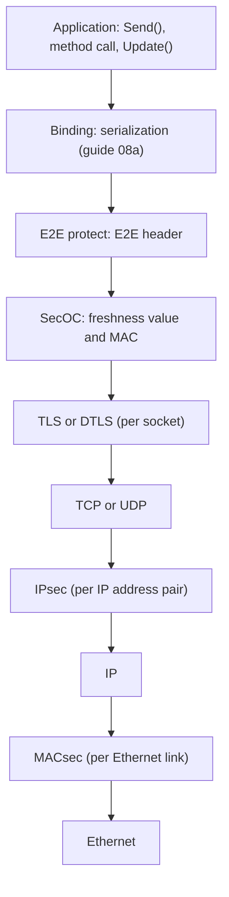
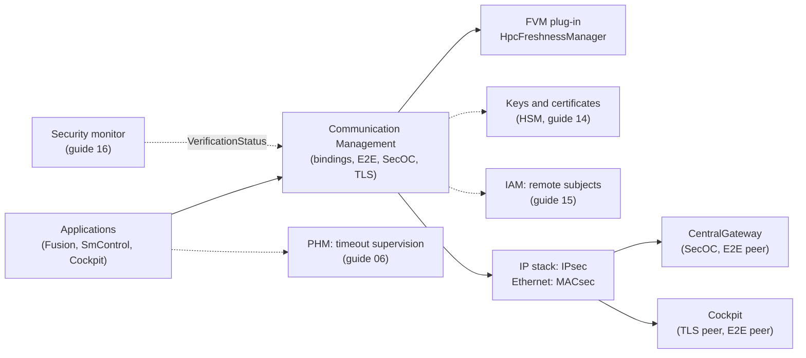
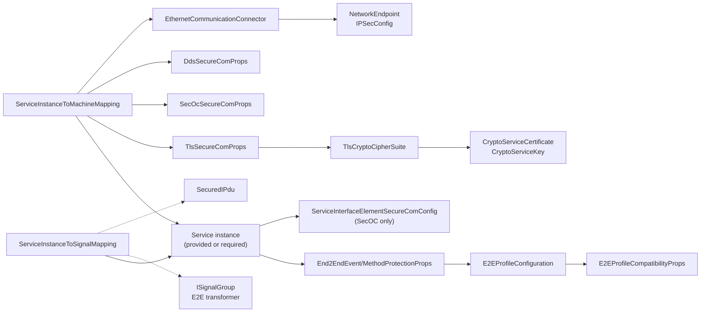
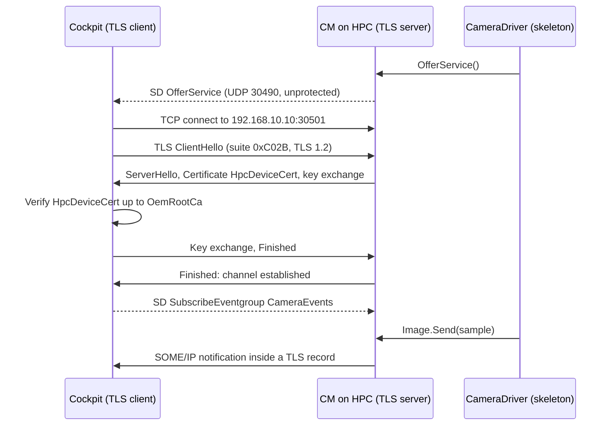
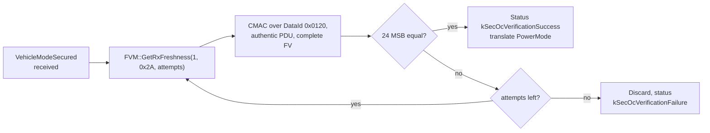
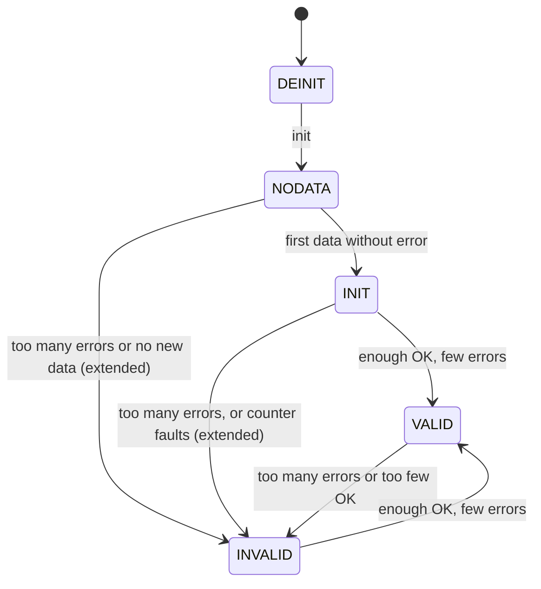
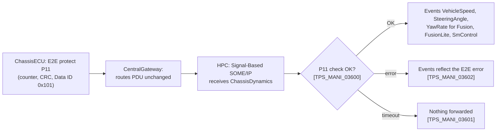
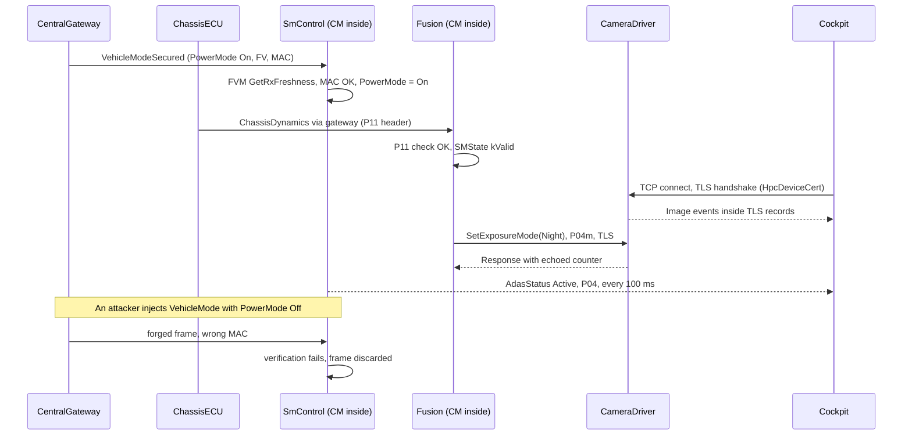

# AUTOSAR Adaptive Platform: Communication Management Part 3, Secure Communication and End-to-End Protection

<!-- markdownlint-disable MD013 MD033 -->

> **Source specification:** *Specification of Communication Management* (`AUTOSAR_AP_SWS_CommunicationManagement`) and *Specification of Manifest* (`AUTOSAR_AP_TPS_ManifestSpecification`), AUTOSAR Adaptive Platform **R25-11**. Also based on the Foundation **R25-11** protocol specifications *E2E Protocol Specification* (`AUTOSAR_FO_PRS_E2EProtocol`), *Specification of Secure Onboard Communication Protocol* (`AUTOSAR_FO_PRS_SecOCProtocol`) and *SOME/IP Protocol Specification* (`AUTOSAR_FO_PRS_SOMEIPProtocol`), on *Integration of DDS Security* (`AUTOSAR_AP_TR_DDSSecurityIntegration`, Adaptive Platform R25-11) and, for Classic Platform background, on *System Template* (`AUTOSAR_CP_TPS_SystemTemplate`, Classic Platform R25-11).
>
> **Document type:** training material.
>
> **Author:** Hieu Do Minh/Claude
>
> **Version:** 1.0 (draft, pending review)
>
> **Part of the series:** [AUTOSAR Adaptive Platform Training Guides](00_LearningPath.md). Previous: [08a Communication Management Part 2: Network Bindings](08a_NetworkBindings.md). Next: 09 Network Management, Time Synchronization and Raw Data Stream (`09_NM_TimeSync_RawDataStream.md`, planned).

## About This Guide

[Guide 08a](08a_NetworkBindings.md) showed how service communication travels over SOME/IP, the Signal-Based binding and DDS. It showed the traffic without any protection. Real vehicles need two kinds of protection. An **attacker** on the network must not be able to read confidential data, inject a forged `PowerMode Off` or replay an old command. And a **fault** in a controller, a gateway or a cable must not make a braking function use a corrupted, repeated or stale vehicle speed.

Communication Management (CM) answers the first need with **secure communication**: TLS, DTLS, SecOC, IPsec, MACsec and DDS Security. It answers the second with **end-to-end (E2E) protection**. This guide explains both as R25-11 specifies them: what each mechanism protects, where it sits, how it looks on the wire, what CM does at run time, what you configure, and which parts of the specification are still DRAFT or silent. It also covers the only API that this part of CM defines: the `ara::com::secoc` services and the Freshness Value Manager extension interface. How an application reads E2E results was already shown in [guide 07, Chapter 12](07_CommunicationManagement.md#12-end-to-end-protection-the-api-side).

### Who This Guide Is For

- **Integrators** who decide which communication is secured or E2E-protected and write the deployment.
- **Security engineers** who choose protocols, cipher suites and SecOC profiles, and who need to know what the platform guarantees and what it leaves open.
- **Safety engineers** who choose E2E profiles, Data IDs and state machine settings, and who must argue that faults are detected in time.
- **Application developers** who use protected services and want to understand the errors and states they see.

Assumed background: [guide 07](07_CommunicationManagement.md) (`ara::com`, events, methods, fields, the E2E API) and [guide 08a](08a_NetworkBindings.md) (SOME/IP header, service discovery, the Signal-Based binding, DDS). Basic knowledge of what a checksum, a message authentication code and a certificate are helps; this guide explains the rest.

### Learning Objectives

After working through this guide you will be able to:

1. Explain the difference between secure communication and E2E protection, and which faults or attacks each one handles.
2. Name the six security protocols of R25-11, the layer each works on, and where each one is configured for each binding.
3. Configure TLS for a SOME/IP service, including server and client roles, cipher suites and certificates.
4. Explain how SecOC builds and verifies an authenticated message, including freshness values, truncation, profiles and the Freshness Value Manager.
5. Explain the behavior of proxies and skeletons before a secure channel exists.
6. Read an E2E header of a SOME/IP event or method byte by byte, and choose a suitable E2E profile.
7. Explain the E2E state machine and choose its window and threshold settings.
8. Explain how E2E and SecOC work across the Signal-to-Service translation, and why the DDS binding does not use the AUTOSAR E2E protocol.
9. Use the `ara::com::secoc` services and implement the Freshness Value Manager interface.

### How to Read This Guide

Chapters 1 to 4 introduce the mechanisms, the terms, the architecture and the configuration model. Chapters 5 to 9 explain secure communication: the common rules, TLS and DTLS, SecOC, IPsec and MACsec, and DDS Security. Chapters 10 to 14 explain E2E protection: profiles and the header, the state machine, E2E for SOME/IP, E2E on DDS, and E2E and SecOC in the Signal-to-Service translation. Chapter 15 is the configuration reference and Chapter 16 the API reference. Chapters 17 to 19 are practical.

If you only secure a SOME/IP service, read Chapters 1 to 6 and 15.3. If you are a safety engineer, read Chapters 1 to 4 and 10 to 14. If you connect Classic ECUs, read Chapters 7 and 14.

| Convention | Meaning |
| --- | --- |
| `[SWS_CM_11274]` | A requirement ID in the Communication Management specification. Search for it in the specification to read the exact normative text. |
| `[PRS_E2E_00875]`, `[PRS_SecOc_00211]`, `[PRS_SOMEIP_00941]` | A requirement of a Foundation protocol specification. |
| `[TPS_MANI_03130]`, `[constr_3493]` | A requirement or constraint of the *Manifest Specification* (TPS). |
| `[TPS_SYST_02068]`, `[TR_DDSS_00101]` | An item of the Classic *System Template* or of *Integration of DDS Security*. |
| DRAFT | The specification item has the status DRAFT in R25-11: it may change in later releases. |
| **Note (implementation example)** | How a typical implementation *might* realize something. This is not mandated by AUTOSAR. |
| **Note (Classic Platform background)** | Background about the Classic Platform, given only to help readers without a Classic background. |
| **Note (interpretation)** | The specification is silent or ambiguous. The note says how this guide reads it, and why. |
| **Pitfall** | A common mistake seen in real projects. |
| **Key takeaways** | A short summary at the end of each chapter. |
| Diagrams | Written in Mermaid. They render natively on GitHub and GitLab. In VS Code, install the *Markdown Preview Mermaid Support* extension. |

> **Note:** All IDs, keys, certificates and data IDs in this guide belong to the invented running example and are illustrative. Byte layouts are taken from the R25-11 protocol specifications; CRC and MAC values are shown as `xx`, because they depend on the algorithm implementation. Configuration excerpts in ARXML come from a model of the running example that was validated against the R25-11 XML schema.

### The Running Example

All guides of the series use the same invented system. [Guide 00, Chapter 6](00_LearningPath.md#6-the-running-example-the-hpc-reference-system) defines it; [guide 08a](08a_NetworkBindings.md#the-running-example) deployed its communication without protection. This guide protects it:

| Communication | Threat | Protection in this guide | Section |
| --- | --- | --- | --- |
| `CameraService` between `CameraDriver` and `Cockpit` (and `Fusion`) over SOME/IP and TCP | Eavesdropping, forged commands from the network | TLS 1.2: `CameraTlsServer` with `HpcDeviceCert`, `CameraTlsClient` | [6.6](#66-worked-example-cameraservice-secured-with-hpcdevicecert) |
| `SetExposureMode` of `CameraService` | Corrupted or repeated method calls | E2E `PROFILE_04m` | [12.7](#127-worked-example-setexposuremode-with-profile_04m) |
| `AdasStatus` to `Cockpit` over SOME/IP | Corrupted, lost or stale status on the display | E2E `PROFILE_04` | [11.6](#116-worked-example-the-state-of-adasstatus-through-a-burst-of-lost-messages) |
| `ChassisDynamics` from `ChassisECU` through `CentralGateway` | Corrupted, lost or stale vehicle dynamics | E2E `PROFILE_11` on the signal group `ChassisDynamicsGroup`, safe translation | [14.6](#146-worked-example-chassisdynamics-with-profile_11-becomes-vehicledynamicsservice) |
| `VehicleMode` (signal `PowerMode`) from `CentralGateway` | A forged `PowerMode Off` that shuts the HPC down while driving | SecOC Profile 1 on `VehicleModeSecured`, secure translation | [7.10](#710-worked-example-powermode-authenticated-by-centralgateway) |
| `ObjectListService` over DDS | Lost or stale object lists | DDS liveliness instead of an E2E profile; DDS Security only as a concept | [13.3](#133-worked-example-what-storage-sees-for-objectlist) |

This guide adds the following elements to the running example (guide 00 lists them as well):

| Element | What it is | Used in |
| --- | --- | --- |
| `CameraTlsServer`, `CameraTlsClient` | TLS configurations (`TlsSecureComProps`) of the TCP endpoints of `CameraService` on `HPC`; one cipher suite `TLS_ECDHE_ECDSA_WITH_AES_128_GCM_SHA256`, TLS 1.2 | [Chapter 6](#6-tls-and-dtls) |
| `HpcDeviceCert`, `HpcDeviceKey`, `OemRootCa` | Existing certificates and key of guide 00, modeled here as crypto stubs; `HpcDeviceCert` is issued under `OemRootCa` | [Section 6.4](#64-cipher-suites-certificates-and-pre-shared-keys) |
| `ChassisDynamicsGroup` | Signal group of `ChassisDynamics` with the E2E header signals `ChassisDynamicsCrc`, `ChassisDynamicsCounter`, `ChassisDynamicsDataIdNibble` in bytes 6 and 7; `PROFILE_11`, data ID `0x101` | [Section 14.6](#146-worked-example-chassisdynamics-with-profile_11-becomes-vehicledynamicsservice) |
| `VehicleModeSecured` | Secured PDU of `VehicleMode` (5 bytes, SecOC Profile 1, SecOC data ID `0x0120`, freshness value ID 1) | [Section 7.10](#710-worked-example-powermode-authenticated-by-centralgateway) |
| `VehicleModeSecOcKey` | Symmetric AES-128 key shared by `CentralGateway` and `HPC`, stored in the HSM (owner guide 14) | [Section 7.10](#710-worked-example-powermode-authenticated-by-centralgateway) |
| `HpcFreshnessManager` | The Freshness Value Manager plug-in library of the OEM on `HPC` | [Section 7.8](#78-the-freshness-value-manager-plug-in) |
| E2E profiles `AdasStatusP04`, `CameraMethodsP04mServer`, `CameraMethodsP04mClient` and `HpcE2eCompat` | E2E profile configurations of the SOME/IP services | [Chapter 15](#15-configuration-reference-what-to-configure) |
| Cyclic `AdasStatus` | `SmControl` publishes `AdasStatus` on every change and at least every 100 ms (`dataUpdatePeriod` 0.1 s), so that E2E can detect loss | [Section 11.6](#116-worked-example-the-state-of-adasstatus-through-a-burst-of-lost-messages) |

## Table of Contents

- [1. Introduction to Protected Communication](#1-introduction-to-protected-communication)
    - [1.1 Two Threats: Attackers and Faults](#11-two-threats-attackers-and-faults)
    - [1.2 What This Guide Does Not Do](#12-what-this-guide-does-not-do)
    - [1.3 The Mechanisms at a Glance](#13-the-mechanisms-at-a-glance)
    - [1.4 Analogies](#14-analogies)
- [2. Core Concepts and Terminology](#2-core-concepts-and-terminology)
    - [2.1 Integrity, Authenticity, Confidentiality and Freshness](#21-integrity-authenticity-confidentiality-and-freshness)
    - [2.2 Secure Channel and Security Association](#22-secure-channel-and-security-association)
    - [2.3 Authenticator, MAC, Freshness Value and Truncation](#23-authenticator-mac-freshness-value-and-truncation)
    - [2.4 The E2E Header: CRC, Counter, Data ID and Source ID](#24-the-e2e-header-crc-counter-data-id-and-source-id)
    - [2.5 Check Status and State Machine](#25-check-status-and-state-machine)
    - [2.6 Other Key Terms](#26-other-key-terms)
- [3. Protection in the System Architecture](#3-protection-in-the-system-architecture)
    - [3.1 Where Each Mechanism Sits](#31-where-each-mechanism-sits)
    - [3.2 Interfaces](#32-interfaces)
    - [3.3 Interaction Map](#33-interaction-map)
- [4. Configuration Overview](#4-configuration-overview)
    - [4.1 Where the Configuration Lives](#41-where-the-configuration-lives)
    - [4.2 How the Elements Relate](#42-how-the-elements-relate)
    - [4.3 Who Configures What, and When](#43-who-configures-what-and-when)
- [5. Secure Channels: The Common Rules](#5-secure-channels-the-common-rules)
    - [5.1 Six Protocols, Five Configuration Points](#51-six-protocols-five-configuration-points)
    - [5.2 Selecting the Channel](#52-selecting-the-channel)
    - [5.3 Multicast Cannot Be Confidential](#53-multicast-cannot-be-confidential)
    - [5.4 Before the Channel Exists: Proxy and Skeleton Behavior](#54-before-the-channel-exists-proxy-and-skeleton-behavior)
    - [5.5 Protecting Service Discovery](#55-protecting-service-discovery)
    - [5.6 Secure Channels and Remote Subjects](#56-secure-channels-and-remote-subjects)
- [6. TLS and DTLS](#6-tls-and-dtls)
    - [6.1 TLS in Plain Words](#61-tls-in-plain-words)
    - [6.2 When CM Creates a TLS or DTLS Channel](#62-when-cm-creates-a-tls-or-dtls-channel)
    - [6.3 Server and Client Roles](#63-server-and-client-roles)
    - [6.4 Cipher Suites, Certificates and Pre-Shared Keys](#64-cipher-suites-certificates-and-pre-shared-keys)
    - [6.5 TLS and DTLS on the DDS Binding](#65-tls-and-dtls-on-the-dds-binding)
    - [6.6 Worked Example: `CameraService` Secured With `HpcDeviceCert`](#66-worked-example-cameraservice-secured-with-hpcdevicecert)
- [7. SecOC: Authenticated Messages](#7-secoc-authenticated-messages)
    - [7.1 SecOC in Plain Words](#71-secoc-in-plain-words)
    - [7.2 The Secured Message, Byte by Byte](#72-the-secured-message-byte-by-byte)
    - [7.3 Security Profiles 1, 2 and 3](#73-security-profiles-1-2-and-3)
    - [7.4 SecOC for SOME/IP: Selecting Elements](#74-secoc-for-someip-selecting-elements)
    - [7.5 Sending: Freshness, MAC, Truncation and Build Attempts](#75-sending-freshness-mac-truncation-and-build-attempts)
    - [7.6 Receiving: Verification, Retries, Bypass and Ignore](#76-receiving-verification-retries-bypass-and-ignore)
    - [7.7 SecOC on the Signal-Based Binding: the `SecuredIPdu` Decides](#77-secoc-on-the-signal-based-binding-the-securedipdu-decides)
    - [7.8 The Freshness Value Manager Plug-in](#78-the-freshness-value-manager-plug-in)
    - [7.9 Verification Status and Overrides](#79-verification-status-and-overrides)
    - [7.10 Worked Example: `PowerMode` Authenticated by `CentralGateway`](#710-worked-example-powermode-authenticated-by-centralgateway)
- [8. IPsec and MACsec: Protection Below the Binding](#8-ipsec-and-macsec-protection-below-the-binding)
    - [8.1 IPsec in Plain Words](#81-ipsec-in-plain-words)
    - [8.2 How CM Uses `IPSecConfig`](#82-how-cm-uses-ipsecconfig)
    - [8.3 MACsec: Protecting the Ethernet Link](#83-macsec-protecting-the-ethernet-link)
    - [8.4 Choosing the Layer](#84-choosing-the-layer)
- [9. DDS Security](#9-dds-security)
    - [9.1 DDS Security in Plain Words](#91-dds-security-in-plain-words)
    - [9.2 What AUTOSAR Requires](#92-what-autosar-requires)
    - [9.3 `DdsSecureComProps` and `DdsSecureGovernance`](#93-ddssecurecomprops-and-ddssecuregovernance)
    - [9.4 Topic Access Rules](#94-topic-access-rules)
    - [9.5 From the Model to the Security Documents](#95-from-the-model-to-the-security-documents)
    - [9.6 Worked Example: Securing `ObjectListService` to `Cockpit`](#96-worked-example-securing-objectlistservice-to-cockpit)
- [10. E2E Profiles and the E2E Header](#10-e2e-profiles-and-the-e2e-header)
    - [10.1 What E2E Detects](#101-what-e2e-detects)
    - [10.2 Profiles Available on the Adaptive Platform](#102-profiles-available-on-the-adaptive-platform)
    - [10.3 Profile 4 Header, Byte by Byte](#103-profile-4-header-byte-by-byte)
    - [10.4 Method Profiles 4m, 7m, 8m and 44m](#104-method-profiles-4m-7m-8m-and-44m)
    - [10.5 Where the Header Goes in a SOME/IP Message and What the CRC Covers](#105-where-the-header-goes-in-a-someip-message-and-what-the-crc-covers)
    - [10.6 Data IDs and `dataIdMode`](#106-data-ids-and-dataidmode)
- [11. The E2E State Machine](#11-the-e2e-state-machine)
    - [11.1 From Check Status to State](#111-from-check-status-to-state)
    - [11.2 States and Transitions](#112-states-and-transitions)
    - [11.3 Windows and Thresholds](#113-windows-and-thresholds)
    - [11.4 Compatibility Switches](#114-compatibility-switches)
    - [11.5 Choosing Values: Cycle Time, FTTI and Counter Delta](#115-choosing-values-cycle-time-ftti-and-counter-delta)
    - [11.6 Worked Example: The State of `AdasStatus` Through a Burst of Lost Messages](#116-worked-example-the-state-of-adasstatus-through-a-burst-of-lost-messages)
- [12. E2E for SOME/IP Events, Methods and Fields](#12-e2e-for-someip-events-methods-and-fields)
    - [12.1 Events: Protect in `Send`, Check in `GetNewSamples`](#121-events-protect-in-send-check-in-getnewsamples)
    - [12.2 Methods: Request, Response and E2E Error Response](#122-methods-request-response-and-e2e-error-response)
    - [12.3 Fields: Get, Set and Update](#123-fields-get-set-and-update)
    - [12.4 Fire-and-Forget Methods](#124-fire-and-forget-methods)
    - [12.5 Limitations](#125-limitations)
    - [12.6 Transport Fault Conditions](#126-transport-fault-conditions)
    - [12.7 Worked Example: `SetExposureMode` With `PROFILE_04m`](#127-worked-example-setexposuremode-with-profile_04m)
- [13. E2E on the DDS Binding](#13-e2e-on-the-dds-binding)
    - [13.1 Why the AUTOSAR E2E Protocol Is Not Used on DDS](#131-why-the-autosar-e2e-protocol-is-not-used-on-dds)
    - [13.2 How DDS Status Becomes `SMState` and Transport Faults](#132-how-dds-status-becomes-smstate-and-transport-faults)
    - [13.3 Worked Example: What `Storage` Sees for `ObjectList`](#133-worked-example-what-storage-sees-for-objectlist)
- [14. E2E and SecOC in Signal-to-Service Translation](#14-e2e-and-secoc-in-signal-to-service-translation)
    - [14.1 `safeTranslation` and `secureTranslation`](#141-safetranslation-and-securetranslation)
    - [14.2 E2E-Protected Signal Groups](#142-e2e-protected-signal-groups)
    - [14.3 Checking and Forwarding Across the Translation](#143-checking-and-forwarding-across-the-translation)
    - [14.4 One PDU, Several Events: E2E Status per Event](#144-one-pdu-several-events-e2e-status-per-event)
    - [14.5 Periods the Application Must Keep](#145-periods-the-application-must-keep)
    - [14.6 Worked Example: `ChassisDynamics` With `PROFILE_11` Becomes `VehicleDynamicsService`](#146-worked-example-chassisdynamics-with-profile_11-becomes-vehicledynamicsservice)
- [15. Configuration Reference: What to Configure](#15-configuration-reference-what-to-configure)
    - [15.1 Minimal Configuration](#151-minimal-configuration)
    - [15.2 Endpoint Security References](#152-endpoint-security-references)
    - [15.3 TLS](#153-tls)
    - [15.4 SecOC for Service Instances](#154-secoc-for-service-instances)
    - [15.5 SecOC for Translated PDUs](#155-secoc-for-translated-pdus)
    - [15.6 IPsec](#156-ipsec)
    - [15.7 MACsec](#157-macsec)
    - [15.8 DDS Security](#158-dds-security)
    - [15.9 E2E for Service Instances](#159-e2e-for-service-instances)
    - [15.10 E2E and SecOC for Signals](#1510-e2e-and-secoc-for-signals)
    - [15.11 The Running Example: Complete Configuration](#1511-the-running-example-complete-configuration)
- [16. API Reference: `ara::com::secoc` and the FVM Extension Interface](#16-api-reference-aracomsecoc-and-the-fvm-extension-interface)
    - [16.1 API Overview](#161-api-overview)
    - [16.2 Data Types](#162-data-types)
    - [16.3 Service `VerificationStatus`](#163-service-verificationstatus)
    - [16.4 Services `VerificationStatusConfigurationByDataId` and `...ByFreshnessId`](#164-services-verificationstatusconfigurationbydataid-and-byfreshnessid)
    - [16.5 `apext::com::secoc::FVM` and `FVContainer`](#165-apextcomsecocfvm-and-fvcontainer)
    - [16.6 `ComSecOcFvmErrc` and Its Error Domain](#166-comsecocfvmerrc-and-its-error-domain)
    - [16.7 Usage Sketches](#167-usage-sketches)
- [17. Reporting and Observability](#17-reporting-and-observability)
    - [17.1 What Is Reported, and What Is Not](#171-what-is-reported-and-what-is-not)
    - [17.2 Using `VerificationStatus` for Attack Detection](#172-using-verificationstatus-for-attack-detection)
    - [17.3 Seeing Protection on the Wire](#173-seeing-protection-on-the-wire)
- [18. End-to-End Walkthrough: A Protected Drive Cycle](#18-end-to-end-walkthrough-a-protected-drive-cycle)
    - [18.1 The Sequence](#181-the-sequence)
    - [18.2 Step by Step](#182-step-by-step)
- [19. Best Practices, Pitfalls and Troubleshooting](#19-best-practices-pitfalls-and-troubleshooting)
    - [19.1 Best Practices](#191-best-practices)
    - [19.2 Common Pitfalls](#192-common-pitfalls)
    - [19.3 Troubleshooting Guide](#193-troubleshooting-guide)
- [20. Summary and Self-Check Quiz](#20-summary-and-self-check-quiz)
    - [20.1 Summary](#201-summary)
    - [20.2 Self-Check Quiz](#202-self-check-quiz)
- [Appendix A. Glossary and Acronyms](#appendix-a-glossary-and-acronyms)
    - [A.1 Acronyms](#a1-acronyms)
    - [A.2 Glossary](#a2-glossary)
- [Appendix B. Quick Reference Cheat Sheet](#appendix-b-quick-reference-cheat-sheet)
    - [B.1 Protocols](#b1-protocols)
    - [B.2 E2E Profiles on AP](#b2-e2e-profiles-on-ap)
    - [B.3 State Machine Relations](#b3-state-machine-relations)
    - [B.4 SecOC Profiles and API Types](#b4-secoc-profiles-and-api-types)
- [Appendix C. Spec Traceability](#appendix-c-spec-traceability)
- [Appendix D. Notable Changes in Recent Releases](#appendix-d-notable-changes-in-recent-releases)
- [Appendix E. References](#appendix-e-references)

---
## 1. Introduction to Protected Communication

> **Why this matters:** Every service of guide 08a can be read, forged or corrupted on its way. Whether that matters depends on the data: a camera image to a display may leak private information, a forged power mode may shut down the HPC while driving, and a corrupted vehicle speed may make a driver assistance function brake. This chapter sorts the threats and the mechanisms that R25-11 offers against them.

### 1.1 Two Threats: Attackers and Faults

**In plain words:** *secure communication* defends against an intelligent attacker who reads, changes, injects or replays messages on purpose. *End-to-end protection* defends against random faults in hardware and software that corrupt, lose, repeat, delay or misroute messages by accident. The two are complementary, and the same message can need both.

**Formally:** SWS CM, Section 7.3.2 lists the security protocols that Communication Management supports: DDS Security, SecOC, TLS 1.2, DTLS 1.2, IPsec and MACsec. Section 7.4 integrates the AUTOSAR E2E protocol for SOME/IP and specifies how the DDS binding covers the same fault model ([SWS_CM_90433], [SWS_CM_90485]; SWS CM, Section 7.4.2). The fault model of E2E is derived from ISO 26262-6:2011, Annex D.2.4 (SWS CM, Section 7.4.2).

| Question | Secure communication | E2E protection |
| --- | --- | --- |
| Against what? | An attacker | Random faults |
| Typical mechanism | Cryptography with secret keys (MAC, encryption, signatures) | CRC, counter and data ID, without secrets |
| Detects a deliberate forgery? | Yes, if the attacker has no key | No: anyone can compute a CRC |
| Detects loss and delay? | Partly (freshness, sequence numbers) | Yes, with counter and state machine, if data is sent periodically |
| Standard behind it | IETF, IEEE, OMG standards; AUTOSAR SecOC | AUTOSAR E2E protocol, derived from ISO 26262 |
| Owner in the project | Security engineer | Safety engineer |
| In this guide | [Chapters 5 to 9](#5-secure-channels-the-common-rules) | [Chapters 10 to 14](#10-e2e-profiles-and-the-e2e-header) |

### 1.2 What This Guide Does Not Do

| Not covered here | Where instead |
| --- | --- |
| How an application reads E2E results (`ProfileCheckStatus`, `SMState`, `E2EErrorHandler`) | [Guide 07, Chapter 12](07_CommunicationManagement.md#12-end-to-end-protection-the-api-side) (this guide only recaps it) |
| The bindings themselves: SOME/IP header, service discovery, signal mapping, DDS topics | [Guide 08a](08a_NetworkBindings.md) |
| Keys, certificates, key slots and the crypto API | Guide 14 (Cryptography, `14_Cryptography.md`, planned) |
| Who may use which service; remote subjects | Guide 15 (Identity and Access Management, `15_IdentityAndAccessManagement.md`, planned) |
| Security events, intrusion detection and firewall | Guide 16 (IdsM and Firewall, `16_IDSM_Firewall.md`, planned) |
| Supervision of method timeouts | [Guide 06](06_PlatformHealthManagement.md) (Platform Health Management) |

### 1.3 The Mechanisms at a Glance

The following table compares the mechanisms. The rest of the guide explains each column.

| Mechanism | Layer | Bindings | Integrity and authenticity | Confidentiality | Multicast | Configured in |
| --- | --- | --- | --- | --- | --- | --- |
| TLS 1.2 | Above TCP | SOME/IP, DDS | Yes | Yes | No | `ServiceInstanceToMachineMapping.secureComPropsForTcp` |
| DTLS 1.2 | Above UDP | SOME/IP, DDS | Yes | Yes | No | `ServiceInstanceToMachineMapping.secureComPropsForUdp` |
| SecOC | Inside the message | SOME/IP, Signal-Based | Yes, with freshness | No | Yes | `SecOcSecureComProps` and `ServiceInterfaceElementSecureComConfig` (SOME/IP); `SecuredIPdu` (Signal-Based) |
| IPsec | IP | All IP traffic | Yes | Yes (ESP) | Not by CM | `NetworkEndpoint.ipSecConfig` |
| MACsec (DRAFT in TPS) | Ethernet frame | All traffic on the link | Yes | Yes | Link level | `CouplingPort.macSecProps` |
| DDS Security (DRAFT in TPS) | DDS/RTPS | DDS | Yes | Yes | Yes | `DdsServiceInstanceToMachineMapping.secureComPropsForDds` |
| E2E protection | Inside the message | SOME/IP events, methods, fields; signals through the translation | Against faults only | No | Yes | `End2EndEventProtectionProps`, `End2EndMethodProtectionProps`, E2E transformer of the System Description |

### 1.4 Analogies

- **SecOC** is a letter with a seal: the content stays readable, but anyone with the right stamp can check that it is authentic and not an old letter sent again.
- **TLS, IPsec and MACsec** are armored transport: an armored truck between two buildings (TLS between two sockets), an armored road (IPsec between two IP addresses) or an armored street segment (MACsec between two Ethernet ports). What leaves the truck is not protected any more.
- **E2E** is a numbered page with a checksum at the bottom: the reader notices a missing, repeated or smudged page, but a forger can renumber and recompute.

The analogies break down in one important place: CM applies the protections automatically according to the configuration. The application code does not change, except for reading E2E results and handling the errors of [Section 5.4](#54-before-the-channel-exists-proxy-and-skeleton-behavior).

> **Key takeaways**
>
> - Secure communication defends against attackers; E2E protection defends against random faults. Some data needs both.
> - R25-11 supports TLS 1.2, DTLS 1.2, SecOC, IPsec, MACsec and DDS Security, plus the AUTOSAR E2E protocol.
> - Only SecOC (and DDS Security) can protect multicast; no protocol except DDS Security gives confidentiality to multicast events.
> - Keys and certificates (guide 14), access control (guide 15) and IDS (guide 16) are separate topics.

---

## 2. Core Concepts and Terminology

> **Why this matters:** Security and safety use many similar-sounding words with precise meanings: authenticity is not confidentiality, a counter is not a freshness value, a check status is not a state. Learning them once makes the rest of the guide easy to read.

### 2.1 Integrity, Authenticity, Confidentiality and Freshness

| Property | Plain meaning | Provided by |
| --- | --- | --- |
| Integrity | The content was not changed on the way | TLS, DTLS, SecOC, IPsec, MACsec, DDS Security (against attacks); E2E CRC (against faults) |
| Authenticity | The message comes from the claimed sender | Message authentication code (MAC) or signature with a key only the sender has |
| Confidentiality | Only the intended receiver can read the content | Encryption: TLS, DTLS, IPsec ESP, MACsec, DDS Security. **Not** SecOC ([Section 5.3](#53-multicast-cannot-be-confidential)) |
| Freshness | The message is new, not an old copy sent again (replay) | SecOC freshness value; sequence numbers in TLS, IPsec, MACsec; E2E counter (against faults) |

### 2.2 Secure Channel and Security Association

**In plain words:** a *secure channel* is a protected connection between two endpoints. Before data flows, the endpoints agree on keys and algorithms; this agreement is a *security association*.

**Formally:** SWS CM, Section 7.3.2.1 says that a secure channel "can be established using protocols like TLS, IPsec, and MACsec", that the channel is ready as soon as it is established, and that "without an established secure channel the remote peer is unreachable". The configuration of the endpoint decides which channel applies ([SWS_CM_90101], [SWS_CM_90102]). SecOC is configured like a channel, but it protects each message individually ([Chapter 7](#7-secoc-authenticated-messages)).

### 2.3 Authenticator, MAC, Freshness Value and Truncation

These are the terms of SecOC (PRS SecOC, Section 5.1.1):

| Term | Meaning |
| --- | --- |
| Authentic I-PDU (Authentic message) | The message that needs protection, as the application or the translation produced it |
| Secured I-PDU (Secured message) | The Authentic message plus the authentication information |
| Authenticator | A unique authentication data string, for example a MAC, computed over the Data ID, the authentic payload and the freshness value with a secret key |
| Freshness Value | A monotonic counter or time stamp that makes each message unique in time |
| Truncation | Sending only part of the MAC (the most significant bits) or of the freshness value (the least significant bits) to save space ([PRS_SecOc_00103], [PRS_SecOc_00210]) |
| Data ID (SecOC) | A 16-bit identifier of the secured message that enters the MAC ([PRS_SecOc_00222]) |
| Freshness Value Manager (FVM) | The component that provides and synchronizes freshness values; on the Adaptive Platform a plug-in library of CM ([Section 7.8](#78-the-freshness-value-manager-plug-in)) |

### 2.4 The E2E Header: CRC, Counter, Data ID and Source ID

**In plain words:** the sender adds a small *E2E header* to each protected message. The receiver recomputes and compares it.

| Field | What it detects | Profiles |
| --- | --- | --- |
| CRC | Corrupted bits | All |
| Counter (sequence counter) | Lost, repeated, inserted or reordered messages | All |
| Data ID | Masquerading and wrong addressing: a message of another sender or another element | All except P76 |
| Length | A wrong message length, for dynamic-size data | P04, P06, P07, P08, P44 and their method variants |
| Source ID | The client that sent a request | P04m, P07m, P08m, P44m |
| Message Type, Message Result | Request versus response; normal versus error response | P04m, P07m, P08m, P44m |

The PRS E2E lists these mechanisms in Section 6.2. [Chapter 10](#10-e2e-profiles-and-the-e2e-header) shows the headers byte by byte.

### 2.5 Check Status and State Machine

[Guide 07, Sections 12.1 and 12.2](07_CommunicationManagement.md#121-e2e-in-plain-words) introduced the two results that an application sees: the *check status* of one sample (`ara::com::e2e::ProfileCheckStatus`) and the *state* of the communication channel (`ara::com::e2e::SMState`). The check function looks at one message; the state machine looks at the recent history of checks ([PRS_E2E_00322], [PRS_E2E_00853]). [Chapter 11](#11-the-e2e-state-machine) explains how the state machine decides.

### 2.6 Other Key Terms

| Term | Meaning | Details in |
| --- | --- | --- |
| Cipher suite | A set of algorithms for key exchange, authentication and encryption, identified by an IANA number | [6.4](#64-cipher-suites-certificates-and-pre-shared-keys) |
| Certificate chain | A certificate signed by a higher certificate up to a trusted root | [6.4](#64-cipher-suites-certificates-and-pre-shared-keys) |
| Pre-shared key (PSK) | A symmetric secret configured on both ends instead of certificates | [6.4](#64-cipher-suites-certificates-and-pre-shared-keys) |
| Security profile (SecOC) | A standardized set of SecOC algorithm and length settings | [7.3](#73-security-profiles-1-2-and-3) |
| MKA, KaY | MACsec Key Agreement and the Key Agreement Entity that runs it | [8.3](#83-macsec-protecting-the-ethernet-link) |
| Governance document, permissions document | The two signed policy files of DDS Security | [9.5](#95-from-the-model-to-the-security-documents) |
| E2E profile | A standardized combination of E2E mechanisms and header layout | [10.2](#102-profiles-available-on-the-adaptive-platform) |
| FTTI | Fault tolerant time interval: the time a fault may exist before a hazard can occur (ISO 26262) | [11.5](#115-choosing-values-cycle-time-ftti-and-counter-delta) |
| Transformer chain | Classic Platform concept: an ordered list of data transformations, for example serialization and E2E | [14.2](#142-e2e-protected-signal-groups) |

> **Key takeaways**
>
> - Integrity and authenticity are not confidentiality; SecOC gives the first two, not the third.
> - A secure channel must exist before data flows; until then, the peer is unreachable.
> - The E2E header combines CRC, counter and data ID, and for methods also source ID, message type and result.
> - The check status judges one message; the state machine judges the channel.

---

## 3. Protection in the System Architecture

> **Why this matters:** Each mechanism protects a different stretch of the path. Knowing where it starts and ends tells you what is still unprotected, for example data inside a gateway or inside the HPC.

### 3.1 Where Each Mechanism Sits

The following diagram shows the protection layers on the sending side of `HPC`. The receiving side runs the same layers in reverse.



The order of E2E and SecOC is specified: the sender performs message authentication "after the E2E protection calculations" ([SWS_CM_11274]); the receiver performs "the message authentication procedure ... before E2E checks" ([SWS_CM_11276]). So SecOC protects the E2E header too, and an E2E check never runs on a message that failed verification. TLS, IPsec and MACsec work below the binding and protect whatever the binding sends.

A protection ends where its endpoint ends. TLS between `Cockpit` and `HPC` ends in the CM of `HPC`; E2E of `ChassisDynamics` ends in the translation on `HPC` ([Chapter 14](#14-e2e-and-secoc-in-signal-to-service-translation)); MACsec ends at the next switch port.

### 3.2 Interfaces

| Direction | Interface | Content | Spec |
| --- | --- | --- | --- |
| Provided by CM | Service `VerificationStatus` (namespace `ara::com::secoc`) | The result of every SecOC verification | [SWS_CM_11278], [SWS_CM_11280] |
| Provided by CM | Services `VerificationStatusConfigurationByDataId`, `VerificationStatusConfigurationByFreshnessId` | Override of the verification behavior | [SWS_CM_11279], [SWS_CM_11281], [SWS_CM_11282] |
| Required by CM | Platform extension interface `apext::com::secoc::FVM` | Freshness values for SecOC, implemented by the OEM or stack vendor | [SWS_CM_11272], [SWS_CM_11287] |
| Required by CM | Keys, certificates, crypto primitives | Not as an API: the model references `CryptoServiceKey`, `CryptoServiceCertificate` and key slots (guide 14) | TPS 13.5.1, 9.9.2.2 |
| Used by IAM | Identity of remote peers from TLS or IPsec | Remote subjects for access control (guide 15) | [SWS_CM_10495] |

All `ara::com::secoc` services are DRAFT in R25-11. [Chapter 16](#16-api-reference-aracomsecoc-and-the-fvm-extension-interface) lists them.

### 3.3 Interaction Map



> **Key takeaways**
>
> - The sender applies E2E first, then SecOC; the receiver verifies SecOC first, then checks E2E.
> - TLS, IPsec and MACsec work below the binding; each protection ends at its endpoint.
> - CM provides three SecOC services (DRAFT) and requires one platform extension, the Freshness Value Manager.
> - Keys and certificates are referenced in the model; the crypto side belongs to guide 14.

---

## 4. Configuration Overview

> **Why this matters:** CM has no built-in knowledge of which data needs protection. Everything comes from configuration, which is spread over the Service Instance Manifest, the machine design and the System Description shared with the Classic ECUs. This chapter gives the map; [Chapter 15](#15-configuration-reference-what-to-configure) lists every setting.

### 4.1 Where the Configuration Lives

| Model or manifest | Configured by | When | Elements for protection |
| --- | --- | --- | --- |
| Service Instance Manifest | Integrator, security and safety engineers | Deployment | `End2EndEventProtectionProps`, `End2EndMethodProtectionProps` and `ServiceInterfaceElementSecureComConfig` of each service instance; `secureComPropsForTcp`, `secureComPropsForUdp`, `secOcComPropsForMulticast` and `secureComPropsForDds` of each machine mapping |
| Packages of the deployment | Same | Deployment | `TlsSecureComProps`, `SecOcSecureComProps`, `DdsSecureComProps`, `DdsSecureGovernance`, `DdsTopicAccessRule`, `E2EProfileConfigurationSet`, `E2EProfileCompatibilityProps` |
| Machine design and Machine Manifest | Machine integrator | Integration | `SomeipServiceDiscovery` secure props, `NetworkEndpoint.ipSecConfig`, `CouplingPort.macSecProps`, `CmModuleInstantiation.secOCIgnoreVerificationResult` |
| System Description (communication matrix) | System designer, shared with the Classic ECUs | System design | `SecuredIPdu` and its props, E2E transformer of `ISignalGroup`s, `SignalServiceTranslationEventProps` |
| Crypto design | Security engineer (guide 14) | Design and deployment | `CryptoServiceCertificate`, `CryptoServiceKey`, `CryptoServicePrimitive`, key slot mappings |
| Port ComSpecs | Application developer | Application design | `disableEndToEndCheck`, `disableEndToEndStateMachine` ([guide 07, Section 14.6](07_CommunicationManagement.md#146-endtoendtransformationcomspecprops)); `dataUpdatePeriod` |

### 4.2 How the Elements Relate

The following diagram shows the main references. Dashed boxes are elements of the Classic System Description.



Two rules shape the model. First, E2E and SecOC settings are aggregated by the **service instance**, so each binding of a multi-binding can be protected differently (TPS 13.4, 13.5). Second, the **security protocol** of TLS, DTLS and SecOC is chosen per endpoint by the machine mapping ([TPS_MANI_03199]).

### 4.3 Who Configures What, and When

- The **safety engineer** decides which elements need E2E, chooses profile and Data IDs together with the partner ECUs, and sets the state machine thresholds from the timing requirements.
- The **security engineer** decides which communication needs which protocol, chooses cipher suites and SecOC profiles, and owns keys and certificates (guide 14).
- The **system designer** writes the Classic side (`SecuredIPdu`, E2E transformer) once for all ECUs of the communication matrix.
- The **integrator** puts it together in the Service Instance Manifest and the machine design, and checks the constraints of [Chapter 15](#15-configuration-reference-what-to-configure).

> **Key takeaways**
>
> - E2E and SecOC element settings belong to the service instance; the protocol of an endpoint belongs to the machine mapping.
> - Signal-based protection comes from the System Description: `SecuredIPdu` and the E2E transformer.
> - IPsec, MACsec and SD protection belong to the machine network configuration.
> - Keys and certificates are only referenced; guide 14 owns them.

---
## 5. Secure Channels: The Common Rules

> **Why this matters:** Before looking at each protocol, an integrator must know three things that are the same for all of them: where the protocol is chosen, what it can and cannot protect, and what the application sees while the channel is not ready. Most surprises in secured systems come from these three points.

### 5.1 Six Protocols, Five Configuration Points

SWS CM, Section 7.3.2 says that the configuration of SecOC and TLS "has a dependency on the network binding". The rules are:

| Binding | Allowed protocols | How they are configured |
| --- | --- | --- |
| SOME/IP | TLS or SecOC | A `TlsSecureComProps` or `SecOcSecureComProps`, both specializations of `SecureComProps`, referenced by the `ServiceInstanceToMachineMapping`. For SecOC, additionally one `ServiceInterfaceElementSecureComConfig` per protected element. With TLS, all elements are secured and `ServiceInterfaceElementSecureComConfig` is not used |
| Signal-Based | SecOC only | The `SecureCommunicationAuthenticationProps`, `SecureCommunicationFreshnessProps` and `SecureCommunicationProps` of the `SecuredIPdu` that references the PDU; `SecureComProps` is not used |
| DDS | DDS over TLS, DDS over DTLS or DDS Security | "valid, independent and mutually exclusive choices" |
| Any (IP) | IPsec | `IPSecConfig` aggregated by the `NetworkEndpoint`, independent of the binding |
| Any (Ethernet) | MACsec | `MacSecProps` of the `CouplingPort` of the communication controller ([SWS_CM_00154]) |

### 5.2 Selecting the Channel

The `ServiceInstanceToMachineMapping` connects service instances to an endpoint: a connector, an IP address and a TCP or UDP port (guide 08a, Section 14.7). It references a security configuration per transport:

- `secureComPropsForTcp`: the protection of the TCP endpoint;
- `secureComPropsForUdp`: the protection of the UDP endpoint;
- `secOcComPropsForMulticast`: the protection of IP multicast, which can only be SecOC ([TPS_MANI_03200]).

CM creates one secure channel for each `SecureComProps` referenced in these roles. Several service instances may share a channel by referencing the same props in the same role ([SWS_CM_90101]). All communication of a proxy or skeleton then goes through the channel that the machine mapping of its instance defines ([SWS_CM_90102]). Which channel CM creates "is determined by the concrete sub-class of the `SecureComProps` base-class" (SWS CM, Section 7.3.2.1.1).

> **Note:** `secOcComPropsForMulticast` appears only in the TPS ([TPS_MANI_03200], [advisory_03003]). The SWS SecOC items for UDP refer to `secureComPropsForUdp` only ([SWS_CM_90115], [SWS_CM_90116]); how a multicast event uses the multicast props is not specified further.

### 5.3 Multicast Cannot Be Confidential

SOME/IP events may switch between unicast and multicast at run time, depending on `multicastThreshold` (guide 08a, Section 2.4). TLS and DTLS are point-to-point. Only SecOC can protect multicast, and SecOC has no encryption. SWS CM, Section 7.3.2 therefore states that UDP events that may be sent by multicast "cannot be guaranteed confidential". The restriction "does not apply to DDS Security".

The TPS adds an advisory: a provided SOME/IP instance with a multicast-capable UDP event group should either use no secure props at all, or use SecOC both in `secureComPropsForUdp` and in `secOcComPropsForMulticast`, so that unicast and multicast are protected consistently ([advisory_03003]). The TPS also notes that the Classic Platform does not support a switch between TLS for unicast and SecOC for multicast.

> **Pitfall:** An event group with `multicastThreshold` 2 and DTLS on the UDP endpoint looks protected. As soon as a second subscriber appears, CM switches to multicast, which DTLS cannot carry. Use `multicastThreshold` 0 for events that need DTLS, or SecOC for both paths.

### 5.4 Before the Channel Exists: Proxy and Skeleton Behavior

A TLS handshake or an IPsec negotiation takes time. During that time the remote peer is unreachable (SWS CM, Section 7.3.2.1). R25-11 specifies what the API does in this phase; all four items are **DRAFT**:

| Side | Transport | Behavior | ID |
| --- | --- | --- | --- |
| Proxy | Reliable (TCP) | Futures of method calls, `Get()` and `Set()` are satisfied only after the channel was established or could not be established. A call that returns immediately returns `ComErrc::kCommunicationFailure` while the channel is missing. If the channel cannot be established, the future contains `kCommunicationFailure`. If the protocol can protect SD, the same applies to SD calls such as `FindService()` | [SWS_CM_00231] |
| Proxy | Unreliable (UDP) | Futures are satisfied only after the channel is established; received requests are dropped while it is not | [SWS_CM_00232] |
| Skeleton | Reliable or unreliable | `Send()` of events and triggers and `Update()` of fields send nothing to a proxy whose channel is configured but not established. With a protocol that can protect SD, this also applies to `OfferService()` | [SWS_CM_00233], [SWS_CM_00234] |

The SWS explains the difference between TCP and UDP: plain UDP "would also silently discard packets that cannot be sent, where TCP would report an error". For TLS and DTLS, creating the proxy starts the asynchronous handshake ([SWS_CM_90119]).

> **Pitfall:** An `Update()` of a field or a `Send()` of an event made at startup, before the TLS handshake of a client is finished, is not sent to that client ([SWS_CM_00233]). Code that counts on "every update reaches every subscriber" must not assume it during startup.

### 5.5 Protecting Service Discovery

SOME/IP-SD messages are UDP datagrams, partly multicast (guide 08a, Chapter 6). The machine design can reference security props for them: `SomeipServiceDiscovery.unicastSecureComProps` (a list, because different ECU pairs may use different credentials) and `multicastSecureComProps` (TPS, Section 6.4).

> **Note (interpretation):** R25-11 specifies no behavior for these two references: no SWS item reads them. SecOC would need a data ID and a freshness value ID, but `ServiceInterfaceElementSecureComConfig` provides them only for elements of a service interface. [SWS_CM_00231] and [SWS_CM_00233] only say "in case the chosen security protocol is able to protect Service Discovery". In practice, SD protection is therefore implementation-specific. The running example leaves SD unprotected and relies on the protection of the service data itself.

### 5.6 Secure Channels and Remote Subjects

A secure channel also tells who the peer is. Identity and Access Management (IAM) uses this: CM associates a peer of an established TLS or DTLS connection with a `TlsIamRemoteSubject` ([SWS_CM_10495]), which is identified by an accepted certificate or a pre-shared key ([TPS_MANI_03240], DRAFT). IPsec and plain IP information can identify remote subjects too (TPS, Section 3.5.2). SecOC is deliberately not used for IAM, because "the existing association between SecOC keys and DataIDs already provides a fine grained access control mechanism" (SWS CM, Section 7.3.1). Guide 15 explains remote access control.

> **Key takeaways**
>
> - The machine mapping chooses the protocol per endpoint: TLS, DTLS or SecOC for SOME/IP; SecOC from the `SecuredIPdu` for signals; TLS, DTLS or DDS Security for DDS.
> - Instances that reference the same props in the same role share a channel.
> - Multicast UDP events cannot be confidential; use SecOC on both paths or avoid multicast.
> - Until the channel exists, proxies return `kCommunicationFailure` (TCP) or wait, and skeletons send nothing to that peer (DRAFT).
> - SD protection is modeled but not specified in R25-11.

---

## 6. TLS and DTLS

> **Why this matters:** TLS is the default way to secure a TCP service such as `CameraService` towards another ECU: it gives integrity, authenticity and confidentiality without changing the application. The configuration has a handful of strict rules about server and client roles that are easy to break.

### 6.1 TLS in Plain Words

**In plain words:** TLS builds an encrypted tunnel over one TCP connection. In a *handshake*, client and server agree on a *cipher suite*, the server proves its identity with a *certificate* (or both sides prove knowledge of a *pre-shared key*), and both derive session keys. DTLS does the same over UDP.

> **Note (implementation example):** The TLS 1.2 handshake (RFC 5246) exchanges ClientHello and ServerHello with the chosen cipher suite, the server certificate and a key exchange, for example ephemeral elliptic-curve Diffie-Hellman (ECDHE) signed with the server's ECDSA key. After the Finished messages, application data is protected with the negotiated symmetric algorithm, for example AES-128-GCM. DTLS 1.2 (RFC 6347) adds retransmission and record sequence numbers for datagrams. On Linux, CM implementations typically use a TLS library on the socket of the binding.

**Formally:** SWS CM supports TLS 1.2 and DTLS 1.2 (SWS CM, Section 7.3.2). A (D)TLS channel "may provide authenticity, integrity and confidentiality" for the SOME/IP and DDS bindings (SWS CM, Section 7.3.2.4).

### 6.2 When CM Creates a TLS or DTLS Channel

For SOME/IP, CM creates a TLS channel when a `TlsSecureComProps` is referenced in the role `secureComPropsForTcp` of a machine mapping. All content of the service interface that is deployed over TCP then goes through the channel ([SWS_CM_90103]). The same with `secureComPropsForUdp` creates a DTLS channel for all UDP content ([SWS_CM_90104]). Unlike SecOC, TLS does not select individual elements: `ServiceInterfaceElementSecureComConfig` "is not relevant in case of TLS communication" ([TPS_MANI_03137]).

> **Note:** `TlsVersionEnum` has the literals `tls12` and `tls13` (TPS, Table 13.84), but SWS CM lists only TLS 1.2 and DTLS 1.2 as supported. The running example uses `tls12`.

### 6.3 Server and Client Roles

The `category` of `TlsSecureComProps` gives the role. The only supported values are `TLS_SERVER` and `TLS_CLIENT` ([constr_5047]). The role must fit the service instances of the endpoint:

| Rule | ID |
| --- | --- |
| The skeleton side acts as TLS server: if the instance is a `ProvidedApServiceInstance`, CM associates the channel with the skeleton and acts as server | [SWS_CM_90121] |
| A TCP endpoint with `TLS_SERVER` may serve only provided instances; with `TLS_CLIENT` only required instances | [constr_3486], [constr_5261] |
| The same for UDP and DTLS | [constr_3485], [constr_5260] |
| All provided instances that share one TCP (or UDP) endpoint on one connector use the same `TLS_SERVER` props | [constr_9351], [constr_9350] |

Because a proxy and a skeleton cannot bind to the identical local endpoint, a local endpoint is either a TLS client or a TLS server. Several proxies (or skeletons) on the same endpoint share their channel (SWS CM, Section 7.3.2.4.1).

### 6.4 Cipher Suites, Certificates and Pre-Shared Keys

A `TlsSecureComProps` aggregates one or more `TlsCryptoCipherSuite`s ([TPS_MANI_03213]). Each cipher suite describes the cryptographic operations of a TLS connection: the key exchange, the authentication of the partners and the encryption ([TPS_MANI_03134]). Its main attributes are:

| Attribute | Meaning |
| --- | --- |
| `cipherSuiteId`, `cipherSuiteShortLabel` | Number and name of the suite "according to the IANA assignments list" |
| `version` | `tls12` or `tls13` |
| `priority` | Range 1 to 65535; lower values mean higher priority |
| `certificate` | The local certificate (`CryptoServiceCertificate`) |
| `authenticationKey` | The private key of the certificate, or the pre-shared key for PSK suites |
| `remoteCertificate` | "the applicable remote certificate" |
| `pskIdentity` | The PSK identity and identity hint, for PSK suites |
| `keyExchange`, `keyExchangeAuthentication`, `authentication`, `encryption` | References to `CryptoServicePrimitive`s for the steps of the connection |

Key-exchange references that are common to all suites may be put once on the `TlsSecureComProps` instead ([TPS_MANI_03214]). A `CryptoServiceCertificate` "represents a cryptographic certificate needed for the creation of a TLS connection" ([TPS_MANI_03215]); its `nextHigherCertificate` forms a certificate chain.

The rules for authentication are asymmetric:

- A **server** suite must have either a `certificate` or a `pskIdentity` ([constr_5048]).
- A **client** suite may have a certificate, a PSK identity, or neither; with neither, "the handshake is provided on the basis of the server certificate only" ([TPS_MANI_03216]).

> **Note:** The Adaptive model has no setting with which a TLS server requests a client certificate. The attribute `useClientAuthenticationRequest` exists only on the Classic `TlsCryptoServiceMapping`. Whether a server asks for a client certificate is therefore implementation-specific; the running example uses server-only authentication.

### 6.5 TLS and DTLS on the DDS Binding

DDS is built on RTPS, which defines a UDP mapping; TCP and shared-memory transports are vendor extensions (SWS CM, Section 7.3.2.4.2). The DDS binding creates and uses (D)TLS channels like the SOME/IP binding ([SWS_CM_90201], [SWS_CM_90202]). A method, event or field is sent over TLS or DTLS when the machine mapping references `TlsSecureComProps` in the matching role, the element is selected by a `ServiceInterfaceElementSecureComConfig`, and the element's `transportProtocol` is `tcp` or `udp`. The DataReaders and DataWriters of the element then operate over (D)TLS ([SWS_CM_90203] to [SWS_CM_90207]).

> **Note:** The DDS items select elements with `ServiceInterfaceElementSecureComConfig`, while [TPS_MANI_03137] says that this element is not relevant for TLS, and the SOME/IP items secure the whole interface. The specification contradicts itself here. Ask your DDS vendor how elements are selected.

### 6.6 Worked Example: `CameraService` Secured With `HpcDeviceCert`

`CameraDriver` provides `CameraService` on TCP port 30501 of `HPC` (`CameraServiceServerTcp`). `Cockpit` (a remote ECU) and `Fusion` (on `HPC`, endpoint `CameraServiceClientTcp`) consume it. To protect the images and the `SetExposureMode` commands, the server endpoint gets `CameraTlsServer`:

```xml
<TLS-SECURE-COM-PROPS>
  <SHORT-NAME>CameraTlsServer</SHORT-NAME>
  <CATEGORY>TLS_SERVER</CATEGORY>
  <TLS-CIPHER-SUITES>
    <TLS-CRYPTO-CIPHER-SUITE>
      <SHORT-NAME>EcdheEcdsaAes128Gcm</SHORT-NAME>
      <AUTHENTICATION-KEY-REF DEST="CRYPTO-SERVICE-KEY">/HPC/CryptoServiceKeys/HpcDeviceKey</AUTHENTICATION-KEY-REF>
      <CERTIFICATE-REF DEST="CRYPTO-SERVICE-CERTIFICATE">/HPC/CryptoServiceCertificates/HpcDeviceCert</CERTIFICATE-REF>
      <CIPHER-SUITE-ID>0xC02B</CIPHER-SUITE-ID>
      <CIPHER-SUITE-SHORT-LABEL>TLS_ECDHE_ECDSA_WITH_AES_128_GCM_SHA256</CIPHER-SUITE-SHORT-LABEL>
      <PRIORITY>1</PRIORITY>
      <VERSION>TLS-12</VERSION>
    </TLS-CRYPTO-CIPHER-SUITE>
  </TLS-CIPHER-SUITES>
</TLS-SECURE-COM-PROPS>
```

The cipher suite `0xC02B` is `TLS_ECDHE_ECDSA_WITH_AES_128_GCM_SHA256` in the IANA registry: ECDHE key exchange, ECDSA server authentication with `HpcDeviceCert`, AES-128-GCM encryption. The certificate and its key are stubs here; guide 14 creates them. `HpcDeviceCert` points to `OemRootCa` as `nextHigherCertificate`.

`Fusion` reaches `CameraDriver` through the same TCP server endpoint as `Cockpit`. A TLS server cannot talk to a plain-TCP client, so `Fusion`'s required instance gets the client configuration `CameraTlsClient`. It has no certificate of its own and names `HpcDeviceCert` as `remoteCertificate`:

```xml
<TLS-SECURE-COM-PROPS>
  <SHORT-NAME>CameraTlsClient</SHORT-NAME>
  <CATEGORY>TLS_CLIENT</CATEGORY>
  <TLS-CIPHER-SUITES>
    <TLS-CRYPTO-CIPHER-SUITE>
      <SHORT-NAME>EcdheEcdsaAes128Gcm</SHORT-NAME>
      <CIPHER-SUITE-ID>0xC02B</CIPHER-SUITE-ID>
      <CIPHER-SUITE-SHORT-LABEL>TLS_ECDHE_ECDSA_WITH_AES_128_GCM_SHA256</CIPHER-SUITE-SHORT-LABEL>
      <PRIORITY>1</PRIORITY>
      <REMOTE-CERTIFICATE-REF DEST="CRYPTO-SERVICE-CERTIFICATE">/HPC/CryptoServiceCertificates/HpcDeviceCert</REMOTE-CERTIFICATE-REF>
      <VERSION>TLS-12</VERSION>
    </TLS-CRYPTO-CIPHER-SUITE>
  </TLS-CIPHER-SUITES>
</TLS-SECURE-COM-PROPS>
```

The two machine mappings reference the props in the role `secureComPropsForTcp`:

```xml
<SOMEIP-SERVICE-INSTANCE-TO-MACHINE-MAPPING>
  <SHORT-NAME>CameraServiceServerOnHpc</SHORT-NAME>
  <COMMUNICATION-CONNECTOR-REF DEST="ETHERNET-COMMUNICATION-CONNECTOR">/HPC/MachineDesigns/HpcDesign/BackboneConnector</COMMUNICATION-CONNECTOR-REF>
  <SECURE-COM-PROPS-FOR-TCP-REF DEST="TLS-SECURE-COM-PROPS">/HPC/SecureComProps/CameraTlsServer</SECURE-COM-PROPS-FOR-TCP-REF>
  <SERVICE-INSTANCE-REFS>
    <SERVICE-INSTANCE-REF DEST="PROVIDED-SOMEIP-SERVICE-INSTANCE">/HPC/ServiceInstances/CameraService_Provided</SERVICE-INSTANCE-REF>
  </SERVICE-INSTANCE-REFS>
  <TCP-PORT-REF DEST="AP-APPLICATION-ENDPOINT">/HPC/MachineDesigns/HpcDesign/BackboneConnector/CameraServiceServerTcp</TCP-PORT-REF>
</SOMEIP-SERVICE-INSTANCE-TO-MACHINE-MAPPING>
```

> **Note (interpretation):** The TPS describes `remoteCertificate` only as "the applicable remote certificate". The running example reads it as the expected server certificate, and its chain (`nextHigherCertificate` up to `OemRootCa`) as the trust path. How a client validates the chain is not specified in CM; it is the job of the crypto stack (guide 14).

`Cockpit` uses an equivalent `TLS_CLIENT` configuration in its own manifest. The sequence below shows how `Cockpit` gets its first image. SD itself stays unprotected ([Section 5.5](#55-protecting-service-discovery)).



On `Cockpit`, a `SetExposureMode()` call made before the handshake is finished does not fail: its future becomes ready only after the channel is established, or with `kCommunicationFailure` if it cannot be established ([SWS_CM_00231]).

> **Note (implementation example):** `Fusion` and `CameraDriver` run on the same machine, so their TLS connection costs CPU for nothing an attacker could see on the network. Projects that care use a local IPC binding for local consumers (guide 07, Chapter 13). The running example keeps SOME/IP for `Fusion` so that the models of guides 02 and 07 stay unchanged.

> **Key takeaways**
>
> - A `TlsSecureComProps` in `secureComPropsForTcp` (or `ForUdp`) secures the whole interface over TCP (or UDP) with TLS (or DTLS).
> - The skeleton side is the TLS server; server props may only serve provided instances, client props only required ones.
> - Server suites need a certificate or a PSK identity; clients may authenticate the server only.
> - All clients of a TLS server endpoint, local ones included, need TLS client props.

---

## 7. SecOC: Authenticated Messages

> **Why this matters:** SecOC is the only protocol that works for multicast and for signals coming from Classic ECUs, and it is how `HPC` can trust a `PowerMode` that `CentralGateway` sends. Its configuration is split between the Adaptive manifest, the Classic System Description and a plug-in library, and its parameter names differ between documents.

### 7.1 SecOC in Plain Words

**In plain words:** SecOC appends a short *authenticator* (a truncated MAC) and, optionally, part of a *freshness value* to each message. The receiver recomputes the MAC with the same secret key and the expected freshness value. A forged message has a wrong MAC; a replayed one has an old freshness value.

**Formally:** "The SecOC secure channel may provide authenticity and integrity" (SWS CM, Section 7.3.2.3). Its behavior is specified in PRS SecOC, and one main goal is interoperability with SecOC on the Classic Platform, "especially applicable to the usage of UDP multicast messages ... and secured signal-based communication with AUTOSAR Classic Platform through the signal-based network binding". CM relies on a pluggable Freshness Value Management library for the freshness values.

### 7.2 The Secured Message, Byte by Byte

PRS SecOC defines the layout of a Secured I-PDU, starting from the first byte ([PRS_SecOc_00125], [PRS_SecOc_00211]):

| Part | Length | Content |
| --- | --- | --- |
| Secured I-PDU Header (optional) | 0 to 4 bytes | Length of the Authentic I-PDU ([PRS_SecOc_00102], [PRS_SecOc_00126]) |
| Authentic I-PDU | As configured | The protected message |
| Freshness Value (optional) | `freshnessValueTxLength` bits | The least significant bits of the freshness value ([PRS_SecOc_00103]) |
| Authenticator | `authInfoTxLength` bits | The most significant bits of the MAC ([PRS_SecOc_00210]) |

All SecOC data is big endian ([PRS_SecOc_00101]). The MAC is computed over the Data ID, the secured part of the Authentic I-PDU and the **complete** freshness value, in this order ([PRS_SecOc_00208]). So the receiver must know the complete value, even if only 8 bits are sent.

For SOME/IP, the SOME/IP header is split into **Part I** (Message ID and Length) and **Part II** (Request ID, Protocol Version, Interface Version, Message Type, Return Code). SecOC covers Part II and the payload; "It is essential that the Part I of the SOME/IP Message header is NOT covered by the SecOC calculation" (SWS CM, Section 7.3.2.3, Figure 7.14). The SOME/IP Length covers Part II, payload, freshness value and authenticator. For the Signal-Based binding, only Part I exists, and SecOC covers the signal-based payload (Figure 7.15).

### 7.3 Security Profiles 1, 2 and 3

A security profile is a consistent set of algorithm and length settings ([PRS_SecOc_00600]). The profile of a SOME/IP configuration is the `category` of `SecOcSecureComProps` ([TPS_MANI_03138]); the standardized values are `PROFILE_01`, `PROFILE_02` and `PROFILE_03`, and other values may be used ([TPS_MANI_03139], [TPS_MANI_03140]). The values are those of the Classic System Template ([constr_3325]):

| Profile | Name in PRS | MAC algorithm | `authInfoTxLength` | `freshnessValueLength` | `freshnessValueTxLength` | Spec |
| --- | --- | --- | --- | --- | --- | --- |
| `PROFILE_01` | 24Bit-CMAC-8Bit-FV | AES-128 CMAC | 24 bits | not specified | 8 bits | [PRS_SecOc_00610] |
| `PROFILE_02` | 24Bit-CMAC-No-FV | AES-128 CMAC | 24 bits | 0 | 0 | [PRS_SecOc_00620] |
| `PROFILE_03` | JASPAR | AES-128 CMAC | 28 bits | 64 bits | 4 bits | [PRS_SecOc_00630] |

Profile 2 "shall only be used if no synchronized freshness value is established"; Profile 3 "shall be used for CAN".

> **Note:** PRS SecOC notes that MAC truncation lowers the security level against forgery of single MACs, and that MAC sizes of 64 bits and above are considered sufficient by NIST. Profiles with 24-bit MACs are a trade-off for small frames; the choice "requires careful judgment by a security expert" (PRS SecOC, Section 5.1.1).

### 7.4 SecOC for SOME/IP: Selecting Elements

SecOC protects individual elements, not the whole interface. Each protected element gets one `ServiceInterfaceElementSecureComConfig` in the service instance ([SWS_CM_11270], [TPS_MANI_03133]). Each such element references exactly one element of the deployment ([constr_3391]), in one of the roles `methodCall`, `methodReturn`, `event`, `fieldNotifier`, `getterCall`, `getterReturn`, `setterCall` or `setterReturn`. For SecOC, `dataId` and `freshnessValueId` are mandatory ([constr_3392]).

CM creates and uses a SecOC channel for a method, event, trigger or field when the machine mapping references a `SecOcSecureComProps` in the role for the element's transport (`secureComPropsForTcp` or `secureComPropsForUdp`) and the element is selected by a `ServiceInterfaceElementSecureComConfig` ([SWS_CM_90108], [SWS_CM_90115], [SWS_CM_90109], [SWS_CM_90116], [SWS_CM_90110]). Sending and reception then follow [SWS_CM_11274] to [SWS_CM_11277] ([SWS_CM_11271]).

### 7.5 Sending: Freshness, MAC, Truncation and Build Attempts

When a message is configured to be SecOC-sent, CM ([SWS_CM_11274]):

1. treats the message as the Authentic message, after the E2E protection;
2. calls `apext::com::secoc::FVM::GetTxFreshness` with the `freshnessValueId`, if one is defined;
3. calculates the MAC from the Authentic message, the freshness value and the `dataId`;
4. truncates the authenticator to `authInfoTxLength` and the freshness value to `freshnessValueTxLength`, if defined;
5. appends the truncated freshness value and authenticator, and continues the normal send processing.

PRS SecOC requires the order "generate Authenticator, construct Secured I-PDU, increment Freshness Counter" ([PRS_SecOc_00200]). If the freshness value or the MAC cannot be calculated, the message is sent with a configured default pattern, or dropped if no pattern is configured ([PRS_SecOc_00206], [PRS_SecOc_00221]).

CM keeps an Authentication Build Counter for each message. It is reset on success. If `GetTxFreshness` returns the recoverable error `kFVNotAvailable`, or the MAC calculation fails, the counter is incremented and the attempt is retried "in an implementation specific manner"; at a threshold the message is discarded ([SWS_CM_11275]).

> **Note:** The SWS calls this threshold "the SecOC implementation specific threshold `SecOCAuthenticationBuildAttempts`", while `SecOcSecureComProps` has the attribute `authenticationBuildAttempts`: "the additional number of authentication build attempts". The guide reads the attribute as the configured value of that threshold. The SWS also uses `authenticationRetries` (an attribute of the Classic `SecureCommunicationProps`) for the receiver, where `SecOcSecureComProps` has `authenticationVerifyAttempts`.

### 7.6 Receiving: Verification, Retries, Bypass and Ignore

The receiver behavior depends on two switches ([SWS_CM_11276], [SWS_CM_11372]):

| `securedRxVerification` | `secOCIgnoreVerificationResult` | Behavior |
| --- | --- | --- |
| `true` or not defined | `false` or not defined | Verify. Get the freshness value (through `GetRxFreshness` with the truncated value from the message), extract the authenticator, calculate and compare the MAC, then continue with the E2E check |
| `true` or not defined | `true` | Verify once, but ignore the result and proceed as if it were a success |
| `false` | any | No verification: extract the Authentic message and process it; the verification status is `kSecOcNoVerification` |

`securedRxVerification` is an attribute of `ServiceInterfaceElementSecureComConfig` ([TPS_MANI_03664]). It may only be defined for received elements: events, notifiers and returns in a required instance, and calls in a provided instance ([constr_3691]). `secOCIgnoreVerificationResult` is a machine-wide attribute of `CmModuleInstantiation`, tagged *candidate* in the TPS ([guide 07, Section 14.10](07_CommunicationManagement.md#1410-cmmoduleinstantiation)).

If `GetRxFreshness` returns `kFVNotAvailable` or the MAC calculation fails, CM increments an Authentication Build Counter, retries in an implementation-specific way and discards the message at the configured number of attempts. If the MAC was calculated but did not match for the configured number of attempts, the message is discarded too ([SWS_CM_11277]; [PRS_SecOc_00306], [PRS_SecOc_00309]). A discarded message never reaches the application: on `GetNewSamples` it simply does not exist.

### 7.7 SecOC on the Signal-Based Binding: the `SecuredIPdu` Decides

For a translated signal (`SomeipEventDeployment.serializer` = `signalBased`), CM checks whether the PDU triggering of the signal's `ISignalIPdu` is referenced by a `SecuredIPdu`. If so, it uses the `SecureCommunicationAuthenticationProps`, `SecureCommunicationFreshnessProps` and `SecureCommunicationProps` of that `SecuredIPdu` as the SecOC configuration ([SWS_CM_11346]). This is the Classic way of configuring SecOC, reused so that both sides read the same communication matrix (SWS CM, Section 7.3.2.3.2; TPS, Section 9.9.2).

Three TPS rules connect the two worlds:

- A `ServiceInterfaceElementSecureComConfig` is still created for each translated event or field notifier whose PDU is secured and whose `IPduPort` has `rxSecurityVerification` `true` ([TPS_MANI_03636]), but all its attributes except the element reference are ignored ([TPS_MANI_03637]).
- Secure-com references of the machine mapping of such an instance are ignored ([TPS_MANI_03663]).
- A `SecuredIPdu` with `useAsCryptographicIPdu` `true`, which sends the authentication information in a separate PDU, cannot be translated on the Adaptive Platform, because SOME/IP cannot handle two PDUs for one secured message ([constr_3555]). Such PDUs must be translated on a Classic gateway.

> **Note (Classic Platform background):** On the Classic Platform, the SecOC module sits between PduR and the bus interface. A `SecuredIPdu` references the authentic `ISignalIPdu` through its `payload` PDU triggering. `SecureCommunicationProps` holds `dataId`, `freshnessValueId`, build attempts and retries; `SecureCommunicationAuthenticationProps` holds `authInfoTxLength`; `SecureCommunicationFreshnessProps` holds the freshness lengths. The key comes from a key slot ([Section 15.5](#155-secoc-for-translated-pdus)).

### 7.8 The Freshness Value Manager Plug-in

Freshness values must stay synchronized between sender and receiver, and every OEM has its own scheme (counters, time stamps, synchronization messages). AUTOSAR therefore does not specify the scheme. CM calls a plug-in, the Freshness Value Manager (FVM), through the platform extension interface `apext::com::secoc::FVM` (SWS CM, Appendix C). The interface is a replica of the Classic FreshnessManagement interface and its callouts (SWS CM, Section 7.3.2.3).

- The lifecycle of the FVM implementation "shall be managed by `ara::com`" ([SWS_CM_11272]).
- CM initializes it by calling `FVM::Initialize` ([SWS_CM_11273]).
- CM calls `GetTxFreshness` before sending and `GetRxFreshness` before verifying ([SWS_CM_11274], [SWS_CM_11276]), and reports every verification status with `SetVerificationStatus` (DRAFT, [SWS_CM_19999]).

In the running example, the OEM delivers the plug-in library **`HpcFreshnessManager`**. It keeps a freshness counter for freshness value ID 1 that `CentralGateway` and `HPC` keep synchronized by an OEM-specific protocol. [Section 16.5](#165-apextcomsecocfvm-and-fvcontainer) lists the functions.

> **Note:** The specification describes the FVM class as having "a single instance in the CM". CM may run partly inside every application process (guide 07, Section 3.1), and the translation that verifies `VehicleModeSecured` runs inside `SmControl` (guide 08a, Section 10.5). Whether "single instance" means one per process or one per machine is not specified; a per-machine counter needs inter-process synchronization inside the plug-in.

### 7.9 Verification Status and Overrides

CM makes each verification result available through the service `VerificationStatus` ([SWS_CM_11278]). An application can use it to "continuously monitor the number of failed verification attempts" and react to an attack flood (SWS CM, Section 7.3.2.3.1). Two further services let an application override the verification for a Data ID or a freshness value ID, for example to keep a function running while a key is being renewed. An override by Data ID wins over an override by freshness ID ([SWS_CM_11279]). The `OverrideStatus` values decide whether the MAC is checked, whether the message is passed on or dropped, and for how long (until further notice or for a number of messages). All three services are DRAFT; [Section 16.4](#164-services-verificationstatusconfigurationbydataid-and-byfreshnessid) lists them.

> **Pitfall:** An override such as `kSecOcOverridePassUntilNotice` passes unauthenticated data to the application until someone cancels it. Treat access to the override services like a key: restrict it with IAM (guide 15).

### 7.10 Worked Example: `PowerMode` Authenticated by `CentralGateway`

`PowerMode Off` makes `SmControl` request `PowerOff` (guide 05). A forged `Off` from the network could shut `HPC` down while driving. `CentralGateway`, which produces `VehicleMode`, therefore sends it as the secured PDU `VehicleModeSecured`, with SecOC Profile 1 and the key `VehicleModeSecOcKey`:

```xml
<SECURED-I-PDU>
  <SHORT-NAME>VehicleModeSecured</SHORT-NAME>
  <LENGTH>5</LENGTH>
  <AUTHENTICATION-PROPS-REF DEST="SECURE-COMMUNICATION-AUTHENTICATION-PROPS">/HPC/SecureCommunicationPropsSets/HpcSecOcProps/SecOcProfile01Auth</AUTHENTICATION-PROPS-REF>
  <FRESHNESS-PROPS-REF DEST="SECURE-COMMUNICATION-FRESHNESS-PROPS">/HPC/SecureCommunicationPropsSets/HpcSecOcProps/SecOcProfile01Fv</FRESHNESS-PROPS-REF>
  <PAYLOAD-REF DEST="PDU-TRIGGERING">/HPC/Topology/Backbone/BackboneChannel/VehicleModeTriggering</PAYLOAD-REF>
  <SECURE-COMMUNICATION-PROPS>
    <AUTHENTICATION-BUILD-ATTEMPTS>2</AUTHENTICATION-BUILD-ATTEMPTS>
    <AUTHENTICATION-RETRIES>2</AUTHENTICATION-RETRIES>
    <DATA-ID>0x0120</DATA-ID>
    <FRESHNESS-VALUE-ID>1</FRESHNESS-VALUE-ID>
  </SECURE-COMMUNICATION-PROPS>
  <USE-AS-CRYPTOGRAPHIC-I-PDU>false</USE-AS-CRYPTOGRAPHIC-I-PDU>
  <USE-SECURED-PDU-HEADER>NO-HEADER</USE-SECURED-PDU-HEADER>
</SECURED-I-PDU>
```

The authentication and freshness props carry the Profile 1 lengths: `authInfoTxLength` 24 and `freshnessValueTxLength` 8. On `HPC`, the secured PDU arrives through the `IPduPort` `VehicleModeSecuredIn` with `rxSecurityVerification` `true`:

```xml
<I-PDU-PORT>
  <SHORT-NAME>VehicleModeSecuredIn</SHORT-NAME>
  <COMMUNICATION-DIRECTION>IN</COMMUNICATION-DIRECTION>
  <RX-SECURITY-VERIFICATION>true</RX-SECURITY-VERIFICATION>
</I-PDU-PORT>
```

On the backbone, `CentralGateway` sends `VehicleModeSecured` as an event of `PowerModeService` over the Signal-Based SOME/IP binding (guide 08a, Section 11.2). With `PowerMode` = `On` and an illustrative freshness value whose 8 least significant bits are `0x2A`:

| Bytes | Value | Meaning | Covered by SecOC |
| --- | --- | --- | --- |
| `20 02` | Service ID `0x2002` | `PowerModeService` (Partial SOME/IP Header, Part I) | No |
| `80 01` | Method ID `0x8001` | Notifier of `PowerMode`, event ID 1 plus `0x8000` | No |
| `00 00 00 05` | Length 5 | Signal-based message: length of the payload only (guide 08a, Section 11.2) | No |
| `01` | Authentic PDU `VehicleMode` | `PowerMode` = 1 (`On`) in bits 0 and 1 | Yes |
| `2A` | Truncated freshness value | 8 least significant bits | Enters as the complete value |
| `xx xx xx` | Truncated authenticator | 24 most significant bits of the AES-128 CMAC | (result) |

The MAC is calculated over `01 20` (SecOC Data ID `0x0120`), `01` (the authentic PDU) and the complete freshness value that `HpcFreshnessManager` reconstructs from `0x2A` ([PRS_SecOc_00208], [PRS_SecOc_00316]).



Because the translation runs inside `SmControl`, the verification runs there too. `SmControl` receives `PowerMode` only if the MAC was correct; a forged `Off` is discarded, and `SmControl` keeps the last valid value. The `SignalServiceTranslationEventProps` `PowerModeSecure` has `secureTranslation` `true` ([Section 14.1](#141-safetranslation-and-securetranslation)).

> **Key takeaways**
>
> - SecOC appends a truncated freshness value and a truncated MAC; it gives authenticity, integrity and freshness, but no confidentiality.
> - For SOME/IP, SecOC protects selected elements, configured by `SecOcSecureComProps` plus one `ServiceInterfaceElementSecureComConfig` per element, with `dataId` and `freshnessValueId`.
> - For signals, the Classic `SecuredIPdu` decides; Adaptive secure-com settings are ignored.
> - The OEM provides the Freshness Value Manager as a plug-in behind `apext::com::secoc::FVM`.
> - Verification results go to the `VerificationStatus` service; overrides are powerful and must be protected.

---

## 8. IPsec and MACsec: Protection Below the Binding

> **Why this matters:** Sometimes the simplest way to protect all traffic between two ECUs is to protect the IP packets or the Ethernet frames, not each service. IPsec and MACsec do this without any change to the service configuration, but they protect the link, not the end-to-end path through gateways.

### 8.1 IPsec in Plain Words

**In plain words:** IPsec protects IP packets between two IP addresses. A security association defines the keys and algorithms. The Authentication Header (AH) protects integrity; the Encapsulating Security Payload (ESP) adds confidentiality. Keys are usually negotiated with the Internet Key Exchange (IKE).

> **Note (implementation example):** RFC 4301 defines the IPsec architecture with a security policy database (which traffic to protect) and security associations (how). On Linux, the kernel implements IPsec, and a daemon such as an IKEv2 implementation negotiates the associations. CM implementations typically generate the policies from the manifest.

### 8.2 How CM Uses `IPSecConfig`

An `IPSecConfig` is aggregated by a `NetworkEndpoint` ([TPS_MANI_03203]). CM creates and uses an IPsec channel when a service instance is mapped to a connector whose `unicastNetworkEndpoint` aggregates an `IPSecConfig` ([SWS_CM_90117], [TPS_MANI_03208]; for DDS [SWS_CM_90209]). The `IPSecRule`s of the config define security associations with remote nodes ([TPS_MANI_03204]). The packets of a service connection are protected if the local address and port, the remote address and port, and the protocol of the connection match a rule ([SWS_CM_90118]).

| Element | Defines | Spec |
| --- | --- | --- |
| `IPSecRule` | Header type (AH or ESP), IP protocol, local and remote IDs, local and remote ports, remote addresses, mode, policy, pre-shared key, priority | [TPS_MANI_03204], [TPS_MANI_03205], [TPS_MANI_03233] |
| `IPSecConfigProps` | AH, ESP and IKE cipher suite names, dead peer detection, rekey and reauthentication times | [TPS_MANI_03232], [TPS_MANI_03206], [TPS_MANI_03234], [TPS_MANI_03207] |

> **Pitfall:** The attributes are called port *ranges*, but `localPortRangeStart` must equal `localPortRangeEnd`, and the same for the remote range ([constr_5102], [constr_5103]). One rule protects exactly one port pair.

### 8.3 MACsec: Protecting the Ethernet Link

MACsec (IEEE 802.1AE) protects Ethernet frames between two ports. Its keys are negotiated by the MACsec Key Agreement (MKA), run by a Key Agreement Entity (KaY). CM creates a MACsec channel when a service instance is mapped to a connector whose communication controller aggregates a `CouplingPort` with `MacSecProps` ([SWS_CM_00154], [SWS_CM_99040]). Frames are protected if their EtherType and VLAN are not in the bypass lists of `MacSecGlobalKayProps` and the MAC addresses match the configured participants ([SWS_CM_00155]).

The TPS items for MACsec are **DRAFT** ([TPS_MANI_03317] to [TPS_MANI_03320]), and most of the XSD elements are tagged *candidate*. SWS CM added MACsec secure channels in R22-11 and MACsec cryptographic protection in R24-11 (change history of SWS CM).

### 8.4 Choosing the Layer

| Need | TLS/DTLS | SecOC | IPsec | MACsec |
| --- | --- | --- | --- | --- |
| Protect one service towards one ECU | Best fit | Possible | Coarse | Too coarse |
| Protect multicast | No | Yes | No (in CM) | Link only |
| Confidentiality | Yes | No | Yes (ESP) | Yes |
| Interoperate with Classic SecOC PDUs | No | Yes | No | No |
| Protect across a gateway that routes PDUs | No | Yes (if the gateway does not change the PDU) | No | No |
| Application or element granularity | Endpoint | Element | IP connection | Link |

> **Key takeaways**
>
> - IPsec protects the packets of a connection that matches an `IPSecRule` of the local `NetworkEndpoint`; ports are single ports.
> - MACsec protects frames on a link; its TPS items are DRAFT and its XSD elements candidate.
> - Both work below the binding; neither protects data through a gateway that terminates the link.
> - The running example uses neither, but the integrator may add them without changing any service.

---

## 9. DDS Security

> **Why this matters:** DDS has its own security standard, which protects data, discovery and liveliness, and enforces who may publish or subscribe. For the DDS binding it is the only option that also covers multicast with confidentiality. In R25-11 its AUTOSAR configuration is still DRAFT.

### 9.1 DDS Security in Plain Words

**In plain words:** DDS Security adds plug-ins to every DDS participant: *authentication* (who is this participant?), *access control* (may it join this domain, publish or subscribe to this topic?) and *cryptography* (sign or encrypt the data). Two signed documents describe the policy: a *governance document* for the domain and a *permissions document* for each participant.

**Formally:** DDS Security, as defined by the OMG, "is a complementary standard to DDS, providing transport-independent security measures (authentication, secrecy, non-repudiation, integrity, access control and logging) without requiring changes to application logic" (SWS CM, Section 7.3.2.2).

### 9.2 What AUTOSAR Requires

Adaptive applications that provide or require services through the DDS binding "shall enforce, when provided, deployed DDS Security policies" ([SWS_CM_90218]). The mapping of the deployment model and of the IAM grants to DDS QoS policies and to the DDS Security documents is described in the technical report *Integration of DDS Security*. DDS Security, DDS over TLS and DDS over DTLS are mutually exclusive choices (SWS CM, Section 7.3.2).

### 9.3 `DdsSecureComProps` and `DdsSecureGovernance`

The DDS machine mapping references a `DdsSecureComProps` in the role `secureComPropsForDds` (TPS, Section 13.5.3). It has two attributes, both required by [constr_3678] (DRAFT):

- `identity`: the `CryptoCertificate` of the participant;
- `governance`: the `DdsSecureGovernance` of the domain (tagged *candidate*).

`DdsSecureGovernance` defines domain-wide rules: the certificate authorities for identities and permissions, whether unauthenticated participants may join, whether join access control is enforced, and the protection kind of discovery, liveliness and RTPS messages ([TPS_MANI_03661], DRAFT). All these attributes and at least one domain ID range must exist ([constr_3679]); a range needs `min` ≤ `max` ([constr_3682]). The protection kinds are `none`, `sign`, `encryptAndSign`, `signWithOriginAuthentication` and `encryptAndSignWithOriginAuthentication`.

### 9.4 Topic Access Rules

A `DdsTopicAccessRule` defines how the topics of a service interface deployment are protected: data and metadata protection kind, discovery and liveliness protection, and whether read and write access control apply ([TPS_MANI_03662], DRAFT). All six attributes must exist ([constr_3680]); `dataProtectionKind` may only be `none`, `sign` or `encryptAndSign` ([constr_3681]). The deployment references the rules for event topics (`DdsEventDeployment.eventTopicAccessRule`), method topics and field topics; these references must be set if the deployment is used with DDS Security ([constr_3683]).

The read and write switches "are not meant to interfere with or duplicate `ComGrant`-based access rules": they only allow an integrator to disable access control for a topic ([TPS_MANI_03662]).

### 9.5 From the Model to the Security Documents

The technical report describes a workflow: integrators do not edit DDS Security files by hand, but generate them from the model, sign them and deploy them with the manifest (*Integration of DDS Security*, Section 4.1). For each DDS machine mapping with `DdsSecureComProps`, the tooling generates a signed governance document, a signed permissions document and a QoS profile with the DDS Security properties ([TR_DDSS_00001]):

| Property | Value from the model | Item |
| --- | --- | --- |
| `dds.sec.auth.identity_ca` | `identityCertificateAuthority` of the governance | [TR_DDSS_00002] |
| `dds.sec.auth.identity_certificate` | `identity` | [TR_DDSS_00003] |
| `dds.sec.auth.private_key` | The key slot of the identity certificate | [TR_DDSS_00004] |
| `dds.sec.auth.permissions_ca` | `permissionCertificateAuthority` | [TR_DDSS_00005] |
| `dds.sec.access.governance`, `dds.sec.access.permissions` | The generated documents | [TR_DDSS_00006], [TR_DDSS_00007] |

The governance document gets a domain rule with the governance attributes ([TR_DDSS_00101]), a catch-all topic rule `ara.com://services/*` ([TR_DDSS_00102]), a rule for the discovery topic `ara.com://services/discovery` ([TR_DDSS_00103]) and, optionally, one rule per event, method and field topic ([TR_DDSS_00104]). The permissions document comes from the IAM grants ([TR_DDSS_00201] to [TR_DDSS_00205]; guide 15). All items of the report are DRAFT.

### 9.6 Worked Example: Securing `ObjectListService` to `Cockpit`

The running example does not configure DDS Security, because the TPS items are DRAFT and most of the elements are candidates. The following conceptual view shows what an integrator would add:

```yaml
# Conceptual view of DDS Security for ObjectListService. NOT real ARXML syntax.
DdsServiceInstanceToMachineMapping ObjectListDdsOnHpc:
  secureComPropsForDds: ObjectListDdsSecurity
DdsSecureComProps ObjectListDdsSecurity:
  identity: a CryptoCertificate of HPC for DDS   # guide 14
  governance: AdasDomainGovernance
DdsSecureGovernance AdasDomainGovernance:
  domainId: { min: 1, max: 1 }
  identityCertificateAuthority / permissionCertificateAuthority: OemRootCa-based CAs
  allowUnauthenticatedParticipants: false
  enableJoinAccessControl: true
  discoveryProtectionKind: sign
  livelinessProtectionKind: sign
  rtpsProtectionKind: none
DdsTopicAccessRule AdasObjectListRule:            # eventTopicAccessRule of ObjectList
  dataProtectionKind: encryptAndSign
  metadataProtectionKind: sign
  enableDiscoveryProtection / enableLivelinessProtection: true
  enableReadAccessControl / enableWriteAccessControl: true
```

> **Key takeaways**
>
> - DDS Security protects data, discovery and liveliness, and enforces publish and subscribe permissions, also for multicast.
> - `DdsSecureComProps` (identity, governance), `DdsSecureGovernance` and `DdsTopicAccessRule` configure it; most items are DRAFT or candidate.
> - Tools generate signed governance and permissions documents from the model and the IAM grants.
> - DDS Security, DDS over TLS and DDS over DTLS exclude each other.

---
## 10. E2E Profiles and the E2E Header

> **Why this matters:** The E2E header is the part of a protected message that both ends must agree on bit by bit. Choosing the wrong profile or a different Data ID on one side makes every message fail the check. This chapter explains what the profiles offer and how the header sits in a SOME/IP message.

### 10.1 What E2E Detects

The E2E mechanisms are designed against the fault model of ISO 26262-6, Annex D.2.4 (SWS CM, Section 7.4.2). For Profile 11, for example, PRS E2E maps each fault to a mechanism (PRS E2E, Section 6.12):

| Fault | Main mechanism |
| --- | --- |
| Repetition, loss, delay, incorrect sequence | Counter |
| Insertion of information | Data ID |
| Masquerading, incorrect addressing | Data ID, CRC |
| Corruption, asymmetric information to several receivers | CRC |
| Information received by only some receivers, blocking of the channel | Counter (loss or timeout) |

Faults that the lower layers detect, for example an Ethernet frame check error or a wrong UDP checksum, make the message disappear before E2E sees it (PRS E2E, Section 4.1.1). E2E then sees a loss.

> **Pitfall:** E2E detects loss and delay only if the receiver expects data regularly. The PRS limits E2E "to periodic or semi-periodic data communication paradigm" (PRS E2E, Sections 4.1.2 and 4.1.3). An event that is sent only on change cannot be supervised for loss by E2E alone.

### 10.2 Profiles Available on the Adaptive Platform

`E2EProfileConfiguration.profileName` selects the profile ([TPS_MANI_03129]). The standardized values for service instances are `PROFILE_04`, `PROFILE_05`, `PROFILE_06`, `PROFILE_07`, `PROFILE_08`, `PROFILE_11`, `PROFILE_22`, `PROFILE_04m`, `PROFILE_07m`, `PROFILE_44`, `PROFILE_08m` and `PROFILE_44m` ([TPS_MANI_03130]). `PROFILE_01` and `PROFILE_02` are reserved but "excluded for usage on the AUTOSAR adaptive Platform"; other names may be used for non-standardized profiles ([TPS_MANI_03131]).

| Profile | Header size | CRC | Counter | Data ID | Length | Typical use | PRS |
| --- | --- | --- | --- | --- | --- | --- | --- |
| P04 | 12 bytes | 32 bit | 16 bit | 32 bit, sent | 16 bit | Ethernet events up to 4 KB | [PRS_E2E_00875] |
| P05 | 3 bytes | 16 bit | 8 bit | 16 bit, implicit | no | Small fixed-size data | [PRS_E2E_00877] |
| P06 | 5 bytes | 16 bit | 8 bit | 16 bit, implicit | 16 bit | Small dynamic-size data | [PRS_E2E_00882] |
| P07 | 20 bytes | 64 bit | 32 bit | 32 bit, sent | 32 bit | Large data | [PRS_E2E_00904] |
| P08 | 16 bytes | 32 bit | 32 bit | 32 bit, sent | 32 bit | Large data | [PRS_E2E_00901] |
| P11 | 2 bytes (or 12 bits) | 8 bit | 4 bit | 16 bit or 12 bit (4 bits sent) | no | CAN, bus-compatible with P01 | [PRS_E2E_00888] |
| P22 | 2 bytes | 8 bit | 4 bit | list of 16 IDs | no | CAN and CAN FD signal groups | [PRS_E2E_00894] |
| P44 | 12 bytes | 32 bit | 16 bit | 32 bit, sent | 16 bit | See the note below | [PRS_E2E_00906] |
| P04m, P44m | 16 bytes | 32 bit | 16 bit | 32 bit, sent | 16 bit | Methods: plus message type, result, 28-bit Source ID | [PRS_E2E_00899] |
| P07m | 24 bytes | 64 bit | 32 bit | 32 bit, sent | 32 bit | Methods with large data | PRS E2E 6.17 |
| P08m | 20 bytes | 32 bit | 32 bit | 32 bit, sent | 32 bit | Methods with large data | PRS E2E 6.18 |

The header sizes follow the header-space rule of the Classic System Template ([constr_3153]).

> **Note:** PRS E2E R25-11 also specifies Profile 76 (DRAFT, for SAE J1939), which [TPS_MANI_03130] does not list for service instances. In the R25-11 text, Profile 44 has the same header fields, sizes and positions as Profile 4; the guide found no difference in its mechanism table. Check PRS E2E, Section 6.14 with your tool vendor before you choose between them.

For methods, use a method profile (`m`): it adds the Source ID of the client and distinguishes requests, normal responses and error responses. The PRS allows other profiles too, but then "some parameters of SOME/IP are not protected" (SWS CM, Section 7.4.1.3), and P01, P02, P11 and P22 are not suggested for client-server communication (PRS E2E, Section 4.1.4).

### 10.3 Profile 4 Header, Byte by Byte

Profile 4 provides Length, Counter, CRC and Data ID ([PRS_E2E_00875]). The header has one fixed layout (PRS E2E, Section 6.7):

| Offset in header | Field | Size | Encoding |
| --- | --- | --- | --- |
| 0 | E2E Length | 16 bit | Length of the protected data in bytes, including the header |
| 2 | E2E Counter | 16 bit | Incremented for each message |
| 4 | E2E Data ID | 32 bit | "unique system-wide" |
| 8 | E2E CRC | 32 bit | Polynomial `0xF4ACFB13` |

The fields are big endian. The Length "includes user data + E2E Header" (PRS E2E, Section 6.3.3). Profile 7 doubles everything (32-bit Length and Counter, 64-bit CRC, 20 bytes); Profile 8 uses 32-bit Length and Counter with a 32-bit CRC (16 bytes).

### 10.4 Method Profiles 4m, 7m, 8m and 44m

Profile 4m adds three fields to the Profile 4 header, in the last 4 bytes of a 16-byte header ([PRS_E2E_00899]):

| Field | Size | Values |
| --- | --- | --- |
| Message Type | 2 bit | `STD_MESSAGETYPE_REQUEST` (0), `STD_MESSAGETYPE_RESPONSE` (1) ([PRS_E2E_00856]) |
| Message Result | 2 bit | `STD_MESSAGERESULT_OK` (0), `STD_MESSAGERESULT_ERROR` (1); fixed to OK for requests ([PRS_E2E_00857]) |
| Source ID | 28 bit | The client, "unique system-wide" |

PRS E2E, Table 6.71 shows how the three fields share the 32 bits at offset 12. With these fields the server can tell clients apart, and the client can tell a normal response from an error response. The response carries the same Data ID and counter as its request ([SWS_CM_90469]; [PRS_E2E_01465]).

### 10.5 Where the Header Goes in a SOME/IP Message and What the CRC Covers

The E2E header is placed after the Return Code, "depending on the chosen Offset value". The default offset of 64 bits puts it exactly between Return Code and payload ([PRS_SOMEIP_00941]; [PRS_E2E_01446]). On the Adaptive Platform the offsets are not configurable: `counterOffset`, `crcOffset` and `dataIdNibbleOffset` are fixed by the standard, and `offset` has its default value (SWS CM, Sections 7.4.1.1.1 and 7.4.1.2.1).

The data handed to the E2E functions starts at the Request ID. Message ID and Length form the "non-protected part" (SWS CM, Sections 7.4.1.1.2 and 7.4.1.1.3). What the CRC covers depends on the profile:

- For profiles 1, 2, 4, 5, 6, 7, 11 and 22: Request ID, Protocol Version, Interface Version, Message Type, Return Code and payload ([PRS_E2E_01444]).
- For profiles 4m, 7m, 8m and 44m: the payload only ([PRS_E2E_01445]). The method profiles protect type and result through their own header fields instead.

The resulting SOME/IP message with Profile 4 is:

| Part | Bytes | Covered by E2E |
| --- | --- | --- |
| Message ID, Length | 8 | No (non-protected part) |
| Request ID, Protocol Version, Interface Version, Message Type, Return Code | 8 | Yes (CRC for P04) |
| E2E header | 12 | Header fields themselves |
| Payload | n | Yes |

The SOME/IP Length covers everything from the Request ID, so it grows by the header size.

### 10.6 Data IDs and `dataIdMode`

The Data ID makes a message of one element distinguishable from a message of another element with the same layout. On the Adaptive Platform it is configured per element in `End2EndEventProtectionProps.dataId` or `End2EndMethodProtectionProps.dataId` ([SWS_CM_90403], [SWS_CM_10463]). [constr_3493] defines which attributes apply to which profile: one Data ID for all profiles except P22 (16 IDs); `dataLength` only for P05, P11 and P22; `minDataLength` and `maxDataLength` for the others; `sourceId` only for P04m, P07m, P08m and P44m; `dataIdMode` only for P11.

`dataIdMode` (`all16Bit` or `lower12Bit`) says how a 16-bit Data ID enters the one-byte CRC of P11. With `lower12Bit`, the low byte is included implicitly and the low nibble of the high byte is sent in the message (TPS, Table 13.73).

In a multi-binding, two instances of the same port may use the same Data ID (and Source ID) for the same element, because they carry the same data ([TPS_MANI_03128], [TPS_MANI_03229], [TPS_MANI_03252]).

> **Key takeaways**
>
> - Choose the profile by size and bus: P04 or P08 for Ethernet events, P07 for large data, P11 or P22 for CAN signals, an `m` profile for methods.
> - On SOME/IP the header follows the Return Code; for normal profiles the CRC covers Request ID to payload, for method profiles only the payload.
> - Offsets are fixed on the Adaptive Platform; Data IDs, lengths and source IDs are configured per element and profile ([constr_3493]).
> - `PROFILE_01` and `PROFILE_02` are excluded on the Adaptive Platform.

---

## 11. The E2E State Machine

> **Why this matters:** A single failed check is not a reason to stop a function, and a single good message after a long outage is not a reason to trust it again. The state machine turns the history of checks into a decision. Its settings decide how fast a function reacts to a fault, and how fast it recovers.

### 11.1 From Check Status to State

The check function returns a profile-independent status per message: OK, REPEATED, WRONGCRC, WRONGSEQUENCE or NONEWDATA ([PRS_E2E_00322], [PRS_E2E_00921]). If the state machine is enabled, the result also contains the state of the channel: VALID, DEINIT, NODATA, INIT or INVALID ([PRS_E2E_00853], [PRS_E2E_00922]). `ara::com` maps both to `ProfileCheckStatus` and `SMState` ([SWS_CM_12021], [SWS_CM_12022]; [guide 07, Section 12.2](07_CommunicationManagement.md#122-events-check-status-per-sample-state-per-event)).

### 11.2 States and Transitions

The state machine counts OK and error results in a moving window. The following diagram shows the extended variant (`transitToInvalidExtended` = `true`) in simplified form (PRS E2E, Section 6.20.1):



| State | Meaning (PRS E2E, Figure 6.131) | `SMState` |
| --- | --- | --- |
| DEINIT | Not initialized | `kNoData` |
| NODATA | Waiting for the first reception; do not use data | `kNoData` |
| INIT | Communication initialization; do not use queued data | `kInit` |
| VALID | Communication within limits; OK to use data | `kValid` |
| INVALID | Communication not within limits; do not use data | `kInvalid` |

With `transitToInvalidExtended` = `false`, there is no direct transition from NODATA to INVALID, and counter-related faults do not move INIT to INVALID ("Autosar R19-11 or former behavior", [PRS_E2E_00675]). With `true`, both transitions exist ([PRS_E2E_00676]).

### 11.3 Windows and Thresholds

The decisions use three windows and six thresholds of `E2EProfileConfiguration` (TPS, Table 13.72):

| Setting | Meaning |
| --- | --- |
| `windowSizeInit`, `windowSizeValid`, `windowSizeInvalid` | How many recent checks the state looks at in INIT, VALID and INVALID |
| `minOkStateInit`, `minOkStateValid`, `minOkStateInvalid` | The minimum number of OK checks in the window to go to (or stay in) VALID |
| `maxErrorStateInit`, `maxErrorStateValid`, `maxErrorStateInvalid` | The maximum number of error checks (`E2E_P_ERROR`) allowed in the window |
| `maxDeltaCounter` | The maximum allowed counter difference between two valid messages; with 3, after counter 1 the counters 2, 3 and 4 are accepted |
| `clearFromValidToInvalid` | Clear the window when VALID changes to INVALID |

The PRS requires consistent values ([PRS_E2E_01457] to [PRS_E2E_01464]): every window is at least as large as the sum of its OK minimum and error maximum, `windowSizeInit` and `windowSizeInvalid` are not larger than `windowSizeValid`, and 1 ≤ `minOkStateValid` ≤ `minOkStateInit` ≤ `minOkStateInvalid`, `maxErrorStateValid` ≥ `maxErrorStateInit` ≥ `maxErrorStateInvalid` ≥ 0.

> **Note:** For service instances, only the instance-level `E2EProfileConfiguration` is used. The port-level attributes of `EndToEndTransformationComSpecProps` that would override windows and thresholds are not supported by CM in R25-11; only `disableEndToEndCheck` and `disableEndToEndStateMachine` are (SWS CM, Section 7.4.1.1.1; [guide 07, Section 14.6](07_CommunicationManagement.md#146-endtoendtransformationcomspecprops)).

### 11.4 Compatibility Switches

`E2EProfileCompatibilityProps` holds two switches that keep older behavior available:

- `transitToInvalidExtended`: the extended transitions of [Section 11.2](#112-states-and-transitions). Every `E2EProfileConfiguration` must reference a compatibility props element that defines it ([constr_5230]).
- `combinedNoDataInitCount`: if `true`, counter errors and missing messages in NODATA and INIT are counted together instead of per state ("Autosar R23-11 or former behavior" when `false` or not defined; TPS, Table 13.74).

### 11.5 Choosing Values: Cycle Time, FTTI and Counter Delta

The check function "should be invoked at least once within FTTI" ([PRS_E2E_01449]). The reaction time of the state machine is roughly the receive cycle times the number of bad checks it tolerates. For a 100 ms cycle and a VALID window of 5 with `maxErrorStateValid` 2, three corrupted messages in a row move the state to INVALID within about 300 ms. PRS E2E, Section 6.20.4 discusses the relation between FTTI and these parameters.

For client-server communication, the counters of different clients interleave at the server. The PRS therefore requires `maxDeltaCounter` on the server to be the maximum of the counter range, and on the client 1, because the response echoes the request counter ([PRS_E2E_01447], [PRS_E2E_01448]). A server may also see the same counter from two clients and report REPEATED; the PRS says it "can be interpreted as E2E_P_OK" (PRS E2E, Section 9.2).

### 11.6 Worked Example: The State of `AdasStatus` Through a Burst of Lost Messages

`Cockpit` shows the ADAS status to the driver, so `AdasStatus` is E2E-protected with `PROFILE_04`. Because E2E needs periodic data, `SmControl` publishes `AdasStatus` on every change and at least every 100 ms: the sender ComSpec of `AdasStatusPPort` has `dataUpdatePeriod` 0.1 s and `transmissionMode` `cyclicAndOnChange`, which the application must keep ([TPS_MANI_03599]). The profile configuration:

<!-- ARXMLX:E-2-E-PROFILE-CONFIGURATION:AdasStatusP04 -->

The values respect [PRS_E2E_01457] to [PRS_E2E_01464]. Suppose `Cockpit` polls once per 100 ms and the link drops three messages:

| Cycle | Received counter | Check status | Window (last 5, VALID) | State |
| --- | --- | --- | --- | --- |
| 1-5 | 10 to 14 | OK | 5 OK, 0 errors | VALID |
| 6 | 15 lost | NONEWDATA | 4 OK | VALID (`minOkStateValid` 2) |
| 7 | 16 lost | NONEWDATA | 3 OK | VALID |
| 8 | 17 lost | NONEWDATA | 2 OK | VALID |
| 9 | 18 | WRONGSEQUENCE (jump 4 > `maxDeltaCounter` 2) | 1 OK, still no `E2E_P_ERROR` | INVALID (too few OK) |
| 10-12 | 19 to 21 | OK | in INVALID window of 3: 3 OK | VALID after 3 OK (`minOkStateInvalid` 3) |

The table is a simplification: the exact counting is defined in PRS E2E, Section 6.20.2. It shows the design trade-off: with `minOkStateValid` 2, the display keeps showing the old status for 300 ms of silence and only then marks it as not trustworthy; after recovery it needs 300 ms of good data.

> **Key takeaways**
>
> - The state machine turns check results into VALID, INVALID, INIT or NODATA using windows and thresholds.
> - `transitToInvalidExtended` must be defined for each profile configuration ([constr_5230]); `true` enables the extended transitions.
> - Window and threshold values must respect [PRS_E2E_01457] to [PRS_E2E_01464].
> - For methods, set `maxDeltaCounter` to the counter maximum on the server and to 1 on the client.
> - E2E needs periodic data; `AdasStatus` is therefore also sent cyclically.

---

## 12. E2E for SOME/IP Events, Methods and Fields

> **Why this matters:** CM runs the E2E functions inside `Send()`, `GetNewSamples()` and the method calls. Knowing exactly which Data ID, counter and message type go into each call explains most interoperability problems between ECUs, for example between an Adaptive server and a Classic client.

### 12.1 Events: Protect in `Send`, Check in `GetNewSamples`

An E2E-protected event is configured by `End2EndEventProtectionProps` and `E2EProfileConfiguration` ([SWS_CM_90402]); the E2E functions comply with PRS E2E ([SWS_CM_90433]). On the publisher, `Send()` serializes the sample and adds the SOME/IP header, calls `E2E_protect` with `End2EndEventProtectionProps.dataId` on the protected part, and inserts the E2E header where the binding requires it ([SWS_CM_00046], [SWS_CM_90430], [SWS_CM_90401], [SWS_CM_90403], [SWS_CM_90404]). On the subscriber, `GetNewSamples()` processes the non-protected header, calls `E2E_check` with the same Data ID, removes the header, deserializes, and stores the check status in the `SamplePtr` and the state in the event ([SWS_CM_90406], [SWS_CM_90408], [SWS_CM_90410], [SWS_CM_00045], [SWS_CM_90411], [SWS_CM_00044]). If no new sample arrived, `E2E_check` runs with a null sample, so the state machine sees the loss ([SWS_CM_90415] to [SWS_CM_90417]). Guide 07, Section 12.2 shows the API.

### 12.2 Methods: Request, Response and E2E Error Response

For an E2E-protected method, configured by `End2EndMethodProtectionProps` ([SWS_CM_10460]), the calls are:

| Step | Data ID | Source ID (Xm profiles) | Message type | Message result | Counter | IDs |
| --- | --- | --- | --- | --- | --- | --- |
| Client protects request | `dataId` | Client's configured `sourceId` | REQUEST (0) | OK (0) | Client counter | [SWS_CM_10463], [SWS_CM_90486] to [SWS_CM_90488] |
| Server checks request | `dataId` | Extracted from the header and stored | REQUEST | OK | as received | [SWS_CM_00039], [SWS_CM_90489] to [SWS_CM_90491] |
| Server protects response | `dataId` | The stored source ID | RESPONSE (1) | OK, or ERROR (1) for application and E2E error responses | The request's counter | [SWS_CM_10469], [SWS_CM_90492] to [SWS_CM_90495], [SWS_CM_90469] |
| Client checks response | `dataId` | Client's configured `sourceId` | RESPONSE | OK or ERROR | Set to request counter minus 1 before the check | [SWS_CM_90474], [SWS_CM_90496] to [SWS_CM_90499], [SWS_CM_00472] |

The response must carry the same counter as the request, otherwise it is discarded without further processing ([SWS_CM_10465]).

If the server's check fails, CM calls the skeleton's `E2EErrorHandler` instead of the method and sends an **E2E error response** ([SWS_CM_00034], [SWS_CM_10472]). Its payload contains an `ara::core::ErrorCode` of `ComE2EErrorDomain` with the check result ([SWS_CM_00033]). On SOME/IP, the Return Code of this error response is the value of `ComE2EErrc::kUnspecifiedE2EError`, `0x0D`, which is `E_E2E` in PRS SOME/IP ([SWS_CM_10312]). So the specific error is in the payload, not in the Return Code. The client's future then contains the server's E2E error, or its own check result if the response failed ([SWS_CM_90477]).

> **Note:** The SWS defines a "failed E2E check" for methods as a result of REPEATED, WRONGSEQUENCE or NONEWDATA (SWS CM, Section 7.4.1.2), which leaves out ERROR (a wrong CRC). Section 7.4.1.3 counts ERROR among the error results, and the error handler explicitly considers CRC errors. The guide follows Section 7.4.1.3: every result other than OK and OK_SOME_LOST is a failure.

The Source ID tells the server who sent the request, but the server has no list of allowed Source IDs: only the client configures `sourceId` ([SWS_CM_90486]). The server echoes what it received ([SWS_CM_90489], [SWS_CM_90492]).

### 12.3 Fields: Get, Set and Update

Fields combine the two cases (SWS CM, Section 7.4.1.3). `Get()` and `Set()` follow the method rules of [Section 12.2](#122-methods-request-response-and-e2e-error-response), configured with `End2EndMethodProtectionProps` that reference the getter or setter deployment ([TPS_MANI_03228]). The notifier (`Update()`) follows the event rules, configured with `End2EndEventProtectionProps` that reference the notifier deployment ([TPS_MANI_03127]). E2E results OK and OK_SOME_LOST are successful; ERROR, REPEATED, WRONGSEQUENCE and NONEWDATA are errors. A `Get()` request has no payload, so its E2E data consists of the protected SOME/IP header part and the E2E header only.

### 12.4 Fire-and-Forget Methods

Fire-and-forget methods are E2E-protected on the server side: the request is checked, and the error handler is called on failure. There is no state machine on the client, and no error response is sent ([SWS_CM_00127], new in R25-11).

### 12.5 Limitations

- **N:1 only:** method protection assumes "exactly one server per system" (PRS E2E, Section 4.1.4).
- **No timeout supervision:** "`ara::com` does not support any timeout supervision for method calls". A lost response can block `wait()` forever; use PHM checkpoints or `wait_for()` (SWS CM, Section 7.4.1.2.6; guide 06).
- **Processing mode:** `kEvent` is not supported for skeletons with E2E-protected methods (SWS CM, Section 7.4.1.2.1).
- **No triggers:** triggers cannot be E2E-protected ([SWS_CM_CONSTR_00007]).
- **Port overrides:** only `disableEndToEndCheck` and `disableEndToEndStateMachine` are supported ([Section 11.3](#113-windows-and-thresholds)).
- **Same profile per deployment:** all instances of one service interface deployment use the same `profileName`, although their settings may differ ([constr_5250]).

### 12.6 Transport Fault Conditions

E2E is not the only source of fault information. Bindings may report transport fault conditions (sample rejected, deadline missed, sample lost) through the `TransportFaultConditionHandler` of an event, trigger or notifier; CM serializes the calls of each handler ([SWS_CM_00089]). Method calls and field `Get`/`Set` report transport faults as `ComErrc::kCommunicationFailure` in their future ([SWS_CM_00090]). Support for these APIs is optional per binding (SWS CM, Section 7.4.2). Guide 07, Section 15.10 lists the types.

### 12.7 Worked Example: `SetExposureMode` With `PROFILE_04m`

`Fusion` calls `SetExposureMode(Night)` of `CameraDriver` when the image gets dark ([guide 03, Section 9.7](03_CoreAndGeneral.md#97-worked-example-fusion-requests-the-night-exposure-mode)); `Cockpit`, as a consumer of `CameraService`, may call it too. A corrupted or replayed command would degrade the camera image, so the method is protected with `PROFILE_04m`, data ID `0x10010001`. `Fusion`'s required instance configures its Source ID `0x0000001` and the client profile configuration (`maxDeltaCounter` 1):

```xml
<REQUIRED-SOMEIP-SERVICE-INSTANCE>
  <SHORT-NAME>CameraService_Required</SHORT-NAME>
  <E-2-E-METHOD-PROTECTION-PROPSS>
    <END-2-END-METHOD-PROTECTION-PROPS>
      <SHORT-NAME>SetExposureModeE2e</SHORT-NAME>
      <DATA-IDS>
        <DATA-ID>0x10010001</DATA-ID>
      </DATA-IDS>
      <E-2-E-PROFILE-CONFIGURATION-REF DEST="E-2-E-PROFILE-CONFIGURATION">/HPC/E2EProfileConfigurationSets/HpcE2eProfiles/CameraMethodsP04mClient</E-2-E-PROFILE-CONFIGURATION-REF>
      <MAX-DATA-LENGTH>4096</MAX-DATA-LENGTH>
      <METHOD-REF DEST="SOMEIP-METHOD-DEPLOYMENT">/HPC/ServiceInterfaceDeployments/CameraService_Someip/SetExposureMode</METHOD-REF>
      <MIN-DATA-LENGTH>192</MIN-DATA-LENGTH>
      <SOURCE-ID>0x0000001</SOURCE-ID>
    </END-2-END-METHOD-PROTECTION-PROPS>
  </E-2-E-METHOD-PROTECTION-PROPSS>
  <SERVICE-INTERFACE-DEPLOYMENT-REF DEST="SOMEIP-SERVICE-INTERFACE-DEPLOYMENT">/HPC/ServiceInterfaceDeployments/CameraService_Someip</SERVICE-INTERFACE-DEPLOYMENT-REF>
  <REQUIRED-EVENT-GROUPS>
    <SOMEIP-REQUIRED-EVENT-GROUP>
      <SHORT-NAME>CameraEvents</SHORT-NAME>
      <EVENT-GROUP-REF DEST="SOMEIP-EVENT-GROUP">/HPC/ServiceInterfaceDeployments/CameraService_Someip/CameraEvents</EVENT-GROUP-REF>
      <SD-CLIENT-EVENT-GROUP-TIMING-CONFIG-REF DEST="SOMEIP-SD-CLIENT-EVENT-GROUP-TIMING-CONFIG">/HPC/SomeipSdTimingConfigs/CameraEventsSdClient</SD-CLIENT-EVENT-GROUP-TIMING-CONFIG-REF>
    </SOMEIP-REQUIRED-EVENT-GROUP>
  </REQUIRED-EVENT-GROUPS>
  <REQUIRED-MINOR-VERSION>0</REQUIRED-MINOR-VERSION>
  <REQUIRED-SERVICE-INSTANCE-ID>0x0001</REQUIRED-SERVICE-INSTANCE-ID>
  <SD-CLIENT-CONFIG-REF DEST="SOMEIP-SD-CLIENT-SERVICE-INSTANCE-CONFIG">/HPC/SomeipSdTimingConfigs/CameraServiceSdClient</SD-CLIENT-CONFIG-REF>
</REQUIRED-SOMEIP-SERVICE-INSTANCE>
```

The provided instance of `CameraDriver` references `CameraMethodsP04mServer` with `maxDeltaCounter` 65535 and has no Source ID ([Section 11.5](#115-choosing-values-cycle-time-ftti-and-counter-delta)). `CameraDriver` already uses the processing mode `kEventSingleThread` (guide 00, Section 6.6), which E2E-protected methods need. The request `SetExposureMode(Night)` (`ExposureMode` `Night` = 2) with E2E counter 5, from a client with an illustrative Client ID `0x0010`:

| Bytes | Value | Meaning |
| --- | --- | --- |
| `10 01 00 01` | Message ID | `CameraService` `0x1001`, method `0x0001` |
| `00 00 00 19` | Length 25 | 8 + 16 (E2E header) + 1 (payload) |
| `00 10 00 01` | Request ID | Client ID `0x0010`, Session ID 1 |
| `01 01 00 00` | Protocol 1, Interface 1, REQUEST, E_OK | |
| `00 19` | E2E Length 25 | Protected data from the Request ID, header included |
| `00 05` | E2E Counter 5 | |
| `10 01 00 01` | E2E Data ID | `0x10010001` |
| `xx xx xx xx` | E2E CRC | Over the payload only ([PRS_E2E_01445]) |
| 4 bytes | Message Type 0, Message Result 0, Source ID `0x0000001` | Packed as in PRS E2E, Table 6.71 |
| `02` | Payload | `ExposureMode` `Night` |

`CameraDriver` answers with message type RESPONSE (`0x80`), the same Request ID, and an E2E header with the **same counter 5**, message type RESPONSE, result OK and the echoed Source ID. The method has no out arguments, so the SOME/IP Length is 24 and the E2E Length 24; this is the `minDataLength` of 192 bits in the configuration. If `CameraDriver` raises `ExposureModeNotSupported`, the response is an error response with result ERROR ([SWS_CM_90495]).

If the request arrives with a wrong CRC, `CameraDriver`'s handler runs instead of the method:

```cpp
// Illustrative: E2E error handler of CameraDriver (signature as in guide 07, Section 12.3).
class CameraServiceImpl final : public hpc::camera::skeleton::CameraServiceSkeleton {
    void E2EErrorHandler(ara::com::e2e::ComE2EErrc errorCode,
                         ara::com::e2e::DataID dataID,
                         ara::com::e2e::MessageCounter messageCounter) override {
        // Called from a separate thread ([SWS_CM_00034]). dataID may be corrupt after a CRC error.
        // Log errorCode and messageCounter, for example with ara::log (guide 10).
        static_cast<void>(errorCode);
        static_cast<void>(dataID);
        static_cast<void>(messageCounter);
        // CM sends the E2E error response itself ([SWS_CM_10472]); nothing else to do here.
    }
    // ...
};
```

> **Key takeaways**
>
> - Events: `Send()` protects, `GetNewSamples()` checks, with the configured Data ID.
> - Methods: the client sends its Source ID; the server echoes Source ID and counter in the response; the client checks with the request counter.
> - A failed server check calls `E2EErrorHandler` and sends an error response with Return Code `0x0D` and the specific error in the payload.
> - CM supervises no method timeouts; the application must.

---

## 13. E2E on the DDS Binding

> **Why this matters:** `ObjectListService` goes over DDS. A safety engineer who expects a Profile 4 header on the `AdasObjectList` topic will not find one. The DDS binding covers the E2E fault model differently, and it reports through the same `ara::com` API.

### 13.1 Why the AUTOSAR E2E Protocol Is Not Used on DDS

The DDS binding is defined in terms of standard DDS APIs. "Hence, End-to-end communication protection as described in sections 7.4.1.1 and 7.4.1.2 doesn't apply, because API calls can't be checksummed or payloaded the same way serialized messages are" (SWS CM, Section 7.4.2). DDS still covers the faults:

| Fault | DDS mechanism (SWS CM, Section 7.4.2) |
| --- | --- |
| Repetition, loss, insertion, incorrect sequence, partial reception, blocking | RTPS sequence numbers and reliability ([FO_PRS_DDS_00601], [FO_PRS_DDS_00602]) |
| Delay, blocking | Deadline and latency QoS ([FO_PRS_DDS_00603]) |
| Masquerade, incorrect addressing | DDS Security authentication plug-in |
| Corruption, asymmetric information | [FO_PRS_DDS_00604] |

The protection is configured "via DDS QoS policy configuration and the DDS Wire Interoperability protocol, in opposition to Manifest configuration and the AUTOSAR E2E protocol". `End2EndEventProtectionProps` are therefore not used for DDS instances. How the faults become a `ProfileCheckStatus` per sample "depends on the specific capacities of the DDS implementation".

### 13.2 How DDS Status Becomes `SMState` and Transport Faults

All mappings are **DRAFT**:

| API | DDS source | Result | ID |
| --- | --- | --- | --- |
| `Event::GetE2EStateMachineState()` | LIVELINESS QoS and status of the DataReader | `kStateMDisabled` for an infinite lease duration; `kInvalid` before the first liveliness change or when `alive_count` drops to 0; `kValid` with `alive_count` > 0; `kIncompatibleQoS` on an incompatible QoS. `kInit` and `kNoData` are not supported | [SWS_CM_00210] |
| `TransportFaultConditionHandler` of events and triggers | SAMPLE_REJECTED, REQUESTED_DEADLINE_MISSED, SAMPLE_LOST | `kSampleRejected`, `kDeadlineMissed`, `kSampleLost` | [SWS_CM_00211], [SWS_CM_00212] |
| Skeleton `E2EErrorHandler` for methods | Error of the request DataReader | Called from a separate thread with a status derived like [SWS_CM_00210], a Data ID computed from the method name, and the publication sequence number | [SWS_CM_00213], [SWS_CM_00214] |
| Methods and fields | Same principles | Method, notifier, getter and setter mappings | [SWS_CM_00215] to [SWS_CM_00221] |

### 13.3 Worked Example: What `Storage` Sees for `ObjectList`

Guide 07, Section 12.5 left open whether `ObjectListService` is E2E-protected. The answer in `HPC`: not with an E2E profile, because the instance uses the DDS binding. The QoS profile `AdasReliable` (its content is vendor-specific; guide 08a, Section 13.9) should define a finite LIVELINESS lease duration and a DEADLINE, so that the reader of `Storage` (and of `Cockpit`) gets a meaningful state.

The code of `Storage` in guide 07 still works unchanged:

- With a finite lease duration, `GetE2EStateMachineState()` returns `kValid` while `Fusion` (or `FusionLite`) is alive, and `kInvalid` when it is not. `Storage` marks recordings as not trustworthy in that case.
- With an infinite lease duration, it returns `kStateMDisabled`, which `Storage` treats as trusted, as in guide 07.
- Lost samples and missed deadlines arrive through the `TransportFaultConditionHandler`, if the DDS binding of the vendor supports it.

> **Pitfall:** `kInit` and `kNoData` do not exist on DDS ([SWS_CM_00210]). Code that waits for `kNoData` to detect "never received anything" never sees it; use `kInvalid` before the first liveliness change instead.

> **Key takeaways**
>
> - The DDS binding does not use E2E profiles or `End2EndEventProtectionProps`; DDS/RTPS mechanisms and QoS cover the fault model.
> - `SMState` comes from LIVELINESS status; faults come from DataReader statuses (all DRAFT).
> - `ObjectListService` needs a finite liveliness lease and a deadline in its QoS profile to be supervised.
> - Code written against the E2E API keeps working, but `kInit` and `kNoData` never occur.

---

## 14. E2E and SecOC in Signal-to-Service Translation

> **Why this matters:** `VehicleSpeed` starts in `ChassisECU`, passes `CentralGateway` and becomes an event on `HPC`. For the safety argument, the protection must span the whole path, including the translation. TPS Chapter 9 specifies how; SWS CM says very little.

### 14.1 `safeTranslation` and `secureTranslation`

Each `SignalServiceTranslationEventProps` states for its mappings whether the translation must be safe and secure; both Booleans are mandatory ([constr_10230], [constr_10231]; guide 08a, Section 12.5).

- `safeTranslation` = `true` requires "a safe transport" and a translation that handles the data "in an end-to-end preserving way" (TPS, Section 9.9.1). The signal-based payload must have an E2E profile ([constr_3554]), and the translation software must fulfill a sufficient ASIL ([TPS_MANI_03612]).
- `secureTranslation` = `true` means that "the translation shall happen in a secure way". No constraint connects it to a `SecuredIPdu`; the SecOC configuration comes from the `SecuredIPdu` anyway ([SWS_CM_11346]). The running example sets it where the PDU is secured.

In `HPC`, the translation props are split into three groups:

```xml
<SIGNAL-SERVICE-TRANSLATION-EVENT-PROPS>
  <SHORT-NAME>PowerModeSecure</SHORT-NAME>
  <SAFE-TRANSLATION>false</SAFE-TRANSLATION>
  <SECURE-TRANSLATION>true</SECURE-TRANSLATION>
  <SERVICE-ELEMENT-MAPPING-REFS>
    <SERVICE-ELEMENT-MAPPING-REF DEST="SIGNAL-BASED-FIELD-TO-I-SIGNAL-TRIGGERING-MAPPING">/HPC/ServiceInstanceToSignalMappings/PowerMode_SmControl_PowerMode/PowerMode</SERVICE-ELEMENT-MAPPING-REF>
  </SERVICE-ELEMENT-MAPPING-REFS>
</SIGNAL-SERVICE-TRANSLATION-EVENT-PROPS>
```

`VehicleDynamicsSafe` has `safeTranslation` `true` for the nine event mappings of the three consumers, and `AdasHmiPlain` has both flags `false` for the `AdasStatus` to `InstrumentCluster`.

### 14.2 E2E-Protected Signal Groups

> **Note (Classic Platform background):** On the Classic Platform, an E2E-protected group of signals is an `ISignalGroup` with a COM Based Transformer chain: the group references a `DataTransformation` in the role `comBasedSignalGroupTransformation` ([TPS_SYST_02058]), and the E2E settings of the group are in `EndToEndTransformationISignalProps` ([constr_3183]). The E2E transformer itself is a `TransformationTechnology` with `protocol` `E2E`, `version` `1.0.0` and `transformerClass` `safety` ([constr_3313]), whose `EndToEndTransformationDescription` holds the profile, offsets and state machine settings. Space for the header is allocated by "defining one `ISignal` per header part that is member of the `ISignalGroup`" ([TPS_SYST_02068]): 16 bits for `PROFILE_11` with `lower12Bit` ([constr_3153]). With the COM Based Transformer, the E2E transformer's buffer header length is 0 ([constr_3152]).

The TPS says that the assignment of `ISignal`s to `EndToEndTransformationDescription`s defines the safety aspects of the translation (TPS, Section 9.9). Unlike E2E for SOME/IP, the offsets of the header are configurable here, because the layout of a CAN PDU is fixed by the Classic ECUs.

### 14.3 Checking and Forwarding Across the Translation

The TPS requires end-to-end preserving behavior in both directions ([TPS_MANI_03608]):

| Direction | Rule | ID |
| --- | --- | --- |
| Signal to service | Check the E2E status of every received signal-based payload; forward the data only if the check is OK | [TPS_MANI_03600] |
| Signal to service | On timeout (no message within the cycle time), transmit nothing to the service side | [TPS_MANI_03601] |
| Signal to service | On an E2E error, the service-based message "shall reflect that E2E error" | [TPS_MANI_03602] |
| Service to signal | Check every received service payload; forward only if OK; nothing on timeout; a new signal-based message reflects an E2E error | [TPS_MANI_03603] to [TPS_MANI_03605] |
| Both | One Service/SignalGroup pair is translated in one Executable, so that a change of profile is closed ([TPS_MANI_03607]); the same or different profiles on both sides are supported ([TPS_MANI_03609]) | |
| Several sources | 1:n mapping allowed ([TPS_MANI_03610]); a protected target only from protected sources ([TPS_MANI_03611]); a source with an error is not forwarded ([TPS_MANI_03614]) | |

The PRS provides the *forward* function for this purpose: it creates a header like protect, but replicates a received E2E state (PRS E2E, Section 6.2.3).

> **Note (interpretation):** SWS CM, Section 7.4 specifies E2E for the SOME/IP and DDS bindings only, and its Signal-Based sections contain no E2E item. [TPS_MANI_03602] requires the service message to "reflect" an E2E error, but no SWS item says how the events of `VehicleDynamicsService` deliver it. This guide assumes the natural reading: a consumer of a translated event sees `ProfileCheckStatus` and `SMState` as for a SOME/IP event (guide 07, Section 12.2), derived from the check of the signal group. Check this with your CM vendor.

### 14.4 One PDU, Several Events: E2E Status per Event

The `ara::com` E2E status exists per event. If a PDU contains several signal groups, of which some are E2E-protected, its content must be distributed over several events, so that each protected group has its own status (TPS, Section 9.6.6; [TPS_MANI_03667]). In `ChassisDynamics` all three signals are in the one group `ChassisDynamicsGroup`, and `VehicleDynamicsService` has three events from the same PDU (guide 08a, Section 12.4). All three events receive the same E2E result.

### 14.5 Periods the Application Must Keep

Classic E2E relies on periodic communication. The TPS therefore asks the application to keep the periods of the ComSpecs: a consumer with `ReceiverComSpec.receptionProps.dataUpdatePeriod` checks for updates with that period ([TPS_MANI_03598]); a provider with `SenderComSpec.transmissionProps.dataUpdatePeriod` updates the event with that period ([TPS_MANI_03599]). `End2EndEventProtectionProps.dataUpdatePeriod` only documents the assumed period: "The middleware does not use this attribute at all" (TPS, Table 13.69).

### 14.6 Worked Example: `ChassisDynamics` With `PROFILE_11` Becomes `VehicleDynamicsService`

`ChassisECU` protects `VehicleSpeed`, `SteeringAngle` and `YawRate` with `PROFILE_11`. The first six bytes are fixed by guide 00 (`VehicleSpeed` from bit 0), so the 16-bit header goes into the free bytes 6 and 7, with `crcOffset` 48, `counterOffset` 56 and `dataIdNibbleOffset` 60. These are not the recommended P11 offsets (0, 8 and 12, [TPS_SYST_02155]), but [TPS_SYST_02155] is a recommendation and the CP constraints only require the offsets to exist ([constr_3187], [constr_3189], [constr_3191]). `PROFILE_01` cannot be used: it is excluded on the Adaptive Platform ([TPS_MANI_03131]); P11 is bus-compatible with it (PRS E2E, Section 6.12).

The signal group:

```xml
<I-SIGNAL-GROUP>
  <SHORT-NAME>ChassisDynamicsGroup</SHORT-NAME>
  <COM-BASED-SIGNAL-GROUP-TRANSFORMATIONS>
    <DATA-TRANSFORMATION-REF-CONDITIONAL>
      <DATA-TRANSFORMATION-REF DEST="DATA-TRANSFORMATION">/HPC/DataTransformationSets/HpcTransformers/ChassisDynamicsE2e</DATA-TRANSFORMATION-REF>
    </DATA-TRANSFORMATION-REF-CONDITIONAL>
  </COM-BASED-SIGNAL-GROUP-TRANSFORMATIONS>
  <I-SIGNAL-REFS>
    <I-SIGNAL-REF DEST="I-SIGNAL">/HPC/ISignals/VehicleSpeed</I-SIGNAL-REF>
    <I-SIGNAL-REF DEST="I-SIGNAL">/HPC/ISignals/SteeringAngle</I-SIGNAL-REF>
    <I-SIGNAL-REF DEST="I-SIGNAL">/HPC/ISignals/YawRate</I-SIGNAL-REF>
    <I-SIGNAL-REF DEST="I-SIGNAL">/HPC/ISignals/ChassisDynamicsCrc</I-SIGNAL-REF>
    <I-SIGNAL-REF DEST="I-SIGNAL">/HPC/ISignals/ChassisDynamicsCounter</I-SIGNAL-REF>
    <I-SIGNAL-REF DEST="I-SIGNAL">/HPC/ISignals/ChassisDynamicsDataIdNibble</I-SIGNAL-REF>
  </I-SIGNAL-REFS>
  <TRANSFORMATION-I-SIGNAL-PROPSS>
    <END-TO-END-TRANSFORMATION-I-SIGNAL-PROPS>
      <END-TO-END-TRANSFORMATION-I-SIGNAL-PROPS-VARIANTS>
        <END-TO-END-TRANSFORMATION-I-SIGNAL-PROPS-CONDITIONAL>
          <TRANSFORMER-REF DEST="TRANSFORMATION-TECHNOLOGY">/HPC/DataTransformationSets/HpcTransformers/E2eProfile11</TRANSFORMER-REF>
          <DATA-IDS>
            <DATA-ID>0x101</DATA-ID>
          </DATA-IDS>
          <DATA-LENGTH>64</DATA-LENGTH>
        </END-TO-END-TRANSFORMATION-I-SIGNAL-PROPS-CONDITIONAL>
      </END-TO-END-TRANSFORMATION-I-SIGNAL-PROPS-VARIANTS>
    </END-TO-END-TRANSFORMATION-I-SIGNAL-PROPS>
  </TRANSFORMATION-I-SIGNAL-PROPSS>
</I-SIGNAL-GROUP>
```

The E2E transformer with the state machine values of configuration setting C of [TPS_SYST_02155]:

```xml
<TRANSFORMATION-TECHNOLOGY>
  <SHORT-NAME>E2eProfile11</SHORT-NAME>
  <BUFFER-PROPERTIES>
    <HEADER-LENGTH>0</HEADER-LENGTH>
    <IN-PLACE>true</IN-PLACE>
  </BUFFER-PROPERTIES>
  <HAS-INTERNAL-STATE>true</HAS-INTERNAL-STATE>
  <NEEDS-ORIGINAL-DATA>false</NEEDS-ORIGINAL-DATA>
  <PROTOCOL>E2E</PROTOCOL>
  <TRANSFORMATION-DESCRIPTIONS>
    <END-TO-END-TRANSFORMATION-DESCRIPTION>
      <CLEAR-FROM-VALID-TO-INVALID>false</CLEAR-FROM-VALID-TO-INVALID>
      <COUNTER-OFFSET>56</COUNTER-OFFSET>
      <CRC-OFFSET>48</CRC-OFFSET>
      <DATA-ID-MODE>LOWER-12-BIT</DATA-ID-MODE>
      <DATA-ID-NIBBLE-OFFSET>60</DATA-ID-NIBBLE-OFFSET>
      <E-2-E-PROFILE-COMPATIBILITY-PROPS-REF DEST="E-2-E-PROFILE-COMPATIBILITY-PROPS">/HPC/E2EProfileCompatibilityPropsCollection/HpcE2eCompat</E-2-E-PROFILE-COMPATIBILITY-PROPS-REF>
      <MAX-DELTA-COUNTER>2</MAX-DELTA-COUNTER>
      <MAX-ERROR-STATE-INIT>1</MAX-ERROR-STATE-INIT>
      <MAX-ERROR-STATE-INVALID>1</MAX-ERROR-STATE-INVALID>
      <MAX-ERROR-STATE-VALID>1</MAX-ERROR-STATE-VALID>
      <MIN-OK-STATE-INIT>1</MIN-OK-STATE-INIT>
      <MIN-OK-STATE-INVALID>2</MIN-OK-STATE-INVALID>
      <MIN-OK-STATE-VALID>1</MIN-OK-STATE-VALID>
      <PROFILE-NAME>PROFILE_11</PROFILE-NAME>
      <UPPER-HEADER-BITS-TO-SHIFT>0</UPPER-HEADER-BITS-TO-SHIFT>
      <WINDOW-SIZE-INIT>2</WINDOW-SIZE-INIT>
      <WINDOW-SIZE-INVALID>3</WINDOW-SIZE-INVALID>
      <WINDOW-SIZE-VALID>3</WINDOW-SIZE-VALID>
    </END-TO-END-TRANSFORMATION-DESCRIPTION>
  </TRANSFORMATION-DESCRIPTIONS>
  <TRANSFORMER-CLASS>SAFETY</TRANSFORMER-CLASS>
  <VERSION>1.0.0</VERSION>
</TRANSFORMATION-TECHNOLOGY>
```

With 50 km/h (raw 5000), -2.5 degrees (raw -25), 1.00 degree/s (raw 100) and counter 3, the 8 bytes of `ChassisDynamics` are (little endian, as in guide 00):

| Byte | Value | Content |
| --- | --- | --- |
| 0-1 | `88 13` | `VehicleSpeed` 5000 = `0x1388` |
| 2-3 | `E7 FF` | `SteeringAngle` -25 = `0xFFE7` |
| 4-5 | `64 00` | `YawRate` 100 = `0x0064` |
| 6 | `xx` | `ChassisDynamicsCrc`: CRC-8 (SAE J1850) over the Data ID part and the data |
| 7 | `13` | Low nibble: `ChassisDynamicsCounter` 3; high nibble: `ChassisDynamicsDataIdNibble` 1, the high nibble of the 12-bit Data ID `0x101` |



`CentralGateway` must route the PDU without changing it; otherwise the protection would end in the gateway. `Fusion` then reads the E2E status of `VehicleSpeed` as in guide 07, Section 12.5, with the reading of [Section 14.3](#143-checking-and-forwarding-across-the-translation).

> **Key takeaways**
>
> - `safeTranslation` requires an E2E profile on the signal side ([constr_3554]) and ASIL-capable translation software; `secureTranslation` has no further specified effect.
> - Signal-side E2E is configured in the System Description with a COM Based Transformer and an E2E transformer on an `ISignalGroup`.
> - The translation checks, does not forward on timeout, and reflects errors; how the status reaches `ara::com` is not specified in the SWS.
> - Each E2E-protected signal group needs its own events, because the status exists per event.
> - Gateways must route protected PDUs unchanged.

---
## 15. Configuration Reference: What to Configure

> **Why this matters:** Protection fails silently when one side is configured differently from the other: a different Data ID, profile, key or cipher suite makes every message fail. This chapter lists everything that you must or can configure for secure communication and E2E, what each setting means, and what CM does with it.

The tables use the meta-model names of the TPS (and, for Classic elements, of the System Template). "Mult." is the multiplicity in the meta-model; a constraint can make an optional attribute mandatory (column *Rules*). "Default" is given only where the specification defines one; SWS CM defines no default values for this cluster (SWS CM, Section 10.1). "Candidate" and "DRAFT" mark elements whose status is not yet final.

### 15.1 Minimal Configuration

**TLS for a SOME/IP service over TCP (`CameraService`):**

1. Mandatory: a `TlsSecureComProps` with `category` `TLS_SERVER` and at least one `TlsCryptoCipherSuite` with `certificate` and `authenticationKey` (or a PSK identity) ([constr_5047], [constr_5048]).
2. Mandatory: reference it as `secureComPropsForTcp` from the machine mapping of the provided instance; all provided instances on that endpoint use the same props ([constr_9351]).
3. Mandatory: a `TLS_CLIENT` props on the machine mapping of every required instance that connects to this endpoint, on `HPC` and on the remote ECUs ([constr_5261]).
4. Mandatory (guide 14): the certificate, key and trust chain in the crypto configuration.

**SecOC for a SOME/IP element:**

1. Mandatory: a `SecOcSecureComProps` (profile in `category`, lengths, attempts) in `secureComPropsForUdp` or `ForTcp` (and `secOcComPropsForMulticast` for multicast events).
2. Mandatory: one `ServiceInterfaceElementSecureComConfig` per protected element in each instance, with `dataId` and `freshnessValueId` ([constr_3391], [constr_3392]).
3. Mandatory: the FVM plug-in on the machine, and the key (guide 14).

**SecOC for a translated PDU (`VehicleModeSecured`):**

1. Mandatory (System Description): a `SecuredIPdu` whose `payload` is the PDU triggering of the authentic PDU, with `SecureCommunicationProps` (`dataId`, `freshnessValueId`), authentication and freshness props ([SWS_CM_11346]).
2. Mandatory: an `IPduPort` with `rxSecurityVerification` `true` on the receiving side ([TPS_MANI_03636]).
3. Recommended: `secureTranslation` `true` on the mapping.

**E2E for a SOME/IP event or method:**

1. Mandatory: an `E2EProfileConfiguration` with `profileName` and a reference to `E2EProfileCompatibilityProps` that defines `transitToInvalidExtended` ([constr_10226], [constr_5230]).
2. Mandatory: in each instance, `End2EndEventProtectionProps` (or `...MethodProtectionProps`) that reference the element deployment and the profile configuration, with the attributes of [constr_3493] for the profile.
3. Optional: `disableEndToEndCheck` or `disableEndToEndStateMachine` on a consumer port.

**E2E for a signal group (`ChassisDynamicsGroup`):** an `ISignalGroup` with header signals, `comBasedSignalGroupTransformation` and `EndToEndTransformationISignalProps`, an E2E `TransformationTechnology` with its `EndToEndTransformationDescription`, and `safeTranslation` `true` on the mappings ([constr_3554], [constr_3183]).

**IPsec, MACsec and DDS Security:** optional; see [Sections 15.6 to 15.8](#156-ipsec).

### 15.2 Endpoint Security References

**Purpose:** choose the protocol per endpoint. **Lives in:** Service Instance Manifest and machine design. **Configured by:** integrator. **Spec:** TPS 13.5, 13.5.3, 6.4; SWS CM 7.3.2.1.1.

| Element.attribute | Meaning | Type and values | Mult. | Default | Rules | Effect at run time |
| --- | --- | --- | --- | --- | --- | --- |
| `ServiceInstanceToMachineMapping.secureComPropsForTcp` | Protection of the TCP endpoint | `SecureComProps` (TLS or SecOC) | `0..1` | not specified | [TPS_MANI_03199], [TPS_MANI_03200]; TLS roles [constr_3486], [constr_5261], [constr_9351] | Channel creation and use ([SWS_CM_90101], [SWS_CM_90102]; [Section 5.2](#52-selecting-the-channel)) |
| `ServiceInstanceToMachineMapping.secureComPropsForUdp` | Protection of the UDP endpoint | `SecureComProps` (DTLS or SecOC) | `0..1` | not specified | [constr_3485], [constr_5260], [constr_9350], [advisory_03003] | Same |
| `ServiceInstanceToMachineMapping.secOcComPropsForMulticast` | Protection of IP multicast | `SecOcSecureComProps` | `*` | not specified | [TPS_MANI_03200], [advisory_03003] | Not specified further in SWS ([Section 5.2](#52-selecting-the-channel)) |
| `DdsServiceInstanceToMachineMapping.secureComPropsForDds` | DDS Security of the instances | `DdsSecureComProps` | `0..1` | not specified | [constr_3683] | [SWS_CM_90218]; [Section 9.3](#93-ddssecurecomprops-and-ddssecuregovernance) |
| `SomeipServiceDiscovery.unicastSecureComProps` | Protection of unicast SD messages, per ECU pair | `SecureComProps` | `*` | not specified | | Not specified in SWS ([Section 5.5](#55-protecting-service-discovery)) |
| `SomeipServiceDiscovery.multicastSecureComProps` | Protection of multicast SD messages | `SecureComProps` | `0..1` | not specified | | Not specified in SWS |

For a translated instance whose PDU is secured, these references are ignored ([TPS_MANI_03663]).

### 15.3 TLS

**Purpose:** configure TLS or DTLS of an endpoint. **Lives in:** packages of the deployment (`TlsSecureComProps` is an `ARElement`). **Configured by:** security engineer. **Spec:** TPS 13.5.1; SWS CM 7.3.2.4.

| Element.attribute | Meaning | Type and values | Mult. | Default | Rules | Effect at run time |
| --- | --- | --- | --- | --- | --- | --- |
| `TlsSecureComProps.category` | Role in the connection | `TLS_SERVER`, `TLS_CLIENT` | `0..1` | not specified | Only these values ([constr_5047]) | Server for provided, client for required instances ([SWS_CM_90121]) |
| `TlsSecureComProps.tlsCipherSuite` | Supported cipher suites | `TlsCryptoCipherSuite` (aggr) | `*` | not specified | [TPS_MANI_03213] | Offered or accepted in the handshake |
| `TlsSecureComProps.keyExchange` | Key exchange primitives shared by all suites | `CryptoServicePrimitive` (ref) | `*` | not specified | Mixture with per-suite references allowed ([TPS_MANI_03214]) | Handshake |
| `TlsCryptoCipherSuite.cipherSuiteId` | IANA number of the suite | `PositiveInteger` | `0..1` | not specified | | Negotiated suite |
| `TlsCryptoCipherSuite.cipherSuiteShortLabel` | IANA name | `String` | `0..1` | not specified | | Documentation |
| `TlsCryptoCipherSuite.version` | TLS version | `TlsVersionEnum`: `tls12`, `tls13` | `0..1` | not specified | SWS supports TLS/DTLS 1.2 only | Protocol version |
| `TlsCryptoCipherSuite.priority` | Preference | `PositiveInteger`, 1..65535, lower is higher | `0..1` | not specified | | Order of suites |
| `TlsCryptoCipherSuite.certificate` | Local certificate | `CryptoServiceCertificate` (ref) | `0..1` | not specified | Server: certificate or PSK ([constr_5048]); client optional ([TPS_MANI_03216]) | Sent in the handshake |
| `TlsCryptoCipherSuite.authenticationKey` | Private key or pre-shared key | `CryptoServiceKey` (ref) | `0..1` | not specified | | Proves the identity |
| `TlsCryptoCipherSuite.remoteCertificate` | The applicable remote certificate | `CryptoServiceCertificate` (ref) | `0..1` | not specified | | Expected peer certificate ([Section 6.6](#66-worked-example-cameraservice-secured-with-hpcdevicecert)) |
| `TlsCryptoCipherSuite.pskIdentity` | PSK identity and hint | `TlsPskIdentity` (`pskIdentity`, `pskIdentityHint`: `String`) | `0..1` | not specified | | PSK handshake |
| `TlsCryptoCipherSuite.keyExchange`, `keyExchangeAuthentication`, `authentication`, `encryption`, `ellipticCurve`, `signatureScheme` | Cryptographic steps and parameters | refs to `CryptoServicePrimitive`, `CryptoEllipticCurveProps`, `CryptoSignatureScheme` | `*` or `0..1` | not specified | [TPS_MANI_03134] | Handshake and record protection |
| `TlsCryptoCipherSuite.props.tcpIpTlsUseSecurityExtensionForceEncryptThenMac` | RFC 7366 extension, useful for CBC suites | `Boolean` | `0..1` | not specified | | Encrypt-then-MAC |
| `CryptoServiceCertificate.format`, `algorithmFamily`, `maximumLength`, `nextHigherCertificate`, `serverNameIdentification` | Certificate description and chain | `X-509`/`CVC`; `ECC`/`RSA`; `PositiveInteger`; ref; `String` | `0..1` each | not specified | [TPS_MANI_03215] | Guide 14 |
| `CryptoServicePrimitive.algorithmFamily`, `algorithmMode`, `algorithmSecondaryFamily` | Algorithm description | `String` | `0..1` each | not specified | | Guide 14 |

### 15.4 SecOC for Service Instances

**Purpose:** authenticate selected SOME/IP elements. **Lives in:** `SecOcSecureComProps` in a package; `ServiceInterfaceElementSecureComConfig` in the service instance. **Configured by:** security engineer, integrator. **Spec:** TPS 13.5, 13.5.2; SWS CM 7.3.2.3.

| Element.attribute | Meaning | Type and values | Mult. | Default | Rules | Effect at run time |
| --- | --- | --- | --- | --- | --- | --- |
| `SecOcSecureComProps.category` | Security profile | `PROFILE_01`, `PROFILE_02`, `PROFILE_03` or other | `0..1` | not specified | [TPS_MANI_03138] to [TPS_MANI_03140]; values [constr_3325] | [Section 7.3](#73-security-profiles-1-2-and-3) |
| `SecOcSecureComProps.authInfoTxLength` | Bits of the MAC that are sent | `PositiveInteger` (bits) | `0..1` | not specified | | Truncation ([SWS_CM_11274]) |
| `SecOcSecureComProps.freshnessValueLength` | Complete length of the freshness value | `PositiveInteger` (bits) | `0..1` | not specified | | Freshness value |
| `SecOcSecureComProps.freshnessValueTxLength` | Bits of the freshness value that are sent | `PositiveInteger` (bits) | `0..1` | not specified | | Truncation; selects `GetRxFreshness` with the truncated value ([SWS_CM_11276]) |
| `SecOcSecureComProps.authenticationBuildAttempts` | Additional build attempts when the authentication information cannot be generated; 0 = one attempt | `PositiveInteger` | `0..1` | not specified | Name mismatch with SWS ([Section 7.5](#75-sending-freshness-mac-truncation-and-build-attempts)) | Discard after the attempts ([SWS_CM_11275]) |
| `SecOcSecureComProps.authenticationVerifyAttempts` | Additional verification attempts; 0 = one attempt | `PositiveInteger`, 0..65535 | `0..1` | not specified | [constr_5347] | Discard after the attempts ([SWS_CM_11277]) |
| `SecOcSecureComProps.authentication` | MAC algorithm | `CryptoServicePrimitive` (ref) | `0..1` | not specified | | Guide 14 |
| `SecOcSecureComProps.jobRequirement.secOcJobSemantic` | Required crypto routine | `authenticate` (MAC), `verify` (signature) | `*` / mandatory attribute | not specified | [constr_10227] | Crypto job selection |
| `ServiceInterfaceElementSecureComConfig.event`, `fieldNotifier`, `getterCall`, `getterReturn`, `setterCall`, `setterReturn`, `methodCall`, `methodReturn` | The protected element | refs to deployment elements | exactly one ([constr_3391]) | not specified | [SWS_CM_11270] | Element selected for SecOC |
| `ServiceInterfaceElementSecureComConfig.dataId` | SecOC Data ID of the element | `PositiveInteger` | `0..1` | not specified | Mandatory for SecOC ([constr_3392]) | Enters the MAC |
| `ServiceInterfaceElementSecureComConfig.freshnessValueId` | Freshness value ID | `PositiveInteger` | `0..1` | not specified | Mandatory for SecOC ([constr_3392]) | Argument of the FVM calls |
| `ServiceInterfaceElementSecureComConfig.securedRxVerification` | Verify on reception | `Boolean` | `0..1` | not defined = verify ([TPS_MANI_03664]) | Only for received elements ([constr_3691]) | `false`: no verification, status `kSecOcNoVerification` ([SWS_CM_11372]) |
| `CmModuleInstantiation.secOCIgnoreVerificationResult` | Ignore the verification result machine-wide | `Boolean` (candidate) | `0..1` | not defined = do not ignore ([SWS_CM_11276]) | | Verify once, proceed as success |

`ServiceInterfaceElementSecureComConfig` is not relevant for TLS ([TPS_MANI_03137]); for translated elements all its attributes except the element reference are ignored ([TPS_MANI_03637]).

### 15.5 SecOC for Translated PDUs

**Purpose:** authenticate signal-based PDUs. **Lives in:** System Description. **Configured by:** system designer, shared with the Classic ECUs. **Spec:** TPS 9.9.2, Appendix E; SWS CM 7.3.2.3.2; CP System Template.

| Element.attribute | Meaning | Type and values | Mult. | Default | Rules | Effect at run time |
| --- | --- | --- | --- | --- | --- | --- |
| `SecuredIPdu.payload` | The PDU triggering of the authentic PDU | `PduTriggering` (ref) | `0..1` | not specified | | CM uses this `SecuredIPdu` for the translated signals ([SWS_CM_11346]) |
| `SecuredIPdu.authenticationProps` | MAC length | `SecureCommunicationAuthenticationProps` (`authInfoTxLength`) | `0..1` | not specified | | Truncation |
| `SecuredIPdu.freshnessProps` | Freshness lengths | `SecureCommunicationFreshnessProps` (`freshnessValueLength`, `freshnessValueTxLength`, `useFreshnessTimestamp`, `freshnessCounterSyncAttempts`, `freshnessTimestampTimePeriodFactor`) | `0..1` | not specified | | Freshness handling |
| `SecuredIPdu.secureCommunicationProps` | Per-PDU settings | `SecureCommunicationProps`: `dataId`, `freshnessValueId`, `secondaryFreshnessValueId`, `authenticationBuildAttempts`, `authenticationRetries`, `authDataFreshnessLength`, `authDataFreshnessStartPosition`, `messageLinkLength`, `messageLinkPosition`, `securedAreaLength`, `securedAreaOffset` | `0..1` | not specified | | MAC input and attempts |
| `SecuredIPdu.useAsCryptographicIPdu` | Authentication information in a separate PDU | `Boolean` | `0..1` | not specified | Not translatable on AP ([constr_3555]) | |
| `SecuredIPdu.useSecuredPduHeader` | Secured I-PDU Header | `noHeader`, `securedPduHeader08Bit`, `16Bit`, `32Bit` | `0..1` | not specified | [PRS_SecOc_00126] | Header in front of the authentic PDU |
| `SecuredIPdu.dynamicRuntimeLengthHandling` | Dynamic length of the authentic PDU | `Boolean` | `0..1` | not specified | | |
| `IPduPort.rxSecurityVerification` | Verify on this port | `Boolean` | `0..1` | not specified | Condition of [TPS_MANI_03636] | Verification of received secured PDUs |
| `IPduPort.useAuthDataFreshness`, `timestampRxAcceptanceWindow` | Freshness from the payload; timestamp window | `Boolean`; `TimeValue` | `0..1` | not specified | | [PRS_SecOc_00104] |
| `SecOcCryptoServiceMapping`, `ComSecOcToCryptoKeySlotMapping` | Algorithm, key, crypto queue; key slot of the SecOC key | refs | `0..1` | not specified | TPS 9.9.2.2 | Guide 14 |

### 15.6 IPsec

**Purpose:** protect IP traffic of an endpoint. **Lives in:** `NetworkEndpoint.ipSecConfig` (machine design); `IPSecConfigProps` in a package. **Configured by:** machine integrator. **Spec:** TPS 7.2.2; SWS CM 7.3.2.5.

| Element.attribute | Meaning | Type and values | Mult. | Default | Rules | Effect at run time |
| --- | --- | --- | --- | --- | --- | --- |
| `IPSecConfig.ipSecRule` | Security associations with remote nodes | `IPSecRule` (aggr) | `*` | not specified | [TPS_MANI_03204] | [SWS_CM_90117] |
| `IPSecConfig.ipSecConfigProps` | General settings | `IPSecConfigProps` (ref) | `0..1` | not specified | [TPS_MANI_03232] | IKE and SA lifetimes |
| `IPSecRule.headerType`, `ipProtocol`, `mode`, `policy` | AH or ESP, protocol, transport or tunnel, policy | enumerations `IPsecHeaderTypeEnum`, `IPsecIpProtocolEnum`, `IPsecModeEnum`, `IPsecPolicyEnum` | `0..1` each | not specified | [TPS_MANI_03205], [TPS_MANI_03206], [TPS_MANI_03233] | Protection of matching packets ([SWS_CM_90118]) |
| `IPSecRule.localPortRangeStart`, `...End`, `remotePortRangeStart`, `...End` | Ports of the connection | `PositiveInteger` | `0..1` each | not specified | Start = End ([constr_5102], [constr_5103]) | Matching |
| `IPSecRule.remoteIpAddress` | Remote nodes | `NetworkEndpoint` (ref) | `*` | not specified | | Matching |
| `IPSecRule.localId`, `remoteId`, `preSharedKey`, `priority` | IKE identities, PSK, rule priority | `String`, `CryptoServiceKey`, `PositiveInteger` | `0..1` each | not specified | [TPS_MANI_03207] | IKE |
| `IPSecConfigProps.ahCipherSuiteName`, `espCipherSuiteName`, `ikeCipherSuiteName` | Algorithms | `String` | `*`, `*`, `0..1` | not specified | [TPS_MANI_03234] | |
| `IPSecConfigProps.dpdAction`, `dpdDelay`, `ikeOverTime`, `ikeRandTime`, `ikeReauthTime`, `ikeRekeyTime`, `saOverTime`, `saRandTime`, `saRekeyTime` | Dead peer detection and lifetimes | enumeration, `TimeValue`, `PositiveInteger` | `0..1` each | not specified | | |

### 15.7 MACsec

**Purpose:** protect Ethernet frames of a link. **Lives in:** `CouplingPort.macSecProps`; `MacSecGlobalKayProps` and `MacSecParticipantSet` in packages. **Configured by:** machine integrator. **Spec:** TPS 7.2.3 (DRAFT); most XSD elements *candidate*.

| Element.attribute | Meaning | Type and values | Mult. | Default | Rules | Effect at run time |
| --- | --- | --- | --- | --- | --- | --- |
| `MacSecProps.autoStart`, `macSecKayConfig`, `onFailPermissiveModeTimeout`, `sakRekeyTimeSpan` | Start behavior, local KaY, fallback, rekeying | `Boolean`, `MacSecLocalKayProps`, `TimeValue` | `0..1` each | not specified | [TPS_MANI_03317] | MACsec entity on the port ([SWS_CM_00154]) |
| `MacSecLocalKayProps.role`, `keyServerPriority`, `sourceMacAddress`, `destinationMacAddress`, `mkaParticipant` | KaY role, key server election, addresses, participants | enumeration, `PositiveInteger`, MAC strings, refs | `0..1`, `*` | not specified | [TPS_MANI_03318] | Matching ([SWS_CM_00155]) |
| `MacSecGlobalKayProps.bypassEtherType`, `bypassVlan` | Traffic not protected | `PositiveInteger` lists | `*` | not specified | | Bypassed frames ([SWS_CM_00155]) |
| `MacSecParticipantSet.ethernetCluster`, `mkaParticipant`; `MacSecKayParticipant.cak`, `connectivityKeyName` | Participants of the cluster and their CAK | refs, `PositiveUnlimitedInteger` | | not specified | | MKA |
| `MacSecCipherSuiteConfig.cipherSuite`, `cipherSuitePriority` | MACsec cipher suites | `String`, `PositiveInteger` | `0..1` each | not specified | [TPS_MANI_03319], [TPS_MANI_03320] | |

### 15.8 DDS Security

**Purpose:** configure DDS Security plug-ins. **Lives in:** packages; topic rules referenced by the DDS interface deployment. **Configured by:** security engineer. **Spec:** TPS 13.5.3, 13.2.2 (DRAFT); TR DDS Security Integration.

| Element.attribute | Meaning | Type and values | Mult. | Default | Rules | Effect at run time |
| --- | --- | --- | --- | --- | --- | --- |
| `DdsSecureComProps.identity` | Identity of the participant | `CryptoCertificate` (ref) | `0..1` | not specified | Mandatory ([constr_3678]) | `dds.sec.auth.identity_certificate` ([TR_DDSS_00003]) |
| `DdsSecureComProps.governance` | Domain governance | `DdsSecureGovernance` (ref, candidate) | `0..1` | not specified | Mandatory ([constr_3678]) | Governance document ([TR_DDSS_00101]) |
| `DdsSecureGovernance.domainId` | Covered domains | `DdsDomainRange` (`min`, `max`) | `*` | not specified | At least one ([constr_3679]); `min` ≤ `max` ([constr_3682]) | |
| `DdsSecureGovernance.identityCertificateAuthority`, `permissionCertificateAuthority` | Certificate authorities | `CryptoCertificate` (ref) | `0..1` each | not specified | Mandatory ([constr_3679]) | [TR_DDSS_00002], [TR_DDSS_00005] |
| `DdsSecureGovernance.allowUnauthenticatedParticipants`, `enableJoinAccessControl` | Join rules | `Boolean` | `0..1` each | not specified | Mandatory ([constr_3679]) | Governance domain rule |
| `DdsSecureGovernance.discoveryProtectionKind`, `livelinessProtectionKind`, `rtpsProtectionKind` | Protection of discovery, liveliness, RTPS | `DdsProtectionKindEnum` (5 literals) | `0..1` each | not specified | Mandatory ([constr_3679]) | Governance domain rule |
| `DdsTopicAccessRule.dataProtectionKind`, `metadataProtectionKind` | Protection of data and metadata | `DdsProtectionKindEnum`; data only `none`, `sign`, `encryptAndSign` | `0..1` each | not specified | [constr_3680], [constr_3681] | Topic rule ([TR_DDSS_00104]) |
| `DdsTopicAccessRule.enableDiscoveryProtection`, `enableLivelinessProtection`, `enableReadAccessControl`, `enableWriteAccessControl` | Topic protection switches | `Boolean` | `0..1` each | not specified | [constr_3680]; do not duplicate `ComGrant`s ([TPS_MANI_03662]) | Topic rule |
| `DdsEventDeployment.eventTopicAccessRule`, `DdsServiceInterfaceDeployment.methodTopicsAccessRule`, `fieldTopicsAccessRule` | Rules of the topics | `DdsTopicAccessRule` (ref) | `0..1` each | not specified | Set when DDS Security is used ([constr_3683]) | |

### 15.9 E2E for Service Instances

**Purpose:** E2E protection of SOME/IP events, methods and fields. **Lives in:** the service instance (props) and packages (profile configurations). **Configured by:** safety engineer, integrator. **Spec:** TPS 13.4; SWS CM 7.4.1.

| Element.attribute | Meaning | Type and values | Mult. | Default | Rules | Effect at run time |
| --- | --- | --- | --- | --- | --- | --- |
| `End2EndEventProtectionProps.event` | Protected event or field notifier | `ServiceEventDeployment` (ref) | `0..1` | not specified | [TPS_MANI_03127] | [Section 12.1](#121-events-protect-in-send-check-in-getnewsamples) |
| `End2EndMethodProtectionProps.method` | Protected method, getter or setter | `ServiceMethodDeployment` (ref) | `0..1` | not specified | [TPS_MANI_03228] | [Section 12.2](#122-methods-request-response-and-e2e-error-response) |
| `...ProtectionProps.dataId` | Data ID(s) | `PositiveInteger`, ordered | `*` | not specified | 1 (P22: 16) per [constr_3493]; may repeat in multi-binding ([TPS_MANI_03128], [TPS_MANI_03229]) | `dataID` of protect and check ([SWS_CM_90403], [SWS_CM_10463]) |
| `...ProtectionProps.dataLength` | Fixed length of payload including header, in bits | `PositiveInteger` | `0..1` | not specified | P05, P11, P22 only ([constr_3493]) | Length check |
| `...ProtectionProps.minDataLength`, `maxDataLength` | Length limits, in bits, header included | `PositiveInteger` | `0..1` each | not specified | Not for P05, P11, P22 ([constr_3493]) | Length check |
| `...ProtectionProps.dataUpdatePeriod` | Assumed processing period | `TimeValue` | `0..1` | not specified | | "The middleware does not use this attribute at all" |
| `End2EndMethodProtectionProps.sourceId` | Source ID of this client | `PositiveInteger` | `0..1` | not specified | P04m, P07m, P08m, P44m only ([constr_3493]); may repeat in multi-binding ([TPS_MANI_03252]) | `sourceID` of the client ([SWS_CM_90486], [SWS_CM_90496]) |
| `...ProtectionProps.e2eProfileConfiguration` | Profile and state machine settings | `E2EProfileConfiguration` (ref) | `0..1` | not specified | Same `profileName` for all instances of one deployment ([constr_5250]) | |
| `E2EProfileConfiguration.profileName` | Profile | `NameToken`: the 12 standardized names or others | `0..1` | not specified | Mandatory ([constr_10226]); [TPS_MANI_03130], [TPS_MANI_03131] | [Section 10.2](#102-profiles-available-on-the-adaptive-platform) |
| `E2EProfileConfiguration.dataIdMode` | Inclusion of the Data ID | `all16Bit`, `lower12Bit` | `0..1` | not specified | P11 only ([constr_3493]) | CRC calculation |
| `E2EProfileConfiguration.maxDeltaCounter` | Maximum counter jump | `PositiveInteger` | `0..1` | not specified | Methods: server = counter maximum, client = 1 ([PRS_E2E_01447], [PRS_E2E_01448]) | Check status |
| `E2EProfileConfiguration.windowSizeInit`, `windowSizeValid`, `windowSizeInvalid`, `minOkState*`, `maxErrorState*` | State machine windows and thresholds | `PositiveInteger` | `0..1` each | not specified | [PRS_E2E_01457] to [PRS_E2E_01464] | [Section 11.3](#113-windows-and-thresholds) |
| `E2EProfileConfiguration.clearFromValidToInvalid` | Clear the window on VALID to INVALID | `Boolean` | `0..1` | not specified | | |
| `E2EProfileConfiguration.e2eProfileCompatibilityProps` | Compatibility switches | `E2EProfileCompatibilityProps` (ref) | `0..1` | not specified | Mandatory, with `transitToInvalidExtended` ([constr_5230]) | |
| `E2EProfileCompatibilityProps.transitToInvalidExtended` | Extended transitions | `Boolean` | `0..1` | not specified | [constr_5230] | [PRS_E2E_00675], [PRS_E2E_00676] |
| `E2EProfileCompatibilityProps.combinedNoDataInitCount` | Combined counting in NODATA and INIT | `Boolean` | `0..1` | `false` or not defined: R23-11 behavior | | [Section 11.4](#114-compatibility-switches) |
| `E2EProfileConfigurationSet.e2eProfileConfiguration` | Collection | `E2EProfileConfiguration` (aggr) | `*` | not specified | | |

Port-level settings: `EndToEndTransformationComSpecProps.disableEndToEndCheck` and `disableEndToEndStateMachine` are supported; all other attributes are not ([guide 07, Section 14.6](07_CommunicationManagement.md#146-endtoendtransformationcomspecprops)).

### 15.10 E2E and SecOC for Signals

**Purpose:** protection across the Signal-to-Service translation. **Lives in:** Service Instance Manifest (translation props) and System Description (Classic elements). **Configured by:** system designer and integrator. **Spec:** TPS 9.9; CP System Template 7.3.3, 7.3.5.

| Element.attribute | Meaning | Type and values | Mult. | Default | Rules | Effect at run time |
| --- | --- | --- | --- | --- | --- | --- |
| `SignalServiceTranslationEventProps.safeTranslation` | Translate in a safe, end-to-end preserving way | `Boolean` | `0..1` | not specified | Mandatory ([constr_10230]); E2E profile required ([constr_3554]) | [TPS_MANI_03600] to [TPS_MANI_03612] |
| `SignalServiceTranslationEventProps.secureTranslation` | Translate in a secure way | `Boolean` | `0..1` | not specified | Mandatory ([constr_10231]) | Not specified further ([Section 14.1](#141-safetranslation-and-securetranslation)) |
| `SignalServiceTranslationEventProps.serviceElementMapping` | The mappings the props apply to | refs | `*` | not specified | | |
| `ISignalGroup.comBasedSignalGroupTransformation` | Transformer chain of the group | `DataTransformation` (ref) | `0..1` | not specified | Required with `transformationISignalProps` ([constr_3183]) | COM Based Transformer |
| `ISignalGroup.transformationISignalProps` | Group-specific E2E settings | `EndToEndTransformationISignalProps`: `transformer`, `dataIds`, `dataLength`, `minDataLength`, `maxDataLength`, `sourceId` | `*` | not specified | P11: one Data ID 0..65535 ([constr_3184], [constr_3156]), `dataLength` required ([constr_3161]) | Data ID and length of the check |
| `ISignalGroup.iSignal` | Members, including one per header part | `ISignal` (ref) | `*` | not specified | [TPS_SYST_02068]; 16 bits for P11 `lower12Bit` ([constr_3153]) | Header space |
| `DataTransformation.transformerChain`, `executeDespiteDataUnavailability` | Ordered transformers; run without new data | refs; `Boolean` | `*`; `0..1` | not specified | `true` with E2E ([constr_3148]) | Loss detection |
| `TransformationTechnology.protocol`, `version`, `transformerClass`, `hasInternalState`, `needsOriginalData`, `bufferProperties` | E2E transformer identity and buffer | `E2E`, `1.0.0`, `safety`, `true`, `false`; `headerLength` 0 with COM Based ([constr_3152]) | `0..1` each | not specified | [constr_3313], [constr_3265], [constr_3149] | |
| `EndToEndTransformationDescription.profileName`, `crcOffset`, `counterOffset`, `dataIdMode`, `dataIdNibbleOffset`, `offset`, `maxDeltaCounter`, windows and thresholds, `e2eProfileCompatibilityProps`, `upperHeaderBitsToShift` | Profile, header position, state machine | as in TPS Table E.68 | `0..1` each | not specified | P11: `dataIdMode` `all16Bit` or `lower12Bit` ([constr_3326]); offsets required, `offset` absent ([constr_3187], [constr_3189], [constr_3191], [constr_3193]); `maxDeltaCounter` 1..14 ([constr_3158]); compatibility props ([constr_5229]) | Check of the translation |
| `ReceptionComSpecProps.dataUpdatePeriod`, `timeout`; `TransmissionComSpecProps.dataUpdatePeriod`, `transmissionMode` | Periods the application keeps | `TimeValue`; `cyclic`, `cyclicAndOnChange`, `onChange`, `triggered` | `0..1` each | not specified | [TPS_MANI_03598], [TPS_MANI_03599] | Application obligation |

### 15.11 The Running Example: Complete Configuration

The following conceptual view summarizes the protection of `HPC`. The ARXML excerpts below it come from the validated model (`14_SecureAndSafe.arxml` and the updated files of guide 08a).

```yaml
# Conceptual view of the protection of HPC. NOT real ARXML syntax.
TLS:
  CameraServiceServerOnHpc.secureComPropsForTcp: CameraTlsServer   # TLS_SERVER, HpcDeviceCert/HpcDeviceKey
  CameraServiceClientOnHpc.secureComPropsForTcp: CameraTlsClient   # TLS_CLIENT for Fusion, server-only auth
  cipher suite: 0xC02B TLS_ECDHE_ECDSA_WITH_AES_128_GCM_SHA256, tls12
SecOC:
  VehicleModeSecured: payload VehicleModeTriggering, 5 bytes, dataId 0x0120, freshnessValueId 1
  props: authInfoTxLength 24, freshnessValueTxLength 8 (Profile 1)
  key: VehicleModeSecOcKey (guide 14); FVM plug-in: HpcFreshnessManager
  IPduPort VehicleModeSecuredIn: rxSecurityVerification true
E2E (SOME/IP):
  AdasStatus_ToCockpit: notifier, PROFILE_04, dataId 0x10020001, 168 bits fixed
  CameraService_Provided / _Required: SetExposureMode, PROFILE_04m, dataId 0x10010001,
      server maxDeltaCounter 65535, client maxDeltaCounter 1 and sourceId 0x0000001
  HpcE2eCompat: transitToInvalidExtended true, combinedNoDataInitCount true
E2E (signals):
  ChassisDynamicsGroup: PROFILE_11, lower12Bit, dataId 0x101, header in bytes 6-7
Translation props: VehicleDynamicsSafe (safe), PowerModeSecure (secure), AdasHmiPlain
Not configured: SD protection, IPsec, MACsec, DDS Security
```

The E2E configuration of the provided `CameraService` instance:

```xml
<PROVIDED-SOMEIP-SERVICE-INSTANCE>
  <SHORT-NAME>CameraService_Provided</SHORT-NAME>
  <E-2-E-METHOD-PROTECTION-PROPSS>
    <END-2-END-METHOD-PROTECTION-PROPS>
      <SHORT-NAME>SetExposureModeE2e</SHORT-NAME>
      <DATA-IDS>
        <DATA-ID>0x10010001</DATA-ID>
      </DATA-IDS>
      <E-2-E-PROFILE-CONFIGURATION-REF DEST="E-2-E-PROFILE-CONFIGURATION">/HPC/E2EProfileConfigurationSets/HpcE2eProfiles/CameraMethodsP04mServer</E-2-E-PROFILE-CONFIGURATION-REF>
      <MAX-DATA-LENGTH>4096</MAX-DATA-LENGTH>
      <METHOD-REF DEST="SOMEIP-METHOD-DEPLOYMENT">/HPC/ServiceInterfaceDeployments/CameraService_Someip/SetExposureMode</METHOD-REF>
      <MIN-DATA-LENGTH>192</MIN-DATA-LENGTH>
    </END-2-END-METHOD-PROTECTION-PROPS>
  </E-2-E-METHOD-PROTECTION-PROPSS>
  <SERVICE-INTERFACE-DEPLOYMENT-REF DEST="SOMEIP-SERVICE-INTERFACE-DEPLOYMENT">/HPC/ServiceInterfaceDeployments/CameraService_Someip</SERVICE-INTERFACE-DEPLOYMENT-REF>
  <PROVIDED-EVENT-GROUPS>
    <SOMEIP-PROVIDED-EVENT-GROUP>
      <SHORT-NAME>CameraEvents</SHORT-NAME>
      <EVENT-GROUP-REF DEST="SOMEIP-EVENT-GROUP">/HPC/ServiceInterfaceDeployments/CameraService_Someip/CameraEvents</EVENT-GROUP-REF>
      <MULTICAST-THRESHOLD>0</MULTICAST-THRESHOLD>
    </SOMEIP-PROVIDED-EVENT-GROUP>
  </PROVIDED-EVENT-GROUPS>
  <SD-SERVER-CONFIG-REF DEST="SOMEIP-SD-SERVER-SERVICE-INSTANCE-CONFIG">/HPC/SomeipSdTimingConfigs/CameraServiceSdServer</SD-SERVER-CONFIG-REF>
  <SERVICE-INSTANCE-ID>0x0001</SERVICE-INSTANCE-ID>
</PROVIDED-SOMEIP-SERVICE-INSTANCE>
```

The E2E-protected SOME/IP instance of `AdasStatusService` for `Cockpit`:

```xml
<PROVIDED-SOMEIP-SERVICE-INSTANCE>
  <SHORT-NAME>AdasStatus_ToCockpit</SHORT-NAME>
  <E-2-E-EVENT-PROTECTION-PROPSS>
    <END-2-END-EVENT-PROTECTION-PROPS>
      <SHORT-NAME>AdasStatusNotifierE2e</SHORT-NAME>
      <DATA-IDS>
        <DATA-ID>0x10020001</DATA-ID>
      </DATA-IDS>
      <DATA-UPDATE-PERIOD>0.1</DATA-UPDATE-PERIOD>
      <E-2-E-PROFILE-CONFIGURATION-REF DEST="E-2-E-PROFILE-CONFIGURATION">/HPC/E2EProfileConfigurationSets/HpcE2eProfiles/AdasStatusP04</E-2-E-PROFILE-CONFIGURATION-REF>
      <EVENT-REF DEST="SOMEIP-EVENT-DEPLOYMENT">/HPC/ServiceInterfaceDeployments/AdasStatusService_Someip/AdasStatus/Notifier</EVENT-REF>
      <MAX-DATA-LENGTH>168</MAX-DATA-LENGTH>
      <MIN-DATA-LENGTH>168</MIN-DATA-LENGTH>
    </END-2-END-EVENT-PROTECTION-PROPS>
  </E-2-E-EVENT-PROTECTION-PROPSS>
  <SERVICE-INTERFACE-DEPLOYMENT-REF DEST="SOMEIP-SERVICE-INTERFACE-DEPLOYMENT">/HPC/ServiceInterfaceDeployments/AdasStatusService_Someip</SERVICE-INTERFACE-DEPLOYMENT-REF>
  <PROVIDED-EVENT-GROUPS>
    <SOMEIP-PROVIDED-EVENT-GROUP>
      <SHORT-NAME>AdasStatusEvents</SHORT-NAME>
      <EVENT-GROUP-REF DEST="SOMEIP-EVENT-GROUP">/HPC/ServiceInterfaceDeployments/AdasStatusService_Someip/AdasStatusEvents</EVENT-GROUP-REF>
      <MULTICAST-THRESHOLD>0</MULTICAST-THRESHOLD>
    </SOMEIP-PROVIDED-EVENT-GROUP>
  </PROVIDED-EVENT-GROUPS>
  <SD-SERVER-CONFIG-REF DEST="SOMEIP-SD-SERVER-SERVICE-INSTANCE-CONFIG">/HPC/SomeipSdTimingConfigs/AdasStatusSdServer</SD-SERVER-CONFIG-REF>
  <SERVICE-INSTANCE-ID>0x0001</SERVICE-INSTANCE-ID>
</PROVIDED-SOMEIP-SERVICE-INSTANCE>
```

The method profile configurations and the compatibility props:

<!-- ARXMLX:E-2-E-PROFILE-CONFIGURATION:CameraMethodsP04mServer -->

<!-- ARXMLX:E-2-E-PROFILE-COMPATIBILITY-PROPS:HpcE2eCompat -->

The SecOC props of `VehicleModeSecured` and the certificate stub:

```xml
<SECURE-COMMUNICATION-PROPS-SET>
  <SHORT-NAME>HpcSecOcProps</SHORT-NAME>
  <AUTHENTICATION-PROPSS>
    <SECURE-COMMUNICATION-AUTHENTICATION-PROPS>
      <SHORT-NAME>SecOcProfile01Auth</SHORT-NAME>
      <AUTH-INFO-TX-LENGTH>24</AUTH-INFO-TX-LENGTH>
    </SECURE-COMMUNICATION-AUTHENTICATION-PROPS>
  </AUTHENTICATION-PROPSS>
  <FRESHNESS-PROPSS>
    <SECURE-COMMUNICATION-FRESHNESS-PROPS>
      <SHORT-NAME>SecOcProfile01Fv</SHORT-NAME>
      <FRESHNESS-VALUE-TX-LENGTH>8</FRESHNESS-VALUE-TX-LENGTH>
    </SECURE-COMMUNICATION-FRESHNESS-PROPS>
  </FRESHNESS-PROPSS>
</SECURE-COMMUNICATION-PROPS-SET>
```

```xml
<CRYPTO-SERVICE-CERTIFICATE>
  <SHORT-NAME>HpcDeviceCert</SHORT-NAME>
  <ALGORITHM-FAMILY>ECC</ALGORITHM-FAMILY>
  <FORMAT>X-509</FORMAT>
  <NEXT-HIGHER-CERTIFICATE-REF DEST="CRYPTO-SERVICE-CERTIFICATE">/HPC/CryptoServiceCertificates/OemRootCa</NEXT-HIGHER-CERTIFICATE-REF>
</CRYPTO-SERVICE-CERTIFICATE>
```

| Value | Why |
| --- | --- |
| One TLS suite, TLS 1.2 | SWS supports TLS 1.2 only; ECDHE gives forward secrecy, ECDSA fits the ECC certificate of `HPC` |
| `TLS_CLIENT` for `Fusion` | `Fusion` uses the same server endpoint as `Cockpit` ([Section 6.6](#66-worked-example-cameraservice-secured-with-hpcdevicecert)) |
| SecOC Profile 1 for `VehicleMode` | 5 bytes fit a classic CAN frame; 8-bit freshness needs a synchronized FVM; interoperable with `CentralGateway` |
| `PROFILE_04` for `AdasStatus`, fixed 168 bits | 8 bytes of protected SOME/IP header, 12 bytes E2E header, 1 byte payload |
| `PROFILE_04m` for `SetExposureMode` | Source IDs tell `Fusion` and `Cockpit` apart; strict windows of 1 (configuration setting A of [TPS_SYST_02349] for the Classic transformer is equally strict) |
| `PROFILE_11` for `ChassisDynamics` | CAN, 16 free bits; `PROFILE_01` is excluded on AP |
| `transitToInvalidExtended` `true` | Detect a missing first message and counter faults in INIT |
| Data IDs `0x1001xxxx`, `0x1002xxxx`, `0x101` | Service ID plus element number for SOME/IP; the CAN ID for the PDU. Any unique scheme works |

> **Key takeaways**
>
> - Endpoint protocols live in the machine mapping; element protection (E2E, SecOC) in the service instance; signal protection in the System Description.
> - Mandatory pieces that are easy to forget: TLS client props for every client, `dataId` and `freshnessValueId` for SecOC, `transitToInvalidExtended`, the same profile for all instances of a deployment.
> - No default values are specified for this cluster; write every value explicitly.
> - Several elements are DRAFT or candidate: MACsec, DDS Security, `secOCIgnoreVerificationResult`.

---
## 16. API Reference: `ara::com::secoc` and the FVM Extension Interface

> **Why this matters:** Secure communication and E2E need almost no code: CM applies them from the configuration. The exceptions are the SecOC services, which let a monitor watch and steer verification, and the Freshness Value Manager, which the OEM must implement. All declarations follow SWS CM, Chapter 9 and Appendix C of R25-11. The code examples are illustrative, so check your vendor's headers for details.

### 16.1 API Overview

| Header or namespace | Contents | Typical user | Status |
| --- | --- | --- | --- |
| `ara::com::secoc` (modeled service interfaces; generated code) | Data types `OverrideStatus`, `VerificationStatusContainer`, `VerificationStatusResult`; services `VerificationStatus`, `VerificationStatusConfigurationByDataId`, `VerificationStatusConfigurationByFreshnessId` | Security monitoring application | All DRAFT |
| `apext/com/secoc/fvm.h` (forwarding header `apext/com/com_fwd.h`) | `FVContainer`, class `FVM` with `VerificationStatus`, `Initialize`, `GetTxFreshness`, `GetRxFreshness`, `SetVerificationStatus` | OEM or stack vendor (implementer); CM (caller) | `SetVerificationStatus` DRAFT |
| `apext/com/secoc/fvm_error_domain.h` | `ComSecOcFvmErrc`, `ComSecOcFvmErrorDomain`, `ComSecOcFvmException`, `GetComSecOcFvmErrorDomain`, `MakeErrorCode` | FVM implementer | |
| E2E API (`ara::com::e2e`) | `ProfileCheckStatus`, `SMState`, `ComE2EErrc`, `E2EErrorHandler`, transport faults | Applications | [Guide 07, Chapter 12](07_CommunicationManagement.md#12-end-to-end-protection-the-api-side) and [Section 15.10](07_CommunicationManagement.md#1510-e2e-status-types-and-transport-fault-types) |

Platform extension interfaces "are intended to be used/provided by an OEM or Integrator to extend the functionality of the AUTOSAR Adaptive Platform" (SWS CM, Appendix C).

### 16.2 Data Types

All three types are in the namespace `ara::com::secoc` (SWS CM, Section 9.1).

**`VerificationStatusResult`** ([SWS_CM_11284]): `TYPE_REFERENCE` to `uint8_t`.

| Literal | Value | Meaning |
| --- | --- | --- |
| `kSecOcVerificationSuccess` | `0x00` | Verification successful |
| `kSecOcVerificationFailure` | `0x01` | Verification not successful |
| `kSecOcFreshnessFailure` | `0x02` | Not successful because of a wrong freshness value |
| `kSecOcAuthenticationBuildFailure` | `0x03` | Not successful because of wrong build authentication codes |
| `kSecOcNoVerification` | `0x04` | Verification skipped; data provided as is |
| `kSecOcVerificationFailureOverwritten` | `0x05` | Verification failed, but the PDU was passed on because of an override |

**`VerificationStatusContainer`** ([SWS_CM_11283]): `STRUCTURE` with `freshnessValueID` (`uint16_t`), `verificationStatus` (`VerificationStatusResult`) and `secOCDataId` (`uint16_t`).

**`OverrideStatus`** ([SWS_CM_11285]): `TYPE_REFERENCE` to `uint8_t`.

| Literal | Value | MAC verified? | Message passed on? | Duration |
| --- | --- | --- | --- | --- |
| `kSecOcOverrideDropUntilNotice` | `0x00` | No | Dropped; status `kSecOcNoVerification` | Until further notice |
| `kSecOcOverrideDropUntilLimit` | `0x01` | No | Dropped | For `numberOfMessagesToOverride` messages |
| `kSecOcOverrideCancel` | `0x02` | (normal) | (normal) | Cancels the override |
| `kSecOcOverridePassUntilNotice` | `0x40` | Yes | Always; status `kSecOcVerificationFailureOverwritten` on failure | Until further notice |
| `kSecOcOverrideSkipUntilLimit` | `0x41` | No | Yes; status `kSecOcNoVerification` | For a number of messages |
| `kSecOcOverridePassUntilLimit` | `0x42` | Yes | Always | For a number of messages |
| `kSecOcOverrideSkipUntilNotice` | `0x43` | No | Yes | Until further notice |

### 16.3 Service `VerificationStatus`

| Item | Definition | ID |
| --- | --- | --- |
| Provided port | `VerificationStatus` of CM, interface `VerificationStatus` | [SWS_CM_11367] |
| Service interface | `VerificationStatus`, namespace `ara::com::secoc`, version 1.0, one event | [SWS_CM_11280] |
| Event | `VerificationStatus` of type `VerificationStatusContainer` | [SWS_CM_10048] |

CM sends one event for each verification result ([SWS_CM_11278]). A consumer uses it like any other `ara::com` event (guide 07, Chapter 7).

> **Note:** SWS CM lists the three SecOC services under the heading "Client-Server Interfaces", although `VerificationStatus` consists of an event only. The service definitions themselves are unambiguous.

### 16.4 Services `VerificationStatusConfigurationByDataId` and `...ByFreshnessId`

| Item | `...ByDataId` | `...ByFreshnessId` |
| --- | --- | --- |
| Provided port | [SWS_CM_11369] | [SWS_CM_11368] |
| Service interface (namespace `ara::com::secoc`, version 1.0) | [SWS_CM_11282] | [SWS_CM_11281] |
| Method | `VerifyStatusOverride(dataID, overrideStatus, numberOfMessagesToOverride)` ([SWS_CM_10050]) | `VerifyStatusOverride(freshnessID, overrideStatus, numberOfMessagesToOverride)` ([SWS_CM_10049]) |
| First argument | `dataID`: `uint16_t`, the Data ID to override | `freshnessID`: `uint16_t`, the freshness value ID |
| `overrideStatus` | `OverrideStatus` | `OverrideStatus` |
| `numberOfMessagesToOverride` | `uint8_t`; considered only for `kSecOcOverrideDropUntilLimit`, `kSecOcOverrideSkipUntilLimit` and `kSecOcOverridePassUntilLimit` | same |
| Fire-and-forget | No | No |

All arguments are `IN`; the methods have no out arguments. An override by Data ID takes precedence over an override by freshness ID ([SWS_CM_11279]).

### 16.5 `apext::com::secoc::FVM` and `FVContainer`

```cpp
// apext/com/secoc/fvm.h (declarations as in SWS CM, Appendix C)
namespace apext::com::secoc {
struct FVContainer {                                   // [SWS_CM_11286]
    std::uint64_t length;                              // [SWS_CM_11344] length in bits
    ara::core::Vector<std::uint8_t> value;             // [SWS_CM_11345] full or truncated value
};
class FVM {                                            // [SWS_CM_11287]
public:
    enum class VerificationStatus : std::uint8_t {...};    // [SWS_CM_11378]
    ara::core::Result< FVContainer > GetRxFreshness (std::uint16_t SecOCFreshnessValueID,
        const FVContainer &SecOCTruncatedFreshnessValue,
        std::uint16_t SecOCAuthVerifyAttempts) noexcept;                       // [SWS_CM_11288]
    ara::core::Result< FVContainer > GetTxFreshness (std::uint16_t SecOCFreshnessValueID) noexcept;  // [SWS_CM_11289]
    ara::core::Result< void > Initialize () noexcept;                          // [SWS_CM_11290]
    ara::core::Result< void > SetVerificationStatus (std::uint16_t secOCFreshnessValueID,
        VerificationStatus secOCVerificationStatus) noexcept;                  // [SWS_CM_19999], DRAFT
};
}  // namespace apext::com::secoc
```

| Function | Called by CM when | Arguments | Result | Errors |
| --- | --- | --- | --- | --- |
| `Initialize` | At FVM initialization ([SWS_CM_11273]) | none | `Result<void>` | `kFVInitializeFailed` |
| `GetTxFreshness` | Before a secured message is sent, if `freshnessValueId` is defined ([SWS_CM_11274]) | Freshness value ID | The freshness value to use for the MAC | `kFVNotAvailable` (recoverable: retry, [SWS_CM_11275]) |
| `GetRxFreshness` | Before a received message is verified ([SWS_CM_11276]) | Freshness value ID, the truncated value from the message, the number of verify attempts since the last reception (0 for the first) | The complete freshness value for the MAC | `kFVNotAvailable` |
| `SetVerificationStatus` | After each verification | Freshness value ID, status | `Result<void>` | none standardized |

`FVM::VerificationStatus` has the same six literals and values as `VerificationStatusResult` ([Section 16.2](#162-data-types)). The class "will have a single instance in the CM" ([SWS_CM_11287]).

> **Note:** Appendix C has small inconsistencies (finding of this guide): the return descriptions say "a corresponding `ara::com::ComErrc`", while the listed errors are of `ComSecOcFvmErrc`; the functions are not declared `virtual`, so how the plug-in is bound (link time, a vendor factory) is implementation-specific; and [SWS_CM_11276] mentions only two of the three arguments of `GetRxFreshness`. Implement against your vendor's header.

### 16.6 `ComSecOcFvmErrc` and Its Error Domain

| Declaration | ID |
| --- | --- |
| `enum class ComSecOcFvmErrc : ara::core::ErrorDomain::CodeType {...};` with `kFVNotAvailable` = 1, `kFVInitializeFailed` = 2 | [SWS_CM_11342] |
| `class ComSecOcFvmErrorDomain final : public ara::core::ErrorDomain {...};` | [SWS_CM_12514] |
| `using Errc = ComSecOcFvmErrc;`, `using Exception = ComSecOcFvmException;` | [SWS_CM_12515], [SWS_CM_12516] |
| `constexpr ComSecOcFvmErrorDomain () noexcept;` | [SWS_CM_12517] |
| `const char * Name () const noexcept override;`, `const char * Message (CodeType errorCode) const noexcept override;` | [SWS_CM_12518], [SWS_CM_12519] |
| `void ThrowAsException (const ara::core::ErrorCode &errorCode) const noexcept(false) override;` | [SWS_CM_12520] |
| `constexpr const ara::core::ErrorDomain & GetComSecOcFvmErrorDomain () noexcept;` | [SWS_CM_12521] |
| `constexpr ara::core::ErrorCode MakeErrorCode (apext::com::secoc::ComSecOcFvmErrc errorCode, ara::core::ErrorDomain::SupportDataType data) noexcept;` | [SWS_CM_12522] |
| `class ComSecOcFvmException : public ara::core::Exception {...};` with `explicit ComSecOcFvmException (ara::core::ErrorCode errorCode) noexcept;` | [SWS_CM_12512], [SWS_CM_12513] |

The domain has the identifier `0x8000'0000'0000'1271` and the name `ComSecOcFvm` ([SWS_CORE_90023]). Error domains are explained in [guide 03, Chapter 7](03_CoreAndGeneral.md#7-errorcode-and-errordomain).

### 16.7 Usage Sketches

**A minimal counter-based FVM.** The following sketch shows the shape of `HpcFreshnessManager`. It keeps one 64-bit counter per freshness value ID and reconstructs the complete value from the 8 transmitted bits. Real FVMs synchronize counters between ECUs and persist them; that part is OEM-specific.

```cpp
// Illustrative sketch of HpcFreshnessManager, the FVM plug-in of HPC (not a complete implementation).
#include "apext/com/secoc/fvm.h"
#include "apext/com/secoc/fvm_error_domain.h"

namespace apext::com::secoc {
namespace {
std::uint64_t g_rxCounter = 0;   // last accepted freshness value of ID 1 (VehicleMode)
}

ara::core::Result<void> FVM::Initialize() noexcept {
    // Load the last counters from secure storage (OEM-specific). On failure:
    // return MakeErrorCode(ComSecOcFvmErrc::kFVInitializeFailed, 0);
    return {};
}

ara::core::Result<FVContainer> FVM::GetRxFreshness(std::uint16_t id, const FVContainer& truncated,
                                                   std::uint16_t /*attempts*/) noexcept {
    if (id != 1U || truncated.value.empty()) {
        return MakeErrorCode(ComSecOcFvmErrc::kFVNotAvailable, 0);
    }
    // Complete value: upper bits from the local counter, 8 LSB from the message ([PRS_SecOc_00103]).
    std::uint64_t candidate = (g_rxCounter & ~std::uint64_t{0xFF}) | truncated.value[0];
    if (candidate <= g_rxCounter) {
        candidate += 0x100;   // the 8-bit part wrapped around
    }
    FVContainer full{64U, {}};
    for (int shift = 56; shift >= 0; shift -= 8) {           // big endian ([PRS_SecOc_00101])
        full.value.push_back(static_cast<std::uint8_t>(candidate >> shift));
    }
    return full;   // g_rxCounter is updated in SetVerificationStatus after a success
}
// GetTxFreshness and SetVerificationStatus follow the same pattern.
}  // namespace apext::com::secoc
```

**A monitor that counts failed verifications.** A security monitor (in a real project, a sensor of guide 16) subscribes to `VerificationStatus`. Proxy names follow the generated-code rules of guide 07; they are tool-specific.

```cpp
// Illustrative: count SecOC failures per Data ID.
void Monitor::OnVerificationStatus(ara::com::secoc::proxy::VerificationStatusProxy& proxy) {
    proxy.VerificationStatus.GetNewSamples(
        [this](ara::com::SamplePtr<const ara::com::secoc::VerificationStatusContainer> s) {
            if (s->verificationStatus != ara::com::secoc::VerificationStatusResult::kSecOcVerificationSuccess) {
                ++failures_[s->secOCDataId];     // e.g. 0x0120 for VehicleModeSecured
            }
        });
}
```

> **Key takeaways**
>
> - The `ara::com::secoc` services report verification results and allow overrides; all are DRAFT.
> - The FVM is implemented by the OEM or stack vendor behind `apext::com::secoc::FVM`; CM calls it.
> - `kFVNotAvailable` is recoverable and leads to a retry; `kFVInitializeFailed` stops SecOC.
> - The error domain `ComSecOcFvm` has the ID `0x8000'0000'0000'1271`.

---

## 17. Reporting and Observability

> **Why this matters:** When protection fails, data silently disappears or is marked invalid. Knowing what CM reports, and what it does not, tells you where to look.

### 17.1 What Is Reported, and What Is Not

CM defines one security event in R25-11, `SEV_ACCESS_CONTROL_COM_IAM_ACCESS_DENIED` for IAM ([SWS_CM_00601] to [SWS_CM_00603]; [guide 07, Section 16.1](07_CommunicationManagement.md#161-security-event)). It defines **no** security event, log message or production error for failed TLS handshakes, SecOC verification failures or E2E errors (SWS CM, Sections 7.7.1 to 7.7.4).

| Failure | Where it becomes visible |
| --- | --- |
| TLS or DTLS channel cannot be established | `kCommunicationFailure` in proxy futures; no data from skeletons ([SWS_CM_00231] to [SWS_CM_00234]) |
| SecOC verification fails | Message discarded; `VerificationStatus` event; `FVM::SetVerificationStatus` |
| E2E check fails | `ProfileCheckStatus`, `SMState`, `ComE2EErrc` in futures, `E2EErrorHandler` (guide 07) |
| DDS liveliness lost, deadline missed | `SMState` `kInvalid`, transport fault handler ([SWS_CM_00210], [SWS_CM_00211]) |
| IPsec or MACsec failure | Not reported by CM; packets do not arrive |

### 17.2 Using `VerificationStatus` for Attack Detection

The SWS suggests using the verification status to "continuously monitor the number of failed verification attempts" and to set up "a security management system/intrusion detection system that is able to detect an attack flood and react with adequate dynamic countermeasures" (SWS CM, Section 7.3.2.3.1). On the Adaptive Platform, such a monitor reports to the Intrusion Detection System Manager through its own security sensor; guide 16 shows how.

### 17.3 Seeing Protection on the Wire

> **Note (implementation example):** In Wireshark, TLS connections appear as TLS records on the TCP port (for `CameraService` 30501); the SOME/IP dissector sees nothing inside unless the session keys are exported. E2E headers and SecOC trailers are visible as payload bytes: with the layouts of [Sections 10.3](#103-profile-4-header-byte-by-byte) and [7.2](#72-the-secured-message-byte-by-byte), the counter and the truncated freshness value can be read by hand. A stuck E2E counter in a capture points to the sender; a correct counter with `kError` at the receiver points to a Data ID or profile mismatch.

> **Key takeaways**
>
> - R25-11 has no security event, log message or production error for TLS, SecOC or E2E failures.
> - SecOC failures are visible only through `VerificationStatus` and the FVM; E2E failures through the API.
> - An IDS sensor on top of `VerificationStatus` is the intended way to detect attack floods.

---
## 18. End-to-End Walkthrough: A Protected Drive Cycle

> **Why this matters:** Each mechanism of this guide protects one stretch. This walkthrough follows one drive of `HPC` and shows where each protection acts, and what each process sees.

### 18.1 The Sequence



### 18.2 Step by Step

1. **Power on.** `CentralGateway` sends `VehicleModeSecured` with `PowerMode` `On`. Inside `SmControl`, the translation asks `HpcFreshnessManager` for the complete freshness value, verifies the 24-bit MAC and forwards `On`; `SmControl` requests `Drive` (guide 05). The `VerificationStatus` service reports `kSecOcVerificationSuccess` ([Section 7.10](#710-worked-example-powermode-authenticated-by-centralgateway)).
2. **Vehicle dynamics.** `ChassisECU` sends `ChassisDynamics` every 10 ms with a P11 header; `CentralGateway` routes it unchanged. The translations in `Fusion`, `FusionLite` and `SmControl` check it; after the first good messages the state is `kValid` ([Section 14.6](#146-worked-example-chassisdynamics-with-profile_11-becomes-vehicledynamicsservice)).
3. **Cockpit connects.** `Cockpit` finds `CameraService` by unprotected SD, opens TCP to port 30501 and runs the TLS handshake with `HpcDeviceCert`. Until the handshake is finished, `CameraDriver`'s `Image.Send()` sends nothing to `Cockpit` ([SWS_CM_00233], DRAFT). `Fusion`, a TLS client on the same machine, has connected the same way ([Section 6.6](#66-worked-example-cameraservice-secured-with-hpcdevicecert)).
4. **Night mode.** It gets dark. `Fusion` calls `SetExposureMode(Night)`. The request carries a P04m header with `Fusion`'s Source ID inside a TLS record; the response echoes the counter ([Section 12.7](#127-worked-example-setexposuremode-with-profile_04m)).
5. **Status to the driver.** `SmControl` publishes `AdasStatus` `Active` to `Cockpit` with Profile 4, at least every 100 ms ([Section 11.6](#116-worked-example-the-state-of-adasstatus-through-a-burst-of-lost-messages)). `ObjectListService` reaches `Cockpit` and `Storage` over DDS; their `SMState` follows DDS liveliness ([Section 13.3](#133-worked-example-what-storage-sees-for-objectlist)).
6. **Attack.** A device on the backbone sends a `VehicleMode` frame with `PowerMode` `Off`. It cannot compute the MAC without `VehicleModeSecOcKey`. Verification fails for all attempts, the frame is discarded and `SmControl` keeps `On`. The monitor of guide 16 sees `kSecOcVerificationFailure` for SecOC Data ID `0x0120`.
7. **Fault.** A loose connector on `ChassisECU` corrupts some frames. The P11 CRC fails; the translation reflects the error, and the state of `VehicleSpeed` becomes `kInvalid` after more errors than the VALID window tolerates. `Fusion` stops using the vehicle speed and degrades, as its safety concept requires.

> **Key takeaways**
>
> - SecOC stops the forged power mode; E2E detects the corrupted vehicle speed; TLS protects the camera data; DDS liveliness supervises the object lists.
> - Each protection acts in a different process or layer, and each one is invisible to the application code except through its results.

---

## 19. Best Practices, Pitfalls and Troubleshooting

> **Why this matters:** Protection that is configured slightly differently on two ECUs does not degrade gracefully: every message fails. Most problems are found by comparing both sides of the configuration.

### 19.1 Best Practices

- **Decide per data flow.** Write down for each service element: confidentiality needed, authenticity needed, E2E needed, multicast possible. The table of [Section 1.3](#13-the-mechanisms-at-a-glance) then gives the protocol.
- **Keep one Data ID plan for E2E and one for SecOC**, shared with the Classic ECUs. Data IDs must be unique system-wide; only multi-binding instances of the same element may reuse them ([TPS_MANI_03128]).
- **Choose E2E profiles by size and paradigm:** P04 or P08 for Ethernet events, P07 for large data, an `m` profile for methods, P11 or P22 for CAN.
- **Send E2E-protected data periodically**, or the counter cannot detect loss ([Section 10.1](#101-what-e2e-detects)).
- **Apply SecOC after E2E**, as CM does; do not try to compute E2E over a secured message.
- **Use separate keys per purpose**: TLS keys, SecOC keys and DDS identities are different assets (guide 14).
- **Test the "no channel yet" phase**: start the client before the server, disconnect the network, and check that the application handles `kCommunicationFailure` and missing events ([Section 5.4](#54-before-the-channel-exists-proxy-and-skeleton-behavior)).
- **Supervise method timeouts** with `wait_for()` or PHM checkpoints; CM does not ([Section 12.5](#125-limitations)).

### 19.2 Common Pitfalls

| Pitfall | Why it fails | Source |
| --- | --- | --- |
| DTLS on a UDP event group with `multicastThreshold` > 0 | Multicast cannot use DTLS | [advisory_03003] |
| A required instance on a TLS server endpoint, or a local client without TLS props | Wrong role, or a plain client talks to a TLS server | [constr_3486], [constr_5261] |
| Different `TlsSecureComProps` for two provided instances on one TCP port | One endpoint has one TLS server | [constr_9351] |
| SecOC element without `dataId` or `freshnessValueId` | Mandatory for SecOC | [constr_3392] |
| `useAsCryptographicIPdu` `true` on a translated PDU | Two PDUs cannot form one SOME/IP message | [constr_3555] |
| Two instances of one deployment with different E2E profiles | Not allowed | [constr_5250] |
| `E2EProfileConfiguration` without `transitToInvalidExtended` | Mandatory | [constr_5230] |
| `kEvent` processing mode with E2E-protected methods | Not supported | SWS CM 7.4.1.2.1 |
| Server-side `maxDeltaCounter` 1 for methods | Interleaving clients look like lost messages | [PRS_E2E_01447] |
| Expecting an E2E header on DDS topics, or `kNoData` from a DDS event | DDS uses QoS and liveliness | SWS CM 7.4.2, [SWS_CM_00210] |
| Assuming SD is protected because `unicastSecureComProps` is set | Not specified in R25-11 | [Section 5.5](#55-protecting-service-discovery) |
| `PROFILE_01` for a CAN signal group translated on AP | Excluded on AP; use `PROFILE_11` | [TPS_MANI_03131] |
| A gateway that repacks a protected PDU | E2E and SecOC end at the gateway | [Section 14.6](#146-worked-example-chassisdynamics-with-profile_11-becomes-vehicledynamicsservice) |
| An override left at `kSecOcOverridePassUntilNotice` | Unauthenticated data passes until cancelled | [SWS_CM_11285] |

### 19.3 Troubleshooting Guide

| Symptom | Likely cause | What to check |
| --- | --- | --- |
| Remote proxy calls end with `kCommunicationFailure`, plain TCP works | TLS handshake fails | Cipher suite and version on both sides, certificate chain, client role on the client endpoint |
| Events from a TLS server never arrive at one client | Client endpoint without TLS props, or handshake not finished | Machine mapping of the client ([Section 6.6](#66-worked-example-cameraservice-secured-with-hpcdevicecert)) |
| A SecOC-protected event never arrives, `VerificationStatus` shows `kSecOcFreshnessFailure` | Freshness values out of sync | FVM synchronization, `freshnessValueTxLength`, freshness value ID |
| `kSecOcVerificationFailure` for every message | Different key, Data ID or profile | SecOC Data ID, key slot (guide 14), profile lengths on both sides |
| Every E2E sample is `kError` | Data ID, profile or length mismatch | `dataId`, `profileName`, `min/maxDataLength` on both sides |
| `kWrongSequence` now and then on a method server | Several clients share the server | `maxDeltaCounter` of the server ([Section 11.5](#115-choosing-values-cycle-time-ftti-and-counter-delta)) |
| State stays `kInit` or goes `kInvalid` after a pause | Sender not periodic, or windows too strict | `dataUpdatePeriod`, windows and thresholds |
| Method client waits forever | Lost response; no timeout in CM | Use `wait_for()` or PHM |
| Translated vehicle speed always `kInvalid` | Header offsets differ between ECU and System Description, or the gateway changes the PDU | `crcOffset`, `counterOffset`, `dataIdNibbleOffset`, gateway routing |

> **Key takeaways**
>
> - Compare both sides: profile, Data ID, lengths, keys, cipher suites and roles must match.
> - Periodic sending, correct counter deltas and timeout supervision are the application's part of E2E.
> - Use `VerificationStatus` and the E2E states as the first diagnostic signals.

---

## 20. Summary and Self-Check Quiz

### 20.1 Summary

1. **Two kinds of protection.** Secure communication defends against attackers; E2E protection defends against faults. They are applied in a fixed order: E2E before SecOC when sending, SecOC before E2E when receiving.
2. **Six security protocols.** TLS and DTLS per socket, SecOC per element or PDU, IPsec per IP connection, MACsec per link, DDS Security for DDS. Only SecOC and DDS Security protect multicast; SecOC gives no confidentiality.
3. **Configuration points.** The machine mapping chooses the endpoint protocol; the service instance holds E2E and SecOC element settings; the Classic System Description holds signal protection; the machine design holds IPsec, MACsec and SD protection.
4. **TLS.** The skeleton side is the server; every client of a TLS endpoint needs TLS client props; server suites need a certificate or PSK.
5. **SecOC.** A truncated freshness value and a truncated MAC; the OEM's FVM plug-in provides freshness values; the `VerificationStatus` service reports results.
6. **E2E.** Profiles define the header; offsets are fixed on AP for SOME/IP; the state machine decides with windows and thresholds; methods echo the counter and carry a Source ID.
7. **DDS and signals.** DDS uses QoS and liveliness instead of E2E profiles. Signals use the Classic E2E transformer and SecOC on `SecuredIPdu`; the translation checks and forwards.
8. **Gaps.** Several parts are DRAFT or not specified: behavior before the channel exists, the SecOC services, MACsec, DDS Security, SD protection and the E2E status of translated signals.

### 20.2 Self-Check Quiz

Try to answer each question first, then expand the answer.

<details>
<summary>1. Which of TLS, SecOC and E2E protects against an attacker who changes a message and recomputes the checksum?</summary>

TLS and SecOC, because they use a secret key. E2E uses a CRC that anyone can recompute; it protects against faults only ([Section 1.1](#11-two-threats-attackers-and-faults)).

</details>

<details>
<summary>2. Why can a SOME/IP UDP event that may be sent by multicast not be confidential?</summary>

Multicast can only be protected by SecOC, and SecOC has no encryption. TLS and DTLS are point-to-point ([Section 5.3](#53-multicast-cannot-be-confidential)).

</details>

<details>
<summary>3. A proxy calls a method over TCP before the TLS handshake is finished. What happens?</summary>

The future becomes ready only after the channel is established, or with `kCommunicationFailure` if it cannot be established; this is DRAFT in R25-11 ([SWS_CM_00231]; [Section 5.4](#54-before-the-channel-exists-proxy-and-skeleton-behavior)).

</details>

<details>
<summary>4. Why does <code>Fusion</code> need <code>CameraTlsClient</code>, although it runs on the same machine as <code>CameraDriver</code>?</summary>

It connects to the same TCP server endpoint as `Cockpit`, which has `CameraTlsServer`; a plain-TCP client cannot talk to a TLS server ([Section 6.6](#66-worked-example-cameraservice-secured-with-hpcdevicecert)).

</details>

<details>
<summary>5. Which two attributes are mandatory for a SOME/IP element protected by SecOC?</summary>

`dataId` and `freshnessValueId` of its `ServiceInterfaceElementSecureComConfig` ([constr_3392]; [Section 7.4](#74-secoc-for-someip-selecting-elements)).

</details>

<details>
<summary>6. The truncated freshness value in <code>VehicleModeSecured</code> has 8 bits. Why is that enough?</summary>

The MAC is computed over the complete freshness value; the FVM of the receiver reconstructs it from its own counter and the 8 transmitted bits ([PRS_SecOc_00208], [PRS_SecOc_00103]; [Section 16.7](#167-usage-sketches)).

</details>

<details>
<summary>7. Where is the SecOC configuration of a translated PDU taken from?</summary>

From the `SecuredIPdu` that references the PDU triggering of the signal's `ISignalIPdu`; Adaptive secure-com settings of that instance are ignored ([SWS_CM_11346], [TPS_MANI_03663]; [Section 7.7](#77-secoc-on-the-signal-based-binding-the-securedipdu-decides)).

</details>

<details>
<summary>8. Where is the E2E header placed in a SOME/IP message, and what does the Profile 4 CRC cover?</summary>

After the Return Code (default offset 64 bits). The CRC covers Request ID, Protocol Version, Interface Version, Message Type, Return Code and payload; Message ID and Length are not protected ([PRS_SOMEIP_00941], [PRS_E2E_01444]; [Section 10.5](#105-where-the-header-goes-in-a-someip-message-and-what-the-crc-covers)).

</details>

<details>
<summary>9. Why is <code>maxDeltaCounter</code> of a method server set to the counter maximum, but 1 on the client?</summary>

At the server, requests of several clients with independent counters interleave, so any jump must be accepted. The response echoes the request counter, so the client expects exactly the next value ([PRS_E2E_01447], [PRS_E2E_01448]; [Section 11.5](#115-choosing-values-cycle-time-ftti-and-counter-delta)).

</details>

<details>
<summary>10. The server detects an E2E error in a request. What does the client receive?</summary>

An E2E error response with Return Code `0x0D` and an `ErrorCode` of `ComE2EErrorDomain` in the payload; the client's future contains the server's E2E error ([SWS_CM_10472], [SWS_CM_00033], [SWS_CM_90477]; [Section 12.2](#122-methods-request-response-and-e2e-error-response)).

</details>

<details>
<summary>11. Which setting must every <code>E2EProfileConfiguration</code> define through its compatibility props, and what does it change?</summary>

`transitToInvalidExtended` ([constr_5230]). With `true`, the state machine can go directly from NODATA to INVALID and from INIT to INVALID on counter faults ([Section 11.4](#114-compatibility-switches)).

</details>

<details>
<summary>12. Why does <code>ObjectListService</code> have no E2E profile?</summary>

It uses the DDS binding, where the AUTOSAR E2E protocol does not apply; DDS mechanisms and QoS cover the fault model, and `SMState` comes from liveliness ([Section 13.1](#131-why-the-autosar-e2e-protocol-is-not-used-on-dds)).

</details>

<details>
<summary>13. <code>Storage</code> waits for <code>kNoData</code> to detect that <code>Fusion</code> never started. Why does this not work over DDS?</summary>

The DDS mapping does not support `kInit` and `kNoData`; before the first liveliness change the state is `kInvalid` ([SWS_CM_00210]; [Section 13.3](#133-worked-example-what-storage-sees-for-objectlist)).

</details>

<details>
<summary>14. What does <code>safeTranslation</code> = <code>true</code> require?</summary>

An E2E profile on the signal-based payload ([constr_3554]) and translation software with a sufficient ASIL ([TPS_MANI_03612]); the translation checks, forwards only OK data, sends nothing on timeout and reflects errors ([Section 14.3](#143-checking-and-forwarding-across-the-translation)).

</details>

<details>
<summary>15. Why is the P11 header of <code>ChassisDynamics</code> in bytes 6 and 7, and not at the recommended offsets?</summary>

The signal layout of guide 00 starts `VehicleSpeed` at bit 0, so only bytes 6 and 7 are free; the offsets are configurable on the Classic side, and the recommended values are only a recommendation ([TPS_SYST_02155]; [Section 14.6](#146-worked-example-chassisdynamics-with-profile_11-becomes-vehicledynamicsservice)).

</details>

<details>
<summary>16. A SecOC verification fails. Which security event does CM report?</summary>

None: R25-11 defines no security event for secure communication. The failure is visible in the `VerificationStatus` service and to the FVM ([Section 17.1](#171-what-is-reported-and-what-is-not)).

</details>

---

## Appendix A. Glossary and Acronyms

### A.1 Acronyms

| Acronym | Meaning |
| --- | --- |
| AH | Authentication Header (IPsec) |
| CAK | Connectivity Association Key (MACsec) |
| CMAC | Cipher-based Message Authentication Code |
| CRC | Cyclic Redundancy Check |
| DTLS | Datagram Transport Layer Security |
| E2E | End-to-End (protection) |
| ESP | Encapsulating Security Payload (IPsec) |
| FTTI | Fault Tolerant Time Interval |
| FV | Freshness Value |
| FVM | Freshness Value Manager |
| IKE | Internet Key Exchange |
| KaY | MACsec Key Agreement Entity |
| MAC | Message Authentication Code (also: Media Access Control address) |
| MKA | MACsec Key Agreement |
| PSK | Pre-Shared Key |
| SA | Security Association |
| SecOC | Secure Onboard Communication |
| TLS | Transport Layer Security |

### A.2 Glossary

| Term | Meaning |
| --- | --- |
| Authentic I-PDU | The message that SecOC protects, before the authentication information is added. |
| Authenticator | The (truncated) MAC or signature that SecOC appends to a message. |
| Cipher suite | A set of algorithms for key exchange, authentication and encryption of a TLS connection, identified by an IANA number. |
| Data ID | An identifier of the protected element that enters the E2E CRC or the SecOC MAC; unique system-wide. |
| E2E profile | A standardized combination of E2E mechanisms and header layout, for example `PROFILE_04`. |
| E2E state machine | The function that turns the history of E2E checks into the states VALID, INVALID, INIT or NODATA. |
| Freshness value | A counter or time stamp that makes each SecOC message unique in time and prevents replay. |
| Freshness Value Manager | The plug-in that provides and synchronizes SecOC freshness values; on AP the platform extension `apext::com::secoc::FVM`. |
| Safe translation | A Signal-to-Service translation that preserves end-to-end protection (`safeTranslation`). |
| Secure channel | A protected connection between two endpoints, for example a TLS connection; until it exists, the peer is unreachable. |
| Secured I-PDU | A message with SecOC authentication information. |
| Security profile (SecOC) | A standardized set of SecOC algorithm and length settings, for example `PROFILE_01`. |
| Source ID | The identifier of the client in the E2E header of method profiles. |

## Appendix B. Quick Reference Cheat Sheet

### B.1 Protocols

| Protocol | Configure in | Roles and rules |
| --- | --- | --- |
| TLS / DTLS | `secureComPropsForTcp` / `ForUdp` → `TlsSecureComProps` | `TLS_SERVER` only provided, `TLS_CLIENT` only required instances; TLS 1.2 |
| SecOC (SOME/IP) | `SecOcSecureComProps` + `ServiceInterfaceElementSecureComConfig` | `dataId`, `freshnessValueId` mandatory |
| SecOC (signals) | `SecuredIPdu` | Not as cryptographic I-PDU |
| IPsec | `NetworkEndpoint.ipSecConfig` | Single ports per rule |
| MACsec | `CouplingPort.macSecProps` | DRAFT |
| DDS Security | `secureComPropsForDds` → `DdsSecureComProps` | DRAFT; excludes DDS over TLS/DTLS |

### B.2 E2E Profiles on AP

| Profile | Header | Use |
| --- | --- | --- |
| `PROFILE_04`, `PROFILE_44` | 12 bytes | Ethernet events up to 4 KB |
| `PROFILE_07` / `PROFILE_08` | 20 / 16 bytes | Large data |
| `PROFILE_05` / `PROFILE_06` | 3 / 5 bytes | Small data |
| `PROFILE_11` / `PROFILE_22` | 2 bytes | CAN signal groups |
| `PROFILE_04m`, `PROFILE_44m` / `07m` / `08m` | 16 / 24 / 20 bytes | Methods |

### B.3 State Machine Relations

1 ≤ `minOkStateValid` ≤ `minOkStateInit` ≤ `minOkStateInvalid`; `maxErrorStateValid` ≥ `maxErrorStateInit` ≥ `maxErrorStateInvalid` ≥ 0; `minOk + maxError` ≤ window for each state; `windowSizeInit`, `windowSizeInvalid` ≤ `windowSizeValid` ([PRS_E2E_01457] to [PRS_E2E_01464]).

### B.4 SecOC Profiles and API Types

| Item | Values |
| --- | --- |
| Profile 1 / 2 / 3 | MAC 24 / 24 / 28 bits; FV sent 8 / 0 / 4 bits |
| `VerificationStatusResult` | `kSecOcVerificationSuccess` 0, `kSecOcVerificationFailure` 1, `kSecOcFreshnessFailure` 2, `kSecOcAuthenticationBuildFailure` 3, `kSecOcNoVerification` 4, `kSecOcVerificationFailureOverwritten` 5 |
| `ComSecOcFvmErrc` | `kFVNotAvailable` 1, `kFVInitializeFailed` 2 |
| Defaults that are specified | `securedRxVerification` not defined = verify; `secOCIgnoreVerificationResult` not defined = do not ignore; `combinedNoDataInitCount` not defined = per-state counting |

## Appendix C. Spec Traceability

Use this table to find the normative text in the specification (R25-11) for each topic of this guide.

| Topic | Guide | Specification section | Key requirement IDs |
| --- | --- | --- | --- |
| Protocols and their binding | [1](#1-introduction-to-protected-communication), [5.1](#51-six-protocols-five-configuration-points) | SWS CM 7.3.2 | [SWS_CM_90101], [SWS_CM_90102] |
| Before the channel exists | [5.4](#54-before-the-channel-exists-proxy-and-skeleton-behavior) | SWS CM 7.3.2.1 | [SWS_CM_00231] to [SWS_CM_00234], [SWS_CM_90119] |
| Multicast, SD | [5.3](#53-multicast-cannot-be-confidential), [5.5](#55-protecting-service-discovery) | SWS CM 7.3.2; TPS 13.5, 6.4 | [advisory_03003], [TPS_MANI_03200] |
| Remote subjects | [5.6](#56-secure-channels-and-remote-subjects) | SWS CM 7.3.1; TPS 3.5.2 | [SWS_CM_10495], [TPS_MANI_03240] |
| TLS and DTLS | [6](#6-tls-and-dtls) | SWS CM 7.3.2.4; TPS 13.5.1 | [SWS_CM_90103], [SWS_CM_90104], [SWS_CM_90121], [constr_5047], [constr_3485], [constr_3486], [constr_5260], [constr_5261], [constr_9350], [constr_9351], [constr_5048], [TPS_MANI_03216], [TPS_MANI_03137] |
| DDS TLS | [6.5](#65-tls-and-dtls-on-the-dds-binding) | SWS CM 7.3.2.4.2 | [SWS_CM_90201] to [SWS_CM_90207] |
| SecOC protocol | [7.1](#71-secoc-in-plain-words) to [7.3](#73-security-profiles-1-2-and-3) | PRS SecOC 5.1, 5.3 | [PRS_SecOc_00125], [PRS_SecOc_00208], [PRS_SecOc_00211], [PRS_SecOc_00610] |
| SecOC in CM | [7.4](#74-secoc-for-someip-selecting-elements) to [7.6](#76-receiving-verification-retries-bypass-and-ignore) | SWS CM 7.3.2.3.1; TPS 13.5.2 | [SWS_CM_11270], [SWS_CM_90108] to [SWS_CM_90116], [SWS_CM_11271] to [SWS_CM_11277], [SWS_CM_11372], [constr_3391], [constr_3392], [TPS_MANI_03664], [constr_3691] |
| SecOC for signals | [7.7](#77-secoc-on-the-signal-based-binding-the-securedipdu-decides) | SWS CM 7.3.2.3.2; TPS 9.9.2 | [SWS_CM_11346], [constr_3555], [TPS_MANI_03636], [TPS_MANI_03637], [TPS_MANI_03663] |
| FVM, verification status | [7.8](#78-the-freshness-value-manager-plug-in), [7.9](#79-verification-status-and-overrides), [16](#16-api-reference-aracomsecoc-and-the-fvm-extension-interface) | SWS CM 9, App. C | [SWS_CM_11278], [SWS_CM_11279], [SWS_CM_11280] to [SWS_CM_11290], [SWS_CM_19999], [SWS_CM_11342] |
| IPsec, MACsec | [8](#8-ipsec-and-macsec-protection-below-the-binding) | SWS CM 7.3.2.5, 7.3.2.6; TPS 7.2.2, 7.2.3 | [SWS_CM_90117], [SWS_CM_90118], [SWS_CM_99040], [SWS_CM_00154], [SWS_CM_00155], [TPS_MANI_03203], [constr_5102] |
| DDS Security | [9](#9-dds-security) | SWS CM 7.3.2.2; TPS 13.5.3, 13.2.2; TR DDSS 4 | [SWS_CM_90218], [constr_3678], [constr_3679], [TPS_MANI_03662], [constr_3683], [TR_DDSS_00001], [TR_DDSS_00101] |
| E2E profiles and header | [10](#10-e2e-profiles-and-the-e2e-header) | PRS E2E 6, 9.1; TPS 13.4 | [TPS_MANI_03130], [TPS_MANI_03131], [constr_3493], [PRS_E2E_00875], [PRS_E2E_00899], [PRS_E2E_01444], [PRS_E2E_01445], [PRS_SOMEIP_00941] |
| State machine | [11](#11-the-e2e-state-machine) | PRS E2E 6.20, 8.1.1; TPS 13.4 | [PRS_E2E_00675], [PRS_E2E_00676], [PRS_E2E_01457] to [PRS_E2E_01464], [constr_5230] |
| E2E for SOME/IP | [12](#12-e2e-for-someip-events-methods-and-fields) | SWS CM 7.4.1 | [SWS_CM_90402], [SWS_CM_90403], [SWS_CM_10460], [SWS_CM_90486], [SWS_CM_90469], [SWS_CM_10465], [SWS_CM_10472], [SWS_CM_00033], [SWS_CM_00127], [SWS_CM_00089], [SWS_CM_00090] |
| E2E on DDS | [13](#13-e2e-on-the-dds-binding) | SWS CM 7.4.2 | [SWS_CM_00210] to [SWS_CM_00221] |
| Translation | [14](#14-e2e-and-secoc-in-signal-to-service-translation) | TPS 9.9; CP System Template 7.3.3, 7.3.5 | [constr_3554], [TPS_MANI_03600] to [TPS_MANI_03614], [TPS_SYST_02068], [constr_3183], [constr_3153] |
| Configuration | [15](#15-configuration-reference-what-to-configure) | TPS 6.4, 7.2.2, 7.2.3, 9.9, 13.2.2, 13.4, 13.5 | see chapter |
| Reporting | [17](#17-reporting-and-observability) | SWS CM 7.7 | [SWS_CM_00601] |

## Appendix D. Notable Changes in Recent Releases

This summary is based on the change history of SWS CM and of the PRS documents. It lists only the changes that matter most when you port material from an older release.

| Release | Change | Specification items |
| --- | --- | --- |
| R25-11 | Generic behavior before a secure channel is established (DRAFT) replaces the TLS/DTLS handshake items | [SWS_CM_00231] to [SWS_CM_00234] added; [SWS_CM_90111] to [SWS_CM_90114] deleted |
| R25-11 | E2E of fire-and-forget methods; counter handling of the method response check | [SWS_CM_00127], [SWS_CM_00472] added |
| R25-11 | SecOC send and receive items and FVM functions changed; `FVM::SetVerificationStatus` added (DRAFT) | [SWS_CM_11275] to [SWS_CM_11279], [SWS_CM_11288] to [SWS_CM_11290], [SWS_CM_19999] |
| R25-11 (PRS E2E) | Check of the E2E counter at the server side for methods removed | PRS E2E change history |
| R24-11 | MACsec cryptographic protection; transport fault conditions and their DDS mappings (DRAFT) | [SWS_CM_00154], [SWS_CM_00155], [SWS_CM_00210] to [SWS_CM_00221] |
| R24-11 (PRS E2E, PRS SecOC) | Profile 76 added; E2EPW support removed; new SecOC items for secured I-PDU construction and padding | [PRS_SecOc_00125] to [PRS_SecOc_00127] |
| R22-11 | MACsec secure channels | SWS CM change history |
| R21-11 | E2E for fields; profiles P44m and P08m | SWS CM change history |
| XSD R25-11 | `TlsVersionEnum` literal `LTS-13` removed; DDS Security governance and MACsec elements candidate | AUTOSAR_00054.xsd |

## Appendix E. References

**AUTOSAR specifications (R25-11):**

- *Specification of Communication Management* (`AUTOSAR_AP_SWS_CommunicationManagement`)
- *Specification of Manifest* (`AUTOSAR_AP_TPS_ManifestSpecification`)
- *E2E Protocol Specification* (`AUTOSAR_FO_PRS_E2EProtocol`, Foundation)
- *Specification of Secure Onboard Communication Protocol* (`AUTOSAR_FO_PRS_SecOCProtocol`, Foundation)
- *SOME/IP Protocol Specification* (`AUTOSAR_FO_PRS_SOMEIPProtocol`, Foundation)
- *Specification of DDS Service Communication Protocol* (`AUTOSAR_FO_PRS_DDSCommunicationProtocol`, Foundation), for the `[FO_PRS_DDS_...]` items cited in Chapter 13
- *Integration of DDS Security* (`AUTOSAR_AP_TR_DDSSecurityIntegration`)
- *System Template* (`AUTOSAR_CP_TPS_SystemTemplate`, Classic Platform), background on the E2E transformer and `SecuredIPdu`
- *Specification of Adaptive Platform Core* (`AUTOSAR_AP_SWS_Core`), for the error domain identifiers
- *XML Schema* (`AUTOSAR_00054.xsd`, Foundation)

**Other sources:**

- [EXT-038] *RFC 5246: The Transport Layer Security (TLS) Protocol Version 1.2*, IETF. <https://www.rfc-editor.org/rfc/rfc5246> (accessed 2026-10-29)
- [EXT-039] *RFC 6347: Datagram Transport Layer Security Version 1.2*, IETF. <https://www.rfc-editor.org/rfc/rfc6347> (accessed 2026-10-29)
- [EXT-040] *Transport Layer Security (TLS) Parameters: TLS Cipher Suites*, IANA. <https://www.iana.org/assignments/tls-parameters/tls-parameters.xhtml> (accessed 2026-10-29)
- [EXT-041] *RFC 4301: Security Architecture for the Internet Protocol*, IETF. <https://www.rfc-editor.org/rfc/rfc4301> (accessed 2026-10-29)
- [EXT-042] *IEEE Std 802.1AE-2018: MAC Security (MACsec)*, IEEE 802.1 Working Group. <https://1.ieee802.org/security/802-1ae-2018/> (accessed 2026-10-29)
- [EXT-043] *DDS Security, Version 1.1*, Object Management Group. <https://www.omg.org/spec/DDS-SECURITY/1.1> (accessed 2026-10-29)
- [EXT-044] *NIST SP 800-38B: Recommendation for Block Cipher Modes of Operation: The CMAC Mode for Authentication*, NIST. <https://csrc.nist.gov/pubs/sp/800/38/b/upd1/final> (accessed 2026-10-29)
- [EXT-045] *Display Filter Reference: Transport Layer Security*, Wireshark Foundation. <https://www.wireshark.org/docs/dfref/t/tls.html> (accessed 2026-10-29)
- [EXT-024] *ISO 26262-1:2018 Road vehicles, Functional safety, Part 1: Vocabulary*, ISO. <https://www.iso.org/standard/68383.html> (accessed 2026-10-27)

---

*End of the training guide. For normative details, always refer to `AUTOSAR_AP_SWS_CommunicationManagement` and `AUTOSAR_AP_TPS_ManifestSpecification` (R25-11) and to the protocol specifications they reference.*
