# AUTOSAR Adaptive Platform: Log and Trace Training Guide

<!-- markdownlint-disable MD013 MD033 -->

> **Source specification:** *Specification of Log and Trace* (`AUTOSAR_AP_SWS_LogAndTrace`), AUTOSAR Adaptive Platform **R25-11**, and *Log and Trace Protocol Specification* (`AUTOSAR_FO_PRS_LogAndTraceProtocol`), AUTOSAR Foundation **R25-11**. Also based on *Specification of Manifest* (`AUTOSAR_AP_TPS_ManifestSpecification`, AP R25-11), *Log And Trace Extract Template* (`AUTOSAR_FO_TPS_LogAndTraceExtract`, FO R25-11) and, for the context IDs of the platform, *Specification of Adaptive Platform Core* (`AUTOSAR_AP_SWS_Core`, AP R25-11).
>
> **Document type:** training material.
>
> **Author:** Hieu Do Minh/Claude
>
> **Version:** 1.0 (draft, pending review)
>
> **Part of the series:** [AUTOSAR Adaptive Platform Training Guides](00_LearningPath.md). Previous: [08b Secure and Safe Communication](08b_SecureAndSafeCommunication.md). Next: [11 Persistency](11_Persistency.md).

## About This Guide

Every engineer who has debugged an embedded system knows the moment: something went wrong on the vehicle, and the only evidence is the log. On the Adaptive Platform, that log does not come from `printf` or `syslog`. It comes from the functional cluster *Log and Trace*: a C++ API called `ara::log` that every application and every platform cluster uses, and a binary protocol called DLT that carries the messages to a tool on a laptop. Questions like "why does my message never arrive?", "why does the viewer show only numbers?", "who decides the log level?" or "which process wrote this line?" are all questions about Log and Trace. This guide explains the API, the messages, the configuration in the manifest and the DLT protocol on the wire, and ends with a complete DLT trace of the running example.

### Who This Guide Is For

- **Application developers** who add logging to their Adaptive Applications and want to know which API to use, which log level to choose, and how to make their messages cheap.
- **Integrators** who configure application IDs, context IDs, sinks and network endpoints, and who analyze traces of a whole machine.
- **Tool and platform developers** who implement a logging backend, a trace tool or a viewer, and who need the exact protocol layout.

Assumed background: modern C++ (C++17: templates, move semantics, `std::chrono`), plus basic Linux/POSIX knowledge (processes, sockets, `stdout`). You do not need prior AUTOSAR Adaptive knowledge. Two guides of the series make this one easier: [02 Manifests and Methodology](02_Manifests.md) for ports, processes and machine configuration, and [03 `ara::core` and General Conventions](03_CoreAndGeneral.md) for `Initialize`, `InstanceSpecifier`, `ErrorCode` and violations.

### Learning Objectives

After working through this guide you will be able to:

1. Explain what Log and Trace does on the Adaptive Platform, and what it leaves to the implementation.
2. Identify the source of every message: ECU ID, application ID, context ID and session ID.
3. Create loggers in three ways and predict which threshold each logger uses.
4. Write non-modeled (verbose) messages with all supported argument types, names, units and formatting hints.
5. Model a message in ARXML, use the generated header and send it as a non-verbose message.
6. Choose log levels following the protocol's guidelines, and explain where messages are filtered.
7. Configure console, file, network and ARTI sinks, and choose the right one for development and production.
8. Decode the headers of a DLT version 2 message byte by byte.
9. Use control messages to change log levels of a running ECU.
10. Explain how timestamps, buffering and tracing with ARTI work.
11. Configure every element and attribute that Log and Trace reads, and know what each setting means.
12. Read a DLT trace of a state transition that involves several processes and platform clusters.

### How to Read This Guide

The chapters build on each other. Chapters 1 and 2 introduce the concepts. Chapter 3 places Log and Trace in the platform, and Chapter 4 gives the big picture of its configuration. Chapters 5 to 10 explain the mechanisms from the application's point of view: identifiers, loggers, non-modeled and modeled messages, log levels and sinks. Chapters 11 to 14 go below the API: the DLT protocol, control messages, timestamps and tracing. Chapter 15 lists every configuration setting, and Chapter 16 the complete API. Chapters 17 to 20 are practical, and the appendices are for quick reference.

If you write application code, read Chapters 1, 2, 6 to 9 and 16 first. If you integrate, read Chapters 1 to 5, 10, 15 and 18. If you build tools, read Chapters 11 to 13.

| Convention | Meaning |
| --- | --- |
| `[SWS_LOG_00253]` | A requirement ID in the Log and Trace specification. Search for it in the specification to read the exact normative text. |
| `[PRS_Dlt_01008]` | A requirement of the Log and Trace Protocol Specification (the DLT protocol). |
| `[constr_5277]`, `[TPS_MANI_03283]`, `[TPS_DLTXT_00006]` | A constraint or requirement of the *Manifest Specification* (TPS) or of the *Log And Trace Extract Template*. |
| **Note (implementation example)** | How a typical implementation, often on Linux, *might* realize something. This is not mandated by AUTOSAR. |
| **Pitfall** | A common mistake seen in real projects. |
| **Key takeaways** | A short summary at the end of each chapter. |
| Diagrams | Written in Mermaid. They render natively on GitHub and GitLab. In VS Code, install the *Markdown Preview Mermaid Support* extension. |

> **Note:** The code in this guide is illustrative C++17. It follows the R25-11 API tables of the specification exactly, but vendor headers may differ in detail, for example in the implementation-defined types `Argument` and the message ID types of modeled messages. All values of the running example, such as IDs, ports and timestamps, are invented for teaching.

### The Running Example

All guides of the series use the same invented system. A high-performance ECU called **`HPC`** runs an ADAS feature. [Guide 00, Chapter 6](00_LearningPath.md#6-the-running-example-the-hpc-reference-system) defines the complete example; this section recaps the part that Log and Trace needs.

- **`Fusion`** fuses camera, radar and vehicle data in a 50 ms cycle and runs in `ADAS.Normal`. **`FusionLite`** replaces it in `ADAS.Degraded`.
- **`CameraDriver`** drives the front camera and provides `CameraService`, with the exposure modes `Auto`, `Day` and `Night`.
- **`SmControl`** contains the project-specific state logic and publishes the ADAS status (`Off`, `Active`, `Degraded`, `Unavailable`).
- The platform daemons of Execution Management, State Management and Platform Health Management log their standardized messages.
- `HPC` has the log ECU ID **`HPC1`** and sends its log messages over the Ethernet backbone to a logging client.

This guide adds the following elements to the running example (guide 00 lists them as well):

| Element | What it is | Used in |
| --- | --- | --- |
| Application and context IDs | `FUSN` (`MAIN`, `TRCK`), `CAMD` (`MAIN`, `IMGS`) from guide 00, plus `FUSL` (`MAIN`) for `FusionLite` and `SMCT` (`MAIN`) for `SmControl` | [Section 5.7](#57-worked-example-the-ids-of-hpc) |
| Log ports | R-ports typed by the `LogAndTraceInterface`s `FusionLog`, `CameraLog` and `SmControlLog`: `MainLogPort` and `TrackLogPort` of `FusionSwc`, `MainLogPort` and `ImageLogPort` of `CameraDriverSwc`, `MainLogPort` of `FusionLiteSwc` and `SmControlSwc` | [Section 6.9](#69-worked-example-fusion-sets-up-its-loggers) |
| Modeled messages | `FusionCycleOverrun`, `TrackListSummary`, `FusionCycleBegin`, `FusionCycleEnd`, `FusionLiteActive`, `ImageDropped`, `ExposureModeChanged`, `AdasStatusChanged`, with message IDs `0x00010001` to `0x00030001` | [Section 8.10](#810-worked-example-fusioncycleoverrun-from-model-to-wire) |
| Machine configuration | `LogAndTraceInstantiation` `HpcLogAndTrace` with the DLT sink `HpcDltChannel` (log channel `HPCN`, TCP port 3490), the console sink `HpcConsole`, and the per-port sinks `HpcRemoteInfo` and `HpcRemoteWarn`; time base `VehicleTime` | [Section 15.11](#1511-the-running-example-complete-configuration) |
| Trace switches | `FusionCycleBeginSwitch` and `FusionCycleEndSwitch` for the trace points of `Fusion` | [Section 14.8](#148-worked-example-timing-the-fusion-cycle) |

## Table of Contents

- [1. Introduction to Log and Trace](#1-introduction-to-log-and-trace)
    - [1.1 What Is Log and Trace?](#11-what-is-log-and-trace)
    - [1.2 What Log and Trace Does Not Do](#12-what-log-and-trace-does-not-do)
    - [1.3 Analogies](#13-analogies)
    - [1.4 Log and Trace and ARA](#14-log-and-trace-and-ara)
- [2. Core Concepts and Terminology](#2-core-concepts-and-terminology)
    - [2.1 Log Message, Log Level and Threshold](#21-log-message-log-level-and-threshold)
    - [2.2 Who Sent It: ECU, Application, Context and Session](#22-who-sent-it-ecu-application-context-and-session)
    - [2.3 Logger and LogStream](#23-logger-and-logstream)
    - [2.4 Non-Modeled and Modeled Messages; Verbose and Non-Verbose Mode](#24-non-modeled-and-modeled-messages-verbose-and-non-verbose-mode)
    - [2.5 Sinks and Log Channels](#25-sinks-and-log-channels)
    - [2.6 The Log and Trace Extract](#26-the-log-and-trace-extract)
    - [2.7 Logs and Traces](#27-logs-and-traces)
    - [2.8 Logging Client and Control Messages](#28-logging-client-and-control-messages)
- [3. Log and Trace in the System Architecture](#3-log-and-trace-in-the-system-architecture)
    - [3.1 Where Log and Trace Sits in the Platform](#31-where-log-and-trace-sits-in-the-platform)
    - [3.2 Interfaces Provided by Log and Trace](#32-interfaces-provided-by-log-and-trace)
    - [3.3 Interfaces Required by Log and Trace](#33-interfaces-required-by-log-and-trace)
    - [3.4 Interaction Map](#34-interaction-map)
    - [3.5 How Platform Clusters Log](#35-how-platform-clusters-log)
- [4. Configuration Overview](#4-configuration-overview)
    - [4.1 Where the Configuration Lives](#41-where-the-configuration-lives)
    - [4.2 How the Elements Relate](#42-how-the-elements-relate)
    - [4.3 Who Configures What, and When](#43-who-configures-what-and-when)
- [5. Identifying the Source: ECU, Application, Context and Session](#5-identifying-the-source-ecu-application-context-and-session)
    - [5.1 ECU ID](#51-ecu-id)
    - [5.2 Application ID](#52-application-id)
    - [5.3 Context ID](#53-context-id)
    - [5.4 Reserved Prefixes](#54-reserved-prefixes)
    - [5.5 Session ID](#55-session-id)
    - [5.6 Length of IDs](#56-length-of-ids)
    - [5.7 Worked Example: the IDs of HPC](#57-worked-example-the-ids-of-hpc)
- [6. Initialization, Loggers and Lifecycle](#6-initialization-loggers-and-lifecycle)
    - [6.1 Initializing the Framework](#61-initializing-the-framework)
    - [6.2 Creating Loggers](#62-creating-loggers)
    - [6.3 Where the Threshold Comes From](#63-where-the-threshold-comes-from)
    - [6.4 Connected and Unconnected Loggers](#64-connected-and-unconnected-loggers)
    - [6.5 Before the Backend Is Ready: the Queue](#65-before-the-backend-is-ready-the-queue)
    - [6.6 Shutdown and Daemon Crash](#66-shutdown-and-daemon-crash)
    - [6.7 Knowing Whether Someone Listens](#67-knowing-whether-someone-listens)
    - [6.8 Errors Are Swallowed](#68-errors-are-swallowed)
    - [6.9 Worked Example: Fusion Sets Up Its Loggers](#69-worked-example-fusion-sets-up-its-loggers)
- [7. Writing Non-Modeled Messages](#7-writing-non-modeled-messages)
    - [7.1 The Builder Pattern](#71-the-builder-pattern)
    - [7.2 Supported Argument Types](#72-supported-argument-types)
    - [7.3 Logging Your Own Types](#73-logging-your-own-types)
    - [7.4 Names and Units with `Arg`](#74-names-and-units-with-arg)
    - [7.5 Formatting Hints](#75-formatting-hints)
    - [7.6 Source Location, Tags and Privacy](#76-source-location-tags-and-privacy)
    - [7.7 Avoiding Work When Nobody Listens](#77-avoiding-work-when-nobody-listens)
    - [7.8 Keeping a LogStream: Flush and Scope](#78-keeping-a-logstream-flush-and-scope)
    - [7.9 Worked Example: CameraDriver Logs a Dropped Image](#79-worked-example-cameradriver-logs-a-dropped-image)
- [8. Modeled Messages](#8-modeled-messages)
    - [8.1 Why Model a Message](#81-why-model-a-message)
    - [8.2 The Message Model](#82-the-message-model)
    - [8.3 Predefined Text and Assembled Data](#83-predefined-text-and-assembled-data)
    - [8.4 Argument Types](#84-argument-types)
    - [8.5 Message IDs](#85-message-ids)
    - [8.6 From ARXML to `messages.h`](#86-from-arxml-to-messagesh)
    - [8.7 Calling `Logger::Log`](#87-calling-loggerlog)
    - [8.8 When a Modeled Message Is Sent Verbose](#88-when-a-modeled-message-is-sent-verbose)
    - [8.9 Pitfall: the Outdated ARXML Example in the SWS](#89-pitfall-the-outdated-arxml-example-in-the-sws)
    - [8.10 Worked Example: FusionCycleOverrun from Model to Wire](#810-worked-example-fusioncycleoverrun-from-model-to-wire)
- [9. Log Levels and Filtering](#9-log-levels-and-filtering)
    - [9.1 The Six Levels and `kOff`](#91-the-six-levels-and-koff)
    - [9.2 What Each Level Is For](#92-what-each-level-is-for)
    - [9.3 Where Filtering Happens](#93-where-filtering-happens)
    - [9.4 Changing Levels at Run Time](#94-changing-levels-at-run-time)
    - [9.5 Trace Status](#95-trace-status)
- [10. Output Sinks](#10-output-sinks)
    - [10.1 The Five Sink Categories](#101-the-five-sink-categories)
    - [10.2 Machine Sinks and Per-Port Sinks](#102-machine-sinks-and-per-port-sinks)
    - [10.3 The Network Sink](#103-the-network-sink)
    - [10.4 Console Output Rules](#104-console-output-rules)
    - [10.5 File Output](#105-file-output)
    - [10.6 The LT Protocol Binding](#106-the-lt-protocol-binding)
    - [10.7 The ARTI Sink](#107-the-arti-sink)
    - [10.8 Choosing Sinks for Development and Production](#108-choosing-sinks-for-development-and-production)
- [11. The DLT Protocol, Version 2](#11-the-dlt-protocol-version-2)
    - [11.1 Message Layout](#111-message-layout)
    - [11.2 The Base Header](#112-the-base-header)
    - [11.3 Message Type and Message Info](#113-message-type-and-message-info)
    - [11.4 The Extension Header](#114-the-extension-header)
    - [11.5 Non-Verbose Payload](#115-non-verbose-payload)
    - [11.6 Verbose Payload](#116-verbose-payload)
    - [11.7 Segmentation of Large Messages](#117-segmentation-of-large-messages)
    - [11.8 Byte by Byte: Two Messages of HPC](#118-byte-by-byte-two-messages-of-hpc)
    - [11.9 Storing Messages in Files: the Storage Header](#119-storing-messages-in-files-the-storage-header)
    - [11.10 Version 1 and Version 2](#1110-version-1-and-version-2)
- [12. Controlling a Running ECU: Control Messages](#12-controlling-a-running-ecu-control-messages)
    - [12.1 What Control Messages Are](#121-what-control-messages-are)
    - [12.2 The Services](#122-the-services)
    - [12.3 Setting Log Levels and Trace Status](#123-setting-log-levels-and-trace-status)
    - [12.4 Asking the ECU](#124-asking-the-ecu)
    - [12.5 Buffer Overflow Notification](#125-buffer-overflow-notification)
    - [12.6 Injection, and Why to Disable It](#126-injection-and-why-to-disable-it)
    - [12.7 Error Responses](#127-error-responses)
    - [12.8 Worked Example: Debugging TRCK for One Drive](#128-worked-example-debugging-trck-for-one-drive)
- [13. Timestamps, Buffering and Performance](#13-timestamps-buffering-and-performance)
    - [13.1 Where Timestamps Come From](#131-where-timestamps-come-from)
    - [13.2 The 9-Byte Timestamp](#132-the-9-byte-timestamp)
    - [13.3 Buffering and Loss](#133-buffering-and-loss)
    - [13.4 The Cost of Logging](#134-the-cost-of-logging)
    - [13.5 Buffers in a Real Implementation](#135-buffers-in-a-real-implementation)
- [14. Tracing](#14-tracing)
    - [14.1 Logging and Tracing in AUTOSAR](#141-logging-and-tracing-in-autosar)
    - [14.2 Three Ways to Configure Tracing](#142-three-ways-to-configure-tracing)
    - [14.3 The Trace Switch](#143-the-trace-switch)
    - [14.4 `apext::log::TraceArti` and Who Generates What](#144-apextlogtracearti-and-who-generates-what)
    - [14.5 The ARTI Sink](#145-the-arti-sink)
    - [14.6 Operating System Traces](#146-operating-system-traces)
    - [14.7 `TraceMetaInfo`](#147-tracemetainfo)
    - [14.8 Worked Example: Timing the Fusion Cycle](#148-worked-example-timing-the-fusion-cycle)
- [15. Configuration Reference: What to Configure](#15-configuration-reference-what-to-configure)
    - [15.1 Minimal Configuration](#151-minimal-configuration)
    - [15.2 LogAndTraceInterface and Its Ports](#152-logandtraceinterface-and-its-ports)
    - [15.3 LogAndTraceMessageCollectionSet and LTMessageCollectionToPortPrototypeMapping](#153-logandtracemessagecollectionset-and-ltmessagecollectiontoportprototypemapping)
    - [15.4 DltMessage, DltArgument and DltArgumentProps](#154-dltmessage-dltargument-and-dltargumentprops)
    - [15.5 DltEcu, DltApplication and DltContext](#155-dltecu-dltapplication-and-dltcontext)
    - [15.6 LogAndTraceInstantiation](#156-logandtraceinstantiation)
    - [15.7 DltLogSink](#157-dltlogsink)
    - [15.8 DltApplicationToProcessMapping and DltLogSinkToPortPrototypeMapping](#158-dltapplicationtoprocessmapping-and-dltlogsinktoportprototypemapping)
    - [15.9 TraceSwitchConfig and ExecutableLoggingImplementationProps](#159-traceswitchconfig-and-executableloggingimplementationprops)
    - [15.10 Mappings for Functional Clusters](#1510-mappings-for-functional-clusters)
    - [15.11 The Running Example: Complete Configuration](#1511-the-running-example-complete-configuration)
- [16. API Reference and Usage Guide (ara::log)](#16-api-reference-and-usage-guide-aralog)
    - [16.1 API Overview](#161-api-overview)
    - [16.2 LogLevel and ClientState](#162-loglevel-and-clientstate)
    - [16.3 CreateLogger](#163-createlogger)
    - [16.4 Class Logger](#164-class-logger)
    - [16.5 Class LogStream](#165-class-logstream)
    - [16.6 Arg, Argument, Format, Fmt and the Format Helpers](#166-arg-argument-format-fmt-and-the-format-helpers)
    - [16.7 Free operator<< Overloads](#167-free-operator-overloads)
    - [16.8 RegisterConnectionStateHandler](#168-registerconnectionstatehandler)
    - [16.9 apext::log::TraceArti](#169-apextlogtracearti)
    - [16.10 Thread Safety and Exception Safety Summary](#1610-thread-safety-and-exception-safety-summary)
    - [16.11 Complete Example: Fusion](#1611-complete-example-fusion)
- [17. Reporting of Log and Trace Itself](#17-reporting-of-log-and-trace-itself)
- [18. End-to-End Walkthrough: A DLT Trace of an ADAS Transition](#18-end-to-end-walkthrough-a-dlt-trace-of-an-adas-transition)
    - [18.1 Setting Up the Logging Client](#181-setting-up-the-logging-client)
    - [18.2 The Trace](#182-the-trace)
    - [18.3 How the Standardized Messages Are Identified](#183-how-the-standardized-messages-are-identified)
    - [18.4 Reading the Trace](#184-reading-the-trace)
- [19. Best Practices, Pitfalls and Troubleshooting](#19-best-practices-pitfalls-and-troubleshooting)
    - [19.1 Best Practices](#191-best-practices)
    - [19.2 Common Pitfalls](#192-common-pitfalls)
    - [19.3 Troubleshooting Guide](#193-troubleshooting-guide)
- [20. Summary and Self-Check Quiz](#20-summary-and-self-check-quiz)
    - [20.1 Summary](#201-summary)
    - [20.2 Self-Check Quiz](#202-self-check-quiz)
- [Appendix A. Glossary and Acronyms](#appendix-a-glossary-and-acronyms)
    - [A.1 Acronyms](#a1-acronyms)
    - [A.2 Glossary](#a2-glossary)
- [Appendix B. Quick Reference Cheat Sheet](#appendix-b-quick-reference-cheat-sheet)
    - [B.1 API at a Glance](#b1-api-at-a-glance)
    - [B.2 Levels](#b2-levels)
    - [B.3 Sink Categories](#b3-sink-categories)
    - [B.4 DLT Version 2 Headers](#b4-dlt-version-2-headers)
    - [B.5 Type Info Bits (Verbose Payload)](#b5-type-info-bits-verbose-payload)
    - [B.6 Control Services](#b6-control-services)
    - [B.7 Reserved IDs of the Platform](#b7-reserved-ids-of-the-platform)
- [Appendix C. Spec Traceability](#appendix-c-spec-traceability)
- [Appendix D. Notable Changes in Recent Releases](#appendix-d-notable-changes-in-recent-releases)
- [Appendix E. References](#appendix-e-references)

---

## 1. Introduction to Log and Trace

> **Why this matters:** Logging looks trivial until a whole machine of twenty processes and a dozen platform clusters writes into it at the same time. Log and Trace gives every message an identity, a severity and a common format, so that one tool can show, filter and control them all.

### 1.1 What Is Log and Trace?

**In plain words:** Log and Trace is the logging service of the Adaptive Platform. Applications and platform clusters hand it short messages with a severity, such as "camera blocked" or "cycle took 61 ms". Log and Trace adds who sent the message and when, and sends it to the console, a file or the network. On the network, a tool on a developer's laptop receives the messages, shows them and can change on the fly which messages the ECU sends.

**Formally:** Log and Trace is the functional cluster that provides interfaces for Adaptive Applications to forward logging information onto the communication bus, the console, the file system or ARTI-trace, each piece of information with its own severity level (SWS, Chapter 1). Its C++ interface is the namespace `ara::log`. To pack the information into a standardized format, it uses the *LT protocol*, which the *Log and Trace Protocol Specification* (PRS) defines. The protocol is better known by its name *DLT* (Diagnostic Log and Trace).

The cluster has three layers, and this guide covers all of them:

| Layer | What it defines | Document |
| --- | --- | --- |
| API | `ara::log`: loggers, log levels, message building, modeled messages | SWS Log and Trace |
| Protocol | DLT version 2: headers, payload, control messages | PRS Log and Trace Protocol |
| Configuration | Which IDs, sinks, messages and endpoints a machine uses | TPS Manifest (Section 12.6) and TPS Log And Trace Extract |

### 1.2 What Log and Trace Does Not Do

Knowing the limits saves time when you look for something the standard does not define.

- **No standardized console or file format.** Apart from a few rules ([Section 10.4](#104-console-output-rules)), the layout of console and file output is implementation-defined (SWS, Sections 7.7.2 and 7.7.3).
- **No standardized daemon.** How messages travel from the process to the network, for example through a log daemon, is up to the implementation. The SWS only says that messages must be queued while that path is not ready ([Section 6.5](#65-before-the-backend-is-ready-the-queue)).
- **No file rotation, retention or compression**, and no rules for storing logs on the ECU.
- **No security.** The protocol has no authentication or encryption. The PRS recommends to deactivate DLT after development and to protect its activation with a security mechanism (PRS, Section 1.2.1).
- **No diagnostic event memory.** A logged error is not a diagnostic trouble code. Diagnostic events and DTCs belong to Diagnostic Management (guide 12a, `12a_Diagnostics.md`, planned).
- **No security events.** Log and Trace defines no security events, no production errors and no violation messages of its own (SWS, Section 7.9).

### 1.3 Analogies

| If you know ... | It is similar in ... | But different in ... |
| --- | --- | --- |
| `syslog` or the systemd journal | Severity levels, a central collector, one record per message with a source identity | Messages are binary, not text; the source is identified by short IDs, not by a process name; a tool can change the level of each source remotely |
| `printf` or `std::cout` | A message is built from arguments with `operator<<` | Each argument keeps its type on the wire, so a viewer can show `17` as hex or `4.2` with a unit |
| Structured logging libraries (for example JSON loggers) | Arguments can carry names and units | With *modeled* messages, the names, units and static text are not sent at all; they stay in a model file that the viewer reads |
| `ftrace` or LTTng on Linux | Trace points in code, enabled at build or run time | Traces are modeled messages of `ara::log`; a compile-time switch routes them to a trace tool through ARTI |

### 1.4 Log and Trace and ARA

`ara::log` is a library. Every process that logs links it, and each call runs in the calling thread of that process. Behind the library, an implementation-specific *logging backend* turns the messages into DLT messages and sends them. A *logging client*, usually a PC tool, receives them. The diagram shows the four parts and the standards that define them.

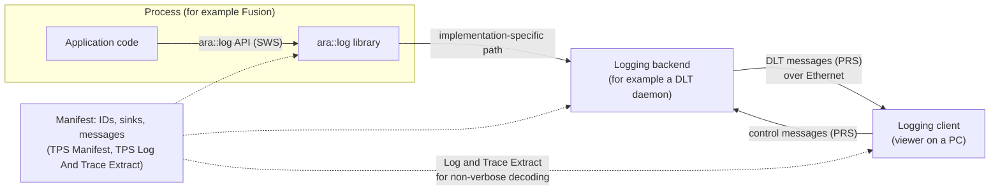

The SWS uses a few names for these parts that you will meet again: the *Logging framework* is the implementation as a whole, the *Logging backend* is the implementation of the LT protocol (for example DLT), and the *Logging client* is the external tool that can remotely interact with the framework (SWS, Table 2.1).

> **Key takeaways**
>
> - Log and Trace has an API (`ara::log`), a protocol (DLT version 2) and a configuration (manifest and Log and Trace Extract).
> - Only the API, the protocol and the configuration are standardized; the daemon, the console layout and the file format are not.
> - DLT is meant for development; the PRS recommends to deactivate it in production.
> - The same API serves applications and platform clusters.

---

## 2. Core Concepts and Terminology

> **Why this matters:** The specifications use a small set of terms very precisely, and they sometimes use two names for the same thing (a *modeled* message is a *non-verbose* message on the wire). Learn them once here; the rest of the guide uses them without further explanation.

### 2.1 Log Message, Log Level and Threshold

A **log message** is one unit of logging information, including its headers (SWS, Table 2.1). Each log message has a **log level** (the SWS also says *log severity level*): `Fatal`, `Error`, `Warn`, `Info`, `Debug` or `Verbose`, from most to least severe. A **threshold** (the *log reporting level*) is a filter: a message passes only if its level is at least as severe as the threshold (SWS, Section 7.1.2). The special level `Off` as a threshold blocks everything. [Chapter 9](#9-log-levels-and-filtering) covers levels in detail.

### 2.2 Who Sent It: ECU, Application, Context and Session

Four identifiers tell a reader where a message comes from:

| Identifier | Identifies | Example in `HPC` | Configured in |
| --- | --- | --- | --- |
| **ECU ID** | The ECU or machine | `HPC1` | `DltEcu.ecuId` |
| **Application ID** | One process instance | `FUSN` for `Fusion` | `DltApplication.applicationId` |
| **Context ID** | A logical group of messages within the application | `TRCK` for the tracking part of `Fusion` | `DltContext.contextId`, or a string in the code |
| **Session ID** | One instance of a software component, if the same component runs several times | not used in `HPC` | `DltLogSinkToPortPrototypeMapping.dltSessionId` |

The pair *(application ID, context ID)* identifies the source of a message within an ECU (PRS, Table 4.2). [Chapter 5](#5-identifying-the-source-ecu-application-context-and-session) explains the rules.

### 2.3 Logger and LogStream

A **`Logger`** is the C++ object that represents one context of one process; the SWS also calls it a *Logging instance* (SWS, Table 2.1). You never construct it yourself: a call to `CreateLogger` creates it inside the framework and returns a reference ([SWS_LOG_00005]). A **`LogStream`** is a temporary object that collects the arguments of one non-modeled message and sends the message when it is destroyed or flushed.

### 2.4 Non-Modeled and Modeled Messages; Verbose and Non-Verbose Mode

There are two classes of log messages (SWS, Section 7.2):

- A **non-modeled message** is built at run time from arguments: `logger.LogInfo() << "text" << 4.2;`. The whole message, including the type and optionally the name and unit of each argument, travels on the network. On the wire, this is a **verbose** message.
- A **modeled message** is defined in advance in the model as a `DltMessage`, with a unique message ID, a log level and typed arguments. The code calls `logger.Log(SpeedMsg, value)`. Only the message ID and the values travel on the network; the viewer adds the rest from the model. On the wire, this is a **non-verbose** message.

The parts that a modeled message leaves out are called **constant data**, and the values it sends are **variable data** (PRS, Table 4.2). The *Log And Trace Extract Template* calls them *predefined text* and *assembled data*.

> **Note:** A modeled message can still be sent in verbose form if the sink is configured so ([Section 8.8](#88-when-a-modeled-message-is-sent-verbose)). "Modeled" describes how the message is defined; "verbose" describes how it travels.

### 2.5 Sinks and Log Channels

A **log sink** is a destination for messages: the console, a file, the network through the DLT protocol, or a trace tool through ARTI. In the model, a sink is a `DltLogSink`, and its `category` is the *log mode* of the SWS (SWS, Section 7.1.3). A **log channel** is a named output path of the DLT protocol, for example one Ethernet connection to a logging client (PRS, Table 4.2).

### 2.6 The Log and Trace Extract

The **Log and Trace Extract** is the part of the model that describes the sources and the messages: `DltEcu`, `DltApplication`, `DltContext` and the `DltMessage`s with their arguments. It is defined by the *Log And Trace Extract Template* and is the same for the Classic and the Adaptive Platform. The viewer needs it to decode non-verbose messages; the generator needs it to create the C++ header of the modeled messages.

### 2.7 Logs and Traces

A **log message** describes something that happened, such as a state change or a value change. A **trace message** describes the flow through the software, for example the entry into a function (PRS, Table 4.2). In `ara::log`, a trace is simply a modeled message whose message type is a trace type, such as `DLT_TRACE_FUNCTION_IN`. A compile-time *trace switch* can route it to a trace tool instead of, or in addition to, the logger ([Chapter 14](#14-tracing)).

### 2.8 Logging Client and Control Messages

The **logging client** is the external tool that receives and stores the messages, for example a viewer on a PC. It can send **control messages** back to the ECU, for example to set the log level of one context, or to ask which applications and contexts exist ([Chapter 12](#12-controlling-a-running-ecu-control-messages)). The **trace status** is the on/off switch for trace messages of a context; control messages can change it too.

> **Key takeaways**
>
> - A message has a level; a threshold filters by level.
> - ECU ID, application ID and context ID identify the source; the session ID separates instances of one component.
> - Non-modeled messages travel verbose; modeled messages travel non-verbose with only a message ID and values.
> - The Log and Trace Extract describes sources and messages; viewers and generators read it.
> - Control messages let a logging client change levels and trace status at run time.

---

## 3. Log and Trace in the System Architecture

> **Why this matters:** Every other cluster logs through Log and Trace, so a misconfigured log setup hides the evidence of every other problem. This chapter shows what Log and Trace offers, what it needs, and how the platform clusters fit in.

### 3.1 Where Log and Trace Sits in the Platform

Log and Trace is a library-based cluster: `ara::log` runs inside each process that uses it ([guide 00, Section 6.3](00_LearningPath.md#63-the-hpc-machine)). Adaptive Applications, the libraries of other clusters inside those applications, and the platform daemons all use the same API. What happens behind the library is not standardized. A typical design has a log daemon that collects the messages of all processes, adds the ECU ID, applies the thresholds and sends the result to the network.

> **Note (implementation example):** The open-source COVESA `dlt-daemon` is one such design. Its user library sends messages to the daemon through named pipes (FIFOs), UNIX sockets or VSOCK sockets, selected at compile time, and keeps a ring buffer for messages that cannot be sent yet [EXT-049]. The daemon serves logging clients over TCP; its tools use port 3490 by default [EXT-048]. `dlt-daemon` implements version 1 of the protocol completely and version 2 only as a partial "minimum viable product" ([Section 11.10](#1110-version-1-and-version-2)) [EXT-046].

### 3.2 Interfaces Provided by Log and Trace

Log and Trace provides one interface, the class `Logger`, to applications and to the other functional clusters (SWS, Section 5.1). Its member functions are `IsEnabled`, `Log`, `LogDebug`, `LogError`, `LogFatal`, `LogInfo`, `LogVerbose`, `LogWarn` and `WithLevel`. According to SWS Table 5.1, Communication Management, Diagnostic Management, Execution Management, the Intrusion Detection System Manager, Network Management, Persistency, Platform Health Management, Raw Data Stream, State Management, Time Synchronization, Update and Configuration Management, Vehicle Update and Configuration Management and the Automotive API Gateway use it, most of them "to log standardized messages".

Log and Trace provides no service interfaces (SWS, Chapter 9).

### 3.3 Interfaces Required by Log and Trace

| Required from | Interface | Purpose |
| --- | --- | --- |
| Time Synchronization | `SynchronizedTimeBaseConsumer` | Timestamps of log messages ([Section 13.1](#131-where-timestamps-come-from)) |
| Operating system | (internal) | Processes, threads, IPC |
| TCP/IP stack | (internal) | Network sinks |
| Non-volatile storage | (internal) | File sinks; storing a configuration changed by control messages |

Source: SWS, Section 5.2 and Figure 5.2. Only the interface to Time Synchronization is a public ARA interface; the others are marked internal.

### 3.4 Interaction Map

The following diagram shows who talks to whom. Applications and platform clusters log through `Logger`; Log and Trace reads the time from Time Synchronization and sends DLT messages to the logging client, which sends control messages back.

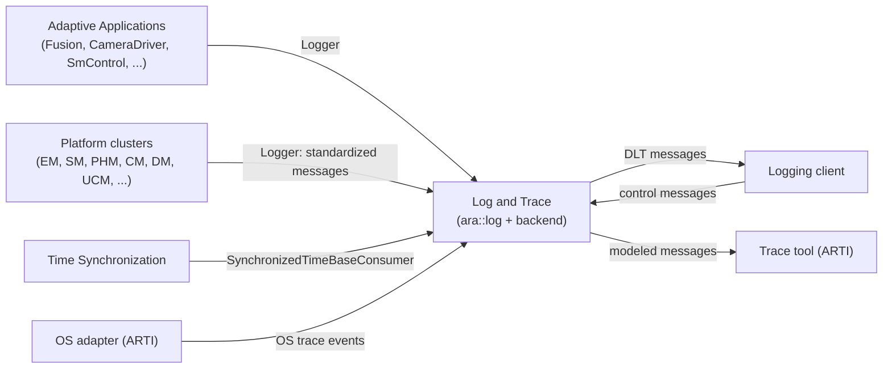

### 3.5 How Platform Clusters Log

The libraries and daemons of the platform clusters log with standardized context IDs and message ID ranges. AUTOSAR reserves the prefix `#` for context IDs of messages standardized by AUTOSAR ([PRS_Dlt_01054]), and SWS Core assigns one context ID and one range of message IDs to each cluster ([SWS_CORE_90024], status DRAFT): for example `#EXE` with `0x8000'4000` to `0x8000'4fff` for Execution Management and `#LOG` with `0x8000'6000` to `0x8000'6fff` for Log and Trace itself. [Guide 03, Section 12.5](03_CoreAndGeneral.md#125-logging-and-tracing-conventions) has the table; Appendix B of this guide repeats it.

Two meta-classes connect a cluster to a sink in the model ([Section 15.10](#1510-mappings-for-functional-clusters)):

- `FunctionalClusterToDltLogSinkMapping` maps a functional cluster, represented by its module instantiation, to a `DltLogSink` and a `DltContext` ([TPS_MANI_01476], new in R25-11).
- `PersistencyDeploymentToDltLogSinkMapping` maps a Persistency deployment to a sink ([TPS_MANI_03276]); [guide 11, Section 14.11](11_Persistency.md#1411-persistencylogging) covers it.

> **Key takeaways**
>
> - `ara::log` is a library inside each process; the backend behind it is implementation-specific.
> - The only provided interface is `Logger`; almost every cluster uses it.
> - The only public required interface is Time Synchronization, for timestamps.
> - Platform clusters log with `#`-prefixed context IDs and reserved message ID ranges.

---

## 4. Configuration Overview

> **Why this matters:** Most "my logs are missing" problems are configuration problems: a missing mapping, a sink of the wrong category, a threshold that filters everything. This chapter gives you the mental model; [Chapter 15](#15-configuration-reference-what-to-configure) lists every setting.

### 4.1 Where the Configuration Lives

| Level | Elements | Who configures, when | What it decides |
| --- | --- | --- | --- |
| Log and Trace Extract | `DltEcu`, `DltApplication`, `DltContext`; `LogAndTraceMessageCollectionSet` with `DltMessage`s; `DltArgumentPropsSet` | Application developer (messages, contexts), integrator (ECU, applications) | The IDs on the wire and the content of modeled messages |
| Application design | `LogAndTraceInterface` with a namespace; R-ports typed by it; `LTMessageCollectionToPortPrototypeMapping` | Application developer, before code generation | The `InstanceSpecifier`s for `CreateLogger`; the generated `messages.h` |
| Machine | `LogAndTraceInstantiation` in the `Machine`; `DltLogSink`s; `PlatformModuleEthernetEndpointConfiguration` | Machine integrator | Where messages go, the ECU ID, timestamps, session IDs |
| Deployment mappings | `DltApplicationToProcessMapping`, `DltLogSinkToPortPrototypeMapping` | Integrator | Which process has which application ID, which port logs with which context to which sink |
| Tracing | `TraceSwitchConfig` | Application developer or integrator, before code generation | Compile-time routing of trace messages |

The SWS defines no default values for these attributes (SWS, Section 10.1) and only one semantic constraint: every `LogAndTraceInterface` shall have a namespace ([SWS_LOG_CONSTR_00001]). Two "absent" behaviors are specified elsewhere: without a configured threshold, a logger uses `kWarn` ([SWS_LOG_00253]), and without a time base, messages carry no timestamp ([SWS_LOG_00083]).

> **Note:** The SWS says that applications "supply" their application ID, description, default log level and log mode "through the application execution manifest" (SWS, Section 7.1). In the R25-11 meta-model, these settings are not attributes of the `Executable` or the `Process`. They live in the Log and Trace Extract and in the machine configuration, connected to the process by mappings, as described here and in TPS Manifest Section 12.6.

### 4.2 How the Elements Relate

The following diagram shows the chain from a port in the code to a sink and to the IDs on the wire.

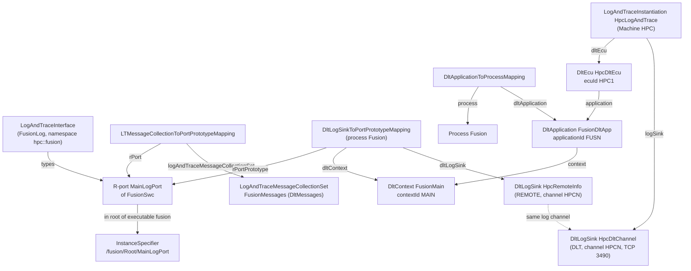

At run time, `CreateLogger` with the instance specifier `/fusion/Root/MainLogPort` makes the framework find the `DltLogSinkToPortPrototypeMapping` of the current process for that port. From it, the framework takes the context ID and the sinks; from the `DltApplicationToProcessMapping` of the process, the application ID; and from the `LogAndTraceInstantiation`, the ECU ID ([SWS_LOG_00251]).

### 4.3 Who Configures What, and When

| Role | Typical tasks | When |
| --- | --- | --- |
| Application developer | Defines contexts and modeled messages, the `LogAndTraceInterface` and its ports; writes the code with `CreateLogger` | Application design, before code generation |
| Software cluster integrator | Assigns application IDs, checks their uniqueness, maps ports to sinks and contexts | Deployment |
| Machine integrator | Defines the ECU ID, the sinks, the network endpoint, the time base and the session ID policy | Machine configuration |
| Tester or developer at run time | Changes thresholds and trace status through control messages | Operation |

The SWS gives the integrator the overall responsibility for unique application IDs: because the IDs are defined in the model, the integrator can check them (SWS, Section 7.1.1).

> **Key takeaways**
>
> - The Extract describes sources and messages; the machine describes sinks; mappings connect processes and ports to both.
> - The code knows only an `InstanceSpecifier`; the mapping of the current process resolves it to a context and sinks.
> - The SWS defines no defaults; only the `kWarn` threshold and "no timestamp without time base" are specified.
> - Application IDs belong to the integrator, context IDs and messages to the developer.

---

## 5. Identifying the Source: ECU, Application, Context and Session

> **Why this matters:** A trace of a whole machine is useless if you cannot tell which process wrote a line. The identifiers of this chapter are what a viewer filters by, and duplicates make messages of two sources indistinguishable.

### 5.1 ECU ID

**In plain words:** the ECU ID names the machine that sent a message, so that traces of several ECUs can be merged.

**Formally:** the ECU ID is the name of an ECU, composed of 8-bit ASCII characters (PRS, Table 4.2). In the model, it is `DltEcu.ecuId`, which shall exist ([constr_5294]). The machine refers to its `DltEcu` from the `LogAndTraceInstantiation` in the role `dltEcu`, and the referenced `ecuId` is transported in the header of each message ([TPS_MANI_03282]). The PRS highly recommends a vehicle-wide unique ECU ID (PRS, Section 5.1.2.1). There is no need for unique application IDs across ECUs, because the ECU ID is the differentiator (SWS, Section 7.1.1).

### 5.2 Application ID

**In plain words:** the application ID names the process instance that sent a message.

**Formally:** the application ID associates logging information with its application (SWS, Section 7.1.1). In the model, it is `DltApplication.applicationId`, with a description in `applicationDescription`; both shall exist ([constr_5296], [constr_5297]). A `DltApplicationToProcessMapping` assigns a `DltApplication` to a `Process` ([TPS_MANI_03286]). The rules:

- Application IDs are unique per process: if the same executable runs in several processes, each process needs its own ID (SWS, Section 7.1.1, note).
- The SWS recommends unique application IDs within one ECU, and makes the system integrator responsible for it (SWS, Section 7.1.1).
- The description exists because the ID is short; its maximum length is implementation-dependent (SWS, Section 7.1.1.1).

### 5.3 Context ID

**In plain words:** a context ID groups the messages of one part of a process, such as "main loop" or "object tracking", so that you can switch the levels of each part separately.

**Formally:** a context ID logically groups logging information within the scope of an application process (SWS, Section 7.1.4). Each application can own several contexts; context IDs are unique within an application, and the tuple of application ID and context ID identifies the source of a message (PRS, Table 4.2). In the model, `DltContext.contextId` and `contextDescription` shall exist ([constr_5298], [constr_5299]), and each `DltApplication` references at least one `DltContext` ([constr_5295]).

Two remarks from the SWS deserve attention:

- **Libraries.** A library runs in the process that uses it, so its messages appear under that process's application ID. Give each library its own context ID, and reserve it system-wide if several processes use the library (SWS, Section 7.1.4, note).
- **Contexts outside the model.** With the string overloads of `CreateLogger`, the context ID is passed in the code and "is not modeled in the manifest" (SWS, Section 7.1.4). With the `InstanceSpecifier` overload, it comes from the `DltContext` of the mapping ([SWS_LOG_00251]). A context in the model must reference at least one `DltMessage` ([constr_5300]), so a context that carries only non-modeled messages cannot be described in the Extract without at least one modeled message.

### 5.4 Reserved Prefixes

Two prefixes of context IDs are reserved:

| Prefix | Reserved for | Rule |
| --- | --- | --- |
| `#` (U+0023) | Messages standardized by AUTOSAR | [PRS_Dlt_01054]; the IDs are in [SWS_CORE_90024], for example `#EXE`, `#PHM`, `#SMX` |
| `+` (U+002B) | Messages defined by stack vendors | `+`, then the vendor's numeric ID in Base62 (two characters), then a vendor-defined rest ([PRS_Dlt_01055], [PRS_Dlt_01056]) |

The Base62 encoding uses the digit sequence `0`-`9`, `A`-`Z`, `a`-`z` ([PRS_Dlt_01056]). For the vendor ID `0x07bb` (1979): 1979 = 31 × 62 + 57, digit 31 is `V` and digit 57 is `v`, so the context IDs of this vendor start with `+Vv`, as in the PRS example. The highest vendor ID that fits into two characters is 3843 (`0x0f03`, encoded `zz`).

Application developers should therefore not start their context IDs with `#` or `+`.

### 5.5 Session ID

**In plain words:** if the same software component runs several times, the session ID tells the instances apart.

**Formally:** a session is the logical source of log or trace messages; if a component is instantiated several times, each instance has its own session with a globally unique session ID (PRS, Table 4.2). On the wire, it is a 32-bit unsigned integer in the extension header ([PRS_Dlt_00322], [PRS_Dlt_01024]). In the model, `LogAndTraceInstantiation.sessionIdSupport` switches the use of session IDs on or off for the machine, and `DltLogSinkToPortPrototypeMapping.dltSessionId` assigns the value for one port of one process. All mappings of the same port must use the same value ([constr_5292]).

### 5.6 Length of IDs

In version 1 of the protocol, application and context IDs had exactly four characters. Version 2 transports each ID with a length byte, so longer IDs are possible (PRS, Section 1 and [PRS_Dlt_01022]). The SWS notes that length limits apply only to version 1 (SWS, Sections 7.1.1 and 7.1.4).

> **Pitfall:** Long IDs are legal in version 2, but many tools, filters and habits still assume four characters. The running example keeps four-character IDs. The AUTOSAR context IDs themselves have four characters, with one DRAFT exception, `#SHWA` ([guide 03, Section 12.5](03_CoreAndGeneral.md#125-logging-and-tracing-conventions)).

### 5.7 Worked Example: the IDs of HPC

The following diagram shows the identifiers that `HPC` uses for its applications. The platform daemons log under vendor-specific application IDs with the standardized context IDs of their clusters.

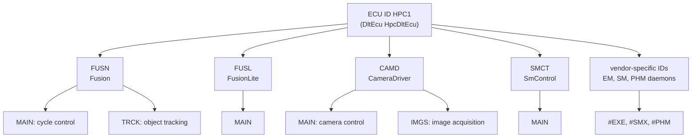

| Process | Application ID | Contexts | Session IDs |
| --- | --- | --- | --- |
| `Fusion` | `FUSN` | `MAIN` (cycle control and service handling), `TRCK` (object tracking) | not used (`sessionIdSupport` = `false`) |
| `FusionLite` | `FUSL` | `MAIN` | not used |
| `CameraDriver` | `CAMD` | `MAIN` (camera control), `IMGS` (image acquisition) | not used |
| `SmControl` | `SMCT` | `MAIN` | not used |
| EM, SM, PHM daemons | vendor-specific; this guide shows them as `EXEM`, `SMGR` and `PHMD` (illustrative) | `#EXE`, `#SMX`, `#PHM` ([SWS_CORE_90024]) | vendor-specific |

`HPC` runs each executable only once, so session IDs are switched off.

> **Key takeaways**
>
> - ECU ID per machine, application ID per process instance, context ID per logical group within the process.
> - Application IDs are the integrator's responsibility and must be unique on the ECU.
> - `#` is reserved for AUTOSAR, `+` plus Base62 vendor ID for stack vendors.
> - Session IDs separate several instances of one component; `HPC` does not need them.

---

## 6. Initialization, Loggers and Lifecycle

> **Why this matters:** A logger created the wrong way logs to the console instead of the network, ignores your modeled messages, or uses a threshold you never configured. This chapter explains how a logger is born and what happens before and after the backend is ready.

### 6.1 Initializing the Framework

`ara::log` is initialized together with the other clusters by `ara::core::Initialize(argc, argv)`, and its use before that is not allowed (SWS, Section 7.8.1; [guide 03, Section 5.2](03_CoreAndGeneral.md#52-initialize)). The framework shall be initialized if the executable has a port typed by a `LogAndTraceInterface` ([SWS_LOG_00004]). From the application's point of view, a logger instance is created when the application registers a context (SWS, Section 7.1.6).

### 6.2 Creating Loggers

All three `CreateLogger` functions return a reference to a `Logger` that the framework owns; the application cannot construct a `Logger` itself ([SWS_LOG_00005], [SWS_LOG_00259]). The context stays registered until the end of the process (SWS, Section 7.1.6, note).

| Overload | IDs come from | Threshold | Connected to the model? | Sinks |
| --- | --- | --- | --- | --- |
| `CreateLogger(const ara::core::InstanceSpecifier& is)` ([SWS_LOG_00256], DRAFT) | The model: context ID, application ID, ECU ID and session ID ([SWS_LOG_00251]) | From the configuration (see [Section 6.3](#63-where-the-threshold-comes-from)) | Yes | The sinks of the mapping |
| `CreateLogger(ctxId, ctxDescription)` ([SWS_LOG_00263]) | Context ID and description from the arguments | `defaultLogThreshold` of the corresponding sink, else `kWarn` ([SWS_LOG_00253]) | No | Console, if no model is available |
| `CreateLogger(ctxId, ctxDescription, ctxDefLogLevel)` ([SWS_LOG_00021]) | Context ID and description from the arguments | The given level ([SWS_LOG_00006]) | No | Console, if no model is available |

The `InstanceSpecifier` must name a port typed by a `LogAndTraceInterface` or by a `ServiceInterface` ([SWS_LOG_00251], [constr_5286], [constr_5287]). If it cannot be resolved, refers to the wrong kind of element, or is already in use in the process, `CreateLogger` raises a violation and the process is terminated ([SWS_LOG_00256]; [guide 03, Section 6.3](03_CoreAndGeneral.md#63-violations-fail-early)).

### 6.3 Where the Threshold Comes From

The flowchart summarizes how a new logger gets its initial threshold. Afterwards, the application can change it with `Logger::SetThreshold` ([SWS_LOG_00254]), and a logging client can change it with control messages ([Section 9.4](#94-changing-levels-at-run-time)).

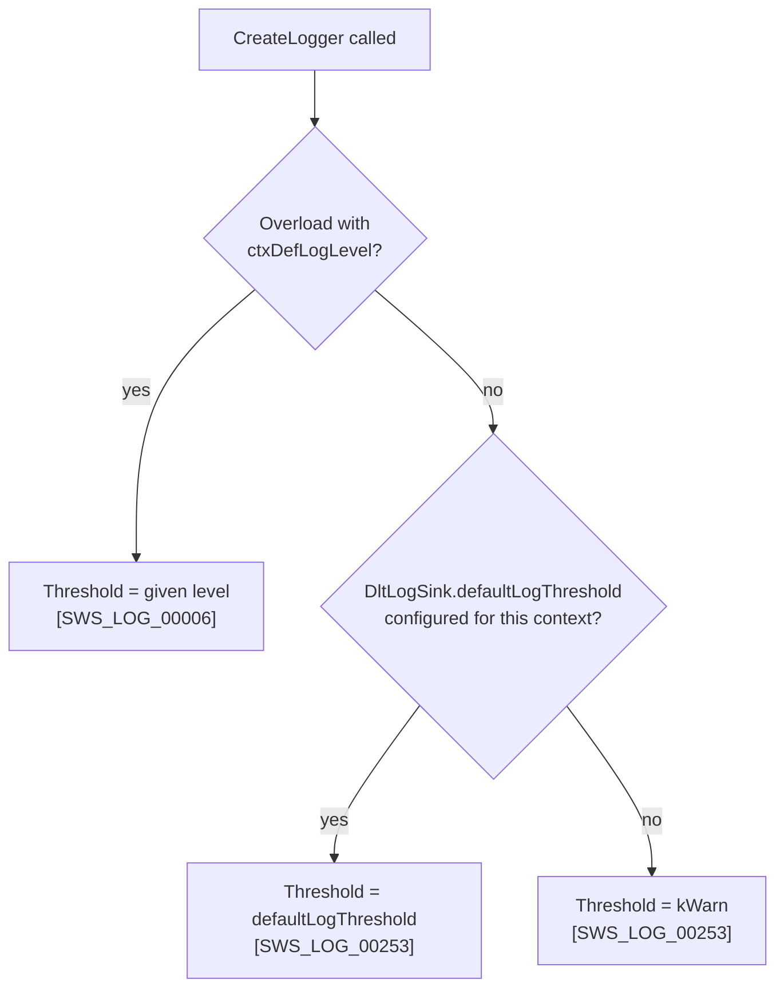

> **Note:** [SWS_LOG_00253] takes the threshold from "the DltLogSink that corresponds to the given context ID". The model maps sinks to *ports* (with a `DltContext`), not to context strings, and a port can have several sinks with different thresholds. Which threshold applies in those cases is not specified in R25-11. If the threshold matters, use the `InstanceSpecifier` overload with one sink per mapping, or pass the level explicitly.

### 6.4 Connected and Unconnected Loggers

A logger created with an `InstanceSpecifier` is *connected* to the model: the framework knows its context, its sinks and the modeled messages of its port. A logger created from strings is not. This difference matters for modeled messages: if `Logger::Log` is called on a logger that has no connection to the model, the call is ignored ([SWS_LOG_00257]).

> **Pitfall:** A team creates all loggers with `CreateLogger("MAIN", "Main context")`, adds modeled messages later, and sees nothing on the network. The modeled messages are silently dropped by [SWS_LOG_00257]. Use the `InstanceSpecifier` overload for every logger that sends modeled messages. Note that this overload has the status DRAFT in R25-11, so check the support of your stack.

### 6.5 Before the Backend Is Ready: the Queue

Messages logged while the framework cannot process them yet, for example because the connection to a log daemon is not established or the framework is not fully initialized, shall be queued. The queue size is `DltLogSink.queueSize`, counted in messages; when it is exceeded, the oldest entries are discarded ([SWS_LOG_00001]). The same rule applies when the log daemon crashes (SWS, Section 7.8.3).

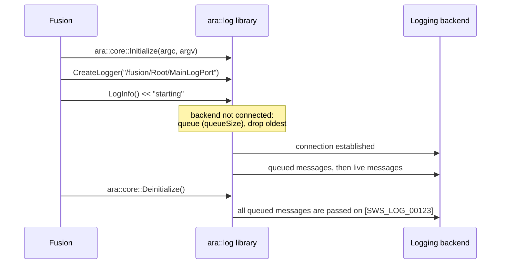

### 6.6 Shutdown and Daemon Crash

When `ara::core::Deinitialize()` is called, the framework passes all queued messages to the configured sinks ([SWS_LOG_00123]). After that, the application must not use the logging API any more (SWS, Section 7.8.2). [Guide 03, Section 5.4](03_CoreAndGeneral.md#54-what-works-before-initialize-and-after-deinitialize) explains why the return value of `Deinitialize` is the only error report you can still rely on at that point.

### 6.7 Knowing Whether Someone Listens

An application can register one callback that is called whenever the connection state to a logging client changes:

```cpp
#include "ara/log/logger.h"

void WatchLogClient() {
    // Only one handler can be installed; a second call replaces the first [SWS_LOG_00205].
    ara::log::RegisterConnectionStateHandler([](ara::log::ClientState state) {
        // kUnknown: backend not up yet; kNotConnected: no client; kConnected: client connected.
        g_clientConnected.store(state == ara::log::ClientState::kConnected);
    });
}
```

`ClientState` has the values `kUnknown` (-1, the DLT backend is not up and running yet), `kNotConnected` and `kConnected` ([SWS_LOG_00098]). The registration function is not thread-safe ([SWS_LOG_00205]); call it once at start-up.

### 6.8 Errors Are Swallowed

If anything goes wrong inside the logging framework or the system below it, the application is not bothered: the calls are silently discarded, and the logging interfaces neither return error values nor throw exceptions ([SWS_LOG_00002]). All `Log*()` interfaces are no-throw (SWS, Section 7.2). The only reports you can get are violations of `CreateLogger(InstanceSpecifier)` ([Section 6.2](#62-creating-loggers)) and the connection state ([Section 6.7](#67-knowing-whether-someone-listens)).

### 6.9 Worked Example: Fusion Sets Up Its Loggers

`Fusion` creates one logger per context from its two log ports. Instance specifiers have a leading slash ([SWS_CORE_10200]).

```cpp
#include "ara/core/initialization.h"
#include "ara/core/instance_specifier.h"
#include "ara/log/logger.h"

int main(int argc, char* argv[]) {
    if (!ara::core::Initialize(argc, argv).HasValue()) {
        return EXIT_FAILURE;
    }
    // Context MAIN: IDs, sinks and threshold come from the mapping of process Fusion.
    ara::log::Logger& mainLog =
        ara::log::CreateLogger(ara::core::InstanceSpecifier{"/fusion/Root/MainLogPort"});
    // Context TRCK: mapped to the sink HpcRemoteWarn, so Debug messages are filtered by default.
    ara::log::Logger& trackLog =
        ara::log::CreateLogger(ara::core::InstanceSpecifier{"/fusion/Root/TrackLogPort"});

    mainLog.LogInfo() << "Fusion started, cycle" << std::uint32_t{50} << "ms";
    // ... report kRunning to EM, run the 50 ms cycle (guides 04 and 07) ...
    (void)ara::core::Deinitialize();  // flushes queued messages [SWS_LOG_00123]
    return EXIT_SUCCESS;
}
```

> **Key takeaways**
>
> - `ara::core::Initialize` initializes `ara::log`; `Deinitialize` flushes the queue.
> - Use `CreateLogger(InstanceSpecifier)` for loggers that send modeled messages; string-created loggers ignore `Log`.
> - Without a configured threshold, a logger starts at `kWarn`.
> - Messages are queued (up to `queueSize`) until the backend is ready; the oldest are dropped first.
> - Logging never throws and never returns errors.

---

## 7. Writing Non-Modeled Messages

> **Why this matters:** Non-modeled messages are what most developers write every day. They are easy to use, but each argument costs bytes and CPU, and a few details (no `char`, thread rules of `LogStream`) cause surprising results.

### 7.1 The Builder Pattern

A non-modeled message is built like a stream. A member function of the logger creates a `LogStream` with a level; `operator<<` appends arguments; at the end of the statement, the temporary `LogStream` is destroyed and the message is sent (SWS, Section 7.2.1).

```cpp
mainLog.LogWarn() << "late radar input:" << delayMs << "ms";       // fixed level
mainLog.WithLevel(level) << "cycle" << cycleCounter << "done";    // level chosen at run time
```

| Function | Level | ID |
| --- | --- | --- |
| `LogFatal()` | Fatal | [SWS_LOG_00008], [SWS_LOG_00064] |
| `LogError()` | Error | [SWS_LOG_00009], [SWS_LOG_00065] |
| `LogWarn()` | Warn | [SWS_LOG_00010], [SWS_LOG_00066] |
| `LogInfo()` | Info | [SWS_LOG_00011], [SWS_LOG_00067] |
| `LogDebug()` | Debug | [SWS_LOG_00012], [SWS_LOG_00068] |
| `LogVerbose()` | Verbose | [SWS_LOG_00013], [SWS_LOG_00069] |
| `WithLevel(LogLevel)` | Given at run time | [SWS_LOG_00130], [SWS_LOG_00131] |

A message without any arguments serves no purpose and is discarded (SWS, Section 7.2).

### 7.2 Supported Argument Types

`ara::log` defines `operator<<` for all C++ arithmetic types, `bool`, string types and some `ara::core` types (SWS, Section 7.2.1). The last column shows how the LT protocol binding transports the value ([Section 10.6](#106-the-lt-protocol-binding)).

| Argument type | ID | On the wire (verbose) |
| --- | --- | --- |
| `bool` | [SWS_LOG_00040] | `BOOL` ([SWS_LOG_00235]) |
| `std::uint8_t`, `std::uint16_t`, `std::uint32_t`, `std::uint64_t` | [SWS_LOG_00041] to [SWS_LOG_00044] | `UINT` |
| `std::int8_t`, `std::int16_t`, `std::int32_t`, `std::int64_t` | [SWS_LOG_00045] to [SWS_LOG_00048] | `SINT` |
| `float`, `double` | [SWS_LOG_00049], [SWS_LOG_00050] | `FLOA` |
| `const char* const` (null-terminated UTF-8), `ara::core::StringView` | [SWS_LOG_00051], [SWS_LOG_00062] | `STRG`, UTF-8 ([SWS_LOG_00236]) |
| `ara::core::Span<const ara::core::Byte>` | [SWS_LOG_00128] | `RAWD` ([SWS_LOG_00237]) |
| `ara::core::InstanceSpecifier` | [SWS_LOG_00126] | `STRG`, the result of `ToString` ([SWS_LOG_00238]) |
| `ara::core::ErrorCode` | [SWS_LOG_00124] | implementation-defined; on the console, the domain name and the error number |
| `std::chrono::duration` | [SWS_LOG_00125] | implementation-defined; on the console, value and SI unit, for example `42ns` ([SWS_LOG_00233]) |
| `LogLevel` | [SWS_LOG_00063] | the level as text |
| `const void*` | [SWS_LOG_00127] | implementation-defined |
| `Argument<T>` (from `Arg`) | [SWS_LOG_00203] | the value with its attributes |

> **Pitfall:** There is no `operator<<` for `char`, because it could conflict with the overloads for `std::uint8_t` and `std::int8_t`. Logging a single `char` is implementation-defined and often prints the character code as a number (SWS, Section 7.2.1). Log a one-character `ara::core::StringView` instead.

### 7.3 Logging Your Own Types

You can log application types by writing an `operator<<` that uses the supported types (SWS, [SWS_LOG_00173] description):

```cpp
struct TrackState {
    std::uint16_t id;
    float x;
    float y;
};

ara::log::LogStream& operator<<(ara::log::LogStream& out, const TrackState& t) {
    return out << "track" << t.id << "at" << t.x << t.y;  // five arguments on the wire
}

trackLog.LogDebug() << "update" << TrackState{17U, 12.5F, -1.75F};
```

> **Pitfall:** Start such a message with a built-in argument, as above. `LogDebug()` returns a temporary `LogStream`, and a temporary cannot bind to the `LogStream&` parameter of a free `operator<<`; only the member overloads of `LogStream` can be called on it. The example in the SWS description of `LogStream` (`ctx0.LogDebug() << MyCustomType{...}`) has exactly this problem. The free overloads of `ara::log` itself (for `InstanceSpecifier`, `ErrorCode`, `duration`, `LogLevel`, `const void*`) behave the same way, unless your vendor adds an rvalue overload.

`ErrorCode` has its own overload, which makes error reports compact:

```cpp
auto result = calibrationProxy.GetCalibration(key).GetResult();
if (!result.HasValue()) {
    mainLog.LogError() << "GetCalibration failed:" << result.Error();  // domain and code
}
```

### 7.4 Names and Units with `Arg`

`ara::log::Arg` wraps a value together with an optional name, an optional unit and an optional formatting hint ([SWS_LOG_00201]):

```cpp
using ara::log::Arg;
mainLog.LogInfo() << Arg(cycleTimeUs, "cycleTime", "us") << Arg(trackCount, "tracks");
// Console: cycleTime:48210:us tracks:17      ([SWS_LOG_00228], [SWS_LOG_00229])
```

The call is ill-formed for types other than arithmetic types, `bool`, strings and raw data, and it is ill-formed to give a unit to a string, raw data or `bool` ([SWS_LOG_00201]). On the wire, the name and unit travel in the *Variable Info* of the verbose argument ([Section 11.6](#116-verbose-payload)).

### 7.5 Formatting Hints

Formatting hints ask the viewer to show a number in a certain way. The viewer decides whether it follows the hint (SWS, Section 7.2.1.2).

```cpp
using namespace ara::log;
mainLog.LogDebug() << Arg(statusRegister, "status", nullptr, Hex(8));     // hexadecimal, 8 digits
mainLog.LogDebug() << Arg(flags, "flags", nullptr, Bin());               // binary
mainLog.LogDebug() << Arg(yawRate, "yawRate", "deg/s", DecFloat(2));     // like printf "%.2f"
```

| Helper | Hint (`Fmt`) | Precision meaning |
| --- | --- | --- |
| `Dflt()` | `kDefault` | ignored; implementation-defined formatting |
| `Dec()`, `Dec(p)`; `Oct()`, `Oct(p)`; `Hex()`, `Hex(p)`; `Bin()`, `Bin(p)` | `kDec`, `kOct`, `kHex`, `kBin` | minimum number of digits, like `%.7d`; 0 counts as 1 |
| `DecFloat(p = 6)`, `EngFloat(p = 6)`, `HexFloat(p)` | `kDecFloat`, `kEngFloat`, `kHexFloat` | digits after the decimal point, like `%f`, `%e`, `%a` |
| `AutoFloat(p = 6)` | `kAutoFloat` | significant digits, like `%g` |
| `DecFloatMax()`, `EngFloatMax()`, `HexFloatMax()`, `AutoFloatMax()` | as above | enough digits for full round-trip safety |

Sources: [SWS_LOG_00206] to [SWS_LOG_00226]. The hints map to the *Type Format* and *Type Precision* bits of the verbose payload ([Section 11.6](#116-verbose-payload)).

### 7.6 Source Location, Tags and Privacy

`LogStream` has three modifiers that add information to the extension header of the message:

| Modifier | Adds | Rules | ID |
| --- | --- | --- | --- |
| `WithLocation(file, line)` | Source file identifier and line number | Usually `__FILE__` and `__LINE__` | [SWS_LOG_00129] |
| `WithTag(tag)` | A message tag for filtering; several tags keep their order | At most 255 characters, ASCII only | [SWS_LOG_00132], SWS 7.2.1.1 |
| `WithPrivacy(value)` | A privacy level | Integral or enum type; only the lower 8 bits are used | [SWS_LOG_00258] |

```cpp
mainLog.LogWarn().WithLocation(__FILE__, __LINE__).WithTag("perf") << "cycle overrun";
```

The PRS leaves the meaning of privacy levels to the project: there is no global definition of the values, and the viewer or forwarding instance must respect them (PRS, Section 5.1.2.6).

> **Note (implementation example):** No macro for `WithLocation` has been defined in the Adaptive Platform yet (SWS, Section 7.2.1). Projects typically add their own, for example `#define HPC_LOG_WARN(logger) (logger).LogWarn().WithLocation(__FILE__, __LINE__)`. Keep such macros in one project header, so that the source identifier (full path, file name or hash, see [Section 11.4](#114-the-extension-header)) is chosen in one place.

### 7.7 Avoiding Work When Nobody Listens

Building a message costs time even if the threshold filters it, because the arguments are evaluated first. `Logger::IsEnabled` tells whether a level would pass the logger's current threshold ([SWS_LOG_00007], [SWS_LOG_00070]):

```cpp
if (trackLog.IsEnabled(ara::log::LogLevel::kDebug)) {
    for (const auto& track : tracker.Tracks()) {   // expensive loop only when needed
        trackLog.LogDebug() << track;
    }
}
```

### 7.8 Keeping a LogStream: Flush and Scope

A `LogStream` can be stored in a variable to build one message over several lines. `Flush` sends the current content and starts a new message; otherwise, the message is sent when the variable goes out of scope (SWS, Section 7.2.1; [SWS_LOG_00039]).

```cpp
ara::log::LogStream line = trackLog.LogDebug();
for (const auto& track : tracker.Tracks()) {
    line << track.id;
}
line.Flush();                // message 1: all track IDs
line << "tracks:" << count;  // message 2, sent at the end of the scope
```

`Logger` member functions are thread-safe, but the member functions of `LogStream`, including `Flush` and all `operator<<`, are not ([Section 16.10](#1610-thread-safety-and-exception-safety-summary)). The SWS advises not to hold global `LogStream` objects in multi-threaded applications (SWS, Section 7.2.1). Keep each `LogStream` local to one thread.

### 7.9 Worked Example: CameraDriver Logs a Dropped Image

`CameraDriver` warns when the sensor delivers an image too late. During development, the team uses a non-modeled message:

```cpp
// CameraDriver, image thread; imageLog was created from "/camera_driver/Root/ImageLogPort".
if (frameAge > kMaxFrameAge) {
    imageLog.LogWarn() << "image dropped, frame" << frameCounter
                       << ara::log::Arg(std::chrono::duration_cast<std::chrono::milliseconds>(frameAge).count(),
                                        "age", "ms");
}
```

On the console, this appears as `... image dropped, frame 18342 age:41:ms` (the prefix is implementation-defined, [Section 10.4](#104-console-output-rules)). For production, the team replaces it by the modeled message `ImageDropped`, which sends only 4 bytes of payload ([Section 8.10](#810-worked-example-fusioncycleoverrun-from-model-to-wire)).

> **Key takeaways**
>
> - `LogInfo() << ...` builds and sends one verbose message per statement; `WithLevel` takes the level at run time.
> - All arithmetic types, `bool`, strings, bytes, `InstanceSpecifier`, `ErrorCode` and `duration` are supported; `char` is not.
> - `Arg` adds names, units and formatting hints; the viewer decides about the hints.
> - `WithLocation`, `WithTag` and `WithPrivacy` add extension header fields.
> - Use `IsEnabled` before expensive preparation, and keep `LogStream` objects thread-local.

---

## 8. Modeled Messages

> **Why this matters:** A verbose message repeats its texts, names and types every time it is sent. On a busy ECU, that is most of the log bandwidth. Modeled messages move all constant parts into the model and send only an ID and the values; they are the preferred choice in production systems (SWS, Section 7.2).

### 8.1 Why Model a Message

Modeled messages have three advantages (SWS, Sections 7.2 and 7.2.2):

1. **Less traffic.** Only the message ID and the variable data travel; the viewer adds the static parts from the model.
2. **Compile-time checking.** The generator creates a C++ symbol per message, and a call with wrong argument types does not compile ([SWS_LOG_00241]).
3. **Cheap filtering.** `Logger::Log` is a single call. If the message's level does not reach the threshold, the implementation can return after one `if`, without building a stream object.

Their disadvantage: the model must exist before the code, which is why non-modeled messages are "mainly used during development" (SWS, Section 7.2). Both classes can be used in the same application.

### 8.2 The Message Model

The following diagram shows the meta-classes of the Log and Trace Extract that describe messages (TPS Log And Trace Extract, Chapter 3).

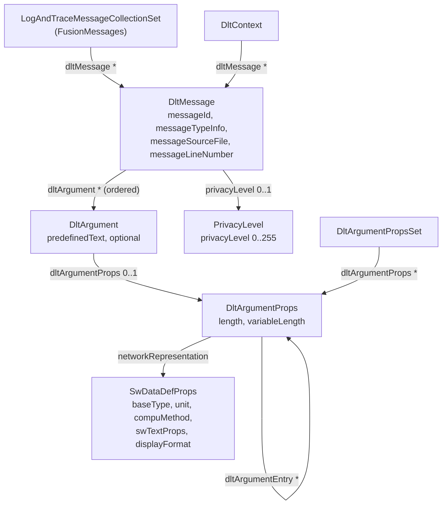

One log or trace message is one `DltMessage` ([TPS_DLTXT_00001]). Its message type and message info (the log level or trace type) come from `messageTypeInfo`, and its source position from `messageSourceFile` and `messageLineNumber` ([TPS_DLTXT_00002]). The user data are the ordered `DltArgument`s ([TPS_DLTXT_00003]). Only the standardized values may be used in `messageTypeInfo`, for example `DLT_LOG_WARN` or `DLT_TRACE_FUNCTION_IN`; custom values are not allowed ([TPS_DLTXT_00008]).

> **Note:** Since R25-11, the properties that describe an argument's representation live in a separate, reusable `DltArgumentProps`, typically collected in a `DltArgumentPropsSet` ([TPS_DLTXT_00015]). The AUTOSAR standard model of the platform's own messages uses one shared collection for all clusters (*Standardized M1 Models used for the Definition of AUTOSAR*, Foundation R25-11).

### 8.3 Predefined Text and Assembled Data

Each `DltArgument` is either predefined text (static) or assembled data ([TPS_DLTXT_00004]):

- **Predefined text** has only a short name, a `desc` with the text, and `predefinedText` = `true` ([TPS_DLTXT_00005]); it has no `DltArgumentProps` ([constr_9365]) and is never sent. It is available only in the ARXML file.
- **Assembled data** references a `DltArgumentProps`, whose network representation defines at least a base type and a unit ([TPS_DLTXT_00006]). Only assembled data is sent.

An argument can be marked `optional`, which means it may be omitted from the payload ([TPS_DLTXT_00014]); `optional` and `predefinedText` must not be set together ([constr_9364]).

### 8.4 Argument Types

The network representation of an argument decides its type on the wire. Primitive base types have 8, 16, 32 or 64 bits ([constr_5303]). An enumeration is a base type with a `CompuMethod` of category `TEXTTABLE` ([constr_5305]); the viewer shows the text instead of the number. A string is described as an array of characters with `swTextProps` for the character encoding ([TPS_DLTXT_00007]). Arrays and structures use `length` and nested `dltArgumentEntry` elements. The table summarizes which attributes describe which kind of argument ([constr_5363]):

| Kind | `length` | `dltArgumentEntry` | `baseType` of the top-level props |
| --- | --- | --- | --- |
| Predefined text | – | – | – |
| Primitive type | – | – | defined |
| String | defined (code points; maximum if `variableLength`) | – | defined |
| One-dimensional array | defined (number of entries) | – | defined |
| n-dimensional array | defined (number of dimensions) | defined (one per dimension, each with its `length`) | defined |
| Structure | – | defined (one per member) | – |

Sources: [TPS_DLTXT_00009] to [TPS_DLTXT_00013], [constr_5304], [constr_5364]. Value ranges (`dataConstr`) may be modeled but are irrelevant for the protocol (TPS Log And Trace Extract, Chapter 3).

### 8.5 Message IDs

The message ID identifies a modeled message on the wire. Rules:

- The ID must exist ([constr_5301]) and be unique within the ECU (SWS, Section 7.2.2.1); the PRS requires one ID per combination of constant data ([PRS_Dlt_00352]).
- IDs with bit 31 = 1 and bit 30 = 0 are reserved for messages standardized by AUTOSAR ([PRS_Dlt_01062]); SWS Core assigns each cluster a sub-range, for example `0x8000'4000` to `0x8000'4fff` for Execution Management ([SWS_CORE_90024]).
- IDs with bit 31 = 1 and bit 30 = 1 are reserved for stack vendors; bits 27 to 12 hold the vendor ID and bits 11 to 0 are free for the vendor ([PRS_Dlt_01053]).
- All other IDs, that is bit 31 = 0, are left to applications. `HPC` uses `0x0001'xxxx` for `Fusion` and `FusionLite`, `0x0002'xxxx` for `CameraDriver` and `0x0003'xxxx` for `SmControl`.

If a message ID is not uniquely related to one application ID and context ID, the application ID and context ID must be sent with the non-verbose message ([PRS_Dlt_01052]). The PRS names standardized logging and tracing as the typical case: the AUTOSAR model defines these messages once, without an application, and some of them, such as the violation messages of the Core library, can be logged by any process. [Section 18.3](#183-how-the-standardized-messages-are-identified) shows the effect in a trace.

### 8.6 From ARXML to `messages.h`

A workflow tool, the *ara::log Modeled Message Generator*, reads the `LogAndTraceMessageCollectionSet` and the configuration and generates one C++ header per collection set ([SWS_LOG_00246]). The rules:

| Rule | Content | ID |
| --- | --- | --- |
| Folder | `<ns0>/<ns1>/.../<nsN>/<name>/`: the namespace symbols of the `LogAndTraceInterface`, then the `shortName` of the collection set, all in lower case | [SWS_LOG_00244] |
| File name | `messages.h` | [SWS_LOG_00245] |
| Exclusivity | The symbols of one collection set are available only in its header | [SWS_LOG_00247] |
| Namespace | The interface's namespace symbols, then the collection set's `shortName`, all in lower case | [SWS_LOG_00248] |
| Include guard | `<PATH>_H_`, the path components joined with `_`, upper case | [SWS_LOG_00249] |
| One symbol per message | `constexpr static <Name>Type <Name>;`, where `<Name>Type` is implementation-defined | [SWS_LOG_00250] |

For `Fusion`, the interface `FusionLog` has the namespace `hpc::fusion` and the collection set is `FusionMessages`. The generated file is therefore `hpc/fusion/fusionmessages/messages.h`. A sketch of its content:

```cpp
// Generated (sketch). The type names and their content are implementation-defined [SWS_LOG_00250].
#ifndef HPC_FUSION_FUSIONMESSAGES_MESSAGES_H_
#define HPC_FUSION_FUSIONMESSAGES_MESSAGES_H_

namespace hpc {
namespace fusion {
namespace fusionmessages {

constexpr static FusionCycleOverrunType FusionCycleOverrun;  // 0x00010001, Warn: (uint32 us, uint32 us)
constexpr static TrackListSummaryType TrackListSummary;      // 0x00010002, Debug: (uint16)
constexpr static FusionCycleBeginType FusionCycleBegin;      // 0x00010101, trace function in: (uint32)
constexpr static FusionCycleEndType FusionCycleEnd;          // 0x00010102, trace function out: (uint32)

}  // namespace fusionmessages
}  // namespace fusion
}  // namespace hpc

#endif  // HPC_FUSION_FUSIONMESSAGES_MESSAGES_H_
```

`FusionLite` uses the same interface `FusionLog` but its own collection set `FusionLiteMessages`, so its header is `hpc/fusion/fusionlitemessages/messages.h`. Different namespaces per collection set avoid name clashes when two sets have messages of the same name (SWS, note to [SWS_LOG_00248]); the generator requires the interface to have a namespace ([SWS_LOG_CONSTR_00001]).

### 8.7 Calling `Logger::Log`

The application includes the generated header and calls the single function `Log` with the message symbol and the variable values, in model order ([SWS_LOG_00204]):

```cpp
#include "ara/log/logger.h"
#include "hpc/fusion/fusionmessages/messages.h"

namespace msg = hpc::fusion::fusionmessages;

void ReportOverrun(ara::log::Logger& mainLog, std::uint32_t cycleTimeUs) {
    // Predefined text "cycle overrun" is in the model; only the two values are passed.
    mainLog.Log(msg::FusionCycleOverrun, cycleTimeUs, std::uint32_t{50000});
}
```

The implementation uses the `DltMessage` that corresponds to the message ID ([SWS_LOG_00240]) and checks the argument types at compile time ([SWS_LOG_00241]); a call with an argument list that does not match the model is ill-formed ([SWS_LOG_00204]). Remember that `Log` is ignored on a logger that is not connected to the model ([SWS_LOG_00257], [Section 6.4](#64-connected-and-unconnected-loggers)).

`Logger::LogWith` sends a modeled message with additional attributes, for example a source location or a tag (SWS, Section 7.2.2.4; [SWS_LOG_00133]). The SWS shows `logger.LogWith(std::make_tuple(Location(FILE, LINE)), SpeedMsg, 4.2);`, but the attribute types `Location` and `Tag` are not declared in the API chapter of R25-11; the description of `LogWith` still marks the attribute type as "to be defined". Use `LogWith` only as far as your stack documents it.

### 8.8 When a Modeled Message Is Sent Verbose

The sink decides the format on the wire. If `DltLogSink.nonVerboseMode` is `false`, all modeled messages sent to that sink are composed as verbose messages; otherwise as non-verbose messages ([SWS_LOG_00242]). In verbose form, the message carries the types and names of its arguments, so a viewer without the Log and Trace Extract can still show it. This is useful when a tool has no access to the model.

### 8.9 Pitfall: the Outdated ARXML Example in the SWS

> **Pitfall:** The ARXML example in SWS Log and Trace, Section 7.2.2.3, puts `LENGTH` and `NETWORK-REPRESENTATION` directly into the `DLT-ARGUMENT`. In R25-11, the *Log And Trace Extract Template* moved these properties into `DltArgumentProps` ([TPS_DLTXT_00006], [TPS_DLTXT_00015]), and the R25-11 XML schema marks the old elements as removed (`atp.Status="removed"`). The old elements still pass schema validation, so a tool does not warn you. Model new messages with `DltArgumentProps`, as in [Section 8.10](#810-worked-example-fusioncycleoverrun-from-model-to-wire).

### 8.10 Worked Example: FusionCycleOverrun from Model to Wire

`Fusion` must finish each cycle within 50 ms. When it does not, it sends the modeled message `FusionCycleOverrun`. The model, taken from the validated running example file, has a predefined text and two assembled `uint32` arguments in microseconds:

```xml
<DLT-MESSAGE>
  <SHORT-NAME>FusionCycleOverrun</SHORT-NAME>
  <DLT-ARGUMENTS>
    <DLT-ARGUMENT>
      <SHORT-NAME>text</SHORT-NAME>
      <DESC>
        <L-2 L="EN">cycle overrun</L-2>
      </DESC>
      <PREDEFINED-TEXT>true</PREDEFINED-TEXT>
    </DLT-ARGUMENT>
    <DLT-ARGUMENT>
      <SHORT-NAME>cycleTime</SHORT-NAME>
      <DLT-ARGUMENT-PROPSS>
        <DLT-ARGUMENT-PROPS-REF-CONDITIONAL>
          <DLT-ARGUMENT-PROPS-REF DEST="DLT-ARGUMENT-PROPS">/HPC/DltArgumentPropsSets/HpcDltArgumentProps/uint32_microseconds</DLT-ARGUMENT-PROPS-REF>
        </DLT-ARGUMENT-PROPS-REF-CONDITIONAL>
      </DLT-ARGUMENT-PROPSS>
    </DLT-ARGUMENT>
    <DLT-ARGUMENT>
      <SHORT-NAME>budget</SHORT-NAME>
      <DLT-ARGUMENT-PROPSS>
        <DLT-ARGUMENT-PROPS-REF-CONDITIONAL>
          <DLT-ARGUMENT-PROPS-REF DEST="DLT-ARGUMENT-PROPS">/HPC/DltArgumentPropsSets/HpcDltArgumentProps/uint32_microseconds</DLT-ARGUMENT-PROPS-REF>
        </DLT-ARGUMENT-PROPS-REF-CONDITIONAL>
      </DLT-ARGUMENT-PROPSS>
    </DLT-ARGUMENT>
  </DLT-ARGUMENTS>
  <MESSAGE-ID>0x00010001</MESSAGE-ID>
  <MESSAGE-TYPE-INFO>DLT_LOG_WARN</MESSAGE-TYPE-INFO>
</DLT-MESSAGE>
```

Both arguments reference the reusable props `uint32_microseconds` (base type `uint32`, unit `Microsecond`):

```xml
<DLT-ARGUMENT-PROPS>
  <SHORT-NAME>uint32_microseconds</SHORT-NAME>
  <NETWORK-REPRESENTATIONS>
    <SW-DATA-DEF-PROPS>
      <SW-DATA-DEF-PROPS-VARIANTS>
        <SW-DATA-DEF-PROPS-CONDITIONAL>
          <BASE-TYPE-REF DEST="SW-BASE-TYPE">/HPC/SwBaseTypes/uint32</BASE-TYPE-REF>
          <UNIT-REF DEST="UNIT">/HPC/Units/Microsecond</UNIT-REF>
        </SW-DATA-DEF-PROPS-CONDITIONAL>
      </SW-DATA-DEF-PROPS-VARIANTS>
    </SW-DATA-DEF-PROPS>
  </NETWORK-REPRESENTATIONS>
</DLT-ARGUMENT-PROPS>
```

The flow from model to wire:

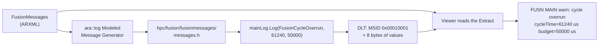

On the wire, the message has 25 bytes of headers and 8 bytes of payload ([Section 11.8](#118-byte-by-byte-two-messages-of-hpc)). The same information as a verbose message, with the text, two names and two units, needs 62 bytes of payload: 19 for the string, 23 and 20 for the two named integers with their units.

> **Key takeaways**
>
> - A modeled message is a `DltMessage` in the Extract: ID, type info and ordered arguments.
> - Predefined text stays in the model; assembled data is sent, typed by `DltArgumentProps`.
> - The generator creates `<namespace>/<set>/messages.h` with one constant per message; `Log` checks types at compile time.
> - IDs with bit 31 set are reserved for AUTOSAR and vendors; applications use the rest.
> - `nonVerboseMode = false` sends modeled messages verbose; the SWS ARXML example uses removed attributes.

---

## 9. Log Levels and Filtering

> **Why this matters:** Choosing levels is the most frequent logging decision, and the threshold is the most frequent reason why messages are "missing". This chapter gives the level semantics and shows every place where a message can be filtered.

### 9.1 The Six Levels and `kOff`

The same levels exist in four places, under four spellings. There is a 1:1 mapping between `ara::log` levels and protocol levels, and the log level of a `DltMessage` is translated into the protocol level of the same name ([SWS_LOG_00234]).

| `ara::log::LogLevel` ([SWS_LOG_00018]) | Value | Meta-model `LogTraceDefaultLogLevelEnum` | `DltMessage.messageTypeInfo` | MTIN on the wire ([PRS_Dlt_00619]) |
| --- | --- | --- | --- | --- |
| `kOff` | `0x00` | `off` | `DLT_LOG_OFF` | – (threshold only) |
| `kFatal` | `0x01` | `fatal` | `DLT_LOG_FATAL` | `0x1` |
| `kError` | `0x02` | `error` | `DLT_LOG_ERROR` | `0x2` |
| `kWarn` | `0x03` | `warn` | `DLT_LOG_WARN` | `0x3` |
| `kInfo` | `0x04` | `info` | `DLT_LOG_INFO` | `0x4` |
| `kDebug` | `0x05` | `debug` | `DLT_LOG_DEBUG` | `0x5` |
| `kVerbose` | `0x06` | `verbose` | `DLT_LOG_VERBOSE` | `0x6` |

In ARXML, the enumeration literals are written in upper case, for example `<DEFAULT-LOG-THRESHOLD>INFO</DEFAULT-LOG-THRESHOLD>`.

### 9.2 What Each Level Is For

The PRS proposes a meaning for each level (PRS, Section 7.1). The proposal is informative: producers should follow it, and consumers shall not derive actions from levels without an additional agreement.

| Level | Meaning (PRS 7.1) | Example in `HPC` |
| --- | --- | --- |
| Fatal | Unrecoverable error; the (sub-)system's stability is endangered; often the last message | `Fusion` cannot allocate its track memory at start-up |
| Error | The (sub-)system stops working correctly but might recover | `GetCalibration` fails; `CameraService` disappears |
| Warn | Correct behavior cannot be ensured, but the situation is under control | `FusionCycleOverrun`; `ImageDropped`; late radar input |
| Info | Major state changes and high-level context | `Fusion started`; `AdasStatusChanged`; `ExposureModeChanged` |
| Debug | Detailed information for developers; disable in production | Track list summary per cycle (`TRCK`) |
| Verbose | Even more detail: dumps of buffers and loops | Raw radar detections |

### 9.3 Where Filtering Happens

A message can be filtered at several points on its way. The first one is the logger's own threshold; the others depend on the implementation and the tool.

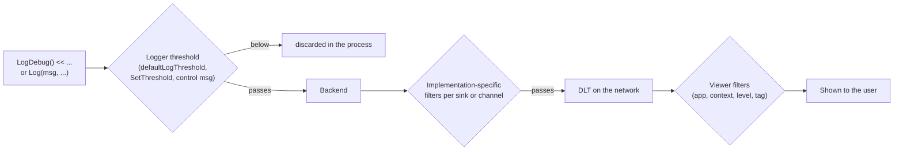

The threshold acts as a reporting filter: only messages with the same or a higher severity are processed, and the others are ignored (SWS, Section 7.1.2). The application-wide level and the context levels shall be adjustable at run time; the SWS leaves the realization to the backend, for example remotely through a logging client (SWS, Section 7.1.2).

### 9.4 Changing Levels at Run Time

| Who | How | Scope |
| --- | --- | --- |
| The application | `Logger::SetThreshold(LogLevel)` ([SWS_LOG_00254], [SWS_LOG_00255]) | One logger |
| A logging client | Control message `SetLogLevel` or `SetLogLevelLong` ([PRS_Dlt_00194], [PRS_Dlt_01057]) | One context, all contexts of an application, or the whole ECU |
| A logging client | `SetDefaultLogLevel` ([PRS_Dlt_00380]) | The default for contexts without an explicit level |
| A logging client | `SetLogChannelThreshold` ([PRS_Dlt_00639]) | One log channel |

After a `SetLogLevel`, the DLT module updates its setting and informs the registered applications ([PRS_Dlt_00195]). How the new level reaches the `Logger` object in the process is implementation-specific. [Section 12.8](#128-worked-example-debugging-trck-for-one-drive) shows an example.

### 9.5 Trace Status

The trace status is a second switch per context, for trace messages (PRS, Table 4.2). A logging client sets it with `SetTraceStatus` ([PRS_Dlt_00196]) and reads it with `GetTraceStatus` ([PRS_Dlt_00638]). In the model, `DltLogSink.defaultTraceState` defines the default trace status and is mandatory ([constr_5281]). SWS Log and Trace does not describe how the trace status affects `ara::log` calls; its effect is therefore implementation-specific.

> **Key takeaways**
>
> - Six levels plus `kOff`, with the same names in API, meta-model, `messageTypeInfo` and protocol.
> - Follow the PRS proposal: Warn means "still under control", Debug and Verbose are for development.
> - The logger's threshold filters first; backend and viewer may filter again.
> - Thresholds change at run time through `SetThreshold` or control messages.
> - `defaultTraceState` is mandatory, but its effect on `ara::log` is not specified.

---

## 10. Output Sinks

> **Why this matters:** The same message can go to the console, a file, the network or a trace tool. The sink category decides which attributes apply and where a sink may be referenced; a sink of the wrong category in the wrong place is the classic configuration error.

### 10.1 The Five Sink Categories

`DltLogSink.category` selects the output binding. AUTOSAR reserves five values ([TPS_MANI_03283]); each category accepts only some of the sink's attributes ([constr_5277]) and may be referenced only from certain places ([constr_5278], [constr_5279]).

| Category | Purpose | Applicable attributes | Referenced by |
| --- | --- | --- | --- |
| `DLT_LOGSINK_DLT` | Messages on a specific VLAN through a DLT log channel ([TPS_MANI_02385]) | `logChannelId`, `endpointConfiguration`, `nonVerboseMode`, `segmentationSupported` | `LogAndTraceInstantiation` only ([constr_5279]) |
| `DLT_LOGSINK_REMOTE` | Messages to a DLT log channel ([TPS_MANI_02384]) | `logChannelId` | `DltLogSinkToPortPrototypeMapping` only ([constr_5278]) |
| `DLT_LOGSINK_FILE` | Messages to the file in `path` ([TPS_MANI_02386]) | `path` | either |
| `DLT_LOGSINK_CONSOLE` | Messages to the console ([TPS_MANI_02387]) | `bufferOutput` | either |
| `DLT_LOGSINK_ARTI` | All modeled messages, unfiltered, to the ARTI trace API ([TPS_MANI_03325]) | none of the six | either |

The attributes `defaultLogThreshold`, `defaultTraceState` and `queueSize` are not restricted by [constr_5277] and apply to every category.

> **Note:** The SWS uses two other spellings. Section 7.2.2.1 writes `DltLogSinkRemote`, `DltLogSinkDlt`, `DltLogSinkFile` and `DltLogSinkConsole`, and Section 7.7.4.1 names `DLT_LOGSINK_NETWORK` as a category of the LT protocol binding. `DLT_LOGSINK_NETWORK` is not among the values reserved by [TPS_MANI_03283]. Use the five TPS literals.

### 10.2 Machine Sinks and Per-Port Sinks

The two DLT categories work together. A `DLT_LOGSINK_DLT` sink belongs to the machine: it defines a log channel and the network endpoint of that channel. A `DLT_LOGSINK_REMOTE` sink belongs to a port mapping: it names the log channel to which that port's messages go, and can carry its own default threshold. The following diagram shows the structure of `HPC`.

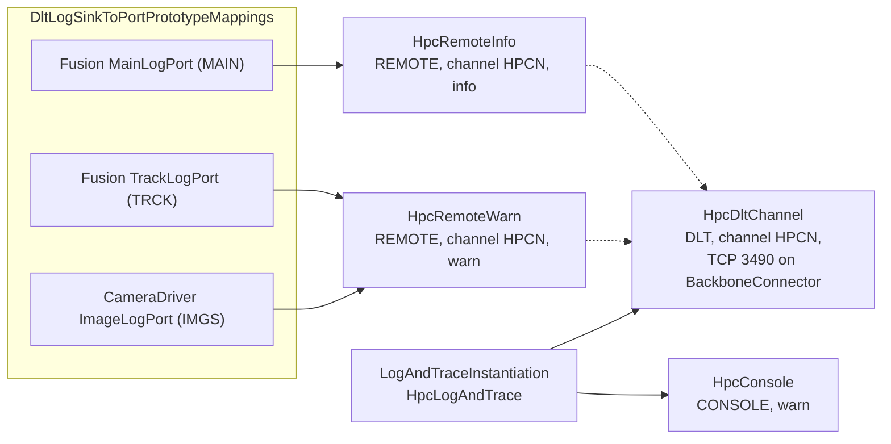

The connection from a REMOTE sink to the DLT sink is the log channel ID. The TPS does not define a meta-model reference between the two; the matching ID is what connects them ([TPS_MANI_02384], [TPS_MANI_02385]).

### 10.3 The Network Sink

The output channel on Ethernet is configured with a `PlatformModuleEthernetEndpointConfiguration`, referenced by the DLT sink as `endpointConfiguration` ([TPS_MANI_03163]). Its `tcpPort` or `udpPort` reference an `ApApplicationEndpoint` of the communication connector, which selects the transport protocol and the port number; the IP address comes from the `NetworkEndpoint` of the connector. The PRS does not prescribe a transport or a port.

If `segmentationSupported` is `true`, messages larger than the `maximumTransmissionUnit` of the connector are segmented (TPS Table 12.55; SWS, Section 7.2.2.1). [Section 11.7](#117-segmentation-of-large-messages) describes the protocol.

> **Note (implementation example):** `HPC` offers its DLT channel as a TCP server on port 3490. This is the default port of the COVESA `dlt-receive` tool [EXT-048] and of most DLT viewers, which saves configuration on the developer's side. The port number is a project choice, not an AUTOSAR rule.

### 10.4 Console Output Rules

Much of the console output is implementation-defined, for example the general layout, the timestamp format and which header elements are shown (SWS, Section 7.7.2.1). The SWS fixes only these rules:

| Rule | Example | ID |
| --- | --- | --- |
| Each message ends with an end-of-line sequence | – | [SWS_LOG_00227] |
| Arguments are separated by a single space | `speed 4.1 m/s` | [SWS_LOG_00228] |
| A name is prepended and a unit appended, each with a colon | `speed:42.1:km/h` | [SWS_LOG_00229] |
| `bool` is `0` or `1` | `1` | [SWS_LOG_00230] |
| Raw bytes are hex octets separated by apostrophes | `48'65'6c'6f` | [SWS_LOG_00231] |
| `InstanceSpecifier` is printed with `ToString` | `/fusion/Root/MainLogPort` | [SWS_LOG_00232] |
| `std::chrono::duration` is an integer with its SI unit (at least nano to giga) | `42ns` | [SWS_LOG_00233] |
| An `Arg` with attributes is shown as one argument | `cycleTime:48210:us` | [SWS_LOG_00203] |

The console sink has one attribute of its own, `bufferOutput`, which defines whether a buffer is used.

### 10.5 File Output

A file sink writes to the file named in `path`. Its appearance is implementation-defined (SWS, Section 7.7.3), and the SWS describes the option as meant for development, integration and prototyping, "not suitable for production" (SWS, Section 7.1.3.1).

> **Note (implementation example):** Many tools store DLT messages in `.dlt` files, which add the PRS *storage header* in front of each received message ([Section 11.9](#119-storing-messages-in-files-the-storage-header)). The COVESA daemon can also store logs on the ECU ("offline logstorage"), configured in its own `dlt.conf` [EXT-050].

### 10.6 The LT Protocol Binding

When a message goes to a DLT sink, the argument types are mapped to the verbose types of the protocol:

| `ara::log` type | DLT type | ID |
| --- | --- | --- |
| Log level of a `DltMessage` | The protocol log level of the same name | [SWS_LOG_00234] |
| `bool` | `BOOL` | [SWS_LOG_00235] |
| `const char*`, `ara::core::StringView` | `STRG` with TYFM UTF-8 | [SWS_LOG_00236] |
| `ara::core::Span<const ara::core::Byte>` | `RAWD` | [SWS_LOG_00237] |
| `InstanceSpecifier` | `STRG` with TYFM UTF-8, the result of `ToString` | [SWS_LOG_00238] |

Integers and floating-point numbers map naturally to `SINT`, `UINT` and `FLOA` with the matching length; the SWS does not list them separately.

### 10.7 The ARTI Sink

A sink of category `DLT_LOGSINK_ARTI` forwards all modeled messages, with all their parameters and without filtering, to the trace tool through `apext::log::TraceArti` ([TPS_MANI_03325]; SWS, Section 7.6.3). [Chapter 14](#14-tracing) explains tracing.

### 10.8 Choosing Sinks for Development and Production

| Phase | Typical sinks | Why |
| --- | --- | --- |
| Desktop development | Console (`DLT_LOGSINK_CONSOLE`) | No tools needed; readable immediately |
| Integration on the target | DLT sink on the backbone, non-verbose with a viewer that has the Extract; REMOTE sinks per port with `info` | Full picture of the machine, low bandwidth |
| Timing analysis | ARTI sink or trace switches ([Chapter 14](#14-tracing)) | Minimal run-time influence |
| Production | DLT deactivated or limited to warnings, with protected activation (PRS, Section 1.2.1); no file sink | Security and resources |

> **Key takeaways**
>
> - Five categories: DLT, REMOTE, FILE, CONSOLE, ARTI; each accepts only some attributes.
> - DLT sinks belong to the machine; REMOTE sinks belong to port mappings and name the DLT log channel.
> - The network endpoint (TCP or UDP port) comes from a `PlatformModuleEthernetEndpointConfiguration`.
> - Console and file formats are mostly implementation-defined; only a few console rules are standardized.
> - Use the TPS literals; `DLT_LOGSINK_NETWORK` in the SWS is not one of them.

---

## 11. The DLT Protocol, Version 2

> **Why this matters:** When a viewer shows garbage, drops messages or cannot decode anything, you have to look at bytes. This chapter gives you the layout of a DLT version 2 message, checked against the R25-11 PRS, and decodes two messages of `HPC` byte by byte.

### 11.1 Message Layout

Every DLT message, data or control, has the same format: a *Base Header*, an optional *Extension Header* and a *Payload* (PRS, Table 5.1). Both headers use network byte order, that is big-endian ([PRS_Dlt_01000]).

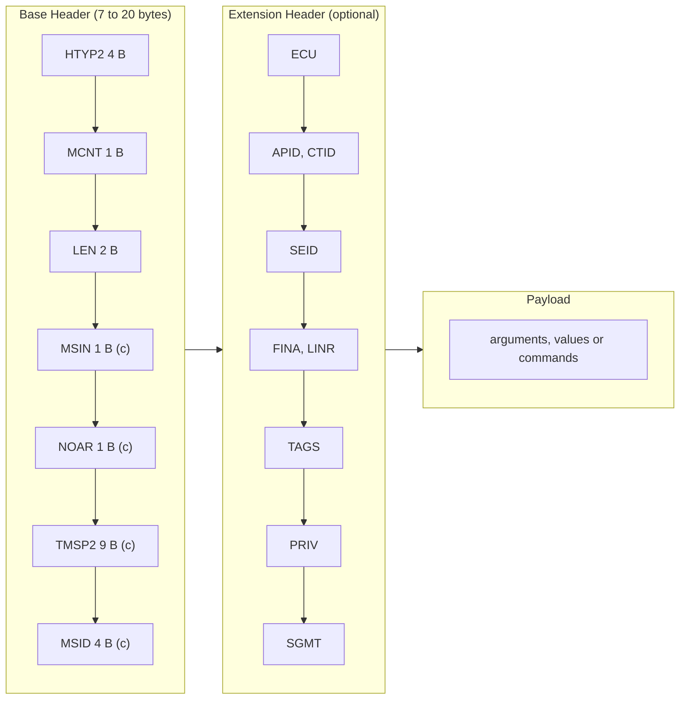

The fields marked (c) are conditional; their presence depends on the kind of message. All fields of the extension header are optional; flags in the base header announce them.

### 11.2 The Base Header

The base header always starts with the 32-bit header type `HTYP2`, the 8-bit message counter `MCNT` and the 16-bit length `LEN` ([PRS_Dlt_01001]). The conditional fields follow in a fixed order without gaps ([PRS_Dlt_01002]).

**Header type `HTYP2`** ([PRS_Dlt_01006] to [PRS_Dlt_01011]; PRS Table 5.2). Byte 0 holds bits 0 to 7, byte 1 holds bits 8 to 15:

| Byte | Bit 7 | Bit 6 | Bit 5 | Bit 4 | Bit 3 | Bit 2 | Bit 1 | Bit 0 |
| --- | --- | --- | --- | --- | --- | --- | --- | --- |
| 0 | VERS | VERS | VERS | WSID | WACID | WEID | CNTI | CNTI |
| 1 | reserved | reserved | reserved | reserved | WSGM | WPVL | WTGS | WSFLN |
| 2, 3 | reserved | reserved | reserved | reserved | reserved | reserved | reserved | reserved |

| Field | Meaning |
| --- | --- |
| CNTI (bits 0-1) | Content information: `0` verbose data message, `1` non-verbose data message, `2` control message, `3` reserved ([PRS_Dlt_01009]) |
| WEID, WACID, WSID (bits 2-4) | With ECU ID; with application and context ID; with session ID |
| VERS (bits 5-7) | Protocol version; `2` for this specification. It sits at the same position as in version 1, so a receiver can always tell the versions apart ([PRS_Dlt_01010]) |
| WSFLN, WTGS, WPVL, WSGM (bits 8-11) | With source file name and line number; with tags; with privacy level; with segmentation |

If any of the "with" flags is set, an extension header follows ([PRS_Dlt_01011]).

**Message counter `MCNT`.** An unsigned 8-bit counter per log channel: `0` after initialization, incremented for each message sent to the channel, wrapping from 255 to 0 ([PRS_Dlt_00319], [PRS_Dlt_00613], [PRS_Dlt_00105], [PRS_Dlt_00106]). A receiver can use it to detect lost messages.

**Length `LEN`.** An unsigned 16-bit value: the length in bytes of the complete message, that is base header, extension header and payload ([PRS_Dlt_00320], [PRS_Dlt_00614]). A single message is therefore at most 65535 bytes long, or less if the transport limits it.

**Conditional fields.** Which fields appear depends on the kind of message:

| Field | Size | Verbose data | Non-verbose data | Control | Rule |
| --- | --- | --- | --- | --- | --- |
| MSIN (message info) | 1 byte | yes | – | yes | [PRS_Dlt_01003] |
| NOAR (number of arguments) | 1 byte | yes | – | yes | [PRS_Dlt_01003], [PRS_Dlt_00326] |
| TMSP2 (timestamp) | 9 bytes | yes | yes | – | [PRS_Dlt_01004] |
| MSID (message ID) | 4 bytes | – | yes | – | [PRS_Dlt_01005], [PRS_Dlt_00624] |

A non-verbose message has no MSIN and no NOAR: its message type, level and number of arguments are recovered from the Log and Trace Extract through the message ID ([PRS_Dlt_00134]).

### 11.3 Message Type and Message Info

The message info `MSIN` has bit 0 reserved, the 3-bit message type `MSTP` in bits 1 to 3 and the 4-bit message type info `MTIN` in bits 4 to 7 ([PRS_Dlt_00618], [PRS_Dlt_00324], [PRS_Dlt_00325]).

| MSTP ([PRS_Dlt_00120]) | Kind | MTIN values |
| --- | --- | --- |
| `0x0` `DLT_TYPE_LOG` | Log message | `0x1` FATAL, `0x2` ERROR, `0x3` WARN, `0x4` INFO, `0x5` DEBUG, `0x6` VERBOSE ([PRS_Dlt_00619]) |
| `0x1` `DLT_TYPE_APP_TRACE` | Trace message | `0x1` VARIABLE, `0x2` FUNCTION_IN, `0x3` FUNCTION_OUT, `0x4` STATE, `0x5` VFB ([PRS_Dlt_00620]) |
| `0x2` `DLT_TYPE_NW_TRACE` | Network message | `0x1` IPC, `0x2` CAN, `0x3` FLEXRAY, `0x4` MOST, `0x5` ETHERNET, `0x6` SOMEIP, `0x7`-`0xF` user-defined ([PRS_Dlt_00621]) |
| `0x3` `DLT_TYPE_CONTROL` | Control message | `0x1` REQUEST, `0x2` RESPONSE ([PRS_Dlt_00622]) |

For example, an Info log message has MSIN = `0x40` (MSTP 0, MTIN 4).

**Timestamp `TMSP2`.** Nine bytes: a 32-bit nanoseconds part and a 40-bit seconds part, counted from 1970-01-01 00:00:00, that is a global time from a synchronized time base ([PRS_Dlt_01012]). The nanoseconds part is valid from 0 to 999 999 999; bits 30 and 31 are reserved. If the ECU cannot provide an absolute time, bit 31 of the nanoseconds part is set and the time counts from the ECU start-up ([PRS_Dlt_01013]). The value is the time when the application called the module ([PRS_Dlt_01014]).

> **Note:** The PRS is not consistent about the order of the two parts. Figure 5.1 shows the nanoseconds part before the seconds part, while [PRS_Dlt_01012] calls the nanoseconds the "lower 4 bytes" and the seconds the "upper 5 bytes", which with big-endian headers would put the seconds first. The storage header puts the seconds first ([PRS_Dlt_00405]). This guide follows Figure 5.1 for the base header; check the order with your tool vendor.

### 11.4 The Extension Header

The extension header carries information about the origin and handling of a message. All its fields are optional, appear in the order of their flags in `HTYP2`, and follow the base header directly ([PRS_Dlt_01015], [PRS_Dlt_01016]). Most fields use a "length, value" scheme, so that a receiver can skip fields it does not understand (PRS, Section 5.1.2).

| Field | Flag | Content | Rules |
| --- | --- | --- | --- |
| ECU | WEID | 1 length byte, then the ECU ID in ASCII without NUL | [PRS_Dlt_01017] to [PRS_Dlt_01019] |
| APID, CTID | WACID | Length byte and ASCII application ID, then length byte and ASCII context ID | [PRS_Dlt_01020] to [PRS_Dlt_01023] |
| SEID | WSID | Session ID, 32-bit unsigned, no length byte | [PRS_Dlt_01024], [PRS_Dlt_00322] |
| FINA, LINR | WSFLN | Length byte and UTF-8 source file identifier (at most 255 bytes), then the 32-bit line number (starting at 1) | [PRS_Dlt_01025] to [PRS_Dlt_01030] |
| TAGS | WTGS | 8-bit number of tags (at most 255), then for each tag a length byte and the ASCII name | [PRS_Dlt_01031] to [PRS_Dlt_01034] |
| PRIV | WPVL | Privacy level, one unsigned byte; no global meaning of the values | [PRS_Dlt_01035], [PRS_Dlt_01036] |
| SGMT | WSGM | Segmentation information ([Section 11.7](#117-segmentation-of-large-messages)) | [PRS_Dlt_01043] to [PRS_Dlt_01051] |

The source file identifier does not have to be a file name: it can be a stem, a full or relative path, or, if the origin is sensitive, a hash (PRS, Section 5.1.2.4).

### 11.5 Non-Verbose Payload

A non-verbose message carries only the variable data, consistently packed and byte-aligned ([PRS_Dlt_00378]). Everything else is recovered from the Log and Trace Extract through the message ID: the type information of each argument ([PRS_Dlt_00353]) and the header information MSTP, MSIN, NOAR, file name and line number ([PRS_Dlt_00134]). The software supplier of the application provides this description (PRS, Section 5.1.3.1.2).

Three further rules:

- If a message ID is not uniquely related to one application ID and context ID in the Extract, these IDs must be sent in the extension header ([PRS_Dlt_01052]).
- Constant data that is nevertheless sent in a non-verbose message takes precedence over the Extract ([PRS_Dlt_01037]); the PRS calls this an exception.
- The number of arguments is not limited by NOAR, only by the overall length of 65535 bytes (PRS, Section 5.1.3.1.1).

The PRS states the byte order only for the headers ([PRS_Dlt_01000]). The R25-11 version 2 does not state the byte order of payload data. Agree on it with your tool vendor.

### 11.6 Verbose Payload

A verbose message carries up to 255 arguments, each as a pair of *Type Info* and data ([PRS_Dlt_00459]). The 32-bit Type Info describes the data that follows ([PRS_Dlt_00135], [PRS_Dlt_00625]):

| Bits | Field | Meaning |
| --- | --- | --- |
| 0-3 | TYLE | Type length: `1` 8 bit, `2` 16 bit, `3` 32 bit, `4` 64 bit, `5` 128 bit; `0` for strings, structs, raw data and trace info ([PRS_Dlt_00626], [PRS_Dlt_00354]) |
| 4 | BOOL | Boolean (TYLE 1) |
| 5, 6, 7 | SINT, UINT, FLOA | Signed integer, unsigned integer, float (IEEE 754) |
| 8 | ARAY | n-dimensional array of BOOL, SINT, UINT or FLOA |
| 9 | STRG | String: 16-bit length, then the characters without NUL ([PRS_Dlt_00156], [PRS_Dlt_00373]) |
| 10 | RAWD | Raw data: 16-bit length, then the bytes ([PRS_Dlt_00160], [PRS_Dlt_00374]) |
| 11 | VARI | Variable info: a name, and for numbers a unit, precede the data ([PRS_Dlt_00410], [PRS_Dlt_00357]) |
| 12 | FIXP | Fixed point: quantization and offset precede the data; only with SINT or UINT ([PRS_Dlt_00389], [PRS_Dlt_00169]) |
| 13 | TRAI | Trace info: a string such as a module or function name ([PRS_Dlt_00170]) |
| 14 | STRU | Struct of further typed entries |
| 15-17 | TYFM | Type format: for STRG `0` ASCII, `1` UTF-8; for SINT/UINT `0` base 10, `1` base 8, `2` base 16, `3` base 2; for FLOA `0` implementation-defined, `1` `%f`, `2` `%e`, `3` `%a`, `4` `%g` ([PRS_Dlt_00783]) |
| 18-23 | TYPR | Type precision: for integers, minimum digits plus one; for floats, digits after the point plus one, `63` for loss-less ([PRS_Dlt_00785]) |
| 24-31 | – | reserved |

The formatting hints of `ara::log` ([Section 7.5](#75-formatting-hints)) map onto TYFM and TYPR. Some Type Info values of `HPC` messages, computed from this table:

| Argument | Type Info | Fields set |
| --- | --- | --- |
| `"objects published:"` (`const char*`) | `0x00008200` | STRG, TYFM 1 (UTF-8, [SWS_LOG_00236]) |
| `std::uint16_t{17}` | `0x00000042` | TYLE 2, UINT |
| `Arg(status, "status", nullptr, Hex(8))` with `std::uint32_t` | `0x001D0843` | TYLE 3, UINT, VARI, TYFM 2 (base 16), TYPR 7 (8 digits) |

The PRS example of a named `uint8` (name `temperature`, unit `Celsius`, value 25) has TYLE 1, UINT and VARI set, followed by two 16-bit lengths (11 and 7), the two strings and one data byte (PRS, Table 5.9).

### 11.7 Segmentation of Large Messages

A message that does not fit into one frame, or into the 65535 bytes of LEN, can be split. The module decides from the frame length limit whether segmentation is needed; small messages should not be segmented ([PRS_Dlt_01043]). A segmented message sets WSGM and carries the segmentation information in the extension header ([PRS_Dlt_01044], [PRS_Dlt_01045]):

| Frame type | Value | Details | Rule |
| --- | --- | --- | --- |
| FirstFrame | `0` | 64-bit TotalLength of the whole payload | [PRS_Dlt_01049] |
| ConsecutiveFrame | `1` | 32-bit SequenceCounter, from 0, no wrap-around | [PRS_Dlt_01050] |
| LastFrame | `2` | no details; marks success | [PRS_Dlt_01046] |
| AbortFrame | `3` | 8-bit reason: `0` none, `1` communication timeout, `2` insufficient resources, `3` sequence or protocol error | [PRS_Dlt_01048] |

The sequence is one FirstFrame, zero or more ConsecutiveFrames and one LastFrame; an AbortFrame cancels it, and the next allowed frame is a new FirstFrame ([PRS_Dlt_01046], [PRS_Dlt_01048]). Each frame carries the next slice of the payload ([PRS_Dlt_01051]). In the model, `DltLogSink.segmentationSupported` enables it per DLT sink.

> **Note:** SWS Log and Trace, Section 7.3, contains an older, informal "proposal" for segmentation without requirement IDs. The normative format is the one of the PRS.

### 11.8 Byte by Byte: Two Messages of HPC

The following dumps were computed from the tables of this chapter. The time is 2026-10-31 08:15:00.250 UTC (seconds `0x6AE5A384`), synchronized with `VehicleTime`.

**1. The non-verbose message `FusionCycleOverrun`** (`0x00010001`), with the ECU ID but without application and context IDs, because the message ID is unique to `FUSN`/`MAIN` in the Extract ([PRS_Dlt_01052]):

```text
Offset  Bytes                 Field
  0     45 00 00 00           HTYP2: CNTI=1 (non-verbose), WEID=1, VERS=2
  4     2A                    MCNT = 42
  5     00 21                 LEN = 33 (25 header bytes + 8 payload bytes)
  7     0E E6 B2 80           TMSP2 nanoseconds = 250 000 000 (bit 31 = 0: synchronized)
 11     00 6A E5 A3 84        TMSP2 seconds = 1 793 434 500
 16     00 01 00 01           MSID = 0x00010001
 20     04 48 50 43 31        ECU: length 4, "HPC1"
 25     (8 bytes)             cycleTime (uint32), budget (uint32), packed
```

**2. A verbose Info message of `Fusion`**, `mainLog.LogInfo() << "objects published:" << std::uint16_t{17};`, with ECU, application and context IDs:

```text
Offset  Bytes                 Field
  0     4C 00 00 00           HTYP2: CNTI=0 (verbose), WEID=1, WACID=1, VERS=2
  4     2B                    MCNT = 43
  5     00 3F                 LEN = 63 (33 header bytes + 30 payload bytes)
  7     40                    MSIN: MSTP=0 (log), MTIN=4 (info)
  8     02                    NOAR = 2
  9     0E F9 02 00           TMSP2 nanoseconds = 251 200 000
 13     00 6A E5 A3 84        TMSP2 seconds
 18     04 48 50 43 31        ECU "HPC1"
 23     04 46 55 53 4E        APID "FUSN"
 28     04 4D 41 49 4E        CTID "MAIN"
 33     (30 bytes)            Type Info 0x00008200, length 18, "objects published:";
                              Type Info 0x00000042, value 17
```

The non-verbose message needs 33 bytes for information that the verbose form would spread over more than 90 bytes. The payload bytes are not shown in hex, because R25-11 does not state the payload byte order ([Section 11.5](#115-non-verbose-payload)).

### 11.9 Storing Messages in Files: the Storage Header

A logging client that stores messages adds a *storage header* in front of each one, because the sender may have left out the ECU ID and because the time of reception helps the analysis ([PRS_Dlt_00405]):

| Offset | Length | Content |
| --- | --- | --- |
| 0 | 4 | Pattern `44 4C 54 02` ("DLT" and `0x02`) ([PRS_Dlt_00427]) |
| 4 | 9 | Reception time: 5 bytes seconds since 1970, 4 bytes nanoseconds ([PRS_Dlt_00404]) |
| 13 | 1 + n | Length of the ECU ID and the ECU ID ([PRS_Dlt_00292]) |
| 14 + n | – | The received message: base header, extension header, payload |

The pattern lets a tool resynchronize in a damaged file (PRS, Section 5.4.1).

### 11.10 Version 1 and Version 2

Version 1 of the protocol is specified in the PRS of R20-11 and keeps its validity; version 2 was introduced in R21-11 and is the only version in the R25-11 PRS (PRS, Section 1). The main differences:

| Topic | What version 2 changed (PRS, Section 1) |
| --- | --- |
| Header | New 32-bit header type HTYP2 with a "flag, length, value" extension header that can grow without breaking compatibility |
| IDs | Long ECU, application and context IDs are supported in the header |
| Timestamp | Nanosecond resolution and a time span of thousands of years; the command `SyncTimeStamp` (`0x24`) is no longer needed and was removed |
| Source location | File name and line number are supported in the header |
| Filtering | Tags and privacy levels |
| Strings | No NUL termination; the length field is enough |
| Later additions | Segmentation (R22-11), framework context IDs (R22-11) |

VERS is at the same bit position in both versions, so a receiver can tell them apart ([PRS_Dlt_01010]).

> **Note (implementation example):** The COVESA `dlt-daemon` implements version 1 completely. Its version 2 support follows the R22-11 PRS and is released as a "minimum viable product"; its documentation lists non-verbose logging, segmentation, offline logstorage and other features as not yet adapted for version 2. The active version is selected with the environment variable `DLT_PROTOCOL_VERSION`, and one session cannot mix both versions [EXT-046], [EXT-047]. Check which version your stack sends and your viewer understands before you start a measurement.

> **Key takeaways**
>
> - A message is base header, optional extension header and payload; headers are big-endian.
> - HTYP2 says verbose, non-verbose or control, the version, and which extension fields follow.
> - Non-verbose messages have a message ID and no MSIN/NOAR; verbose messages have MSIN, NOAR and typed arguments.
> - The extension header carries ECU, application, context and session IDs, file and line, tags, privacy and segmentation.
> - R25-11 leaves the TMSP2 part order and the payload byte order open; agree on them with your tool vendor.

---

## 12. Controlling a Running ECU: Control Messages

> **Why this matters:** On a test drive, you cannot recompile to get more output. Control messages let a logging client raise the level of one context, ask which applications exist, or learn that the ECU dropped messages.

### 12.1 What Control Messages Are

Control messages are normal DLT messages with CNTI = 2 and MSTP = `DLT_TYPE_CONTROL`. Their payload contains one or more commands, each a 32-bit service ID followed by its parameters ([PRS_Dlt_00187]); NOAR holds the number of commands ([PRS_Dlt_01040]). A request is MTIN `DLT_CONTROL_REQUEST`, a response MTIN `DLT_CONTROL_RESPONSE` ([PRS_Dlt_00622]). Commands are executed in order, each response is created before the next request is processed, and the responses come in the same order ([PRS_Dlt_01042]). A client must not send a new request for a service ID before the previous one has been answered ([PRS_Dlt_01041]).

### 12.2 The Services

| Service ID | Name | Purpose | Rule |
| --- | --- | --- | --- |
| `0x01` | SetLogLevel | Set the level of an application/context (4-character IDs) | [PRS_Dlt_00194] |
| `0x02` | SetTraceStatus | Enable or disable trace messages | [PRS_Dlt_00196] |
| `0x03` | GetLogInfo | Registered applications and contexts with levels and trace status | [PRS_Dlt_00197] |
| `0x04` | GetDefaultLogLevel | The level used for wildcards | [PRS_Dlt_00198] |
| `0x05` | StoreConfiguration | Store the current configuration non-volatile | [PRS_Dlt_00199] |
| `0x06` | ResetToFactoryDefault | Back to the default configuration | [PRS_Dlt_00200] |
| `0x0A` | SetMessageFiltering | Enable or disable message filtering | [PRS_Dlt_00205] |
| `0x11` | SetDefaultLogLevel | Set the level for wildcards | [PRS_Dlt_00380] |
| `0x12` | SetDefaultTraceStatus | Set the trace status for wildcards | [PRS_Dlt_00383] |
| `0x13` | GetSoftwareVersion | The ECU software version | [PRS_Dlt_00393] |
| `0x15` | GetDefaultTraceStatus | The trace status for wildcards | [PRS_Dlt_00494] |
| `0x17` | GetLogChannelNames | The names of the log channels | [PRS_Dlt_00502] |
| `0x1F` | GetTraceStatus | The trace status of an application/context | [PRS_Dlt_00638] |
| `0x20` | SetLogChannelAssignment | Add or remove a log channel as output path | [PRS_Dlt_00637] |
| `0x21` | SetLogChannelThreshold | The level threshold of a log channel | [PRS_Dlt_00639] |
| `0x22` | GetLogChannelThreshold | Read that threshold | [PRS_Dlt_00640] |
| `0x23` | BufferOverflowNotification | The ECU reports lost messages | [PRS_Dlt_00769] |
| `0x25` to `0x29` | SetLogLevelLong, SetTraceStatusLong, GetLogInfoLong, GetTraceStatusLong, SetLogChannelAssignmentLong | The same as the short forms, but with length-prefixed IDs of any length | [PRS_Dlt_01057] to [PRS_Dlt_01061] |
| `0xFFF` to `0xFFFFFFFF` | CallSWCInjection | Call a function in an application with data | [PRS_Dlt_00217] to [PRS_Dlt_00220] |

The table of [PRS_Dlt_00635] lists the services up to `0x23`; the "Long" variants are specified in the subsections of PRS 5.3. Eighteen older commands are deprecated, among them `0x09` SetVerboseMode and `0x24` SyncTimeStamp ([PRS_Dlt_00641]); the module answers most of them with NOT_SUPPORTED ([PRS_Dlt_00644]).

### 12.3 Setting Log Levels and Trace Status

`SetLogLevel` takes a 4-byte application ID, a 4-byte context ID and a signed 8-bit level ([PRS_Dlt_00194]):

- A NULL application ID sets the level of all contexts on the ECU; a NULL context ID sets all contexts of the given application.
- A level from `DLT_LOG_FATAL` to `DLT_LOG_VERBOSE` sets the pass-through range; `0` blocks all messages of the context; `-1` means "use the ECU's default level".

`SetLogLevelLong` does the same with a length byte before each ID; a length of 0 makes the module ignore the command ([PRS_Dlt_01057]). `SetTraceStatus` works the same way with `1` (on), `0` (off) and `-1` (default) ([PRS_Dlt_00196]).

### 12.4 Asking the ECU

`GetLogInfo` returns the registered applications and contexts. Option 6 returns them with log level and trace status, option 7 also with the textual descriptions ([PRS_Dlt_00197]). This is where the `applicationDescription` and `contextDescription` of the model become visible in the tool. `GetSoftwareVersion` and `GetLogChannelNames` answer the obvious questions ([PRS_Dlt_00393], [PRS_Dlt_00502]).

### 12.5 Buffer Overflow Notification

If the module's message buffer overflows, it sends a control message `BufferOverflowNotification` (`0x23`) with a counter of the messages lost since the last notification ([PRS_Dlt_00648], [PRS_Dlt_00769]). The buffer status is checked cyclically, and the minimum interval between two notifications is configurable ([PRS_Dlt_00649]). Together with gaps in MCNT, this tells you that the trace is incomplete.

### 12.6 Injection, and Why to Disable It

`CallSWCInjection` forwards data from the logging client to an application. The application ID, context ID and session ID in the header identify the receiving client-server interface; if the target is not registered, the answer is NOT_SUPPORTED ([PRS_Dlt_00218], [PRS_Dlt_00219]). This is a remote call into the ECU without authentication. The PRS recommends to deactivate DLT after development and to deactivate the injection feature "in any case" (PRS, Section 1.2.1).

### 12.7 Error Responses

| Status | Value | When |
| --- | --- | --- |
| OK | `0` | The command was executed |
| NOT_SUPPORTED | `1` | The command is not supported, for example a deprecated one ([PRS_Dlt_00644]) |
| ERROR | `2` | A parameter does not match the configuration, another command is in progress ([PRS_Dlt_00650]), or the service ID is unknown ([PRS_Dlt_00642]) |
| PENDING | `3` | Only for injections ([PRS_Dlt_00220]) |

### 12.8 Worked Example: Debugging TRCK for One Drive

On a test drive, `Fusion` loses a tracked pedestrian now and then. The context `TRCK` is mapped to `HpcRemoteWarn`, so its Debug messages, such as `TrackListSummary`, are normally filtered. The engineer raises the level for one drive without changing the software:

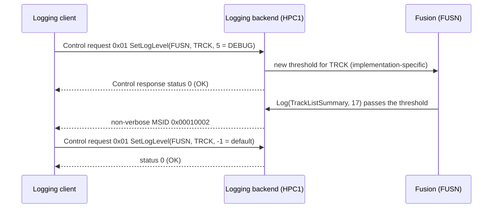

Because the change is not stored (no `StoreConfiguration`), `TRCK` falls back to its configured threshold after the next restart.

> **Key takeaways**
>
> - Control messages carry 32-bit service IDs and parameters; NOAR counts the commands.
> - `SetLogLevel` uses NULL as a wildcard, `0` to block and `-1` for the default; the "Long" variants allow long IDs.
> - `GetLogInfo` shows the registered applications and contexts with their descriptions.
> - `BufferOverflowNotification` and MCNT gaps reveal lost messages.
> - Injection is an unauthenticated remote call; disable it outside development.

---

## 13. Timestamps, Buffering and Performance

> **Why this matters:** A trace of several processes is only useful if the times are comparable, and a trace with silent gaps is worse than none. This chapter explains where the time comes from, how messages are buffered, and what logging costs.

### 13.1 Where Timestamps Come From

Log and Trace takes its time from the Time Synchronization cluster (SWS, Section 5.2). The machine configuration names the time base: the attribute `timeBaseResource` of `LogAndTraceInstantiation` identifies it ([SWS_LOG_00082]; [TPS_MANI_03162]), and at most one may be referenced ([constr_3729]). If the time base is referenced, the current timestamp is included in each DLT message; otherwise, it is not ([SWS_LOG_00083]).

In `HPC`, `HpcLogAndTrace` references the synchronized time base consumer `VehicleTime`, the time base that `CentralGateway` provides over gPTP ([guide 00, Section 6.14](00_LearningPath.md#614-time-network-management-and-logging)). Guide 09 (`09_NM_TimeSync_RawDataStream.md`, planned) completes its configuration.

> **Note:** Executables that implement (a part of) the logging cluster on the platform side can declare, with `ExecutableLoggingImplementationProps.usesTimeBaseResource`, that they need access to the time base ([TPS_MANI_01383]). These properties are allowed only for executables of category `PLATFORM_LEVEL` ([constr_10113]).

### 13.2 The 9-Byte Timestamp

The DLT timestamp `TMSP2` has a nanosecond part and a 40-bit seconds part since 1970-01-01, which covers about 34 841 years ([PRS_Dlt_01012]). If the ECU has no synchronized time, it sets bit 31 of the nanosecond part and counts from its start-up ([PRS_Dlt_01013]). The value is taken when the application calls the module, not when the message is sent ([PRS_Dlt_01014]); queuing and buffering therefore do not distort it.

When `CreateLogger` is called, Log and Trace sends a message "local time base used" or "global time base used", depending on the time base ([SWS_LOG_00091]). Look for this message when the times in a trace do not match.

### 13.3 Buffering and Loss

| Situation | Rule | Source |
| --- | --- | --- |
| Backend not ready, or log daemon crashed | Queue up to `queueSize` messages; drop the oldest | [SWS_LOG_00001], SWS 7.8.3 |
| High load from several applications | Buffer internally to prevent data loss | [SWS_LOG_00095] |
| Buffer overflow in the DLT module | Send `BufferOverflowNotification` with the number of lost messages | [PRS_Dlt_00648], [PRS_Dlt_00769] |
| Error while sending on the bus | Retry, with a configurable maximum (recommendation) | [PRS_Dlt_00651] |
| Shutdown | Pass all queued messages to the sinks | [SWS_LOG_00123] |

On the receiving side, a jump in the message counter of a log channel shows lost messages ([Section 11.2](#112-the-base-header)).

### 13.4 The Cost of Logging

| Measure | Effect |
| --- | --- |
| Modeled instead of non-modeled messages | Less data on the network: `FusionCycleOverrun` has 8 bytes of payload instead of 62 ([Section 8.10](#810-worked-example-fusioncycleoverrun-from-model-to-wire)) |
| `Log` instead of `LogStream` for filtered messages | One call and one threshold check instead of building a stream (SWS, Section 7.2.2) |
| `IsEnabled` before expensive preparation | No work at all when the level is filtered ([SWS_LOG_00007]) |
| Context-specific thresholds | Detail only where it is needed (`TRCK` at Warn, `MAIN` at Info) |
| Trace switches at compile time | Zero run-time cost for disabled trace points ([Section 14.3](#143-the-trace-switch)) |

### 13.5 Buffers in a Real Implementation

> **Note (implementation example):** In the COVESA implementation, the user library keeps a ring buffer for messages that cannot be passed to the daemon yet, and sets an overflow flag when the daemon's pipe or socket is full [EXT-049]. The daemon has its own ring buffer for messages that arrive before a client connects (configured with `RingbufferMinSize` and `RingbufferMaxSize`), an initial context log level (`ContextLogLevel`, default 4 = Info) and optional storage of logs on the ECU ("offline logstorage") [EXT-050]. These are the kinds of settings that the AUTOSAR model summarizes in `queueSize` and leaves to the implementation otherwise.

> **Key takeaways**
>
> - The timestamp comes from the time base referenced in `timeBaseResource`; without it, there is none.
> - TMSP2 is taken at the call; bit 31 marks a local time since start-up.
> - Messages are queued and buffered; losses are reported by `BufferOverflowNotification` and visible as MCNT gaps.
> - Modeled messages, `IsEnabled` and context thresholds keep logging cheap.

---

## 14. Tracing

> **Why this matters:** Timing problems, such as a 50 ms cycle that sometimes takes 61 ms, need trace points with almost no overhead. Log and Trace offers them as modeled messages that a compile-time switch can send to a trace tool instead of the logger.

### 14.1 Logging and Tracing in AUTOSAR

For an Adaptive Application, tracing is identical to logging modeled messages (SWS, Section 7.6). A trace point is a `DltMessage` whose `messageTypeInfo` is a trace type, for example `DLT_TRACE_FUNCTION_IN` or `DLT_TRACE_STATE`; on the wire, its MSTP is `DLT_TYPE_APP_TRACE` ([PRS_Dlt_00620]). What makes tracing different is the routing: a trace message can go to the logger, to a trace tool, to both, or nowhere. The trace tool is reached through **ARTI**, the AUTOSAR Run-Time Interface, which connects the software to tracing capabilities of the system, such as LTTng or a hardware tracer (SWS, Table 2.1).

### 14.2 Three Ways to Configure Tracing

Tracing costs memory and time, and the needs differ between the development and the field (SWS, Section 7.6):

| Configuration | When it takes effect | Overhead | Mechanism |
| --- | --- | --- | --- |
| Precompile | Before the build | None or minimal | Trace switch per message ([Section 14.3](#143-the-trace-switch)) |
| Static | At start of the application, unchangeable while it runs | Low | Sinks of the deployment, for example the ARTI sink ([Section 14.5](#145-the-arti-sink)) |
| Dynamic | At every call | Highest | Run-time checks, for example thresholds and trace status |

### 14.3 The Trace Switch

A `TraceSwitchConfig` maps one `DltMessage`, in the context of one `Executable`, to a trace switch value ([TPS_MANI_03336]). It is used for the compile-time configuration of ARTI trace and is not needed for normal logging. The evaluation is done at compile time ([SWS_LOG_20001] to [SWS_LOG_20004]):

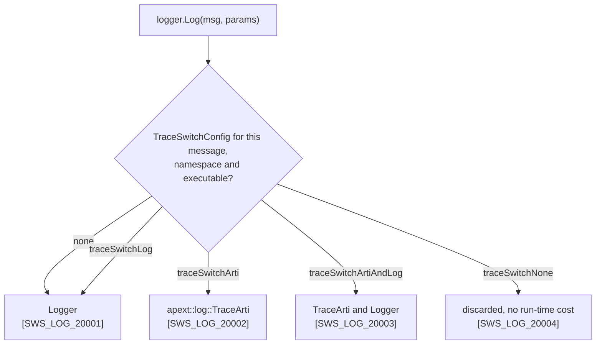

| `TraceSwitchEnum` literal | Effect |
| --- | --- |
| `traceSwitchNone` | The message is not routed; no run-time resources are used |
| `traceSwitchArti` | The message goes to ARTI trace with minimal run-time influence, for example for performance measurement |
| `traceSwitchLog` | The message goes to the logger, which processes it for the sinks |
| `traceSwitchArtiAndLog` | Both |

All three references of a `TraceSwitchConfig` are mandatory: the message, the switch value and the executable ([constr_9392] to [constr_9394]). Its `namespace` follows the same hierarchical pattern as other namespaces ([TPS_MANI_03337], [TPS_MANI_03338]).

### 14.4 `apext::log::TraceArti` and Who Generates What

The interface to the trace tool is a platform extension, the function template `apext::log::TraceArti(const MsgId& msg_id, const Params&... params)` in `apext/log/trace_arti.h` ([SWS_LOG_20000]). It is called only internally by the logging framework and should cost as little as possible, for example through specializations per message type.

| Artifact | Generated by | Content (SWS, Section 7.6.2) |
| --- | --- | --- |
| `messages.h` | ara::log Modeled Message Generator | The message symbols ([Section 8.6](#86-from-arxml-to-messagesh)) |
| The `TraceSwitch` header | Generator of the AUTOSAR stack vendor | Template specializations that route each message type at compile time; located next to the modeled messages |
| `trace_arti_spec.h` | Generator of the trace tool vendor | Specializations of `TraceArti` for the tool's capabilities; located next to the modeled messages |

The SWS illustrates the idea with a decorator: `Logger::Log` calls a function template `TraceSwitch`, whose default forwards to the internal logger and whose specializations call `TraceArti` instead (SWS, Section 7.6.2, Figure 7.4). Because the switch is a template specialization, it costs nothing at run time.

### 14.5 The ARTI Sink

A `DltLogSink` of category `DLT_LOGSINK_ARTI` forwards all modeled messages with all parameters to `TraceArti`, without filtering ([TPS_MANI_03325]). This makes ARTI an additional sink beside console, file and network, which can be switched on and off without recompiling (SWS, Section 7.6.3). The call should happen before the message is formatted or filtered by level, because the trace tool filters for itself.

### 14.6 Operating System Traces

The operating system has its own trace events, for example task switches. An *OS/ara::log adapter* maps them to `ara::log` messages, typically in a separate daemon; this costs run-time resources but gives the full flexibility of `ara::log` (SWS, Section 7.6.1). The adapter and the OS/ARTI interface are described in the *Technical Report on Operating System Tracing Interface* (AP R25-11, Chapter 4.1). [Guide 01, Section 7.10](01_PlatformOverview.md#710-os-tracing-with-arti) covers OS tracing and its standardized messages.

### 14.7 `TraceMetaInfo`

Log and Trace defines one modeled message of its own, `TraceMetaInfo` (`0x80006000`, `DLT_TRACE_STATE`, status DRAFT). It carries meta information about a recording: the AUTOSAR version as a year (`arVersion`, `uint16`), the tool name, the vendor name, the software version and an ECU identifier (UTF-8 strings). Only the tracing tool that captures the messages generates it, once at the beginning of the log file; applications and functional clusters shall not create it ([SWS_LOG_01001]).

### 14.8 Worked Example: Timing the Fusion Cycle

`Fusion` marks the start and the end of each 50 ms cycle with the trace messages `FusionCycleBegin` (`0x00010101`, `DLT_TRACE_FUNCTION_IN`) and `FusionCycleEnd` (`0x00010102`, `DLT_TRACE_FUNCTION_OUT`), each with the cycle counter:

```cpp
#include "hpc/fusion/fusionmessages/messages.h"

namespace msg = hpc::fusion::fusionmessages;

void FusionCycle(ara::log::Logger& mainLog, std::uint32_t cycleCounter) {
    mainLog.Log(msg::FusionCycleBegin, cycleCounter);
    // ... read inputs, fuse, publish ObjectList (guide 07) ...
    mainLog.Log(msg::FusionCycleEnd, cycleCounter);
}
```

The production build of `fusion` routes both messages to `traceSwitchNone`, so the two calls compile to nothing. For a timing measurement, the integrator builds `fusion` with `traceSwitchArti`; the trace tool then records the begin and end events (how it time-stamps them is up to the tool), without the overhead of the logger. The production configuration:

```xml
<TRACE-SWITCH-CONFIG>
  <SHORT-NAME>FusionCycleBeginSwitch</SHORT-NAME>
  <EXECUTABLE-REF DEST="EXECUTABLE">/HPC/Executables/fusion</EXECUTABLE-REF>
  <NAMESPACES>
    <SYMBOL-PROPS>
      <SHORT-NAME>Ns1</SHORT-NAME>
      <SYMBOL>hpc</SYMBOL>
    </SYMBOL-PROPS>
    <SYMBOL-PROPS>
      <SHORT-NAME>Ns2</SHORT-NAME>
      <SYMBOL>fusion</SYMBOL>
    </SYMBOL-PROPS>
  </NAMESPACES>
  <TRACE-MESSAGE-REF DEST="DLT-MESSAGE">/HPC/LogAndTraceMessageCollectionSets/FusionMessages/FusionCycleBegin</TRACE-MESSAGE-REF>
  <TRACE-SWITCH>TRACE-SWITCH-NONE</TRACE-SWITCH>
</TRACE-SWITCH-CONFIG>
```

A second `TraceSwitchConfig`, `FusionCycleEndSwitch`, does the same for `FusionCycleEnd`.

> **Key takeaways**
>
> - A trace point is a modeled message with a trace type; `Logger::Log` sends it.
> - `TraceSwitchConfig` routes each message at compile time to the logger, ARTI, both or nowhere.
> - `traceSwitchNone` removes a trace point at zero run-time cost; the ARTI sink forwards all modeled messages without recompiling.
> - The trace tool vendor generates `trace_arti_spec.h`; the stack vendor generates the switch.
> - `TraceMetaInfo` is written by the tracing tool, never by applications.

---

## 15. Configuration Reference: What to Configure

> **Why this matters:** This chapter answers the question "what do I have to configure for Log and Trace, and what does each setting mean?". It covers every element and attribute that Log and Trace reads, from the Log and Trace Extract and from the machine manifest. The general manifest structure is in [guide 02, Chapter 12](02_Manifests.md#12-configuration-reference-what-to-configure).

The tables use the column *Default* only for values that a specification states. SWS Log and Trace defines no default values (SWS, Section 10.1); the only specified behaviors for absent settings are the `kWarn` threshold ([SWS_LOG_00253]) and the missing timestamp ([SWS_LOG_00083]). Enumeration literals are given in the meta-model spelling; in ARXML they are written in upper case with hyphens, for example `traceSwitchNone` as `TRACE-SWITCH-NONE`.

### 15.1 Minimal Configuration

To let an application log with modeled and non-modeled messages over the network, configure the following:

| # | What | Who | Section |
| --- | --- | --- | --- |
| 1 | A `LogAndTraceInterface` with a `namespace`, and an R-port typed by it for each context of the component | Application developer | [15.2](#152-logandtraceinterface-and-its-ports) |
| 2 | A `LogAndTraceMessageCollectionSet` with the `DltMessage`s, and an `LTMessageCollectionToPortPrototypeMapping` per port | Application developer | [15.3](#153-logandtracemessagecollectionset-and-ltmessagecollectiontoportprototypemapping), [15.4](#154-dltmessage-dltargument-and-dltargumentprops) |
| 3 | A `DltContext` per context, with `contextId`, `contextDescription` and at least one `DltMessage` | Application developer | [15.5](#155-dltecu-dltapplication-and-dltcontext) |
| 4 | A `DltApplication` per process in the `DltEcu`, with `applicationId`, `applicationDescription` and its contexts | Integrator | [15.5](#155-dltecu-dltapplication-and-dltcontext) |
| 5 | A `DltEcu` with `ecuId` | Machine integrator | [15.5](#155-dltecu-dltapplication-and-dltcontext) |
| 6 | A `LogAndTraceInstantiation` in the `Machine`, with `dltEcu` and at least one `logSink` | Machine integrator | [15.6](#156-logandtraceinstantiation) |
| 7 | A `DltLogSink` of category `DLT_LOGSINK_DLT` with `logChannelId` and an `endpointConfiguration`, and `defaultTraceState` on every sink | Machine integrator | [15.7](#157-dltlogsink) |
| 8 | One or more `DltLogSink`s of category `DLT_LOGSINK_REMOTE` that name the log channel, for the port mappings | Integrator | [15.7](#157-dltlogsink) |
| 9 | A `DltApplicationToProcessMapping` per process | Integrator | [15.8](#158-dltapplicationtoprocessmapping-and-dltlogsinktoportprototypemapping) |
| 10 | A `DltLogSinkToPortPrototypeMapping` per port and process, with `dltContext` and `dltLogSink` | Integrator | [15.8](#158-dltapplicationtoprocessmapping-and-dltlogsinktoportprototypemapping) |
| 11 | Optional: `timeBaseResource` for timestamps; `TraceSwitchConfig`s for trace points | Machine integrator; developer | [15.6](#156-logandtraceinstantiation), [15.9](#159-traceswitchconfig-and-executableloggingimplementationprops) |

### 15.2 LogAndTraceInterface and Its Ports

**Purpose:** the port interface through which an application logs; each port becomes an `InstanceSpecifier` for `CreateLogger`. **Lives in:** application design. **Configured by:** application developer. **Spec:** TPS Manifest 4.13; SWS 10.

| Element.attribute | Meaning | Type and values | Mult. | Default | Rules | Effect at run time |
| --- | --- | --- | --- | --- | --- | --- |
| `LogAndTraceInterface` | A port interface for logging or tracing; no attributes of its own | `PortInterface` | – | – | Only R-ports may be typed by it ([constr_5290]) | An R-port forwards logging information to the viewer ([TPS_MANI_03284]); its presence initializes the framework ([SWS_LOG_00004]) |
| `LogAndTraceInterface.namespace` (from `PortInterface`) | Namespace of the generated `messages.h` | `SymbolProps` (ordered) | `*` | not specified; shall exist | Shall exist ([SWS_LOG_CONSTR_00001]) | First part of the header path and C++ namespace ([SWS_LOG_00244], [SWS_LOG_00248]) |
| `RPortPrototype.requiredInterface` | The interface of the log port | `LogAndTraceInterface` (tref) | `0..1` | not specified | – | `CreateLogger(InstanceSpecifier)` with the port's path ([SWS_LOG_00251]) |

Use one port per context: each `DltLogSinkToPortPrototypeMapping` gives its port exactly one `DltContext`.

### 15.3 LogAndTraceMessageCollectionSet and LTMessageCollectionToPortPrototypeMapping

**Purpose:** the collection of modeled messages and its assignment to a port. **Lives in:** application design. **Configured by:** application developer. **Spec:** TPS Manifest 4.13; TPS Log And Trace Extract 3.

| Element.attribute | Meaning | Type and values | Mult. | Default | Rules | Effect at run time |
| --- | --- | --- | --- | --- | --- | --- |
| `LogAndTraceMessageCollectionSet.dltMessage` | The messages of the set | `DltMessage` (aggr) | `*` | not specified | One set, one header ([SWS_LOG_00246]) | `<namespace>/<set>/messages.h` with one constant per message ([SWS_LOG_00244] to [SWS_LOG_00250]) |
| `LTMessageCollectionToPortPrototypeMapping.logAndTraceMessageCollectionSet` | The set used by the port | `LogAndTraceMessageCollectionSet` (ref) | `0..1` | not specified | – | Describes at design time which messages the application uses through the port ([TPS_MANI_03285]) |
| `LTMessageCollectionToPortPrototypeMapping.rPort` | The port | `RPortPrototype` (iref in the executable) | `0..1` | not specified | Port typed by a `LogAndTraceInterface` ([constr_5291]) | As above |

### 15.4 DltMessage, DltArgument and DltArgumentProps

**Purpose:** the definition of one modeled message. **Lives in:** Log and Trace Extract. **Configured by:** application developer. **Spec:** TPS Log And Trace Extract 3.

| Element.attribute | Meaning | Type and values | Mult. | Default | Rules | Effect at run time |
| --- | --- | --- | --- | --- | --- | --- |
| `DltMessage.messageId` | Unique ID of the message | `PositiveInteger` | `0..1` | not specified; shall exist | Shall exist ([constr_5301]); unique within the ECU (SWS 7.2.2.1, [PRS_Dlt_00352]); AUTOSAR and vendor ranges reserved ([PRS_Dlt_01062], [PRS_Dlt_01053]) | MSID of non-verbose messages ([Section 8.5](#85-message-ids)) |
| `DltMessage.messageTypeInfo` | Message type and info (log level or trace type) | `String`, only the standardized values `DLT_LOG_OFF` ... `DLT_LOG_VERBOSE`, `DLT_TRACE_VARIABLE` ... `DLT_TRACE_VFB`, `DLT_NW_TRACE_*`, `DLT_CONTROL_REQUEST`, `DLT_CONTROL_RESPONSE` | `0..1` | not specified | Custom values not allowed ([TPS_DLTXT_00008]) | MSTP and MTIN ([TPS_DLTXT_00002]); level for the threshold check ([SWS_LOG_00234]) |
| `DltMessage.messageSourceFile`, `messageLineNumber` | Source position | `String`, `PositiveInteger` | `0..1` each | not specified | Not applicable to standardized or reused messages (TPS Log And Trace Extract 3) | FINA and LINR recovered from the Extract ([TPS_DLTXT_00002], [PRS_Dlt_00134]) |
| `DltMessage.privacyLevel` | Privacy level of the message | `PrivacyLevel`: `privacyLevel` (`PositiveInteger`, 0 to 255, [constr_5340]) and `compuMethod` (`TEXTTABLE`, [constr_5341]) | `0..1` | not specified | – | PRIV field ([PRS_Dlt_01035]) |
| `DltMessage.dltArgument` | The arguments | `DltArgument` (aggr, ordered) | `*` | not specified | Order is the payload order ([TPS_DLTXT_00003]) | Parameter list of `Logger::Log` ([SWS_LOG_00241]) |
| `DltArgument.predefinedText` | The argument is static text in its `desc` | `Boolean` | `0..1` | not specified | Only `shortName`, `desc` and `predefinedText` ([TPS_DLTXT_00005]); no props ([constr_9365]); not with `optional` ([constr_9364]) | Not sent; shown by the viewer |
| `DltArgument.optional` | The argument may be omitted from the payload | `Boolean` | `0..1` | not specified | [TPS_DLTXT_00014] | – |
| `DltArgument.dltArgumentProps` | Representation of assembled data | `DltArgumentProps` (ref) | `0..1` | not specified | Required for assembled data, with `baseType` and `unit` ([TPS_DLTXT_00006]) | Size and type of the value on the wire |
| `DltArgumentProps.networkRepresentation` | Base type, unit, `compuMethod`, `swTextProps`, `displayFormat`, `dataConstr` | `SwDataDefProps` | `0..1` | not specified | Allowed attributes ([constr_5098]); `baseTypeSize` 8, 16, 32 or 64 ([constr_5303]); `compuMethod` only `TEXTTABLE` ([constr_5305]); strings ([TPS_DLTXT_00007]) | Type and display of the value |
| `DltArgumentProps.length`, `variableLength`, `dltArgumentEntry` | Strings, arrays and structures | `PositiveInteger`, `Boolean`, `DltArgumentProps` (aggr) | `0..1`, `0..1`, `*` | not specified | [TPS_DLTXT_00009] to [TPS_DLTXT_00013], [constr_5304], [constr_5363], [constr_5364] | Length and layout of composite values |
| `DltArgumentPropsSet.dltArgumentProps` | Reusable props | `DltArgumentProps` (aggr) | `*` | not specified | [TPS_DLTXT_00015] | – |

### 15.5 DltEcu, DltApplication and DltContext

**Purpose:** the identity of the sources. **Lives in:** Log and Trace Extract. **Configured by:** integrator (ECU, applications) and application developer (contexts). **Spec:** TPS Log And Trace Extract 2.

| Element.attribute | Meaning | Type and values | Mult. | Default | Rules | Effect at run time |
| --- | --- | --- | --- | --- | --- | --- |
| `DltEcu.ecuId` | ECU ID | `String` | `0..1` | not specified; shall exist | Shall exist ([constr_5294]); unique in the vehicle recommended (PRS 5.1.2.1) | ECU field of the extension header ([TPS_MANI_03282]) |
| `DltEcu.application` | The applications of the ECU | `DltApplication` (aggr) | `*` | not specified | – | – |
| `DltApplication.applicationId` | Application ID | `String` | `0..1` | not specified; shall exist | Shall exist ([constr_5296]); unique per process instance and recommended unique per ECU (SWS 7.1.1) | APID ([SWS_LOG_00251]) |
| `DltApplication.applicationDescription` | Text for the ID | `String` | `0..1` | not specified; shall exist | Shall exist ([constr_5297]); maximum length implementation-dependent (SWS 7.1.1.1) | Returned by `GetLogInfo` ([PRS_Dlt_00197]) |
| `DltApplication.context` | The contexts of the application | `DltContext` (ref) | `*` | not specified | At least one ([constr_5295]); context IDs unique within the application (PRS 4.2) | – |
| `DltContext.contextId` | Context ID | `String` | `0..1` | not specified; shall exist | Shall exist ([constr_5298]); prefixes `#` and `+` reserved ([PRS_Dlt_01054], [PRS_Dlt_01055]) | CTID ([SWS_LOG_00251]) |
| `DltContext.contextDescription` | Text for the ID | `String` | `0..1` | not specified; shall exist | Shall exist ([constr_5299]) | Returned by `GetLogInfo` |
| `DltContext.dltMessage` | The modeled messages of the context | `DltMessage` (ref) | `*` | not specified | At least one ([constr_5300]) | Relates a message ID to an application and context ([PRS_Dlt_01052]) |

### 15.6 LogAndTraceInstantiation

**Purpose:** the machine-specific settings of Log and Trace ([TPS_MANI_03162]). **Lives in:** machine manifest, as a `moduleInstantiation` of the `Machine`. **Configured by:** machine integrator. **Spec:** TPS Manifest 12.6.1.

| Element.attribute | Meaning | Type and values | Mult. | Default | Rules | Effect at run time |
| --- | --- | --- | --- | --- | --- | --- |
| `dltEcu` | The ECU representation in the Extract | `DltEcu` (ref) | `0..1` | not specified; shall exist | Shall exist ([constr_5275]) | ECU ID of all messages ([TPS_MANI_03282]) |
| `logSink` | The machine's sinks | `DltLogSink` (ref) | `*` | not specified | At least one ([constr_5276]); not of category `DLT_LOGSINK_REMOTE` ([constr_5278]) | Output paths of the machine ([TPS_MANI_03274]) |
| `sessionIdSupport` | Whether session IDs are used | `Boolean` | `0..1` | not specified | – | WSID and SEID in the header (SWS 7.2.2.1) |
| `timeBaseResource` | The time base for timestamps | `TimeBaseResource` (ref), for example a `SynchronizedTimeBaseConsumer` | `*` | absent: no timestamp ([SWS_LOG_00083]) | At most one ([constr_3729]) | TMSP2 from this time base ([SWS_LOG_00082]) |

### 15.7 DltLogSink

**Purpose:** one output sink. **Lives in:** deployment (`ARPackage` element). **Configured by:** machine integrator, integrator. **Spec:** TPS Manifest 12.6.1; SWS 7.1.3, 7.7.

| Element.attribute | Meaning | Type and values | Mult. | Default | Rules | Effect at run time |
| --- | --- | --- | --- | --- | --- | --- |
| `category` | Kind of sink (the log mode) | `DLT_LOGSINK_REMOTE`, `DLT_LOGSINK_DLT`, `DLT_LOGSINK_FILE`, `DLT_LOGSINK_CONSOLE`, `DLT_LOGSINK_ARTI` | `0..1` | not specified | Reserved values ([TPS_MANI_03283]); applicable attributes ([constr_5277]) | Output binding ([Section 10.1](#101-the-five-sink-categories)) |
| `logChannelId` | The DLT log channel | `String` | `0..1` | not specified | `REMOTE` and `DLT` only ([constr_5277]) | Channel of the messages ([TPS_MANI_02384], [TPS_MANI_02385]) |
| `endpointConfiguration` | Network endpoint on a VLAN | `PlatformModuleEthernetEndpointConfiguration` (ref) | `0..1` | not specified | `DLT` only | Protocol, port and IP address ([TPS_MANI_03163]) |
| `nonVerboseMode` | Whether non-verbose messages are supported | `Boolean` | `0..1` | not specified | `DLT` only | `false`: modeled messages sent verbose ([SWS_LOG_00242]) |
| `segmentationSupported` | Segment messages larger than the connector's MTU | `Boolean` | `0..1` | not specified | `DLT` only | Segmentation ([Section 11.7](#117-segmentation-of-large-messages)) |
| `path` | Output file | `UriString` | `0..1` | not specified | `FILE` only; not for production (SWS 7.1.3.1) | File sink |
| `bufferOutput` | Buffered console output | `Boolean` | `0..1` | not specified | `CONSOLE` only | Console buffering |
| `defaultLogThreshold` | Initial threshold | `LogTraceDefaultLogLevelEnum`: `fatal`, `error`, `warn`, `info`, `debug`, `verbose`, `off` | `0..1` | absent: loggers use `kWarn` ([SWS_LOG_00253]) | – | Threshold of loggers created without an explicit level ([Section 6.3](#63-where-the-threshold-comes-from)) |
| `defaultTraceState` | Default trace status | `Boolean` | `0..1` | not specified; shall exist | Shall exist ([constr_5281]) | Default of the PRS trace status; effect on `ara::log` not specified ([Section 9.5](#95-trace-status)) |
| `queueSize` | Queue length in messages | `PositiveInteger` | `0..1` | not specified | – | Queue before the backend is ready; oldest dropped ([SWS_LOG_00001]) |

The network endpoint:

| Element.attribute | Meaning | Type and values | Mult. | Default | Rules | Effect at run time |
| --- | --- | --- | --- | --- | --- | --- |
| `PlatformModuleEthernetEndpointConfiguration.communicationConnector` | The VLAN | `EthernetCommunicationConnector` (ref) | `0..1` | not specified | – | IP address from the connector's `NetworkEndpoint` ([TPS_MANI_03163]) |
| `tcpPort`, `udpPort` | Transport and port | `ApApplicationEndpoint` (ref) | `0..1` each | not specified | – | TCP or UDP port of the DLT channel ([TPS_MANI_03163]) |
| `remoteConfig`, `secureComPropsForTcp`, `secureComPropsForUdp` | Peers and security settings | `RemoteEndpointConfiguration` (aggr), `SecureComProps` (ref) | `*`, `0..1`, `0..1` | not specified | – | Secure communication, see [guide 08b](08b_SecureAndSafeCommunication.md) |

### 15.8 DltApplicationToProcessMapping and DltLogSinkToPortPrototypeMapping

**Purpose:** connect processes to application IDs, and ports to contexts and sinks. **Lives in:** deployment. **Configured by:** integrator. **Spec:** TPS Manifest 12.6.2.

| Element.attribute | Meaning | Type and values | Mult. | Default | Rules | Effect at run time |
| --- | --- | --- | --- | --- | --- | --- |
| `DltApplicationToProcessMapping.process` | The process | `Process` (ref) | `0..1` | not specified; shall exist | Shall exist ([constr_5288]) | – |
| `DltApplicationToProcessMapping.dltApplication` | Its application ID | `DltApplication` (ref) | `0..1` | not specified; shall exist | Shall exist ([constr_5289]); one per process instance (SWS 7.1.1) | APID of all loggers of the process ([TPS_MANI_03286]) |
| `DltLogSinkToPortPrototypeMapping.process` | The process context | `Process` (ref) | `0..1` | not specified; shall exist | Shall exist ([constr_5282]) | The mapping applies only to this process ([TPS_MANI_02388]) |
| `DltLogSinkToPortPrototypeMapping.rPortPrototype`, `pPortPrototype` | The port | `RPortPrototype`, `PPortPrototype` (iref in the executable) | `0..1` each | not specified | Exactly one of the two ([constr_5285]); R-port typed by a `LogAndTraceInterface` or `ServiceInterface` ([constr_5286]); P-port typed by a `ServiceInterface` ([constr_5287]) | `CreateLogger(InstanceSpecifier)` resolves to this mapping ([SWS_LOG_00251]); a `ServiceInterface` port describes `ara::com` communication that Log and Trace monitors |
| `DltLogSinkToPortPrototypeMapping.dltContext` | The context of the port | `DltContext` (ref) | `0..1` | not specified; shall exist | Shall exist ([constr_5284]) | CTID of the logger |
| `DltLogSinkToPortPrototypeMapping.dltLogSink` | The sinks of the port | `DltLogSink` (ref) | `*` | not specified | At least one ([constr_5283]); not of category `DLT_LOGSINK_DLT` ([constr_5279]) | Output paths and default threshold of the logger |
| `DltLogSinkToPortPrototypeMapping.dltSessionId` | Session ID | `PositiveInteger` | `0..1` | not specified | Same value for all mappings of the same port ([constr_5292]) | SEID, if `sessionIdSupport` is on |

### 15.9 TraceSwitchConfig and ExecutableLoggingImplementationProps

**Purpose:** compile-time routing of trace messages; platform implementation properties. **Lives in:** application design (before ARA API generation). **Configured by:** application developer or integrator; platform vendor. **Spec:** TPS Manifest 3.2.3 and 3.2.2.6.

| Element.attribute | Meaning | Type and values | Mult. | Default | Rules | Effect at run time |
| --- | --- | --- | --- | --- | --- | --- |
| `TraceSwitchConfig.traceMessage` | The message to route | `DltMessage` (ref) | `0..1` | not specified; shall exist | Shall exist ([constr_9392]) | – |
| `TraceSwitchConfig.traceSwitch` | Where the message goes | `TraceSwitchEnum`: `traceSwitchNone`, `traceSwitchArti`, `traceSwitchLog`, `traceSwitchArtiAndLog` | `0..1` | not specified; shall exist. Without a `TraceSwitchConfig`, the message goes to the logger ([SWS_LOG_20001]) | Shall exist ([constr_9393]) | Compile-time routing ([SWS_LOG_20001] to [SWS_LOG_20004]) |
| `TraceSwitchConfig.executable` | The executable in which the switch applies | `Executable` (ref) | `0..1` | not specified; shall exist | Shall exist ([constr_9394]) | – |
| `TraceSwitchConfig.namespace` | Namespace for the generated code | `SymbolProps` (ordered) | `*` | not specified | Hierarchical, order kept ([TPS_MANI_03337], [TPS_MANI_03338]) | Namespace of the generated switch |
| `ExecutableLoggingImplementationProps.usesTimeBaseResource` | The executable needs the time base | `Boolean` | `0..1` | not specified | Only for `PLATFORM_LEVEL` executables ([constr_10113]) | Platform-side access to Time Synchronization ([TPS_MANI_01383]) |

### 15.10 Mappings for Functional Clusters

**Purpose:** route the logging of a platform cluster to a sink. **Lives in:** deployment (`FCInteractions`). **Configured by:** machine integrator. **Spec:** TPS Manifest 15.6 and 15.7.

| Element.attribute | Meaning | Type and values | Mult. | Default | Rules | Effect at run time |
| --- | --- | --- | --- | --- | --- | --- |
| `FunctionalClusterToDltLogSinkMapping.functionalCluster` | The cluster that logs | `NonOsModuleInstantiation` (ref) | `0..1` | not specified | New in R25-11 ([TPS_MANI_01476]) | – |
| `FunctionalClusterToDltLogSinkMapping.logSink` | Its sink | `DltLogSink` (ref) | `0..1` | not specified | – | Output path of the cluster's messages |
| `FunctionalClusterToDltLogSinkMapping.dltContext` | Its context | `DltContext` (ref) | `0..1` | not specified | – | CTID of the cluster's messages |
| `PersistencyDeploymentToDltLogSinkMapping.persistencyDeployment`, `logSink`, `dltContext` | The same for a Persistency deployment | refs | `0..1` each | not specified | [TPS_MANI_03276] | See [guide 11, Section 14.11](11_Persistency.md#1411-persistencylogging) |

`HPC` leaves the platform clusters to the vendor's default configuration and does not model these mappings.

### 15.11 The Running Example: Complete Configuration

The complete Log and Trace configuration of `HPC` first as a conceptual view, then as excerpts of the ARXML file of the running example, which validates against the R25-11 schema (`AUTOSAR_00054.xsd`) and was checked against the constraints of this chapter together with the configuration of the previous guides.

```text
# Conceptual view of the running example. NOT real ARXML syntax.
DltEcu HpcDltEcu: ecuId HPC1
  DltApplication FusionDltApp       applicationId FUSN  contexts FusionMain (MAIN), FusionTracking (TRCK)
  DltApplication FusionLiteDltApp   applicationId FUSL  contexts FusionLiteMain (MAIN)
  DltApplication CameraDriverDltApp applicationId CAMD  contexts CameraMain (MAIN), CameraImages (IMGS)
  DltApplication SmControlDltApp    applicationId SMCT  contexts SmControlMain (MAIN)

LogAndTraceMessageCollectionSets (message ID, messageTypeInfo, context)
  FusionMessages      FusionCycleOverrun   0x00010001 DLT_LOG_WARN            MAIN  "cycle overrun", cycleTime us, budget us
                      TrackListSummary     0x00010002 DLT_LOG_DEBUG           TRCK  trackCount
                      FusionCycleBegin     0x00010101 DLT_TRACE_FUNCTION_IN   MAIN  cycleCounter
                      FusionCycleEnd       0x00010102 DLT_TRACE_FUNCTION_OUT  MAIN  cycleCounter
  FusionLiteMessages  FusionLiteActive     0x00011001 DLT_LOG_INFO            MAIN  "radar-only fusion active after", startupTime us
  CameraMessages      ImageDropped         0x00020001 DLT_LOG_WARN            IMGS  frameCounter
                      ExposureModeChanged  0x00020002 DLT_LOG_INFO            MAIN  mode (Auto/Day/Night)
  SmControlMessages   AdasStatusChanged    0x00030001 DLT_LOG_INFO            MAIN  status (Off/Active/Degraded/Unavailable)

LogAndTraceInterfaces: FusionLog (hpc::fusion), CameraLog (hpc::camera), SmControlLog (hpc::smcontrol)
Log ports (InstanceSpecifier -> context, sink):
  /fusion/Root/MainLogPort         -> MAIN, HpcRemoteInfo
  /fusion/Root/TrackLogPort        -> TRCK, HpcRemoteWarn
  /fusion_lite/Root/MainLogPort    -> MAIN, HpcRemoteInfo
  /camera_driver/Root/MainLogPort  -> MAIN, HpcRemoteInfo
  /camera_driver/Root/ImageLogPort -> IMGS, HpcRemoteWarn
  /sm_control/Root/MainLogPort     -> MAIN, HpcRemoteInfo

Machine HPC: LogAndTraceInstantiation HpcLogAndTrace
  dltEcu HpcDltEcu, sessionIdSupport false, timeBaseResource VehicleTime
  logSink HpcDltChannel: DLT, channel HPCN, TCP 3490 on BackboneConnector, nonVerbose, info, queue 2000
  logSink HpcConsole:    CONSOLE, warn, bufferOutput
Per-port sinks: HpcRemoteInfo (REMOTE, HPCN, info), HpcRemoteWarn (REMOTE, HPCN, warn)
Trace switches: FusionCycleBegin, FusionCycleEnd in fusion -> traceSwitchNone (production build)
```

**The ECU and its applications.** The `DltEcu` aggregates the applications, which reference their contexts:

```xml
<DLT-ECU>
  <SHORT-NAME>HpcDltEcu</SHORT-NAME>
  <APPLICATIONS>
    <DLT-APPLICATION>
      <SHORT-NAME>FusionDltApp</SHORT-NAME>
      <APPLICATION-DESCRIPTION>Fusion: camera, radar and vehicle dynamics fusion</APPLICATION-DESCRIPTION>
      <APPLICATION-ID>FUSN</APPLICATION-ID>
      <CONTEXTS>
        <DLT-CONTEXT-REF-CONDITIONAL>
          <DLT-CONTEXT-REF DEST="DLT-CONTEXT">/HPC/DltContexts/FusionMain</DLT-CONTEXT-REF>
        </DLT-CONTEXT-REF-CONDITIONAL>
        <DLT-CONTEXT-REF-CONDITIONAL>
          <DLT-CONTEXT-REF DEST="DLT-CONTEXT">/HPC/DltContexts/FusionTracking</DLT-CONTEXT-REF>
        </DLT-CONTEXT-REF-CONDITIONAL>
      </CONTEXTS>
    </DLT-APPLICATION>
    <DLT-APPLICATION>
      <SHORT-NAME>FusionLiteDltApp</SHORT-NAME>
      <APPLICATION-DESCRIPTION>FusionLite: radar-only fallback fusion</APPLICATION-DESCRIPTION>
      <APPLICATION-ID>FUSL</APPLICATION-ID>
      <CONTEXTS>
        <DLT-CONTEXT-REF-CONDITIONAL>
          <DLT-CONTEXT-REF DEST="DLT-CONTEXT">/HPC/DltContexts/FusionLiteMain</DLT-CONTEXT-REF>
        </DLT-CONTEXT-REF-CONDITIONAL>
      </CONTEXTS>
    </DLT-APPLICATION>
    <DLT-APPLICATION>
      <SHORT-NAME>CameraDriverDltApp</SHORT-NAME>
      <APPLICATION-DESCRIPTION>CameraDriver: front camera driver</APPLICATION-DESCRIPTION>
      <APPLICATION-ID>CAMD</APPLICATION-ID>
      <CONTEXTS>
        <DLT-CONTEXT-REF-CONDITIONAL>
          <DLT-CONTEXT-REF DEST="DLT-CONTEXT">/HPC/DltContexts/CameraMain</DLT-CONTEXT-REF>
        </DLT-CONTEXT-REF-CONDITIONAL>
        <DLT-CONTEXT-REF-CONDITIONAL>
          <DLT-CONTEXT-REF DEST="DLT-CONTEXT">/HPC/DltContexts/CameraImages</DLT-CONTEXT-REF>
        </DLT-CONTEXT-REF-CONDITIONAL>
      </CONTEXTS>
    </DLT-APPLICATION>
    <DLT-APPLICATION>
      <SHORT-NAME>SmControlDltApp</SHORT-NAME>
      <APPLICATION-DESCRIPTION>SmControl: SMControlApplication of HPC</APPLICATION-DESCRIPTION>
      <APPLICATION-ID>SMCT</APPLICATION-ID>
      <CONTEXTS>
        <DLT-CONTEXT-REF-CONDITIONAL>
          <DLT-CONTEXT-REF DEST="DLT-CONTEXT">/HPC/DltContexts/SmControlMain</DLT-CONTEXT-REF>
        </DLT-CONTEXT-REF-CONDITIONAL>
      </CONTEXTS>
    </DLT-APPLICATION>
  </APPLICATIONS>
  <ECU-ID>HPC1</ECU-ID>
</DLT-ECU>
```

**A context.** Each context references its modeled messages ([constr_5300]):

```xml
<DLT-CONTEXT>
  <SHORT-NAME>FusionTracking</SHORT-NAME>
  <CONTEXT-DESCRIPTION>Fusion: object tracking</CONTEXT-DESCRIPTION>
  <CONTEXT-ID>TRCK</CONTEXT-ID>
  <DLT-MESSAGES>
    <DLT-MESSAGE-REF-CONDITIONAL>
      <DLT-MESSAGE-REF DEST="DLT-MESSAGE">/HPC/LogAndTraceMessageCollectionSets/FusionMessages/TrackListSummary</DLT-MESSAGE-REF>
    </DLT-MESSAGE-REF-CONDITIONAL>
  </DLT-MESSAGES>
</DLT-CONTEXT>
```

**The interface and the machine.** The `LogAndTraceInterface` carries the namespace; the `Machine` gets the `LogAndTraceInstantiation` and, until guide 09 completes it, a minimal Time Synchronization instantiation with the consumer `VehicleTime`:

```xml
<LOG-AND-TRACE-INTERFACE>
  <SHORT-NAME>FusionLog</SHORT-NAME>
  <NAMESPACES>
    <SYMBOL-PROPS>
      <SHORT-NAME>Ns1</SHORT-NAME>
      <SYMBOL>hpc</SYMBOL>
    </SYMBOL-PROPS>
    <SYMBOL-PROPS>
      <SHORT-NAME>Ns2</SHORT-NAME>
      <SYMBOL>fusion</SYMBOL>
    </SYMBOL-PROPS>
  </NAMESPACES>
</LOG-AND-TRACE-INTERFACE>
```

```xml
<LOG-AND-TRACE-INSTANTIATION>
  <SHORT-NAME>HpcLogAndTrace</SHORT-NAME>
  <DLT-ECU-REF DEST="DLT-ECU">/HPC/DltEcus/HpcDltEcu</DLT-ECU-REF>
  <LOG-SINK-REFS>
    <LOG-SINK-REF DEST="DLT-LOG-SINK">/HPC/DltLogSinks/HpcDltChannel</LOG-SINK-REF>
    <LOG-SINK-REF DEST="DLT-LOG-SINK">/HPC/DltLogSinks/HpcConsole</LOG-SINK-REF>
  </LOG-SINK-REFS>
  <SESSION-ID-SUPPORT>false</SESSION-ID-SUPPORT>
  <TIME-BASE-RESOURCE-REFS>
    <TIME-BASE-RESOURCE-REF DEST="SYNCHRONIZED-TIME-BASE-CONSUMER">/HPC/Machines/HPC/HpcTimeSync/VehicleTime</TIME-BASE-RESOURCE-REF>
  </TIME-BASE-RESOURCE-REFS>
</LOG-AND-TRACE-INSTANTIATION>
```

**The sinks.** The DLT sink of the machine and one of the REMOTE sinks of the port mappings. The TCP endpoint `DltServerTcp` (port 3490) is an `ApApplicationEndpoint` of `BackboneConnector`:

```xml
<DLT-LOG-SINK>
  <SHORT-NAME>HpcDltChannel</SHORT-NAME>
  <CATEGORY>DLT_LOGSINK_DLT</CATEGORY>
  <DEFAULT-LOG-THRESHOLD>INFO</DEFAULT-LOG-THRESHOLD>
  <DEFAULT-TRACE-STATE>false</DEFAULT-TRACE-STATE>
  <ENDPOINT-CONFIGURATION-REF DEST="PLATFORM-MODULE-ETHERNET-ENDPOINT-CONFIGURATION">/HPC/PlatformModuleEndpointConfigurations/HpcDltEndpoint</ENDPOINT-CONFIGURATION-REF>
  <LOG-CHANNEL-ID>HPCN</LOG-CHANNEL-ID>
  <NON-VERBOSE-MODE>true</NON-VERBOSE-MODE>
  <QUEUE-SIZE>2000</QUEUE-SIZE>
  <SEGMENTATION-SUPPORTED>false</SEGMENTATION-SUPPORTED>
</DLT-LOG-SINK>
```

```xml
<DLT-LOG-SINK>
  <SHORT-NAME>HpcRemoteWarn</SHORT-NAME>
  <CATEGORY>DLT_LOGSINK_REMOTE</CATEGORY>
  <DEFAULT-LOG-THRESHOLD>WARN</DEFAULT-LOG-THRESHOLD>
  <DEFAULT-TRACE-STATE>false</DEFAULT-TRACE-STATE>
  <LOG-CHANNEL-ID>HPCN</LOG-CHANNEL-ID>
</DLT-LOG-SINK>
```

```xml
<PLATFORM-MODULE-ETHERNET-ENDPOINT-CONFIGURATION>
  <SHORT-NAME>HpcDltEndpoint</SHORT-NAME>
  <COMMUNICATION-CONNECTOR-REF DEST="ETHERNET-COMMUNICATION-CONNECTOR">/HPC/MachineDesigns/HpcDesign/BackboneConnector</COMMUNICATION-CONNECTOR-REF>
  <TCP-PORT-REF DEST="AP-APPLICATION-ENDPOINT">/HPC/MachineDesigns/HpcDesign/BackboneConnector/DltServerTcp</TCP-PORT-REF>
</PLATFORM-MODULE-ETHERNET-ENDPOINT-CONFIGURATION>
```

**The mappings of `Fusion`.** The application mapping gives the process its application ID; the port mapping gives `TrackLogPort` its context and sink:

```xml
<DLT-APPLICATION-TO-PROCESS-MAPPING>
  <SHORT-NAME>FusionDltAppToFusion</SHORT-NAME>
  <DLT-APPLICATION-REF DEST="DLT-APPLICATION">/HPC/DltEcus/HpcDltEcu/FusionDltApp</DLT-APPLICATION-REF>
  <PROCESS-REF DEST="PROCESS">/HPC/Processes/Fusion</PROCESS-REF>
</DLT-APPLICATION-TO-PROCESS-MAPPING>
```

```xml
<DLT-LOG-SINK-TO-PORT-PROTOTYPE-MAPPING>
  <SHORT-NAME>Fusion_TrackLog</SHORT-NAME>
  <DLT-CONTEXT-REF DEST="DLT-CONTEXT">/HPC/DltContexts/FusionTracking</DLT-CONTEXT-REF>
  <DLT-LOG-SINK-REFS>
    <DLT-LOG-SINK-REF DEST="DLT-LOG-SINK">/HPC/DltLogSinks/HpcRemoteWarn</DLT-LOG-SINK-REF>
  </DLT-LOG-SINK-REFS>
  <PROCESS-REF DEST="PROCESS">/HPC/Processes/Fusion</PROCESS-REF>
  <R-PORT-PROTOTYPE-IREF>
    <CONTEXT-ROOT-SW-COMPONENT-PROTOTYPE-REF DEST="ROOT-SW-COMPONENT-PROTOTYPE">/HPC/Executables/fusion/Root</CONTEXT-ROOT-SW-COMPONENT-PROTOTYPE-REF>
    <TARGET-R-PORT-PROTOTYPE-REF DEST="R-PORT-PROTOTYPE">/HPC/AdaptiveApplicationSwComponentTypes/FusionSwc/TrackLogPort</TARGET-R-PORT-PROTOTYPE-REF>
  </R-PORT-PROTOTYPE-IREF>
</DLT-LOG-SINK-TO-PORT-PROTOTYPE-MAPPING>
```

```xml
<LT-MESSAGE-COLLECTION-TO-PORT-PROTOTYPE-MAPPING>
  <SHORT-NAME>Fusion_TrackLogPort</SHORT-NAME>
  <LOG-AND-TRACE-MESSAGE-COLLECTION-SET-REF DEST="LOG-AND-TRACE-MESSAGE-COLLECTION-SET">/HPC/LogAndTraceMessageCollectionSets/FusionMessages</LOG-AND-TRACE-MESSAGE-COLLECTION-SET-REF>
  <R-PORT-IREF>
    <CONTEXT-ROOT-SW-COMPONENT-PROTOTYPE-REF DEST="ROOT-SW-COMPONENT-PROTOTYPE">/HPC/Executables/fusion/Root</CONTEXT-ROOT-SW-COMPONENT-PROTOTYPE-REF>
    <TARGET-R-PORT-PROTOTYPE-REF DEST="R-PORT-PROTOTYPE">/HPC/AdaptiveApplicationSwComponentTypes/FusionSwc/TrackLogPort</TARGET-R-PORT-PROTOTYPE-REF>
  </R-PORT-IREF>
</LT-MESSAGE-COLLECTION-TO-PORT-PROTOTYPE-MAPPING>
```

The other ports, processes and messages follow the same pattern. An enumeration argument, such as the `mode` of `ExposureModeChanged`, references props with the `TEXTTABLE` compu method of the service interface data type, so the viewer shows `Night` instead of `2`:

```xml
<DLT-ARGUMENT-PROPS>
  <SHORT-NAME>exposure_mode</SHORT-NAME>
  <NETWORK-REPRESENTATIONS>
    <SW-DATA-DEF-PROPS>
      <SW-DATA-DEF-PROPS-VARIANTS>
        <SW-DATA-DEF-PROPS-CONDITIONAL>
          <BASE-TYPE-REF DEST="SW-BASE-TYPE">/HPC/SwBaseTypes/uint8</BASE-TYPE-REF>
          <COMPU-METHOD-REF DEST="COMPU-METHOD">/HPC/CompuMethods/ExposureMode_Values</COMPU-METHOD-REF>
          <UNIT-REF DEST="UNIT">/HPC/Units/NoUnit</UNIT-REF>
        </SW-DATA-DEF-PROPS-CONDITIONAL>
      </SW-DATA-DEF-PROPS-VARIANTS>
    </SW-DATA-DEF-PROPS>
  </NETWORK-REPRESENTATIONS>
</DLT-ARGUMENT-PROPS>
```

> **Key takeaways**
>
> - Design: interface with namespace, one R-port per context, message sets and their port mappings.
> - Extract: `DltEcu` (ecuId), `DltApplication` (ID and description, at least one context), `DltContext` (ID, description, at least one message).
> - Machine: `LogAndTraceInstantiation` with `dltEcu`, sinks and optional time base; every sink needs `defaultTraceState`.
> - Mappings: one application per process; per port a context and REMOTE (not DLT) sinks.
> - No defaults are specified except `kWarn` and "no time base, no timestamp".

---

## 16. API Reference and Usage Guide (ara::log)

> **Why this matters:** This chapter is the reference for every element of `ara::log` in R25-11, with its exact signature, thread safety and specification ID. The earlier chapters explained when to use what; here you look up how.

### 16.1 API Overview

All elements are in the namespace `ara::log`, except the platform extension `apext::log::TraceArti`.

| Header | Content |
| --- | --- |
| `ara/log/common.h` (forwarding header `ara/log/log_fwd.h`) | `LogLevel`, `ClientState` |
| `ara/log/logger.h` | `Logger`, `CreateLogger`, `Fmt`, `Format`, `Arg`, the format helpers, `ConnectionStateHandler`, `RegisterConnectionStateHandler` |
| `ara/log/log_stream.h` | `LogStream`, `Argument`, the free `operator<<` overloads |
| `apext/log/trace_arti.h` | `apext::log::TraceArti` |
| `<namespace>/<set>/messages.h` (generated) | The constants of the modeled messages ([Section 8.6](#86-from-arxml-to-messagesh)) |

| Task | Use |
| --- | --- |
| Get a logger connected to the model | `CreateLogger(InstanceSpecifier)` |
| Get a logger without a model, for example in a test | `CreateLogger(ctxId, ctxDescription[, level])` |
| Log a non-modeled message | `logger.LogInfo() << ...`, `logger.WithLevel(level) << ...` |
| Log a modeled message or trace point | `logger.Log(Msg, args...)`, `logger.LogWith(attrs, Msg, args...)` |
| Avoid expensive preparation | `logger.IsEnabled(level)` |
| Change the threshold | `logger.SetThreshold(level)` |
| Add names, units, formats | `Arg(value, name, unit, Hex())` |
| Add location, tags, privacy | `LogStream::WithLocation`, `WithTag`, `WithPrivacy` |
| Know whether a client listens | `RegisterConnectionStateHandler` |

There are no error codes: logging functions are no-throw and silently discard failures ([SWS_LOG_00002]).

### 16.2 LogLevel and ClientState

```cpp
// ara/log/common.h
enum class LogLevel : std::uint8_t {          // [SWS_LOG_00018]
    kOff = 0x00, kFatal = 0x01, kError = 0x02, kWarn = 0x03,
    kInfo = 0x04, kDebug = 0x05, kVerbose = 0x06
};
enum class ClientState : std::int8_t {        // [SWS_LOG_00098]
    kUnknown = -1,   // DLT back-end not up and running yet
    kNotConnected,   // no remote client detected
    kConnected       // remote client is connected
};
```

### 16.3 CreateLogger

```cpp
// ara/log/logger.h
Logger& CreateLogger(const ara::core::InstanceSpecifier& is) noexcept;                        // [SWS_LOG_00256], DRAFT
Logger& CreateLogger(ara::core::StringView ctxId, ara::core::StringView ctxDescription) noexcept;  // [SWS_LOG_00263]
Logger& CreateLogger(ara::core::StringView ctxId, ara::core::StringView ctxDescription,
                     LogLevel ctxDefLogLevel) noexcept;                                         // [SWS_LOG_00021]
```

| Overload | Behavior | Thread safety |
| --- | --- | --- |
| `InstanceSpecifier` | Creates a logger derived from the manifest: context ID, application ID, ECU ID and session ID from the model, and connections to the sinks ([SWS_LOG_00251]). Violations: `InstanceSpecifierMappingIntegrityViolation` (cannot be resolved, or not a port), `PortInterfaceMappingViolation` (wrong interface type), `ProcessMappingViolation` (no mapping for the running process), `InstanceSpecifierAlreadyInUseViolation` (specifier already used in this process) | thread-safe |
| `ctxId, ctxDescription` | Creates a logger for the given context; threshold from `defaultLogThreshold` or `kWarn` ([SWS_LOG_00253]); console if no model is available | thread-safe |
| `ctxId, ctxDescription, ctxDefLogLevel` | As above, with the given threshold ([SWS_LOG_00006]) | thread-safe |

All three return a reference to an object owned by the framework ([SWS_LOG_00005]).

### 16.4 Class Logger

`class Logger final` ([SWS_LOG_00172]) is the C++ binding of the `LogAndTraceInterface` (SWS, Table 8.2). The default constructor is deleted ([SWS_LOG_00259]; the table text says "default destructor", a typo); the destructor is not exception safe ([SWS_LOG_00260]).

| Member | Signature | ID | Notes |
| --- | --- | --- | --- |
| `LogFatal`, `LogError`, `LogWarn`, `LogInfo`, `LogDebug`, `LogVerbose` | `LogStream LogFatal() const noexcept;` (and so on) | [SWS_LOG_00064] to [SWS_LOG_00069] | Returns a stream of that level; thread-safe |
| `WithLevel` | `LogStream WithLevel(LogLevel logLevel) const noexcept;` | [SWS_LOG_00131] | Level at run time; thread-safe |
| `IsEnabled` | `bool IsEnabled(LogLevel logLevel) const noexcept;` | [SWS_LOG_00070] | `true` if the level satisfies the configured reporting level; thread-safe |
| `Log` | `template <typename MsgId, typename... Params> void Log(const MsgId& id, const Params&... args) noexcept;` | [SWS_LOG_00204] | Modeled message; ill-formed if the arguments do not match the model; ignored on unconnected loggers ([SWS_LOG_00257]); thread-safe |
| `LogWith` | `template <typename... Attrs, typename MsgId, typename... Params> void LogWith(const std::tuple<Attrs...>& attrs, const MsgId& msgId, const Params&... params) noexcept;` | [SWS_LOG_00133] | Modeled message with attributes; the attribute types are still "to be defined" in R25-11; thread-safe |
| `SetThreshold` | `void SetThreshold(LogLevel threshold) noexcept;` | [SWS_LOG_00255] | Sets this logger's threshold ([SWS_LOG_00254]); thread-safe |

### 16.5 Class LogStream

`class LogStream final` ([SWS_LOG_00173]) represents one non-modeled message. Normally, you never name it: the `Log*` functions return a temporary that lives until the end of the statement.

| Member | Signature | ID | Thread safety |
| --- | --- | --- | --- |
| Copy constructor and copy assignment | deleted | [SWS_LOG_00174], [SWS_LOG_00175] | – |
| Move constructor | `LogStream(LogStream&&) noexcept;` (typically declared only, to allow return value optimization) | [SWS_LOG_00176] | – |
| Move assignment | deleted | [SWS_LOG_00177] | – |
| Destructor | `~LogStream() noexcept;` hands the message to the framework | [SWS_LOG_00262] | not thread-safe |
| `Flush` | `void Flush() noexcept;` sends the buffer and starts a new message | [SWS_LOG_00039] | not thread-safe |
| `WithLocation` | `LogStream& WithLocation(core::StringView file, int line) noexcept;` | [SWS_LOG_00129] | not thread-safe |
| `WithTag` | `LogStream& WithTag(core::StringView tag) noexcept;` | [SWS_LOG_00132] | not thread-safe |
| `WithPrivacy` | `template <typename T> LogStream& WithPrivacy(T value) noexcept;` integral or enum, lower 8 bits | [SWS_LOG_00258] | not thread-safe |
| `operator<<` | for `bool`, `std::uint8_t` ... `std::uint64_t`, `std::int8_t` ... `std::int64_t`, `float`, `double`, `const char* const`, `const ara::core::StringView`, `core::Span<const core::Byte>`, `const Argument<T>&` | [SWS_LOG_00040] to [SWS_LOG_00051], [SWS_LOG_00062], [SWS_LOG_00128], [SWS_LOG_00203] | not thread-safe |

### 16.6 Arg, Argument, Format, Fmt and the Format Helpers

```cpp
template <typename T> class Argument final;                                   // [SWS_LOG_00261], implementation-defined
template <typename T>
Argument<T> Arg(T&& arg, const char* name = nullptr, const char* unit = nullptr,
                Format format = Dflt()) noexcept;                              // [SWS_LOG_00201]
enum class Fmt : std::uint16_t {                                               // [SWS_LOG_00206]
    kDefault = 0, kDec, kOct, kHex, kBin, kDecFloat, kEngFloat, kHexFloat, kAutoFloat
};
struct Format final { Fmt fmt; std::uint16_t precision; };                     // [SWS_LOG_00207], [SWS_LOG_00225], [SWS_LOG_00226]

constexpr Format Dflt() noexcept;                                              // [SWS_LOG_00208]
constexpr Format Hex() noexcept;   constexpr Format Hex(std::uint16_t precision) noexcept;   // [SWS_LOG_00209], [SWS_LOG_00210]
constexpr Format Dec() noexcept;   constexpr Format Dec(std::uint16_t precision) noexcept;   // [SWS_LOG_00211], [SWS_LOG_00212]
constexpr Format Oct() noexcept;   constexpr Format Oct(std::uint16_t precision) noexcept;   // [SWS_LOG_00213], [SWS_LOG_00214]
constexpr Format Bin() noexcept;   constexpr Format Bin(std::uint16_t precision) noexcept;   // [SWS_LOG_00215], [SWS_LOG_00216]
constexpr Format DecFloat(std::uint16_t precision = 6) noexcept;   constexpr Format DecFloatMax() noexcept;  // [SWS_LOG_00217], [SWS_LOG_00218]
constexpr Format EngFloat(std::uint16_t precision = 6) noexcept;   constexpr Format EngFloatMax() noexcept;  // [SWS_LOG_00219], [SWS_LOG_00220]
constexpr Format HexFloat(std::uint16_t precision) noexcept;       constexpr Format HexFloatMax() noexcept;  // [SWS_LOG_00221], [SWS_LOG_00222]
constexpr Format AutoFloat(std::uint16_t precision = 6) noexcept;  constexpr Format AutoFloatMax() noexcept; // [SWS_LOG_00223], [SWS_LOG_00224]
```

All of these are thread-safe. Use the helpers instead of filling `Format` by hand (SWS, [SWS_LOG_00207] description).

### 16.7 Free operator<< Overloads

```cpp
template <typename Rep, typename Period>
LogStream& operator<<(LogStream& out, const std::chrono::duration<Rep, Period>& value) noexcept;  // [SWS_LOG_00125]
LogStream& operator<<(LogStream& out, const ara::core::InstanceSpecifier& value) noexcept;        // [SWS_LOG_00126]
LogStream& operator<<(LogStream& out, const void* value) noexcept;                                // [SWS_LOG_00127]
LogStream& operator<<(LogStream& out, LogLevel value) noexcept;                                   // [SWS_LOG_00063]
LogStream& operator<<(LogStream& out, const core::ErrorCode& ec) noexcept;                        // [SWS_LOG_00124]
```

All five are thread-safe according to their tables.

### 16.8 RegisterConnectionStateHandler

```cpp
using ConnectionStateHandler = std::function<void(ClientState)>;               // [SWS_LOG_00265]
void RegisterConnectionStateHandler(ConnectionStateHandler callback) noexcept; // [SWS_LOG_00205]
```

The callback is invoked whenever the connection state changes. Only one callback can be installed; a new registration replaces the old one. The function is not thread-safe.

### 16.9 apext::log::TraceArti

```cpp
// apext/log/trace_arti.h, platform extension (SWS, Appendix C)
namespace apext { namespace log {
template <typename MsgId, typename... Params>
void TraceArti(const MsgId& msg_id, const Params&... params) noexcept;         // [SWS_LOG_20000]
}}
```

Applications do not call it. The logging framework calls it for messages routed to ARTI; the trace tool vendor provides the specializations ([Section 14.4](#144-apextlogtracearti-and-who-generates-what)).

### 16.10 Thread Safety and Exception Safety Summary

| Element | Thread safety | Exception safety |
| --- | --- | --- |
| `CreateLogger` (all overloads) | thread-safe | exception safe (`noexcept`) |
| `Logger` member functions | thread-safe | exception safe; destructor not exception safe |
| `LogStream` member functions and destructor | not thread-safe | exception safe |
| `Arg`, format helpers, free `operator<<` | thread-safe | exception safe |
| `RegisterConnectionStateHandler` | not thread-safe | exception safe |
| `TraceArti` | thread-safe | exception safe |

[Guide 03, Section 12.6](03_CoreAndGeneral.md#126-thread-safety) explains what "thread-safe" means in AUTOSAR: you may call a thread-safe member concurrently on the *same* object. A `Logger` can therefore be shared between threads, a `LogStream` cannot.

### 16.11 Complete Example: Fusion

The program puts the pieces together: two connected loggers, modeled and non-modeled messages, `IsEnabled`, a trace point pair and the connection state. Execution Management and `ara::com` details are shortened; see [guide 04, Section 14.3](04_ExecutionManagement.md#143-executionclient) and [guide 07](07_CommunicationManagement.md).

```cpp
#include <atomic>
#include <chrono>
#include <cstdint>
#include <cstdlib>

#include "ara/core/initialization.h"
#include "ara/core/instance_specifier.h"
#include "ara/log/logger.h"
#include "hpc/fusion/fusionmessages/messages.h"   // generated from FusionMessages

namespace msg = hpc::fusion::fusionmessages;
using ara::log::Arg;
using ara::log::LogLevel;

namespace {
std::atomic<bool> g_clientConnected{false};
constexpr std::uint32_t kBudgetUs = 50000U;       // 50 ms cycle budget
}  // namespace

int main(int argc, char* argv[]) {
    if (!ara::core::Initialize(argc, argv).HasValue()) {
        return EXIT_FAILURE;
    }
    ara::log::Logger& mainLog =
        ara::log::CreateLogger(ara::core::InstanceSpecifier{"/fusion/Root/MainLogPort"});
    ara::log::Logger& trackLog =
        ara::log::CreateLogger(ara::core::InstanceSpecifier{"/fusion/Root/TrackLogPort"});

    ara::log::RegisterConnectionStateHandler([](ara::log::ClientState s) {
        g_clientConnected.store(s == ara::log::ClientState::kConnected);
    });

    mainLog.LogInfo() << "Fusion started, budget" << Arg(kBudgetUs, "budget", "us");
    // ... ExecutionClient: report kRunning (guide 04); create proxies and the skeleton (guide 07) ...

    for (std::uint32_t cycle = 0U; /* until termination is requested */; ++cycle) {
        const auto start = std::chrono::steady_clock::now();
        mainLog.Log(msg::FusionCycleBegin, cycle);           // trace point; removed by traceSwitchNone

        const std::uint16_t trackCount = 0U;                  // ... fuse, publish ObjectList ...
        mainLog.Log(msg::FusionCycleEnd, cycle);

        if (trackLog.IsEnabled(LogLevel::kDebug)) {           // only when TRCK is raised to Debug
            trackLog.Log(msg::TrackListSummary, trackCount);
        }
        const auto us = std::chrono::duration_cast<std::chrono::microseconds>(
                            std::chrono::steady_clock::now() - start).count();
        if (static_cast<std::uint32_t>(us) > kBudgetUs) {
            mainLog.Log(msg::FusionCycleOverrun, static_cast<std::uint32_t>(us), kBudgetUs);
        }
        // ... wait for the next 50 ms tick; leave the loop on termination ...
        break;  // keeps the example finite
    }

    mainLog.LogInfo() << "Fusion stopping";
    (void)ara::core::Deinitialize();                          // flushes queued messages
    return EXIT_SUCCESS;
}
```

> **Key takeaways**
>
> - Three headers plus the generated `messages.h`; no error codes.
> - `CreateLogger(InstanceSpecifier)` is DRAFT and raises the standard instance specifier violations.
> - `Logger` is thread-safe and can be shared; `LogStream` is not.
> - `Log` and `LogWith` are templates checked against the generated message types.

---

## 17. Reporting of Log and Trace Itself

> **Why this matters:** Every cluster guide of the series lists the security events, log messages, violations and production errors of its cluster. For Log and Trace, the list is short, and knowing that saves you a search.

| Report | Content | Source |
| --- | --- | --- |
| Security events | None | SWS, Section 7.9.1 |
| Log messages | `TraceMetaInfo` (`0x80006000`, `DLT_TRACE_STATE`, DRAFT), written by the tracing tool only ([Section 14.7](#147-tracemetainfo)) | [SWS_LOG_01001] |
| Other messages | "local time base used" or "global time base used" at `CreateLogger` | [SWS_LOG_00091] |
| Violation messages | None of its own; implementations may add non-standardized violations | SWS, Section 7.9.3 |
| Violations raised | The four Core violations of `CreateLogger(InstanceSpecifier)`, with their standardized DLT messages | [SWS_LOG_00256]; [guide 03, Section 15.3](03_CoreAndGeneral.md#153-violation-messages) |
| Production errors | None | SWS, Section 7.9.4 |
| Protocol-level reports | `BufferOverflowNotification` control messages | [PRS_Dlt_00769] |

Log and Trace is also the channel through which all other clusters report. Their standardized messages appear in the trace with `#` context IDs and message IDs from their reserved ranges ([Section 3.5](#35-how-platform-clusters-log)); [Chapter 18](#18-end-to-end-walkthrough-a-dlt-trace-of-an-adas-transition) shows an example.

> **Key takeaways**
>
> - Log and Trace has no security events, no production errors and no violation messages of its own.
> - Its only modeled message, `TraceMetaInfo`, is written by the tracing tool.
> - `CreateLogger(InstanceSpecifier)` raises the standard instance specifier violations of Core.

---

## 18. End-to-End Walkthrough: A DLT Trace of an ADAS Transition

> **Why this matters:** This chapter puts the guide together on one real situation of the running example: `Fusion` stalls during a drive, and `ADAS` goes from `Normal` to `Degraded`. You see what each process and cluster writes, how a viewer shows it, and how to read the trace.

### 18.1 Setting Up the Logging Client

The developer connects a laptop to the backbone and points the logging client to `192.168.10.10`, TCP port 3490, the endpoint of `HpcDltChannel` ([Section 15.11](#1511-the-running-example-complete-configuration)). For non-verbose decoding, the client loads the Log and Trace Extract of `HPC`, that is the running example file with the `DltEcu`, the contexts and the four message collection sets, and the AUTOSAR standard model with the messages of the platform clusters (*Standardized M1 Models used for the Definition of AUTOSAR*, Foundation R25-11). After connecting, the client sends `GetLogInfo` with option 7 and shows the applications and contexts with their descriptions ([Section 12.4](#124-asking-the-ecu)).

> **Note (implementation example):** With the COVESA tools, `dlt-receive -o drive.dlt 192.168.10.10` stores the stream in a file (port 3490 is the default) [EXT-048], and DLT Viewer opens the file and offers filters and a plugin for non-verbose decoding [EXT-051]. Check first whether the tools support protocol version 2 for your use case ([Section 11.10](#1110-version-1-and-version-2)).

### 18.2 The Trace

Twenty minutes into the drive, `Fusion` starts to miss its 50 ms budget, and its deadline supervision expires ([guide 06, Section 12.6](06_PlatformHealthManagement.md#126-worked-example-fusion-stalls-and-adas-goes-to-degraded); [guide 05, Section 8.7](05_StateManagement.md#87-worked-example-fusion-fails-and-adas-goes-to-degraded)). The illustrative trace below is sorted by timestamp. The layout depends on the viewer; the application IDs of the platform daemons are vendor-specific placeholders, and all values are invented.

```text
# Illustrative DLT trace of HPC1, decoded with the Log and Trace Extract (layout simplified)
time (VehicleTime)  apid  ctid  type        msg id      message
08:15:00.250114     FUSN  MAIN  log warn    0x00010001  cycle overrun cycleTime=61240 us budget=50000 us
08:15:00.311902     FUSN  MAIN  log warn    0x00010001  cycle overrun cycleTime=58870 us budget=50000 us
08:15:00.372455     FUSN  MAIN  log warn    verbose     late radar input: 12 ms
08:15:00.400310     PHMD  #PHM  log error   0x80009002  RecoveryInitiated /HPC/Processes/Fusion
08:15:00.400702     SMGR  #SMX  log info    verbose     (vendor-specific) AdasAgent: error 42 -> Degraded
08:15:00.401980     EXEM  #EXE  trace vfb   0x80004003  ProcessTerminationRequest posixProcessId=812
08:15:00.452317     FUSN  MAIN  log info    verbose     Fusion stopping
08:15:00.466021     EXEM  #EXE  trace vfb   0x80004004  ProcessTerminated posixProcessId=812
08:15:00.466930     EXEM  #EXE  trace vfb   0x80004001  ProcessCreated posixProcessId=1377 /HPC/Processes/FusionLite
08:15:00.702448     EXEM  #EXE  trace vfb   0x80004002  ProcessKRunningReceived posixProcessId=1377
08:15:00.702913     FUSL  MAIN  log info    0x00011001  radar-only fusion active after startupTime=235983 us
08:15:00.703260     SMCT  MAIN  log info    0x00030001  AdasStatusChanged status=Degraded
```

### 18.3 How the Standardized Messages Are Identified

The messages of `Fusion`, `FusionLite` and `SmControl` with application-range IDs are sent non-verbose without application and context IDs: their message IDs are unique on `HPC1`, so the viewer finds `FUSN`/`MAIN` in the Extract ([PRS_Dlt_01052]). The messages of the platform clusters are different. Their IDs come from the AUTOSAR standard model, which does not assign them to an application of `HPC`, so the sender must include the application ID and the `#` context ID in the extension header ([PRS_Dlt_01052]). [Section 11.8](#118-byte-by-byte-two-messages-of-hpc) computed the header of such a message: `ProcessTerminationRequest` with `EXEM`/`#EXE` needs 35 header bytes instead of 25.

The verbose lines, such as "late radar input", are non-modeled messages of the developers; they carry their IDs and their text themselves. The line of State Management is vendor-specific: SM defines no modeled log messages ([guide 05, Chapter 14](05_StateManagement.md#14-logging-security-events-and-violations)).

### 18.4 Reading the Trace

Read such a trace in five steps:

1. **Start at the error.** `RecoveryInitiated` of PHM names the process whose supervision expired: `Fusion`.
2. **Look backwards in the same application.** The `FusionCycleOverrun` warnings show the cause: cycles of 59 to 61 ms against a budget of 50 ms. The verbose line hints at late radar input. If `TRCK` is needed, raise it to Debug with a control message on the next drive ([Section 12.8](#128-worked-example-debugging-trck-for-one-drive)).
3. **Look forwards for the reaction.** State Management decides `Degraded`; Execution Management terminates `Fusion` (request and termination 64 ms apart) and creates `FusionLite`.
4. **Measure the recovery.** From `RecoveryInitiated` to `FusionLiteActive` takes 303 ms; `FusionLite` needed 236 ms from creation to `kRunning`. Compare these times with the recovery timeout of 6 s of `AdasRecovery` ([guide 00, Section 6.13](00_LearningPath.md#613-safety)).
5. **Check the visible result.** `AdasStatusChanged` `Degraded` from `SmControl` is what the driver sees in the instrument cluster.

> **Pitfall:** Lines from different processes can reach the client out of timestamp order, because each process and the backend buffer messages ([Section 13.3](#133-buffering-and-loss)). Sort by the timestamp, not by the order of arrival, and compare timestamps only if they come from the same time base. A line whose order looks wrong, for example an `AdasStatusChanged` `Degraded` before EM has created `FusionLite`, is either a sorting effect or a real bug in the application logic: `SmControl` must publish the new status only after `AdasAgent` reports `CurrentState` `Degraded` ([guide 05, Section 8.7](05_StateManagement.md#87-worked-example-fusion-fails-and-adas-goes-to-degraded)).

The sequence of the transition:

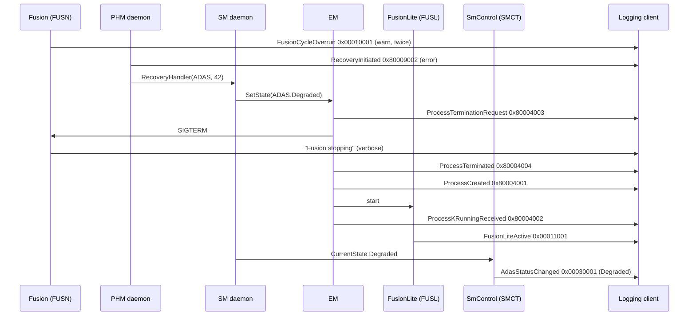

> **Key takeaways**
>
> - The logging client needs the endpoint of the DLT channel and, for non-verbose decoding, the Extract of `HPC` and the AUTOSAR standard model.
> - Application messages with unique IDs travel without APID/CTID; standardized messages carry them.
> - Read from the error backwards for the cause and forwards for the reaction; use the timestamps to measure the recovery.
> - Check every line against the expected sequence: a trace can also reveal bugs in the logic.

---

## 19. Best Practices, Pitfalls and Troubleshooting

> **Why this matters:** Most logging problems repeat across projects. This chapter collects the practices that prevent them and a table for diagnosing the rest.

### 19.1 Best Practices

1. **Choose levels by the PRS proposal** ([Section 9.2](#92-what-each-level-is-for)): Warn means "under control", Debug and Verbose are for development only.
2. **One context per subsystem and per library.** Give libraries their own context IDs and reserve them system-wide (SWS, Section 7.1.4).
3. **Model the messages you keep.** Use non-modeled messages while developing; move the messages that stay into the Extract before production.
4. **Create loggers from `InstanceSpecifier`s.** Only connected loggers send modeled messages ([SWS_LOG_00257]).
5. **Guard expensive preparation with `IsEnabled`** and keep `LogStream` objects thread-local.
6. **Never log secrets.** Keys, passwords and personal data do not belong in logs; use the privacy level for data that a viewer must handle with care ([Section 7.6](#76-source-location-tags-and-privacy)).
7. **Keep IDs short and unique.** Four characters, no `#` or `+` prefix, unique application IDs per ECU, checked by the integrator.
8. **Configure a time base.** Without `timeBaseResource`, messages have no timestamp ([SWS_LOG_00083]).
9. **Deactivate DLT, and above all injection, in production**, and protect its activation (PRS, Section 1.2.1).

### 19.2 Common Pitfalls

| Pitfall | Consequence | Avoid it by |
| --- | --- | --- |
| Modeled `Log` on a logger from `CreateLogger("MAIN", ...)` | Message silently ignored ([SWS_LOG_00257]) | `CreateLogger(InstanceSpecifier)` |
| Logging a `char` | A number instead of a character (implementation-defined) | Log a one-character `StringView` |
| A REMOTE sink referenced by the `LogAndTraceInstantiation`, or a DLT sink by a port mapping | Invalid model ([constr_5278], [constr_5279]) | DLT sinks on the machine, REMOTE sinks on mappings |
| `defaultTraceState` missing | Invalid model ([constr_5281]) | Set it on every sink |
| `path` on a console sink, `endpointConfiguration` on a REMOTE sink | Invalid model ([constr_5277]) | Check the applicability table ([Section 10.1](#101-the-five-sink-categories)) |
| A context in the Extract without messages | Invalid model ([constr_5300]) | Add at least one modeled message, or keep the context out of the model |
| Copying the ARXML example of SWS 7.2.2.3 | Removed attributes in the model | Use `DltArgumentProps` ([Section 8.9](#89-pitfall-the-outdated-arxml-example-in-the-sws)) |
| A global `LogStream` shared by threads | Data races; corrupted messages | One stream per statement or per thread |
| A version 1 tool on a version 2 stream | Nothing decoded | Check the VERS bits ([Section 11.10](#1110-version-1-and-version-2)) |
| No configured threshold | Info and Debug messages missing (default `kWarn`) | Set `defaultLogThreshold` |

### 19.3 Troubleshooting Guide

| Symptom | Likely cause | Check |
| --- | --- | --- |
| No messages at all from one process | `ara::core::Initialize` not called; no log port and no string logger; process crashed early | Process start in the EM trace (`ProcessCreated`, `ProcessKRunningReceived`) |
| The process is terminated at `CreateLogger` | A violation: wrong or duplicate `InstanceSpecifier`, no mapping for the process | The Core violation message; the `DltLogSinkToPortPrototypeMapping` of the process |
| Messages appear on the console instead of the network | String-created logger without a model; console sink only | `CreateLogger` overload; sinks of the mapping |
| Info messages missing, warnings visible | Threshold `kWarn` (default) or `warn` on the sink | `defaultLogThreshold`; `GetLogInfo` |
| The viewer shows only message IDs and hex | Non-verbose messages without the Extract in the viewer | Load the Extract; or set `nonVerboseMode` to `false` temporarily |
| Messages of two processes are mixed up | Duplicate application IDs | `DltApplicationToProcessMapping`; IDs unique per ECU |
| Timestamps are zero or start at boot | No `timeBaseResource`; time base not synchronized (bit 31 set) | Machine configuration; "local/global time base used" message ([SWS_LOG_00091]) |
| Gaps in the message counter | Lost messages: buffer overflow, network | `BufferOverflowNotification`; `queueSize`; bandwidth |
| A control message is answered with ERROR | Unknown IDs, a parameter that does not match the configuration, another command in progress ([PRS_Dlt_00650]) | Application and context IDs; wait for the previous response |
| Trace points never appear | `traceSwitchNone` or `traceSwitchArti` for the message | `TraceSwitchConfig` of the executable |

> **Key takeaways**
>
> - Model production messages, create loggers from instance specifiers, and set thresholds and a time base.
> - Most invalid models come from sink categories in the wrong place or missing mandatory attributes.
> - Missing messages are usually thresholds, unconnected loggers or a decoder without the Extract.
> - Disable DLT and injection outside development.

---

## 20. Summary and Self-Check Quiz

> **Why this matters:** A short repetition fixes the main ideas, and the quiz shows where to read again.

### 20.1 Summary

Log and Trace gives every process and cluster of the Adaptive Platform one logging API, `ara::log`, and one wire protocol, DLT version 2. Messages are identified by ECU ID, application ID and context ID, and filtered by log levels and thresholds. Non-modeled messages are built at run time and travel verbose; modeled messages are defined in the Log and Trace Extract, generated into `messages.h`, checked at compile time and travel non-verbose as a message ID plus values. Loggers created from instance specifiers are connected to the model and get their IDs, sinks and thresholds from it. The machine defines sinks of five categories; DLT sinks carry log channels to the network, REMOTE sinks connect port mappings to them. A logging client receives the messages, decodes non-verbose ones with the Extract, and controls the ECU with control messages. Timestamps come from Time Synchronization; tracing uses modeled messages that a compile-time switch can route to ARTI. The configuration has almost no defaults, and the R25-11 documents leave some details open, which this guide has pointed out.

### 20.2 Self-Check Quiz

<details>
<summary>1. What are the three layers of Log and Trace, and which document defines each?</summary>

The API `ara::log` (SWS Log and Trace), the DLT protocol (PRS Log and Trace Protocol) and the configuration (TPS Manifest 12.6 and TPS Log And Trace Extract). See [Section 1.1](#11-what-is-log-and-trace).
</details>

<details>
<summary>2. Which identifiers name the source of a message, and who is responsible for unique application IDs?</summary>

ECU ID, application ID, context ID and, optionally, session ID. The system integrator ensures unique application IDs. See [Section 2.2](#22-who-sent-it-ecu-application-context-and-session) and [Section 5.2](#52-application-id).
</details>

<details>
<summary>3. A logger is created with CreateLogger("MAIN", "Main"). Which threshold does it have if nothing is configured?</summary>

`kWarn` ([SWS_LOG_00253]). See [Section 6.3](#63-where-the-threshold-comes-from).
</details>

<details>
<summary>4. Why does logger.Log(msg::FusionCycleOverrun, ...) show nothing on the network although the code compiles?</summary>

Probably the logger was created from strings and is not connected to the model; `Log` is then ignored ([SWS_LOG_00257]). Use `CreateLogger(InstanceSpecifier)`. See [Section 6.4](#64-connected-and-unconnected-loggers).
</details>

<details>
<summary>5. What travels on the wire for a modeled message in non-verbose mode, and what does the viewer add?</summary>

The message ID and the packed variable data. The viewer adds the predefined text, argument names, types, units, the level and the source position from the Log and Trace Extract. See [Section 8.3](#83-predefined-text-and-assembled-data) and [Section 11.5](#115-non-verbose-payload).
</details>

<details>
<summary>6. Your application wants to use the message ID 0x80001234. Is that allowed?</summary>

No. IDs with bit 31 = 1 and bit 30 = 0 are reserved for AUTOSAR ([PRS_Dlt_01062]), and with bit 30 = 1 for vendors. Applications use IDs with bit 31 = 0. See [Section 8.5](#85-message-ids).
</details>

<details>
<summary>7. Where does the generator put the header of the collection set FusionMessages of the interface FusionLog (namespace hpc::fusion)?</summary>

`hpc/fusion/fusionmessages/messages.h`, namespace `hpc::fusion::fusionmessages` ([SWS_LOG_00244], [SWS_LOG_00248]). See [Section 8.6](#86-from-arxml-to-messagesh).
</details>

<details>
<summary>8. Why is logging a char risky?</summary>

There is no `operator<<` for `char`; the result is implementation-defined and often a number. Log a one-character `StringView`. See [Section 7.2](#72-supported-argument-types).
</details>

<details>
<summary>9. An integrator references a REMOTE sink from the LogAndTraceInstantiation. What is wrong?</summary>

REMOTE sinks may only be referenced by `DltLogSinkToPortPrototypeMapping`s ([constr_5278]); the machine references DLT, file, console or ARTI sinks. See [Section 10.1](#101-the-five-sink-categories).
</details>

<details>
<summary>10. Which base header fields does a non-verbose data message have?</summary>

HTYP2, MCNT, LEN, TMSP2 and MSID; no MSIN and no NOAR. See [Section 11.2](#112-the-base-header).
</details>

<details>
<summary>11. The first byte of a message is 0x4C. What does it tell you?</summary>

CNTI = 0 (verbose data), WEID = 1, WACID = 1, WSID = 0 and VERS = 2: a version 2 verbose message with ECU, application and context ID. See [Section 11.2](#112-the-base-header) and [Section 11.8](#118-byte-by-byte-two-messages-of-hpc).
</details>

<details>
<summary>12. How do you see Debug messages of FUSN/TRCK for one drive without changing the software?</summary>

Send `SetLogLevel(FUSN, TRCK, 5)` from the logging client, and `-1` afterwards to return to the default. See [Section 12.3](#123-setting-log-levels-and-trace-status) and [Section 12.8](#128-worked-example-debugging-trck-for-one-drive).
</details>

<details>
<summary>13. The message counter of a log channel jumps from 17 to 23. What happened, and what else do you look for?</summary>

Five messages were lost. Look for a `BufferOverflowNotification` and check `queueSize` and the bandwidth. See [Section 13.3](#133-buffering-and-loss).
</details>

<details>
<summary>14. Your timestamps count from the ECU start-up. Why?</summary>

The ECU has no synchronized absolute time: bit 31 of the nanosecond part is set ([PRS_Dlt_01013]), or no time base is configured. Check `timeBaseResource` and the "local/global time base used" message. See [Section 13.2](#132-the-9-byte-timestamp).
</details>

<details>
<summary>15. How can a trace point cost nothing at run time in a production build?</summary>

A `TraceSwitchConfig` with `traceSwitchNone` for that message and executable discards it at compile time ([SWS_LOG_20004]). See [Section 14.3](#143-the-trace-switch).
</details>

<details>
<summary>16. Why do the EM messages in a trace carry an application ID and a context ID, while FusionCycleOverrun does not?</summary>

The standardized messages are not uniquely related to one application ID and context ID in the Extract, so these IDs must be sent ([PRS_Dlt_01052]); the message IDs of `Fusion` are unique on the ECU. See [Section 18.3](#183-how-the-standardized-messages-are-identified).
</details>

---

## Appendix A. Glossary and Acronyms

### A.1 Acronyms

| Acronym | Meaning |
| --- | --- |
| APID | Application ID (DLT header field) |
| ARTI | AUTOSAR Run-Time Interface |
| CNTI | Content Information (HTYP2 bits 0-1) |
| CTID | Context ID (DLT header field) |
| DLT | Diagnostic Log and Trace; the LT protocol |
| FINA, LINR | File Name, Line Number (extension header fields) |
| HTYP2 | Header Type, protocol version 2 |
| L&T, LT | Log and Trace |
| LEN | Message Length |
| MCNT | Message Counter |
| MSID | Message ID |
| MSIN | Message Info |
| MSTP | Message Type |
| MTIN | Message Type Info |
| NOAR | Number of Arguments |
| PRIV | Privacy Level (extension header field) |
| PRS | Protocol Requirements Specification |
| SEID | Session ID |
| SGMT | Segmentation information (extension header field) |
| TMSP2 | Timestamp, protocol version 2 |
| TYFM, TYPR, TYLE | Type Format, Type Precision, Type Length (Type Info fields) |
| VERS | Version Number (HTYP2 bits 5-7) |
| WACID, WEID, WSID, WSFLN, WTGS, WPVL, WSGM | "With" flags of HTYP2: application and context ID, ECU ID, session ID, source file and line, tags, privacy level, segmentation |

### A.2 Glossary

| Term | Definition |
| --- | --- |
| Application ID | The identifier of one process instance in log and trace messages, defined by `DltApplication.applicationId` ([Section 5.2](#52-application-id)). |
| Constant data | The parts of a message that do not change between calls, such as text, names, units and types; left out of non-verbose messages. The Extract calls it predefined text ([Section 2.4](#24-non-modeled-and-modeled-messages-verbose-and-non-verbose-mode)). |
| Context ID | The identifier of a logical group of messages within an application ([Section 5.3](#53-context-id)). |
| Control message | A DLT message with which a logging client controls the logging module, or the module's response ([Chapter 12](#12-controlling-a-running-ecu-control-messages)). |
| ECU ID | The identifier of the ECU or machine in log and trace messages, defined by `DltEcu.ecuId` ([Section 5.1](#51-ecu-id)). |
| Log and Trace Extract | The part of the model that describes the sources (`DltEcu`, `DltApplication`, `DltContext`) and the modeled messages ([Section 2.6](#26-the-log-and-trace-extract)). |
| Log channel | A named output path of the DLT protocol, for example one Ethernet connection ([Section 2.5](#25-sinks-and-log-channels)). |
| Log level | The severity of a log message: Fatal, Error, Warn, Info, Debug or Verbose ([Section 9.1](#91-the-six-levels-and-koff)). |
| Log sink | A destination of log messages: console, file, DLT network channel or ARTI, modeled as `DltLogSink` ([Chapter 10](#10-output-sinks)). |
| Logger | The `ara::log` object that represents one context of one process; created by `CreateLogger` ([Section 2.3](#23-logger-and-logstream)). |
| Logging backend | The implementation of the LT protocol behind the `ara::log` library, for example a DLT daemon ([Section 1.4](#14-log-and-trace-and-ara)). |
| Logging client | An external tool that receives and stores log messages and can control the ECU ([Section 2.8](#28-logging-client-and-control-messages)). |
| Logging framework | The implementation of Log and Trace as a whole ([Section 1.4](#14-log-and-trace-and-ara)). |
| LogStream | The temporary `ara::log` object that collects the arguments of one non-modeled message ([Section 7.8](#78-keeping-a-logstream-flush-and-scope)). |
| Message ID | The 32-bit identifier of a modeled message on the wire ([Section 8.5](#85-message-ids)). |
| Modeled message | A log message whose static parts are defined in the model, so that only the dynamic parts are sent ("non-verbose" in DLT) ([Chapter 8](#8-modeled-messages)). |
| Non-modeled message | A log message that is built and sent completely at run time ("verbose" in DLT) ([Chapter 7](#7-writing-non-modeled-messages)). |
| Non-verbose mode | The DLT form in which a message carries only a message ID and its variable data ([Section 11.5](#115-non-verbose-payload)). |
| Session ID | The identifier of one instance of a software component that runs several times ([Section 5.5](#55-session-id)). |
| Storage header | The header that a logging client adds in front of each stored message ([Section 11.9](#119-storing-messages-in-files-the-storage-header)). |
| Threshold | The minimum log level that a logger lets through ([Section 2.1](#21-log-message-log-level-and-threshold)). |
| Trace status | The on/off switch for trace messages of a context, controlled by control messages ([Section 9.5](#95-trace-status)). |
| Trace switch | The compile-time routing of a modeled message to the logger, ARTI, both or nowhere, configured by `TraceSwitchConfig` ([Section 14.3](#143-the-trace-switch)). |
| Variable data | The values of a message that are sent in non-verbose mode; the Extract calls it assembled data ([Section 2.4](#24-non-modeled-and-modeled-messages-verbose-and-non-verbose-mode)). |
| Verbose mode | The DLT form in which a message carries type information, and optionally names and units, for each argument ([Section 11.6](#116-verbose-payload)). |

## Appendix B. Quick Reference Cheat Sheet

### B.1 API at a Glance

```cpp
#include "ara/log/logger.h"
auto& log = ara::log::CreateLogger(ara::core::InstanceSpecifier{"/fusion/Root/MainLogPort"});
log.LogInfo() << "text" << 42 << ara::log::Arg(4.2, "speed", "m/s");   // non-modeled
log.WithLevel(ara::log::LogLevel::kWarn) << "level at run time";
log.Log(hpc::fusion::fusionmessages::FusionCycleOverrun, 61240U, 50000U); // modeled
if (log.IsEnabled(ara::log::LogLevel::kDebug)) { /* expensive */ }
log.SetThreshold(ara::log::LogLevel::kInfo);
```

### B.2 Levels

| `LogLevel` | Value | Meta-model | MTIN | Use for |
| --- | --- | --- | --- | --- |
| `kOff` | 0 | `off` | – | Threshold only: block all |
| `kFatal` | 1 | `fatal` | 1 | Unrecoverable; last message |
| `kError` | 2 | `error` | 2 | Stops working correctly, may recover |
| `kWarn` | 3 | `warn` | 3 | Correctness not ensured, under control |
| `kInfo` | 4 | `info` | 4 | Major state changes |
| `kDebug` | 5 | `debug` | 5 | Developer detail |
| `kVerbose` | 6 | `verbose` | 6 | Dumps, loops |

### B.3 Sink Categories

| Category | Attributes | On machine | On port mapping |
| --- | --- | --- | --- |
| `DLT_LOGSINK_DLT` | `logChannelId`, `endpointConfiguration`, `nonVerboseMode`, `segmentationSupported` | yes | no |
| `DLT_LOGSINK_REMOTE` | `logChannelId` | no | yes |
| `DLT_LOGSINK_FILE` | `path` | yes | yes |
| `DLT_LOGSINK_CONSOLE` | `bufferOutput` | yes | yes |
| `DLT_LOGSINK_ARTI` | – | yes | yes |

All categories: `defaultLogThreshold`, `defaultTraceState` (mandatory), `queueSize`.

### B.4 DLT Version 2 Headers

| Field | Size | When |
| --- | --- | --- |
| HTYP2 | 4 | always; byte 0: CNTI (0 verbose, 1 non-verbose, 2 control), WEID, WACID, WSID, VERS = 2; byte 1: WSFLN, WTGS, WPVL, WSGM |
| MCNT | 1 | always; per log channel, wraps at 255 |
| LEN | 2 | always; whole message, big-endian |
| MSIN | 1 | verbose and control; MSTP bits 1-3, MTIN bits 4-7 |
| NOAR | 1 | verbose and control |
| TMSP2 | 9 | data messages; ns part (bit 31: no global time) and 40-bit seconds |
| MSID | 4 | non-verbose |
| Extension header | variable | if any "with" flag is set: ECU, APID+CTID, SEID, FINA+LINR, TAGS, PRIV, SGMT |

MSTP: `0` log, `1` app trace, `2` network trace, `3` control.

### B.5 Type Info Bits (Verbose Payload)

| Bits | 0-3 | 4 | 5 | 6 | 7 | 8 | 9 | 10 | 11 | 12 | 13 | 14 | 15-17 | 18-23 |
| --- | --- | --- | --- | --- | --- | --- | --- | --- | --- | --- | --- | --- | --- | --- |
| Field | TYLE | BOOL | SINT | UINT | FLOA | ARAY | STRG | RAWD | VARI | FIXP | TRAI | STRU | TYFM | TYPR |

### B.6 Control Services

| ID | Service | ID | Service |
| --- | --- | --- | --- |
| `0x01` | SetLogLevel | `0x13` | GetSoftwareVersion |
| `0x02` | SetTraceStatus | `0x15` | GetDefaultTraceStatus |
| `0x03` | GetLogInfo | `0x17` | GetLogChannelNames |
| `0x04` | GetDefaultLogLevel | `0x1F` | GetTraceStatus |
| `0x05` | StoreConfiguration | `0x20` | SetLogChannelAssignment |
| `0x06` | ResetToFactoryDefault | `0x21`, `0x22` | Set/GetLogChannelThreshold |
| `0x0A` | SetMessageFiltering | `0x23` | BufferOverflowNotification |
| `0x11` | SetDefaultLogLevel | `0x25` to `0x29` | "Long" variants |
| `0x12` | SetDefaultTraceStatus | `0xFFF` and above | CallSWCInjection |

### B.7 Reserved IDs of the Platform

| Cluster | Context ID | Message ID range | Cluster | Context ID | Message ID range |
| --- | --- | --- | --- | --- | --- |
| com | `#COM` | `0x8000'0000`-`0fff` | phm | `#PHM` | `0x8000'9000`-`9fff` |
| core | `#COR` | `0x8000'1000`-`1fff` | sm | `#SMX` | `0x8000'a000`-`afff` |
| crypto | `#CRY` | `0x8000'2000`-`2fff` | tsync | `#TSY` | `0x8000'b000`-`bfff` |
| diag | `#DIA` | `0x8000'3000`-`3fff` | ucm | `#UCM` | `0x8000'c000`-`cfff` |
| exec | `#EXE` | `0x8000'4000`-`4fff` | vucm | `#VUM` | `0x8000'd000`-`dfff` |
| idsm | `#IDS` | `0x8000'5000`-`5fff` | osi | `#OSI` | `0x8000'e000`-`efff` |
| log | `#LOG` | `0x8000'6000`-`6fff` | rds | `#RDS` | `0x8000'f000`-`ffff` |
| nm | `#NMX` | `0x8000'7000`-`7fff` | fw | `#FWX` | `0x8001'0000`-`0fff` |
| per | `#PER` | `0x8000'8000`-`8fff` | aag | `#AAG` | `0x8001'1000`-`1fff` |
| shwa | `#SHWA` | `0x8001'2000`-`2fff` | rper | `#RPR` | `0x8001'3000`-`3fff` |

Source: [SWS_CORE_90024] (DRAFT). Vendor context IDs: `+` and the Base62 vendor ID; vendor message IDs: bits 31 and 30 set, vendor ID in bits 27 to 12.

## Appendix C. Spec Traceability

Use this table to find the normative text for each topic of this guide. "SWS" is the Log and Trace specification, "PRS" the Log and Trace Protocol Specification, "TPS" the *Manifest Specification* and "LTX" the *Log And Trace Extract Template*, all R25-11.

| Topic | Guide | Specification section | Key requirement IDs |
| --- | --- | --- | --- |
| Overview, architecture | [1](#1-introduction-to-log-and-trace), [3](#3-log-and-trace-in-the-system-architecture) | SWS 1, 5, 7; PRS 1, 2 | (section references) |
| Platform context IDs | [3.5](#35-how-platform-clusters-log) | SWS Core 7.1; PRS 5.1.2.2; TPS 15.7 | [SWS_CORE_90024], [PRS_Dlt_01054], [TPS_MANI_01476] |
| Configuration overview | [4](#4-configuration-overview) | SWS 7.1, 10; TPS 12.6 | [SWS_LOG_CONSTR_00001], [SWS_LOG_00251] |
| Identifiers | [5](#5-identifying-the-source-ecu-application-context-and-session) | SWS 7.1.1 to 7.1.5; PRS 4.2, 5.1.2.1 to 5.1.2.3; LTX 2 | [constr_5294] to [constr_5299], [TPS_MANI_03282], [TPS_MANI_03286], [PRS_Dlt_01054] to [PRS_Dlt_01056], [PRS_Dlt_01024], [PRS_Dlt_00322], [constr_5292] |
| Initialization and loggers | [6](#6-initialization-loggers-and-lifecycle) | SWS 7.1.6, 7.8 | [SWS_LOG_00002], [SWS_LOG_00004] to [SWS_LOG_00007], [SWS_LOG_00253], [SWS_LOG_00254], [SWS_LOG_00251], [SWS_LOG_00257], [SWS_LOG_00001], [SWS_LOG_00123] |
| Non-modeled messages | [7](#7-writing-non-modeled-messages) | SWS 7.2.1 | [SWS_LOG_00008] to [SWS_LOG_00013], [SWS_LOG_00130], [SWS_LOG_00201], [SWS_LOG_00129], [SWS_LOG_00132], [SWS_LOG_00258], [SWS_LOG_00039] |
| Modeled messages | [8](#8-modeled-messages) | SWS 7.2.2; LTX 3; TPS 4.13; PRS 5.1.3.1 | [SWS_LOG_00240] to [SWS_LOG_00250], [SWS_LOG_00257], [TPS_DLTXT_00001] to [TPS_DLTXT_00015], [constr_5301], [constr_5303], [constr_5305], [constr_5363], [constr_5364], [constr_9364], [constr_9365], [PRS_Dlt_00352], [PRS_Dlt_01062], [PRS_Dlt_01053] |
| Levels and filtering | [9](#9-log-levels-and-filtering) | SWS 7.1.2, 7.7.4.2; PRS 5.1.1.4, 7.1 | [SWS_LOG_00018], [SWS_LOG_00234], [PRS_Dlt_00619], [PRS_Dlt_00194], [constr_5281] |
| Sinks | [10](#10-output-sinks) | SWS 7.1.3, 7.7; TPS 12.6.1 | [TPS_MANI_03283], [TPS_MANI_02384] to [TPS_MANI_02387], [TPS_MANI_03325], [TPS_MANI_03163], [constr_5277] to [constr_5279], [SWS_LOG_00227] to [SWS_LOG_00238] |
| DLT message format | [11](#11-the-dlt-protocol-version-2) | PRS 5.1, 5.4 | [PRS_Dlt_01000] to [PRS_Dlt_01016], [PRS_Dlt_00319], [PRS_Dlt_00614], [PRS_Dlt_00618] to [PRS_Dlt_00622], [PRS_Dlt_01017] to [PRS_Dlt_01051], [PRS_Dlt_00378], [PRS_Dlt_00134], [PRS_Dlt_01052], [PRS_Dlt_00625], [PRS_Dlt_00405] |
| Control messages | [12](#12-controlling-a-running-ecu-control-messages) | PRS 5.2, 5.3, 5.6 | [PRS_Dlt_00635], [PRS_Dlt_00187], [PRS_Dlt_01040] to [PRS_Dlt_01042], [PRS_Dlt_00194], [PRS_Dlt_00197], [PRS_Dlt_00769], [PRS_Dlt_00217] to [PRS_Dlt_00220], [PRS_Dlt_00641], [PRS_Dlt_00650] |
| Timestamps and buffering | [13](#13-timestamps-buffering-and-performance) | SWS 7.4, 7.5; PRS 5.1.1.6; TPS 3.2.2.6 | [SWS_LOG_00082], [SWS_LOG_00083], [SWS_LOG_00091], [SWS_LOG_00095], [PRS_Dlt_01012] to [PRS_Dlt_01014], [constr_3729], [TPS_MANI_01383] |
| Tracing | [14](#14-tracing) | SWS 7.6, 7.9.2, App. C; TPS 3.2.3 | [SWS_LOG_20000] to [SWS_LOG_20004], [TPS_MANI_03336], [constr_9392] to [constr_9394], [TPS_MANI_03325], [SWS_LOG_01001] |
| Configuration reference | [15](#15-configuration-reference-what-to-configure) | TPS 4.13, 12.6, 15.6, 15.7; LTX 2, 3; SWS 10 | [constr_5275], [constr_5276], [constr_5282] to [constr_5292], [TPS_MANI_02388], [TPS_MANI_03276], [TPS_MANI_03284], [TPS_MANI_03285] |
| API | [16](#16-api-reference-and-usage-guide-aralog) | SWS 8, App. C | [SWS_LOG_00018], [SWS_LOG_00021], [SWS_LOG_00098], [SWS_LOG_00172], [SWS_LOG_00173], [SWS_LOG_00204], [SWS_LOG_00205], [SWS_LOG_00256], [SWS_LOG_00263], [SWS_LOG_20000] |
| Reporting | [17](#17-reporting-of-log-and-trace-itself) | SWS 7.9 | [SWS_LOG_01001], [SWS_LOG_00091] |

## Appendix D. Notable Changes in Recent Releases

From the change histories of the SWS (Appendix E), the PRS and the Log And Trace Extract Template.

| Release | Change |
| --- | --- |
| R25-11 | Modeled message `TraceMetaInfo` ([SWS_LOG_01001]) added. Configuration of the trace switch fixed ([SWS_LOG_20001] to [SWS_LOG_20004] changed); `Logger`, the move constructor of `LogStream` and `CreateLogger(InstanceSpecifier)` changed. In the Extract, `DltArgumentProps` introduced; `length` and `networkRepresentation` moved out of `DltArgument`. `FunctionalClusterToDltLogSinkMapping` added to the Manifest ([TPS_MANI_01476]). PRS: editorial changes only. |
| R24-11 | Special member functions of `Logger` and `LogStream` and the type `ConnectionStateHandler` added; most API items reworded ("Application" replaced by "Adaptive Application"). Constraint [SWS_LOG_CONSTR_00001] (namespace of `LogAndTraceInterface`) added. PRS: extension header table completed; constant and variable data in non-verbose messages clarified. |
| R23-11 | Tracing of the Adaptive Platform with modeled messages and ARTI (`TraceArti`, trace switch) incorporated; dependencies to other clusters described. PRS: storage header offsets corrected; segmentation refined. |
| R22-11 | Specification of modeled messages finished; `InstanceSpecifier` for `CreateLogger`; optional segmentation header; privacy flags and message tags. PRS: context IDs for the framework reserved; long application and context IDs. Extract: privacy flags. |
| R21-11 | Mapping of log mode to log channel. PRS: **protocol version 2** introduced, with type format and precision; the non-verbose description format moved to the new Log And Trace Extract Template. |
| R20-11 | Non-modeled and modeled messages introduced; `Logger::WithLevel`. |
| R19-11 | Class `LogManager` removed; initialization through `ara::core::Initialize`. |

## Appendix E. References

**AUTOSAR specifications (R25-11):**

- *Specification of Log and Trace* (`AUTOSAR_AP_SWS_LogAndTrace`)
- *Log and Trace Protocol Specification* (`AUTOSAR_FO_PRS_LogAndTraceProtocol`), protocol version 2
- *Log And Trace Extract Template* (`AUTOSAR_FO_TPS_LogAndTraceExtract`)
- *Specification of Manifest* (`AUTOSAR_AP_TPS_ManifestSpecification`), for the configuration in [Chapter 15](#15-configuration-reference-what-to-configure)
- *Requirements on Log and Trace* (`AUTOSAR_FO_RS_LogAndTrace`)
- *Technical Report on Operating System Tracing Interface* (`AUTOSAR_AP_TR_OperatingSystemTracingInterface`), for the OS/ARTI adapter
- *Specification of Adaptive Platform Core* (`AUTOSAR_AP_SWS_Core`), for `Initialize`, `InstanceSpecifier`, `ErrorCode`, violations and the context IDs of the platform
- *Glossary* (`AUTOSAR_FO_TR_Glossary`), for ARTI
- *XML Schema* `AUTOSAR_00054.xsd` (`AUTOSAR_FO_MMOD_XMLSchema`, Foundation), against which the ARXML of [Section 15.11](#1511-the-running-example-complete-configuration) validates
- *Standardized M1 Models used for the Definition of AUTOSAR* (`AUTOSAR_FO_MOD_GeneralDefinitions`, Foundation), for the standardized DLT messages of the platform clusters

**Other sources:**

- [EXT-046] *dlt-daemon: Diagnostic Log and Trace*, COVESA. <https://github.com/COVESA/dlt-daemon> (accessed 2026-10-31)
- [EXT-047] *DLT protocol v2* (`doc/dlt_protocol_v2.md` of dlt-daemon), COVESA. <https://github.com/COVESA/dlt-daemon/blob/master/doc/dlt_protocol_v2.md> (accessed 2026-10-31)
- [EXT-048] *dlt-receive(1)* (`doc/dlt-receive.1.md` of dlt-daemon), COVESA. <https://github.com/COVESA/dlt-daemon/blob/master/doc/dlt-receive.1.md> (accessed 2026-10-31)
- [EXT-049] *DLT design specification* (`doc/dlt_design_specification.md` of dlt-daemon), COVESA. <https://github.com/COVESA/dlt-daemon/blob/master/doc/dlt_design_specification.md> (accessed 2026-10-31)
- [EXT-050] *dlt.conf(5)* (`doc/dlt.conf.5.md` of dlt-daemon), COVESA. <https://github.com/COVESA/dlt-daemon/blob/master/doc/dlt.conf.5.md> (accessed 2026-10-31)
- [EXT-051] *DLT Viewer*, COVESA. <https://github.com/COVESA/dlt-viewer> (accessed 2026-10-31)

---

*End of the training guide. For normative details, always refer to `AUTOSAR_AP_SWS_LogAndTrace` and `AUTOSAR_FO_PRS_LogAndTraceProtocol` (R25-11) and to the specifications they reference: the Manifest Specification and the Log And Trace Extract Template.*
