# AUTOSAR Adaptive Platform: Persistency Training Guide

<!-- markdownlint-disable MD013 MD033 -->

> **Source specification:** *Specification of Persistency* (`AUTOSAR_AP_SWS_Persistency`), AUTOSAR Adaptive Platform **R25-11**. Also based on *Specification of Manifest* (`AUTOSAR_AP_TPS_ManifestSpecification`, AP R25-11) for the Application Design and the legacy target configuration, *Requirements on Persistency* (`AUTOSAR_AP_RS_Persistency`, AP R25-11) and, for the names of cryptographic algorithms, *Specification of Cryptography* (`AUTOSAR_AP_SWS_Cryptography`, AP R25-11).
>
> **Document type:** training material.
>
> **Author:** Hieu Do Minh/Claude
>
> **Version:** 1.0 (draft, pending review)
>
> **Part of the series:** [AUTOSAR Adaptive Platform Training Guides](00_LearningPath.md). Previous: [10 Log and Trace](10_LogAndTrace.md). Next: [12a Diagnostics Part 1](12a_Diagnostics.md).

## About This Guide

Almost every application needs to remember something: a calibration, a learned parameter, a counter, a recording. On a Linux desktop you would open a file and write to it. On the Adaptive Platform, you use the functional cluster *Persistency* instead, through a C++ API called `ara::per`. Persistency gives each process named storages that survive power cycles and software updates. It can keep redundant copies, detect and repair corrupted data, encrypt and authenticate the data, enforce a quota, and install, migrate or roll back the data together with the software. Questions like "why is my value gone after a restart?", "why did the update not change my default value?", "who decides how many copies are written?" or "why can another process not read my data?" are all questions about Persistency. This guide explains the concepts, the API, the configuration and the life cycle of persistent data, using the storages of the running example.

### Who This Guide Is For

- **Application developers** who store and read data with `ara::per`, and who must know when data is really stored and what happens to it during an update.
- **Integrators** who decide where the data lives, how much space it may use, and how it is protected by redundancy and cryptography.
- **Platform developers** who implement Persistency or a platform cluster that uses it, and who need the exact rules for installation, update, recovery and reporting.

Assumed background: modern C++ (C++17: templates, move semantics, `std::function`), plus basic Linux/POSIX knowledge (files, directories, `fsync`). You do not need prior AUTOSAR Adaptive knowledge. Three guides of the series make this one easier: [02 Manifests and Methodology](02_Manifests.md) for ports, interfaces, processes and APMC, [03 `ara::core` and General Conventions](03_CoreAndGeneral.md) for `Initialize`, `InstanceSpecifier`, `Result`, `ErrorCode` and violations, and [07 Communication Management](07_CommunicationManagement.md) for the service through which the running example shares its data.

### Learning Objectives

After working through this guide you will be able to:

1. Explain what Persistency does, what it does not do, and why persistent data is private to one process.
2. Choose between a Key-Value Storage and a File Storage for a given piece of data.
3. Open storages and files, use the handles correctly in multi-threaded code, and avoid the `kResourceBusy` traps.
4. Read, write, commit and discard values of a Key-Value Storage, and predict what survives a restart.
5. Create, read, write and truncate files with the right open modes and accessors.
6. Explain the difference between "synced" and "physically stored", and what the integrator must configure for it.
7. Choose CRC, hash or M-out-of-N redundancy, and handle recovery and reset in the application.
8. Configure encryption, a MAC or a verification hash for a storage or an element.
9. Set the minimum and maximum size of a storage and react to quota errors.
10. Predict what Persistency does at installation, update, roll-back and reset, and write an update callback that migrates data.
11. Configure every element and parameter of the Application Design and of the APMC target configuration.
12. Read the log messages, violations and production errors that Persistency reports.

### How to Read This Guide

The chapters build on each other. Chapters 1 and 2 introduce the concepts. Chapter 3 places Persistency in the platform, and Chapter 4 gives the big picture of its configuration. Chapters 5 to 7 explain the API from the application's point of view: opening storages, key-value pairs and files. Chapters 8 to 11 explain the qualities of stored data: durability, integrity, security and size. Chapter 12 follows persistent data through installation, update, roll-back and reset, and Chapter 13 collects the errors. Chapter 14 lists every configuration setting, and Chapter 15 the complete API. Chapters 16 to 18 are practical, and the appendices are for quick reference.

If you write application code, read Chapters 1, 2, 5 to 8, 13, 15 and 17 first. If you integrate, read Chapters 1 to 4, 8 to 12 and 14.

| Convention | Meaning |
| --- | --- |
| `[SWS_PER_00331]` | A requirement ID in the Persistency specification. Search for it in the specification to read the exact normative text. |
| `[SWS_PER_CONSTR_00005]` | A constraint of the Persistency specification on the configuration. |
| `[APMC_PER_00010]` | A parameter or container definition of the APMC target configuration of Persistency (SWS, Chapter 10.1). |
| `[constr_1668]`, `[TPS_MANI_01159]` | A constraint or requirement of the *Manifest Specification* (TPS). |
| **Note (implementation example)** | How a typical implementation, often on Linux, *might* realize something. This is not mandated by AUTOSAR. |
| **Pitfall** | A common mistake seen in real projects. |
| **Key takeaways** | A short summary at the end of each chapter. |
| Diagrams | Written in Mermaid. They render natively on GitHub and GitLab. In VS Code, install the *Markdown Preview Mermaid Support* extension. |

> **Note:** The code in this guide is illustrative C++17. It follows the R25-11 API tables of the specification exactly, but vendor headers may differ in detail, for example in the names of generated headers. In the text, the configuration uses the APMC names of the target configuration (`PersistencyCommon.UpdateStrategy`), as the specification does; [Section 14.12](#1412-the-legacy-m2-target-configuration) gives the corresponding names of the older meta-model. All values of the running example, such as sizes, URIs and versions, are invented for teaching.

### The Running Example

All guides of the series use the same invented system. A high-performance ECU called **`HPC`** runs an ADAS feature. [Guide 00, Chapter 6](00_LearningPath.md#6-the-running-example-the-hpc-reference-system) defines the complete example; this section recaps the part that Persistency needs.

- **`Storage`** is the ADAS data store. It keeps the camera calibration, provides it to other processes through `CalibrationDataService` ([guide 07, Section 13.5](07_CommunicationManagement.md#135-worked-example-calibrationdataservice-over-local-ipc)), and records the object lists of `Fusion`.
- **`Fusion`** fuses camera, radar and vehicle data in `ADAS.Normal`. It is delivered in the Software Cluster `AdasCluster`, first as version 1.0.0, later updated to 1.1.0.
- **`CameraDriver`** writes a new camera calibration through `SetCalibration` at the end of the diagnostic routine `CalibrateCamera`; **`CalibrationCheck`** reads it through `GetCalibration` at ADAS start.
- `HPC` has flash memory for persistent data and a Hardware Security Module (HSM) for keys.

The persistent data of `HPC` is defined in [guide 00, Section 6.9](00_LearningPath.md#69-persistent-data); this guide is its owner and holds the details:

| Element | What it is | Used in |
| --- | --- | --- |
| `CalibrationKvs` | Key-Value Storage of `Storage` with the keys `CameraExtrinsics` and `RadarAlignment` (type `CalibrationRecord`); port `CalibrationKvsPort`, interface `CalibrationKvsInterface`; 2 out of 3 copies in two locations, MAC with the key slot `CalibrationMacKeySlot` | [Sections 6.7](#67-worked-example-calibrationstore-in-storage), [9.8](#98-worked-example-calibrationkvs-with-two-out-of-three-copies), [10.6](#106-worked-example-the-mac-over-calibrationkvs) |
| `Recordings` | File Storage of `Storage` with one file per recording; port `RecordingsPort`, interface `RecordingsInterface`; at most 64 files, 64 MiB to 256 MiB, no redundancy | [Sections 7.9](#79-worked-example-recordingfile-in-storage), [11.5](#115-worked-example-recordings-deletes-the-oldest-recording) |
| `FusionParams` | Key-Value Storage of `Fusion` with the key `TrackerTuning`; port `FusionParamsPort`, interface `FusionParamsInterface`; CRC `CRC_32P4` per key-value pair | [Sections 12.12](#1212-worked-example-fusionparams-and-the-update-to-adascluster-110), [15.6](#156-complete-example-fusion-loads-uses-and-migrates-fusionparams) |
| `TrackerTuningV1`, `TrackerTuningV2` | The data type of `TrackerTuning` in `fusion` 1.0.0 and 1.1.0, with a data type mapping for the migration | [Section 12.6](#126-migrating-data-the-update-callback-and-data-type-mappings) |
| Target configuration | The APMC instances `StoragePersistency` (process `Storage`) and `FusionPersistency` (process `Fusion`) | [Section 14.13](#1413-the-running-example-complete-configuration) |

## Table of Contents

- [1. Introduction to Persistency](#1-introduction-to-persistency)
    - [1.1 What Is Persistency?](#11-what-is-persistency)
    - [1.2 What Persistency Does Not Do](#12-what-persistency-does-not-do)
    - [1.3 Analogies](#13-analogies)
    - [1.4 Persistency and ARA](#14-persistency-and-ara)
- [2. Core Concepts and Terminology](#2-core-concepts-and-terminology)
    - [2.1 Storages and Elements](#21-storages-and-elements)
    - [2.2 Key-Value or File: Which One?](#22-key-value-or-file-which-one)
    - [2.3 Persistency Users and Process-Local Data](#23-persistency-users-and-process-local-data)
    - [2.4 Application Design and Target Configuration](#24-application-design-and-target-configuration)
    - [2.5 Contract Version and Target Configuration Version](#25-contract-version-and-target-configuration-version)
    - [2.6 Update Strategies](#26-update-strategies)
    - [2.7 Integrity and Redundancy](#27-integrity-and-redundancy)
    - [2.8 Access Modes](#28-access-modes)
    - [2.9 Terms at a Glance](#29-terms-at-a-glance)
- [3. Persistency in the System Architecture](#3-persistency-in-the-system-architecture)
    - [3.1 Where Persistency Sits in the Platform](#31-where-persistency-sits-in-the-platform)
    - [3.2 Interfaces Provided by Persistency](#32-interfaces-provided-by-persistency)
    - [3.3 Interfaces Required by Persistency](#33-interfaces-required-by-persistency)
    - [3.4 Platform Clusters as Persistency Users](#34-platform-clusters-as-persistency-users)
    - [3.5 Sharing Data Between Processes: Use a Service](#35-sharing-data-between-processes-use-a-service)
- [4. Configuration Overview](#4-configuration-overview)
    - [4.1 Where the Configuration Lives](#41-where-the-configuration-lives)
    - [4.2 How the Elements Relate](#42-how-the-elements-relate)
    - [4.3 Who Configures What, and When](#43-who-configures-what-and-when)
    - [4.4 Precedence in One Picture](#44-precedence-in-one-picture)
- [5. Initialization, Opening and Handles](#5-initialization-opening-and-handles)
    - [5.1 Initialize and Deinitialize](#51-initialize-and-deinitialize)
    - [5.2 Instance Specifiers for Storages](#52-instance-specifiers-for-storages)
    - [5.3 SharedHandle and UniqueHandle](#53-sharedhandle-and-uniquehandle)
    - [5.4 Threads and Handles](#54-threads-and-handles)
    - [5.5 Opening Is More Than Opening](#55-opening-is-more-than-opening)
- [6. Key-Value Storages](#6-key-value-storages)
    - [6.1 The Temporary Storage](#61-the-temporary-storage)
    - [6.2 Reading Values](#62-reading-values)
    - [6.3 Writing and Creating Values](#63-writing-and-creating-values)
    - [6.4 Supported Data Types](#64-supported-data-types)
    - [6.5 Keys](#65-keys)
    - [6.6 Committing and Discarding](#66-committing-and-discarding)
    - [6.7 Worked Example: CalibrationStore in Storage](#67-worked-example-calibrationstore-in-storage)
- [7. File Storages](#7-file-storages)
    - [7.1 A Directory Without Subdirectories](#71-a-directory-without-subdirectories)
    - [7.2 Opening Files](#72-opening-files)
    - [7.3 Open Modes](#73-open-modes)
    - [7.4 The Accessor Classes](#74-the-accessor-classes)
    - [7.5 Positions and End of File](#75-positions-and-end-of-file)
    - [7.6 Text and Binary Content](#76-text-and-binary-content)
    - [7.7 Writing, Truncating and Closing](#77-writing-truncating-and-closing)
    - [7.8 File Information](#78-file-information)
    - [7.9 Worked Example: RecordingFile in Storage](#79-worked-example-recordingfile-in-storage)
- [8. Durability: What "Stored" Really Means](#8-durability-what-stored-really-means)
    - [8.1 Three Levels](#81-three-levels)
    - [8.2 Sync Calls and the File System](#82-sync-calls-and-the-file-system)
    - [8.3 Close, Crash and Shutdown](#83-close-crash-and-shutdown)
    - [8.4 Power Loss Without Redundancy](#84-power-loss-without-redundancy)
- [9. Data Integrity: Redundancy and Recovery](#9-data-integrity-redundancy-and-recovery)
    - [9.1 Detect or Repair](#91-detect-or-repair)
    - [9.2 CRC and Hash](#92-crc-and-hash)
    - [9.3 M out of N and Storage Locations](#93-m-out-of-n-and-storage-locations)
    - [9.4 Storage Scope and Element Scope](#94-storage-scope-and-element-scope)
    - [9.5 When Persistency Checks, and What It Reports](#95-when-persistency-checks-and-what-it-reports)
    - [9.6 Recover or Reset](#96-recover-or-reset)
    - [9.7 The Recovery Report Callback](#97-the-recovery-report-callback)
    - [9.8 Worked Example: CalibrationKvs with Two out of Three Copies](#98-worked-example-calibrationkvs-with-two-out-of-three-copies)
- [10. Security: Encryption, MAC and Verification Hash](#10-security-encryption-mac-and-verification-hash)
    - [10.1 Confidentiality and Authenticity, Invisible to the Application](#101-confidentiality-and-authenticity-invisible-to-the-application)
    - [10.2 Key Slots and Algorithms](#102-key-slots-and-algorithms)
    - [10.3 Storage Level and Element Level](#103-storage-level-and-element-level)
    - [10.4 Verification Hashes for Read-Only and Write-Only-Once Storages](#104-verification-hashes-for-read-only-and-write-only-once-storages)
    - [10.5 Errors](#105-errors)
    - [10.6 Worked Example: the MAC over CalibrationKvs](#106-worked-example-the-mac-over-calibrationkvs)
- [11. Resource Limits and Quotas](#11-resource-limits-and-quotas)
    - [11.1 Minimum Sustained Size and Maximum Allowed Size](#111-minimum-sustained-size-and-maximum-allowed-size)
    - [11.2 kQuotaExceeded or kOutOfStorageSpace](#112-kquotaexceeded-or-koutofstoragespace)
    - [11.3 Measuring Usage](#113-measuring-usage)
    - [11.4 The Number of Files](#114-the-number-of-files)
    - [11.5 Worked Example: Recordings Deletes the Oldest Recording](#115-worked-example-recordings-deletes-the-oldest-recording)
- [12. Installation, Update, Roll-Back and Reset](#12-installation-update-roll-back-and-reset)
    - [12.1 Persistent Data in the Software Life Cycle](#121-persistent-data-in-the-software-life-cycle)
    - [12.2 The Central Storage and the Two Versions](#122-the-central-storage-and-the-two-versions)
    - [12.3 Installation](#123-installation)
    - [12.4 Update Strategies in Detail](#124-update-strategies-in-detail)
    - [12.5 The Update Sequence](#125-the-update-sequence)
    - [12.6 Migrating Data: the Update Callback and Data Type Mappings](#126-migrating-data-the-update-callback-and-data-type-mappings)
    - [12.7 Finalization and Clean-Up](#127-finalization-and-clean-up)
    - [12.8 Roll-Back](#128-roll-back)
    - [12.9 Configuration-Only Updates](#129-configuration-only-updates)
    - [12.10 Resetting Storages and Elements](#1210-resetting-storages-and-elements)
    - [12.11 Removal of an Application's Data](#1211-removal-of-an-applications-data)
    - [12.12 Worked Example: FusionParams and the Update to AdasCluster 1.1.0](#1212-worked-example-fusionparams-and-the-update-to-adascluster-110)
- [13. Error Handling](#13-error-handling)
    - [13.1 PerErrc and the Error Domain](#131-pererrc-and-the-error-domain)
    - [13.2 What Each Error Means and How to React](#132-what-each-error-means-and-how-to-react)
    - [13.3 Violations](#133-violations)
- [14. Configuration Reference: What to Configure](#14-configuration-reference-what-to-configure)
    - [14.1 Minimal Configuration](#141-minimal-configuration)
    - [14.2 PersistencyInterface and Its Subclasses](#142-persistencyinterface-and-its-subclasses)
    - [14.3 PersistencyDataElement, PersistencyFileElement and Data Type Mappings](#143-persistencydataelement-persistencyfileelement-and-data-type-mappings)
    - [14.4 R-Port ComSpecs: Access Mode and Initial Values](#144-r-port-comspecs-access-mode-and-initial-values)
    - [14.5 Persistency and PersistencyGeneral](#145-persistency-and-persistencygeneral)
    - [14.6 Storage Collections, PersistencyKeyValueStorage and PersistencyFileStorage](#146-storage-collections-persistencykeyvaluestorage-and-persistencyfilestorage)
    - [14.7 PersistencyCommon](#147-persistencycommon)
    - [14.8 PersistencyKeyValuePair and PersistencyFile](#148-persistencykeyvaluepair-and-persistencyfile)
    - [14.9 Redundancy Handling](#149-redundancy-handling)
    - [14.10 PersistencyCryptoKeySlotProps](#1410-persistencycryptokeyslotprops)
    - [14.11 PersistencyLogging](#1411-persistencylogging)
    - [14.12 The Legacy M2 Target Configuration](#1412-the-legacy-m2-target-configuration)
    - [14.13 The Running Example: Complete Configuration](#1413-the-running-example-complete-configuration)
- [15. API Reference and Usage Guide (ara::per)](#15-api-reference-and-usage-guide-araper)
    - [15.1 Headers and Namespaces](#151-headers-and-namespaces)
    - [15.2 Key-Value Storage API](#152-key-value-storage-api)
    - [15.3 File Storage and Accessor API](#153-file-storage-and-accessor-api)
    - [15.4 Handles](#154-handles)
    - [15.5 Update, Reset and Recovery API](#155-update-reset-and-recovery-api)
    - [15.6 Complete Example: Fusion Loads, Uses and Migrates FusionParams](#156-complete-example-fusion-loads-uses-and-migrates-fusionparams)
- [16. Reporting](#16-reporting)
    - [16.1 Log Messages](#161-log-messages)
    - [16.2 Violation Messages](#162-violation-messages)
    - [16.3 Production Errors](#163-production-errors)
- [17. Best Practices, Pitfalls and Troubleshooting](#17-best-practices-pitfalls-and-troubleshooting)
    - [17.1 Best Practices](#171-best-practices)
    - [17.2 Common Pitfalls](#172-common-pitfalls)
    - [17.3 Troubleshooting Guide](#173-troubleshooting-guide)
- [18. Summary and Self-Check Quiz](#18-summary-and-self-check-quiz)
    - [18.1 Summary](#181-summary)
    - [18.2 Self-Check Quiz](#182-self-check-quiz)
- [Appendix A. Glossary and Acronyms](#appendix-a-glossary-and-acronyms)
- [Appendix B. Quick Reference Cheat Sheet](#appendix-b-quick-reference-cheat-sheet)
- [Appendix C. Spec Traceability](#appendix-c-spec-traceability)
- [Appendix D. Notable Changes in Recent Releases](#appendix-d-notable-changes-in-recent-releases)
- [Appendix E. References](#appendix-e-references)

---

## 1. Introduction to Persistency

> **Why this matters:** Data that must survive a restart is the data that hurts most when it is lost or wrong: a calibration that is back to "not calibrated", a learned parameter that is reset after every update, a corrupted counter. Persistency is the platform's answer to these problems. Before you use its API, you need to know what it promises and what it leaves to you.

### 1.1 What Is Persistency?

**In plain words:** Persistency gives each process a set of named storages in non-volatile memory. A storage is either a small database of key-value pairs or a directory of files. The data survives power cycles, and it travels with the software through installation, update and roll-back.

**Formally:** Persistency is a functional cluster of the Adaptive Platform Foundation. It offers mechanisms to Adaptive Applications and other functional clusters to store information in the non-volatile memory of a machine, so that the data is available over boot and ignition cycles (SWS, Chapter 1). Its API lives in the namespace `ara::per` ([SWS_PER_00002]) and has two kinds of storage: the **Key-Value Storage** (class `KeyValueStorage`) and the **File Storage** (class `FileStorage`) (SWS, Section 7.1). The specification calls every application or functional cluster that uses Persistency a **Persistency user** (SWS, Chapter 1).

| Responsibility | What it means in practice | Details in |
| --- | --- | --- |
| Key-value pairs | Typed values under a key, with commit and discard | [Chapter 6](#6-key-value-storages) |
| Files | Text or binary files in a flat directory | [Chapter 7](#7-file-storages) |
| Durability | Persisting changes on request, on close or at shutdown | [Chapter 8](#8-durability-what-stored-really-means) |
| Integrity | CRC, hash and redundant copies; recovery and reset | [Chapter 9](#9-data-integrity-redundancy-and-recovery) |
| Security | Encryption, message authentication codes and verification hashes | [Chapter 10](#10-security-encryption-mac-and-verification-hash) |
| Resource limits | A minimum size and a quota per storage | [Chapter 11](#11-resource-limits-and-quotas) |
| Life cycle of data | Installation, update with backup, migration, roll-back, reset | [Chapter 12](#12-installation-update-roll-back-and-reset) |

### 1.2 What Persistency Does Not Do

| Not Persistency's job | Who does it instead |
| --- | --- |
| Sharing data between processes | Communication Management. Persistent data is always local to one process ([SWS_PER_00309]); [Section 3.5](#35-sharing-data-between-processes-use-a-service) shows the pattern. |
| Queries, indexes, transactions over several storages | The application. A Key-Value Storage is a set of keys with values, not a database engine. |
| Creating and protecting cryptographic keys | Cryptography (guide 14). Persistency only uses a configured key slot. |
| Transferring and activating software packages | Update and Configuration Management (UCM, guide 13). Persistency only reacts to the new configuration. |
| Removing the data of an uninstalled application | UCM, using the URIs of the configuration (SWS, Section 7.2.5.5). |
| Defining the storage format or a URI scheme | Nobody: both are implementation-specific. |
| Sharing data with other machines | Remote Persistency (`ara::rper`), which is not covered by this series ([guide 00, Section 2.4](00_LearningPath.md#24-topics-outside-the-series)). |

### 1.3 Analogies

Two analogies help, as long as you know where they break.

- **A Key-Value Storage is like a `std::map` with a commit.** You get, set and remove values by key, and all changes live in memory until you call `SyncToStorage`. If you close the storage without committing, the changes are gone. The analogy breaks because the values are typed and checked, because the initial keys come from the configuration, and because the storage may be redundant, encrypted and versioned.
- **A File Storage is like a directory without subdirectories** (*Platform Design*, Section 10.3). You create, open, read, write and delete files by name. The analogy breaks because you never see a path, because files can have redundant copies and a MAC, and because the content of the directory is installed and updated together with the software.

> **Pitfall:** The two analogies hide an important asymmetry. Unsynced changes of a Key-Value Storage are *discarded* when it is closed, but changes of a file are *persisted* when it is closed ([Section 8.3](#83-close-crash-and-shutdown)).

### 1.4 Persistency and ARA

Persistency is typically a library that runs in the process of the Persistency user, with the rights of that process (SWS, Chapter 1). An application uses it in four steps:

1. `ara::core::Initialize` reads the target configuration of Persistency and prepares access to all storages ([SWS_PER_00408]).
2. `ara::per::OpenKeyValueStorage` or `ara::per::OpenFileStorage` opens a storage, identified by an `ara::core::InstanceSpecifier`, and returns a `SharedHandle`.
3. The application works with the storage and, for a File Storage, with files through `UniqueHandle`s of accessor objects.
4. `ara::core::Deinitialize` persists open files, drops unsynced key-value changes and frees the resources ([SWS_PER_00409]).

The diagram shows the parts inside one process.

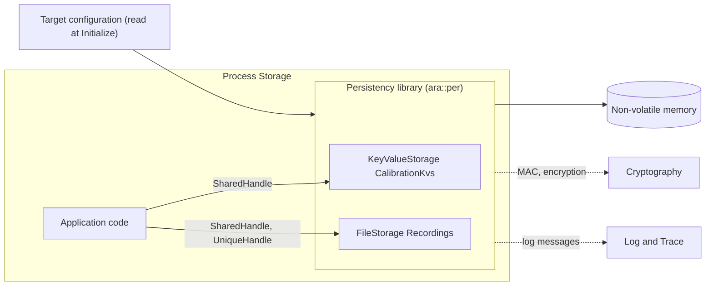

The header files are `ara/per/key_value_storage.h`, `ara/per/file_storage.h`, `ara/per/read_accessor.h`, `ara/per/write_accessor.h`, `ara/per/read_write_accessor.h`, `ara/per/file_accessor.h`, `ara/per/shared_handle.h`, `ara/per/unique_handle.h`, `ara/per/recovery.h`, `ara/per/update.h` and `ara/per/per_error_domain.h` (SWS, Chapter 8). All functions are `noexcept` and return `ara::core::Result` ([Chapter 13](#13-error-handling)).

> **Note (implementation example):** On Linux, a typical library-only implementation maps each storage to a directory, each Key-Value Storage to one or a few files in it, and each file of a File Storage to a file of the same name. It reads its configuration from a file that the integration tooling generated from the target configuration. None of this is visible to the application, and none of it is standardized.

> **Key takeaways**
>
> - Persistency stores data across power cycles and updates, in Key-Value Storages and File Storages.
> - It is a library in the process of its user; the API is `ara::per`, exception-free, with `Result` return values.
> - Persistent data is private to one process; sharing needs a service.
> - Key management, package handling and data removal belong to other clusters.

---

## 2. Core Concepts and Terminology

> **Why this matters:** Persistency uses a small set of terms with precise meanings: storage, element, contract version, target configuration version, update strategy, redundancy. The rules of later chapters are written in these terms, so it pays to learn them once.

### 2.1 Storages and Elements

**In plain words:** a storage is a named container; an element is one thing in it.

**Formally** (SWS, Chapter 2):

- A **Key-Value Storage** (KVS) is a set of key-value pairs that are stored persistently. A **key-value pair** is a key with a value, stored together with the type of the value. The **key** identifies the pair uniquely within the storage.
- A **File Storage** (FS) is a set of files that are stored persistently. A **file** is a binary or text file, and the **file name** identifies it uniquely within the File Storage.
- **Storage** means either kind; **element** means either a key-value pair or a file. The specification uses these umbrella terms when a rule applies to both.
- **Persistent data** is data in persistent memory that one process can access. **Physical storage** is the actual memory: a flash device that Persistency accesses directly, or a file system of the OS.
- **Metadata** is additional data about a storage, for example which redundancy and which keys were used. It is distributed over the storage location and a central location for all storages of a process.

### 2.2 Key-Value or File: Which One?

The two kinds of storage solve different problems. This table helps with the choice.

| Criterion | Key-Value Storage | File Storage |
| --- | --- | --- |
| Typical data | Small typed values: parameters, counters, calibration records | Streams, logs, large blobs, data in a foreign format |
| Types | Platform types, byte arrays, modeled C++ types; checked on every access ([Section 6.4](#64-supported-data-types)) | Bytes or UTF-8 text; Persistency does not interpret the content |
| Atomicity | Each `GetValue`, `SetValue` is atomic; commit all changes with `SyncToStorage` | Each file has a position; one thread per open file |
| When changes are persisted | Only at `SyncToStorage` | At `SyncToFile`, and at the latest when the file is closed |
| Initial content | Initial values from the configuration | Initial content from a URI in the software package, or an empty file |
| Number of items | Unbounded by the model; limited by the quota | `maxNumberOfFiles` and the quota |

In the running example, `CalibrationKvs` and `FusionParams` are Key-Value Storages: they hold a few structured values that must be read and replaced as a whole. `Recordings` is a File Storage: each recording is a growing stream of object lists.

### 2.3 Persistency Users and Process-Local Data

A **Persistency user** is an Adaptive Application or a functional cluster (SWS, Chapter 1). Functional clusters that run as daemons, such as State Management or UCM, are treated like Adaptive Applications; the library part of a cluster uses a configuration without a port ([Section 3.4](#34-platform-clusters-as-persistency-users)).

The most important architectural rule is short: persistent data is always local to one process ([SWS_PER_00309]). Persistency never shares data between two processes, not even between two processes of the same executable. The reason given is that Persistency should not become a second communication path next to Communication Management (SWS, Section 7.2.2). Within one process, Persistency supports concurrent access from several threads ([Section 5.4](#54-threads-and-handles)).

### 2.4 Application Design and Target Configuration

Persistency is configured in two parts (SWS, Chapter 2):

- The **Application Design** is written by the application designer. It says *what* the application needs: a port for each storage, typed by a persistency interface, with the keys or files, their types, their initial values and the requested access mode. It is part of the AUTOSAR meta-model (M2), like the rest of the design ([guide 02, Section 6.5](02_Manifests.md#65-interfaces-to-functional-clusters)).
- The **Target Configuration** is written by the integrator. It says *how* and *where* the data is stored on the machine: the process, the locations, the version, the sizes, the update strategies, redundancy and cryptography. In R25-11 it is defined as an **APMC** model, the Adaptive Platform Machine Configuration ([guide 02, Section 11.9](02_Manifests.md#119-looking-ahead-apmc)). The older M2 description in the TPS is still provided but may be discontinued ([Section 14.12](#1412-the-legacy-m2-target-configuration)).

The target configuration can refine what the design says. When both define the same element, the target configuration wins ([SWS_PER_00379]); [Section 4.4](#44-precedence-in-one-picture) shows all precedence rules.

### 2.5 Contract Version and Target Configuration Version

Persistency keeps two versions per storage, and each one answers a different question (SWS, Chapter 2; [SWS_PER_00378]):

| Version | Question it answers | Changes when | Configured in |
| --- | --- | --- | --- |
| **Contract version** | Has the *structure* that the application expects changed? | Storages are added, removed or renamed, the access mode changes, or the data types of a storage or its elements change | `PersistencyInterface.contractVersion` (design), or `PersistencyCommon.ContractVersion` for storages without a port |
| **Target Configuration version** | Has the *deployed content* changed? | Pre-installed elements of otherwise unchanged storages are added, removed or renamed | `PersistencyCommon.Version` |

When the target configuration version goes up, Persistency updates the storage ([Section 12.5](#125-the-update-sequence)). When the contract version also goes up, it asks the application to migrate the data ([Section 12.6](#126-migrating-data-the-update-callback-and-data-type-mappings)). Therefore a higher contract version requires a higher target configuration version ([SWS_PER_CONSTR_00001]).

### 2.6 Update Strategies

An **update strategy** tells Persistency what to do with an existing element when a new configuration is deployed (SWS, Section 7.2.5):

| Strategy | APMC literal | Meaning |
| --- | --- | --- |
| Keep existing | `KEEP_EXISTING` | Keep the stored element unchanged; add new elements |
| Overwrite | `OVERWRITE` | Replace the stored element with the configured initial value or content (element level only) |
| Delete | `DELETE` | Remove the element |

The strategy can be set for a whole storage and for single elements. [Section 12.4](#124-update-strategies-in-detail) explains the exact effect.

### 2.7 Integrity and Redundancy

Persistency distinguishes two kinds of **integrity** (SWS, Chapter 2):

- **Data integrity**: the stored values are correct. It is ensured by the configured redundancy.
- **Structural integrity**: the structure of the storage can be read at all. When it is lost, the error is `kIntegrityCorrupted`.

**Redundancy** is extra information that Persistency stores to check data integrity: CRCs, hash values or complete copies. Typically, only copies allow Persistency to *repair* corrupted data (SWS, Chapter 2). [Chapter 9](#9-data-integrity-redundancy-and-recovery) explains the three types.

### 2.8 Access Modes

The access mode limits what the Persistency user may do with a storage (SWS, Section 7.1.1). For an application, it comes from the ComSpec of the port; for a cluster without a port, from `PersistencyCommon.FunctionalClusterPersistencyAccess`.

| Access mode (port / cluster) | Allowed | Notes |
| --- | --- | --- |
| `read` / `READ` | Read only | Modifying calls fail with `kIllegalWriteAccess` ([SWS_PER_00537]) |
| `readWrite` / `READ_WRITE` | Read and write | |
| `write` / `WRITE` | Write only | Reading is currently not technically constrained (SWS, Section 7.1.1) |
| `writeOnlyOnce` / – | Add new elements; never modify existing ones | New in R25-11; only for Adaptive Applications. Modifying an existing element fails with `kIllegalWriteAccess` ([SWS_PER_00583]). Reading is not limited. |

### 2.9 Terms at a Glance

| Term | Plain meaning | Where configured | API |
| --- | --- | --- | --- |
| Key-Value Storage | Typed key-value pairs with commit | Port typed by `PersistencyKeyValueStorageInterface`; `PersistencyKeyValueStorage` | `OpenKeyValueStorage`, `KeyValueStorage` |
| File Storage | Flat directory of files | Port typed by `PersistencyFileStorageInterface`; `PersistencyFileStorage` | `OpenFileStorage`, `FileStorage` |
| Temporary storage | The in-memory working copy of an open KVS | – | `SyncToStorage`, `DiscardPendingChanges` |
| Contract version | Version of the structure | `contractVersion`, `ContractVersion` | `RegisterApplicationDataUpdateCallback` |
| Target Configuration version | Version of the deployed content | `PersistencyCommon.Version` | `UpdatePersistency`, `CheckForManifestUpdate` |
| Update strategy | Keep, overwrite or delete on update | `UpdateStrategy`, `ElementUpdateStrategy` | – |
| Redundancy | CRC, hash or M out of N copies | `PersistencyRedundancyHandling` | `Recover*`, `RegisterRecoveryReportCallback` |
| Central storage | Where Persistency keeps the versions and the list of installed storages of a process | `PersistencyCentralStorageUri` | – |
| Backup | The copy of all data of a process taken before an update | – | `CleanUpPersistency` |
| Shared handle | Copyable owner of an open storage | – | `SharedHandle` |
| Unique handle | Move-only owner of an open file | – | `UniqueHandle` |

> **Key takeaways**
>
> - A storage is a KVS or an FS; an element is a key-value pair or a file.
> - Persistent data belongs to exactly one process.
> - The Application Design says what the application needs; the target configuration (APMC in R25-11) says how and where it is stored.
> - The contract version tracks structure; the target configuration version tracks deployed content.
> - Update strategies, redundancy and access modes are configured, not programmed.

---

## 3. Persistency in the System Architecture

> **Why this matters:** Persistency looks like a simple library, but its behavior depends on where it runs, on the file system below it, and on the clusters that use it or that it uses. Knowing these neighbors explains many integration questions, from "why is my sync slow?" to "who deletes the data of an uninstalled application?".

### 3.1 Where Persistency Sits in the Platform

The specification does not prescribe an architecture. It describes four variants that an implementation may combine (SWS, Section 4.2):

| Variant | How it works | Consequences |
| --- | --- | --- |
| Library only | Everything runs in the user's process. The Application Design configures the compilation; the target configuration is read from a file at run time. | Simple; the implementation still decides when data is checked or decrypted. |
| Central daemon | The library talks to a daemon through some IPC. | Additional errors, because the connection to the daemon can be lost at any time. |
| Based on a file system | Library or daemon use the POSIX file system services. | Mount options outside Persistency's control decide when data really reaches the medium ([Chapter 8](#8-durability-what-stored-really-means)). |
| Direct access to storage hardware | Persistency drives flash memory directly. | It must care about wear leveling; usually the OS's flash file system or driver does this instead. |

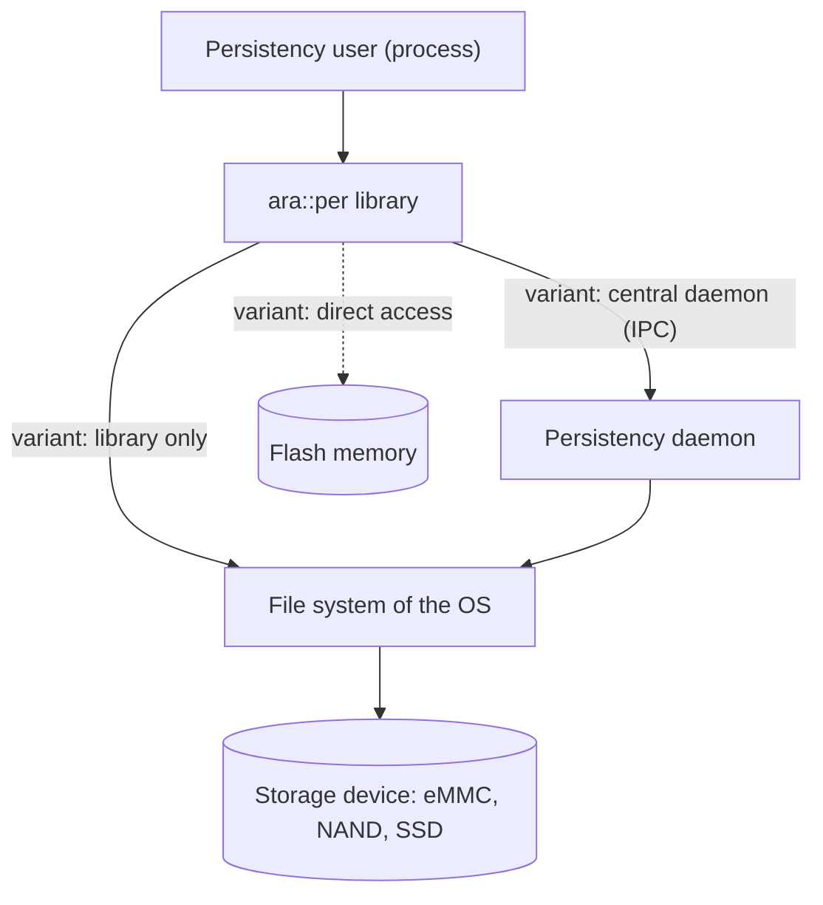

Wear leveling exists because flash cells degrade with the number of writes, while the writes of a typical system are very unevenly distributed; frequent updates of single elements should therefore be spread over the whole memory (SWS, Section 4.2.4).

### 3.2 Interfaces Provided by Persistency

Besides applications, several platform clusters use Persistency (SWS, Table 5.1):

| Interface | Used by | Purpose |
| --- | --- | --- |
| `KeyValueStorage` | Diagnostic Management | Associated data of diagnostic trouble codes, for example freeze frames |
| | State Management | Its internal state ([guide 05, Section 11.3](05_StateManagement.md#113-persistency-logging-and-supervision-of-state-management)) |
| | Time Synchronization | The last received time stamp, for a faster startup |
| | UCM, V-UCM | Their internal state |
| | Remote Persistency | Access to an underlying Key-Value Storage |
| `FileStorage` | UCM, V-UCM | Files of received software and vehicle packages |
| | Diagnostic Management | Properties of diagnostic trouble codes and sessions |

### 3.3 Interfaces Required by Persistency

| Cluster | Interface | Purpose |
| --- | --- | --- |
| Cryptography | `CryptoStack` | Confidentiality and authenticity of the stored data ([Chapter 10](#10-security-encryption-mac-and-verification-hash)) |
| Log and Trace | `Logger` | Information about errors, internal states and actions ([Chapter 16](#16-reporting)) |
| Execution Management | – (implicit) | Persistency is compiled into the executable and runs as part of its process (SWS, Section 5.3) |

Persistency defines no service interfaces (SWS, Chapter 9).

### 3.4 Platform Clusters as Persistency Users

A functional cluster has no software component and therefore no port. Its storages are configured only in the target configuration, as a `PersistencyKeyValueStorage` or `PersistencyFileStorage` *without* `PersistencyCommon.PortPrototypeInstanceRef` (SWS, Section 7.1.1). Three settings replace what the port would provide:

- `PersistencyCommon.FunctionalClusterPersistencyAccess` replaces the access mode of the ComSpec (`READ`, `READ_WRITE` or `WRITE`; there is no write-only-once for clusters).
- `PersistencyCommon.ContractVersion` replaces the contract version of the interface.
- The instance specifier is the *ApmC path* of the storage container instead of the path of a port (SWS, Sections 7.3 and 7.4).

Persistency creates these storages at installation like port-based ones ([SWS_PER_00584], [SWS_PER_00585]). Both settings are mutually exclusive with `PortPrototypeInstanceRef` ([APMC_PER_00046], [APMC_PER_00012]).

### 3.5 Sharing Data Between Processes: Use a Service

Because persistent data is private to one process, data that several processes need must be owned by one of them and offered through a service interface (SWS, Section 7.2.2). The running example follows this rule: `Storage` owns `CalibrationKvs` and offers `CalibrationDataService`; `CameraDriver`, `CalibrationCheck`, `Fusion` and `FusionLite` use the service ([guide 07, Section 13.5](07_CommunicationManagement.md#135-worked-example-calibrationdataservice-over-local-ipc)).

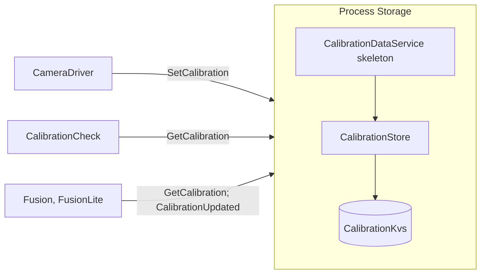

The owner also becomes the single place for plausibility checks, access control (only `CameraDriver` may call `SetCalibration`, guide 15) and the decision when to commit.

> **Pitfall:** Two processes of the same executable get two separate sets of storages ([SWS_PER_00309]), because the target configuration has one storage configuration per process (SWS, Section 7.1.1). If you start a second instance of an executable for load sharing, it does not see the data of the first one.

> **Key takeaways**
>
> - Persistency can be a library, use a daemon, sit on a file system or drive flash directly; the API is the same.
> - DM, SM, UCM, V-UCM and Time Synchronization use Persistency; Persistency uses Cryptography and Log and Trace.
> - Platform clusters configure storages without a port and open them with an ApmC path.
> - Data shared by several processes must be owned by one process and offered as a service.

---

## 4. Configuration Overview

> **Why this matters:** Persistency has no built-in knowledge of your storages. Which storages exist, which keys they start with, where they live, how they are protected and what happens at an update all come from configuration. This chapter gives the big picture; [Chapter 14](#14-configuration-reference-what-to-configure) lists every setting in detail.

### 4.1 Where the Configuration Lives

| Model | Configured by | When (methodology step) | Main elements for Persistency |
| --- | --- | --- | --- |
| Application Design (M2, TPS 3.2.5.2 and 4.6) | Application designer | Design of the software component | `PersistencyKeyValueStorageInterface`, `PersistencyFileStorageInterface`, `PersistencyDataElement`, `PersistencyFileElement`, `PersistencyKeyValueDataTypeMapping`; R-ports with `PersistencyDataRequiredComSpec` or `PersistencyFileRequiredComSpec` |
| Target configuration (APMC, SWS 10.1) | Integrator | Integration of the machine | One `Persistency` instance per process with `PersistencyGeneral`, the storage collections, and per storage `PersistencyCommon`, the key-value pairs or files, redundancy, crypto key slots and URIs |
| Legacy target configuration (M2, TPS 12.2) | Integrator | Integration | `PersistencyKeyValueStorage`, `PersistencyFileStorage` and mappings; may be discontinued |

The software package that UCM installs carries the configuration and the initial file content (SWS, Sections 7.1.2 and 7.1.3).

### 4.2 How the Elements Relate

The diagram shows the main elements and references for one Key-Value Storage of an application.

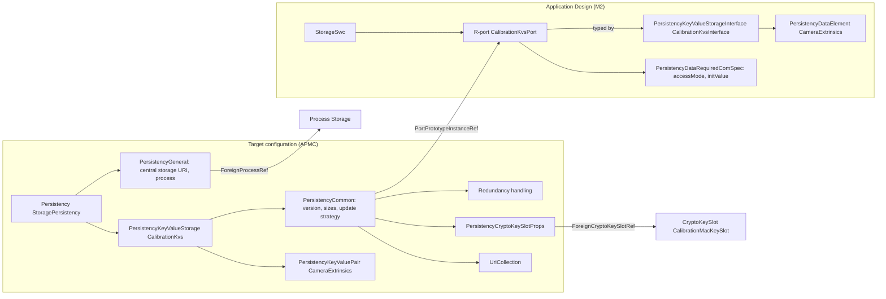

Three links tie the two worlds together: `PersistencyCommon.PortPrototypeInstanceRef` connects a configured storage to the port of the design, `PersistencyGeneral.ForeignProcessRef` connects the whole `Persistency` instance to one process, and key-value pairs or files with the same short name or file name are matched with the elements of the design.

### 4.3 Who Configures What, and When

| Decision | Role | Where |
| --- | --- | --- |
| Which storages, keys, files and types the code uses | Application designer | Interfaces and ports |
| Initial values and initial file content | Application designer, refined by the integrator | ComSpec `initValue`, `contentUri`; `InitValueRef`, `ContentUri` |
| Requested redundancy and minimum size | Application designer (as a request) | `redundancy`, `redundancyHandling`, `minimumSustainedSize` |
| Actual redundancy, crypto, sizes, locations | Integrator | `PersistencyCommon` and its sub-containers |
| Versions and update strategies | Designer (contract version, recommendations), integrator (target configuration version, binding strategies) | `contractVersion`; `Version`, `UpdateStrategy`, `ElementUpdateStrategy` |
| When the configuration becomes active | UCM, at installation or update; Persistency at the next open or `UpdatePersistency` | [Chapter 12](#12-installation-update-roll-back-and-reset) |

### 4.4 Precedence in One Picture

Elements and update strategies can be defined at four places. The more specific and the later definition wins.

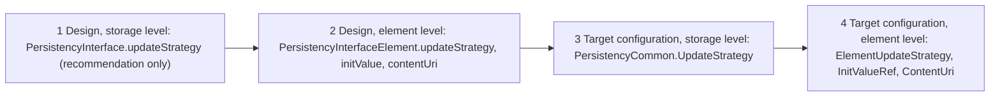

The rules behind the picture:

- An element defined in the target configuration (`PersistencyKeyValuePair`, `PersistencyFile`) is preferred over the same element in the design ([SWS_PER_00379]).
- An update strategy in the target configuration is preferred over one in the design ([SWS_PER_00251]).
- An update strategy for an element is preferred over the strategy of the enclosing storage ([SWS_PER_00380]).
- `PersistencyCommon.UpdateStrategy` is mandatory, so the storage-level strategy of the design is only a recommendation and never used by Persistency (SWS, Section 7.2.5).

So the effective strategy of an element is: target element level if present, else design element level, else target storage level. A design element strategy therefore still beats the storage strategy of the target configuration.

> **Key takeaways**
>
> - The design (M2) describes ports, interfaces and elements; the target configuration (APMC) describes processes, locations, versions, sizes and protection.
> - `PortPrototypeInstanceRef`, `ForeignProcessRef` and matching names connect the two.
> - Target configuration beats design, element level beats storage level.
> - [Chapter 14](#14-configuration-reference-what-to-configure) has every attribute; [Section 14.13](#1413-the-running-example-complete-configuration) has the running example.

---

## 5. Initialization, Opening and Handles

> **Why this matters:** Most Persistency bugs in real code are not about values, but about life cycle: a storage opened before `Initialize`, a handle that is still alive when `Deinitialize` runs, a file opened twice from two threads. This chapter explains when storages and files are open, who owns them, and what is safe across threads.

### 5.1 Initialize and Deinitialize

Persistency belongs to the Adaptive Platform Foundation, so `ara::core::Initialize` and `ara::core::Deinitialize` initialize and de-initialize it together with the other library-based clusters (SWS, Section 7.5; [guide 03, Section 5.2](03_CoreAndGeneral.md#52-initialize)).

- **At `Initialize`**, Persistency reads its target configuration and prepares the access structures to all Key-Value Storages and File Storages that the configuration defines ([SWS_PER_00408]). Depending on the implementation, it may also check redundancy at this point ([Section 9.5](#95-when-persistency-checks-and-what-it-reports)).
- **At `Deinitialize`**, Persistency persists all open files as if `SyncToFile` had been called and closes them, drops all unsynced changes of Key-Value Storages as if `DiscardPendingChanges` had been called, and then frees its remaining resources ([SWS_PER_00409]).

The global functions that take an `InstanceSpecifier`, and the global update and reset functions, check whether they are called before `Initialize` or after `Deinitialize`. If so, this is a violation: Persistency logs `CalledWhileUnititializedViolation` and the process is aborted ([SWS_PER_00574], [SWS_PER_20029]). The checked functions are `UpdatePersistency`, `ResetPersistency`, `OpenKeyValueStorage`, `RecoverKeyValueStorage`, `ResetKeyValueStorage`, `GetCurrentKeyValueStorageSize`, `OpenFileStorage`, `RecoverAllFiles`, `ResetAllFiles` and `GetCurrentFileStorageSize`. All other functions and methods are unprotected; calling them outside the initialized phase is undefined behavior (SWS, Section 7.5; [guide 03, Section 5.4](03_CoreAndGeneral.md#54-what-works-before-initialize-and-after-deinitialize)).

> **Note:** The sentence of [SWS_PER_00574] is inverted in R25-11: it says Persistency shall check whether the functions are called before `Initialize` or after `Deinitialize`, and "if not" treat it as a violation. The explanation directly above it in SWS Section 7.5 makes the intent clear: calling them *outside* the initialized phase is the violation.

> **Pitfall:** `Deinitialize` drops unsynced key-value changes. A `main` that ends with `Deinitialize` and never called `SyncToStorage` loses everything it set since the last sync. Sync explicitly before you leave `Run()`.

### 5.2 Instance Specifiers for Storages

A storage is identified by an `ara::core::InstanceSpecifier` (SWS, Section 7.1.1):

- For an application, it is the short-name path of the R-port in the executable, for example `/storage/Root/CalibrationKvsPort` or `/fusion/Root/FusionParamsPort`. The path starts with the executable and its root software component prototype, as for service ports ([guide 02, Section 9.4](02_Manifests.md#94-from-port-to-instancespecifier)).
- For a platform cluster without a port, it is the ApmC path of the `PersistencyKeyValueStorage` or `PersistencyFileStorage` container ([Section 3.4](#34-platform-clusters-as-persistency-users)).

If the specifier does not name a configured storage, Persistency returns `kStorageNotFound` ([SWS_PER_00538]). This is deliberately an *error*, not a violation as the general requirements of the platform would demand: an error lets the code handle storages that are not configured in a particular product variant ([SWS_PER_NA_00002]). Opening the same storage twice is allowed; both calls return handles to the same storage ([SWS_PER_NA_00003]).

```cpp
#include "ara/core/instance_specifier.h"
#include "ara/per/key_value_storage.h"

// Storage: open CalibrationKvs (illustrative).
auto spec = ara::core::InstanceSpecifier::Create("/storage/Root/CalibrationKvsPort");
if (!spec.HasValue()) { /* malformed path */ }
auto kvs = ara::per::OpenKeyValueStorage(spec.Value());
if (!kvs.HasValue()) {
    // kStorageNotFound: not configured for this process
    // kIntegrityCorrupted, kValidationFailed, kAuthenticationFailed: see Chapters 9 and 10
}
```

### 5.3 SharedHandle and UniqueHandle

Persistency hands out two kinds of handle (SWS, Section 8):

| Handle | Returned by | Copy | Move | Closes when |
| --- | --- | --- | --- | --- |
| `SharedHandle<KeyValueStorage>`, `SharedHandle<FileStorage>` | `OpenKeyValueStorage`, `OpenFileStorage` | yes | yes | The last copy is destroyed, or `Deinitialize` is called |
| `UniqueHandle<ReadAccessor>`, `UniqueHandle<WriteAccessor>`, `UniqueHandle<ReadWriteAccessor>` | `OpenFileReadOnly`, `OpenFileWriteOnly`, `OpenFileReadWrite` | no | yes | The handle is destroyed, its File Storage is closed, or `Deinitialize` is called |

Both handles behave like smart pointers: `operator->` and `operator*` give access to the object, and `explicit operator bool` tells whether the handle holds an object. A moved-from handle is empty, and using any operator other than `bool` on an empty handle is undefined behavior ([SWS_PER_00398], [SWS_PER_00399]). The classes `KeyValueStorage`, `FileStorage` and the accessors cannot be constructed, copied or moved by the application; you only ever hold them through handles.

When a File Storage is closed, any of its files that are still open are closed as well ([SWS_PER_00425]). Using the `UniqueHandle` of such a file afterwards is undefined behavior (SWS, Section 7.2.2).

> **Pitfall:** Keep the `SharedHandle` of a File Storage alive at least as long as the `UniqueHandle`s of its files. A class that stores the file handle but lets the storage handle go out of scope at the end of a function has a dangling file.

### 5.4 Threads and Handles

Persistency supports concurrent access from several threads of one process (SWS, Section 7.2.2):

- **Sharing a storage.** Copy the `SharedHandle` to another thread, or call `Open*Storage` again in that thread. Copying, moving and destroying `SharedHandle`s concurrently is safe; it works like the reference count of `std::shared_ptr` ([SWS_PER_00582]).
- **Key-value pairs.** `GetValue`, `SetValue`, `RemoveKey`, `RemoveAllKeys`, `SyncToStorage` and `DiscardPendingChanges` are atomic, so several threads can access single keys at the same time. A change made by one thread is visible to all others immediately (SWS, Section 7.3).
- **Files.** An open file cannot be shared: its `UniqueHandle` can only be moved to another thread, and opening a file that is already open fails with `kResourceBusy` ([SWS_PER_00546]). `DeleteFile`, `RecoverFile` and `ResetFile` also fail on an open file.
- **Concurrent modification of a storage.** When a function that modifies a storage is called while another function that modifies the same storage is running, it fails with `kResourceBusy` ([SWS_PER_00545]). This applies in particular to `Recover*`, `Reset*`, `UpdatePersistency`, `CleanUpPersistency` and `ResetPersistency`, which only succeed when the storages concerned are not open.

The thread safety of each function is stated in its API table ([Section 15.5](#155-update-reset-and-recovery-api)): the methods of `KeyValueStorage` and `FileStorage` are thread-safe, the methods of the accessors are not, and the global update, reset and registration functions are not.

### 5.5 Opening Is More Than Opening

`OpenKeyValueStorage` and `OpenFileStorage` do more than open. On the first open after an installation, update or roll-back, they also install, update, finalize or roll back the persistent data of that storage ([SWS_PER_00470], [SWS_PER_00471]). The application's update callback may run inside the call ([Section 12.6](#126-migrating-data-the-update-callback-and-data-type-mappings)). An open call can therefore take noticeably longer than usual, and it can return errors that belong to an update, such as `kQuotaExceeded`, `kTooManyFiles` or `kOutOfStorageSpace`. [Chapter 12](#12-installation-update-roll-back-and-reset) explains the details.

> **Key takeaways**
>
> - Open storages only between `Initialize` and `Deinitialize`; outside, the global functions raise a violation.
> - A storage is named by the path of its R-port, or by an ApmC path for platform clusters; an unknown name gives `kStorageNotFound`.
> - Storages are shared through copyable `SharedHandle`s; files are owned by move-only `UniqueHandle`s.
> - Key-value operations are atomic across threads; an open file belongs to one thread at a time.
> - The first open after an update may install, migrate or roll back data.

---

## 6. Key-Value Storages

> **Why this matters:** The Key-Value Storage is the workhorse of Persistency. Its transaction model is simple, but it surprises developers who expect `SetValue` to write to flash. This chapter explains the model, the API and the data types, and builds the class that `Storage` uses for the calibration.

### 6.1 The Temporary Storage

**In plain words:** when you open a Key-Value Storage, you get a working copy in memory. All reads and writes go to that copy. `SyncToStorage` writes the copy to persistent memory; `DiscardPendingChanges` throws it away and reloads the last stored state.

**Formally:** `OpenKeyValueStorage` creates a *temporary storage* that provides access to the Key-Value Storage, and returns a `SharedHandle` ([SWS_PER_00506]). All operations work on this temporary storage. Modifications that were not persisted with `SyncToStorage` are discarded when the storage is closed or the system restarts, as if `DiscardPendingChanges` had been called ([SWS_PER_00331]). `SyncToStorage` stores all changes since the last sync or since opening, and updates the configured redundancy in the same call ([SWS_PER_00494]). `DiscardPendingChanges` resets the storage to the last persisted state ([SWS_PER_00495]). Because all threads share one temporary storage, a sync persists the changes of all threads, and a discard resets them for all threads (SWS, Section 7.3).

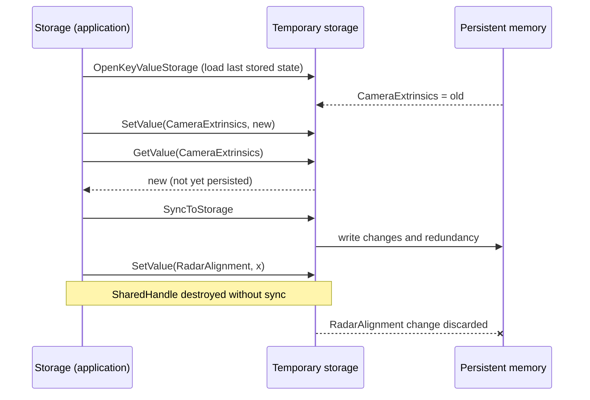

### 6.2 Reading Values

`GetValue` exists in two forms:

```cpp
template <class T> ara::core::Result<T> GetValue(ara::core::StringView key) const noexcept;               // [SWS_PER_00332]
template <class T> ara::core::Result<void> GetValue(ara::core::StringView key, T& value) const noexcept;  // [SWS_PER_00044]
```

The first returns the value; the second writes it into an existing object and is meant for very large values that are read repeatedly, so that the memory can be reused. Both check first whether the key exists in the temporary storage (`kKeyNotFound` otherwise, [SWS_PER_00496]), then whether `T` matches the stored type (`kDataTypeMismatch` otherwise, [SWS_PER_00497]). They return the stored value or, if `SetValue` changed it in the meantime in any thread, the new temporary value ([SWS_PER_00498]).

### 6.3 Writing and Creating Values

```cpp
template <class T> ara::core::Result<void> SetValue(ara::core::StringView key, const T& value) noexcept;  // [SWS_PER_00046]
```

`SetValue` overwrites an existing value of the same type ([SWS_PER_00534]) and creates the key if it does not exist ([SWS_PER_00501]). If the existing value has another type, it fails with `kDataTypeMismatch` ([SWS_PER_00499]). To change the type of a key, remove the key first and then create it again with the new type (SWS, Section 7.3). In a storage with the access mode `read`, `SetValue` fails with `kIllegalWriteAccess`; in a `writeOnlyOnce` storage, it fails for keys that already exist ([SWS_PER_00537], [SWS_PER_00583]).

### 6.4 Supported Data Types

A Key-Value Storage can store three classes of types (SWS, Section 7.3.1):

| Class | Examples | Rule |
| --- | --- | --- |
| Platform types | `bool`, `std::uint8_t` to `std::uint64_t`, `std::int8_t` to `std::int64_t`, `float`, `double` | All types of the platform types specification ([SWS_PER_00302]) |
| Serialized binary data | `ara::core::Vector<ara::core::Byte>`, `ara::core::Span<ara::core::Byte>` | For custom types that the application serializes itself ([SWS_PER_00303]). A `Span` can be passed to `SetValue` and to the out-parameter form of `GetValue`, but it cannot be returned by `GetValue`. |
| Modeled types | `hpc::storage::CalibrationRecord`, `hpc::fusion::TrackerTuningV2` | Every `CppImplementationDataType` that types a `PersistencyDataElement` of the interface or is listed in `dataTypeForSerialization` ([SWS_PER_00304]) |

The definitions of the modeled types are generated from the model, and Persistency typically generates serializers and deserializers for them (SWS, Section 7.3.1). For strings, Persistency expects UTF-8 ([SWS_PER_CONSTR_00006]).

> **Pitfall:** A type that is neither a platform type nor modeled in the interface cannot be stored directly. Either model it (add it to `dataTypeForSerialization`) or serialize it yourself into a `Vector<Byte>`. The first option lets Persistency check the type on every access; the second one makes you responsible for versioning the byte format.

### 6.5 Keys

| Method | Returns | Notes |
| --- | --- | --- |
| `KeyExists(key)` | `Result<bool>` | `true` if the key is in the temporary storage ([SWS_PER_00504]) |
| `GetAllKeys()` | `Result<Vector<String>>` | All keys of the temporary storage; empty vector for an empty storage ([SWS_PER_00505]) |
| `GetCurrentValueSize(key)` | `Result<std::uint64_t>` | Current size of the value in bytes; `kKeyNotFound` for a missing key ([SWS_PER_00565], [SWS_PER_00566]) |
| `RemoveKey(key)` | `Result<void>` | Removes the pair from the temporary storage; `kKeyNotFound` for a missing key ([SWS_PER_00502], [SWS_PER_00535]) |
| `RemoveAllKeys()` | `Result<void>` | Empties the temporary storage ([SWS_PER_00503]) |

Like all other operations, these work on the temporary storage: a removed key is removed persistently only after the next `SyncToStorage`. The keys of the configured key-value pairs are the short names of the `PersistencyDataElement`s or `PersistencyKeyValuePair`s ([SWS_PER_00253]); the application may add other keys at run time with `SetValue`.

### 6.6 Committing and Discarding

`SyncToStorage` is the commit point. Treat it like the end of a transaction:

- **Group related changes.** If two keys must change together, set both and sync once. Another thread sees both new values at once, and a crash before the sync loses both.
- **Check the result.** `SyncToStorage` can fail with `kQuotaExceeded`, `kOutOfStorageSpace`, `kPhysicalStorageFailure`, `kEncryptionFailed` or `kAuthenticationFailed`, among others ([Section 13.2](#132-what-each-error-means-and-how-to-react)). After a failure, the temporary storage still holds the changes; call `DiscardPendingChanges` if you want memory and persistent state to agree again.
- **Sync deliberately, not constantly.** Every sync writes to flash. For data that changes often, such as a learned parameter, sync at meaningful points (for example when the value has converged, or at a state change) and accept that the last changes may be lost at a power cut.

### 6.7 Worked Example: CalibrationStore in Storage

`Storage` wraps `CalibrationKvs` in a small class, `CalibrationStore`. [Guide 07](07_CommunicationManagement.md#86-implementing-a-method-in-the-skeleton) uses its methods `Read`, `Write` and `IsPlausible` in the methods `GetCalibration` and `SetCalibration` of `CalibrationDataService`. The keys of the storage are the names of the enumerators of `CalibrationKey`.

```cpp
// Storage: CalibrationStore wraps the Key-Value Storage CalibrationKvs (illustrative).
#include "ara/core/instance_specifier.h"
#include "ara/core/result.h"
#include "ara/per/key_value_storage.h"
#include "hpc/storage/calibrationdataservice_common.h"  // CalibrationKey, CalibrationRecord

#include <optional>

namespace hpc::storage {

class CalibrationStore {
public:
    CalibrationStore() {
        auto spec = ara::core::InstanceSpecifier::Create("/storage/Root/CalibrationKvsPort");
        if (!spec.HasValue()) { return; }
        auto kvs = ara::per::OpenKeyValueStorage(spec.Value());  // may install or update (Chapter 12)
        if (kvs.HasValue()) { kvs_.emplace(std::move(kvs).Value()); }
    }

    // Used by GetCalibration: any error becomes CalibrationNotFound.
    ara::core::Result<CalibrationRecord> Read(CalibrationKey key) const {
        if (!kvs_) { return ara::per::MakeErrorCode(ara::per::PerErrc::kStorageNotFound, 0); }
        return (*kvs_)->GetValue<CalibrationRecord>(KeyName(key));  // MAC checked by Persistency
    }

    // Used by SetCalibration: commit at once, so that the value survives a power cut.
    ara::core::Result<void> Write(CalibrationKey key, const CalibrationRecord& record) {
        if (!kvs_) { return ara::per::MakeErrorCode(ara::per::PerErrc::kStorageNotFound, 0); }
        auto& kvs = *kvs_;
        auto set = kvs->SetValue(KeyName(key), record);
        if (!set.HasValue()) { return set; }
        auto synced = kvs->SyncToStorage();  // writes 3 copies and the MAC (Sections 9.8, 10.6)
        if (!synced.HasValue()) {
            static_cast<void>(kvs->DiscardPendingChanges());  // memory = last stored state again
        }
        return synced;
    }

    bool IsPlausible(CalibrationKey key, const CalibrationRecord& record) const;  // Storage's own rules

private:
    static ara::core::StringView KeyName(CalibrationKey key) {
        return key == CalibrationKey::CameraExtrinsics ? "CameraExtrinsics" : "RadarAlignment";
    }
    std::optional<ara::per::SharedHandle<ara::per::KeyValueStorage>> kvs_;
};

}  // namespace hpc::storage
```

Three design decisions are worth noting. First, `Write` syncs immediately: a calibration is written rarely and is expensive to measure again, so losing it is worse than one extra flash write. Second, after a failed sync, `Write` discards the pending change, so that `GetCalibration` never returns a value that is not stored. Third, `Storage` processes the method calls of `CalibrationDataService` with `kEventSingleThread` ([guide 07, Section 8.7](07_CommunicationManagement.md#87-method-call-processing-modes)), so `Write` never runs concurrently with itself; a multi-threaded provider would need its own lock, because a `SetValue` of one thread and a `DiscardPendingChanges` of another would interfere.

On a fresh installation, both keys hold their initial values `CameraExtrinsicsDefault` and `RadarAlignmentDefault`, which mean "not calibrated" (an empty value list). `CalibrationCheck` detects this state through `GetCalibration`.

> **Key takeaways**
>
> - All KVS operations work on a temporary storage; only `SyncToStorage` makes changes persistent.
> - Closing, crashing or `Deinitialize` discards unsynced changes.
> - `GetValue` and `SetValue` check the type; change a key's type by removing and re-creating it.
> - Platform types, byte vectors and modeled types are supported.
> - After a failed sync, discard pending changes if memory and storage must agree.

---

## 7. File Storages

> **Why this matters:** Some data does not fit into typed values: recordings, logs, exported reports, configuration files in a third-party format. File Storages give you files with a familiar API, but with stricter rules than POSIX: no paths, one owner per open file, explicit open modes and a few traps in the class design of R25-11.

### 7.1 A Directory Without Subdirectories

A File Storage is opened with `OpenFileStorage`, which returns a `SharedHandle<FileStorage>` ([SWS_PER_00507]). Inside, files are identified only by their file names; there are no subdirectories and no paths.

| Method | Returns | Notes |
| --- | --- | --- |
| `FileExists(fileName)` | `Result<bool>` | ([SWS_PER_00508]) |
| `GetAllFileNames()` | `Result<Vector<String>>` | Accurate only while no file is added or deleted at the same time ([SWS_PER_00509]) |
| `DeleteFile(fileName)` | `Result<void>` | `kFileNotFound` for a missing file ([SWS_PER_00510], [SWS_PER_00511]); `kResourceBusy` for an open file |
| `GetCurrentFileSize(fileName)` | `Result<std::uint64_t>` | Content only, without metadata and redundancy ([SWS_PER_00493]) |
| `GetFileInfo(fileName)` | `Result<FileInfo>` | Times and origin of the file ([Section 7.8](#78-file-information)) |

Files exist because they were installed with the application, created during an update, or created by the application with `OpenFileReadWrite` or `OpenFileWriteOnly` (SWS, Section 7.4).

### 7.2 Opening Files

Each of the three open functions has three overloads: with the file name only, with a file name and an `OpenMode`, and with a file name, an `OpenMode` and a buffer.

| Function | Returns | Default without mode | Missing file |
| --- | --- | --- | --- |
| `OpenFileReadOnly` | `UniqueHandle<ReadAccessor>` | Position at the beginning (`kAtTheBeginning`) | `kFileNotFound` ([SWS_PER_00551]) |
| `OpenFileReadWrite` | `UniqueHandle<ReadWriteAccessor>` | Position at the beginning | Created |
| `OpenFileWriteOnly` | `UniqueHandle<WriteAccessor>` | Content removed (`kTruncate`) | Created |

The buffer overloads take an `ara::core::Span<ara::core::Byte>` that Persistency uses as memory for block-wise access, so that the application controls this allocation. Creating a file can fail with `kTooManyFiles` ([SWS_PER_00542]), `kOutOfStorageSpace` or, in a read-only or write-only-once storage, `kIllegalWriteAccess`. Opening a file that is already open fails with `kResourceBusy` ([SWS_PER_00546]).

### 7.3 Open Modes

`OpenMode` is a bit mask with four values, combined with `|` and `|=` ([SWS_PER_00147], [SWS_PER_00514]):

| Value | Bit | Meaning |
| --- | --- | --- |
| `kAtTheBeginning` | `1 << 0` | Position at the beginning when opened |
| `kAtTheEnd` | `1 << 1` | Position at the end when opened |
| `kTruncate` | `1 << 2` | Remove the existing content when opened |
| `kAppend` | `1 << 3` | Before every write, move to the end of the file ([SWS_PER_00557]) |

Only some combinations are valid. Any other combination fails with `kInvalidOpenMode`:

| Open function | Valid modes | Spec |
| --- | --- | --- |
| `OpenFileReadOnly` | `kAtTheBeginning` or `kAtTheEnd`, nothing else | [SWS_PER_00552] |
| `OpenFileReadWrite`, `OpenFileWriteOnly` | `kAtTheBeginning`, optionally with `kTruncate` and/or `kAppend`; `kAtTheEnd`, optionally with `kAppend`; or `kTruncate` alone | [SWS_PER_00553] |

`kAtTheEnd` and `kAppend` differ: `kAtTheEnd` only places the position once, at opening; `kAppend` moves to the end before *every* write, even after you moved the position to read something.

### 7.4 The Accessor Classes

The open functions return accessors. Their class hierarchy was reworked in R25-11 (SWS, Section 8):

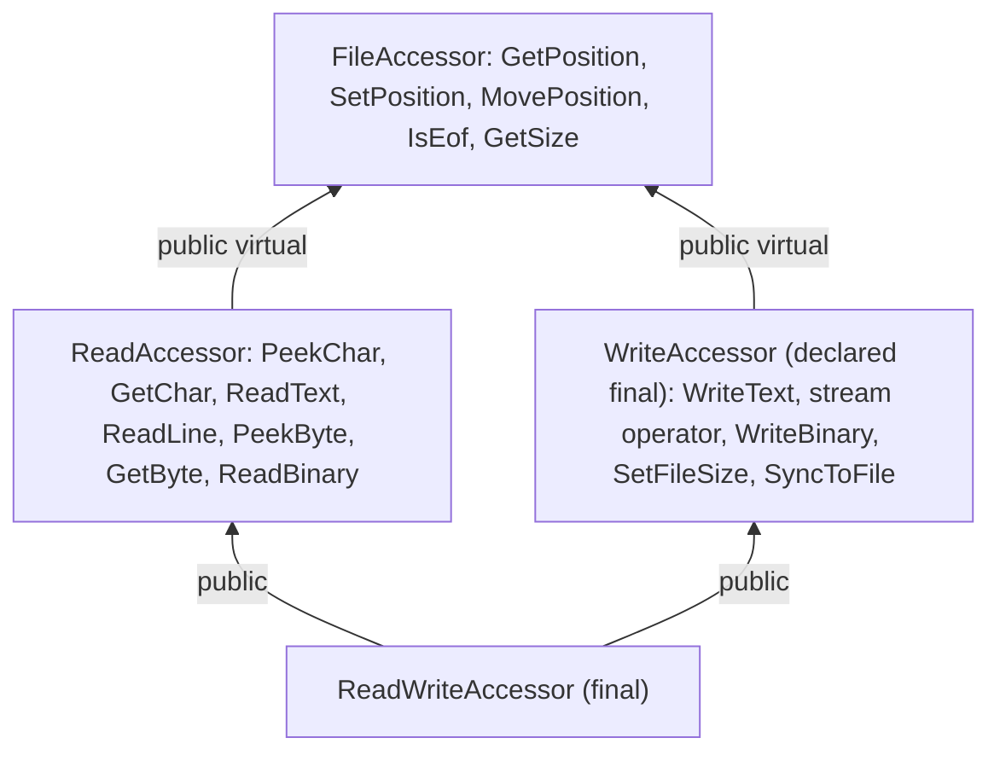

`FileAccessor` holds the position functions. `ReadAccessor` adds reading, `WriteAccessor` adds writing, and `ReadWriteAccessor` combines both. Virtual inheritance from `FileAccessor` ensures that a `ReadWriteAccessor` has one position, not two.

> **Pitfall:** In R25-11, `WriteAccessor` is declared `final` ([SWS_PER_00595]), but `ReadWriteAccessor` derives from it ([SWS_PER_00343]). As written, this is ill-formed C++: a `final` class cannot be a base class. The intent is clearly that `ReadWriteAccessor` combines reading and writing, so expect vendor headers to deviate here, and do not derive your own classes from the accessors.

### 7.5 Positions and End of File

| Method | Behavior | Spec |
| --- | --- | --- |
| `GetPosition()` | Current read/write position; 0 for an empty file | [SWS_PER_00517] |
| `SetPosition(position)` | Absolute position from the beginning; outside the content it fails with `kInvalidPosition` and keeps the old position | [SWS_PER_00515] |
| `MovePosition(origin, offset)` | Relative to `Origin::kBeginning`, `kCurrent` or `kEnd`; returns the new position; same error rule | [SWS_PER_00516] |
| `IsEof()` | `true` when the position equals the file size, that is directly after the last byte, or when the file is empty | [SWS_PER_00518] |
| `GetSize()` | Current total size of the file | [SWS_PER_00519] |

Reading at the end of the file fails with `kEof` ([SWS_PER_00541]); check `IsEof` before reading to avoid it.

> **Note:** The wording of [SWS_PER_00515] and [SWS_PER_00516] ("outside of the current content of the file (including the position at the end of the file)") leaves open whether the end-of-file position itself is a valid target. To write at the end, open with `kAtTheEnd` or `kAppend` instead of seeking there.

### 7.6 Text and Binary Content

Persistency does not care whether a file contains text or binary data, and it never changes or interprets the content (SWS, Section 7.4). It offers both views:

- **Text:** `PeekChar`, `GetChar`, `ReadText()` (to the end), `ReadText(n)`, `ReadLine(delimiter = '\n')` ([SWS_PER_00520] to [SWS_PER_00524]); `WriteText` and `operator<<` for writing.
- **Binary:** `PeekByte`, `GetByte`, `ReadBinary()`, `ReadBinary(n)` ([SWS_PER_00525] to [SWS_PER_00528]); `WriteBinary` for writing.

Text files are assumed to be UTF-8 with UNIX line endings (`LF`). The text functions work on 8-bit characters, which are UTF-8 *code units*, not code points; a `ReadText(n)` may therefore cut a multi-byte character in half (SWS, Section 7.4). `ReadLine` does not include the delimiter in the result.

```cpp
// Read a configuration file line by line (illustrative).
auto file = fs->OpenFileReadOnly("limits.cfg");
if (file.HasValue()) {
    auto& reader = file.Value();
    while (!reader->IsEof()) {
        auto line = reader->ReadLine();
        if (!line.HasValue()) { break; }
        Parse(line.Value());
    }
}  // the UniqueHandle closes the file here
```

### 7.7 Writing, Truncating and Closing

- `WriteText(s)` and `WriteBinary(bytes)` write at the current position, overwriting existing content and extending the file if needed, and move the position behind the written data ([SWS_PER_00529], [SWS_PER_00531]). With `kAppend`, they first move to the end ([SWS_PER_00557]). On an error, the content may be partially written; the API table of each function describes the expected state per error.
- `operator<<` writes text like `WriteText`, but returns the accessor instead of a `Result`, so that calls can be chained. If an error occurs, it is silently ignored ([SWS_PER_00530]); the API calls it a comfort feature for non-safety-critical users.
- `SetFileSize(size)` shrinks the file; a larger size fails with `kInvalidSize`. If the position was beyond the new size, it moves to the new end ([SWS_PER_00532]).
- `SyncToFile()` stores the content of the file and updates its redundancy ([SWS_PER_00533]).
- **Closing** persists all changes, but not necessarily immediately: at the latest when the file is opened again or `Deinitialize` is called ([SWS_PER_00457]).

> **Pitfall:** Do not use `operator<<` for data that matters. A full quota or a failing flash is silently ignored. Use `WriteText` or `WriteBinary` and check the `Result`.

### 7.8 File Information

`GetFileInfo` returns a `FileInfo` structure ([SWS_PER_00437]):

| Member | Type | Meaning |
| --- | --- | --- |
| `creationTime`, `modificationTime`, `accessTime` | `std::uint64_t` | Nanoseconds since 1970-01-01 UTC; 0 if not available ([SWS_PER_00458]) |
| `fileCreationState` | `FileCreationState` | `kCreatedDuringInstallation` (1), `kCreatedDuringUpdate` (2), `kCreatedDuringReset` (3), `kCreatedDuringRecovery` (4), `kCreatedByApplication` (5) |
| `fileModificationState` | `FileModificationState` | `kModifiedDuringUpdate` (2), `kModifiedDuringReset` (3), `kModifiedDuringRecovery` (4), `kModifiedByApplication` (5) |

For a closed file, the information comes from any existing copy, without a validity check ([SWS_PER_00440]). For an open file, the access time and, if the file was created when it was opened, the creation time are the time of opening; the modification time changes with the first write or `SyncToFile` ([SWS_PER_00570]). Times that are not available are 0, for example the access time in a read-only File Storage (SWS, Section 7.4.1). `FileModificationState` has no value 1.

The states are useful after a recovery: a file with `kCreatedDuringRecovery` or `kModifiedDuringRecovery` may hold initial or outdated content ([Section 9.6](#96-recover-or-reset)).

### 7.9 Worked Example: RecordingFile in Storage

`Storage` records the object lists of `Fusion` into `Recordings`, one file per recording. The class `RecordingFile` is used by the main loop of `Storage` in [guide 07, Section 15.13](07_CommunicationManagement.md#1513-complete-example-storage): `Append` adds one object list, and `WaitShortly` waits for the next batch. The file name contains the start time with a fixed width (illustrative: `rec_0000001730.bin`), so that the names sort by age.

```cpp
// Storage: RecordingFile writes the File Storage Recordings (illustrative).
#include "ara/per/file_storage.h"
#include "ara/per/write_accessor.h"
#include "hpc/fusion/objectlistservice_common.h"  // ObjectListData, FusionModeType

#include <chrono>
#include <cstdio>
#include <optional>
#include <thread>

namespace hpc::storage {

class RecordingFile {
public:
    RecordingFile() {
        auto spec = ara::core::InstanceSpecifier::Create("/storage/Root/RecordingsPort");
        if (!spec.HasValue()) { return; }
        auto fs = ara::per::OpenFileStorage(spec.Value());
        if (fs.HasValue()) { fs_.emplace(std::move(fs).Value()); }
    }
    ~RecordingFile() { End(); }

    void Append(const hpc::fusion::ObjectListData& list, hpc::fusion::FusionModeType mode) {
        if (!fs_ || (!file_ && !Start())) { return; }
        auto bytes = SerializeRecord(list, mode);  // Storage's own record format
        auto written = (*file_)->WriteBinary(bytes);
        if (!written.HasValue()) { HandleWriteError(written.Error()); return; }  // Section 11.5
        if (Clock::now() - lastSync_ >= std::chrono::seconds(10)) {
            static_cast<void>((*file_)->SyncToFile());
            lastSync_ = Clock::now();
        }
    }

    void End() {  // called when the recording ends
        if (file_) {
            static_cast<void>((*file_)->SyncToFile());
            file_.reset();  // closes the file; the storage handle fs_ stays alive
        }
    }

    void WaitShortly() { std::this_thread::sleep_for(std::chrono::milliseconds(100)); }

private:
    using Clock = std::chrono::steady_clock;

    bool Start() {
        char name[32];
        std::snprintf(name, sizeof(name), "rec_%010llu.bin", SecondsSinceEpoch());
        auto opened = (*fs_)->OpenFileWriteOnly(name);  // creates the file, truncates it
        if (!opened.HasValue()) { HandleWriteError(opened.Error()); return false; }
        file_.emplace(std::move(opened).Value());
        lastSync_ = Clock::now();
        return true;
    }

    void HandleWriteError(const ara::core::ErrorCode& error);  // Section 11.5

    std::optional<ara::per::SharedHandle<ara::per::FileStorage>> fs_;
    std::optional<ara::per::UniqueHandle<ara::per::WriteAccessor>> file_;
    Clock::time_point lastSync_{};
};

}  // namespace hpc::storage
```

The class keeps the `SharedHandle` of the File Storage as long as the file handle ([Section 5.3](#53-sharedhandle-and-uniquehandle)). It syncs every 10 s, so that a power cut loses at most about 10 s of a recording, and syncs again at the end. `SerializeRecord` and `SecondsSinceEpoch` are `Storage`'s own helpers; the record format is not standardized.

> **Key takeaways**
>
> - A File Storage is a flat set of named files; there are no paths.
> - Read-only opening needs an existing file; read-write and write-only opening create it.
> - Only a few open mode combinations are valid; `kAppend` seeks before every write.
> - Text functions work on UTF-8 code units; `operator<<` ignores errors.
> - Closing a file persists it, possibly later; `SyncToFile` persists it now.

---

## 8. Durability: What "Stored" Really Means

> **Why this matters:** "I called `SyncToStorage`, and after the power cut the value was gone" is one of the most common Persistency complaints. The specification is honest about it: a successful sync does not always mean that the data is on the medium. This chapter explains the levels between your call and the flash cell, and who is responsible for each one.

### 8.1 Three Levels

Data passes three levels on its way to the medium:

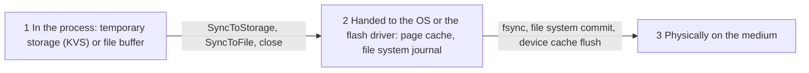

- **Level 1** is under the control of the application: unsynced key-value changes and unsynced file content live here.
- **Level 2** is under the control of Persistency and the operating system. After a sync, the data is usually here at least.
- **Level 3** is where the data must be to survive a power cut. Getting there depends on the file system, its mount options and the device.

### 8.2 Sync Calls and the File System

The specification adds the same note to `SyncToStorage` and `SyncToFile`: depending on the implementation of Persistency, the configuration of the file system and the capabilities of the device, the actual storage may be delayed. After a power cut directly after the call, the data may be updated only partially or not at all, and without redundancy it may even be corrupted ([SWS_PER_00494], [SWS_PER_00533]).

The reason is explained in SWS Appendix C.1: a file-system-based implementation will probably use POSIX `fsync()`, but `fsync()` does not in all cases make the file system clear its caches, and not all file systems can flush the caches of the hardware device. Therefore the specification puts a **demand on the integrator**: to make the sync calls synchronous, use a suitable file system and configure it so that either all changes go to the hardware immediately, or `fsync()` is fully synchronous ([SWS_PER_00575]). The supplier of the Persistency implementation has to give the final guidance, because it depends on the implementation (SWS, Appendix C).

> **Note (implementation example):** On Linux, the building blocks look like this.
>
> - `fsync(fd)` transfers the modified data and metadata of a file to the storage device. It does not guarantee that the directory entry of a new or renamed file has reached the disk; for that, the directory itself must be synced with `fsync` on a descriptor of the directory [EXT-052].
> - `rename(old, new)` replaces an existing `new` atomically: other processes see either the old or the new file, never no file [EXT-053]. Implementations use it for the classic pattern "write a temporary file, `fsync` it, `rename` it over the old one, `fsync` the directory", which never leaves a half-written storage file behind.
> - ext4 in its default mode `data=ordered` writes file data before the metadata that refers to it is committed to the journal, and by default commits data and metadata every 5 seconds (`commit=5`) [EXT-054]. Without `fsync`, a power cut can therefore lose about the last 5 seconds.
> - On raw NAND flash, UBIFS runs on top of UBI, which does the wear leveling. UBIFS is a write-back file system: changes are cached and written to the flash later, unless the application syncs. By default it does not check the CRCs of data nodes when reading (`no_chk_data_crc`) [EXT-055]; Persistency's own redundancy is then the only end-to-end check of the content.
>
> None of this is mandated by AUTOSAR; the point is that the integrator must know these settings to meet [SWS_PER_00575].

### 8.3 Close, Crash and Shutdown

The two storage kinds behave differently when something ends without an explicit sync:

| Event | Key-Value Storage | File (in a File Storage) |
| --- | --- | --- |
| Handle destroyed (close) | Unsynced changes discarded ([SWS_PER_00331]) | Changes persisted, possibly later; at the latest at the next open or `Deinitialize` ([SWS_PER_00457]) |
| `ara::core::Deinitialize` | Unsynced changes discarded ([SWS_PER_00409]) | Synced and closed ([SWS_PER_00409]) |
| Process crash or `Abort` | Unsynced changes lost: the next open sees the last saved state (SWS, Section 7.3) | Not specified; what reached the OS may survive, what was buffered in the process is lost |
| Power cut | Data after the last sync lost; data of the last sync possibly lost or corrupted ([SWS_PER_00494]) | Same, for data after the last sync ([SWS_PER_00533]) |

The Key-Value Storage is conservative by design: nothing becomes persistent that you did not commit. The File Storage is generous: everything you wrote is persisted eventually, unless the process dies first.

### 8.4 Power Loss Without Redundancy

The notes of [SWS_PER_00494] and [SWS_PER_00533] say that, without redundancy, a power cut during a sync may *corrupt* data, not only lose the latest change. A half-written storage may fail its structure check (`kIntegrityCorrupted`) the next time. Two measures work together:

1. **Sync at the right moments**, so that the window for loss is small and known.
2. **Configure redundancy** for data that must not be corrupted, so that a half-written copy can be detected and, with M out of N, repaired ([Chapter 9](#9-data-integrity-redundancy-and-recovery)).

In the running example, `CalibrationKvs` has both: an immediate sync after each change and 2 out of 3 copies. `Recordings` has neither redundancy nor a MAC; a recording damaged by a power cut is simply incomplete, and it can be made again.

> **Key takeaways**
>
> - A sync moves data from the process to the OS; reaching the medium depends on the file system and the device.
> - The integrator must configure a file system with synchronous `fsync` behavior ([SWS_PER_00575]).
> - Closing a KVS discards unsynced changes; closing a file persists them.
> - Without redundancy, a power cut during a sync can corrupt data, not only lose it.

---

## 9. Data Integrity: Redundancy and Recovery

> **Why this matters:** Flash cells wear out, power fails during writes, and bits flip. Persistency can detect these problems and, if configured, repair them. But each redundancy type has a different power, and the application must still decide what to do when repair is not possible.

### 9.1 Detect or Repair

The integrator chooses one or more `PersistencyRedundancyHandling`s per storage (SWS, Section 7.2.4.1). Each one is either a checksum (CRC or hash) or M-out-of-N copies:

| Type | What Persistency stores | Detects corruption | Repairs corruption | Spec |
| --- | --- | --- | --- | --- |
| CRC | A CRC per storage or element | Yes | No | [SWS_PER_00318], [SWS_PER_00439] |
| Hash | A hash value per storage or element, optionally with a random initialization vector | Yes | No | [SWS_PER_00447], [SWS_PER_00448] |
| M out of N | N copies; at least M must be identical when read back | Yes | Yes, if at least M copies agree | [SWS_PER_00319] |

Whether redundancy is sufficient for recovery is implementation-specific, and it "can only be safely assumed" for M out of N ([SWS_PER_00221] and the note below it). CRCs and hashes only tell you that the data is wrong.

The application designer may request redundancy in the design (`PersistencyInterface.redundancy` with `redundant` or `redundantPerElement`, or a preselection in `redundancyHandling`). The integrator decides the actual measures and may choose others "based on superior knowledge of the final system" (SWS, Section 7.2.4).

### 9.2 CRC and Hash

For a CRC, Persistency uses the algorithm family `RedundancyChecksumAlgorithmFamily` with the bit width `RedundancyChecksumLength` ([SWS_PER_00439]). The TPS standardizes these families and their lengths ([TPS_MANI_01207], [constr_1668]):

| Family | Length (bits) |
| --- | --- |
| `CRC_8H2F`, `CRC_J1850` | 8 |
| `CRC_16ARC`, `CRC_CCITT_FALSE` | 16 |
| `CRC_32P4`, `CRC_ETHERNET` | 32 |
| `CRC_0x42F0E1EBA9EA3693` | 64 |

For a hash, the same two parameters name the family and the length; if `InitializationVectorLength` is configured, Persistency generates an initialization vector of random data of that length and passes it to the hash algorithm ([SWS_PER_00448]). Hash families are not standardized, and the integrator must make sure that the configured lengths are supported by the chosen family; Cryptography is a possible provider of the hash and the random data (SWS, Section 7.2.4.1).

> **Note:** In the APMC model, `RedundancyChecksumAlgorithmFamily` and `RedundancyChecksumLength` are optional (`0..1`), while the M2 model requires both ([constr_10144], [constr_10145]). Configure both; without them, a CRC is not defined.

### 9.3 M out of N and Storage Locations

With `PersistencyRedundancyMOutOfN`, Persistency stores N copies (`RedundancyN`) and checks on reading that at least M of them (`RedundancyM`) are identical ([SWS_PER_00319]). The TPS limits N to 2 to 255 and M to 1 to N ([constr_10046], [constr_1751]).

Copies can be spread over several storage locations, each given as a `Uri` in the `UriCollection` of the storage ([SWS_PER_00555]):

| Number of URIs | Placement of the copies (scope `SCOPE_STORAGE`) |
| --- | --- |
| 1 | All copies in one location |
| 2 | The first location holds the main copy, the second location all other copies |
| N | Each copy in its own location |

More than one URI is allowed only for M out of N with storage scope, and the number must be 1, 2 or N ([constr_10366], [constr_10367]). Two locations on different partitions or devices protect against the loss of one partition; N copies in one location only protect against local corruption.

Choosing M and N is a trade-off. With 2 out of 3, one broken copy is detected *and* outvoted. With 1 out of 2, any readable copy is accepted, but two different readable copies cannot be told apart by the copies alone. Several redundancy handlings can be combined, for example a CRC per element together with copies of the storage.

### 9.4 Storage Scope and Element Scope

`PersistencyRedundancyHandlingScope` decides the granularity ([APMC_PER_00025]):

- `SCOPE_STORAGE`: the redundancy covers the whole Key-Value Storage or File Storage.
- `SCOPE_ELEMENT`: the redundancy is applied to every key-value pair or file separately.

Element scope keeps a problem local: one broken key does not invalidate the others, and recovery can work key by key. Storage scope is cheaper in metadata and fits storages that are read and written as a whole. The parameter is optional in APMC, and the specification does not say which scope applies when it is missing; always set it.

### 9.5 When Persistency Checks, and What It Reports

Persistency checks the redundancy when it accesses stored data. If the data is corrupted, it tries to restore it from the redundancy; if that is not possible, it reports `kValidationFailed` ([SWS_PER_00221]). *When* it accesses the data is implementation-specific: at `ara::core::Initialize`, when a storage is opened, or when an element or file is accessed (SWS, Section 7.2.4). Your code must therefore be ready for `kValidationFailed` from `Open*Storage`, `GetValue`, `OpenFile*` and the read functions.

A different error, `kIntegrityCorrupted`, means that the *structure* of the storage is broken so that it cannot be accessed at all ([SWS_PER_00539]). Both errors can be cleared with the recover and reset functions of the next section. Persistency also reports both as production errors ([Section 16.3](#163-production-errors)).

### 9.6 Recover or Reset

When automatic repair fails, the application has two kinds of tools. **Recover** restores consistency with whatever information is left; **reset** returns to the installed state.

| Function | Scope | Precondition | Result |
| --- | --- | --- | --- |
| `RecoverKeyValueStorage(spec)` | Whole KVS | Storage not open, else `kResourceBusy` | First the infrastructure, then every key. May reset the whole storage to the initial state or leave outdated pairs ([SWS_PER_00452]) |
| `KeyValueStorage::RecoverKey(key)` | One key | Key exists in some instance, else `kKeyNotFound` ([SWS_PER_00547]) | Key may be removed, reset to its initial value, or hold an outdated value ([SWS_PER_00453]) |
| `RecoverAllFiles(spec)` | Whole FS | Storage not open | Infrastructure, then every file; may reset or leave outdated files ([SWS_PER_00454]) |
| `FileStorage::RecoverFile(name)` | One file | File exists, else `kFileNotFound` ([SWS_PER_00548]); file not open | File may be removed, reset, or outdated ([SWS_PER_00455]) |
| `ResetKeyValueStorage(spec)`, `ResetAllFiles(spec)` | Whole storage | Storage not open | State after installation with the current target configuration ([SWS_PER_00456], [SWS_PER_00478]) |
| `KeyValueStorage::ResetKey(key)`, `FileStorage::ResetFile(name)` | One element | Element configured, else `kInitValueNotAvailable` ([SWS_PER_00572], [SWS_PER_00573]) | Element as after installation, re-created if missing ([SWS_PER_00477], [SWS_PER_00479]) |
| `ResetPersistency()` | All storages of the process | No storage open | All storages as after installation ([SWS_PER_00556]); they are re-created at the next open |

After a recovery, "the Persistency user has to validate the restored data" (SWS, Section 7.2.4). The decision flow is:

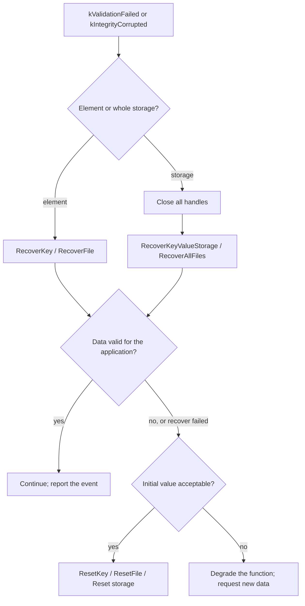

> **Pitfall:** "Recovered" does not mean "correct". A recovered key may hold its initial value or an older value. For a calibration, an older value is a different, possibly wrong calibration. Validate recovered values with application knowledge, or prefer a reset to a known "not calibrated" state.

### 9.7 The Recovery Report Callback

Even when Persistency repairs data silently, an application may want to know: an increasing number of repairs is an early sign of failing hardware, and safety-related applications may need to react (SWS, Section 7.2.4). The application registers one callback for all its storages ([SWS_PER_00480]):

```cpp
void RegisterRecoveryReportCallback(
    std::function<void(const ara::core::InstanceSpecifier& storage,
                       ara::per::RecoveryReportKind recoveryReportKind,
                       ara::core::Vector<ara::core::String> reportedElements,
                       ara::core::Vector<std::uint8_t> reportedInstances)> recoveryReportCallback) noexcept;  // [SWS_PER_00433]
```

Persistency calls it whenever it detects a redundancy problem, whether it could handle the problem or not:

| `RecoveryReportKind` | Value | Meaning | `reportedElements` | Spec |
| --- | --- | --- | --- | --- |
| `kKeyValueStorageRecoveryFailed` | 1 | Whole KVS affected, not repaired (`kValidationFailed`) | empty | [SWS_PER_00481] |
| `kKeyValueStorageRecovered` | 2 | Whole KVS affected, repaired | empty | [SWS_PER_00482] |
| `kKeyRecoveryFailed` | 3 | Some keys affected, not repaired | affected keys | [SWS_PER_00485] |
| `kKeyRecovered` | 4 | Some keys affected, repaired | affected keys | [SWS_PER_00486] |
| `kFileStorageRecoveryFailed` | 5 | Whole FS affected, not repaired | empty | [SWS_PER_00483] |
| `kFileStorageRecovered` | 6 | Whole FS affected, repaired | empty | [SWS_PER_00484] |
| `kFileRecoveryFailed` | 7 | Some files affected, not repaired | affected files | [SWS_PER_00488] |
| `kFileRecovered` | 8 | Some files affected, repaired | affected files | [SWS_PER_00489] |

`reportedInstances` holds the indices of the affected copies; this information is meaningful only with M out of N (SWS, Section 7.2.4). For keys and files, the n-th entry of `reportedElements` belongs to the n-th entry of `reportedInstances`, so an element appears several times if several of its copies are broken; if only one element is affected, it may appear once for all indices ([SWS_PER_00487], [SWS_PER_00490]). The index type `std::uint8_t` matches the limit of 255 copies. The specification does not say whether the indices start at 0 or 1.

The registration function is not thread-safe; register the callback once, early, before you open storages. The callback runs in the context of the Persistency call that detected the problem, so keep it short.

### 9.8 Worked Example: CalibrationKvs with Two out of Three Copies

`CalibrationKvs` is configured with `PersistencyRedundancyMOutOfN` (M = 2, N = 3) and `SCOPE_STORAGE`, over two URIs: the first location holds the main copy, the second the two other copies ([SWS_PER_00555]). `Storage` registers a callback that logs every report and counts repairs.

**Case 1: one copy is broken.** A flash error corrupts one copy in the second location. When `Storage` opens the storage, two copies still agree:

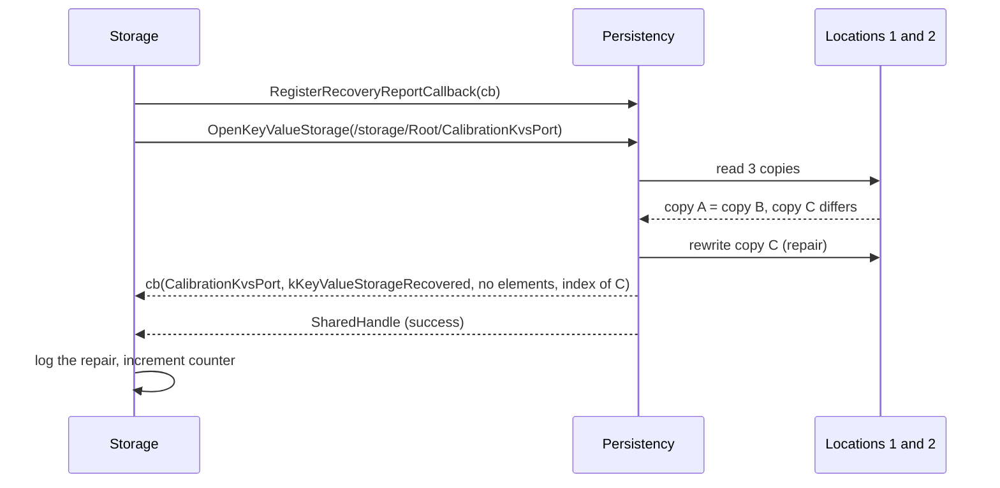

The application continues normally. Persistency also logs `KeyValueStorageRecovered` ([Section 16.1](#161-log-messages)).

**Case 2: two copies are broken.** No two copies agree. `OpenKeyValueStorage` fails with `kValidationFailed`, and the callback reports `kKeyValueStorageRecoveryFailed` with both indices. `Storage` has no open handle, so it can call `RecoverKeyValueStorage` and open the storage again. Whatever the result, the values may now be outdated or back to "not calibrated". `Storage` checks each record with `IsPlausible`; an implausible or initial value makes `CalibrationCheck` fail at the next ADAS start, and a workshop must run the routine `CalibrateCamera` again (guide 12a).

```cpp
// Storage: register the recovery report callback once, before opening storages (illustrative).
ara::per::RegisterRecoveryReportCallback(
    [this](const ara::core::InstanceSpecifier& storage, ara::per::RecoveryReportKind kind,
           ara::core::Vector<ara::core::String> elements, ara::core::Vector<std::uint8_t> copies) {
        log_.LogWarn() << "Persistency report" << storage.ToString()
                       << static_cast<std::uint32_t>(kind) << copies.size();
        ++repairCount_;  // trend monitoring; keep the callback short
    });
```

> **Key takeaways**
>
> - CRC and hash detect; only M out of N can repair.
> - Copies can be spread over 1, 2 or N locations; use separate locations against the loss of a partition.
> - Persistency checks when it accesses data; expect `kValidationFailed` from open and read calls.
> - Recover gives best-effort data that must be validated; reset gives the installed state.
> - The recovery report callback tells you about every redundancy problem, repaired or not.

---

## 10. Security: Encryption, MAC and Verification Hash

> **Why this matters:** Persistent data outlives the process and sits on a medium that an attacker may read or modify. Persistency can encrypt data and protect its authenticity, without any code in the application. The price is a dependency on keys that must exist at run time.

### 10.1 Confidentiality and Authenticity, Invisible to the Application

Which protection is applied, and with which algorithms, is decided in the target configuration; the Persistency user is not aware of it (SWS, Section 7.2.3):

- **Confidentiality.** A storage or an element is encrypted after its creation and whenever it is saved, and decrypted when it is opened, so that only encrypted data is stored.
- **Authenticity.** A message authentication code (MAC) is generated after creation and on every save, and verified when the storage is opened. Unauthorized modifications are detected.
- **Both.** Use an authenticated encryption scheme, such as AES-GCM.

For a read-only storage, encryption happens once, at installation. For a write-only-once storage, pre-installed elements are encrypted at installation and every other element once, when it is created. Decryption happens at every open. All cryptographic operations use the Cryptography cluster (SWS, Section 7.2.3).

### 10.2 Key Slots and Algorithms

A container `PersistencyCryptoKeySlotProps` configures the protection ([APMC_PER_00042]):

| Parameter | Meaning |
| --- | --- |
| `CryptoKeySlotUsage` | `ENCRYPTION` or `VERIFICATION` (MAC) |
| `CryptoAlgorithm` | The algorithm, as a string; the names follow the naming convention of the *Specification of Cryptography* (Appendix D), for example `MAC/CMAC/AES-128`, `MAC/HMAC/SHA-256` or `AEAD/AES-128/GCM` |
| `ForeignCryptoKeySlotRef` | The `CryptoKeySlot` that holds the key; a temporary reference until Cryptography moves to APMC ([APMC_PER_00048]) |
| `CryptoVerificationHash` | Optional fixed hash value for a verification hash ([Section 10.4](#104-verification-hashes-for-read-only-and-write-only-once-storages)) |

The key itself is created, stored and protected by Cryptography (guide 14). Persistency stores which keys and algorithms it used in the metadata of the storage ([SWS_PER_00559]), so that it can still read data protected with an old key after an update that changes the protection ([SWS_PER_00562], [SWS_PER_00563]).

Because the container exists at most once per storage and once per element, one storage has one usage. To get both confidentiality and authenticity, choose an authenticated encryption algorithm with `ENCRYPTION`, or protect the storage with one usage and its elements with the other.

### 10.3 Storage Level and Element Level

The container can be placed in `PersistencyCommon` (the whole storage) or in a single `PersistencyKeyValuePair` or `PersistencyFile`. Each rule exists in both variants:

| Operation | Storage level | Element level |
| --- | --- | --- |
| Encrypt before storing (`ENCRYPTION`) | [SWS_PER_00210] | [SWS_PER_00464] |
| Decrypt after reading (`ENCRYPTION`) | [SWS_PER_00211] | [SWS_PER_00465] |
| Create and store a MAC (`VERIFICATION`) | [SWS_PER_00449] | [SWS_PER_00466] |
| Verify the MAC after reading (`VERIFICATION`) | [SWS_PER_00450] | [SWS_PER_00467] |
| Check a verification hash | [SWS_PER_00451] | [SWS_PER_00468] |

Element-level protection lets you encrypt only the sensitive key of a storage and keep the rest cheap.

### 10.4 Verification Hashes for Read-Only and Write-Only-Once Storages

A storage that never changes after installation can be protected without a key: Persistency calculates a hash of the data with the hash algorithm named in `CryptoAlgorithm` and compares it with `CryptoVerificationHash` from the configuration ([SWS_PER_00451], [SWS_PER_00468]). This is possible for read-only storages (the whole storage or single elements) and for the elements of write-only-once storages. It assumes that the target configuration itself is authentic, protected by other means such as secure boot (SWS, Section 7.2.3).

### 10.5 Errors

| Error | Raised when | Typical causes | Spec |
| --- | --- | --- | --- |
| `kEncryptionFailed` | Encryption or decryption fails | Key or algorithm not available at run time; corrupted data | [SWS_PER_00540] |
| `kAuthenticationFailed` | Calculating or verifying a MAC fails | Key not available; data modified outside Persistency; corrupted data | [SWS_PER_00564] |

The specification notes that corruption, the second cause, can be detected or even avoided by configuring redundancy (SWS, Section 7.2.1.1). It does not name a dedicated error for a failed verification-hash comparison.

> **Pitfall:** A missing key looks exactly like an attack. If the key slot is not provisioned on a new ECU, or was deleted, every access fails with `kAuthenticationFailed` or `kEncryptionFailed`. Make key provisioning part of the production process (guide 14), and test the "key missing" case.

### 10.6 Worked Example: the MAC over CalibrationKvs

`CalibrationKvs` has `PersistencyCryptoKeySlotProps` in its `PersistencyCommon` with `CryptoKeySlotUsage` `VERIFICATION`, `CryptoAlgorithm` `MAC/CMAC/AES-128` and the key slot `CalibrationMacKeySlot`, which holds the symmetric key `CalibrationMacKey` ([guide 00, Section 6.12](00_LearningPath.md#612-security)). Persistency computes the MAC at every `SyncToStorage` and verifies it at every open ([SWS_PER_00449], [SWS_PER_00450]).

If someone changes the calibration on the flash, for example to hide a misaligned camera, the next open of `CalibrationKvs` fails with `kAuthenticationFailed`. `CalibrationStore::Read` returns the error, `GetCalibration` answers `CalibrationNotFound`, and `CalibrationCheck` reports the calibration as missing, so that ADAS does not start with untrusted data. The calibration is not encrypted: it is not secret, but it must be authentic.

> **Key takeaways**
>
> - Encryption, MAC and verification hash are configured, not programmed.
> - Algorithm names follow the naming convention of SWS Cryptography, for example `MAC/CMAC/AES-128`.
> - Protection can be set per storage or per element; one usage per container.
> - A verification hash protects read-only and write-only-once data without a key.
> - A missing key causes the same errors as tampering; provision keys reliably.

---

## 11. Resource Limits and Quotas

> **Why this matters:** On an ECU, flash space is shared by many applications. A logging function that fills the partition can stop a safety function from saving its state. Persistency lets the integrator reserve a minimum and cap a maximum per storage, and the application must handle the cap.

### 11.1 Minimum Sustained Size and Maximum Allowed Size

Two limits are configured per storage in `PersistencyCommon` (SWS, Section 7.2.6):

- **`MinimumSustainedSize`**, in bytes: space that the storage needs at any time. The application designer can give a first value in `PersistencyInterface.minimumSustainedSize` ([TPS_MANI_01194]); the integrator sets the binding value. It is not monitored by Persistency; it is expected to be checked when the Software Package is installed, and the platform must make sure that this space is available ([TPS_MANI_01196]).
- **`MaximumAllowedSize`**, in bytes: the quota. Persistency ensures that the space allocated by the storage never exceeds it ([SWS_PER_00321]). It is not a promise that so much space exists ([TPS_MANI_01197]).

> **Note:** In SWS Chapter 10.1, the description of `MinimumSustainedSize` ([APMC_PER_00008]) is a copy of the description of `UpdateStrategy` ("the global update strategy"). The meaning above comes from SWS Section 7.2.6 and from the TPS.

### 11.2 kQuotaExceeded or kOutOfStorageSpace

| Error | Meaning | Spec |
| --- | --- | --- |
| `kQuotaExceeded` | The operation would make the storage larger than `MaximumAllowedSize` | [SWS_PER_00543] |
| `kOutOfStorageSpace` | The physical storage is full (for example the partition or a file system quota), although the quota is not reached | [SWS_PER_00544] |

`kOutOfStorageSpace` can only happen if `MaximumAllowedSize` is larger than `MinimumSustainedSize`: space between the two is not reserved, so another storage or another process may have taken it (SWS, Section 7.2.1.1). In both cases, the application must write less, delete outdated data, or reset an element or storage.

### 11.3 Measuring Usage

| Function | Measures | Notes |
| --- | --- | --- |
| `GetCurrentKeyValueStorageSize(spec)` | Total space of a KVS | Includes metadata (except the central storage), redundancy and backup; may be inaccurate while the storage is open ([SWS_PER_00491]) |
| `GetCurrentFileStorageSize(spec)` | Total space of an FS | Same rules ([SWS_PER_00492]) |
| `FileStorage::GetCurrentFileSize(name)` | Content of one file | Content only; for an open file the current, possibly unsynced size ([SWS_PER_00493]) |
| `KeyValueStorage::GetCurrentValueSize(key)` | One value | Size in the temporary storage ([SWS_PER_00566]) |

The storage size includes everything that Persistency needs: with 2 out of 3 copies, the storage needs about three times the size of its content, plus metadata. During an update, the backup also counts. Size `MaximumAllowedSize` for the worst case: content times copies, plus a backup of the same size, plus metadata.

### 11.4 The Number of Files

A File Storage can also be limited in the number of files with `PersistencyFileStorageInterface.maxNumberOfFiles`, which includes the files modeled in the interface ([TPS_MANI_01068]). Creating one more file fails with `kTooManyFiles` ([SWS_PER_00542]). The error can also come from an update or a recovery that would create files. The application can delete files, or reset the storage.

### 11.5 Worked Example: Recordings Deletes the Oldest Recording

`Recordings` has `MinimumSustainedSize` 64 MiB, `MaximumAllowedSize` 256 MiB and `maxNumberOfFiles` 64. When the quota, the physical space or the file limit is reached, `RecordingFile` from [Section 7.9](#79-worked-example-recordingfile-in-storage) deletes the oldest finished recording and continues. Because the names contain the start time with a fixed width, the smallest name is the oldest; the creation time from `GetFileInfo` would also work, but it may be 0 where the time is not available ([SWS_PER_00458]).

```cpp
// Storage: make room in Recordings (illustrative; log_ is a logger of Storage, guide 10).
#include <algorithm>

void RecordingFile::HandleWriteError(const ara::core::ErrorCode& error) {
    using ara::per::PerErrc;
    const bool full = error == PerErrc::kQuotaExceeded || error == PerErrc::kOutOfStorageSpace ||
                      error == PerErrc::kTooManyFiles;
    if (!full) {
        log_.LogError() << "Recording stopped:" << error.Message();  // e.g. kPhysicalStorageFailure
        file_.reset();
        return;
    }
    auto names = (*fs_)->GetAllFileNames();
    if (!names.HasValue() || names.Value().size() < 2) { return; }  // keep the current recording
    auto& all = names.Value();
    std::sort(all.begin(), all.end());                // fixed-width names: oldest first
    static_cast<void>((*fs_)->DeleteFile(all.front()));  // the open file is never the oldest
}
```

The data that failed to be written is dropped; the next `Append` writes the next object list into the space now available. Note that `kOutOfStorageSpace` means that *another* user took the shared space; deleting old recordings helps `Storage`, but the integrator should also check why the reserve was too small.

> **Key takeaways**
>
> - `MinimumSustainedSize` is a reservation checked at installation; `MaximumAllowedSize` is a quota enforced at run time.
> - `kQuotaExceeded` is your limit; `kOutOfStorageSpace` means the shared space is gone.
> - Storage sizes include metadata, copies and backups; size the quota for the worst case.
> - `maxNumberOfFiles` limits the number of files, including the modeled ones.

---

## 12. Installation, Update, Roll-Back and Reset

> **Why this matters:** Persistent data outlives the software that wrote it. When a new version is installed, someone must decide which old values to keep, which new defaults to apply and how to convert old formats, and the old data must come back if the update fails. Persistency automates most of this, driven by two versions and the update strategies. Misunderstanding it leads to defaults that never arrive, or to learned values that disappear with every update.

### 12.1 Persistent Data in the Software Life Cycle

Update and Configuration Management (UCM) handles the life cycle of applications in five phases, and persistent data must follow each of them (SWS, Section 7.2.5):

| UCM phase | What happens to persistent data | Section |
| --- | --- | --- |
| Installation of new software | Storages and pre-defined elements are created | [12.3](#123-installation) |
| Update of installed software | A backup is taken, then the data is updated; the application may migrate it | [12.5](#125-the-update-sequence), [12.6](#126-migrating-data-the-update-callback-and-data-type-mappings) |
| Finalization after a successful update | The backup is removed | [12.7](#127-finalization-and-clean-up) |
| Roll-back after a failed update | The backup is restored | [12.8](#128-roll-back) |
| Removal of installed software | UCM removes the data | [12.11](#1211-removal-of-an-applications-data) |

Persistency does the work in one of two ways. The application can call `UpdatePersistency` explicitly during the verification phase that follows an installation or update, or it can rely on Persistency to do it implicitly when a storage is opened (SWS, Section 7.2.5). In both cases, Persistency compares the versions it stored last time with the versions of the current target configuration and acts accordingly.

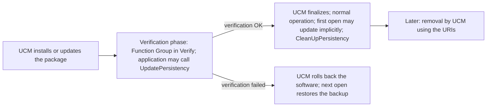

The UCM and State Management side of the verification phase is described in [guide 05, Section 9.4](05_StateManagement.md#94-prepare-verify-and-roll-back); guide 13 tells the UCM story.

### 12.2 The Central Storage and the Two Versions

For each process, Persistency keeps a **central storage** at `PersistencyGeneral.PersistencyCentralStorageUri`. It holds the information about the installed storages, the contract version and the target configuration version of the configuration that was last applied ([SWS_PER_00463], [SWS_PER_00378]).

Both versions are strings with a major, a minor and a patch version, plus optional labels for pre-releases and builds. Persistency assumes that at least one of the first three numbers is incremented when a version changes; the labels may be arbitrary ([SWS_PER_CONSTR_00002]). And because a new contract implies new deployed content, the target configuration version must be increased whenever the contract version is ([SWS_PER_CONSTR_00001]).

At each open (or in `UpdatePersistency`), Persistency compares the target configuration version of the current configuration with the stored one:

| Current vs stored target configuration version | Action | Spec |
| --- | --- | --- |
| No stored data | Installation | [SWS_PER_00382] |
| Equal | Nothing (normal open) | |
| Higher | Backup, then update; then, if the contract version is also higher, the update callback | [SWS_PER_00386], [SWS_PER_00387] |
| Lower | Roll-back from the backup, or re-installation | [SWS_PER_00396] |

### 12.3 Installation

When a storage is opened and Persistency finds no persistent data of the process, it installs the persistent data ([SWS_PER_00382]):

1. **Storages.** A Key-Value Storage is created for each R-port typed by a `PersistencyKeyValueStorageInterface` ([SWS_PER_00383]) and for each `PersistencyKeyValueStorage` without a port ([SWS_PER_00584]). File Storages are created in the same way ([SWS_PER_00385], [SWS_PER_00585]).
2. **Key-value pairs.** An entry is created for each `dataElement` of the interface and each `PersistencyKeyValuePair` of the target configuration whose update strategy is not delete ([SWS_PER_00252]). The key is the short name ([SWS_PER_00253]). The type is the `CppImplementationDataType` of the data element or the type referenced by `ValueDataTypeRef` ([SWS_PER_00254]). The value comes from the constant referenced by `PersistencyKeyValuePair.InitValueRef` or, if that does not exist, from the `initValue` of the `PersistencyDataRequiredComSpec` ([SWS_PER_00384]).
3. **Files.** A file is created for each `fileElement` and each `PersistencyFile` whose update strategy is not delete ([SWS_PER_00265]), with the configured file name ([SWS_PER_00266]). Its content is the resource in the installed Software Package addressed by `PersistencyFile.ContentUri`, else by `PersistencyFileElement.contentUri`; if neither exists, the file is empty ([SWS_PER_00267]).
4. **Metadata.** Persistency records the redundancy, keys and algorithms used for each storage ([SWS_PER_00558], [SWS_PER_00559]).

If the value or type of a pair cannot be determined, or the types conflict, the configuration is invalid ([SWS_PER_CONSTR_00003]). If a `PersistencyFileElement` and a `PersistencyFile` have the same file name but different short names, it is invalid as well ([SWS_PER_CONSTR_00004]). Tooling should reject such configurations.

> **Note:** The run time creates an empty file when no content URI exists ([SWS_PER_00267]), and `ContentUri` is optional in APMC. The M2 constraints, however, require a content URI for files with `keepExisting` or `overwrite` ([constr_10148], [constr_10103]). A tool that checks the M2 constraints may therefore reject a configuration that Persistency itself could handle.

### 12.4 Update Strategies in Detail

The TPS defines the effect of each strategy at installation and at update ([TPS_MANI_01157], [TPS_MANI_01159]):

| Level | Strategy | Installation | Update |
| --- | --- | --- | --- |
| Storage | `KEEP_EXISTING` | (irrelevant) | Keep all stored elements that are not in the new configuration |
| Storage | `DELETE` | (irrelevant) | Delete all stored elements that are not in the new configuration |
| Element | `KEEP_EXISTING` | Create | Do nothing |
| Element | `OVERWRITE` | Create | Replace |
| Element | `DELETE` | Do not create | Remove |

The update rules of the SWS implement the table. For Key-Value Storages:

- A new port or a new storage without a port creates a storage ([SWS_PER_00388], [SWS_PER_00586]); a storage that is no longer configured is removed ([SWS_PER_00389]).
- A new key that is not configured with delete is created with its initial value ([SWS_PER_00390]).
- A stored key that is not configured any more is removed if the storage strategy is `DELETE` ([SWS_PER_00391]), and kept otherwise.
- A configured key with `OVERWRITE` gets the new type and value ([SWS_PER_00275]); with `DELETE`, it is removed ([SWS_PER_00277]).
- A configured key with `KEEP_EXISTING` is not touched. Persistency checks neither its value nor its type (SWS, Section 7.2.5.2.1).

File Storages follow the same pattern ([SWS_PER_00392] to [SWS_PER_00395], [SWS_PER_00281], [SWS_PER_00283]); a kept file's content is not checked either.

> **Pitfall:** `KEEP_EXISTING` keeps the old *type* too. If a new software version changes the type of a key but keeps the strategy, the first `GetValue` with the new type fails with `kDataTypeMismatch`. Either migrate the value in the update callback ([Section 12.6](#126-migrating-data-the-update-callback-and-data-type-mappings)) or use `OVERWRITE` if the old value may be lost.

> **Pitfall:** A new default value in the design does not reach existing vehicles if the key is `KEEP_EXISTING`: only new installations get it. If a field fix needs the new value, use `OVERWRITE` for that key in that update, or write the value in the update callback.

### 12.5 The Update Sequence

When the target configuration version is higher than the stored one, Persistency first creates a backup of *all* persistent data of the process and then updates the data ([SWS_PER_00386]). Only one backup is kept; a new update may overwrite the old backup.

If the redundancy or the protection changed, the old and new settings are both needed: Persistency reads the old storage according to the metadata stored with it ([SWS_PER_00560], [SWS_PER_00562]) and writes the updated storage according to the new configuration, recording the new settings in the metadata ([SWS_PER_00561], [SWS_PER_00563]). For example, if N drops from 3 to 2, the third copy becomes obsolete.

After the update, Persistency informs the application in two ways:

- **Data update indication.** If the application registered with `RegisterDataUpdateIndication`, the function is called for each updated element of each updated storage, limited to the storages and elements that the application asked to monitor ([SWS_PER_00579]).
- **Application data update callback.** If the application registered with `RegisterApplicationDataUpdateCallback` and the contract version of the configuration is higher than the stored one, the callback is called for each updated storage, with the stored (old) contract version as argument ([SWS_PER_00387]).

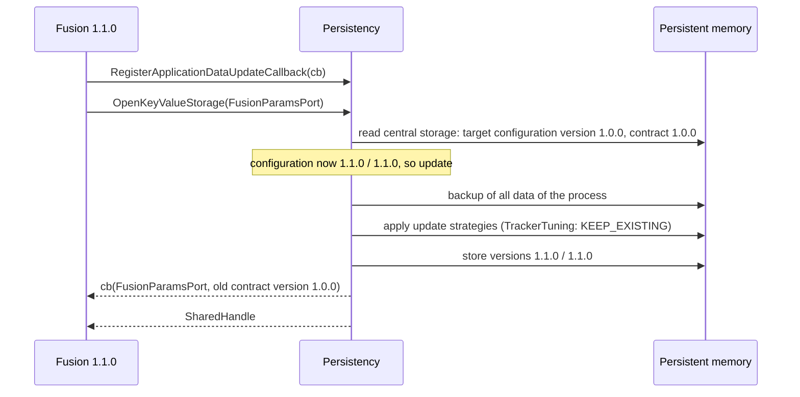

**Explicit or implicit?** `UpdatePersistency` updates all storages of the process at once ([SWS_PER_00469]). It succeeds only when no storage is open and no other thread modifies a storage; otherwise it returns `kResourceBusy` ([SWS_PER_00545]). While it runs, `OpenKeyValueStorage` and `OpenFileStorage` succeed only inside the update callback and only with the specifier that the callback received (API tables of [SWS_PER_00052] and [SWS_PER_00116]). The implicit update happens per storage, at its first open ([SWS_PER_00470], [SWS_PER_00471]).

| | Explicit `UpdatePersistency` | Implicit at `Open*Storage` |
| --- | --- | --- |
| When | Verification phase, controlled by the application | First open of each storage |
| Scope | All storages of the process | One storage per open |
| Failure visible to UCM | Yes, if the application fails its verification | No: the update was already finalized |
| Precondition | No storage open | None |

> **Pitfall:** An implicit update runs after UCM has finalized the new software, if the process does not run in the verification phase. If the data update fails then, UCM no longer rolls back automatically. Data updates that can fail (migrations, a much larger quota) should be done explicitly in the verification phase.

### 12.6 Migrating Data: the Update Callback and Data Type Mappings

The update callback lets the application convert data that the update strategies cannot handle:

```cpp
void RegisterApplicationDataUpdateCallback(
    std::function<void(const ara::core::InstanceSpecifier& storage,
                       ara::core::String contractVersion)> appDataUpdateCallback) noexcept;  // [SWS_PER_00356]
```

The callback is called from within `UpdatePersistency`, `OpenKeyValueStorage` or `OpenFileStorage`. Its second argument is the contract version with which the storage was last accessed, so the application can support migrations from several old versions, each with its own steps. The specification's own example: version 1 stored a maximum speed in mph as `uint8`, version 2 expects km/h as `uint16`; the callback reads the old value with `GetValue<std::uint8_t>`, removes the key, converts the value and stores it with `SetValue<std::uint16_t>` (SWS, Section 7.2.5.2).

To read a type that the new software no longer uses, Persistency must know it. The design declares it with a `PersistencyKeyValueDataTypeMapping` in the interface: `previousDataType` is the old type, `currentDataType` the new one, and `previousContractVersion` the contract version that used the old type ([TPS_MANI_01378], [constr_10486]). The SWS distinguishes two scenarios (SWS, Section 7.2.5.2.1):

1. **The type was changed but kept its name.** The model needs a copy of the old type, and [SWS_PER_CONSTR_00005] prescribes its name: `<currentDataType.shortName>_<previousContractVersion>`.
2. **A new type with a new name replaces the old one.** Both types simply exist in the model, and the mapping connects them.

> **Pitfall:** The naming rule of scenario 1 cannot be followed literally: a contract version such as `1.0.0` contains dots, and a short name may contain only letters, digits and underscores. Until the specification is fixed, prefer scenario 2 and give each version of a persistent type its own name, as the running example does with `TrackerTuningV1` and `TrackerTuningV2`.

The specification does not say how the callback should access the storage during an *implicit* update, which runs inside the application's own `OpenKeyValueStorage` call; for the explicit update it allows opening the storage with the callback's specifier. A robust pattern for the implicit case is to let the callback only record which storage needs migration from which version, and to migrate with the handle that `OpenKeyValueStorage` returns ([Section 12.12](#1212-worked-example-fusionparams-and-the-update-to-adascluster-110)).

### 12.7 Finalization and Clean-Up

After a successful update, the backup is no longer needed. Because the update may have happened for all storages at once or storage by storage, the application decides when to remove the backup, by calling `CleanUpPersistency`, which removes all backup data ([SWS_PER_00446]). The function also removes "other unused data" of all storages, and it fails with `kResourceBusy` while any `SharedHandle` of a storage is in use (API table of [SWS_PER_00567]).

The specification describes a second path as well: Persistency frees the backup when the storage is opened the first time after the update succeeded (SWS, Section 7.2.5; [SWS_PER_00470] lists finalization among the actions of an open). An application that wants to be sure the space is freed, for example because the backup counts against the quota ([Section 11.3](#113-measuring-usage)), calls `CleanUpPersistency` explicitly once the migrated data is synced.

> **Pitfall:** After `CleanUpPersistency`, a roll-back to the old software cannot restore the old data any more; Persistency re-installs the storages instead ([Section 12.8](#128-roll-back)). Clean up only when you are sure the new version stays.

### 12.8 Roll-Back

When a storage is opened and the target configuration version of the configuration is *lower* than the stored one, the software was rolled back. Persistency then compares the configuration's version with the version stored in the backup. If they match, it restores the backup. Otherwise it removes all storages and re-installs the persistent data from the target configuration ([SWS_PER_00396]).

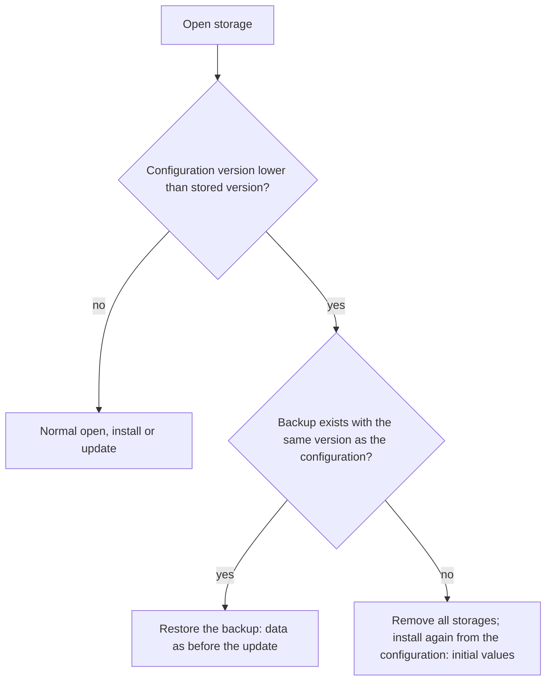

Data written by the new software after the update is lost in both cases. With a backup, the old values return; without one, the initial values return.

### 12.9 Configuration-Only Updates

UCM can also deploy a new configuration without new software, with `SoftwarePackage.actionType` set to `updateConfiguration`; such a package can contain a new Persistency target configuration (SWS, Section 7.2.5). A running application detects it like this:

1. `CheckForManifestUpdate()` returns `true` if the stored target configuration version is higher than the one read at initialization ([SWS_PER_00580]).
2. `ReloadPersistencyManifest()` re-reads the configuration and flags all storages for an update if the version was incremented ([SWS_PER_00581]).
3. The storages are updated when they are opened again, or all at once by `UpdatePersistency` after closing all storages (SWS, Section 7.2.5).

```cpp
// Periodic check for a configuration update (illustrative; run where no storage handle is held).
auto changed = ara::per::CheckForManifestUpdate();
if (changed.HasValue() && changed.Value()) {
    if (ara::per::ReloadPersistencyManifest().HasValue()) {
        CloseAllStorages();                           // release every SharedHandle
        auto updated = ara::per::UpdatePersistency();  // or re-open storage by storage
        ReopenStorages();
    }
}
```

These functions and the `Register*` functions are not thread-safe; call them from one thread. `RegisterDataUpdateIndication` ([SWS_PER_00578]) tells the application which monitored elements actually changed, so that it can reload only those.

### 12.10 Resetting Storages and Elements

At any time, the application can reset its data to the state after installation with the *current* target configuration: everything with `ResetPersistency` ([SWS_PER_00556]), one storage with `ResetKeyValueStorage` or `ResetAllFiles`, one element with `ResetKey` or `ResetFile` ([Section 9.6](#96-recover-or-reset)). `ResetPersistency` removes the content of all storages entirely; they are re-created at the next open (API table of [SWS_PER_00358]). Typical uses are a factory reset requested through diagnostics, and the last step of an unsuccessful recovery.

### 12.11 Removal of an Application's Data

When UCM removes an application, the application no longer runs, so Persistency cannot delete its own data. UCM may use the configuration (`PersistencyCentralStorageUri` and the `UriCollection` of each storage) to find the locations and, if it has access, remove the data (SWS, Section 7.2.5.5). This is one reason why the URIs belong in the configuration and not in the code.

### 12.12 Worked Example: FusionParams and the Update to AdasCluster 1.1.0

`fusion` 1.0.0 stores the learned tracker tuning in `FusionParams` under the key `TrackerTuning`, with the type `hpc::fusion::TrackerTuningV1` (`gateDistance` as `float`, `maxCoastCycles` as `std::uint8_t`). The update to `AdasCluster` 1.1.0 brings `fusion` 1.1.0 with `TrackerTuningV2`: `maxCoastCycles` becomes `std::uint16_t`, and `minConfidence` (`float`) is new.

The configuration changes as follows ([Section 14.13](#1413-the-running-example-complete-configuration)):

| Item | `AdasCluster` 1.0.0 | `AdasCluster` 1.1.0 |
| --- | --- | --- |
| `FusionParamsInterface.contractVersion` | 1.0.0 | 1.1.0 |
| Type of `TrackerTuning` | `TrackerTuningV1` | `TrackerTuningV2` |
| `dataTypeMapping` | none | previous `TrackerTuningV1`, current `TrackerTuningV2`, previous contract version 1.0.0 |
| `PersistencyCommon.Version` of `FusionParams` | 1.0.0 | 1.1.0 ([SWS_PER_CONSTR_00001]) |
| Update strategy of `TrackerTuning` | `KEEP_EXISTING` | `KEEP_EXISTING`: the learned value must survive |

`Fusion` runs only in `ADAS.Normal`, so it opens `FusionParams` for the first time after the verification phase, and the update is implicit. The sequence:

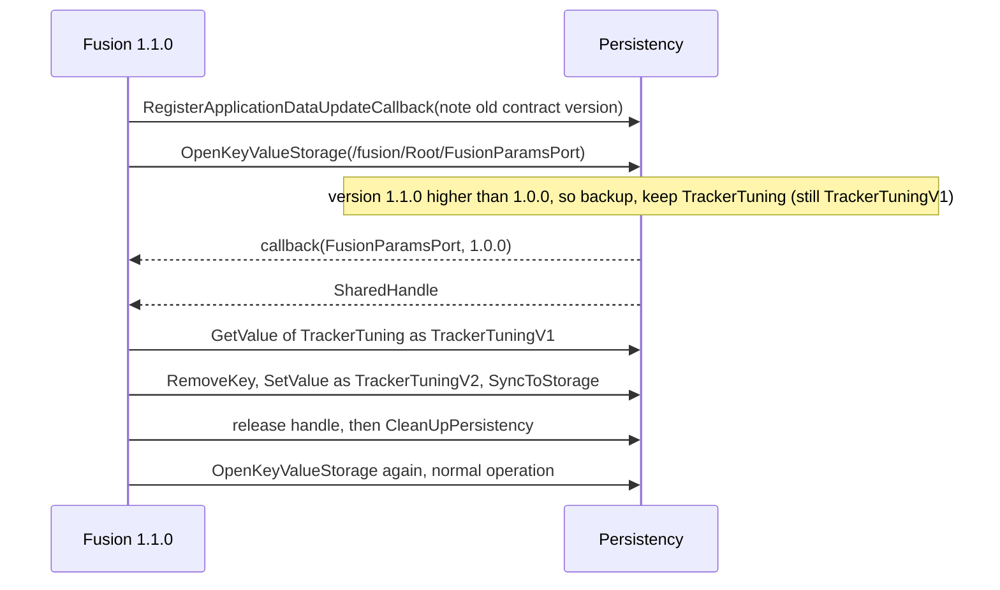

The code is in [Section 15.6](#156-complete-example-fusion-loads-uses-and-migrates-fusionparams). Two consequences are worth knowing:

- If the conversion fails (for example `kQuotaExceeded`, because the backup also counts against the 16 KiB quota), `Fusion` falls back to `ResetKey("TrackerTuning")`, which sets the factory value `TrackerTuningDefault` of the current configuration. The vehicle loses its learned tuning but keeps working.
- If `AdasCluster` is later rolled back to 1.0.0 *after* `CleanUpPersistency`, no backup with version 1.0.0 exists, so Persistency re-installs `FusionParams` with its initial value ([Section 12.8](#128-roll-back)). Guide 13 may later move the migration into `ADAS.Verify` with an explicit `UpdatePersistency`, so that a failing migration fails the verification instead.

> **Key takeaways**
>
> - The target configuration version decides install, update or roll-back; the contract version decides whether the application must migrate.
> - Before an update, Persistency backs up all data of the process; only one backup exists.
> - Strategies: `KEEP_EXISTING` keeps value and type unchecked, `OVERWRITE` replaces, `DELETE` removes.
> - Migrate changed types in the update callback, with a data type mapping; give each type version its own name.
> - Update explicitly in the verification phase when the update can fail; clean up only when the new version stays.

---

## 13. Error Handling

> **Why this matters:** Every Persistency call returns a `Result`. Knowing what each error means, and whether the call had side effects, decides whether you retry, recover, reset or degrade. This chapter collects the error codes and the violations.

### 13.1 PerErrc and the Error Domain

Persistency reports errors through `ara::core::Result` with codes of `ara::per::PerErrc` ([SWS_PER_00472]); the API never throws ([guide 03, Section 6.2](03_CoreAndGeneral.md#62-errors-are-returned-never-thrown)). The domain is `PerErrorDomain`; `GetPerDomain()` returns it ([SWS_PER_00473]), its `Name()` is `"Per"` ([SWS_PER_00353]), and its identifier is defined in the table of [SWS_CORE_90023]. `MakeErrorCode(PerErrc, SupportDataType)` creates an `ErrorCode` ([SWS_PER_00474]). If you prefer exceptions, `ThrowAsException` throws a `PerException` ([SWS_PER_00476]). Values 0 to 255 are reserved for AUTOSAR; vendors may add their own errors from 256 ([SWS_PER_00472]).

| Value | Enumerator | Meaning |
| --- | --- | --- |
| 1 | `kStorageNotFound` | The storage is not configured |
| 2 | `kKeyNotFound` | The key does not exist |
| 3 | `kIllegalWriteAccess` | The storage is read-only, or write-only-once and the element exists |
| 4 | `kPhysicalStorageFailure` | Hardware or OS problem, corrupted file system, insufficient access rights |
| 5 | `kIntegrityCorrupted` | The structure of the storage is corrupted |
| 6 | `kValidationFailed` | Redundancy checks failed and could not repair |
| 7 | `kEncryptionFailed` | Encryption or decryption failed |
| 8 | `kDataTypeMismatch` | The requested type differs from the stored type |
| 9 | `kInitValueNotAvailable` | No initial value configured for a reset |
| 10 | `kResourceBusy` | Another operation, or an open handle or file, blocks the call |
| 12 | `kOutOfStorageSpace` | The physical storage is full |
| 13 | `kFileNotFound` | The file does not exist |
| 15 | `kInvalidPosition` | The position is outside the file |
| 16 | `kEof` | Reading at the end of the file |
| 17 | `kInvalidOpenMode` | Invalid combination of open modes |
| 18 | `kInvalidSize` | `SetFileSize` with a size larger than the file |
| 19 | `kTooManyFiles` | `maxNumberOfFiles` reached |
| 20 | `kQuotaExceeded` | `MaximumAllowedSize` reached |
| 21 | `kAuthenticationFailed` | Creating or verifying a MAC failed |

The values 11 and 14 are not used ([SWS_PER_00311]).

### 13.2 What Each Error Means and How to React

The API table of every function lists its errors with their recoverability: *rollback semantics* means that the failed call had no side effects, *no rollback semantics* that it may have had some while invariants are kept ([guide 03, Section 6.6](03_CoreAndGeneral.md#66-recoverability-classes)). The general requirements use Persistency as their example: if resetting a Key-Value Storage fails with `kAuthenticationFailed`, nothing has changed; if it fails with `kOutOfStorageSpace`, some keys may already be reset and others not, and only a later successful call makes the storage consistent again ([RS_AP_00160]).

| Error | Typical cause | Typical reaction |
| --- | --- | --- |
| `kStorageNotFound` | Wrong specifier or storage not configured in this variant ([SWS_PER_00538]) | Treat as configuration error; or run without the optional storage |
| `kIllegalWriteAccess` | Access mode does not allow the write ([SWS_PER_00537], [SWS_PER_00583]) | Configuration error; do not retry |
| `kKeyNotFound`, `kFileNotFound` | Element was never created, or was deleted | Create it, or use a default |
| `kDataTypeMismatch` | Type changed between versions; wrong template argument | Migrate ([Section 12.6](#126-migrating-data-the-update-callback-and-data-type-mappings)) or remove and re-create |
| `kValidationFailed` | Redundancy could not repair ([SWS_PER_00221]) | Recover, validate, or reset ([Section 9.6](#96-recover-or-reset)) |
| `kIntegrityCorrupted` | Storage structure broken ([SWS_PER_00539]) | Recover or reset the storage |
| `kEncryptionFailed`, `kAuthenticationFailed` | Key missing, tampering, or corruption ([SWS_PER_00540], [SWS_PER_00564]) | Do not use the data; report; recover if redundancy exists |
| `kPhysicalStorageFailure` | Hardware or OS ([SWS_PER_00536]) | The storage is unusable; degrade; a reboot may help |
| `kQuotaExceeded`, `kOutOfStorageSpace`, `kTooManyFiles` | Limits reached ([Chapter 11](#11-resource-limits-and-quotas)) | Delete old data, write less, or reset |
| `kResourceBusy` | Concurrent modification, open handle or file ([SWS_PER_00545], [SWS_PER_00546]) | Close handles first; retry later |
| `kInitValueNotAvailable` | `ResetKey` or `ResetFile` for an element without initial value | Remove the element instead |
| `kEof`, `kInvalidPosition`, `kInvalidOpenMode`, `kInvalidSize` | Programming errors in file handling | Fix the code; check `IsEof` before reading |

```cpp
// Map Persistency errors to an application decision (illustrative).
Decision Classify(const ara::core::ErrorCode& e) {
    using ara::per::PerErrc;
    if (e.Domain() != ara::per::GetPerDomain()) { return Decision::kUnknown; }  // vendor or other domain
    switch (static_cast<PerErrc>(e.Value())) {
    case PerErrc::kValidationFailed:
    case PerErrc::kIntegrityCorrupted:   return Decision::kRecover;
    case PerErrc::kQuotaExceeded:
    case PerErrc::kOutOfStorageSpace:
    case PerErrc::kTooManyFiles:         return Decision::kMakeRoom;
    case PerErrc::kResourceBusy:         return Decision::kRetryLater;
    case PerErrc::kPhysicalStorageFailure:
    case PerErrc::kEncryptionFailed:
    case PerErrc::kAuthenticationFailed: return Decision::kDegrade;
    default:                             return Decision::kConfigurationOrCodeError;
    }
}
```

### 13.3 Violations

Some problems are not reported as errors, because the process cannot continue sensibly. Persistency treats them as violations: it logs a violation message and the process is aborted ([guide 03, Section 6.3](03_CoreAndGeneral.md#63-violations-fail-early)).

| Situation | Violation message | Spec |
| --- | --- | --- |
| Inconsistent target configuration, including invalid or non-existing URIs | `InvalidConfigurationViolation` (the installed configuration is unreadable) | [SWS_PER_00571], [SWS_PER_20030] |
| A checked function called before `Initialize` or after `Deinitialize` | `CalledWhileUnititializedViolation` | [SWS_PER_00574], [SWS_PER_20029] |
| Memory allocation failed | `OutOfMemoryViolation` | [SWS_PER_20028] |

An invalid storage specifier is *not* a violation, but the error `kStorageNotFound` ([Section 5.2](#52-instance-specifiers-for-storages)).

> **Key takeaways**
>
> - All errors are `PerErrc` values in the domain `"Per"`; vendors may add codes from 256.
> - Check each error's recoverability in the API table before retrying.
> - Validation and integrity errors call for recover or reset; limits call for making room; crypto errors call for distrust.
> - Broken configuration, calls outside the initialized phase and out-of-memory are violations.

---

## 14. Configuration Reference: What to Configure

> **Why this matters:** Many Persistency problems in integration are configuration problems: a missing storage, a quota that ignores the backup, a key whose strategy keeps an outdated type, a MAC whose key slot is empty. This chapter lists everything that you must or can configure, what each setting means, and what happens at run time when you change it.

The Application Design uses the meta-model classes of the TPS (Sections 3.2.5.2 and 4.6). The target configuration uses the APMC definitions of SWS Chapter 10.1; the APMC model defines **no default values** for Persistency (SWS, Section 10.2), so every "Default" column below says "none" for APMC parameters. The design attributes have no specified defaults either.

### 14.1 Minimal Configuration

The smallest configuration with which `Storage` can use `CalibrationKvs`:

1. **Interface** (design, mandatory): a `PersistencyKeyValueStorageInterface` with a `contractVersion` and one `PersistencyDataElement` per pre-defined key, each with an `updateStrategy` and a type ([Section 14.2](#142-persistencyinterface-and-its-subclasses), [14.3](#143-persistencydataelement-persistencyfileelement-and-data-type-mappings)).
2. **Port** (design, mandatory): an R-port of `StorageSwc` typed by the interface, with a `PersistencyDataRequiredComSpec` for the access mode and one per key with the initial value ([Section 14.4](#144-r-port-comspecs-access-mode-and-initial-values)).
3. **`Persistency` instance** (target, mandatory): one per process, with `PersistencyGeneral.PersistencyCentralStorageUri` and `ForeignProcessRef` to `Storage` ([Section 14.5](#145-persistency-and-persistencygeneral)).
4. **Storage** (target, mandatory): a `PersistencyKeyValueStorage` whose `PersistencyCommon` has `Version`, `UpdateStrategy`, `MinimumSustainedSize`, `MaximumAllowedSize` and the `PortPrototypeInstanceRef` to the port ([Sections 14.6](#146-storage-collections-persistencykeyvaluestorage-and-persistencyfilestorage), [14.7](#147-persistencycommon)).
5. **Location** (target, practically mandatory): a `UriCollection` with one `Uri`; the format of URIs is implementation-specific.
6. **Key-value pairs** (target, optional): `PersistencyKeyValuePair`s to override the design's initial values or strategies ([Section 14.8](#148-persistencykeyvaluepair-and-persistencyfile)).
7. **Redundancy, crypto, logging** (target, optional): [Sections 14.9](#149-redundancy-handling) to [14.11](#1411-persistencylogging).

### 14.2 PersistencyInterface and Its Subclasses

**Purpose:** the port interface that types a persistency port. **Lives in:** Application Design. **Configured by:** application designer. **Spec:** TPS 4.6.

`PersistencyInterface` is abstract; its subclasses are `PersistencyKeyValueStorageInterface` and `PersistencyFileStorageInterface`.

| Attribute | Meaning | Type and allowed values | Multiplicity | Default | Rules | Effect at run time |
| --- | --- | --- | --- | --- | --- | --- |
| `contractVersion` | Version of the structure the application expects | `StrongRevisionLabelString`, for example `1.0.0` | `0..1` | not specified | Shall exist ([constr_10485]); increase with [SWS_PER_CONSTR_00001], [SWS_PER_CONSTR_00002] | Higher than stored: update callback ([SWS_PER_00387]) |
| `minimumSustainedSize` | Space the designer expects to need, in bytes | `PositiveInteger` | `0..1` | not specified | [TPS_MANI_01194] | Input for the integrator's `MinimumSustainedSize` |
| `redundancy` | Request for redundancy | `none`, `redundant` (storage level), `redundantPerElement` | `0..1` | not specified | Exclusive with `redundancyHandling` ([constr_1746]) | Request only; the integrator decides |
| `redundancyHandling` | Preselected redundancy measures | `PersistencyRedundancyHandling` (CRC, hash, M out of N) | `0..*` | not specified | [TPS_MANI_01319], [TPS_MANI_01320] | Guidance; the integrator may overrule |
| `updateStrategy` | Recommended storage-level strategy | `keepExisting`, `delete` | `0..1` | not specified | [TPS_MANI_01139] | Never used by Persistency (SWS, Section 7.2.5) |
| `namespace` | – | – | – | – | Shall never exist ([SWS_PER_CONSTR_00007]) | – |

`PersistencyKeyValueStorageInterface` adds:

| Attribute | Meaning | Type | Multiplicity | Rules | Effect at run time |
| --- | --- | --- | --- | --- | --- |
| `dataElement` | The pre-defined key-value pairs | `PersistencyDataElement` | `0..*` | [TPS_MANI_01138] | Created at installation ([SWS_PER_00252]) |
| `dataTypeForSerialization` | Further types that the code may store | ref to `AbstractImplementationDataType` | `0..*` | [TPS_MANI_01135], [TPS_MANI_01180] | Storable with `SetValue` ([SWS_PER_00304]) |
| `dataTypeMapping` | Old and new type for a migration | `PersistencyKeyValueDataTypeMapping` | `0..1` | [Section 14.3](#143-persistencydataelement-persistencyfileelement-and-data-type-mappings) | Old type readable in the update callback |

`PersistencyFileStorageInterface` adds:

| Attribute | Meaning | Type | Multiplicity | Rules | Effect at run time |
| --- | --- | --- | --- | --- | --- |
| `fileElement` | The pre-defined files | `PersistencyFileElement` | `0..*` | [TPS_MANI_01142] | Created at installation ([SWS_PER_00265]) |
| `maxNumberOfFiles` | Upper bound of files, including modeled ones | `PositiveInteger` | `0..1` | [TPS_MANI_01068] | `kTooManyFiles` ([SWS_PER_00542]) |

The interfaces of the running example, as validated ARXML. In ARXML, enumeration literals are written in upper case with hyphens, so `keepExisting` appears as `KEEP-EXISTING` and `redundantPerElement` as `REDUNDANT-PER-ELEMENT`:

```xml
<PERSISTENCY-KEY-VALUE-STORAGE-INTERFACE>
  <SHORT-NAME>CalibrationKvsInterface</SHORT-NAME>
  <CONTRACT-VERSION>1.0.0</CONTRACT-VERSION>
  <MINIMUM-SUSTAINED-SIZE>16384</MINIMUM-SUSTAINED-SIZE>
  <REDUNDANCY>REDUNDANT</REDUNDANCY>
  <UPDATE-STRATEGY>KEEP-EXISTING</UPDATE-STRATEGY>
  <DATA-ELEMENTS>
    <PERSISTENCY-DATA-ELEMENT>
      <SHORT-NAME>CameraExtrinsics</SHORT-NAME>
      <TYPE-TREF DEST="STD-CPP-IMPLEMENTATION-DATA-TYPE">/HPC/CppImplementationDataTypes/CalibrationRecord</TYPE-TREF>
      <UPDATE-STRATEGY>KEEP-EXISTING</UPDATE-STRATEGY>
    </PERSISTENCY-DATA-ELEMENT>
    <PERSISTENCY-DATA-ELEMENT>
      <SHORT-NAME>RadarAlignment</SHORT-NAME>
      <TYPE-TREF DEST="STD-CPP-IMPLEMENTATION-DATA-TYPE">/HPC/CppImplementationDataTypes/CalibrationRecord</TYPE-TREF>
      <UPDATE-STRATEGY>KEEP-EXISTING</UPDATE-STRATEGY>
    </PERSISTENCY-DATA-ELEMENT>
  </DATA-ELEMENTS>
</PERSISTENCY-KEY-VALUE-STORAGE-INTERFACE>
```

```xml
<PERSISTENCY-FILE-STORAGE-INTERFACE>
  <SHORT-NAME>RecordingsInterface</SHORT-NAME>
  <CONTRACT-VERSION>1.0.0</CONTRACT-VERSION>
  <MINIMUM-SUSTAINED-SIZE>67108864</MINIMUM-SUSTAINED-SIZE>
  <REDUNDANCY>NONE</REDUNDANCY>
  <UPDATE-STRATEGY>KEEP-EXISTING</UPDATE-STRATEGY>
  <MAX-NUMBER-OF-FILES>64</MAX-NUMBER-OF-FILES>
</PERSISTENCY-FILE-STORAGE-INTERFACE>
```

### 14.3 PersistencyDataElement, PersistencyFileElement and Data Type Mappings

**Purpose:** pre-defined elements of a storage, and the migration of types. **Lives in:** Application Design. **Configured by:** application designer.

Both element classes inherit from `PersistencyInterfaceElement`:

| Element.attribute | Meaning | Type and allowed values | Multiplicity | Rules | Effect at run time |
| --- | --- | --- | --- | --- | --- |
| `PersistencyInterfaceElement.updateStrategy` | Strategy of this element | `overwrite`, `keepExisting`, `delete` | `0..1` | Shall exist ([constr_10427]) | [Section 12.4](#124-update-strategies-in-detail); beats the storage strategy ([SWS_PER_00380]) |
| `PersistencyDataElement` (short name, type) | One key; the short name is the key, the type is the value type | `CppImplementationDataType` | – | Initial value in the ComSpec for `keepExisting`/`overwrite` ([constr_10425]), none for `delete` ([constr_10420]) | [SWS_PER_00253], [SWS_PER_00254] |
| `PersistencyFileElement.fileName` | File name in the storage | `String` | `0..1` | Shall exist ([constr_10149]); unique ([constr_1581]) | [SWS_PER_00266] |
| `PersistencyFileElement.contentUri` | Initial content in the package | `UriString` | `0..1` | Shall exist for `keepExisting`/`overwrite` ([constr_10148]) | [SWS_PER_00267] |

`PersistencyKeyValueDataTypeMapping` ([TPS_MANI_01378]):

| Attribute | Meaning | Multiplicity | Rules |
| --- | --- | --- | --- |
| `currentDataType` | The type used by the current version | `0..1` (must exist) | Complete mapping required (TPS 4.6.2) |
| `previousDataType` | The type used by an earlier version | `0..1` (must exist) | Name rule [SWS_PER_CONSTR_00005] for a changed type with the same name ([Section 12.6](#126-migrating-data-the-update-callback-and-data-type-mappings)) |
| `previousContractVersion` | The contract version that used `previousDataType` | `0..1` | Shall exist ([constr_10486]) |

`FusionParamsInterface` in `AdasCluster` 1.1.0, with its data type mapping:

```xml
<PERSISTENCY-KEY-VALUE-STORAGE-INTERFACE>
  <SHORT-NAME>FusionParamsInterface</SHORT-NAME>
  <CONTRACT-VERSION>1.1.0</CONTRACT-VERSION>
  <MINIMUM-SUSTAINED-SIZE>4096</MINIMUM-SUSTAINED-SIZE>
  <REDUNDANCY>REDUNDANT-PER-ELEMENT</REDUNDANCY>
  <UPDATE-STRATEGY>KEEP-EXISTING</UPDATE-STRATEGY>
  <DATA-ELEMENTS>
    <PERSISTENCY-DATA-ELEMENT>
      <SHORT-NAME>TrackerTuning</SHORT-NAME>
      <TYPE-TREF DEST="STD-CPP-IMPLEMENTATION-DATA-TYPE">/HPC/CppImplementationDataTypes/TrackerTuningV2</TYPE-TREF>
      <UPDATE-STRATEGY>KEEP-EXISTING</UPDATE-STRATEGY>
    </PERSISTENCY-DATA-ELEMENT>
  </DATA-ELEMENTS>
  <DATA-TYPE-MAPPING>
    <CURRENT-DATA-TYPE-REF DEST="STD-CPP-IMPLEMENTATION-DATA-TYPE">/HPC/CppImplementationDataTypes/TrackerTuningV2</CURRENT-DATA-TYPE-REF>
    <PREVIOUS-CONTRACT-VERSION>1.0.0</PREVIOUS-CONTRACT-VERSION>
    <PREVIOUS-DATA-TYPE-REF DEST="STD-CPP-IMPLEMENTATION-DATA-TYPE">/HPC/CppImplementationDataTypes/TrackerTuningV1</PREVIOUS-DATA-TYPE-REF>
  </DATA-TYPE-MAPPING>
</PERSISTENCY-KEY-VALUE-STORAGE-INTERFACE>
```

In `AdasCluster` 1.0.0, the same interface had `CONTRACT-VERSION` 1.0.0, typed `TrackerTuning` with `TrackerTuningV1`, and had no `DATA-TYPE-MAPPING`.

### 14.4 R-Port ComSpecs: Access Mode and Initial Values

**Purpose:** per port, the access mode and the initial values. **Lives in:** Application Design, on the R-port. **Configured by:** application designer.

| Element.attribute | Meaning | Type and allowed values | Multiplicity | Rules | Effect at run time |
| --- | --- | --- | --- | --- | --- |
| `AbstractPersistencyRequireComSpec.accessMode` | Access mode of the whole port | `read`, `write`, `readWrite`, `writeOnlyOnce` | `0..1` | Set it in a ComSpec *without* `dataElement` ([TPS_MANI_01456], [constr_10576]) | [Section 2.8](#28-access-modes); `kIllegalWriteAccess` |
| `PersistencyDataRequiredComSpec.dataElement` | The key this ComSpec is about | ref to `PersistencyDataElement` | `0..1` | | |
| `PersistencyDataRequiredComSpec.initValue` | Initial value of the key | `ValueSpecification` (for example a reference to a `ConstantSpecification`) | `0..1` | Not with `delete` ([constr_10081]) | [SWS_PER_00384], used if no `InitValueRef` |
| `PersistencyFileRequiredComSpec` | Carries the access mode for a file port | – | at most one per port ([constr_10654]) | | |

The ports of `StorageSwc`:

```xml
<ADAPTIVE-APPLICATION-SW-COMPONENT-TYPE>
  <SHORT-NAME>StorageSwc</SHORT-NAME>
  <PORTS>
    <R-PORT-PROTOTYPE>
      <SHORT-NAME>CalibrationKvsPort</SHORT-NAME>
      <REQUIRED-COM-SPECS>
        <PERSISTENCY-DATA-REQUIRED-COM-SPEC>
          <ACCESS-MODE>READ-WRITE</ACCESS-MODE>
        </PERSISTENCY-DATA-REQUIRED-COM-SPEC>
        <PERSISTENCY-DATA-REQUIRED-COM-SPEC>
          <DATA-ELEMENT-REF DEST="PERSISTENCY-DATA-ELEMENT">/HPC/PortInterfaces/CalibrationKvsInterface/CameraExtrinsics</DATA-ELEMENT-REF>
          <INIT-VALUE>
            <CONSTANT-REFERENCE>
              <CONSTANT-REF DEST="CONSTANT-SPECIFICATION">/HPC/Constants/CameraExtrinsicsDefault</CONSTANT-REF>
            </CONSTANT-REFERENCE>
          </INIT-VALUE>
        </PERSISTENCY-DATA-REQUIRED-COM-SPEC>
        <PERSISTENCY-DATA-REQUIRED-COM-SPEC>
          <DATA-ELEMENT-REF DEST="PERSISTENCY-DATA-ELEMENT">/HPC/PortInterfaces/CalibrationKvsInterface/RadarAlignment</DATA-ELEMENT-REF>
          <INIT-VALUE>
            <CONSTANT-REFERENCE>
              <CONSTANT-REF DEST="CONSTANT-SPECIFICATION">/HPC/Constants/RadarAlignmentDefault</CONSTANT-REF>
            </CONSTANT-REFERENCE>
          </INIT-VALUE>
        </PERSISTENCY-DATA-REQUIRED-COM-SPEC>
      </REQUIRED-COM-SPECS>
      <REQUIRED-INTERFACE-TREF DEST="PERSISTENCY-KEY-VALUE-STORAGE-INTERFACE">/HPC/PortInterfaces/CalibrationKvsInterface</REQUIRED-INTERFACE-TREF>
    </R-PORT-PROTOTYPE>
    <R-PORT-PROTOTYPE>
      <SHORT-NAME>RecordingsPort</SHORT-NAME>
      <REQUIRED-COM-SPECS>
        <PERSISTENCY-FILE-REQUIRED-COM-SPEC>
          <ACCESS-MODE>READ-WRITE</ACCESS-MODE>
        </PERSISTENCY-FILE-REQUIRED-COM-SPEC>
      </REQUIRED-COM-SPECS>
      <REQUIRED-INTERFACE-TREF DEST="PERSISTENCY-FILE-STORAGE-INTERFACE">/HPC/PortInterfaces/RecordingsInterface</REQUIRED-INTERFACE-TREF>
    </R-PORT-PROTOTYPE>
  </PORTS>
</ADAPTIVE-APPLICATION-SW-COMPONENT-TYPE>
```

### 14.5 Persistency and PersistencyGeneral

**Purpose:** one Persistency configuration per process. **Lives in:** target configuration (APMC). **Configured by:** integrator. **Spec:** SWS 10.1.1.

| Container or parameter | Meaning | Type and range | Multiplicity | Default | Rules | Effect at run time |
| --- | --- | --- | --- | --- | --- | --- |
| `Persistency` ([APMC_PER_00001]) | The configuration of one Persistency instance | `ApmcFunctionalClusterDef` | `0..*` | none | | Read at `Initialize` ([SWS_PER_00408]) |
| `PersistencyGeneral` ([APMC_PER_00040]) | Settings for the whole instance | container | `1` | none | | |
| `PersistencyGeneral.PersistencyCentralStorageUri` ([APMC_PER_00047]) | Location of the central storage: installed storages and versions | `ApmcUriParamDef` | `1` | none | Format implementation-specific; invalid URI is a violation ([SWS_PER_00571]) | [SWS_PER_00463]; used by UCM for removal |
| `PersistencyGeneral.ForeignProcessRef` ([APMC_PER_00049]) | The process whose storages these are | foreign reference to `Process` | `1` | none | Temporary until Execution Management moves to APMC | One storage set per process ([SWS_PER_00309]) |

### 14.6 Storage Collections, PersistencyKeyValueStorage and PersistencyFileStorage

| Container | Parent | Multiplicity | Contains | Spec |
| --- | --- | --- | --- | --- |
| `PersistencyKeyValueStorageCollection` | `Persistency` | `0..1` | `PersistencyKeyValueStorage` `0..*` | [APMC_PER_00002] |
| `PersistencyKeyValueStorage` | KVS collection | `0..*` | `PersistencyCommon` `1`, `PersistencyKeyValuePairCollection` `0..1` | [APMC_PER_00004] |
| `PersistencyKeyValuePairCollection` | KVS | `0..1` | `PersistencyKeyValuePair` `0..*` | [APMC_PER_00019] |
| `PersistencyFileStorageCollection` | `Persistency` | `0..1` | `PersistencyFileStorage` `0..*` | [APMC_PER_00003] |
| `PersistencyFileStorage` | FS collection | `0..*` | `PersistencyCommon` `1`, `PersistencyFileCollection` `0..1` | [APMC_PER_00005] |
| `PersistencyFileCollection` | FS | `0..1` | `PersistencyFile` `0..*` | [APMC_PER_00015] |

A storage with `PortPrototypeInstanceRef` belongs to an application port ([SWS_PER_00383], [SWS_PER_00385]); one without it is a platform cluster's storage ([SWS_PER_00584], [SWS_PER_00585]). Its short-name path (ApmC path) is then the instance specifier.

### 14.7 PersistencyCommon

**Purpose:** the settings shared by both storage kinds. **Spec:** [APMC_PER_00006].

| Parameter | Meaning | Type and range | Multiplicity | Default | Rules | Effect at run time |
| --- | --- | --- | --- | --- | --- | --- |
| `Version` ([APMC_PER_00007]) | Target configuration version of the storage | `ApmcStrongRevisionLabelParamDef` | `1` | none | [SWS_PER_CONSTR_00001], [SWS_PER_CONSTR_00002] | Install, update or roll-back ([Section 12.2](#122-the-central-storage-and-the-two-versions)) |
| `UpdateStrategy` ([APMC_PER_00010]) | Storage-level strategy | `KEEP_EXISTING`, `DELETE` | `1` | none | | Elements no longer configured: kept or deleted ([SWS_PER_00391], [SWS_PER_00395]) |
| `MinimumSustainedSize` ([APMC_PER_00008]) | Reserved space in bytes | `0` to `2^64-1` | `1` | none | Description in SWS 10.1 is a copy error ([Section 11.1](#111-minimum-sustained-size-and-maximum-allowed-size)) | Checked at installation |
| `MaximumAllowedSize` ([APMC_PER_00009]) | Quota in bytes | `0` to `2^64-1` | `1` | none | | `kQuotaExceeded` ([SWS_PER_00321], [SWS_PER_00543]) |
| `PortPrototypeInstanceRef` ([APMC_PER_00014]) | The port of the application | instance ref to `PortPrototype` in the context of a root or other `SwComponentPrototype` | `0..1` | none | Exclusive with `ContractVersion` and `FunctionalClusterPersistencyAccess` | Identifies the storage by the port path |
| `ContractVersion` ([APMC_PER_00046]) | Contract version of a storage without port | `ApmcStrongRevisionLabelParamDef` | `0..1` | none | Only without port | As `contractVersion` |
| `FunctionalClusterPersistencyAccess` ([APMC_PER_00012]) | Access mode of a platform cluster | `READ`, `READ_WRITE`, `WRITE` | `0..1` | none | Only without port | `kIllegalWriteAccess` |
| `UriCollection` ([APMC_PER_00011]) with `Uri` ([APMC_PER_00035]) | Storage locations | `ApmcStringParamDef`, `0..*` | `0..1` | none | Several URIs only for M out of N ([constr_10366], [constr_10367]) | Copy placement ([SWS_PER_00555]); used by UCM for removal |
| Sub-containers | `PersistencyCryptoKeySlotProps` `0..1`, `PersistencyLogging` `0..*`, `PersistencyRedundancyHandlingCollection` `0..1` | | | | | [Sections 14.9](#149-redundancy-handling) to [14.11](#1411-persistencylogging) |

> **Pitfall:** `MaximumAllowedSize` counts metadata, all copies and the backup during an update ([SWS_PER_00491], [SWS_PER_00492]). A quota of "content size plus a little" works until the first update, and then the update fails with `kQuotaExceeded`.

### 14.8 PersistencyKeyValuePair and PersistencyFile

**Purpose:** target-level definition or override of single elements. **Spec:** [APMC_PER_00020], [APMC_PER_00016].

| Parameter | Container | Meaning | Type | Multiplicity | Rules | Effect at run time |
| --- | --- | --- | --- | --- | --- | --- |
| short name | `PersistencyKeyValuePair` | The key | identifier | – | Matches a `PersistencyDataElement` to override it ([SWS_PER_00379]) | [SWS_PER_00253] |
| `ElementUpdateStrategy` ([APMC_PER_00036]) | both | Element strategy | `OVERWRITE`, `KEEP_EXISTING`, `DELETE` | `1` | | Beats every other strategy ([SWS_PER_00251], [SWS_PER_00380]) |
| `InitValueRef` ([APMC_PER_00021]) | `PersistencyKeyValuePair` | Initial value | foreign reference to `ConstantSpecification` | `1` | See the note below | [SWS_PER_00384] |
| `ValueDataTypeRef` ([APMC_PER_00022]) | `PersistencyKeyValuePair` | Value type | foreign reference to `AbstractImplementationDataType` | `1` | Must not conflict with the design ([SWS_PER_CONSTR_00003]) | [SWS_PER_00254] |
| `FileName` ([APMC_PER_00018]) | `PersistencyFile` | File name | `ApmcStringParamDef` | `1` | Unique per storage ([constr_1589]); same short name as a matching file element ([SWS_PER_CONSTR_00004]) | [SWS_PER_00266] |
| `ContentUri` ([APMC_PER_00017]) | `PersistencyFile` | Initial content in the package | `ApmcStringParamDef` | `0..1` | | [SWS_PER_00267]; empty file if none |
| `PersistencyCryptoKeySlotProps` | both | Element-level protection | container | `0..1` | | [Section 10.3](#103-storage-level-and-element-level) |

> **Note:** `InitValueRef` is mandatory in APMC, although its own description says that an initial value makes no sense with `DELETE`, and the M2 model forbids it in that case ([constr_10083]). A pair with `DELETE` therefore still needs some `InitValueRef` in APMC. Until the specification is corrected, model removed keys by leaving them out of the configuration under a storage with `UpdateStrategy` `DELETE`, rather than by an element with `DELETE`.

### 14.9 Redundancy Handling

**Spec:** [APMC_PER_00023] to [APMC_PER_00038]. The integrator may overrule the design here (SWS, Section 7.2.4).

| Container or parameter | Meaning | Type and range | Multiplicity | Rules | Effect at run time |
| --- | --- | --- | --- | --- | --- |
| `PersistencyRedundancyHandlingCollection` | All measures of a storage | container | `0..1` | | [SWS_PER_00317] |
| `PersistencyRedundancyHandling` | One measure | container | `0..*` | Several measures can be combined | |
| `PersistencyRedundancyHandlingScope` | Granularity | `SCOPE_ELEMENT`, `SCOPE_STORAGE` | `0..1` | No default; always set it | [Section 9.4](#94-storage-scope-and-element-scope) |
| `PersistencyRedundancyHandlingChoice` | Either checksum or copies | choice container | `0..1` | | |
| `PersistencyRedundancyMOutOfN.RedundancyM` | Minimum identical copies | integer, at least 1 | `1` | 1 to N ([constr_1751]) | [SWS_PER_00319] |
| `PersistencyRedundancyMOutOfN.RedundancyN` | Number of copies | integer, at least 2 | `1` | 2 to 255 ([constr_10046]) | [SWS_PER_00319], [SWS_PER_00555] |
| `PersistencyRedundancyChecksum.RedundancyChecksumAlgorithmFamily` | CRC or hash family | string | `0..1` | CRCs from [TPS_MANI_01207] | [SWS_PER_00439], [SWS_PER_00448] |
| `PersistencyRedundancyChecksum.RedundancyChecksumLength` | Length in bits | integer | `0..1` | CRC combinations of [constr_1668] | as above |
| `PersistencyRedundancyCrc` | Use a CRC | container, no parameters | `0..1` | | [SWS_PER_00318] |
| `PersistencyRedundancyHash.InitializationVectorLength` | Random IV length in bits | integer | `0..1` | Must be supported by the family | [SWS_PER_00448] |

The TPS constraints were written for the M2 model; whether they formally apply to the APMC values is not stated, but tooling should check them.

### 14.10 PersistencyCryptoKeySlotProps

**Spec:** [APMC_PER_00042]. Placed in `PersistencyCommon`, `PersistencyKeyValuePair` or `PersistencyFile`.

| Parameter | Meaning | Type and allowed values | Multiplicity | Rules | Effect at run time |
| --- | --- | --- | --- | --- | --- |
| `CryptoKeySlotUsage` ([APMC_PER_00043]) | Purpose | `ENCRYPTION`, `VERIFICATION` | `1` | | Encrypt/decrypt or MAC ([Section 10.3](#103-storage-level-and-element-level)) |
| `CryptoAlgorithm` ([APMC_PER_00044]) | Algorithm | string, SWS Cryptography naming | `1` | Must be supported by the crypto provider | Used for encryption, MAC or hash |
| `CryptoVerificationHash` ([APMC_PER_00045]) | Fixed hash of read-only data | string | `0..1` | Read-only storages, write-only-once elements | [SWS_PER_00451], [SWS_PER_00468] |
| `ForeignCryptoKeySlotRef` ([APMC_PER_00048]) | The key slot | foreign reference to `CryptoKeySlot` | `1` | Temporary until Cryptography moves to APMC | `kEncryptionFailed`, `kAuthenticationFailed` if unusable |

### 14.11 PersistencyLogging

**Spec:** [APMC_PER_00050]. A `PersistencyLogging` container (`0..*` in `PersistencyCommon`) maps the log messages of a storage to a log sink: `ForeignDltContextRef` ([APMC_PER_00051]) names the `DltContext`, and `ForeignDltLogSinkRef` ([APMC_PER_00052]) the sink. The SWS notes that this modeling will change once Log and Trace has moved to APMC. Without it, where Persistency's messages appear is implementation-specific. The running example does not configure it; guide 10 explains sinks and contexts ([guide 10, Section 10.2](10_LogAndTrace.md#102-machine-sinks-and-per-port-sinks)).

### 14.12 The Legacy M2 Target Configuration

Before APMC, the target configuration was modeled with meta-classes of the TPS (Section 12.2). R25-11 still describes it, "but it may be discontinued". Tools and older projects may still use it, so here is the correspondence (SWS, Table 10.1):

| APMC element | M2 element |
| --- | --- |
| `Persistency` | `PersistencyDeployment` |
| `PersistencyGeneral.PersistencyCentralStorageUri` | `ProcessToMachineMapping.persistencyCentralStorageURI` |
| `PersistencyGeneral.ForeignProcessRef` | `ProcessToMachineMapping.process` |
| `PersistencyCommon.Version` | `PersistencyDeployment.version` |
| `PersistencyCommon.UpdateStrategy` | `PersistencyDeployment.updateStrategy` |
| `PersistencyCommon.MinimumSustainedSize`, `MaximumAllowedSize` | `PersistencyDeployment.minimumSustainedSize`, `maximumAllowedSize` |
| `PersistencyCommon.PortPrototypeInstanceRef` | `PersistencyPortPrototypeToDeploymentMapping` (concretely `PersistencyPortPrototypeToKeyValueStorageMapping` or `PersistencyPortPrototypeToFileStorageMapping`, [TPS_MANI_01078], [TPS_MANI_01080]) |
| `PersistencyCommon.ContractVersion`, `FunctionalClusterPersistencyAccess` | `FunctionalClusterInteractsWithPersistencyDeploymentMapping.contractVersion`, `.persistencyAccess` ([TPS_MANI_01379]) |
| `UriCollection.Uri` | `PersistencyDeployment.deploymentUri` (`PersistencyDeploymentUri.uri`) |
| `PersistencyKeyValuePair`, `PersistencyFile` | the M2 classes of the same names |
| `ElementUpdateStrategy` | `PersistencyDeploymentElement.updateStrategy` |
| `InitValueRef`, `ValueDataTypeRef` | `PersistencyKeyValuePair.initValue`, `.valueDataType` |
| `PersistencyCryptoKeySlotProps` | `PersistencyDeploymentToCryptoKeySlotMapping` (storage, [TPS_MANI_03272]) or `PersistencyDeploymentElementToCryptoKeySlotMapping` (element, [TPS_MANI_03273]) |
| `PersistencyLogging` | `PersistencyDeploymentToDltLogSinkMapping` ([TPS_MANI_03276]) |
| Redundancy containers | `PersistencyRedundancyHandling` and its subclasses, `.scope`, `.algorithmFamily`, `.length`, `.m`, `.n` |

In the M2 approach, `ProcessToMachineMapping.persistencyCentralStorageURI` must exist for every process that uses Persistency ([constr_10090]; [guide 02, Section 12.12](02_Manifests.md#1212-processtomachinemapping)). The SWS warns that the correspondence table is misleading in places: for example, the element-level `DELETE` should map only to `PersistencyElementLevelUpdateStrategyEnum.delete` (SWS, Section 4.1).

### 14.13 The Running Example: Complete Configuration

The Application Design of the running example is real ARXML that validates against the R25-11 schema. The interfaces and the ports of `StorageSwc` are shown in Sections 14.2 to 14.4; `FusionSwc` adds one port:

```xml
<ADAPTIVE-APPLICATION-SW-COMPONENT-TYPE>
  <SHORT-NAME>FusionSwc</SHORT-NAME>
  <PORTS>
    <R-PORT-PROTOTYPE>
      <SHORT-NAME>FusionParamsPort</SHORT-NAME>
      <REQUIRED-COM-SPECS>
        <PERSISTENCY-DATA-REQUIRED-COM-SPEC>
          <ACCESS-MODE>READ-WRITE</ACCESS-MODE>
        </PERSISTENCY-DATA-REQUIRED-COM-SPEC>
        <PERSISTENCY-DATA-REQUIRED-COM-SPEC>
          <DATA-ELEMENT-REF DEST="PERSISTENCY-DATA-ELEMENT">/HPC/PortInterfaces/FusionParamsInterface/TrackerTuning</DATA-ELEMENT-REF>
          <INIT-VALUE>
            <CONSTANT-REFERENCE>
              <CONSTANT-REF DEST="CONSTANT-SPECIFICATION">/HPC/Constants/TrackerTuningDefault</CONSTANT-REF>
            </CONSTANT-REFERENCE>
          </INIT-VALUE>
        </PERSISTENCY-DATA-REQUIRED-COM-SPEC>
      </REQUIRED-COM-SPECS>
      <REQUIRED-INTERFACE-TREF DEST="PERSISTENCY-KEY-VALUE-STORAGE-INTERFACE">/HPC/PortInterfaces/FusionParamsInterface</REQUIRED-INTERFACE-TREF>
    </R-PORT-PROTOTYPE>
  </PORTS>
</ADAPTIVE-APPLICATION-SW-COMPONENT-TYPE>
```

The value type of `CalibrationKvs` is `CalibrationRecord` from `CalibrationDataService` ([guide 07, Section 13.5](07_CommunicationManagement.md#135-worked-example-calibrationdataservice-over-local-ipc)); the types `TrackerTuningV1` and `TrackerTuningV2` and the constants `CameraExtrinsicsDefault`, `RadarAlignmentDefault` and `TrackerTuningDefault` are defined in the same ARXML file.

The target configuration is APMC. AUTOSAR publishes no standardized APMC definition file for Persistency in R25-11 that values could reference, so the target configuration is shown as a conceptual tree. URIs and paths are illustrative.

```yaml
# Conceptual view of the APMC target configuration of HPC. NOT real ARXML syntax.
Persistency StoragePersistency:
  PersistencyGeneral:
    PersistencyCentralStorageUri: "file:///persist/storage/central"      # illustrative
    ForeignProcessRef: /HPC/Processes/Storage
  PersistencyKeyValueStorageCollection:
    PersistencyKeyValueStorage CalibrationKvs:
      PersistencyCommon:
        Version: 1.0.0
        UpdateStrategy: KEEP_EXISTING
        MinimumSustainedSize: 16384          # 16 KiB
        MaximumAllowedSize: 65536            # 64 KiB: 3 copies + backup + metadata
        PortPrototypeInstanceRef: storage/Root -> StorageSwc/CalibrationKvsPort
        UriCollection:
          Uri: ["file:///persist/a/calibration", "file:///persist/b/calibration"]
        PersistencyRedundancyHandlingCollection:
          PersistencyRedundancyHandling:
            PersistencyRedundancyHandlingScope: SCOPE_STORAGE
            PersistencyRedundancyMOutOfN: { RedundancyM: 2, RedundancyN: 3 }
        PersistencyCryptoKeySlotProps:
          CryptoKeySlotUsage: VERIFICATION
          CryptoAlgorithm: "MAC/CMAC/AES-128"
          ForeignCryptoKeySlotRef: CalibrationMacKeySlot                 # defined in guide 14
      PersistencyKeyValuePairCollection:
        PersistencyKeyValuePair CameraExtrinsics:
          ElementUpdateStrategy: KEEP_EXISTING
          InitValueRef: /HPC/Constants/CameraExtrinsicsDefault
          ValueDataTypeRef: /HPC/CppImplementationDataTypes/CalibrationRecord
        PersistencyKeyValuePair RadarAlignment:
          ElementUpdateStrategy: KEEP_EXISTING
          InitValueRef: /HPC/Constants/RadarAlignmentDefault
          ValueDataTypeRef: /HPC/CppImplementationDataTypes/CalibrationRecord
  PersistencyFileStorageCollection:
    PersistencyFileStorage Recordings:
      PersistencyCommon:
        Version: 1.0.0
        UpdateStrategy: KEEP_EXISTING
        MinimumSustainedSize: 67108864       # 64 MiB
        MaximumAllowedSize: 268435456        # 256 MiB
        PortPrototypeInstanceRef: storage/Root -> StorageSwc/RecordingsPort
        UriCollection:
          Uri: ["file:///persist/a/recordings"]
      # no files, no redundancy, no crypto

Persistency FusionPersistency:
  PersistencyGeneral:
    PersistencyCentralStorageUri: "file:///persist/fusion/central"
    ForeignProcessRef: /HPC/Processes/Fusion
  PersistencyKeyValueStorageCollection:
    PersistencyKeyValueStorage FusionParams:
      PersistencyCommon:
        Version: 1.1.0                       # 1.0.0 in AdasCluster 1.0.0
        UpdateStrategy: KEEP_EXISTING
        MinimumSustainedSize: 4096
        MaximumAllowedSize: 16384
        PortPrototypeInstanceRef: fusion/Root -> FusionSwc/FusionParamsPort
        UriCollection:
          Uri: ["file:///persist/a/fusionparams"]
        PersistencyRedundancyHandlingCollection:
          PersistencyRedundancyHandling:
            PersistencyRedundancyHandlingScope: SCOPE_ELEMENT
            PersistencyRedundancyChecksum:
              RedundancyChecksumAlgorithmFamily: CRC_32P4
              RedundancyChecksumLength: 32
              PersistencyRedundancyCrc: {}
      PersistencyKeyValuePairCollection:
        PersistencyKeyValuePair TrackerTuning:
          ElementUpdateStrategy: KEEP_EXISTING
          InitValueRef: /HPC/Constants/TrackerTuningDefault
          ValueDataTypeRef: /HPC/CppImplementationDataTypes/TrackerTuningV2   # V1 in 1.0.0
```

| Choice | Value | Why |
| --- | --- | --- |
| One `Persistency` per process | `StoragePersistency`, `FusionPersistency` | Persistent data belongs to one process ([SWS_PER_00309]) |
| Access mode | `readWrite` for all three ports | Each owner reads and writes its data |
| Update strategy | `KEEP_EXISTING` everywhere | Calibrations and learned values must survive updates; recordings are never re-installed |
| `CalibrationKvs` redundancy | 2 out of 3, storage scope, two locations | Detect and repair one broken copy; survive the loss of one partition |
| `CalibrationKvs` protection | MAC, `MAC/CMAC/AES-128` | The calibration is not secret, but must be authentic |
| `CalibrationKvs` quota | 16 KiB / 64 KiB | Small content; three copies and a backup must fit |
| `Recordings` | 64 MiB / 256 MiB, at most 64 files, no redundancy | Large, re-creatable data; the oldest is deleted first |
| `FusionParams` | CRC `CRC_32P4` per element | Detect a corrupted tuning and fall back to `ResetKey`; a lost tuning is re-learned |
| `FusionParams` versions | contract and target configuration version 1.1.0 in `AdasCluster` 1.1.0 | The type of `TrackerTuning` changed ([SWS_PER_CONSTR_00001]) |
| `PersistencyLogging` | not configured | Temporary modeling until Log and Trace moves to APMC |

> **Key takeaways**
>
> - Design: interface with `contractVersion` and elements, port with access mode and initial values.
> - Target: one `Persistency` per process; per storage `PersistencyCommon` with version, strategy, sizes, port reference and URIs.
> - APMC defines no defaults; set every mandatory parameter and the redundancy scope explicitly.
> - Mind the specification problems: `InitValueRef` mandatory for `DELETE`, the copied description of `MinimumSustainedSize`, M2 constraints on content URIs.
> - The legacy M2 model maps one to one, with a few misleading rows.

---

## 15. API Reference and Usage Guide (ara::per)

> **Why this matters:** This chapter is the compact reference of the whole `ara::per` API, with the thread safety of each function, and a complete example that ties loading, using, migrating and saving together. All declarations follow Chapter 8 of the R25-11 specification. The code examples are illustrative, so check your vendor's headers for details.

### 15.1 Headers and Namespaces

All classes, functions and types are in the namespace `ara::per` ([SWS_PER_00002]). Every function is `noexcept`.

| Header | Contents | Typical user |
| --- | --- | --- |
| `ara/per/key_value_storage.h` | `KeyValueStorage`, `OpenKeyValueStorage`, `RecoverKeyValueStorage`, `ResetKeyValueStorage`, `GetCurrentKeyValueStorageSize` | Application |
| `ara/per/file_storage.h` | `FileStorage`, `OpenFileStorage`, `RecoverAllFiles`, `ResetAllFiles`, `GetCurrentFileStorageSize`, `OpenMode`, `FileInfo`, `FileCreationState`, `FileModificationState` | Application |
| `ara/per/file_accessor.h`, `read_accessor.h`, `write_accessor.h`, `read_write_accessor.h` | `FileAccessor`, `Origin`, `ReadAccessor`, `WriteAccessor`, `ReadWriteAccessor` | Application |
| `ara/per/shared_handle.h`, `unique_handle.h` | `SharedHandle<T>`, `UniqueHandle<T>` | Application |
| `ara/per/recovery.h` | `RecoveryReportKind`, `RegisterRecoveryReportCallback` | Safety-related application |
| `ara/per/update.h` | `UpdatePersistency`, `ResetPersistency`, `CleanUpPersistency`, `CheckForManifestUpdate`, `ReloadPersistencyManifest`, `RegisterApplicationDataUpdateCallback`, `RegisterDataUpdateIndication` | Application with migrations |
| `ara/per/per_error_domain.h` | `PerErrc`, `PerErrorDomain`, `PerException`, `GetPerDomain`, `MakeErrorCode` | All |

### 15.2 Key-Value Storage API

| Declaration | Spec | Thread-safe |
| --- | --- | --- |
| `Result<SharedHandle<KeyValueStorage>> OpenKeyValueStorage(const InstanceSpecifier& kvs)` | [SWS_PER_00052] | yes |
| `Result<void> RecoverKeyValueStorage(const InstanceSpecifier& kvs)` | [SWS_PER_00333] | yes |
| `Result<void> ResetKeyValueStorage(const InstanceSpecifier& kvs)` | [SWS_PER_00334] | yes |
| `Result<std::uint64_t> GetCurrentKeyValueStorageSize(const InstanceSpecifier& kvs)` | [SWS_PER_00405] | yes |
| `Result<Vector<String>> KeyValueStorage::GetAllKeys() const` | [SWS_PER_00042] | yes |
| `Result<bool> KeyValueStorage::KeyExists(StringView key) const` | [SWS_PER_00043] | yes |
| `Result<std::uint64_t> KeyValueStorage::GetCurrentValueSize(StringView key) const` | [SWS_PER_00554] | yes |
| `template <class T> Result<T> KeyValueStorage::GetValue(StringView key) const` | [SWS_PER_00332] | yes |
| `template <class T> Result<void> KeyValueStorage::GetValue(StringView key, T& value) const` | [SWS_PER_00044] | yes |
| `template <class T> Result<void> KeyValueStorage::SetValue(StringView key, const T& value)` | [SWS_PER_00046] | yes |
| `Result<void> KeyValueStorage::RemoveKey(StringView key)` | [SWS_PER_00047] | yes |
| `Result<void> KeyValueStorage::RemoveAllKeys()` | [SWS_PER_00048] | yes |
| `Result<void> KeyValueStorage::RecoverKey(StringView key)` | [SWS_PER_00427] | yes |
| `Result<void> KeyValueStorage::ResetKey(StringView key)` | [SWS_PER_00426] | yes |
| `Result<void> KeyValueStorage::SyncToStorage()` | [SWS_PER_00049] | yes |
| `Result<void> KeyValueStorage::DiscardPendingChanges()` | [SWS_PER_00365] | yes |
| `KeyValueStorage::~KeyValueStorage()` | [SWS_PER_00050] | no |

(`Result`, `Vector`, `String`, `StringView` and `InstanceSpecifier` are the `ara::core` types.) A method may be delayed by an ongoing call of another thread that touches the same key or the whole storage; the API table of each method lists which calls (for example [SWS_PER_00049]).

### 15.3 File Storage and Accessor API

| Declaration | Spec | Thread-safe |
| --- | --- | --- |
| `Result<SharedHandle<FileStorage>> OpenFileStorage(const InstanceSpecifier& fs)` | [SWS_PER_00116] | yes |
| `Result<void> RecoverAllFiles(const InstanceSpecifier& fs)` | [SWS_PER_00335] | yes |
| `Result<void> ResetAllFiles(const InstanceSpecifier& fs)` | [SWS_PER_00336] | yes |
| `Result<std::uint64_t> GetCurrentFileStorageSize(const InstanceSpecifier& fs)` | [SWS_PER_00406] | yes |
| `Result<Vector<String>> FileStorage::GetAllFileNames() const` | [SWS_PER_00110] | yes |
| `Result<bool> FileStorage::FileExists(StringView fileName) const` | [SWS_PER_00112] | yes |
| `Result<void> FileStorage::DeleteFile(StringView fileName)` | [SWS_PER_00111] | yes |
| `Result<std::uint64_t> FileStorage::GetCurrentFileSize(StringView fileName) const` | [SWS_PER_00407] | yes |
| `Result<FileInfo> FileStorage::GetFileInfo(StringView fileName) const` | [SWS_PER_00438] | yes |
| `Result<UniqueHandle<ReadAccessor>> FileStorage::OpenFileReadOnly(StringView fileName [, OpenMode mode [, Span<Byte> buffer]])` | [SWS_PER_00376], [SWS_PER_00114], [SWS_PER_00430] | yes |
| `Result<UniqueHandle<ReadWriteAccessor>> FileStorage::OpenFileReadWrite(...)` (same three forms) | [SWS_PER_00375], [SWS_PER_00113], [SWS_PER_00429] | yes |
| `Result<UniqueHandle<WriteAccessor>> FileStorage::OpenFileWriteOnly(...)` (same three forms) | [SWS_PER_00377], [SWS_PER_00115], [SWS_PER_00431] | yes |
| `Result<void> FileStorage::RecoverFile(StringView fileName)`, `ResetFile(StringView fileName)` | [SWS_PER_00337], [SWS_PER_00338] | yes |
| `std::uint64_t FileAccessor::GetPosition() const`, `GetSize() const`; `bool IsEof() const` | [SWS_PER_00162], [SWS_PER_00424], [SWS_PER_00107] | no |
| `Result<void> FileAccessor::SetPosition(std::uint64_t position)` | [SWS_PER_00163] | no |
| `Result<std::uint64_t> FileAccessor::MovePosition(Origin origin, std::int64_t offset)` | [SWS_PER_00164] | no |
| `Result<char> ReadAccessor::PeekChar() const`, `GetChar()` | [SWS_PER_00167], [SWS_PER_00168] | no |
| `Result<Byte> ReadAccessor::PeekByte() const`, `GetByte()` | [SWS_PER_00418], [SWS_PER_00419] | no |
| `Result<String> ReadAccessor::ReadText()`, `ReadText(std::uint64_t n)`, `ReadLine(char delimiter = '\n')` | [SWS_PER_00420], [SWS_PER_00165], [SWS_PER_00119] | no |
| `Result<Vector<Byte>> ReadAccessor::ReadBinary()`, `ReadBinary(std::uint64_t n)` | [SWS_PER_00421], [SWS_PER_00422] | no |
| `Result<void> WriteAccessor::WriteText(StringView s)`, `WriteBinary(Span<const Byte> b)` | [SWS_PER_00166], [SWS_PER_00423] | no |
| `WriteAccessor& WriteAccessor::operator<<(StringView s)` | [SWS_PER_00125] | no |
| `Result<void> WriteAccessor::SetFileSize(std::uint64_t size)`, `SyncToFile()` | [SWS_PER_00428], [SWS_PER_00122] | no |
| `constexpr OpenMode operator|(OpenMode, OpenMode)`; `OpenMode& operator|=(OpenMode&, const OpenMode&)` | [SWS_PER_00144], [SWS_PER_00434] | – |

### 15.4 Handles

| Declaration | Spec |
| --- | --- |
| `template <typename T> class SharedHandle final`: copy and move constructors and assignments, destructor | [SWS_PER_00362], [SWS_PER_00367] to [SWS_PER_00370], [SWS_PER_00568] |
| `template <typename T> class UniqueHandle final`: move constructor and assignment, destructor | [SWS_PER_00359], [SWS_PER_00371], [SWS_PER_00372], [SWS_PER_00569] |
| `explicit operator bool() const` (both) | [SWS_PER_00398], [SWS_PER_00399] |
| `T& operator*()`, `const T& operator*() const`, `T* operator->()`, `const T* operator->() const` (both) | [SWS_PER_00402], [SWS_PER_00403], [SWS_PER_00363], [SWS_PER_00364]; [SWS_PER_00400], [SWS_PER_00401], [SWS_PER_00360], [SWS_PER_00361] |

Copying, moving and destroying `SharedHandle`s from different threads at the same time is safe ([SWS_PER_00582]).

### 15.5 Update, Reset and Recovery API

| Declaration | Spec | Thread-safe | Notes |
| --- | --- | --- | --- |
| `Result<void> UpdatePersistency()` | [SWS_PER_00357] | no | All storages; none may be open |
| `Result<void> ResetPersistency()` | [SWS_PER_00358] | no | All storages; none may be open |
| `Result<void> CleanUpPersistency()` | [SWS_PER_00567] | no | Removes backups; no handle may be in use |
| `Result<bool> CheckForManifestUpdate()` | [SWS_PER_00576] | no | Configuration-only updates |
| `Result<void> ReloadPersistencyManifest()` | [SWS_PER_00577] | no | Re-reads the configuration |
| `void RegisterApplicationDataUpdateCallback(std::function<void(const InstanceSpecifier& storage, String contractVersion)>)` | [SWS_PER_00356] | no | Migration hook |
| `void RegisterDataUpdateIndication(std::function<void(const InstanceSpecifier& updatedStorage, StringView updatedElement)>, InstanceSpecifier monitoredStorage, Vector<String> monitoredElements)` | [SWS_PER_00578] | no | Change notification |
| `void RegisterRecoveryReportCallback(std::function<void(const InstanceSpecifier&, RecoveryReportKind, Vector<String>, Vector<std::uint8_t>)>)` | [SWS_PER_00433] | no | Redundancy monitoring |
| `constexpr const ErrorDomain& GetPerDomain()`; `constexpr ErrorCode MakeErrorCode(PerErrc, ErrorDomain::SupportDataType)` | [SWS_PER_00352], [SWS_PER_00351] | – | Error domain |

Call the non-thread-safe functions from one thread, typically the main thread, before or after the worker threads use the storages.

### 15.6 Complete Example: Fusion Loads, Uses and Migrates FusionParams

`Fusion` 1.1.0 keeps its learned tracker tuning in `FusionParams`. The class `TuningStore` loads the value at startup, migrates it from `TrackerTuningV1` if the update callback reported contract version 1.0.0, falls back to the factory value when the value is corrupted, and saves the tuning when `Fusion` is asked to terminate. The update is implicit ([Section 12.12](#1212-worked-example-fusionparams-and-the-update-to-adascluster-110)).

```cpp
// Fusion 1.1.0: TuningStore for the Key-Value Storage FusionParams (illustrative).
#include "ara/core/initialization.h"
#include "ara/core/instance_specifier.h"
#include "ara/per/key_value_storage.h"
#include "ara/per/update.h"
#include "hpc/fusion/impl_type_trackertuningv1.h"  // generated; file names are illustrative
#include "hpc/fusion/impl_type_trackertuningv2.h"

#include <cstdlib>
#include <optional>

namespace hpc::fusion {

class TuningStore {
public:
    static constexpr const char* kSpec = "/fusion/Root/FusionParamsPort";
    static constexpr const char* kKey = "TrackerTuning";

    // Call once, before the first OpenKeyValueStorage.
    void RegisterMigration() {
        ara::per::RegisterApplicationDataUpdateCallback(
            [this](const ara::core::InstanceSpecifier& storage, ara::core::String contractVersion) {
                // Runs inside OpenKeyValueStorage: only remember what has to be done.
                if (storage.ToString() == kSpec) { oldContract_ = std::move(contractVersion); }
            });
    }

    ara::core::Result<TrackerTuningV2> Load() {
        auto opened = Open();
        if (!opened.HasValue()) { return opened.Error(); }
        if (oldContract_ == "1.0.0") {
            if (!MigrateFromV1().HasValue()) { ResetToFactory(); }  // keep working without the learned value
            oldContract_.reset();
            kvs_.reset();                                         // no handle may be in use
            static_cast<void>(ara::per::CleanUpPersistency());    // drop the backup
            auto reopened = Open();
            if (!reopened.HasValue()) { return reopened.Error(); }
        }
        auto value = (*kvs_)->GetValue<TrackerTuningV2>(kKey);
        if (!value.HasValue() && value.Error() == ara::per::PerErrc::kValidationFailed) {
            ResetToFactory();                                     // CRC_32P4 mismatch: re-learn
            value = (*kvs_)->GetValue<TrackerTuningV2>(kKey);
        }
        return value;
    }

    ara::core::Result<void> Save(const TrackerTuningV2& tuning) {
        auto set = (*kvs_)->SetValue(kKey, tuning);
        if (!set.HasValue()) { return set; }
        return (*kvs_)->SyncToStorage();
    }

private:
    ara::core::Result<void> Open() {
        auto spec = ara::core::InstanceSpecifier::Create(kSpec);
        if (!spec.HasValue()) { return spec.Error(); }
        auto kvs = ara::per::OpenKeyValueStorage(spec.Value());  // may update implicitly
        if (!kvs.HasValue()) { return kvs.Error(); }
        kvs_.emplace(std::move(kvs).Value());
        return {};
    }

    ara::core::Result<void> MigrateFromV1() {
        auto& kvs = *kvs_;
        auto old = kvs->GetValue<TrackerTuningV1>(kKey);  // readable thanks to dataTypeMapping
        if (!old.HasValue()) { return old.Error(); }
        TrackerTuningV2 converted{};
        converted.gateDistance = old.Value().gateDistance;
        converted.maxCoastCycles = old.Value().maxCoastCycles;  // uint8_t -> uint16_t
        converted.minConfidence = 0.3F;                         // as in TrackerTuningDefault
        auto removed = kvs->RemoveKey(kKey);                    // a key changes type by remove + set
        if (!removed.HasValue()) { return removed; }
        auto set = kvs->SetValue(kKey, converted);
        if (!set.HasValue()) { static_cast<void>(kvs->DiscardPendingChanges()); return set; }
        return kvs->SyncToStorage();
    }

    void ResetToFactory() {
        static_cast<void>((*kvs_)->DiscardPendingChanges());
        static_cast<void>((*kvs_)->ResetKey(kKey));  // TrackerTuningDefault of the current configuration
        static_cast<void>((*kvs_)->SyncToStorage());
    }

    std::optional<ara::core::String> oldContract_;
    std::optional<ara::per::SharedHandle<ara::per::KeyValueStorage>> kvs_;
};

}  // namespace hpc::fusion

int main(int argc, char* argv[]) {
    if (!ara::core::Initialize(argc, argv).HasValue()) { return EXIT_FAILURE; }
    int exitCode = EXIT_FAILURE;
    {
        hpc::fusion::TuningStore store;
        store.RegisterMigration();
        auto tuning = store.Load();
        if (tuning.HasValue()) {
            exitCode = RunFusion(tuning.Value(), store);  // Fusion's own loop; calls store.Save on SIGTERM
        }
    }  // the SharedHandle is released before Deinitialize
    return ara::core::Deinitialize().HasValue() ? exitCode : EXIT_FAILURE;
}
```

Points to notice:

- The callback is registered before the first open, because the implicit update and the callback happen inside `OpenKeyValueStorage`.
- The callback does not touch the storage; it only remembers the old contract version ([Section 12.6](#126-migrating-data-the-update-callback-and-data-type-mappings)).
- Changing the type of `TrackerTuning` needs `RemoveKey` before `SetValue`, otherwise `SetValue` fails with `kDataTypeMismatch` ([SWS_PER_00499]).
- `CleanUpPersistency` is called only after the migrated value was synced, and with all handles released ([SWS_PER_00567]).
- `RunFusion` saves the tuning with `Save` when Execution Management asks `Fusion` to terminate; without that sync, `Deinitialize` would discard the last learned value ([SWS_PER_00409]).

> **Key takeaways**
>
> - The API is small: two storage classes, three accessors, two handles, a few global functions.
> - Storage and file-storage methods are thread-safe; accessors and global update functions are not.
> - Register callbacks before opening storages; release all handles before update, reset and clean-up.
> - A complete application loads, validates, migrates and saves explicitly.

---

## 16. Reporting

> **Why this matters:** When persistent data misbehaves in the field, the evidence is in the DLT log and in the diagnostic event memory. Persistency standardizes its messages, so that a log viewer and the diagnostic tester can tell you what happened. In R25-11, all of them are DRAFT.

Persistency defines no security events (SWS, Section 7.6.1).

### 16.1 Log Messages

Persistency defines 69 modeled (non-verbose) DLT messages, with the message IDs `0x80008000` to `0x80008044` ([SWS_PER_20001] to [SWS_PER_20072], without [SWS_PER_20028] to [SWS_PER_20030]). All are DRAFT. Most arguments are UTF-8 strings, such as `storageName`, `keyName` or `fileName`. Modeled messages are explained in [guide 10, Chapter 8](10_LogAndTrace.md#8-modeled-messages).

| Group (SWS section) | Messages (examples) | Message IDs | Levels |
| --- | --- | --- | --- |
| Details of reported errors (7.6.2.1) | `StorageNotFound`, `KeyNotFound`, `IllegalWriteAccess`, `PhysicalStorageFailure`, `IntegrityCorrupted`, `ValidationFailed`, `EncryptionFailed`, `DataTypeMismatch`, `QuotaExceeded`, `AuthenticationFailed` (one per `PerErrc`) | `0x80008000` to `0x80008012` | Error, Warn or Info |
| Redundancy loss (7.6.2.2) | `KeyValueStorageRecoveryFailed`, `KeyValueStorageRecovered`, `KeyRecoveryFailed`, `KeyRecovered`, and the same four for files | `0x80008013` to `0x8000801a` | Warn (failed), Info (recovered) |
| Potentially unexpected behavior (7.6.2.3) | `KeyImplicitlyDeleted`, `KeyImplicitlyReset`, `FileImplicitlyDeleted`, `FileImplicitlyReset` | `0x8000801b` to `0x8000801e` | Warn |
| State changes (7.6.2.4) | `PersistencyInitialized`, `PersistencyDeInitialized` | `0x8000801f`, `0x80008020` | Info |
| Storage access (7.6.2.5) | `ConfigAccessed`, `KvsLocationAccessed`, `KeyCreated`, `KeyDeleted`, `ValueChanged`, `FileCreated`, `FileWritten`, ... | `0x80008021` to `0x80008035` | Debug, Verbose |
| Synchronization (7.6.2.6) | `SyncToFile`, `SyncToStorage`, `DiscardPendingChanges` | `0x80008036` to `0x80008038` | Verbose |
| Updates (7.6.2.7) | `PersistencyInstalled`, `PersistencyUpdated`, `PersistencyRolledBack`, `PersistencyReset`, `KvsInstalled`, `KvsRemoved`, `FsInstalled`, `FsRemoved`, `KeyReset`, `FileReset`, ... | `0x80008039` to `0x80008044` | Info, Debug |

With the threshold at Warn, a production trace shows errors, redundancy failures and implicit deletions or resets; switching to Info adds successful recoveries and installation, update and roll-back events, which is useful when you analyze an update. Where these messages go is configured with `PersistencyLogging` ([Section 14.11](#1411-persistencylogging)).

### 16.2 Violation Messages

Before the process is aborted for a violation, Persistency logs one of three messages at level Fatal (SWS, Section 7.6.3; DRAFT):

| Message | Message ID | Arguments | Spec |
| --- | --- | --- | --- |
| `OutOfMemoryViolation` | `0x80008fff` | `modeledProcessId`, `location`, `variableName`, `size` | [SWS_PER_20028] |
| `CalledWhileUnititializedViolation` | `0x80008ffe` | `modeledProcessId`, `location`, `functionName` | [SWS_PER_20029] |
| `InvalidConfigurationViolation` | `0x80008ffd` | `modeledProcessId`, `location` | [SWS_PER_20030] |

`modeledProcessId` is the short-name path of the process; `location` is an implementation-defined place, such as a file name and line. Implementations may add non-standardized violations.

### 16.3 Production Errors

Persistency defines three diagnostic events (SWS, Section 7.6.4; DRAFT). [Guide 12b](12b_Diagnostics.md#2-core-concepts-and-terminology) explains how diagnostic events become DTCs.

| Event | Failed when | Passed when | Spec |
| --- | --- | --- | --- |
| `PER_E_HARDWARE` | A function returns `kPhysicalStorageFailure`, or a daemon has problems accessing the data | A function that can report `kPhysicalStorageFailure` succeeds | [SWS_PER_10001] |
| `PER_E_INTEGRITY_FAILED` | A function returns `kIntegrityCorrupted`, or a daemon detects a structural corruption | A function that can report `kIntegrityCorrupted` succeeds | [SWS_PER_10002] |
| `PER_E_LOSS_OF_REDUNDANCY` | A function returns `kValidationFailed`, or a daemon detects loss of redundancy | A function that can report `kValidationFailed` succeeds | [SWS_PER_10003] |

A repair by M out of N does not return `kValidationFailed`, so it does not fail `PER_E_LOSS_OF_REDUNDANCY`; to see repairs, use the recovery report callback or the `...Recovered` log messages.

> **Key takeaways**
>
> - 69 modeled log messages cover errors, redundancy, implicit changes, state, access, sync and updates; all DRAFT.
> - Three Fatal violation messages precede an abort.
> - Three production errors report hardware failures, broken structure and lost redundancy.
> - Successful repairs show up only in the callback and in Info-level logs.

---

## 17. Best Practices, Pitfalls and Troubleshooting

> **Why this matters:** The rules of the previous chapters are easy to read and easy to forget under schedule pressure. This chapter condenses them into habits, the traps that the specification itself points out, and a table for the day something goes wrong.

### 17.1 Best Practices

1. **Choose the storage kind by the data.** Small typed values that change as a unit go into a Key-Value Storage; streams, large or foreign-format data go into a File Storage ([Section 2.2](#22-key-value-or-file-which-one)).
2. **Own shared data in one process.** Offer it through a service instead of trying to share a storage ([Section 3.5](#35-sharing-data-between-processes-use-a-service)).
3. **Sync on purpose.** Commit after every change that would be expensive to lose, and at defined points for frequently changing data; sync before termination ([Section 6.6](#66-committing-and-discarding)).
4. **Check every `Result`**, including the one of `SyncToStorage`, and discard pending changes after a failed sync if memory and storage must agree.
5. **Keep handles in the right order.** The File Storage handle outlives its file handles; all handles are released before `Deinitialize`, `UpdatePersistency`, `ResetPersistency` and `CleanUpPersistency`.
6. **Give every persistent type version its own name** and declare a data type mapping when it changes ([Section 12.6](#126-migrating-data-the-update-callback-and-data-type-mappings)).
7. **Raise both versions together.** A new contract version needs a new target configuration version ([SWS_PER_CONSTR_00001]).
8. **Use M out of N where repair matters**, CRC or hash where detection is enough, and nothing for re-creatable data ([Section 9.1](#91-detect-or-repair)).
9. **Validate recovered data** before using it, and register the recovery report callback in safety-related applications ([Section 9.7](#97-the-recovery-report-callback)).
10. **Size quotas for the worst case:** content times copies, plus a backup, plus metadata ([Section 11.3](#113-measuring-usage)).
11. **Make the file system part of the integration.** Agree with the Persistency supplier on mount options and sync behavior ([SWS_PER_00575]).
12. **Migrate where a failure is still visible to UCM**, that is in the verification phase, when the migration can fail ([Section 12.5](#125-the-update-sequence)).

### 17.2 Common Pitfalls

| Pitfall | Consequence | Avoid it by |
| --- | --- | --- |
| Relying on close or `Deinitialize` to persist key-value changes | Changes are discarded ([SWS_PER_00331], [SWS_PER_00409]) | Calling `SyncToStorage` |
| Assuming a successful sync is on the flash | Data lost at a power cut ([SWS_PER_00494]) | File system configuration, redundancy |
| Expecting two processes to share a storage | Each sees its own data ([SWS_PER_00309]) | A service |
| Changing a key's type with `KEEP_EXISTING` and no migration | `kDataTypeMismatch` after the update | Update callback or `OVERWRITE` |
| Expecting a new default to reach existing vehicles | Kept values stay ([Section 12.4](#124-update-strategies-in-detail)) | `OVERWRITE` for that key, or write it in the callback |
| Opening a file from two threads | `kResourceBusy` ([SWS_PER_00546]) | One owner per open file |
| Calling `UpdatePersistency` with a storage open | `kResourceBusy` ([SWS_PER_00545]) | Release all handles first |
| Using `operator<<` for important data | Errors silently ignored ([SWS_PER_00530]) | `WriteText`, `WriteBinary` |
| Treating "recovered" as "correct" | Outdated or initial values used ([SWS_PER_00452]) | Validate after recovery |
| Quota without room for the backup | Update fails with `kQuotaExceeded` | Worst-case sizing |
| Missing crypto key on a new ECU | `kAuthenticationFailed` everywhere | Key provisioning in production |
| Following the naming rule of [SWS_PER_CONSTR_00005] literally | Invalid short name | New type names per version |
| `DELETE` element in APMC without `InitValueRef` | Configuration invalid against [APMC_PER_00021] | Leave the key out under a `DELETE` storage |
| Deriving from or relying on `WriteAccessor` being `final` | Does not compile with headers as specified | Use the accessors only through handles |

### 17.3 Troubleshooting Guide

| Symptom | Likely cause | What to check |
| --- | --- | --- |
| Value is back to the old one after a restart | Not synced; or the process crashed before the sync | Calls to `SyncToStorage`; DLT messages `SyncToStorage` and `DiscardPendingChanges` at Verbose |
| Value lost after a power cut although synced | File system delayed the write | Mount options, `fsync` behavior ([Section 8.2](#82-sync-calls-and-the-file-system)) |
| `kStorageNotFound` at open | Specifier path wrong, or storage not configured for this process | Port path; `PortPrototypeInstanceRef`; `ForeignProcessRef` |
| Process aborts at the first open | Invalid configuration or URI (violation) | DLT `InvalidConfigurationViolation`; URIs ([SWS_PER_00571]) |
| `kDataTypeMismatch` after an update | Type changed, value kept | Strategy of the key; update callback; data type mapping |
| New default value not visible after an update | `KEEP_EXISTING` | `ElementUpdateStrategy`; precedence ([Section 4.4](#44-precedence-in-one-picture)) |
| Learned values reset after a roll-back | Backup already removed | Time of `CleanUpPersistency` ([Section 12.8](#128-roll-back)) |
| `kValidationFailed` at open | Redundancy could not repair | Recovery report callback; `PER_E_LOSS_OF_REDUNDANCY`; flash health |
| `kAuthenticationFailed` or `kEncryptionFailed` | Key slot empty or wrong; data modified | Key provisioning; `ForeignCryptoKeySlotRef`; `CryptoAlgorithm` name |
| `kQuotaExceeded` during an update | Backup counts against the quota | `MaximumAllowedSize`; `GetCurrentKeyValueStorageSize` |
| `kOutOfStorageSpace` | Shared partition full | Other users of the partition; `MinimumSustainedSize` vs `MaximumAllowedSize` |
| `kResourceBusy` | Concurrent modification, open handle or open file | Thread design; handle lifetime |
| `kInvalidOpenMode` | Invalid mode combination | Table in [Section 7.3](#73-open-modes) |

> **Key takeaways**
>
> - Sync on purpose, check every `Result`, and release handles before global operations.
> - Version both the contract and the target configuration, and name each type version.
> - Most field problems are durability, update-strategy or key-provisioning problems.

---

## 18. Summary and Self-Check Quiz

> **Why this matters:** A short summary and a quiz help you check whether the central ideas have stuck before you write code or a configuration.

### 18.1 Summary

1. **Two storage kinds.** Key-Value Storages hold typed values with commit semantics; File Storages hold files in a flat directory.
2. **One process.** Persistent data is private to one process; share it through a service.
3. **Temporary storage.** Key-value changes become persistent only with `SyncToStorage`; files are persisted at sync or close.
4. **Durability needs the integrator.** A sync is synchronous only on a suitable, correctly configured file system.
5. **Redundancy.** CRC and hash detect, M out of N repairs; recovered data must be validated.
6. **Security by configuration.** Encryption, MAC and verification hashes use Cryptography's key slots, invisible to the code.
7. **Limits.** A reserved minimum and an enforced quota per storage, which includes copies and backups.
8. **Two versions.** The target configuration version triggers install, update or roll-back; the contract version triggers migration.
9. **Update strategies.** Keep, overwrite or delete, with target-over-design and element-over-storage precedence.
10. **Configuration.** Design in M2 (interfaces, ports, ComSpecs); target configuration in APMC (one `Persistency` per process).

### 18.2 Self-Check Quiz

Try to answer each question first, then expand the answer.

<details>
<summary>1. CalibrationCheck needs the calibration that Storage keeps in CalibrationKvs. Can it open CalibrationKvs itself?</summary>

No. Persistent data is local to one process ([SWS_PER_00309]); `CalibrationCheck` would get its own, separate storages. It reads the calibration through `CalibrationDataService` ([Section 3.5](#35-sharing-data-between-processes-use-a-service)).

</details>

<details>
<summary>2. A thread calls SetValue and then the process ends with Deinitialize. Is the value stored?</summary>

No. `Deinitialize` drops unsynced key-value changes as if `DiscardPendingChanges` had been called ([SWS_PER_00409]). Only `SyncToStorage` persists them ([Section 8.3](#83-close-crash-and-shutdown)).

</details>

<details>
<summary>3. A thread writes to a file and then destroys the UniqueHandle without SyncToFile. Is the content stored?</summary>

Yes, eventually: closing a file persists its changes, at the latest when it is opened again or `Deinitialize` is called ([SWS_PER_00457]). For a guarantee at a specific point, call `SyncToFile` ([Section 7.7](#77-writing-truncating-and-closing)).

</details>

<details>
<summary>4. SyncToStorage returned success, and a power cut followed immediately. Why can the value still be lost?</summary>

The file system or the device may delay the write ([SWS_PER_00494]). The integrator must configure a file system with synchronous `fsync` behavior ([SWS_PER_00575]; [Section 8.2](#82-sync-calls-and-the-file-system)).

</details>

<details>
<summary>5. Which redundancy type can repair corrupted data?</summary>

Only M out of N copies. CRCs and hashes only detect corruption ([Section 9.1](#91-detect-or-repair)).

</details>

<details>
<summary>6. CalibrationKvs has 2 out of 3 copies, and one copy is broken. What does Storage notice?</summary>

The open succeeds, because two copies agree; Persistency repairs the broken copy. If a recovery report callback is registered, it is called with `kKeyValueStorageRecovered` and the index of the broken copy ([SWS_PER_00482]; [Section 9.8](#98-worked-example-calibrationkvs-with-two-out-of-three-copies)).

</details>

<details>
<summary>7. What is the difference between RecoverKeyValueStorage and ResetKeyValueStorage?</summary>

Recover restores consistency with the information left; the result may be current, outdated or initial values and must be validated ([SWS_PER_00452]). Reset returns the storage to the state after installation with the current target configuration ([SWS_PER_00456]). Both need the storage to be closed ([Section 9.6](#96-recover-or-reset)).

</details>

<details>
<summary>8. Why might every access to CalibrationKvs fail with kAuthenticationFailed on a brand-new ECU?</summary>

The MAC key in `CalibrationMacKeySlot` is not provisioned, so Persistency cannot verify or create the MAC ([SWS_PER_00564]; [Section 10.5](#105-errors)).

</details>

<details>
<summary>9. Recordings has a quota of 256 MiB. Which error does a write get when the quota is reached, and which one when the partition is full first?</summary>

`kQuotaExceeded` for the quota ([SWS_PER_00543]) and `kOutOfStorageSpace` for the full partition ([SWS_PER_00544]). The second is possible only because the maximum is larger than the reserved minimum ([Section 11.2](#112-kquotaexceeded-or-koutofstoragespace)).

</details>

<details>
<summary>10. The new software sets the initial value of a key from 5 to 7. The key's strategy is KEEP_EXISTING. Which value does an updated vehicle see?</summary>

The old stored value: `KEEP_EXISTING` does not touch existing keys, and only new installations get 7 ([SWS_PER_00252]; [Section 12.4](#124-update-strategies-in-detail)).

</details>

<details>
<summary>11. Which version must change so that Persistency updates the data at all, and which one so that the update callback is called?</summary>

The target configuration version (`PersistencyCommon.Version`) must be higher for an update ([SWS_PER_00386]). The callback is called only if, in addition, the contract version is higher ([SWS_PER_00387]; [Section 12.2](#122-the-central-storage-and-the-two-versions)).

</details>

<details>
<summary>12. Fusion 1.1.0 tries GetValue&lt;TrackerTuningV2&gt; directly after the update, without migration. What happens?</summary>

It fails with `kDataTypeMismatch`, because the stored value still has the type `TrackerTuningV1` ([SWS_PER_00497]). The value must be read as `TrackerTuningV1`, removed and set again as `TrackerTuningV2` ([Section 12.12](#1212-worked-example-fusionparams-and-the-update-to-adascluster-110)).

</details>

<details>
<summary>13. AdasCluster is rolled back to 1.0.0 after Fusion called CleanUpPersistency. What happens to FusionParams?</summary>

The configuration version (1.0.0) is lower than the stored one (1.1.0), and no backup with version 1.0.0 exists, so Persistency removes the storages and re-installs them: `TrackerTuning` gets its initial value ([SWS_PER_00396]; [Section 12.8](#128-roll-back)).

</details>

<details>
<summary>14. Why does UpdatePersistency return kResourceBusy?</summary>

A storage handle is still in use, or another thread is recovering, resetting or cleaning up a storage ([SWS_PER_00545]; [Section 12.5](#125-the-update-sequence)).

</details>

<details>
<summary>15. A platform cluster wants its own Key-Value Storage. How is it configured, and how does the code name it?</summary>

As a `PersistencyKeyValueStorage` without `PortPrototypeInstanceRef`, with `ContractVersion` and `FunctionalClusterPersistencyAccess` in `PersistencyCommon`; the code uses the ApmC path of the storage as instance specifier ([SWS_PER_00584]; [Section 3.4](#34-platform-clusters-as-persistency-users)).

</details>

<details>
<summary>16. Which open modes are valid for OpenFileReadOnly?</summary>

Only `kAtTheBeginning` or only `kAtTheEnd`; anything else gives `kInvalidOpenMode` ([SWS_PER_00552]; [Section 7.3](#73-open-modes)).

</details>

<details>
<summary>17. Where does the target configuration of Persistency live in R25-11, and what happened to the M2 description?</summary>

In APMC (SWS Chapter 10.1). The M2 description in the TPS is still provided but may be discontinued; SWS Table 10.1 maps one to the other ([Sections 2.4](#24-application-design-and-target-configuration) and [14.12](#1412-the-legacy-m2-target-configuration)).

</details>

<details>
<summary>18. A call to OpenKeyValueStorage before ara::core::Initialize: error or violation?</summary>

A violation: Persistency logs `CalledWhileUnititializedViolation` and the process is aborted ([SWS_PER_00574], [SWS_PER_20029]; [Section 5.1](#51-initialize-and-deinitialize)).

</details>

<details>
<summary>19. A workshop reads no DTC for PER_E_LOSS_OF_REDUNDANCY, but the flash of HPC is slowly failing. How can that be, and where else would you look?</summary>

The event fails only when a function returns `kValidationFailed` ([SWS_PER_10003]). Copies that M out of N could still repair do not return that error. The repairs appear in the recovery report callback and as `...Recovered` log messages at level Info ([Sections 9.7](#97-the-recovery-report-callback) and [16.3](#163-production-errors)).

</details>

---

## Appendix A. Glossary and Acronyms

| Term | Meaning |
| --- | --- |
| Access mode | What a Persistency user may do with a storage: `read`, `write`, `readWrite` or `writeOnlyOnce` (port), or `READ`, `WRITE`, `READ_WRITE` (platform cluster). |
| APMC | Adaptive Platform Machine Configuration: the M1-based configuration model that is the canonical target configuration of Persistency in R25-11. |
| Application Design | The design part of the model: persistency interfaces, elements, ports and ComSpecs. |
| Backup | The copy of all persistent data of a process that Persistency creates before an update; only one exists at a time. |
| Central storage | The location (`PersistencyCentralStorageUri`) where Persistency keeps the installed storages and the versions of a process. |
| Contract version | Version of the structure of the persistent data that the application expects; a higher contract version triggers the update callback. |
| CRC | Cyclic redundancy check: a checksum that detects corruption. |
| Data integrity | Correctness of the stored values, ensured by redundancy. |
| Data type mapping | `PersistencyKeyValueDataTypeMapping`: declares the previous and the current type of a key so that old values can be read during a migration. |
| Element | A key-value pair or a file. |
| File | A binary or text file in a File Storage, identified by its file name. |
| File Storage (FS) | A Persistency storage location in which a process can create files, like a directory without subdirectories. |
| Key-Value Storage (KVS) | A Persistency storage location that holds key-value pairs. |
| Key-value pair | A key with a value and the value's type, stored in a Key-Value Storage. |
| M out of N | Redundancy with N copies, of which at least M must be identical when read; the only type that can repair. |
| MAC | Message authentication code: protects the authenticity of stored data with a secret key. |
| Metadata | Additional data about a storage, such as the redundancy and crypto settings used. |
| Persistency user | An Adaptive Application or a functional cluster that uses Persistency. |
| Persistent data | Data in persistent memory that belongs to one process. |
| Recovery | Best-effort restoration of a corrupted storage or element; the result may be current, outdated or initial data. |
| Redundancy | CRCs, hashes or copies that Persistency stores to check and possibly repair data. |
| Reset | Returning a storage or an element to the state after installation with the current target configuration. |
| Shared handle | `SharedHandle`: copyable owner of an open Key-Value Storage or File Storage. |
| Storage | A Key-Value Storage or a File Storage. |
| Structural integrity | Readability of the structure of a storage; its loss is `kIntegrityCorrupted`. |
| Target configuration | The integrator's configuration of Persistency on the machine; in R25-11 an APMC model. |
| Target Configuration version | Version of the deployed content of a storage (`PersistencyCommon.Version`); decides install, update or roll-back. |
| Temporary storage | The in-memory working copy of an open Key-Value Storage, persisted by `SyncToStorage`. |
| Unique handle | `UniqueHandle`: move-only owner of an open file accessor. |
| Update strategy | What happens to an element at an update: keep existing, overwrite, or delete. |
| Write-only-once | Access mode (new in R25-11) that allows adding elements but never changing existing ones. |

## Appendix B. Quick Reference Cheat Sheet

**What survives what:**

| | KVS, unsynced | KVS, synced | File, written | File, synced |
| --- | --- | --- | --- | --- |
| Handle destroyed | lost | kept | kept (persisted later) | kept |
| `Deinitialize` | lost | kept | kept | kept |
| Process crash | lost | kept | not specified | kept |
| Power cut | lost | kept, if the file system is synchronous | may be lost | kept, if the file system is synchronous |

**Open modes:**

| Function | Default | Valid explicit modes |
| --- | --- | --- |
| `OpenFileReadOnly` | `kAtTheBeginning` | `kAtTheBeginning`, `kAtTheEnd` |
| `OpenFileReadWrite` | `kAtTheBeginning`, create | `kAtTheBeginning` [+ `kTruncate`] [+ `kAppend`], `kAtTheEnd` [+ `kAppend`], `kTruncate` |
| `OpenFileWriteOnly` | `kTruncate`, create | as `OpenFileReadWrite` |

**Life cycle decisions at open:**

| Stored state | Action |
| --- | --- |
| None | Install |
| Same target configuration version | Open |
| Lower version stored | Backup, update, callback if contract version higher |
| Higher version stored | Restore backup if versions match, else re-install |

**Most important configuration settings (APMC, no defaults):**

| Setting | Values |
| --- | --- |
| `PersistencyGeneral.PersistencyCentralStorageUri`, `ForeignProcessRef` | URI, process |
| `PersistencyCommon.Version` | `major.minor.patch` |
| `PersistencyCommon.UpdateStrategy` | `KEEP_EXISTING`, `DELETE` |
| `ElementUpdateStrategy` | `KEEP_EXISTING`, `OVERWRITE`, `DELETE` |
| `MinimumSustainedSize`, `MaximumAllowedSize` | bytes |
| `PersistencyRedundancyHandlingScope` | `SCOPE_STORAGE`, `SCOPE_ELEMENT` |
| `RedundancyM`, `RedundancyN` | 1..N, 2..255 |
| `CryptoKeySlotUsage`, `CryptoAlgorithm` | `ENCRYPTION`, `VERIFICATION`; for example `MAC/CMAC/AES-128` |

**Error codes:** 1 `kStorageNotFound`, 2 `kKeyNotFound`, 3 `kIllegalWriteAccess`, 4 `kPhysicalStorageFailure`, 5 `kIntegrityCorrupted`, 6 `kValidationFailed`, 7 `kEncryptionFailed`, 8 `kDataTypeMismatch`, 9 `kInitValueNotAvailable`, 10 `kResourceBusy`, 12 `kOutOfStorageSpace`, 13 `kFileNotFound`, 15 `kInvalidPosition`, 16 `kEof`, 17 `kInvalidOpenMode`, 18 `kInvalidSize`, 19 `kTooManyFiles`, 20 `kQuotaExceeded`, 21 `kAuthenticationFailed`.

## Appendix C. Spec Traceability

Use this table to find the normative text in the specification (R25-11) for each topic of this guide.

| Topic | Guide | Specification section | Key requirement IDs |
| --- | --- | --- | --- |
| Overview, terms | 1, 2 | SWS 1, 2 | – |
| Implementation variants | 3.1 | SWS 4.2 | – |
| Interfaces to other clusters | 3.2, 3.3 | SWS 5 | – |
| Configuration, access modes | 2.8, 4 | SWS 7.1 | – |
| Process-local data, threads | 2.3, 5.4 | SWS 7.2.2 | [SWS_PER_00309], [SWS_PER_00545], [SWS_PER_00546], [SWS_PER_00582], [SWS_PER_00425] |
| Life cycle | 5.1 | SWS 7.5 | [SWS_PER_00408], [SWS_PER_00409], [SWS_PER_00574] |
| Key-Value Storage | 6 | SWS 7.3 | [SWS_PER_00506], [SWS_PER_00331], [SWS_PER_00494] to [SWS_PER_00505], [SWS_PER_00534], [SWS_PER_00535], [SWS_PER_00565], [SWS_PER_00566] |
| Data types | 6.4 | SWS 7.3.1 | [SWS_PER_00302], [SWS_PER_00303], [SWS_PER_00304], [SWS_PER_CONSTR_00006] |
| File Storage | 7 | SWS 7.4 | [SWS_PER_00507] to [SWS_PER_00533], [SWS_PER_00551] to [SWS_PER_00553], [SWS_PER_00557], [SWS_PER_00599] |
| File information | 7.8 | SWS 7.4.1 | [SWS_PER_00440], [SWS_PER_00458], [SWS_PER_00493], [SWS_PER_00549], [SWS_PER_00550], [SWS_PER_00570] |
| Durability | 8 | SWS 7.3, 7.4, App. C | [SWS_PER_00494], [SWS_PER_00533], [SWS_PER_00457], [SWS_PER_00575] |
| Redundancy, recovery | 9 | SWS 7.2.4 | [SWS_PER_00317] to [SWS_PER_00319], [SWS_PER_00221], [SWS_PER_00439], [SWS_PER_00447], [SWS_PER_00448], [SWS_PER_00452] to [SWS_PER_00455], [SWS_PER_00480] to [SWS_PER_00490], [SWS_PER_00547], [SWS_PER_00548], [SWS_PER_00555] |
| Security | 10 | SWS 7.2.3 | [SWS_PER_00210], [SWS_PER_00211], [SWS_PER_00449] to [SWS_PER_00451], [SWS_PER_00464] to [SWS_PER_00468] |
| Resources | 11 | SWS 7.2.6 | [SWS_PER_00321], [SWS_PER_00491], [SWS_PER_00492], [SWS_PER_00542] to [SWS_PER_00544] |
| Installation | 12.3 | SWS 7.2.5.1 | [SWS_PER_00382] to [SWS_PER_00385], [SWS_PER_00252] to [SWS_PER_00254], [SWS_PER_00265] to [SWS_PER_00267], [SWS_PER_00558], [SWS_PER_00559], [SWS_PER_00584], [SWS_PER_00585] |
| Update | 12.4 to 12.6 | SWS 7.2.5.2 | [SWS_PER_00386] to [SWS_PER_00395], [SWS_PER_00275], [SWS_PER_00277], [SWS_PER_00281], [SWS_PER_00283], [SWS_PER_00560] to [SWS_PER_00563], [SWS_PER_00579], [SWS_PER_00586], [SWS_PER_00587], [SWS_PER_CONSTR_00005] |
| Versions, precedence | 4.4, 12.2 | SWS 7.2.5 | [SWS_PER_00463], [SWS_PER_00378], [SWS_PER_00379], [SWS_PER_00251], [SWS_PER_00380], [SWS_PER_CONSTR_00001], [SWS_PER_CONSTR_00002] |
| Finalization, roll-back, removal | 12.7, 12.8, 12.11 | SWS 7.2.5.3 to 7.2.5.5 | [SWS_PER_00446], [SWS_PER_00396] |
| Configuration updates | 12.9 | SWS 7.2.5 | [SWS_PER_00469] to [SWS_PER_00471], [SWS_PER_00580], [SWS_PER_00581] |
| Reset | 9.6, 12.10 | SWS 7.2.5 | [SWS_PER_00556], [SWS_PER_00456], [SWS_PER_00477] to [SWS_PER_00479], [SWS_PER_00572], [SWS_PER_00573] |
| Errors | 13 | SWS 7.2.1, 8 | [SWS_PER_00472] to [SWS_PER_00476], [SWS_PER_00353], [SWS_PER_00536] to [SWS_PER_00544], [SWS_PER_00564], [SWS_PER_00571], [SWS_PER_00583], [SWS_PER_00311] |
| Application Design | 14.2 to 14.4 | TPS 3.2.5.2, 4.6 | [TPS_MANI_01139], [TPS_MANI_01378], [TPS_MANI_01456], [constr_10485], [constr_10427], [constr_10425], [constr_10081], [constr_1746] |
| APMC target configuration | 14.5 to 14.11 | SWS 10.1 | [APMC_PER_00001] to [APMC_PER_00052] |
| Legacy target configuration | 14.12 | TPS 12.2, 15.4 to 15.6, 15.9; SWS 10.1.8 | [TPS_MANI_01157], [TPS_MANI_01159], [constr_10366], [constr_10367], [constr_10090] |
| API | 15 | SWS 8 | [SWS_PER_00052], [SWS_PER_00116], [SWS_PER_00339], [SWS_PER_00340], [SWS_PER_00342], [SWS_PER_00343], [SWS_PER_00595], [SWS_PER_00356], [SWS_PER_00357] |
| Reporting | 16 | SWS 7.6 | [SWS_PER_20001] to [SWS_PER_20072], [SWS_PER_10001] to [SWS_PER_10003] |
| Not implemented requirements | 5.2 | SWS App. E | [SWS_PER_NA_00002], [SWS_PER_NA_00003] |

## Appendix D. Notable Changes in Recent Releases

This summary is based on the change history appendix of the specification (SWS, Appendix F). It lists only the changes that matter most when you port code or material from an older release.

| Release | Change | Specification items |
| --- | --- | --- |
| R25-11 | The target configuration is defined as APMC (SWS Chapter 10.1); Chapter 7 uses only APMC names, and the M2 description in the TPS may be discontinued | [APMC_PER_00001] to [APMC_PER_00052] |
| R25-11 | New access mode write-only-once | [SWS_PER_00583] |
| R25-11 | Storages of platform clusters without a port, created at installation and update | [SWS_PER_00584] to [SWS_PER_00587] |
| R25-11 | File accessors reworked: new base class `FileAccessor`, new `WriteAccessor` definition, behavior of `OpenFileWriteOnly`; four items deleted | [SWS_PER_00588] to [SWS_PER_00599]; deleted [SWS_PER_00413] to [SWS_PER_00416] |
| R24-11 | Independent configuration updates: `CheckForManifestUpdate`, `ReloadPersistencyManifest`, `RegisterDataUpdateIndication` | [SWS_PER_00576] to [SWS_PER_00581] |
| R24-11 | Initialization check as violation; thread safety of `SharedHandle`; demand on synchronous sync | [SWS_PER_00574], [SWS_PER_00582], [SWS_PER_00575] |
| R24-11 | Standardized log messages, violation messages and production errors (DRAFT) | [SWS_PER_20001] to [SWS_PER_20072], [SWS_PER_10001] to [SWS_PER_10003] |
| R24-11 | No namespace on persistency interfaces | [SWS_PER_CONSTR_00007] |
| R23-11 | `CleanUpPersistency`, invalid configuration as violation, `ResetKey` and `ResetFile` checks, `GetFileInfo` for open files | [SWS_PER_00567], [SWS_PER_00571] to [SWS_PER_00573], [SWS_PER_00570] |
| R22-11 | Detailed general errors, `kResourceBusy` rules, distributed copies over several URIs, update with old and new redundancy and crypto settings, data type migration constraint | [SWS_PER_00536] to [SWS_PER_00566], [SWS_PER_CONSTR_00005] |
| R21-11 | Recover and reset of single elements, recovery report callback, transaction semantics of the Key-Value Storage, detailed file functions | [SWS_PER_00452] to [SWS_PER_00535] |

## Appendix E. References

**AUTOSAR specifications (R25-11):**

- *Specification of Persistency* (`AUTOSAR_AP_SWS_Persistency`)
- *Requirements on Persistency* (`AUTOSAR_AP_RS_Persistency`)
- *Specification of Manifest* (`AUTOSAR_AP_TPS_ManifestSpecification`), for the Application Design and the legacy target configuration in [Chapter 14](#14-configuration-reference-what-to-configure)
- *Specification of Cryptography* (`AUTOSAR_AP_SWS_Cryptography`), Appendix D, for the names of cryptographic algorithms
- *Explanation of Adaptive Platform Design* (`AUTOSAR_AP_EXP_PlatformDesign`), Chapter 10
- *Specification of Adaptive Platform Core* (`AUTOSAR_AP_SWS_Core`), for `Initialize`, `InstanceSpecifier`, `Result`, `ErrorCode` and violations
- *General Requirements specific to Adaptive Platform* (`AUTOSAR_AP_RS_General`), for the recoverability classes
- *XML Schema* `AUTOSAR_00054.xsd` (`AUTOSAR_FO_MMOD_XMLSchema`, Foundation), against which the ARXML of [Chapter 14](#14-configuration-reference-what-to-configure) validates

**Other sources:**

- [EXT-052] *fsync(2): synchronize a file's in-core state with storage device*, Linux man-pages project. <https://man7.org/linux/man-pages/man2/fsync.2.html> (accessed 2026-11-01)
- [EXT-053] *rename(2): change the name or location of a file*, Linux man-pages project. <https://man7.org/linux/man-pages/man2/rename.2.html> (accessed 2026-11-01)
- [EXT-054] *ext4 General Information*, Linux kernel documentation. <https://docs.kernel.org/admin-guide/ext4.html> (accessed 2026-11-01)
- [EXT-055] *UBI File System*, Linux kernel documentation. <https://docs.kernel.org/filesystems/ubifs.html> (accessed 2026-11-01)

---

*End of the training guide. For normative details, always refer to `AUTOSAR_AP_SWS_Persistency` (R25-11) and to the specifications it references, in particular the Manifest Specification.*
