# AUTOSAR Adaptive Platform: Diagnostics Training Guide, Part 1 (Diagnostic Communication)

<!-- markdownlint-disable MD013 MD033 -->

> **Source specification:** *Specification of Diagnostics* (`AUTOSAR_AP_SWS_Diagnostics`), AUTOSAR Adaptive Platform **R25-11**. Also based on *Specification of Manifest* (`AUTOSAR_AP_TPS_ManifestSpecification`, AP R25-11) for the diagnostic port interfaces, diagnostic mappings, DoIP and Software Cluster configuration, on *Diagnostic Extract Template* (`AUTOSAR_CP_TPS_DiagnosticExtractTemplate`, CP R25-11), which defines the configuration that Diagnostic Management reads, and, for upstream requirements, on *Requirements on Diagnostics* (`AUTOSAR_FO_RS_Diagnostics`, FO R25-11).
>
> **Document type:** training material.
>
> **Author:** Hieu Do Minh/Claude
>
> **Version:** 1.0 (draft, pending review)
>
> **Part of the series:** [AUTOSAR Adaptive Platform Training Guides](00_LearningPath.md). Previous: [11 Persistency](11_Persistency.md). Next: [12b Diagnostics Part 2](12b_Diagnostics.md).

## About This Guide

In the workshop, a technician connects a diagnostic tester to the vehicle, reads software versions, runs a calibration routine and resets an ECU. On the Adaptive Platform, the counterpart of the tester is the functional cluster *Diagnostic Management* (DM): a daemon that speaks the diagnostic protocol UDS over DoIP, checks every request against sessions, security levels and access rights, and forwards the requests that need application knowledge to the applications through a C++ API called `ara::diag`. Questions like "why does the tester get `0x7F`?", "who answers my DID when the process is not running?", "where do I configure that a routine needs the extended session?" or "how does a diagnostic ECU reset reach State Management?" are all questions about Diagnostic Management. This guide, the first of two, covers diagnostic communication: transport, conversations, request validation, sessions, security access, authentication, data identifiers, routines, ECU reset and the configuration behind them. Part 2 (guide 12b) covers diagnostic events, DTCs and the event memory, data and file transfer, and the service-oriented diagnostics SOVD.

### Who This Guide Is For

- **Application developers** who provide diagnostic data identifiers, routines or an ECU reset handler through `ara::diag`.
- **Integrators and diagnostic authors** who configure sessions, security levels, DIDs, routines and their mapping to processes, and who configure DoIP on the machine.
- **Platform developers** who implement a UDS transport protocol plug-in or need the exact processing rules of DM.

Assumed background: modern C++ (C++17: futures, `std::function`, move semantics), basic Linux/POSIX and TCP/IP knowledge, and the idea of request and response protocols. You do not need prior AUTOSAR Adaptive or UDS knowledge; [Section 2.1](#21-uds-in-one-page) gives the UDS basics. Three guides of the series make this one easier: [02 Manifests and Methodology](02_Manifests.md) for ports, processes and Software Clusters, [03 `ara::core` and General Conventions](03_CoreAndGeneral.md) for `InstanceSpecifier`, `Result`, `Future` and violations, and [05 State Management](05_StateManagement.md) for the ECU reset path.

### Learning Objectives

After working through this guide you will be able to:

1. Explain what Diagnostic Management does on the Adaptive Platform, and which UDS services it does not support.
2. Describe how a UDS request travels from the tester over DoIP to a Diagnostic Server instance and back.
3. Predict how DM handles several testers at once, including priorities and refusals.
4. Name the order of request checks and the NRC that each failed check produces.
5. Configure and use diagnostic sessions, the S3 timer and SecurityAccess.
6. Explain authentication with certificates and dynamic access lists.
7. Provide a DID through a typed interface, a data-element interface, `GenericDataIdentifier` or `GenericUDSService`, and choose between them.
8. Provide a routine, including long-running routines with response pending and cancellation.
9. Implement an ECU reset handler and explain the response before and after the reset.
10. Configure the DEXT elements, diagnostic port interfaces, diagnostic mappings and DoIP parameters that DM reads.
11. Use `MetaInfo`, `Conversation`, `CancellationHandler` and the `ara::diag` error domains correctly.
12. Read the security events that DM reports, and troubleshoot typical negative responses.

### How to Read This Guide

Chapters 1 and 2 introduce DM and the UDS vocabulary. Chapter 3 places DM in the platform, and Chapter 4 gives the big picture of its configuration. Chapters 5 to 7 follow a request from the network to the response: transport, conversations, validation. Chapters 8 and 9 cover sessions, security access and authentication. Chapters 10 to 12 explain the services that applications provide: DIDs, routines, ECU reset and custom services. Chapter 13 collects the rules that apply to all `ara::diag` objects. Chapter 14 lists every configuration setting, Chapter 15 the API, and Chapter 16 what DM reports. Chapters 17 to 19 are practical, and the appendices are for quick reference.

If you write application code, read Chapters 1, 2, 7, 10 to 13 and 15 first. If you integrate, read Chapters 1 to 6, 8 and 14. If you implement a transport plug-in, read Chapter 5 and Section 15.9.

| Convention | Meaning |
| --- | --- |
| `[SWS_DM_00390]` | A requirement ID in the Diagnostics specification. Search for it in the specification to read the exact normative text. |
| `[TPS_MANI_01453]`, `[constr_10002]` | A requirement or constraint of the *Manifest Specification* (TPS). |
| `0x22 F1 90` | UDS bytes in hexadecimal: here the service ReadDataByIdentifier (`0x22`) with the DID `0xF190`. |
| NRC `0x33` (`kSecurityAccessDenied`) | A negative response code with its enumerator in `ara::diag::DiagUdsNrcErrc`. |
| **Note (implementation example)** | How a typical implementation *might* realize something. This is not mandated by AUTOSAR. |
| **Pitfall** | A common mistake seen in real projects. |
| **Key takeaways** | A short summary at the end of each chapter. |
| Diagrams | Written in Mermaid. They render natively on GitHub and GitLab. In VS Code, install the *Markdown Preview Mermaid Support* extension. |

> **Note:** The code in this guide is illustrative C++17. It follows the R25-11 API tables of the specification, but vendor headers may differ in detail, in particular the names of generated classes and headers for typed DIDs and routines. UDS (ISO 14229-1) and DoIP (ISO 13400-2) are referred to by name only; this guide explains what the AUTOSAR specification requires on top of them. All IDs, addresses and timings of the running example are invented for teaching.

### The Running Example

All guides of the series use the same invented system. A high-performance ECU called **`HPC`** runs an ADAS feature. [Guide 00, Chapter 6](00_LearningPath.md#6-the-running-example-the-hpc-reference-system) defines the complete example; this section recaps the part that diagnostics needs.

- A **`DiagnosticTester`** in the workshop connects through the `CentralGateway` and sends UDS requests over DoIP (TCP port 13400) to `HPC`, which has the logical address `0x1010`; the tester uses `0x0E80`.
- `HPC` runs two Software Clusters, `HpcPlatformCore` and `AdasCluster`. They share one diagnostic configuration and one diagnostic address.
- **`Fusion`** runs only in `ADAS.Normal` and provides the DID `0x0101` `FusionSoftwareVersion`.
- **`CameraDriver`** provides the routine `0x0201` `CalibrateCamera`, which measures the camera position and stores it with `SetCalibration` ([guide 07, Section 13.5](07_CommunicationManagement.md#135-worked-example-calibrationdataservice-over-local-ipc)).
- **`SmControl`** implements `ara::diag::EcuResetRequest`; an ECU reset ends in `MachineFG.Restart` through the StateMachine `HpcController` ([guide 05, Section 11.2](05_StateManagement.md#112-diagnostics-ecu-reset-and-communication-control)).

This guide adds the following elements (guide 00 lists them as well):

| Element | What it is | Used in |
| --- | --- | --- |
| Sessions | `DefaultSession` (`0x01`) and `ExtendedSession` (`0x03`); P2 50 ms, P2* 5000 ms, S3 5000 ms | [Section 8.1](#81-diagnosticsessioncontrol-and-the-s3-timer) |
| Security level `Level1` | RequestSeed `0x01`, SendKey `0x02`, 4-byte seed and key, 3 failed attempts, 10 s delay; provided by `SmControl` (`SecurityLevelPort`) | [Section 8.4](#84-worked-example-unlocking-hpc-for-calibration) |
| DID `0x0101` | `FusionSoftwareVersion`: 8-byte ASCII text, both sessions, no security; typed interface `FusionSwVersionDid`, P-port `SwVersionDidPort` of `FusionSwc` | [Section 10.7](#107-worked-example-fusionsoftwareversion) |
| DID `0xF190` | Vehicle identification number (VIN, 17 bytes), provided by `SmControl` (`VinDidPort`); also used by DoIP vehicle identification | [Section 10.5](#105-the-vin-did) |
| Routine `0x0201` | `CalibrateCamera`: extended session and `Level1`; start and request results; typed interface `CalibrateCameraRoutine`, P-port `CalibrateCameraPort` of `CameraDriverSwc`; about 3 s | [Section 11.4](#114-worked-example-calibratecamera) |
| Routine `0x0202` | `DegradeAdas`: extended session and `Level1`; start only; provided by `SmControl` (`DegradeAdasPort`); requests `Degrade` (10) from `AdasAgent` | [Section 12.7](#127-worked-example-degradeadas) |
| ECU reset | hardReset (`0x01`) and softReset (`0x03`), positive response before the reset; `SmControl` (`EcuResetPort`) | [Section 12.6](#126-worked-example-ecu-reset-through-smcontrol) |
| DoIP | Protocol version 3 (ISO 13400-2:2019); at most 2 tester connections; tester connection `WorkshopTesters` with source addresses `0x0E00` to `0x0EFF`, priority 10; functional address `0xE400`; `SmControl` provides the DoIP power mode; no TLS | [Section 5.9](#59-worked-example-diagnostictester-connects-to-hpc) |
| Conversations | At most 2 Diagnostic Conversations at a time | [Section 6.3](#63-how-many-testers-at-once) |

## Table of Contents

- [1. Introduction to Diagnostics on the Adaptive Platform](#1-introduction-to-diagnostics-on-the-adaptive-platform)
    - [1.1 What Is Diagnostic Management?](#11-what-is-diagnostic-management)
    - [1.2 What DM Does Not Do](#12-what-dm-does-not-do)
    - [1.3 Analogies](#13-analogies)
    - [1.4 DM and ARA](#14-dm-and-ara)
- [2. Core Concepts and Terminology](#2-core-concepts-and-terminology)
    - [2.1 UDS in One Page](#21-uds-in-one-page)
    - [2.2 Diagnostic Client, Diagnostic Server and Addresses](#22-diagnostic-client-diagnostic-server-and-addresses)
    - [2.3 Diagnostic Server Instances and Software Clusters](#23-diagnostic-server-instances-and-software-clusters)
    - [2.4 Diagnostic Conversation](#24-diagnostic-conversation)
    - [2.5 Sessions, Security Levels and Access Permissions](#25-sessions-security-levels-and-access-permissions)
    - [2.6 Data Identifiers and Routines](#26-data-identifiers-and-routines)
    - [2.7 Internally and Externally Processed Services](#27-internally-and-externally-processed-services)
    - [2.8 The Diagnostic Extract (DEXT) and the Manifest](#28-the-diagnostic-extract-dext-and-the-manifest)
    - [2.9 Terms at a Glance](#29-terms-at-a-glance)
- [3. Diagnostic Management in the System Architecture](#3-diagnostic-management-in-the-system-architecture)
    - [3.1 Where DM Sits in the Platform](#31-where-dm-sits-in-the-platform)
    - [3.2 Interfaces Provided by DM](#32-interfaces-provided-by-dm)
    - [3.3 Interfaces Required by DM](#33-interfaces-required-by-dm)
    - [3.4 Interaction Map](#34-interaction-map)
    - [3.5 Access Control on `ara::diag`](#35-access-control-on-aradiag)
    - [3.6 UDS and SOVD Side by Side](#36-uds-and-sovd-side-by-side)
- [4. Configuration Overview](#4-configuration-overview)
    - [4.1 Where the Configuration Lives](#41-where-the-configuration-lives)
    - [4.2 How the Elements Relate](#42-how-the-elements-relate)
    - [4.3 Who Configures What, and When](#43-who-configures-what-and-when)
- [5. Transport: UDS Transport Layer and DoIP](#5-transport-uds-transport-layer-and-doip)
    - [5.1 Transport Protocol Handlers and the Transport Protocol Manager](#51-transport-protocol-handlers-and-the-transport-protocol-manager)
    - [5.2 Receiving and Sending a Request](#52-receiving-and-sending-a-request)
    - [5.3 DoIP on the Adaptive Platform](#53-doip-on-the-adaptive-platform)
    - [5.4 VIN, EID, GID and Power Mode](#54-vin-eid-gid-and-power-mode)
    - [5.5 DoIP Timing and Limits](#55-doip-timing-and-limits)
    - [5.6 Securing DoIP with TLS](#56-securing-doip-with-tls)
    - [5.7 Dispatching to Diagnostic Servers](#57-dispatching-to-diagnostic-servers)
    - [5.8 Custom Transport Protocols and Channel Re-establishment](#58-custom-transport-protocols-and-channel-re-establishment)
    - [5.9 Worked Example: `DiagnosticTester` Connects to `HPC`](#59-worked-example-diagnostictester-connects-to-hpc)
- [6. Diagnostic Conversations](#6-diagnostic-conversations)
    - [6.1 Identifying a Client](#61-identifying-a-client)
    - [6.2 Life Cycle of a Conversation](#62-life-cycle-of-a-conversation)
    - [6.3 How Many Testers at Once](#63-how-many-testers-at-once)
    - [6.4 Priorities, Replacement and Refusal](#64-priorities-replacement-and-refusal)
    - [6.5 Pseudo-Parallel Processing and Re-entrant Applications](#65-pseudo-parallel-processing-and-re-entrant-applications)
    - [6.6 The `Conversation` Class](#66-the-conversation-class)
    - [6.7 Cancellation and the `CancellationHandler`](#67-cancellation-and-the-cancellationhandler)
- [7. Request Validation and Response Handling](#7-request-validation-and-response-handling)
    - [7.1 The Order of Checks](#71-the-order-of-checks)
    - [7.2 Format, Service and Sub-function Checks](#72-format-service-and-sub-function-checks)
    - [7.3 Session and Security Checks](#73-session-and-security-checks)
    - [7.4 Manufacturer and Supplier Checks: `ServiceValidation`](#74-manufacturer-and-supplier-checks-servicevalidation)
    - [7.5 Environmental Conditions](#75-environmental-conditions)
    - [7.6 Response Pending, P2 and P2*, and the Pending Limit](#76-response-pending-p2-and-p2-and-the-pending-limit)
    - [7.7 NRCs from Applications: `DiagUdsNrcErrc`](#77-nrcs-from-applications-diagudsnrcerrc)
    - [7.8 Worked Example: Why the Tester Gets 0x7F](#78-worked-example-why-the-tester-gets-0x7f)
- [8. Sessions and Security Access](#8-sessions-and-security-access)
    - [8.1 DiagnosticSessionControl and the S3 Timer](#81-diagnosticsessioncontrol-and-the-s3-timer)
    - [8.2 SecurityAccess: Seed and Key, `ara::diag::SecurityAccess`](#82-securityaccess-seed-and-key-aradiagsecurityaccess)
    - [8.3 Failed Attempts and the Delay Timer](#83-failed-attempts-and-the-delay-timer)
    - [8.4 Worked Example: Unlocking `HPC` for Calibration](#84-worked-example-unlocking-hpc-for-calibration)
- [9. Authentication and Dynamic Access Rights](#9-authentication-and-dynamic-access-rights)
    - [9.1 Authentication (0x29) on AP: PKI Certificate Exchange Only](#91-authentication-0x29-on-ap-pki-certificate-exchange-only)
    - [9.2 Roles and Authentication State per Client](#92-roles-and-authentication-state-per-client)
    - [9.3 Dynamic Access Lists](#93-dynamic-access-lists)
    - [9.4 External Authentication](#94-external-authentication)
    - [9.5 How Authentication Checks Fit into Validation](#95-how-authentication-checks-fit-into-validation)
- [10. Data Identifiers](#10-data-identifiers)
    - [10.1 Reading and Writing DIDs (0x22, 0x2E)](#101-reading-and-writing-dids-0x22-0x2e)
    - [10.2 Anatomy of a DID](#102-anatomy-of-a-did)
    - [10.3 Four Ways to Provide a DID](#103-four-ways-to-provide-a-did)
    - [10.4 Internal Data: `DCM_SESSION` and `DCM_SECURITY_LEVEL`](#104-internal-data-dcm_session-and-dcm_security_level)
    - [10.5 The VIN DID](#105-the-vin-did)
    - [10.6 Periodic DIDs (0x2A) and Dynamically Defined DIDs (0x2C)](#106-periodic-dids-0x2a-and-dynamically-defined-dids-0x2c)
    - [10.7 Worked Example: `FusionSoftwareVersion`](#107-worked-example-fusionsoftwareversion)
- [11. Routines](#11-routines)
    - [11.1 Start, Stop and Request Results](#111-start-stop-and-request-results)
    - [11.2 Typed and Generic Routine Interfaces](#112-typed-and-generic-routine-interfaces)
    - [11.3 Long-Running Routines: Futures, Response Pending and Cancellation](#113-long-running-routines-futures-response-pending-and-cancellation)
    - [11.4 Worked Example: `CalibrateCamera`](#114-worked-example-calibratecamera)
- [12. ECU Reset, Communication Control and Custom Services](#12-ecu-reset-communication-control-and-custom-services)
    - [12.1 ECUReset on AP: Reset of a Diagnostic Address Entity](#121-ecureset-on-ap-reset-of-a-diagnostic-address-entity)
    - [12.2 `EcuResetRequest`: RequestReset, ExecuteReset, Responding Before or After the Reset](#122-ecuresetrequest-requestreset-executereset-responding-before-or-after-the-reset)
    - [12.3 Rapid Power Shutdown](#123-rapid-power-shutdown)
    - [12.4 CommunicationControl (0x28)](#124-communicationcontrol-0x28)
    - [12.5 Custom Services with `GenericUDSService`](#125-custom-services-with-genericudsservice)
    - [12.6 Worked Example: ECU Reset Through `SmControl`](#126-worked-example-ecu-reset-through-smcontrol)
    - [12.7 Worked Example: `DegradeAdas`](#127-worked-example-degradeadas)
- [13. Life Cycle, Offering and Concurrency of `ara::diag` Objects](#13-life-cycle-offering-and-concurrency-of-aradiag-objects)
    - [13.1 Offer, StopOffer and NRC 0x94](#131-offer-stopoffer-and-nrc-0x94)
    - [13.2 `MetaInfo`: Who Is Asking](#132-metainfo-who-is-asking)
    - [13.3 Concurrency Types and Re-entrancy](#133-concurrency-types-and-re-entrancy)
    - [13.4 Caching of Calls While DM Is Unavailable](#134-caching-of-calls-while-dm-is-unavailable)
    - [13.5 DM Startup, Shutdown and Crash](#135-dm-startup-shutdown-and-crash)
- [14. Configuration Reference: What to Configure](#14-configuration-reference-what-to-configure)
    - [14.1 Minimal Configuration](#141-minimal-configuration)
    - [14.2 DiagnosticContributionSet, DiagnosticCommonProps and the Diagnostic Address](#142-diagnosticcontributionset-diagnosticcommonprops-and-the-diagnostic-address)
    - [14.3 Service Tables and Service Instances](#143-service-tables-and-service-instances)
    - [14.4 DiagnosticSession and DiagnosticSessionControlClass](#144-diagnosticsession-and-diagnosticsessioncontrolclass)
    - [14.5 DiagnosticSecurityLevel and DiagnosticSecurityAccess](#145-diagnosticsecuritylevel-and-diagnosticsecurityaccess)
    - [14.6 DiagnosticAccessPermission and Environmental Conditions](#146-diagnosticaccesspermission-and-environmental-conditions)
    - [14.7 DiagnosticDataIdentifier, DiagnosticParameter, DiagnosticDataElement and the DID Services](#147-diagnosticdataidentifier-diagnosticparameter-diagnosticdataelement-and-the-did-services)
    - [14.8 DiagnosticRoutine and DiagnosticRoutineControl](#148-diagnosticroutine-and-diagnosticroutinecontrol)
    - [14.9 ECU Reset and Communication Control Classes](#149-ecu-reset-and-communication-control-classes)
    - [14.10 Diagnostic Port Interfaces](#1410-diagnostic-port-interfaces)
    - [14.11 Diagnostic Mappings: Ports and Processes](#1411-diagnostic-mappings-ports-and-processes)
    - [14.12 DoIP Configuration](#1412-doip-configuration)
    - [14.13 Software Cluster Diagnostic Properties](#1413-software-cluster-diagnostic-properties)
    - [14.14 The Running Example: Complete Configuration](#1414-the-running-example-complete-configuration)
- [15. API Reference and Usage Guide (ara::diag, Communication Part)](#15-api-reference-and-usage-guide-aradiag-communication-part)
    - [15.1 Headers, Namespaces and the Port-to-Class Binding](#151-headers-namespaces-and-the-port-to-class-binding)
    - [15.2 Common Patterns](#152-common-patterns)
    - [15.3 Data Identifier Classes](#153-data-identifier-classes)
    - [15.4 Routine Classes](#154-routine-classes)
    - [15.5 SecurityAccess, ServiceValidation and Authentication Classes](#155-securityaccess-servicevalidation-and-authentication-classes)
    - [15.6 EcuResetRequest, CommunicationControl, GenericUDSService and Conversation](#156-ecuresetrequest-communicationcontrol-genericudsservice-and-conversation)
    - [15.7 DoIP Provider Classes](#157-doip-provider-classes)
    - [15.8 Error Domains](#158-error-domains)
    - [15.9 The UDS Transport Layer Interface for Platform Developers](#159-the-uds-transport-layer-interface-for-platform-developers)
    - [15.10 Complete Example: `CameraDriver` Provides `CalibrateCamera`](#1510-complete-example-cameradriver-provides-calibratecamera)
- [16. Reporting](#16-reporting)
    - [16.1 Security Events](#161-security-events)
    - [16.2 Log Messages and Violations](#162-log-messages-and-violations)
    - [16.3 Production Errors](#163-production-errors)
- [17. End-to-End Walkthrough: A Workshop Visit](#17-end-to-end-walkthrough-a-workshop-visit)
- [18. Best Practices, Pitfalls and Troubleshooting](#18-best-practices-pitfalls-and-troubleshooting)
    - [18.1 Best Practices](#181-best-practices)
    - [18.2 Common Pitfalls](#182-common-pitfalls)
    - [18.3 Troubleshooting Guide](#183-troubleshooting-guide)
- [19. Summary and Self-Check Quiz](#19-summary-and-self-check-quiz)
    - [19.1 Summary](#191-summary)
    - [19.2 Self-Check Quiz](#192-self-check-quiz)
- [Appendix A. Glossary and Acronyms](#appendix-a-glossary-and-acronyms)
- [Appendix B. Quick Reference Cheat Sheet](#appendix-b-quick-reference-cheat-sheet)
- [Appendix C. Spec Traceability](#appendix-c-spec-traceability)
- [Appendix D. Notable Changes in Recent Releases](#appendix-d-notable-changes-in-recent-releases)
- [Appendix E. References](#appendix-e-references)

---

## 1. Introduction to Diagnostics on the Adaptive Platform

> **Why this matters:** Diagnostics is how the outside world inspects and services an ECU: in development, in production, in the workshop. On the Adaptive Platform it is a platform service with its own daemon, configuration and API. If you provide a DID or a routine, or integrate the machine, you need to know what DM does for you and what it expects from your application.

### 1.1 What Is Diagnostic Management?

**In plain words:** Diagnostic Management is the ECU's service desk for testers. It accepts diagnostic requests, checks whether the requester is allowed to make them in the current situation, answers the requests it can answer by itself, and passes the others to the application that owns the data or the function.

**Formally:** Diagnostic Management (DM) is a diagnostic server implementation. It realizes a UDS server instance according to ISO 14229-1 and SOVD according to ASAM for the Adaptive Platform (SWS, Chapter 1). As transport for UDS it uses DoIP according to ISO 13400-2, or a custom transport protocol; SOVD uses HTTP or HTTPS with REST services. Its configuration input is the *Diagnostic Extract Template* (DEXT) (SWS, Section 1.2). Applications interact with DM through the C++ API `ara::diag`, which replaced the former `ara::com`-based service interfaces in R19-03 (SWS, Section 1.1).

DM consists of two building blocks (SWS, Chapter 7):

| Building block | Responsibility | Covered in |
| --- | --- | --- |
| Diagnostic Communication Management | Receives, checks, dispatches and answers diagnostic requests (UDS and SOVD) | This guide (UDS); [guide 12b](12b_Diagnostics.md#12-sovd-concepts-and-server-setup) (SOVD) |
| Diagnostic Event Management | Collects diagnostic events from monitors, computes DTC status and keeps the event memory | [Guide 12b](12b_Diagnostics.md#1-introduction-to-fault-memory-and-sovd) |

### 1.2 What DM Does Not Do

R25-11 is explicit about the limits of DM (SWS, Section 4.1):

| Not supported | Consequence |
| --- | --- |
| Legislated OBD and WWH-OBD services | No emission-related diagnostics on AP |
| UDS `0x23` ReadMemoryByAddress, `0x24` ReadScalingDataByIdentifier, `0x2F` InputOutputControlByIdentifier, `0x3D` WriteMemoryByAddress, `0x83` AccessTimingParameter, `0x84` SecuredDataTransmission, `0x87` LinkControl | These services are not implemented. Actuator tests through `0x2F` are not available; a project that needs them can only use a custom service ([Section 12.5](#125-custom-services-with-genericudsservice)) or a routine. |
| Several sub-functions of `0x19`, `0x2A`, `0x2C`, `0x85`, `0x86`; challenge-response authentication | See [Appendix B](#appendix-b-quick-reference-cheat-sheet) |
| DoIP gateway functionality | DM does not route requests to sub-networks behind the machine |
| Manufacturer- or supplier-specific checks of ISO 14229-1 Figure 6 | Use `ServiceValidation` instead ([Section 7.4](#74-manufacturer-and-supplier-checks-servicevalidation)) |
| Restarting the machine | DM only calls the application that implements the ECU reset ([Chapter 12](#12-ecu-reset-communication-control-and-custom-services)) |
| Storing keys and certificates | Cryptography (guide 14) |

### 1.3 Analogies

- **The Classic Platform modules Dcm and Dem.** The communication part of DM "basically resembles" the Classic Dcm (SWS, Section 1.3.1), and the event part the Dem. Concepts such as sessions, security levels, DIDs and routines carry over unchanged, because both platforms share the DEXT. What differs: connections between testers and servers are not configured statically but allocated at run time as *Diagnostic Conversations* ([Chapter 6](#6-diagnostic-conversations)); applications are reached through typed C++ classes bound to ports instead of callbacks; and the machine can host several Software Clusters with their own diagnostic servers.
- **An HTTP server with routes.** A request arrives, is checked for permissions and is routed to a handler that returns a result or an error code. The analogy breaks because UDS is stateful: the session and the security level of a tester change what is allowed, and a handler may ask for more time with "response pending".

### 1.4 DM and ARA

DM is a daemon of the platform (SWS, Table 5.2 calls it daemon-based). Applications do not call DM to ask for diagnostics; they *offer* diagnostic functions:

1. The application creates an `ara::diag` object, for example a DID provider, with the `InstanceSpecifier` of one of its ports.
2. It calls `Offer()`. From now on, DM forwards matching requests to the object's virtual methods.
3. The object answers with an `ara::core::Future`, which carries the result or an NRC.
4. It calls `StopOffer()` before it terminates.

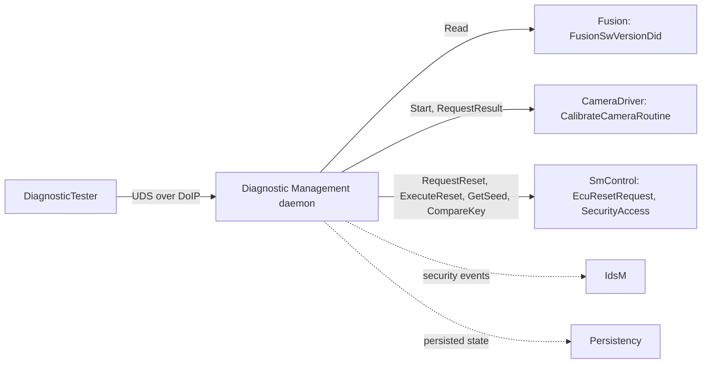

The headers are in `ara/diag/`, for example `ara/diag/ecu_reset_request.h` or `ara/diag/generic_routine.h`; typed classes generated from the model get their own headers ([Section 15.1](#151-headers-namespaces-and-the-port-to-class-binding)). Transport protocol plug-ins use the Platform Extension Interface `apext::diag::uds_transport` (SWS, Appendix C).

> **Key takeaways**
>
> - DM is a UDS (and SOVD) server daemon, configured by the DEXT and the manifest.
> - Applications offer diagnostic functions through `ara::diag` objects bound to ports.
> - R25-11 does not support OBD, `0x2F` IO control and several other services; know the list before you promise a feature.
> - DM resembles the Classic Dcm/Dem, but with run-time conversations and Software Clusters.

---

## 2. Core Concepts and Terminology

> **Why this matters:** Diagnostics has its own vocabulary, most of it from UDS. Every rule in this guide is written in these terms, so a short tour of them saves a lot of confusion later.

### 2.1 UDS in One Page

UDS (Unified Diagnostic Services, ISO 14229-1) is a request and response protocol between a *client* (the tester) and a *server* (the ECU).

- A **request** starts with a one-byte **service identifier** (SID), for example `0x22` ReadDataByIdentifier. Many services have a **sub-function** byte after the SID, for example `0x10 03` = DiagnosticSessionControl, extendedDiagnosticSession.
- A **positive response** starts with SID + `0x40`, for example `0x62` for `0x22`.
- A **negative response** is `0x7F`, the SID, and a one-byte **negative response code** (NRC), for example `0x7F 22 31` = requestOutOfRange for ReadDataByIdentifier.
- Bit 7 of the sub-function is the **suppressPosRspMsgIndicationBit**: if set, the server sends no positive response. `0x3E 80` is a TesterPresent whose positive response is suppressed.
- NRC `0x78` (requestCorrectlyReceivedResponsePending) is special: it is not a final answer but tells the tester to wait ([Section 7.6](#76-response-pending-p2-and-p2-and-the-pending-limit)).

### 2.2 Diagnostic Client, Diagnostic Server and Addresses

Every request carries a **source address** (SA), the address of the tester, and a **target address** (TA), the address of the server. A target address is either **physical** (one server) or **functional** (a group of servers that all receive the request). In addition, the transport layer knows a network endpoint, such as an IP address and port. DM identifies a tester by the pair of SA and the transport channel, so two testers with the same SA from different endpoints are two different clients (SWS, Section 7.1.1.2; [SWS_DM_00421]).

### 2.3 Diagnostic Server Instances and Software Clusters

A machine can host several Software Clusters ([guide 02, Section 10.4](02_Manifests.md#104-worked-example-adascluster-and-hpcplatformcore)). DM supports two approaches (SWS, Section 7.3):

- each Software Cluster has its own diagnostic address and its own diagnostic configuration, the **`DiagnosticContributionSet`**; or
- several Software Clusters share one diagnostic address and one `DiagnosticContributionSet`.

DM creates one independent **Diagnostic Server instance** per `DiagnosticContributionSet` ([SWS_DM_00420], DRAFT). All instances share the transport layer, for example one DoIP listener on TCP port 13400. In `HPC`, both Software Clusters share one contribution set and the address `0x1010`, so there is one Diagnostic Server instance.

### 2.4 Diagnostic Conversation

A **Diagnostic Conversation** is the state of the exchange between one tester and one Diagnostic Server instance: its session, security level, ongoing request and timers. Conversations are created at run time when a tester sends its first request, and end when the tester is back in the default session with no request pending (SWS, Section 7.3.2.1). [Chapter 6](#6-diagnostic-conversations) explains them.

### 2.5 Sessions, Security Levels and Access Permissions

- A **diagnostic session** is a mode of the conversation that unlocks services. Every server starts in the default session (`0x01`); the tester can switch to others, for example extended (`0x03`) or programming (`0x02`), with DiagnosticSessionControl. A non-default session falls back to default when the tester stays silent longer than the **S3 timer**.
- A **security level** is unlocked with SecurityAccess by a seed-and-key exchange ([Chapter 8](#8-sessions-and-security-access)).
- An **access permission** (`DiagnosticAccessPermission`) lists the sessions, security levels and, optionally, authentication roles and environmental conditions in which a service, DID or routine may be used ([Section 7.3](#73-session-and-security-checks)).

### 2.6 Data Identifiers and Routines

- A **data identifier** (DID) is a 16-bit number that names a data record, such as a software version. Testers read it with `0x22` and write it with `0x2E` ([Chapter 10](#10-data-identifiers)).
- A **routine** is a function in the ECU, identified by a 16-bit routine identifier, that a tester starts, stops and queries with RoutineControl `0x31` ([Chapter 11](#11-routines)).

### 2.7 Internally and Externally Processed Services

DM processes some services completely by itself (*internally*) and needs an application for others (*externally*) (SWS, Table 7.2):

| Support type | Services |
| --- | --- |
| Internally | `0x10` DiagnosticSessionControl, `0x14` ClearDiagnosticInformation, `0x19` ReadDTCInformation, `0x2A` ReadDataByPeriodicIdentifier, `0x2C` DynamicallyDefineDataIdentifier, `0x3E` TesterPresent, `0x85` ControlDTCSetting, `0x86` ResponseOnEvent |
| Externally | `0x11` ECUReset, `0x28` CommunicationControl, `0x29` Authentication, `0x2E` WriteDataByIdentifier, `0x31` RoutineControl, `0x34` to `0x38` (upload, download, file transfer) |
| Both | `0x22` ReadDataByIdentifier (internal data or applications), `0x27` SecurityAccess (DM keeps the state, an application computes seed and key) |

### 2.8 The Diagnostic Extract (DEXT) and the Manifest

The **Diagnostic Extract** is the AUTOSAR model of the diagnostic behavior of an ECU: sessions, security levels, services, DIDs, routines, events and DTCs. It is shared between the Classic and the Adaptive Platform and defined in the *Diagnostic Extract Template*. The parts that only apply to the Adaptive Platform, such as the diagnostic port interfaces and the mapping of DEXT elements to ports of processes, are defined in the *Manifest Specification* (TPS Manifest, Section 1.1.2). [Chapter 4](#4-configuration-overview) shows how they fit together.

### 2.9 Terms at a Glance

| Term | Plain meaning | Where configured | API |
| --- | --- | --- | --- |
| Diagnostic Server instance | One UDS server inside DM | `DiagnosticContributionSet` | – |
| Diagnostic Conversation | One tester talking to one server | `maxConversations` | `Conversation` |
| Session | Mode that unlocks services | `DiagnosticSession` | `Conversation::GetDiagnosticSession` |
| Security level | Unlocked by seed and key | `DiagnosticSecurityLevel` | `SecurityAccess` |
| Access permission | Where a service may be used | `DiagnosticAccessPermission` | – |
| DID | Readable or writable data record | `DiagnosticDataIdentifier` | typed DID class, `GenericDataIdentifier` |
| Routine | Function started by the tester | `DiagnosticRoutine` | typed routine class, `GenericRoutine` |
| NRC | Reason for a negative response | – | `DiagUdsNrcErrc` |
| Diagnostic mapping | Connects a DEXT element to a port of a process | `DiagnosticSwMapping` subclasses | `InstanceSpecifier` |
| MetaInfo | Information about the current request | – | `MetaInfo` |

> **Key takeaways**
>
> - UDS requests have a SID, often a sub-function; responses are positive (SID + `0x40`) or negative (`0x7F`, SID, NRC).
> - A tester is identified by its source address and its transport channel.
> - DM runs one Diagnostic Server instance per `DiagnosticContributionSet`; `HPC` has one.
> - Sessions, security levels and access permissions decide what a tester may do.
> - Some services are processed by DM alone, others need an application.

---

## 3. Diagnostic Management in the System Architecture

> **Why this matters:** DM is a central daemon with many partners: the network, the applications that provide data, State Management for resets, Persistency, Cryptography and the intrusion detection system. Knowing these relations explains where configuration lives and why a missing partner leads to a negative response.

### 3.1 Where DM Sits in the Platform

DM is split into a **UDS Transport Layer** and an **Application Layer** (SWS, Chapter 7). On the transport layer, **Transport Protocol Handlers** implement the transport protocols, such as DoIP. The **Transport Protocol Manager** dispatches received requests to the responsible Diagnostic Server instance and responses back to the handler that received the request. Each Diagnostic Server instance does session handling, security checks, internal processing and dispatching to applications.

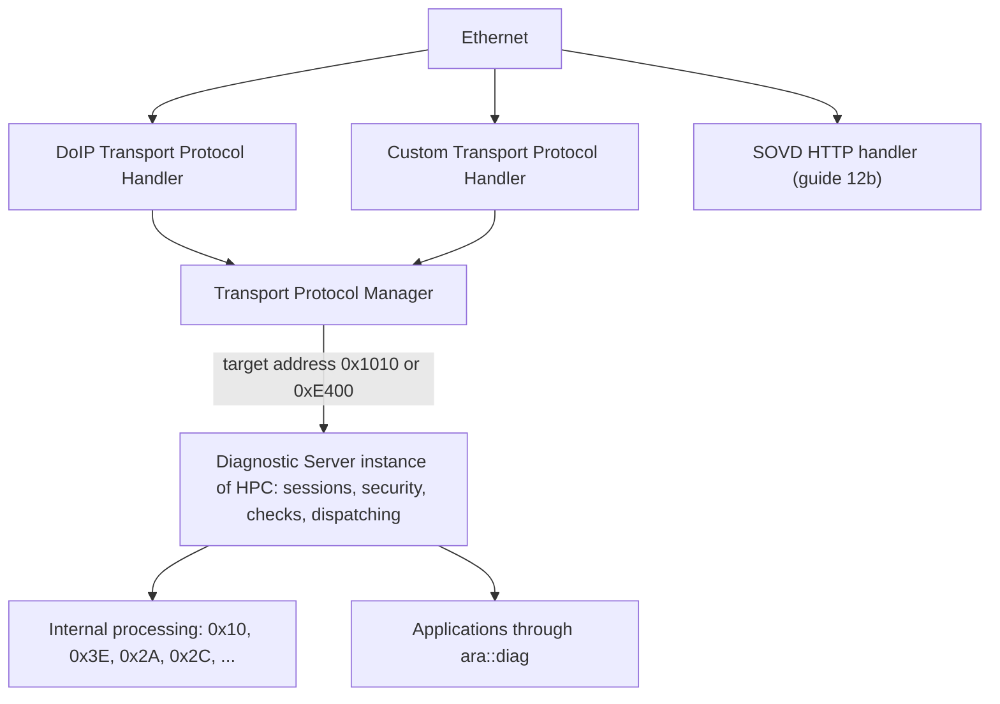

### 3.2 Interfaces Provided by DM

DM provides no interfaces to other functional clusters (SWS, Table 5.1). To applications, it provides the `ara::diag` classes. By use case:

| Use case | Classes |
| --- | --- |
| Provide data | typed DID class, typed data-element class, `GenericDataIdentifier` |
| Provide a function | typed routine class, `GenericRoutine`, `GenericUDSService` |
| Security | `SecurityAccess`, `Authentication`, `TransmitCertificate`, `ExternalAuthentication`, `ClientAuthentication` |
| Control the ECU | `EcuResetRequest`, `CommunicationControl` |
| Observe and filter | `Conversation`, `ServiceValidation` |
| Support DoIP | `DoIPPowerMode`, `DoIPEntityIdentification`, `DoIPGroupIdentification`, `DoIPActivationLine`, `DoIPTriggerVehicleAnnouncement` |
| Fault memory, data transfer, SOVD | [guide 12b](12b_Diagnostics.md) |

### 3.3 Interfaces Required by DM

| Cluster | Interface | Purpose (SWS, Table 5.2) |
| --- | --- | --- |
| Cryptography | `CryptoStack` | For example keys for secure diagnostics |
| Execution Management | `ExecutionClient` | Report the state of the DM daemon |
| Intrusion Detection System Manager | `EventReporter` | Report standardized security events ([Chapter 16](#16-reporting)) |
| Log and Trace | `Logger` | Log standardized messages |
| Persistency | `FileStorage`, `KeyValueStorage` | DTC data, DTC properties, sessions, the security access attempt counter |
| Platform Health Management | `SupervisedEntity` | Supervision of the DM daemon (should) |

### 3.4 Interaction Map

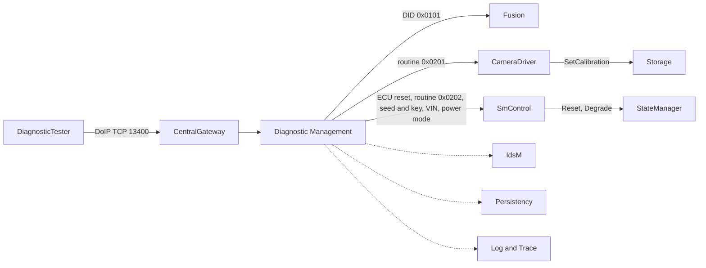

### 3.5 Access Control on `ara::diag`

DM accepts `ara::diag` interactions only from the processes that the corresponding diagnostic mapping names in its role `process`. Other processes are ignored and, if configured, DM raises the security event `SEV_ACCESS_CONTROL_DM_IAM_ACCESS_DENIED` ([SWS_DM_02130], [SWS_DM_02131]). A second process that tries to provide the DID of `Fusion` is therefore not served, even if it uses the same port name.

### 3.6 UDS and SOVD Side by Side

SOVD (Service-Oriented Vehicle Diagnostics, ASAM) offers diagnostic functions as REST resources over HTTP(S): data, faults, operations, modes, configurations, bulk data and software updates. In DM, the same Diagnostic Server instances serve both; DM itself is an SOVD component, and each Diagnostic Server instance is a sub-component ([SWS_DM_01372], [SWS_DM_01373]). An SOVD lock gives one client exclusive access; UDS requests that conflict with it get NRC `0x21` ([SWS_DM_01375]). Guide 12b covers SOVD.

> **Key takeaways**
>
> - DM has a transport layer (handlers, manager) and per-contribution-set Diagnostic Server instances.
> - Applications provide data and functions through `ara::diag`; only mapped processes may do so.
> - DM depends on Persistency, Cryptography, IdsM, Log and Trace, EM and PHM.
> - SOVD shares the servers with UDS; it is covered in [guide 12b](12b_Diagnostics.md#12-sovd-concepts-and-server-setup).

---

## 4. Configuration Overview

> **Why this matters:** DM has no built-in knowledge of your ECU. Which sessions exist, which DIDs and routines are supported, who provides them and how the tester reaches the machine all come from configuration, spread over the DEXT and the manifest. This chapter gives the big picture; [Chapter 14](#14-configuration-reference-what-to-configure) lists every setting.

### 4.1 Where the Configuration Lives

| Model | Configured by | When | Main elements for DM |
| --- | --- | --- | --- |
| Diagnostic Extract (DEXT, CP TPS) | Diagnostic author of the OEM, refined by suppliers | Diagnostic design | `DiagnosticContributionSet`, `DiagnosticCommonProps`, service tables and service instances, sessions, security levels, access permissions, DIDs, routines |
| AP-specific diagnostic design (TPS Manifest, Chapter 5) | Diagnostic author, integrator | Diagnostic design, integration | Diagnostic address of the contribution set, diagnostic mappings to ports and processes |
| Application Design (TPS Manifest, Section 4.9) | Application designer | Software component design | Diagnostic port interfaces such as `DiagnosticDataIdentifierInterface`; P-ports of the components |
| Machine design and machine (TPS Manifest, Sections 6.3.1, 12) | Integrator | Integration | `DoIpFunctionalClusterDesign`, `DoIpNetworkConfiguration`, `GenericTpConnection`, `DoIpInstantiation` |
| Software Cluster (TPS Manifest, Section 16.3.2) | Integrator | Packaging | `SoftwareClusterDiagnosticDeploymentProps` with the reference `diagnosticExtract` to the `DiagnosticContributionSet` |

### 4.2 How the Elements Relate

The diagram shows the path from a DID in the DEXT to the code that provides it.

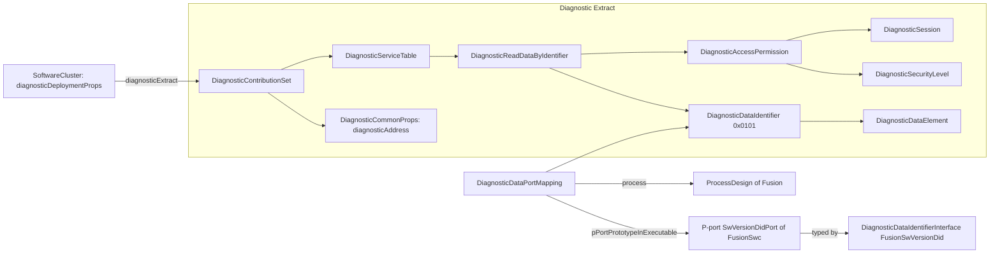

Three links matter most. The **service instance** (here `DiagnosticReadDataByIdentifier`) says that a service is supported for a DID and under which access permission. The **diagnostic mapping** connects the DEXT element to a port of an executable and to a process, so DM knows which running process provides it ([Section 14.11](#1411-diagnostic-mappings-ports-and-processes)). The **Software Cluster** references the contribution set through `SoftwareCluster.diagnosticDeploymentProps.diagnosticExtract`; Software Clusters that share their `SoftwareClusterDiagnosticDeploymentProps` share the contribution set and the Diagnostic Server instance (TPS Manifest, Section 16.3.2.2). In `HPC`, `HpcPlatformCore` and `AdasCluster` share them.

### 4.3 Who Configures What, and When

| Decision | Role | Where |
| --- | --- | --- |
| Which services, sessions, security levels, DIDs and routines exist, and their access permissions | Diagnostic author (OEM) | DEXT |
| The data layout of each DID and routine | Diagnostic author | DEXT (`DiagnosticParameter`, `DiagnosticDataElement`) |
| The port interfaces and ports through which applications provide data and functions | Application designer | Application Design |
| Which process provides which DID or routine | Integrator | Diagnostic mappings |
| Diagnostic address, DoIP parameters, tester priorities | Integrator | Contribution set, machine design, machine |
| How many testers in parallel | Integrator | `SoftwareClusterDiagnosticDeploymentProps.maxConversations` |

> **Key takeaways**
>
> - The DEXT defines the diagnostic behavior; the TPS Manifest adds the AP-specific parts.
> - Applications provide DIDs and routines through P-ports typed by diagnostic port interfaces.
> - Diagnostic mappings connect DEXT elements to ports and processes.
> - DoIP is configured in the machine design and the machine.

---

## 5. Transport: UDS Transport Layer and DoIP

> **Why this matters:** Before DM can check a request, the request must arrive. On the Adaptive Platform this is DoIP over Ethernet, or a custom transport plug-in. Most "the tester cannot connect" problems are transport problems: a wrong logical address, no routing activation, too many testers, or a DoIP parameter the tester does not expect.

### 5.1 Transport Protocol Handlers and the Transport Protocol Manager

DM supports a standardized C++ API, the *Transport Protocol API*, so that standardized and OEM-specific transport protocols can be plugged in (SWS, Section 7.1). Each transport protocol implementation derives from the abstract class `apext::diag::uds_transport::UdsTransportProtocolHandler` ([SWS_DM_00315]). DM provides the counterpart, `UdsTransportProtocolMgr` ([SWS_DM_00306]), and drives the handler's life cycle ([SWS_DM_00329]):

1. **Construct** the handler with a unique `handlerId` and a reference to the manager ([SWS_DM_00330]).
2. **Initialize** it before DM reports `kRunning` to Execution Management ([SWS_DM_00331]). If `Initialize` returns `kInitializeFailed`, DM calls nothing else on that handler ([SWS_DM_01745]).
3. **Start** it, also before reporting `kRunning`; the start may complete asynchronously ([SWS_DM_00332], [SWS_DM_01742]).
4. **Stop** it when DM terminates, and wait for `HandlerStopped` ([SWS_DM_00333], [SWS_DM_00340]).

Today, only Ethernet with DoIP is described in detail; CAN and other networks may follow in later releases (SWS, Section 7.1).

### 5.2 Receiving and Sending a Request

The handler announces a request as soon as it knows the source address, the target address, the address type, the total size and, if the payload is longer than one byte, its first two bytes ([SWS_DM_00342]). The first bytes let DM accept a functional TesterPresent `0x3E 80` even while it is busy ([SWS_DM_00386]).

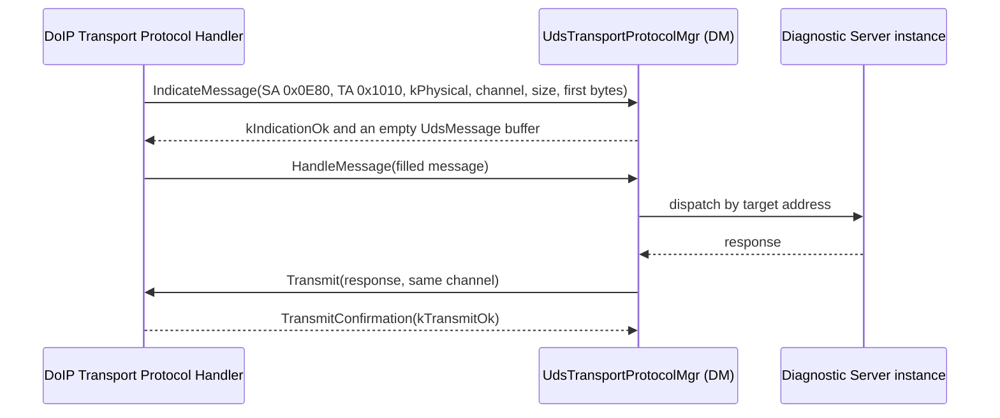

`IndicateMessage` can also refuse the request:

| Result | Meaning | Spec |
| --- | --- | --- |
| `kIndicationOk` | DM accepts and returns a buffer for the payload | [SWS_DM_00385] |
| `kIndicationOccupied` | DM is busy with the same conversation | [SWS_DM_00386] |
| `kIndicationOverflow` | DM has no memory for the request | [SWS_DM_00387] |
| `kIndicationUnknownTargetAddress` | No Diagnostic Server instance has this target address | [SWS_DM_00487] |

The response goes back to the same handler and channel ([SWS_DM_00348], [SWS_DM_00349]); the handler confirms with `kTransmitOk` or `kTransmitFailed` ([SWS_DM_00350], [SWS_DM_00351]). If the handler cannot deliver a request it has indicated, it calls `NotifyMessageFailure` ([SWS_DM_00346]).

### 5.3 DoIP on the Adaptive Platform

DoIP (Diagnostics over IP, ISO 13400-2) carries UDS over TCP and UDP, usually on port 13400. A tester typically finds the ECU through **vehicle identification** and **vehicle announcement** messages, opens a TCP connection, sends a **routing activation request** with its logical address, and then exchanges **diagnostic messages**; **alive checks** detect dead connections. DM supports the DoIP payload types listed in [SWS_DM_01568]: generic header negative acknowledge, vehicle identification request (also with EID or VIN) and response, routing activation request and response, alive check request and response, entity status request and response, diagnostic power mode request and response, diagnostic message with positive and negative acknowledgement, and the periodic diagnostic message ([SWS_DM_00449]).

The DoIP protocol version is configured in `DoIpFunctionalClusterDesign.doIpProtocolVersion`: 2 for ISO 13400-2:2012, 3 for ISO 13400-2:2019, 4 for the 2019 amendment and later. DM uses only the messages and values of the configured version ([SWS_DM_00475], [SWS_DM_02111]); without a value it uses version 3 ([SWS_DM_01986]).

> **Note:** [SWS_DM_00475] makes DoIP support conditional on `DoIpInstantiation.gid` being configured, while [SWS_DM_00813] explicitly handles the case without a configured GID. The condition reads like a copy error; treat DoIP as supported whenever DoIP is configured for the machine, and check your vendor's documentation.

### 5.4 VIN, EID, GID and Power Mode

Some DoIP messages contain information that DM does not own:

| Item | Where DM gets it | If not available | Spec |
| --- | --- | --- | --- |
| VIN (17 bytes) | Reads the DID whose `DiagnosticDataIdentifier.representsVin` is `true` | 17 times `0xFF` | [SWS_DM_00855], [SWS_DM_02005] |
| EID (6 bytes) | Per `DoIpNetworkConfiguration.eidRetrieval`: `eidUseMac` (MAC of the interface), `eidUseConfigValue` (`DoIpFunctionalClusterDesign.eid`) or `eidUseApi` (`DoIPEntityIdentification::GetEntityId`) | 6 times `0xFF` | [SWS_DM_02007], [SWS_DM_02006], [SWS_DM_01361], [SWS_DM_01528] |
| GID (6 bytes) | `DoIpInstantiation.gid` if configured, else `DoIPGroupIdentification::GetGidStatus` | 6 times `0xFF` (or "not set" if the interface is not yet offered) | [SWS_DM_02009], [SWS_DM_00813], [SWS_DM_02008], [SWS_DM_01527] |
| Power mode | `DoIPPowerMode::GetDoIPPowerMode` | 0, "not ready", until the interface is offered | [SWS_DM_00814], [SWS_DM_01525] |
| VIN/GID sync status | Included only if `vehicleIdentificationSyncStatus` is `true` | omitted | [SWS_DM_02107], [SWS_DM_02010] |

Vehicle announcements are sent when the network becomes available and when an activation line becomes active, which an application reports through `DoIPActivationLine` ([SWS_DM_00816]). The SWS points out that the interface `DoIPTriggerVehicleAnnouncement` should not be used by applications to trigger announcements explicitly (SWS, Section 7.1.2).

### 5.5 DoIP Timing and Limits

Unlike most of DM, the DoIP parameters have specified defaults:

| Parameter (`DoIpNetworkConfiguration`) | Default | Spec |
| --- | --- | --- |
| `tcpInitialInactivityTime` | 2 s | [SWS_DM_01980] |
| `tcpGeneralInactivityTime` | 300 s | [SWS_DM_01981] |
| `vehicleAnnouncementCount` | 3 | [SWS_DM_01982] |
| `vehicleAnnouncementInterval` | 0.5 s | [SWS_DM_01983] |
| `tcpAliveCheckResponseTimeout` | 0.5 s | [SWS_DM_01984] |
| `maxTesterConnections` | 1 (range 1 to 255) | [SWS_DM_01985], [SWS_DM_02106] |
| `doIpProtocolVersion` (`DoIpFunctionalClusterDesign`) | 3 | [SWS_DM_01986] |

The entity status response contains the "max data size" only if `entityStatusMaxByteFieldUse` is `true`; the value is `maxRequestBytes` ([SWS_DM_02002]).

> **Pitfall:** The default of `maxTesterConnections` is one. A second tester, for example a data logger next to the workshop tester, cannot connect unless you raise the value. It is independent of `maxConversations` ([Section 6.3](#63-how-many-testers-at-once)).

### 5.6 Securing DoIP with TLS

A Diagnostic Server instance secures its DoIP connections with TLS according to ISO 13400-2, using the configuration referenced by `DoIpNetworkConfigurationDesign.networkConfiguration.secureComPropsForTcp` ([SWS_DM_01979]). The TLS concepts are the same as for service communication ([guide 08b, Chapter 6](08b_SecureAndSafeCommunication.md#6-tls-and-dtls)). `HPC` does not use TLS for DoIP: the workshop reaches it through the `CentralGateway`, and security relies on SecurityAccess and the firewall (guide 16).

### 5.7 Dispatching to Diagnostic Servers

The Transport Protocol Manager uses the target address and its type:

- A **physical** request goes to the Diagnostic Server instance whose Software Cluster has a diagnostic address equal to the target address with `addressSemantics` `physicalAddress` ([SWS_DM_00390]).
- A **functional** request goes to *all* Diagnostic Server instances with a matching address of `addressSemantics` `functionalAddress` ([SWS_DM_00391]).

`HPC` has the physical address `0x1010` and the functional address `0xE400`, both in its one contribution set.

### 5.8 Custom Transport Protocols and Channel Re-establishment

A custom transport protocol implements `UdsTransportProtocolHandler` and uses the same manager calls. One detail matters for the ECU reset: if DM must answer a request *after* a restart, it asks the handler with `NotifyReestablishment(channelId)` to report when that channel is available again. The handler stores the request persistently and calls `ChannelReestablished` once the channel is back ([SWS_DM_00356], [SWS_DM_00358], [SWS_DM_00359]). The request is valid only from the next `Start` to the following `Stop` ([SWS_DM_00357]). [Section 12.2](#122-ecuresetrequest-requestreset-executereset-responding-before-or-after-the-reset) uses this.

### 5.9 Worked Example: `DiagnosticTester` Connects to `HPC`

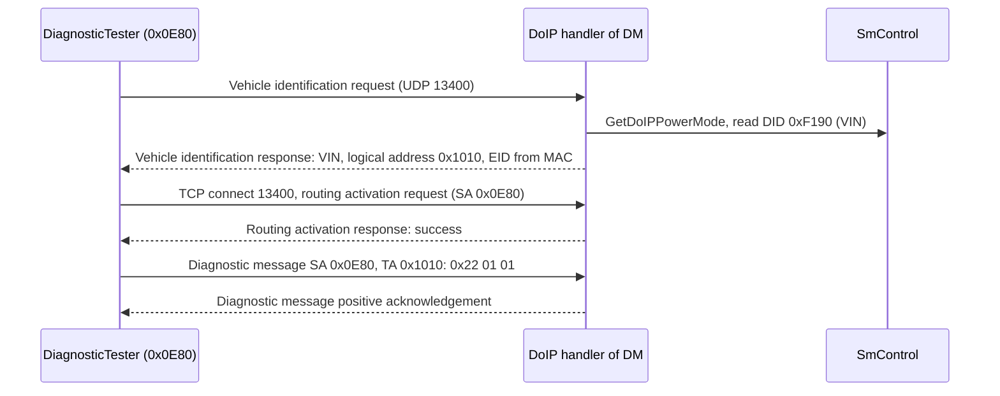

The tester's source address `0x0E80` lies in the range `0x0E00` to `0x0EFF` of the `GenericTpConnection` `WorkshopTesters`, which gives its conversations the priority 10 ([Section 6.4](#64-priorities-replacement-and-refusal)). Up to two testers can be connected at the same time (`maxTesterConnections` 2). How the request `0x22 01 01` continues is the subject of the next chapters.

> **Key takeaways**
>
> - Transport plug-ins implement `UdsTransportProtocolHandler`; DM's `UdsTransportProtocolMgr` receives and dispatches.
> - DM supports DoIP versions 2, 3 and 4 (default 3) without gateway functionality.
> - VIN, EID, GID and power mode come from DIDs, configuration or small `ara::diag` provider classes.
> - DoIP timing parameters have specified defaults; `maxTesterConnections` defaults to one.
> - Requests are dispatched by target address: physical to one server, functional to all matching servers.

---

## 6. Diagnostic Conversations

> **Why this matters:** A workshop tester, a production line tool and a remote diagnostic client may all talk to the same ECU. Who is served, who has to wait and who is thrown out is decided by Diagnostic Conversations and their priorities. Applications that are called by DM need to know whether they can be called in parallel.

### 6.1 Identifying a Client

A Diagnostic Server instance identifies a tester by the tuple of source address and `globalChannelId` that the transport handler passes in `IndicateMessage` ([SWS_DM_00421]). On the Classic Platform, the connections between testers and the ECU are configured statically; on the Adaptive Platform, a conversation is allocated at run time (SWS, Section 7.3.2.1).

### 6.2 Life Cycle of a Conversation

A conversation starts with the first request of a tester to a Diagnostic Server instance. It ends when it is cancelled, or when both of these are true: the request is finished (final response sent and confirmed, or the response suppressed) and the conversation is in the default session (SWS, Section 7.3.2.1.2). A conversation in a non-default session stays alive until the S3 timer expires, so that the tester can send many requests in it. A new conversation starts in the default session with the security level locked and the activity status `kActive` ([SWS_DM_00856]).

### 6.3 How Many Testers at Once

The Diagnostic Server instance provides as many `ara::diag::Conversation` instances as the number of parallel testers configured by `SoftwareClusterDiagnosticDeploymentProps.maxConversations` ([SWS_DM_00840]); without a value, the number is 1 ([SWS_DM_02003]). This limit is independent of the DoIP `maxTesterConnections`, which limits TCP connections. `HPC` allows 2 of each.

### 6.4 Priorities, Replacement and Refusal

Each conversation has a priority from the `GenericTpConnection` whose source address range contains the tester's address ([SWS_DM_02004], DRAFT). A lower value means a higher priority, and 0 is the highest ([SWS_DM_00428]). Without configuration, the range is 0 to 65535 and the priority 255 ([SWS_DM_02108] to [SWS_DM_02110]).

When a request arrives, the Diagnostic Server instance decides as follows (SWS, Figure 7.3):

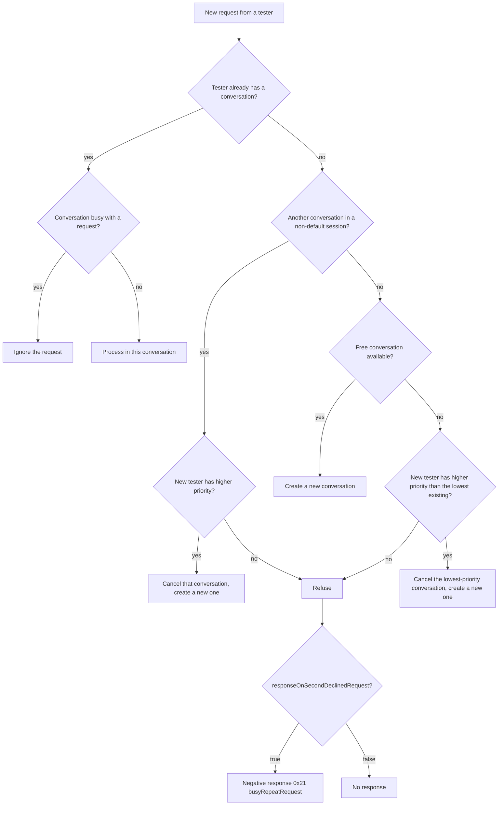

The rules behind the picture: [SWS_DM_00426], [SWS_DM_01581], [SWS_DM_00429], [SWS_DM_00430] for assignment and prioritization; [SWS_DM_00431] for replacement, which cancels the old conversation ([Section 6.7](#67-cancellation-and-the-cancellationhandler)); [SWS_DM_00433], [SWS_DM_00049] and [SWS_DM_00290] for refusal.

> **Pitfall:** A tester in the extended session blocks every other tester, because DM serves only that conversation while a non-default session is active, unless the newcomer has a higher priority (SWS, Section 7.3.2.1.1). Give production and workshop tools sensible priorities, or they will cancel each other's sessions.

### 6.5 Pseudo-Parallel Processing and Re-entrant Applications

DM processes requests of several testers in parallel only while all of them are in the default session ("pseudo parallel mode", SWS, Section 7.3.2.1.1). Even then, it calls an application method concurrently for different testers only if the application declared its object re-entrant with `ConcurrencyType::kConcurrent` in the constructor ([SWS_DM_00940]); for DIDs, the type `DataIdentifierConcurrencyType` distinguishes read, write and read-write ([SWS_DM_00941] to [SWS_DM_00943]). Otherwise DM does not call the object again until the previous call has returned ([SWS_DM_00944]), and it may answer the second tester with NRC `0x21` or delay it; which one is implementation-specific.

### 6.6 The `Conversation` Class

Applications can observe the conversations of their Diagnostic Server instance through `ara::diag::Conversation` ([SWS_DM_00693]):

| Function | Purpose |
| --- | --- |
| `static GetConversation(const MetaInfo&)` | The conversation of the current request |
| `static GetAllConversations()`, `GetCurrentActiveConversations()` | All, or the active, conversations |
| `GetActivityStatus()`, `GetDiagnosticSession()`, `GetDiagnosticSecurityLevel()`, `GetConversationIdentifier()` | Current state |
| `GetDiagnosticSessionShortName(session)`, `GetDiagnosticSecurityLevelShortName(level)` | Short names from the DEXT; `kInvalidArgument` for unknown values or `kLocked` ([SWS_DM_01259] to [SWS_DM_01261]) |
| `SetActivityNotifier`, `SetDiagnosticSessionNotifier`, `SetSecurityLevelNotifier` | Notification of changes (DRAFT); a second registration replaces the first ([SWS_DM_01355] to [SWS_DM_01357]) |
| `ResetToDefaultSession()` | Finish the ongoing request, then return to the default session ([SWS_DM_00842]) |

```cpp
// SmControl: leave the extended session when the vehicle starts to move (illustrative).
#include "ara/diag/conversation.h"

void OnVehicleMoving() {
    for (ara::diag::Conversation& c : ara::diag::Conversation::GetCurrentActiveConversations()) {
        static_cast<void>(c.ResetToDefaultSession());  // unlocked routines are no longer allowed
    }
}
```

### 6.7 Cancellation and the `CancellationHandler`

A conversation is cancelled when a higher-priority tester replaces it ([SWS_DM_00431]) or when the transport fails. If an application is processing a request of that conversation, DM tells it through the `CancellationHandler` that it passed to the application method ([SWS_DM_00277], [SWS_DM_00577]):

- `IsCanceled()` returns `true` once the conversation was cancelled.
- `SetNotifier(f)` registers a function that DM calls on cancellation; a second call replaces the first ([SWS_DM_01348]).

DM does not send a response for a cancelled request ([SWS_DM_00279], [SWS_DM_00280]). An application should stop long work when it is cancelled, for example a running calibration ([Section 11.3](#113-long-running-routines-futures-response-pending-and-cancellation)).

> **Key takeaways**
>
> - A conversation is the state of one tester with one server; it lives while a non-default session is active.
> - `maxConversations` (default 1) limits parallel testers; priorities decide who is replaced or refused.
> - A non-default session makes DM serve only that tester.
> - Applications are called concurrently only if they declare `kConcurrent`.
> - Cancellation reaches applications through the `CancellationHandler`.

---

## 7. Request Validation and Response Handling

> **Why this matters:** Most negative responses are not bugs in the application but results of DM's checks: the service is not configured, the session is wrong, the security level is locked, or a condition is not met. Knowing the order of checks and their NRCs is the fastest way to read a failing trace.

### 7.1 The Order of Checks

The Diagnostic Server instance validates each request as defined by ISO 14229-1 ("General server response behavior") ([SWS_DM_00096]). The first failing check aborts the processing with a negative response ([SWS_DM_00097]).

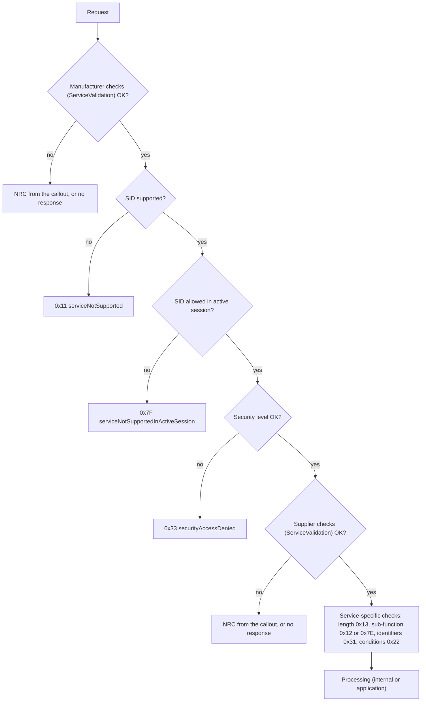

The service-specific checks follow the figures of ISO 14229-1 for each service; the sections below and Chapters 8 to 12 name them.

### 7.2 Format, Service and Sub-function Checks

| Check | NRC | Spec |
| --- | --- | --- |
| Message syntactically correct | `0x13` `kIncorrectMessageLengthOrInvalidFormat` | [SWS_DM_00098] |
| A service processor configured for the SID | `0x11` `kServiceNotSupported` | [SWS_DM_00099] |
| A service processor configured for the sub-function | `0x12` `kSubFunctionNotSupported` | [SWS_DM_00100] |

A "service processor" is a configured `DiagnosticServiceInstance`, internal or external.

### 7.3 Session and Security Checks

Each service instance references a `DiagnosticAccessPermission` with the allowed sessions and security levels:

| Check | NRC | Spec |
| --- | --- | --- |
| Service not allowed in the current session, and no other sub-function or identifier of it is | `0x7F` `kServiceNotSupportedInActiveSession` | [SWS_DM_00101] |
| Sub-function not allowed in the current session, but another sub-function is | `0x7E` `kSubFunctionNotSupportedInActiveSession` | [SWS_DM_00102] |
| Service or sub-function not allowed at the current security level | `0x33` `kSecurityAccessDenied` | [SWS_DM_00103], [SWS_DM_00450] |

If no access permission, or no session or security level in it, is configured, DM skips the corresponding check ([SWS_DM_01951], [SWS_DM_01952]). For DIDs and routines, the same checks are made per identifier ([Sections 10.1](#101-reading-and-writing-dids-0x22-0x2e) and [11.1](#111-start-stop-and-request-results)).

> **Pitfall:** "No permission configured" means "allowed everywhere", not "forbidden". A routine without an access permission can be started in the default session without security access. Review access permissions as part of the security assessment.

### 7.4 Manufacturer and Supplier Checks: `ServiceValidation`

ISO 14229-1 foresees manufacturer- and supplier-specific checks. In DM, they are implemented by applications through `ara::diag::ServiceValidation` ([SWS_DM_01252], [SWS_DM_01253]). For each configured check, DM calls `Validate(requestData, metaInfo)` with the complete request including the SID. The result decides:

| `Validate` result | DM does | Spec |
| --- | --- | --- |
| No error | Continues processing | [SWS_DM_01254] |
| `kNoProcessingNoResponse` | Discards the request without a response | [SWS_DM_00860] |
| Any other `DiagUdsNrcErrc` | Sends that NRC | [SWS_DM_01255] |

After the request is finished, DM calls `Confirmation(status, metaInfo)` with `kResPosOk`, `kResPosNotOk`, `kResNegOk` and so on; if a response was sent, only after the transmit confirmation ([SWS_DM_00859]). Typical uses are message filtering and project-specific rules, for example "no RoutineControl while the vehicle moves" when no environmental condition is modeled.

### 7.5 Environmental Conditions

Some services must only run in a certain vehicle state, for example with the vehicle standing still. A `DiagnosticEnvironmentalCondition` referenced by the access permission of a service makes DM evaluate a formula before the service runs ([SWS_DM_00111], [SWS_DM_00112], [SWS_DM_00286], [SWS_DM_00287]). The formula compares data, read from a `DiagnosticDataElement` or from a port typed by a `DiagnosticDataElementInterface`, with constants. If it is false, DM sends the NRC configured in `nrcValue`, or `0x22` `kConditionsNotCorrect` ([SWS_DM_00289]). If reading the data fails with an NRC, the condition counts as not fulfilled ([SWS_DM_00970]).

### 7.6 Response Pending, P2 and P2*, and the Pending Limit

Each session has two timing parameters from `DiagnosticSession`: **P2** (`p2ServerMax`), the time within which the server should start its response, and **P2\*** (`p2StarServerMax`), the extended time after a response-pending message. If processing takes longer than P2, DM itself sends NRC `0x78` (response pending) and keeps doing so ([SWS_DM_00368]). After `DiagnosticCommonProps.maxNumberOfRequestCorrectlyReceivedResponsePending` such messages, DM cancels the processing and sends `0x10` `kGeneralReject` ([SWS_DM_00369]).

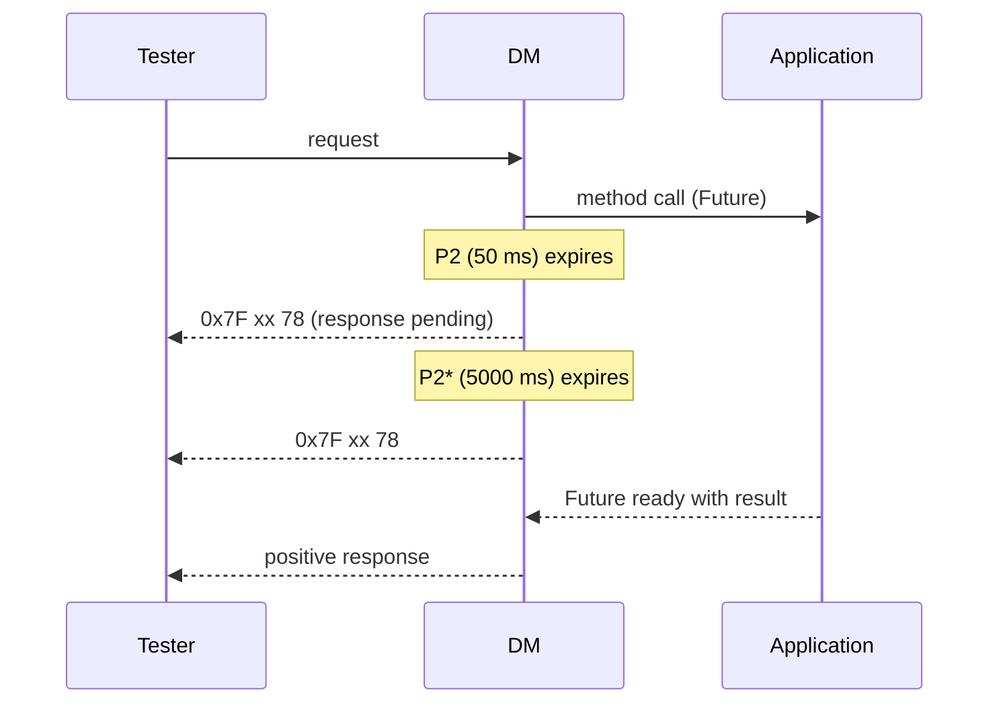

Applications therefore never send "response pending" themselves; they only return their future when the result is ready. If an application that DM needs has not called `Offer()` yet, or has called `StopOffer()`, DM answers `0x94` `kResourceTemporarilyNotAvailable` ([SWS_DM_01257]).

### 7.7 NRCs from Applications: `DiagUdsNrcErrc`

An application rejects a request by setting the error of its future to an `ara::diag::DiagUdsNrcErrc` value. DM sends the corresponding NRC ([SWS_DM_02059], [SWS_DM_02060]). The enumeration defines the standardized NRCs of ISO 14229-1; any value from `0x01` to `0xFE` is accepted, so a manufacturer-specific NRC can be created with a cast (SWS, Section 7.3.2.6.1):

```cpp
// Reject a request with standardized and manufacturer-specific NRCs (illustrative).
#include "ara/diag/diag_uds_nrc_error_domain.h"

ara::core::Promise<void> promise;
promise.SetError(ara::diag::MakeErrorCode(ara::diag::DiagUdsNrcErrc::kConditionsNotCorrect, 0));   // 0x22
// promise.SetError(ara::diag::MakeErrorCode(static_cast<ara::diag::DiagUdsNrcErrc>(0xF0), 0)); // OEM-specific
```

DM does not check whether an NRC makes sense for the service; that is the application's responsibility (SWS, Section 7.3.2.6.1).

### 7.8 Worked Example: Why the Tester Gets 0x7F

The workshop technician sends `0x31 01 02 01` (start routine `CalibrateCamera`) right after connecting. The routine's access permission allows only `ExtendedSession` and `Level1`. The conversation is new, so it is in `DefaultSession` with the security level locked ([SWS_DM_00856]). RoutineControl is configured, but no routine of it is allowed in the default session, so the session check fails with `0x7F 31 7F` ([SWS_DM_00101]). After `0x10 03`, the same request fails with `0x7F 31 33`, because `Level1` is still locked. Only after SecurityAccess does the routine start ([Section 8.4](#84-worked-example-unlocking-hpc-for-calibration)).

> **Key takeaways**
>
> - Checks run in the ISO 14229-1 order; the first failure decides the NRC.
> - Sessions and security levels come from access permissions; missing permissions mean no check.
> - `ServiceValidation` adds project-specific checks; environmental conditions model vehicle-state checks.
> - DM sends response pending itself; applications only complete their futures.
> - Applications report NRCs through `DiagUdsNrcErrc`; `0x94` means the provider is not offered.

---

## 8. Sessions and Security Access

> **Why this matters:** Sessions and security levels are the classic gatekeepers of UDS. Calibration, configuration writes and resets are usually locked behind the extended session and a seed-and-key exchange. Getting the timers, the attempt counter and the persistence of failed attempts right is part of the ECU's security.

### 8.1 DiagnosticSessionControl and the S3 Timer

DM processes DiagnosticSessionControl (`0x10`) internally ([SWS_DM_00226]). A requested session that is not configured as a `DiagnosticSession` with a matching `id` gets `0x12` ([SWS_DM_00227]). Otherwise DM switches the session of the conversation ([SWS_DM_00228]) and updates the `Conversation` object, whose session notifier then fires ([SWS_DM_00845]). In the positive response, the tester receives the P2 and P2\* values of the new session, as ISO 14229-1 defines. With parallel testers, a session change can be refused even for a supported session (SWS, Section 7.3.2.8.4), because a non-default session is exclusive ([Section 6.4](#64-priorities-replacement-and-refusal)).

The **S3 timer** returns a silent tester to the default session:

- Its value is `DiagnosticSessionControlClass.s3ServerTimeout`, or 5000 ms if not configured ([SWS_DM_00380], [SWS_DM_01747]).
- It starts after every final response, after an action without response, and after a failed multi-frame reception; it stops when a new request is indicated ([SWS_DM_00382], [SWS_DM_00383]).
- When it expires in a non-default session, DM resets the conversation to the default session and resets its internal service state ([SWS_DM_00381]); a disabled DTC setting is enabled again ([SWS_DM_00812]).

Testers keep a session alive with TesterPresent (`0x3E`), which DM handles internally ([SWS_DM_00126]).

### 8.2 SecurityAccess: Seed and Key, `ara::diag::SecurityAccess`

SecurityAccess (`0x27`) unlocks a security level in two steps. The tester requests a **seed** with an odd sub-function (`requestSeed`), computes a **key** from it with a secret algorithm, and sends the key with the next even sub-function (`sendKey`). DM keeps the state; an application computes the seed and checks the key through `ara::diag::SecurityAccess`, constructed with a port typed by `DiagnosticSecurityLevelInterface` ([SWS_DM_00761], [SWS_DM_00762]):

| Request | DM does | Spec |
| --- | --- | --- |
| `0x27 01` (sub-function = `DiagnosticSecurityAccess.requestSeedId`) | Checks the length against `accessDataRecordSize` (`0x13` on mismatch), then calls `GetSeed(securityAccessDataRecord, metaInfo, cancellationHandler)` | [SWS_DM_00863], [SWS_DM_00507] |
| `0x27 02` (sub-function - 1 = `requestSeedId`) | Calls `CompareKey(key, metaInfo, cancellationHandler)`; `kKeyValid` unlocks the level | [SWS_DM_00864], [SWS_DM_00846] |
| Not configured sub-function | `0x12` | [SWS_DM_00363] |

The unlocked level is identified by `DiagnosticSecurityAccess.securityLevel`. A static seed, if wanted, is the application's business (SWS, Section 7.3.2.8.9).

### 8.3 Failed Attempts and the Delay Timer

Brute-forcing a key must be slow. DM therefore:

1. counts failed key comparisons per security access type and resets the counter on success ([SWS_DM_00270]);
2. answers `0x35` `kInvalidKey` while the count is below `DiagnosticSecurityLevel.numFailedSecurityAccess`, and `0x36` `kExceedNumberOfAttempts` when it reaches it, starting a delay timer of `securityDelayTime` ([SWS_DM_00271]);
3. answers every requestSeed with `0x37` `kRequiredTimeDelayNotExpired` while the delay timer runs ([SWS_DM_00272]);
4. stores the counters persistently, so that a reset does not clear them ([SWS_DM_00478]);
5. at power-up, restarts the delay timer with `securityDelayTimeOnBoot`, or with the larger of `securityDelayTimeOnBoot` and `securityDelayTime` if a restored counter reached the threshold ([SWS_DM_01758], [SWS_DM_00479]).

With `DiagnosticSecurityAccessClass.sharedTimer`, one delay timer applies to all levels ([SWS_DM_00480]).

> **Note:** ISO 14229-1 starts the delay timer at power-up already after a single failed attempt in the previous power cycle. DM deliberately deviates and follows [SWS_DM_00479] instead (SWS, Section 4.1.1).

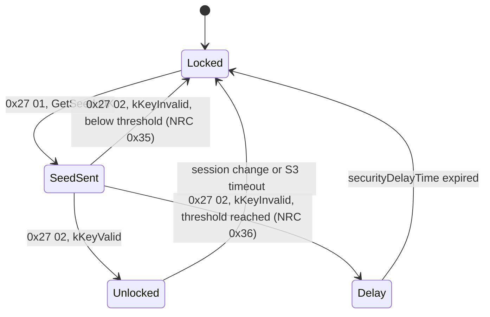

### 8.4 Worked Example: Unlocking `HPC` for Calibration

`HPC` has one security level, `Level1`, with RequestSeed `0x01` and SendKey `0x02`, 4-byte seed and key, 3 allowed failures and a 10 s delay (illustrative). `SmControl` provides it through the P-port `SecurityLevelPort`. The seed is random; the key is derived from the seed with a secret that Cryptography keeps (guide 14). The derivation below is a placeholder.

```cpp
// SmControl: provider of security level Level1 (illustrative).
#include "ara/diag/security_access.h"
#include "ara/core/instance_specifier.h"

namespace hpc::smcontrol {

class Level1Access final : public ara::diag::SecurityAccess {
public:
    explicit Level1Access(const ara::core::InstanceSpecifier& spec)
        : ara::diag::SecurityAccess(spec, ara::diag::ConcurrencyType::kNotConcurrent) {}

    ara::core::Future<ara::core::Vector<std::uint8_t>> GetSeed(
            ara::core::Span<const std::uint8_t> /*securityAccessDataRecord*/,
            const ara::diag::MetaInfo& /*metaInfo*/,
            ara::diag::CancellationHandler /*cancellationHandler*/) noexcept override {
        ara::core::Promise<ara::core::Vector<std::uint8_t>> promise;
        seed_ = RandomBytes(4);                 // project helper, for example from Cryptography
        promise.set_value(seed_);
        return promise.get_future();
    }

    ara::core::Future<ara::diag::KeyCompareResultType> CompareKey(
            ara::core::Span<const std::uint8_t> key,
            const ara::diag::MetaInfo& /*metaInfo*/,
            ara::diag::CancellationHandler /*cancellationHandler*/) noexcept override {
        ara::core::Promise<ara::diag::KeyCompareResultType> promise;
        const bool ok = KeyMatches(seed_, key);  // derivation with the secret of guide 14
        promise.set_value(ok ? ara::diag::KeyCompareResultType::kKeyValid
                             : ara::diag::KeyCompareResultType::kKeyInvalid);
        return promise.get_future();
    }

private:
    ara::core::Vector<std::uint8_t> seed_;
};

}  // namespace hpc::smcontrol
```

`SmControl` constructs it with `/sm_control/Root/SecurityLevelPort` and calls `Offer()`. The technician's tester then sends `0x10 03` (extended session), `0x27 01` (seed) and `0x27 02 <key>`; after `kKeyValid`, the conversation is at `Level1` until the session changes or S3 expires. Because the counter of failed attempts is persistent, three wrong keys followed by an ECU reset still lead to `0x37` until the delay has expired.

> **Key takeaways**
>
> - Sessions are switched internally by DM; the S3 timer (default 5000 ms) returns silent testers to the default session.
> - SecurityAccess is processed by DM, with seed and key computed by an application through `ara::diag::SecurityAccess`.
> - Failed attempts are counted persistently and lead to `0x35`, `0x36` and `0x37`.
> - At power-up, DM restarts the delay timer, deviating on purpose from ISO 14229-1.

---

## 9. Authentication and Dynamic Access Rights

> **Why this matters:** Seed and key protects with one shared secret. Modern vehicles authenticate testers with certificates and give them roles: a workshop gets other rights than the development lab. DM supports this with UDS service `0x29`, roles in the access permissions, and dynamic access lists that an application maintains.

### 9.1 Authentication (0x29) on AP: PKI Certificate Exchange Only

If configured, DM provides Authentication `0x29` with the sub-functions deAuthenticate (`0x00`), verifyCertificateUnidirectional (`0x01`), verifyCertificateBidirectional (`0x02`), proofOfOwnership (`0x03`), transmitCertificate (`0x04`) and authenticationConfiguration (`0x08`) ([SWS_DM_01226]). It implements only authentication with PKI certificate exchange; challenge-response is out of scope (SWS, Section 4.1.1). If proofOfOwnership is configured, one of the verifyCertificate sub-functions must be configured too, and any of these three requires deAuthenticate and authenticationConfiguration ([SWS_DM_01227], [SWS_DM_01228]).

DM does not check certificates itself. It forwards them to the application through `ara::diag::Authentication` ([SWS_DM_01123]):

| Sub-function | DM calls | Positive response | Spec |
| --- | --- | --- | --- |
| verifyCertificateUnidirectional | `VerifyCertificateUnidirectional` with the client's certificate and challenge | Server challenge and ephemeral public key; return value `0x11` | [SWS_DM_01230], [SWS_DM_01233] |
| verifyCertificateBidirectional | `VerifyCertificateBidirectional` | Also the server certificate and proof of ownership | [SWS_DM_01235], [SWS_DM_01238] |
| proofOfOwnership | `VerifyOwnership` with the client's proof and ephemeral key | Session key info; return value `0x12`; the sequence is complete | [SWS_DM_01240], [SWS_DM_01243] |
| transmitCertificate | `TransmitCertificate::Process` for a configured `certificateEvaluationId` (else `0x31`) | Return value `0x13` | [SWS_DM_01247] to [SWS_DM_01251] |
| deAuthenticate | Returns the client to the deauthenticated state | Return value `0x10` | [SWS_DM_01244], [SWS_DM_01245] |

Errors of the application become NRCs, for example `0x50` to `0x58` for certificate and ownership failures ([SWS_DM_01231], [SWS_DM_01241]).

### 9.2 Roles and Authentication State per Client

DM keeps an authentication state and role per tester, independently for each client ([SWS_DM_01229]). After startup, every client is `kDeAuthenticated` and has the default roles, the `DiagnosticAuthRole`s with `isDefault` ([SWS_DM_01205], [SWS_DM_01204]). The application that verified the client calls `ClientAuthentication::Authenticate(userRoles)`, which sets `kAuthenticated` and the roles, and returns a `ClientAuthenticationHandle` ([SWS_DM_01206]). The application gets the `ClientAuthentication` object of a tester from `ExternalAuthentication::Get(metaInfo)` or by address ([SWS_DM_01202]); the possible testers are configured as `DiagnosticExternalAuthenticationIdentification` entries with a fixed source address or a range (TPS Manifest, Section 5.1.3).

A client falls back to `kDeAuthenticated` and its default roles, and loses its dynamic access list ([SWS_DM_01212]), when:

- it stays inactive in the default session for `DiagnosticCommonProps.authenticationTimeout` ([SWS_DM_01210]);
- its S3 timer expires ([SWS_DM_01211]);
- the application calls `Revoke` on the handle ([SWS_DM_01216]), or the tester sends deAuthenticate.

`OverrideDefaultRoles(roles, timeout)` temporarily grants other default roles to a deauthenticated client ([SWS_DM_01209]); `Refresh` extends that time or the inactivity time ([SWS_DM_01217]).

### 9.3 Dynamic Access Lists

A **dynamic access list** grants an authenticated client access to individual requests beyond its roles. It is a set of byte patterns that DM matches against the beginning of each request ([SWS_DM_01224]). The application builds it with `DiagnosticServiceDynamicAccessList::MakeServiceBuilder`, adds bytes, ranges and wildcards (`Any`) and finishes with `Build` ([SWS_DM_01218] to [SWS_DM_01222]), then installs it with `Set` or `Append` on the handle ([SWS_DM_01213], [SWS_DM_01215]). For example, the pattern `31 01 13 F4` allows starting routine `0x13F4` with any options, and `22 F1 xx` (with one wildcard byte) allows reading every DID `0xF1xx` (SWS, Section 7.3.2.3.4). The list is empty after startup ([SWS_DM_01214]).

### 9.4 External Authentication

The authentication state can also be set by other means than `0x29`, for example by a backend-supported procedure: the classes of [Section 9.2](#92-roles-and-authentication-state-per-client) are independent of service `0x29` (SWS, Section 7.3.2.3). The application then calls `Authenticate` after its own verification.

### 9.5 How Authentication Checks Fit into Validation

Authentication checks apply only where `DiagnosticAccessPermission.authenticationEnabled` exists ([SWS_DM_01739]). Then DM checks whether the client's roles are among the `authenticationRole`s of the access permission, in this order: service level, service and sub-function, DIDs, dynamically defined DIDs, routine sub-functions, and the memory selection of `0x19` and `0x14` ([SWS_DM_01223]). If no role grants access, the dynamic access list is tried ([SWS_DM_01224]). If both fail, the response is `0x34` `kAuthenticationRequired` ([SWS_DM_01225]).

`HPC` does not configure Authentication in this guide; its workshop access relies on SecurityAccess. Guide 14 covers the certificates that an authentication setup would need.

> **Key takeaways**
>
> - DM supports `0x29` with PKI certificate exchange only; applications verify certificates through `ara::diag::Authentication`.
> - DM keeps an authentication state and roles per client; applications set them with `ClientAuthentication`.
> - Dynamic access lists grant extra request patterns to authenticated clients.
> - Failed authentication checks lead to `0x34`; without `authenticationEnabled`, no checks happen.

---

## 10. Data Identifiers

> **Why this matters:** Reading DIDs is the most frequent diagnostic request: software versions, serial numbers, sensor values, configuration. On the Adaptive Platform, a DID is often provided by an application process that may not be running. Choosing the right way to provide a DID, and knowing what the tester sees when the provider is missing, avoids many surprises.

### 10.1 Reading and Writing DIDs (0x22, 0x2E)

For ReadDataByIdentifier (`0x22`), the Diagnostic Server instance checks ([SWS_DM_00170]):

| Check | Result if it fails | Spec |
| --- | --- | --- |
| Number of DIDs in the request ≤ `DiagnosticReadDataByIdentifierClass.maxDidToRead` | `0x13` | [SWS_DM_00412] |
| A `DiagnosticDataIdentifier` with this `id` is referenced by a `DiagnosticReadDataByIdentifier` | DID counts as not supported | [SWS_DM_00409] |
| Its access permission includes the active session | DID counts as not supported in this session | [SWS_DM_00413] |
| Its access permission includes the active security level | DID counts as not supported at this level | [SWS_DM_00414] |

How these results become NRCs (`0x31` if no requested DID is supported, `0x33` for security) and how a multi-DID request with partly supported DIDs is answered follow ISO 14229-1; a single failing DID can still lead to a positive response for the others (SWS, Section 7.3.2.8.8). Then DM retrieves the data ([SWS_DM_00570]).

WriteDataByIdentifier (`0x2E`) is processed externally with the analogous checks ([SWS_DM_00186], [SWS_DM_00415] to [SWS_DM_00417], [SWS_DM_00572]). The DID must be referenced by a `DiagnosticWriteDataByIdentifier`, and it must not contain internal data elements ([SWS_DM_CONSTR_00394]).

### 10.2 Anatomy of a DID

A `DiagnosticDataIdentifier` has an `id` and a list of `DiagnosticParameter`s; each parameter places one `DiagnosticDataElement` at a bit offset in the record (SWS, Section 7.3.6; DEXT). A data element has a base type with a byte order. DM serializes and deserializes the data elements for typed interfaces, respecting each element's byte order, or `DiagnosticCommonProps.defaultEndianness` if none is set ([SWS_DM_01759]). Applications therefore deal with C++ values, not with bytes, when they use typed interfaces.

### 10.3 Four Ways to Provide a DID

The diagnostic mapping and the type of the mapped port decide how DM obtains the data (SWS, Section 7.3.6.2):

| Way | Port interface | Mapping | Application implements | Spec |
| --- | --- | --- | --- | --- |
| Whole DID, typed | `DiagnosticDataIdentifierInterface` | `DiagnosticDataPortMapping` to the DID | Generated class with `Read` (and `Write`) using C++ types | [SWS_DM_00848], [SWS_DM_01039] |
| Whole DID, generic | `DiagnosticDataIdentifierGenericInterface` | `DiagnosticDataPortMapping` to the DID | `ara::diag::GenericDataIdentifier` with `Read(dataIdentifier, ...)` and `Write(dataIdentifier, bytes, ...)` returning bytes | [SWS_DM_01038], [SWS_DM_00906] |
| Per data element | `DiagnosticDataElementInterface` | `DiagnosticDataPortMapping` to each data element (or `DiagnosticProvidedDataMapping` for internal data) | Generated class with `Read` per element | [SWS_DM_00401], [SWS_DM_00905] |
| Whole service, raw | `DiagnosticGenericUdsInterface` | `DiagnosticServiceGenericMapping` | `ara::diag::GenericUDSService::HandleMessage(sid, requestData, ...)` with SID `0x22` or `0x2E` and the DID bytes | [SWS_DM_00849], [SWS_DM_00908] |

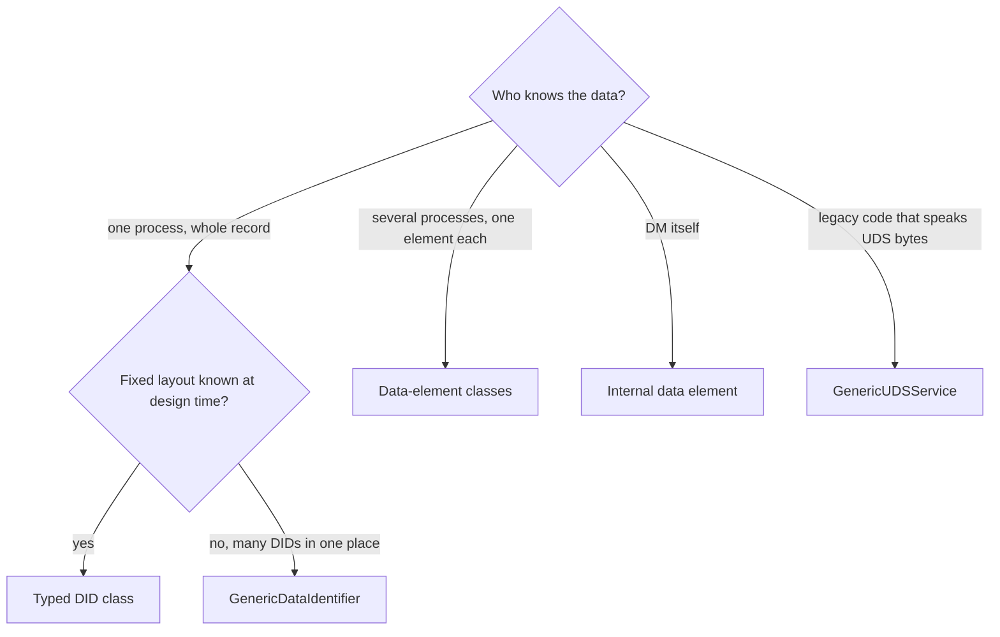

The typed way is the default choice: the generator creates a class from the port interface, the application fills C++ members, and DM handles the bytes and the byte order. `GenericDataIdentifier` suits a gateway-like process that serves many DIDs with one object. Per-element providers let several processes contribute to one DID. `GenericUDSService` leaves all serialization to the application (SWS, Section 7.3.6.2.2).

### 10.4 Internal Data: `DCM_SESSION` and `DCM_SECURITY_LEVEL`

Some data elements are provided by DM itself. They are mapped with a `DiagnosticProvidedDataMapping` whose `dataProvider` names the source. For UDS communication, R25-11 defines `DCM_SESSION` (current session of the conversation, 1 byte) and `DCM_SECURITY_LEVEL` (current security level, 1 byte) ([SWS_DM_01565], [SWS_DM_00393]). Internal elements are read-only ([SWS_DM_CONSTR_00394]) and must stay in their context: DCM elements not in DTC snapshot or extended data, DEM elements not in DIDs read by `0x22` ([SWS_DM_CONSTR_00395], [SWS_DM_CONSTR_00396]).

### 10.5 The VIN DID

DoIP needs the VIN for vehicle identification. DM reads it from the DID whose `representsVin` is `true` ([SWS_DM_00855]), with the `MetaInfo` context `kDoIP` ([SWS_DM_02105]). That DID must have exactly one parameter whose data element is a 17-byte `uint8` array ([SWS_DM_CONSTR_00206]). In `HPC`, `SmControl` provides the DID `0xF190` through the port `VinDidPort`; until it has offered it, DoIP messages carry 17 times `0xFF` ([SWS_DM_02005]).

### 10.6 Periodic DIDs (0x2A) and Dynamically Defined DIDs (0x2C)

DM processes both services internally, using the providers of the source DIDs:

- **ReadDataByPeriodicIdentifier (`0x2A`)** makes DM send DIDs periodically on a separate periodic connection ([SWS_DM_01040], [SWS_DM_01062]). Only scheduler type 1 is supported ([SWS_DM_01060]). Periodic DIDs never run in the default session; switching to it stops them ([SWS_DM_01059]). The transport handler provides a periodic handler for this ([Section 15.9](#159-the-uds-transport-layer-interface-for-platform-developers)).
- **DynamicallyDefineDataIdentifier (`0x2C`)** lets the tester compose a new DID from parts of existing static DIDs (`defineByIdentifier`; `defineByMemoryAddress` is not supported) ([SWS_DM_01070], [SWS_DM_01073], [SWS_DM_01074]). Whether these definitions survive a restart is configured by `DiagnosticDynamicallyDefineDataIdentifierClass.configurationHandling` (`volatile` or `nonVolatile`) ([SWS_DM_01071], [SWS_DM_01072]); with `checkPerSourceId`, definitions whose sources are no longer allowed after a session change are cleared ([SWS_DM_01078]).

### 10.7 Worked Example: `FusionSoftwareVersion`

The DID `0x0101` has one data element, the 8-byte ASCII text of the software version of `fusion`. The port interface `FusionSwVersionDid` (namespace `hpc::fusion`) is a `DiagnosticDataIdentifierInterface` with a `read` operation whose out argument `version` is an array of 8 `uint8`. `FusionSwc` has the P-port `SwVersionDidPort`, mapped by a `DiagnosticDataPortMapping` to the DID and to the process design of `Fusion`.

```cpp
// Fusion: provider of DID 0x0101 FusionSoftwareVersion (illustrative).
// Header and class are generated from the port interface FusionSwVersionDid ([SWS_DM_80011]);
// the name of the output structure is generator-specific ([SWS_DM_00579]).
#include "hpc/fusion/fusionswversiondid.h"

namespace hpc::fusion {

class SwVersionProvider final : public FusionSwVersionDid {
public:
    explicit SwVersionProvider(ara::core::InstanceSpecifier spec)
        : FusionSwVersionDid(std::move(spec), ara::diag::ConcurrencyType::kConcurrent) {}  // read-only, re-entrant

    ara::core::Future<FusionSwVersionDidReadOutput> Read(
            const ara::diag::MetaInfo& /*metaInfo*/,
            ara::diag::CancellationHandler /*cancellationHandler*/) noexcept override {
        ara::core::Promise<FusionSwVersionDidReadOutput> promise;
        FusionSwVersionDidReadOutput out{};
        constexpr char kVersion[8] = {'1', '.', '1', '.', '0', ' ', ' ', ' '};
        std::copy(std::begin(kVersion), std::end(kVersion), out.version.begin());
        promise.set_value(out);
        return promise.get_future();
    }
};

}  // namespace hpc::fusion

// In Fusion's startup:
//   hpc::fusion::SwVersionProvider swVersion{*ara::core::InstanceSpecifier::Create("/fusion/Root/SwVersionDidPort")};
//   swVersion.Offer();   ... and StopOffer() before termination
```

Since the value never changes, the object is declared `kConcurrent`: two testers may read it at the same time ([Section 6.5](#65-pseudo-parallel-processing-and-re-entrant-applications)).

**When `Fusion` is not running.** `Fusion` runs only in `ADAS.Normal` ([guide 00, Section 6.10](00_LearningPath.md#610-diagnostics)). In `ADAS.Off` or `ADAS.Degraded`, nobody has offered the provider, so DM answers `0x7F 22 94` (`kResourceTemporarilyNotAvailable`) ([SWS_DM_01257]). The same happens for a short time after `Fusion` starts and before it calls `Offer()`. If the workshop needs the version in every state, the version must be provided by a process that always runs, for example by `SmControl` with a `GenericDataIdentifier` that reads the installed versions from UCM (guide 13).

> **Pitfall:** Do not call `Offer()` before your object can answer. DM may call `Read` from its own thread as soon as `Offer()` returns, possibly before your process has finished its initialization.

> **Key takeaways**
>
> - DM checks DID support, session and security per DID; `maxDidToRead` limits multi-DID requests.
> - DIDs are provided by typed classes, `GenericDataIdentifier`, per-element classes or `GenericUDSService`; the mapping and port type decide.
> - DM serializes typed data with the configured byte order.
> - `DCM_SESSION` and `DCM_SECURITY_LEVEL` are internal; the VIN DID feeds DoIP.
> - A provider that is not offered yields `0x94`.

---

## 11. Routines

> **Why this matters:** Routines are how a tester makes the ECU do something: calibrate a sensor, erase a memory, run a self-test. They often take seconds, must not run in unsafe conditions, and must stop cleanly when the tester goes away.

### 11.1 Start, Stop and Request Results

RoutineControl (`0x31`) has three sub-functions: startRoutine (`0x01`), stopRoutine (`0x02`) and requestRoutineResults (`0x03`) ([SWS_DM_00201]). DM checks, in order:

| Check | NRC | Spec |
| --- | --- | --- |
| A `DiagnosticRoutine` with this `id` exists | `0x31` | [SWS_DM_00202] |
| Its access permission allows the session | `0x31` (or `0x7F` if no routine is allowed in this session, [Section 7.3](#73-session-and-security-checks)) | [SWS_DM_00448] |
| Its access permission allows the security level | `0x33` | [SWS_DM_00437] |
| The routine has the requested sub-function (`start`, `stop` or `requestResult` configured) | `0x12` | [SWS_DM_00203] |

Each `DiagnosticRoutine` has optional request and response parameters per sub-function (DEXT). The port interface `DiagnosticRoutineInterface` mirrors them with operations in the roles `start` (mandatory), `stop` and `requestResult` ([constr_10031], [constr_1696]).

### 11.2 Typed and Generic Routine Interfaces

| Interface | Application class | DM calls | Spec |
| --- | --- | --- | --- |
| `DiagnosticRoutineInterface` | Generated class with `Start`, `Stop`, `RequestResult`, each with typed in arguments and a typed output structure | the method of the sub-function | [SWS_DM_01270] to [SWS_DM_01272] |
| `DiagnosticRoutineGenericInterface` | `ara::diag::GenericRoutine` with `Start`, `Stop`, `RequestResults(routineId, requestData, ...)` returning bytes | the method of the sub-function | [SWS_DM_00574] to [SWS_DM_00576] |

Both are connected by a `DiagnosticServiceGenericMapping` from the `DiagnosticRoutineControl` service instance to the P-port and the process ([TPS_MANI_01326], [TPS_MANI_01453]).

### 11.3 Long-Running Routines: Futures, Response Pending and Cancellation

A routine method returns a future. If the future is not ready within P2, DM sends response-pending messages until it is ready, or until the configured maximum is reached ([Section 7.6](#76-response-pending-p2-and-p2-and-the-pending-limit)). Two designs are common:

- **Synchronous within the request:** `Start` completes its future when the work is done. Simple, but the tester's request stays open for the whole duration, and the pending limit must cover it.
- **Asynchronous with results:** `Start` launches the work and completes at once; the tester polls with requestRoutineResults until the result is ready. This needs a `requestResult` sub-function in the DEXT.

In both cases, the `CancellationHandler` tells the routine that the conversation was cancelled ([Section 6.7](#67-cancellation-and-the-cancellationhandler)). A routine that moves actuators or writes data should stop and leave a consistent state.

### 11.4 Worked Example: `CalibrateCamera`

`CalibrateCamera` (`0x0201`) measures the camera's mounting angles with a target in front of the vehicle and stores the result with `SetCalibration`. It needs the extended session and `Level1`, takes about 3 s and uses the asynchronous design: start launches the measurement, requestRoutineResults returns a status byte (`0` running, `1` done, `2` failed; illustrative).

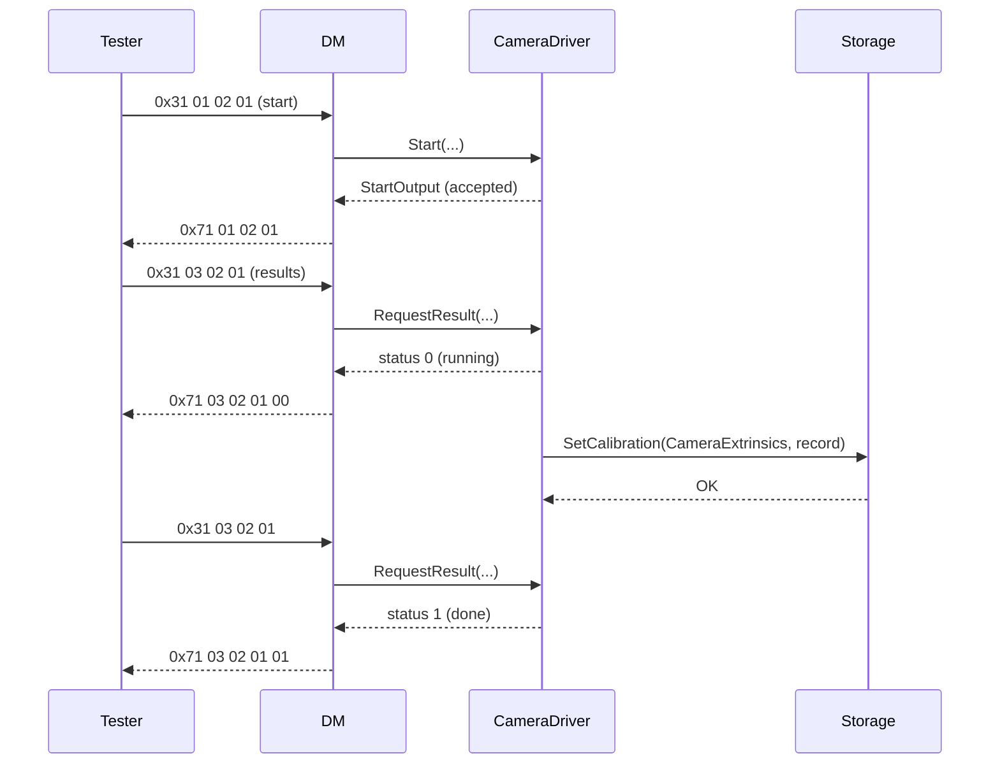

The code is in [Section 15.10](#1510-complete-example-cameradriver-provides-calibratecamera). If the tester disconnects during the measurement, the cancellation notifier stops it, and no calibration is stored.

> **Key takeaways**
>
> - DM checks routine ID, session, security level and sub-function before calling the application.
> - Typed routine classes use C++ arguments; `GenericRoutine` uses bytes; both are mapped with `DiagnosticServiceGenericMapping`.
> - Long routines either keep the request open with response pending, or run asynchronously with requestRoutineResults.
> - Routines must react to cancellation.

---

## 12. ECU Reset, Communication Control and Custom Services

> **Why this matters:** An ECU reset by diagnostics must not simply kill the machine: State Management must shut down processes in order, and the tester expects a response at the right moment. CommunicationControl and custom services are further externally processed services that applications implement.

### 12.1 ECUReset on AP: Reset of a Diagnostic Address Entity

On the Adaptive Platform, an "ECU reset" does not necessarily reset the whole machine. It is interpreted in the context of the diagnostic address it targets, for example a platform or an application Software Cluster; the name was kept because it is well known (SWS, Section 7.3.2.8.5). DM supports the default sub-functions of ISO 14229-1 and custom ones from `DiagnosticEcuReset.customSubFunctionNumber`; others get `0x12` ([SWS_DM_00234], [SWS_DM_00269]).

### 12.2 `EcuResetRequest`: RequestReset, ExecuteReset, Responding Before or After the Reset

An application implements `ara::diag::EcuResetRequest` on a port typed by `DiagnosticEcuResetInterface`, mapped with `DiagnosticServiceGenericMapping` ([SWS_DM_01009], [TPS_MANI_01453]). DM calls it in two steps:

1. `RequestReset(resetType, id, metaInfo, cancellationHandler)` asks whether the reset is possible. `resetType` is `kSoftReset` (0), `kHardReset` (1), `kKeyOffOnReset` (2) or `kCustomReset` (3), with `id` for custom resets ([SWS_DM_01013], [SWS_DM_01283] to [SWS_DM_01286]). An error becomes the NRC. Once the reset is accepted, the Diagnostic Server instance ignores further requests ([SWS_DM_01022]).
2. `ExecuteReset(metaInfo)` performs it ([SWS_DM_01014]).

When the positive response is sent depends on `DiagnosticEcuResetClass.respondToReset`:

| `respondToReset` | Sequence | Spec |
| --- | --- | --- |
| absent or `respondBeforeReset` | RequestReset OK → positive response → ExecuteReset; errors of ExecuteReset have no effect | [SWS_DM_00268], [SWS_DM_01023] |
| `respondAfterReset` | RequestReset OK → ExecuteReset → after the restart, when the transport reports the channel back (`NotifyReestablishment`), positive response | [SWS_DM_01090], [SWS_DM_00360] |

If ExecuteReset fails and no final response was sent yet, DM sends the returned NRC, or `0x10` for an unspecified error ([SWS_DM_01346], [SWS_DM_01347]). When the future of ExecuteReset completes, DM accepts requests again ([SWS_DM_01309]); this matters for resets that do not restart DM itself.

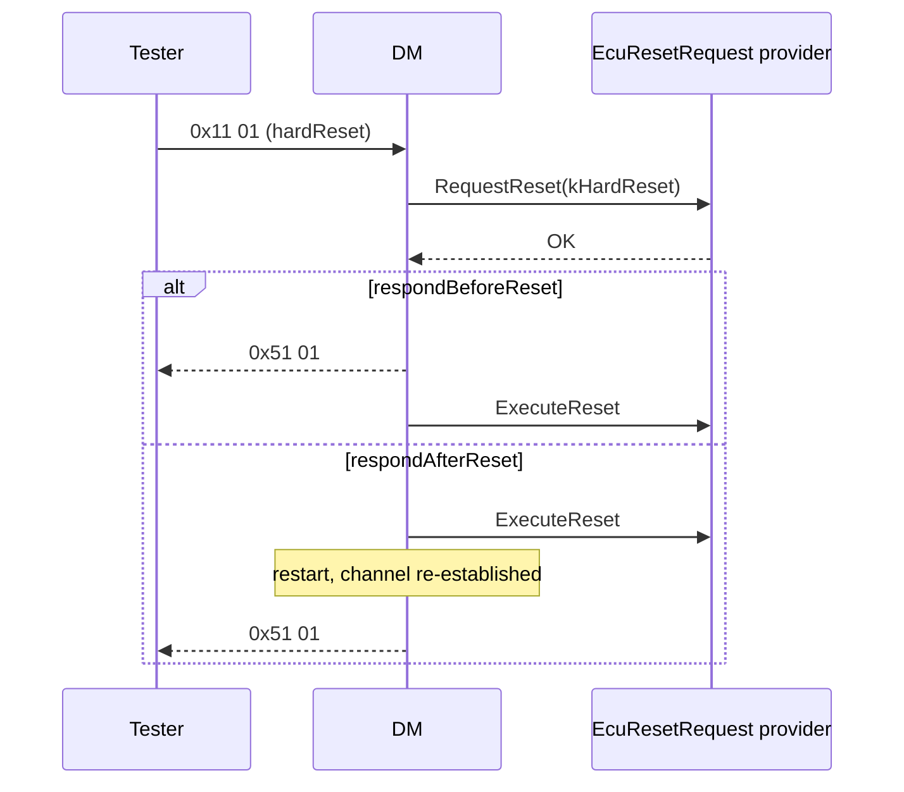

### 12.3 Rapid Power Shutdown

The sub-functions enableRapidPowerShutdown and disableRapidPowerShutdown are forwarded to `EnableRapidShutdown(true or false, ...)` ([SWS_DM_01020], [SWS_DM_01021]). The positive response of enable contains `SoftwareClusterDiagnosticDeploymentProps.powerDownTime` ([SWS_DM_01092]).

### 12.4 CommunicationControl (0x28)

CommunicationControl switches the transmission or reception of normal or network-management messages on or off, for example during reprogramming. DM checks the sub-function against `DiagnosticComControl.category` (`0x12` otherwise) and calls `ara::diag::CommunicationControl::CommCtrlRequest` with the `controlType`, `communicationType` and `nodeIdentificationNumber` of the request ([SWS_DM_00252], [SWS_DM_00865], [SWS_DM_00805]). An NRC from the application becomes the negative response; otherwise DM answers positively ([SWS_DM_00866], [SWS_DM_00199]). What "switching off communication" means on an AP machine is the application's decision. `HPC` does not support CommunicationControl ([guide 05, Section 11.2](05_StateManagement.md#112-diagnostics-ecu-reset-and-communication-control)).

### 12.5 Custom Services with `GenericUDSService`

DM supports custom diagnostic services ([SWS_DM_00502], [SWS_DM_00983]). An application implements `ara::diag::GenericUDSService::HandleMessage(sid, requestData, metaInfo, cancellationHandler)` and returns the response bytes in `OperationOutput::responseData`, or an NRC ([SWS_DM_00618]). The service is mapped with `DiagnosticServiceGenericMapping`. This is the only way to offer a UDS service that DM does not implement, such as an OEM-specific service; DM's own checks of session, security and authentication still apply to the configured service instance.

> **Pitfall:** `GenericUDSService` is not a back door for `0x2F` InputOutputControlByIdentifier: DM does not implement that service, and whether a custom service instance may use a standardized SID is not specified. Model actuator tests as routines instead.

### 12.6 Worked Example: ECU Reset Through `SmControl`

`SmControl` implements `EcuResetRequest` on `EcuResetPort` ([guide 05, Section 11.2](05_StateManagement.md#112-diagnostics-ecu-reset-and-communication-control)). The DEXT configures hardReset and softReset with `respondBeforeReset`. Both restart the machine through `HpcController`; a project could map softReset to a restart of `AdasCluster` only.

```cpp
// SmControl: ECU reset handler (illustrative; RequestTransition and the request IDs are from guide 05).
#include "ara/diag/ecu_reset_request.h"

namespace hpc::smcontrol {

class EcuReset final : public ara::diag::EcuResetRequest {
public:
    EcuReset(const ara::core::InstanceSpecifier& spec, ControllerClient& controller)
        : ara::diag::EcuResetRequest(spec), controller_(controller) {}

    ara::core::Future<void> RequestReset(ara::diag::ResetRequestType type,
                                         ara::core::Optional<std::uint8_t> /*id*/,
                                         const ara::diag::MetaInfo& /*metaInfo*/,
                                         ara::diag::CancellationHandler /*handler*/) noexcept override {
        ara::core::Promise<void> promise;
        if (type != ara::diag::kHardReset && type != ara::diag::kSoftReset) {
            promise.SetError(ara::diag::MakeErrorCode(ara::diag::DiagUdsNrcErrc::kSubFunctionNotSupported, 0));
        } else if (!VehicleStandsStill() || controller_.UpdateSessionActive()) {
            promise.SetError(ara::diag::MakeErrorCode(ara::diag::DiagUdsNrcErrc::kConditionsNotCorrect, 0));
        } else {
            promise.set_value();   // accepted: DM sends 0x51 xx, then calls ExecuteReset
        }
        return promise.get_future();
    }

    ara::core::Future<void> ExecuteReset(const ara::diag::MetaInfo& /*metaInfo*/) noexcept override {
        ara::core::Promise<void> promise;
        controller_.RequestTransition(kResetRequest);  // request ID 3 of HpcController -> MachineFG.Restart
        promise.set_value();
        return promise.get_future();
    }

    ara::core::Future<void> EnableRapidShutdown(bool, const ara::diag::MetaInfo&,
                                                ara::diag::CancellationHandler) noexcept override {
        ara::core::Promise<void> promise;   // not configured in HPC; DM answers 0x12 before calling this
        promise.SetError(ara::diag::MakeErrorCode(ara::diag::DiagUdsNrcErrc::kSubFunctionNotSupported, 0));
        return promise.get_future();
    }

private:
    ControllerClient& controller_;
};

}  // namespace hpc::smcontrol
```

`RequestReset` refuses the reset while the vehicle moves or an update session is active; guide 05 recommends the latter, because the Controller then answers `kUpdateInProgress` ([guide 05, Section 9.3](05_StateManagement.md#93-impactedbyupdate)). Because the response is sent before the reset, the tester sees `0x51 01` and then loses the DoIP connection while the machine restarts.

### 12.7 Worked Example: `DegradeAdas`

Guide 05 left the diagnostic trigger for `ADAS.Degraded` to this guide. It is the routine `0x0202` `DegradeAdas` (extended session, `Level1`, start only), provided by `SmControl` on `DegradeAdasPort`. Its `Start` sends the request `Degrade` (10) to `AdasAgent`, which switches `ADAS` to `Degraded` ([guide 05, Section 7.6](05_StateManagement.md#76-worked-example-hpccontroller-and-adasagent)). The future completes when State Management has accepted the request; the transition itself is reported by `AdasStatusService`. A workshop uses it to test the degraded mode without unplugging the camera.

> **Key takeaways**
>
> - ECUReset targets a diagnostic address entity; the application decides what is reset.
> - DM calls `RequestReset`, responds before or after the reset per `respondToReset`, and calls `ExecuteReset`.
> - CommunicationControl and custom services are implemented by applications through `CommunicationControl` and `GenericUDSService`.
> - In `HPC`, `SmControl` turns diagnostic resets and `DegradeAdas` into State Management requests.

---

## 13. Life Cycle, Offering and Concurrency of `ara::diag` Objects

> **Why this matters:** DM and the applications start, stop and crash independently. The rules for offering, the information in `MetaInfo`, concurrency and caching decide whether a diagnostic function works reliably across these events.

### 13.1 Offer, StopOffer and NRC 0x94

Every provider class has `Offer()` and `StopOffer()`. `Offer()` enables DM to forward requests to the object; a second `Offer()` fails with `DiagOfferErrc::kAlreadyOffered` ([SWS_DM_00599], [SWS_DM_00559]). The constructor checks the `InstanceSpecifier`: if it cannot be resolved to a port, if the port is not referenced by a matching diagnostic mapping, or if the mapping's process does not match the running process, the result is a violation (`InstanceSpecifierMappingIntegrityViolation`, `PortInterfaceMappingViolation`, `ProcessMappingViolation`; API table of [SWS_DM_00585]). While a needed provider is not offered, DM answers `0x94` ([SWS_DM_01257]). A provider should call `StopOffer()` before it is destroyed and before its process terminates.

### 13.2 `MetaInfo`: Who Is Asking

Every call from DM to an application carries an `ara::diag::MetaInfo` ([SWS_DM_00971]). `GetContext()` returns `kDiagnosticCommunication`, `kFaultMemory`, `kDoIP` or `kSovd`, and `GetValue(key)` returns an optional string ([SWS_DM_00978], [SWS_DM_00979]). For UDS requests, DM provides (SWS, Table 7.1; [SWS_DM_02094] to [SWS_DM_02103]):

| Key | Content | Format |
| --- | --- | --- |
| `kSA`, `kTA` | Source and target address | four hex digits, for example `"0E80"` |
| `kTAType` | Addressing | `"PHYS"` or `"FUNC"` |
| `kRequestHandle` | Same for all calls of one request, for example `Validate` and `Confirmation` | decimal |
| `kLocalIP`, `kLocalPort`, `kRemoteIP`, `kRemotePort` | Network endpoints | IPv4 or IPv6 text, decimal port |

The object is valid only during the call; storing it is undefined behavior ([SWS_DM_01345]). Copy the values you need.

### 13.3 Concurrency Types and Re-entrancy

Constructors of provider classes take a `ConcurrencyType` (`kConcurrent` or `kNotConcurrent`), DID classes a `DataIdentifierConcurrencyType` with separate values for read, write and read-write ([SWS_DM_00935], [SWS_DM_00936]). It describes the application's implementation, not a wish: `kConcurrent` promises that the methods can run in parallel for different testers ([Section 6.5](#65-pseudo-parallel-processing-and-re-entrant-applications)). The thread safety of DM's own API functions is stated in their tables, and for some APIs it is not defined yet (SWS, Section 4.1.5).

### 13.4 Caching of Calls While DM Is Unavailable

An application may call `ara::diag` methods while DM is not yet started or temporarily unreachable. For calls outside service processing, such as reporting monitor results or condition states, the `ara::diag` library caches the information and forwards it once DM is available. Methods that list `kServiceNotAvailable` as a possible error do not cache; they fail instead (SWS, Section 7.3.1.3). Most of these methods belong to the event part (guide 12b).

### 13.5 DM Startup, Shutdown and Crash

The startup procedure of DM is vendor-specific. At the latest when it is needed, DM restores persisted data, such as defined dynamic DIDs and event status ([SWS_DM_01571]). On `SIGTERM`, DM shuts down gracefully: it stops all transport handlers and persists its data ([SWS_DM_01572] to [SWS_DM_01574]). If the DM daemon crashes, it is restarted "silently", so that applications keep running; the caching above lets them re-synchronize (SWS, Section 7.4.3). In an orchestrated shutdown, applications that interact with DM are expected to be stopped before DM.

> **Key takeaways**
>
> - Offer only when ready; not offered means `0x94` for the tester.
> - A wrong specifier or mapping is a violation at construction time.
> - `MetaInfo` tells who asks and how; it is valid only during the call.
> - `kConcurrent` is a promise about your code.
> - The `ara::diag` library caches reports while DM is unavailable.

---

## 14. Configuration Reference: What to Configure

> **Why this matters:** Many diagnostic integration problems are configuration problems: a DID without a service instance, a routine without a mapping, a missing access permission, a DoIP default that does not fit the tester. This chapter lists what DM reads, what each setting means and what happens at run time.

The diagnostic configuration is part of the DEXT (CP TPS) and of the TPS Manifest. The tables give the attributes that diagnostic communication uses; fault-memory and SOVD attributes are in [guide 12b, Chapter 14](12b_Diagnostics.md#14-configuration-reference-what-to-configure). "Default" names a value only where the SWS specifies it; otherwise it says "not specified".

### 14.1 Minimal Configuration

For `HPC` to answer `0x22 01 01`:

1. **Contribution set** (DEXT, mandatory): a `DiagnosticContributionSet` with `commonProperties` and the physical address `0x1010` as a `SoftwareClusterUdsDiagnosticAddress` ([Section 14.2](#142-diagnosticcontributionset-diagnosticcommonprops-and-the-diagnostic-address)).
2. **Software Cluster** (mandatory): `SoftwareClusterDiagnosticDeploymentProps.diagnosticExtract` references the contribution set ([Section 14.13](#1413-software-cluster-diagnostic-properties)).
3. **Session** (mandatory): at least `DefaultSession` with `id` 1 and a DiagnosticSessionControl service instance ([Section 14.4](#144-diagnosticsession-and-diagnosticsessioncontrolclass)).
4. **DID** (mandatory): a `DiagnosticDataIdentifier` with `id` `0x0101`, one parameter and data element ([Section 14.7](#147-diagnosticdataidentifier-diagnosticparameter-diagnosticdataelement-and-the-did-services)).
5. **Service instance** (mandatory): a `DiagnosticReadDataByIdentifier` that references the DID, with an access permission ([Sections 14.3](#143-service-tables-and-service-instances), [14.6](#146-diagnosticaccesspermission-and-environmental-conditions)).
6. **Port** (mandatory): a P-port of `FusionSwc` typed by a `DiagnosticDataIdentifierInterface` ([Section 14.10](#1410-diagnostic-port-interfaces)).
7. **Mapping** (mandatory): a `DiagnosticDataPortMapping` from the DID to the port and to the process design of `Fusion` ([Section 14.11](#1411-diagnostic-mappings-ports-and-processes)).
8. **DoIP** (mandatory for Ethernet testers): `DoIpFunctionalClusterDesign`, a network configuration and a `DoIpInstantiation` ([Section 14.12](#1412-doip-configuration)).

### 14.2 DiagnosticContributionSet, DiagnosticCommonProps and the Diagnostic Address

**Purpose:** the unit of diagnostic configuration for one Diagnostic Server instance. **Lives in:** DEXT, with AP extensions in the TPS Manifest (Section 5.1). **Configured by:** diagnostic author, integrator.

| Element.attribute | Meaning | Type and values | Mult. | Default | Rules | Effect at run time |
| --- | --- | --- | --- | --- | --- | --- |
| `DiagnosticContributionSet.serviceTable` | The service tables of this contribution | ref `DiagnosticServiceTable` | `*` | – | – | Services of the server |
| `DiagnosticContributionSet.commonProperties` | Properties shared by the whole contribution | `DiagnosticCommonProps` | `0..1` | – | – | See below |
| `DiagnosticCommonProps.diagnosticAddress` | Diagnostic addresses of the server | `SoftwareClusterUdsDiagnosticAddress` (`diagnosticAddress`, `addressSemantics` `physicalAddress` or `functionalAddress`) | `*` | not specified | One physical address per common props ([constr_10487]); `addressSemantics` shall exist ([constr_10236]) | Dispatching ([SWS_DM_00390], [SWS_DM_00391]) |
| `DiagnosticCommonProps.defaultEndianness` | Byte order of data elements without their own | `ByteOrderEnum` | `0..1` | not specified | – | Serialization ([SWS_DM_01759]) |
| `DiagnosticCommonProps.maxNumberOfRequestCorrectlyReceivedResponsePending` | Maximum number of `0x78` before giving up | `PositiveInteger` | `0..1` | not specified | – | Then `0x10` ([SWS_DM_00369]) |
| `DiagnosticCommonProps.responseOnSecondDeclinedRequest` | Answer refused requests with `0x21` or not at all | `Boolean` | `0..1` | not specified | – | [SWS_DM_00049], [SWS_DM_00290] |
| `DiagnosticCommonProps.authenticationTimeout` | Inactivity before deauthentication | `TimeValue` | `0..1` | not specified | – | [SWS_DM_01210] |
| `DiagnosticCommonProps.externalAuthentication` | Testers (address or range) with a `ClientAuthentication` | `DiagnosticExternalAuthenticationIdentification` | `*` | – | – | [Section 9.2](#92-roles-and-authentication-state-per-client) |

### 14.3 Service Tables and Service Instances

A `DiagnosticServiceTable` collects `DiagnosticServiceInstance`s, each one a supported service. Every service instance has an optional `accessPermission` and a `serviceClass` that holds settings shared by all instances of that service (DEXT).

| Service | Service instance | Class (shared settings) | Identifiers |
| --- | --- | --- | --- |
| `0x10` | `DiagnosticSessionControl` (`diagnosticSession`) | `DiagnosticSessionControlClass` (`s3ServerTimeout`) | – |
| `0x11` | `DiagnosticEcuReset` (`category`, `customSubFunctionNumber`) | `DiagnosticEcuResetClass` (`respondToReset`) | – |
| `0x22`, `0x2E` | `DiagnosticReadDataByIdentifier`, `DiagnosticWriteDataByIdentifier` (`dataIdentifier`) | `DiagnosticReadDataByIdentifierClass` (`maxDidToRead`) | one DID per instance |
| `0x27` | `DiagnosticSecurityAccess` (`requestSeedId`, `securityLevel`, `securityDelayTimeOnBoot`) | `DiagnosticSecurityAccessClass` (shared timer, [SWS_DM_00480]) | one level per instance |
| `0x28` | `DiagnosticComControl` (`category`, `customSubFunctionNumber`) | `DiagnosticComControlClass` | – |
| `0x29` | `DiagnosticAuthentication` with sub-function elements | `DiagnosticAuthenticationClass` | – |
| `0x2A`, `0x2C` | `DiagnosticReadDataByPeriodicID`, `DiagnosticDynamicallyDefineDataIdentifier` | their classes (`configurationHandling`, `checkPerSourceId`, ...) | – |
| `0x31` | `DiagnosticRoutineControl` (`routine`) | `DiagnosticRoutineControlClass` | one routine per instance |
| `0x3E` | `DiagnosticTesterPresent` | – | – |

A service without a service instance is not supported (`0x11`, [SWS_DM_00099]); a DID or routine without a service instance does not exist for the tester.

### 14.4 DiagnosticSession and DiagnosticSessionControlClass

| Attribute | Meaning | Type | Mult. | Default | Rules | Effect at run time |
| --- | --- | --- | --- | --- | --- | --- |
| `DiagnosticSession.id` | Session number used in `0x10` | `PositiveInteger` | `0..1` | not specified | – | [SWS_DM_00227] |
| `DiagnosticSession.p2ServerMax` | Time to the first response | `TimeValue` | `0..1` | not specified | – | First `0x78` ([SWS_DM_00368]) |
| `DiagnosticSession.p2StarServerMax` | Time between `0x78` messages | `TimeValue` | `0..1` | not specified | – | [SWS_DM_00368] |
| `DiagnosticSessionControlClass.s3ServerTimeout` | Session timeout | `TimeValue` | `0..1` | 5000 ms ([SWS_DM_01747]) | – | Fallback to default session ([SWS_DM_00381]) |

### 14.5 DiagnosticSecurityLevel and DiagnosticSecurityAccess

| Attribute | Meaning | Type | Mult. | Default | Effect at run time |
| --- | --- | --- | --- | --- | --- |
| `DiagnosticSecurityLevel.seedSize`, `keySize` | Lengths of seed and key | `PositiveInteger` | `0..1` | not specified | Length checks |
| `DiagnosticSecurityLevel.accessDataRecordSize` | Extra bytes allowed in requestSeed | `PositiveInteger` | `0..1` | 0 extra bytes if absent ([SWS_DM_00507]) | `0x13` on mismatch |
| `DiagnosticSecurityLevel.numFailedSecurityAccess` | Failed attempts before the delay | `PositiveInteger` | `0..1` | not specified | `0x35`, then `0x36` ([SWS_DM_00271]) |
| `DiagnosticSecurityLevel.securityDelayTime` | Delay after too many failures | `TimeValue` | `0..1` | not specified | `0x37` ([SWS_DM_00272]) |
| `DiagnosticSecurityAccess.requestSeedId` | Odd sub-function of requestSeed | `PositiveInteger` | `0..1` | not specified | sendKey = requestSeedId + 1 ([SWS_DM_00863], [SWS_DM_00864]) |
| `DiagnosticSecurityAccess.securityLevel` | Level unlocked by this access type | ref | `0..1` | – | [SWS_DM_00846] |
| `DiagnosticSecurityAccess.securityDelayTimeOnBoot` | Delay after power-up | `TimeValue` | `0..1` | not specified | [SWS_DM_01758], [SWS_DM_00479] |

The provider is mapped with a `DiagnosticSecurityLevelPortMapping` (`securityLevel`, P-port, process) (TPS Manifest, Section 5.2.3.1).

### 14.6 DiagnosticAccessPermission and Environmental Conditions

| Attribute | Meaning | Type | Mult. | Effect at run time |
| --- | --- | --- | --- | --- |
| `diagnosticSession` | Sessions in which access is allowed | ref `DiagnosticSession` | `*` | `0x7F`, `0x7E`, `0x31` ([SWS_DM_00101], [SWS_DM_00102], [SWS_DM_00413]); none = no check ([SWS_DM_01951]) |
| `securityLevel` | Levels at which access is allowed | ref `DiagnosticSecurityLevel` | `*` | `0x33` ([SWS_DM_00103]); none = no check ([SWS_DM_01952]) |
| `environmentalCondition` | Vehicle-state condition | ref `DiagnosticEnvironmentalCondition` | `0..1` | Formula; `nrcValue` or `0x22` ([SWS_DM_00289]) |
| `authenticationEnabled` (with `DiagnosticAuthRoleProxy.authenticationRole`) | Roles that may access | aggr | `0..1` | `0x34` ([SWS_DM_01223], [SWS_DM_01225]); absent = no check ([SWS_DM_01739]) |

A `DiagnosticAuthRole` has `isDefault` (default role of deauthenticated clients, [SWS_DM_01204]) and `bitPosition`.

### 14.7 DiagnosticDataIdentifier, DiagnosticParameter, DiagnosticDataElement and the DID Services

| Attribute | Meaning | Type | Mult. | Rules | Effect at run time |
| --- | --- | --- | --- | --- | --- |
| `DiagnosticDataIdentifier.id` | The DID | `PositiveInteger` | `0..1` | – | [SWS_DM_00409] |
| `DiagnosticDataIdentifier.dataElement` | The parameters with their data elements and bit offsets | `DiagnosticParameter` | `*` | – | Serialization |
| `DiagnosticDataIdentifier.didSize` | Size of the DID in bytes | `PositiveInteger` | `0..1` | – | Length handling |
| `DiagnosticDataIdentifier.representsVin` | This DID is the VIN | `Boolean` | `0..1` | 17-byte array, one parameter ([SWS_DM_CONSTR_00206]) | DoIP ([SWS_DM_00855]) |
| `DiagnosticDataElement` base type and byte order | Representation on the wire | `SwDataDefProps` | – | – | [SWS_DM_01759] |
| `DiagnosticReadDataByIdentifierClass.maxDidToRead` | DIDs per request | `PositiveInteger` | `0..1` | – | `0x13` ([SWS_DM_00412]) |

### 14.8 DiagnosticRoutine and DiagnosticRoutineControl

| Attribute | Meaning | Type | Mult. | Effect at run time |
| --- | --- | --- | --- | --- |
| `DiagnosticRoutine.id` | Routine identifier | `PositiveInteger` | `0..1` | `0x31` if unknown ([SWS_DM_00202]) |
| `DiagnosticRoutine.start`, `stop`, `requestResult` | Sub-functions with request and response parameters | `DiagnosticStartRoutine` etc. | `0..1` each | `0x12` if missing ([SWS_DM_00203]) |
| `DiagnosticRoutine.routineInfo` | Routine info byte of the response | `PositiveInteger` | `0..1` | ISO 14229-1 |
| `DiagnosticRoutineControl.routine` | The routine served by this instance | ref | `0..1` | – |

### 14.9 ECU Reset and Communication Control Classes

| Attribute | Meaning | Type and values | Mult. | Default | Effect at run time |
| --- | --- | --- | --- | --- | --- |
| `DiagnosticEcuResetClass.respondToReset` | Response before or after the reset | `respondBeforeReset`, `respondAfterReset` | `0..1` | before, if absent ([SWS_DM_00268]) | [Section 12.2](#122-ecuresetrequest-requestreset-executereset-responding-before-or-after-the-reset) |
| `DiagnosticEcuReset.category` | The sub-function | `HARD_RESET`, `KEY_OFF_ON_RESET`, `SOFT_RESET`, `ENABLE_RAPID_POWER_SHUT_DOWN`, `DISABLE_RAPID_POWER_SHUT_DOWN`, or a custom value with prefix | – | – | [TPS_DEXT_01056], [TPS_DEXT_01020] |
| `DiagnosticEcuReset.customSubFunctionNumber` | Number of a custom sub-function | `PositiveInteger` | `0..1` | – | Only for custom categories ([constr_1331]); `kCustomReset` with `id` |
| `DiagnosticComControl.category` | Supported control type | – | – | – | `0x12` if not configured ([SWS_DM_00252]) |

### 14.10 Diagnostic Port Interfaces

All diagnostic port interfaces are subclasses of `DiagnosticPortInterface` (TPS Manifest, Section 4.9; [TPS_MANI_01242]). Those of this guide are used on **P-ports**: the application provides the function.

| Port interface | Content | Constraints | API class |
| --- | --- | --- | --- |
| `DiagnosticDataIdentifierInterface` | Operations `read` (mandatory) and `write` | [constr_10030], [constr_1697] (read and write have matching arguments, out and in) | typed DID class |
| `DiagnosticDataIdentifierGenericInterface` | – (bytes) | – | `GenericDataIdentifier` |
| `DiagnosticDataElementInterface` | Operation `read` | – | typed data-element class |
| `DiagnosticRoutineInterface` | Operations `start` (mandatory), `stop`, `requestResult` | [constr_10031], [constr_1696] | typed routine class |
| `DiagnosticRoutineGenericInterface` | – (bytes) | – | `GenericRoutine` |
| `DiagnosticSecurityLevelInterface` | – | – | `SecurityAccess` |
| `DiagnosticServiceValidationInterface` | – | – | `ServiceValidation` |
| `DiagnosticGenericUdsInterface` | – | – | `GenericUDSService` |
| `DiagnosticEcuResetInterface` | – | – | `EcuResetRequest` |
| `DiagnosticComControlInterface` | – | – | `CommunicationControl` |
| `DiagnosticAuthenticationInterface`, `DiagnosticTransmitCertificateInterface`, `DiagnosticExternalAuthenticationInterface` | – | – | `Authentication`, `TransmitCertificate`, `ExternalAuthentication` |
| `DiagnosticDoIPPowerModeInterface`, `...EntityIdentificationInterface`, `...GroupIdentificationInterface`, `...ActivationLineInterface`, `...TriggerVehicleAnnouncementInterface` | – | – | DoIP classes |

The namespace of a generated typed class comes from the interface's `namespace` symbol props, and its header path from the namespaces and the short name ([SWS_DM_80011], [SWS_DM_80012]).

### 14.11 Diagnostic Mappings: Ports and Processes

Diagnostic mappings (subclasses of `DiagnosticSwMapping`) connect a DEXT element to a P-port of an executable (`pPortPrototypeInExecutable`, an instance reference with ≪atpUriDef≫) and to a `ProcessDesign` (`process`) (TPS Manifest, Section 5.2). The process matters because one executable can run as several processes with different diagnostic roles.

| Mapping | Connects | Used for |
| --- | --- | --- |
| `DiagnosticDataPortMapping` | `diagnosticDataIdentifier` or `diagnosticDataElement` | DIDs and data elements ([Section 10.3](#103-four-ways-to-provide-a-did)) |
| `DiagnosticServiceGenericMapping` | `diagnosticServiceInstance` | `DiagnosticEcuReset`, `DiagnosticComControl`, `DiagnosticRoutineControl`, upload, download, transfer, file transfer ([TPS_MANI_01326], [TPS_MANI_01453]); custom services |
| `DiagnosticSecurityLevelPortMapping` | `securityLevel` | `SecurityAccess` providers |
| `DiagnosticServiceValidationMapping` | – (port and process only) | Manufacturer and supplier checks; order decided by the target configuration ([TPS_MANI_01352]) |
| `DiagnosticAuthenticationPortMapping`, `DiagnosticExternalAuthenticationPortMapping` | – | Authentication providers |
| DoIP mappings (`DiagnosticDoIpPowerModePortMapping` and others) | – | DoIP providers |
| `DiagnosticProvidedDataMapping` | data element, `dataProvider` name | Internal data ([SWS_DM_01565]) |

One port and process may be referenced by at most one mapping of the listed kinds ([constr_10002]). Only the mapped process may use the port ([SWS_DM_02130]).

### 14.12 DoIP Configuration

| Element.attribute | Meaning | Type | Mult. | Default | Spec |
| --- | --- | --- | --- | --- | --- |
| `DoIpFunctionalClusterDesign.doIpProtocolVersion` | DoIP version 2, 3 or 4 | `PositiveInteger` | `0..1` | 3 | [SWS_DM_00475], [SWS_DM_01986] |
| `DoIpFunctionalClusterDesign.doIpLogicalAddress` | Logical address of the DoIP entity | `DoIpLogicalAddress` | `0..1` | not specified | – |
| `DoIpFunctionalClusterDesign.eid` | Configured EID | `PositiveUnlimitedInteger` | `0..1` | – | [SWS_DM_02006] |
| `DoIpFunctionalClusterDesign.entityStatusMaxByteFieldUse`, `maxRequestBytes` | Max data size in the entity status | `Boolean`, `PositiveInteger` | `0..1` | – | [SWS_DM_02002] |
| `DoIpNetworkConfiguration(Design).eidRetrieval` | `eidUseMac`, `eidUseConfigValue`, `eidUseApi` | enum | `0..1` | not specified | [Section 5.4](#54-vin-eid-gid-and-power-mode) |
| `.maxTesterConnections` | Parallel TCP connections | `PositiveInteger` | `0..1` | 1 (1..255) | [SWS_DM_01985], [SWS_DM_02106] |
| `.tcpInitialInactivityTime`, `.tcpGeneralInactivityTime`, `.tcpAliveCheckResponseTimeout` | TCP timers | `TimeValue` | `0..1` | 2 s, 300 s, 0.5 s | [SWS_DM_01980], [SWS_DM_01981], [SWS_DM_01984] |
| `.vehicleAnnouncementCount`, `.vehicleAnnouncementInterval`, `.maxInitialVehicleAnnouncementTime` | Announcements | – | `0..1` | 3, 0.5 s, not specified | [SWS_DM_01982], [SWS_DM_01983] |
| `.vehicleIdentificationSyncStatus` | Include VIN/GID sync status | `Boolean` | `0..1` | omitted if absent | [SWS_DM_02107] |
| `.isActivationLineDependent`, `.networkInterfaceId` | Activation line and interface | – | `0..1` | not specified | [SWS_DM_00816] |
| `DoIpNetworkConfigurationDesign.tpConnection` | Tester connections with priorities | ref `GenericTpConnection` | `*` | – | [SWS_DM_02004] |
| `GenericTpConnection.priority`, `.sourceAddressRangeStart`, `.sourceAddressRangeEnd` | Priority for a source address range | `PositiveInteger` | `0..1` | 255, 0, 65535 | [SWS_DM_02108] to [SWS_DM_02110] |
| `DoIpInstantiation.gid`, `.logicalAddress` | Machine-level GID and logical address | – | `0..1` | not specified | [SWS_DM_02009] |

### 14.13 Software Cluster Diagnostic Properties

| Attribute of `SoftwareClusterDiagnosticDeploymentProps` | Meaning | Type | Mult. | Default | Spec |
| --- | --- | --- | --- | --- | --- |
| `diagnosticExtract` | The contribution set of this Software Cluster | ref `DiagnosticContributionSet` | `0..1` | – | TPS Manifest 16.3.2.2 |
| `maxConversations` | Parallel conversations of the server | `PositiveInteger` | `0..1` | 1 | [SWS_DM_00840], [SWS_DM_02003] |
| `powerDownTime` | Power-down time in the response of enableRapidPowerShutdown (seconds) | `PositiveInteger` | `0..1` | not specified | [SWS_DM_01092] |

### 14.14 The Running Example: Complete Configuration

The DEXT and the diagnostic mappings of `HPC` are shown as a conceptual tree with the meta-class and attribute names of the specifications. All values are illustrative.

```yaml
# Conceptual view of the diagnostic configuration of HPC. NOT real ARXML syntax.
DiagnosticContributionSet HpcDiagnostics:
  commonProperties:
    diagnosticAddress:
      - SoftwareClusterUdsDiagnosticAddress: { diagnosticAddress: 0x1010, addressSemantics: physicalAddress }
      - SoftwareClusterUdsDiagnosticAddress: { diagnosticAddress: 0xE400, addressSemantics: functionalAddress }
    maxNumberOfRequestCorrectlyReceivedResponsePending: 10
    responseOnSecondDeclinedRequest: true
  serviceTable: HpcServiceTable
DiagnosticSession DefaultSession:  { id: 0x01, p2ServerMax: 0.05, p2StarServerMax: 5.0 }
DiagnosticSession ExtendedSession: { id: 0x03, p2ServerMax: 0.05, p2StarServerMax: 5.0 }
DiagnosticSecurityLevel Level1: { seedSize: 4, keySize: 4, numFailedSecurityAccess: 3, securityDelayTime: 10.0 }
DiagnosticAccessPermission AnySession:     { diagnosticSession: [DefaultSession, ExtendedSession] }
DiagnosticAccessPermission ExtendedOnly:   { diagnosticSession: [ExtendedSession] }
DiagnosticAccessPermission ExtendedLevel1: { diagnosticSession: [ExtendedSession], securityLevel: [Level1] }
DiagnosticServiceTable HpcServiceTable:
  - DiagnosticSessionControl:  { diagnosticSession: DefaultSession,  serviceClass: { s3ServerTimeout: 5.0 } }
  - DiagnosticSessionControl:  { diagnosticSession: ExtendedSession, accessPermission: AnySession }
  - DiagnosticTesterPresent:   {}
  - DiagnosticSecurityAccess:  { requestSeedId: 0x01, securityLevel: Level1, accessPermission: ExtendedOnly }
  - DiagnosticReadDataByIdentifier: { dataIdentifier: FusionSoftwareVersion, accessPermission: AnySession }
  - DiagnosticReadDataByIdentifier: { dataIdentifier: Vin, accessPermission: AnySession }
  - DiagnosticRoutineControl:  { routine: CalibrateCamera, accessPermission: ExtendedLevel1 }
  - DiagnosticRoutineControl:  { routine: DegradeAdas,     accessPermission: ExtendedLevel1 }
  - DiagnosticEcuReset:        { category: HARD_RESET, accessPermission: ExtendedLevel1, serviceClass: { respondToReset: respondBeforeReset } }
  - DiagnosticEcuReset:        { category: SOFT_RESET, accessPermission: ExtendedLevel1, serviceClass: { respondToReset: respondBeforeReset } }
DiagnosticDataIdentifier FusionSoftwareVersion: { id: 0x0101, dataElement: [ version: uint8[8], ASCII ] }
DiagnosticDataIdentifier Vin: { id: 0xF190, representsVin: true, dataElement: [ vin: uint8[17] ] }
DiagnosticRoutine CalibrateCamera: { id: 0x0201, start: {}, requestResult: { response: [ status: uint8 ] } }
DiagnosticRoutine DegradeAdas:     { id: 0x0202, start: {} }
# Diagnostic mappings (TPS Manifest): DEXT element -> P-port of an executable, process
DiagnosticDataPortMapping:         { diagnosticDataIdentifier: FusionSoftwareVersion, port: fusion/Root/SwVersionDidPort,       process: Fusion }
DiagnosticDataPortMapping:         { diagnosticDataIdentifier: Vin,                   port: sm_control/Root/VinDidPort,         process: SmControl }
DiagnosticServiceGenericMapping:   { diagnosticServiceInstance: RoutineControl CalibrateCamera, port: camera_driver/Root/CalibrateCameraPort, process: CameraDriver }
DiagnosticServiceGenericMapping:   { diagnosticServiceInstance: RoutineControl DegradeAdas,     port: sm_control/Root/DegradeAdasPort,       process: SmControl }
DiagnosticServiceGenericMapping:   { diagnosticServiceInstance: EcuReset (both),                port: sm_control/Root/EcuResetPort,          process: SmControl }
DiagnosticSecurityLevelPortMapping: { securityLevel: Level1, port: sm_control/Root/SecurityLevelPort, process: SmControl }
DiagnosticDoIpPowerModePortMapping: { port: sm_control/Root/DoIpPowerModePort, process: SmControl }
# Machine design and machine
DoIpFunctionalClusterDesign: { doIpProtocolVersion: 3 }
DoIpNetworkConfigurationDesign: { eidRetrieval: eidUseMac, maxTesterConnections: 2, tpConnection: [WorkshopTesters] }
GenericTpConnection WorkshopTesters: { sourceAddressRangeStart: 0x0E00, sourceAddressRangeEnd: 0x0EFF, priority: 10 }
DoIpInstantiation: { logicalAddress: 0x1010 }           # GID not configured
# Software Clusters: HpcPlatformCore and AdasCluster share these props
SoftwareClusterDiagnosticDeploymentProps HpcDiagProps: { diagnosticExtract: HpcDiagnostics, maxConversations: 2 }
```

| Choice | Value | Why |
| --- | --- | --- |
| One contribution set | shared by both Software Clusters | One diagnostic address for the whole machine (guide 00) |
| Sessions | default, extended | Programming session belongs to guide 13 |
| `Level1` for routines and reset | 3 attempts, 10 s | Calibration and resets change the vehicle |
| `FusionSoftwareVersion` in both sessions | no security | Version reading is harmless |
| `respondBeforeReset` | | The tester gets an answer before the connection drops |
| `maxTesterConnections`, `maxConversations` | 2 | Workshop tester plus a logger |
| `WorkshopTesters` priority 10 | | Higher than the default 255 of unknown testers |

> **Key takeaways**
>
> - A DID or routine needs four things: the DEXT element, a service instance with access permission, a P-port typed by the right interface, and a mapping to port and process.
> - Access permissions combine sessions, security levels, conditions and roles.
> - Routines, ECU reset and CommunicationControl use `DiagnosticServiceGenericMapping`; DIDs use `DiagnosticDataPortMapping`.
> - DoIP and conversation limits have specified defaults; change them deliberately.

---

## 15. API Reference and Usage Guide (ara::diag, Communication Part)

> **Why this matters:** This chapter is the compact reference of the `ara::diag` classes for diagnostic communication, with a complete provider example. All declarations follow Chapter 8 and Appendix C of the R25-11 specification; many of them are DRAFT. Generated typed classes may differ in naming between generators, so check your headers.

### 15.1 Headers, Namespaces and the Port-to-Class Binding

All standardized classes are in `ara::diag` (transport plug-ins: `apext::diag::uds_transport`). Each provider class is constructed with an `InstanceSpecifier` of a port typed by the matching port interface (SWS, Table 8.2):

| Header | Class | Port interface | Spec |
| --- | --- | --- | --- |
| generated per interface | typed DID class | `DiagnosticDataIdentifierInterface` | [SWS_DM_00601] |
| generated per interface | typed data-element class | `DiagnosticDataElementInterface` | [SWS_DM_00603] |
| generated per interface | typed routine class | `DiagnosticRoutineInterface` | [SWS_DM_00604] |
| `ara/diag/generic_data_identifier.h` | `GenericDataIdentifier` | `DiagnosticDataIdentifierGenericInterface` | [SWS_DM_00607] |
| `ara/diag/generic_routine.h` | `GenericRoutine` | `DiagnosticRoutineGenericInterface` | [SWS_DM_00605] |
| `ara/diag/generic_uds_service.h` | `GenericUDSService` | `DiagnosticGenericUdsInterface` | [SWS_DM_00602] |
| `ara/diag/security_access.h` | `SecurityAccess` | `DiagnosticSecurityLevelInterface` | [SWS_DM_00761] |
| `ara/diag/service_validation.h` | `ServiceValidation` | `DiagnosticServiceValidationInterface` | [SWS_DM_00771] |
| `ara/diag/ecu_reset_request.h` | `EcuResetRequest` | `DiagnosticEcuResetInterface` | [SWS_DM_01009] |
| `ara/diag/communication_control.h` | `CommunicationControl` | `DiagnosticComControlInterface` | [SWS_DM_00804] |
| `ara/diag/authentication.h`, `transmit_certificate.h`, `external_authentication.h` | `Authentication`, `TransmitCertificate`, `ExternalAuthentication` | authentication interfaces | [SWS_DM_01123], [SWS_DM_01961], [SWS_DM_01191] |
| `ara/diag/doip_power_mode.h` and the other `doip_*.h` | DoIP provider classes | DoIP interfaces | [SWS_DM_00731], [SWS_DM_01362], [SWS_DM_00720], [SWS_DM_00830] |
| `ara/diag/conversation.h` | `Conversation` | – | [SWS_DM_00693] |
| `ara/diag/meta_info.h`, `cancellation_handler.h` | `MetaInfo`, `CancellationHandler` | – | [SWS_DM_00971], [SWS_DM_00608] |
| `ara/diag/diag_uds_nrc_error_domain.h`, `diag_error_domain.h` | error domains | – | [SWS_DM_00526], [SWS_DM_00514] |

### 15.2 Common Patterns

All provider classes share one pattern:

1. **Derive** from the class and implement its pure virtual methods.
2. **Construct** with the `InstanceSpecifier` and, for most classes, a `ConcurrencyType`. A wrong specifier or a missing mapping is a violation ([Section 13.1](#131-offer-stopoffer-and-nrc-0x94)).
3. **Offer** with `Offer()` (`Result<void>`; `DiagOfferErrc::kAlreadyOffered`), **stop** with `StopOffer()`.
4. **Answer** with an `ara::core::Future`: a value, or an error of `DiagUdsNrcErrorDomain` that DM turns into an NRC ([SWS_DM_02060]).
5. **Respect** `MetaInfo` (valid only during the call) and the `CancellationHandler` (`IsCanceled`, `SetNotifier`).

Futures and promises are the `ara::core` types ([guide 03, Chapter 9](03_CoreAndGeneral.md#9-future-and-promise-asynchronous-results)).

### 15.3 Data Identifier Classes

| Declaration | Spec |
| --- | --- |
| `{DID interface}(ara::core::InstanceSpecifier instanceSpec, ara::diag::ConcurrencyType concurrencyType) noexcept;` | [SWS_DM_00585] |
| `virtual ara::core::Future<{...}ReadOutput> Read(const MetaInfo& metaInfo, CancellationHandler cancellationHandler) noexcept = 0;` | [SWS_DM_00640] |
| `virtual ara::core::Future<void> Write({in arguments}, const MetaInfo& metaInfo, CancellationHandler cancellationHandler) noexcept = 0;` | [SWS_DM_00598] |
| `explicit GenericDataIdentifier(const InstanceSpecifier& specifier, DataIdentifierConcurrencyType concurrencyType) noexcept;` | [SWS_DM_00634] |
| `virtual Future<OperationOutput> GenericDataIdentifier::Read(std::uint16_t dataIdentifier, const MetaInfo&, CancellationHandler) noexcept = 0;` (`OperationOutput::responseData` is a `Vector<std::uint8_t>`) | [SWS_DM_00636], [SWS_DM_00631] |
| `virtual Future<void> GenericDataIdentifier::Write(std::uint16_t dataIdentifier, Span<const std::uint8_t> requestData, const MetaInfo&, CancellationHandler) noexcept;` | [SWS_DM_00637] |

### 15.4 Routine Classes

| Declaration | Spec |
| --- | --- |
| `{routine interface}(ara::core::InstanceSpecifier instanceSpec, ara::diag::ConcurrencyType concurrencyType) noexcept;` | [SWS_DM_00589] |
| `virtual Future<{...}StartOutput> Start({in arguments}, const MetaInfo&, CancellationHandler) noexcept = 0;` | [SWS_DM_00591] |
| `virtual Future<{...}StopOutput> Stop({in arguments}, const MetaInfo&, CancellationHandler) noexcept = 0;` | [SWS_DM_00592] |
| `virtual Future<{...}RequestResultOutput> RequestResult({in arguments}, const MetaInfo&, CancellationHandler) noexcept = 0;` | [SWS_DM_00593] |
| `virtual Future<OperationOutput> GenericRoutine::Start(std::uint16_t routineId, Span<const std::uint8_t> requestData, const MetaInfo&, CancellationHandler) noexcept = 0;` and `Stop`, `RequestResults` (not pure virtual) | [SWS_DM_00554] to [SWS_DM_00556] |

### 15.5 SecurityAccess, ServiceValidation and Authentication Classes

| Declaration | Spec |
| --- | --- |
| `virtual Future<Vector<std::uint8_t>> SecurityAccess::GetSeed(Span<const std::uint8_t> securityAccessDataRecord, const MetaInfo&, CancellationHandler) noexcept = 0;` (DRAFT) | [SWS_DM_00764] |
| `virtual Future<KeyCompareResultType> SecurityAccess::CompareKey(Span<const std::uint8_t> key, const MetaInfo&, CancellationHandler) noexcept = 0;` (`kKeyValid`, `kKeyInvalid`) | [SWS_DM_00765], [SWS_DM_00760] |
| `virtual Future<void> ServiceValidation::Validate(Span<const std::uint8_t> requestData, const MetaInfo&) noexcept;` | [SWS_DM_00774] |
| `virtual void ServiceValidation::Confirmation(ConfirmationStatusType status, const MetaInfo&) noexcept;` | [SWS_DM_00775] |
| `Authentication::VerifyCertificateUnidirectional`, `VerifyCertificateBidirectional`, `VerifyOwnership` | [SWS_DM_01126] to [SWS_DM_01128] |
| `Result<ClientAuthenticationHandle> ClientAuthentication::Authenticate(Vector<DiagnosticAuthRole> userRoles)`, `GetState()`, `OverrideDefaultRoles(...)`; handle: `Append`, `Revoke`, `Refresh` | [SWS_DM_01142], [SWS_DM_01143], [SWS_DM_01141], [SWS_DM_01152], [SWS_DM_01154], [SWS_DM_01155] |

### 15.6 EcuResetRequest, CommunicationControl, GenericUDSService and Conversation

| Declaration | Spec |
| --- | --- |
| `explicit EcuResetRequest(const InstanceSpecifier& specifier) noexcept;` | [SWS_DM_01010] |
| `virtual Future<void> RequestReset(ResetRequestType resetType, Optional<std::uint8_t> id, const MetaInfo&, CancellationHandler) noexcept = 0;` | [SWS_DM_01013] |
| `virtual Future<void> ExecuteReset(const MetaInfo&) noexcept = 0;` | [SWS_DM_01014] |
| `virtual Future<void> EnableRapidShutdown(bool enable, const MetaInfo&, CancellationHandler) noexcept = 0;` | [SWS_DM_01012] |
| `using ResetRequestType = std::uint8_t;` with `kSoftReset` 0, `kHardReset` 1, `kKeyOffOnReset` 2, `kCustomReset` 3 | [SWS_DM_01007], [SWS_DM_01283] to [SWS_DM_01286] |
| `virtual Future<void> CommunicationControl::CommCtrlRequest(ComCtrlRequestParamsType controlType, const MetaInfo&, CancellationHandler) noexcept = 0;` | [SWS_DM_00808] |
| `virtual Future<OperationOutput> GenericUDSService::HandleMessage(std::uint8_t sid, Span<const std::uint8_t> requestData, const MetaInfo&, CancellationHandler) noexcept = 0;` | [SWS_DM_00618] |
| `Conversation` functions | [Section 6.6](#66-the-conversation-class) |

### 15.7 DoIP Provider Classes

| Class | Method | Spec |
| --- | --- | --- |
| `DoIPPowerMode` | `virtual Future<PowerModeType> GetDoIPPowerMode() noexcept = 0;` | [SWS_DM_00734] |
| `DoIPEntityIdentification` | `GetEntityId` | [SWS_DM_01361], [SWS_DM_01362] |
| `DoIPGroupIdentification` | `GetGidStatus` (returns `GidStatus`) | [SWS_DM_00720], [SWS_DM_00721] |
| `DoIPActivationLine` | Reports the activation line state | [SWS_DM_00830] |
| `DoIPTriggerVehicleAnnouncement` | `TriggerVehicleAnnouncement` (not for explicit use by applications, SWS 7.1.2) | [SWS_DM_00815] |

### 15.8 Error Domains

| Domain | Enumeration | Used for | Spec |
| --- | --- | --- | --- |
| `DiagUdsNrcErrorDomain` | `DiagUdsNrcErrc`: the ISO 14229-1 NRCs, for example `kGeneralReject` `0x10`, `kServiceNotSupported` `0x11`, `kSubFunctionNotSupported` `0x12`, `kIncorrectMessageLengthOrInvalidFormat` `0x13`, `kBusyRepeatRequest` `0x21`, `kConditionsNotCorrect` `0x22`, `kRequestSequenceError` `0x24`, `kRequestOutOfRange` `0x31`, `kSecurityAccessDenied` `0x33`, `kAuthenticationRequired` `0x34`, `kInvalidKey` `0x35`, `kRequestCorrectlyReceivedResponsePending` `0x78`, `kResourceTemporarilyNotAvailable` `0x94` | Negative responses from applications | [SWS_DM_00526], [SWS_DM_00536], [SWS_DM_00537] |
| `DiagOfferErrorDomain` | `DiagOfferErrc`: `kAlreadyOffered` 101, `kConfigurationMismatch` 102, `kDebouncingConfigurationInconsistent` 103 | `Offer()` | [SWS_DM_00559] |
| `DiagErrorDomain` | `DiagErrc`: 101 to 118, for example `kNotOffered` 106, `kBusy` 109, `kServiceNotAvailable` 118 | Other `ara::diag` calls | [SWS_DM_00514] |
| `DiagReportingErrorDomain` | `DiagReportingErrc` | Event reporting ([guide 12b](12b_Diagnostics.md#1511-error-codes)) | [SWS_DM_00560] |

### 15.9 The UDS Transport Layer Interface for Platform Developers

A transport plug-in derives from `apext::diag::uds_transport::UdsTransportProtocolHandler` (SWS, Appendix C):

| Handler method | Purpose | Spec |
| --- | --- | --- |
| `UdsTransportProtocolHandler(UdsTransportProtocolHandlerID handlerId, UdsTransportProtocolMgr& transportProtocolMgr)` | Construction by DM | [SWS_DM_09015] |
| `virtual InitializationResult Initialize() noexcept = 0;` | `kInitializeOk` or `kInitializeFailed` | [SWS_DM_00319], [SWS_DM_09017] |
| `virtual void Start() noexcept = 0;`, `virtual void Stop() noexcept = 0;` | Life cycle | [SWS_DM_00322], [SWS_DM_00323] |
| `virtual void Transmit(UdsMessageConstPtr message, ChannelID channelId) noexcept = 0;` | Send a response | [SWS_DM_00327] |
| `virtual bool NotifyReestablishment(ChannelID channelId) noexcept = 0;` | Report a channel after restart | [SWS_DM_00326] |
| `GetPeriodicHandler()` | Optional periodic transmission for `0x2A` | [SWS_DM_01068] |

The manager (`UdsTransportProtocolMgr`, provided by DM) offers `IndicateMessage`, `HandleMessage`, `NotifyMessageFailure`, `TransmitConfirmation`, `ChannelReestablished` and `HandlerStopped` ([SWS_DM_00309] to [SWS_DM_00314]). Messages are `UdsMessage` objects with source and target address, address type and payload ([SWS_DM_00291]).

### 15.10 Complete Example: `CameraDriver` Provides `CalibrateCamera`

`CameraDriver` implements the typed routine interface `CalibrateCameraRoutine` (namespace `hpc::camera`): `Start` without arguments, `RequestResult` with the out argument `status`. The measurement runs on a worker thread; cancellation stops it.

```cpp
// CameraDriver: routine 0x0201 CalibrateCamera (illustrative; generated names are generator-specific).
#include "hpc/camera/calibratecameraroutine.h"   // generated from the port interface
#include <atomic>
#include <optional>
#include <thread>

namespace hpc::camera {

class CalibrateCamera final : public CalibrateCameraRoutine {
public:
    CalibrateCamera(ara::core::InstanceSpecifier spec, Calibrator& calibrator)
        : CalibrateCameraRoutine(std::move(spec), ara::diag::ConcurrencyType::kNotConcurrent),
          calibrator_(calibrator) {}
    ~CalibrateCamera() { StopOffer(); Join(); }

    ara::core::Future<CalibrateCameraRoutineStartOutput> Start(
            const ara::diag::MetaInfo& /*metaInfo*/,
            ara::diag::CancellationHandler cancellationHandler) noexcept override {
        ara::core::Promise<CalibrateCameraRoutineStartOutput> promise;
        if (state_ == kRunning) {
            promise.SetError(ara::diag::MakeErrorCode(ara::diag::DiagUdsNrcErrc::kRequestSequenceError, 0));
            return promise.get_future();
        }
        Join();
        cancel_ = false;
        cancellationHandler.SetNotifier([this] { cancel_ = true; });   // tester gone: stop measuring
        handler_.emplace(std::move(cancellationHandler));            // keep it alive while measuring
        state_ = kRunning;
        worker_ = std::thread([this] {
            auto record = calibrator_.Measure(cancel_);                 // about 3 s, polls cancel_
            const bool stored = !cancel_ && record.HasValue() && calibrator_.Store(record.Value());  // SetCalibration
            state_ = stored ? kDone : kFailed;
        });
        promise.set_value(CalibrateCameraRoutineStartOutput{});        // accepted; results via 0x31 03
        return promise.get_future();
    }

    ara::core::Future<CalibrateCameraRoutineRequestResultOutput> RequestResult(
            const ara::diag::MetaInfo&, ara::diag::CancellationHandler) noexcept override {
        ara::core::Promise<CalibrateCameraRoutineRequestResultOutput> promise;
        CalibrateCameraRoutineRequestResultOutput out{};
        out.status = static_cast<std::uint8_t>(state_.load());          // 0 running, 1 done, 2 failed
        promise.set_value(out);
        return promise.get_future();
    }

    ara::core::Future<CalibrateCameraRoutineStopOutput> Stop(
            const ara::diag::MetaInfo&, ara::diag::CancellationHandler) noexcept override {
        ara::core::Promise<CalibrateCameraRoutineStopOutput> promise;  // stop is not configured: DM sends 0x12
        promise.SetError(ara::diag::MakeErrorCode(ara::diag::DiagUdsNrcErrc::kSubFunctionNotSupported, 0));
        return promise.get_future();
    }

private:
    enum State : std::uint8_t { kRunning = 0, kDone = 1, kFailed = 2, kIdle = 3 };
    void Join() { if (worker_.joinable()) { worker_.join(); } }

    Calibrator& calibrator_;
    std::atomic<std::uint8_t> state_{kIdle};
    std::atomic<bool> cancel_{false};
    std::optional<ara::diag::CancellationHandler> handler_;      // no default constructor ([SWS_DM_00609])
    std::thread worker_;
};

}  // namespace hpc::camera
```

`CameraDriver` creates the object with `/camera_driver/Root/CalibrateCameraPort` once its camera and its `CalibrationDataService` proxy are ready, then calls `Offer()`. Because the routine needs the extended session and `Level1`, DM never calls `Start` in the default session ([Section 7.8](#78-worked-example-why-the-tester-gets-0x7f)). `Calibrator` is `CameraDriver`'s own class; `Store` calls `SetCalibration` with a timeout ([guide 07, Section 8.6](07_CommunicationManagement.md#86-implementing-a-method-in-the-skeleton)).

> **Note:** If the DEXT defines no `stop` sub-function, the generated class may not contain `Stop` at all; the code above shows it for completeness. The status value before the first start (`kIdle`) is project-specific.

> **Key takeaways**
>
> - Every provider class is constructed with a port's `InstanceSpecifier`, offered, and answers with futures.
> - Typed classes are generated per port interface; generic classes work with bytes.
> - NRCs come from `DiagUdsNrcErrc`; offering errors from `DiagOfferErrc`.
> - Transport plug-ins use `apext::diag::uds_transport`.

---

## 16. Reporting

> **Why this matters:** Diagnostic access is security-relevant: a successful security access or ECU reset can be the start of an attack. DM reports such actions to the intrusion detection system. Knowing what is reported helps both security engineers and integrators who wonder about the security event log.

### 16.1 Security Events

DM reports standardized security events to the IdsM through `EventReporter` ([SWS_DM_02014]). All of them are DRAFT. Most come in pairs for success and failure, each with defined context data:

| Area | Security events | Spec |
| --- | --- | --- |
| Access needed | `SEV_UDS_SECURITY_ACCESS_NEEDED`, `SEV_UDS_AUTHENTICATION_NEEDED` | [SWS_DM_02015] to [SWS_DM_02018] |
| Security access | `SEV_UDS_SECURITY_ACCESS_SUCCESSFUL`, `SEV_UDS_SECURITY_ACCESS_FAILED` | [SWS_DM_02019] to [SWS_DM_02022] |
| Authentication | `SEV_UDS_AUTHENTICATION_SUCCESSFUL`, `SEV_UDS_AUTHENTICATION_FAILED` | [SWS_DM_02023] to [SWS_DM_02026] |
| Writing data | `SEV_UDS_WRITE_DATA_SUCCESSFUL`, `SEV_UDS_WRITE_DATA_FAILED` | [SWS_DM_02027] to [SWS_DM_02030] |
| Upload and download, file transfer | `SEV_UDS_REQUEST_UP_DOWNLOAD_SUCCESSFUL`, `..._FAILED`, `SEV_UDS_REQUEST_FILE_TRANSFER_SUCCESSFUL`, `..._FAILED` | [SWS_DM_02031] to [SWS_DM_02038] |
| Communication control | `SEV_UDS_COMMUNICATION_CONTROL_SUCCESSFUL`, `..._FAILED` | [SWS_DM_02039] to [SWS_DM_02042] |
| DTCs | `SEV_UDS_CLEAR_DTC_SUCCESSFUL`, `..._FAILED`, `SEV_UDS_CONTROL_DTC_SETTING_SUCCESSFUL`, `..._FAILED` | [SWS_DM_02043] to [SWS_DM_02050] |
| ECU reset | `SEV_UDS_ECU_RESET_SUCCESSFUL` (reported after `RequestReset` and before `ExecuteReset`), `SEV_UDS_ECU_RESET_FAILED` | [SWS_DM_02051] to [SWS_DM_02054] |
| Routine control | `SEV_UDS_ROUTINE_CONTROL_SUCCESSFUL`, `..._FAILED` | [SWS_DM_02055] to [SWS_DM_02058] |
| Access control | `SEV_ACCESS_CONTROL_DM_IAM_ACCESS_DENIED` | [SWS_DM_02131] to [SWS_DM_02133] |
| DoIP | `SEV_DOIP_HEADER_CHECK_FAILED`, `SEV_DOIP_ROUTING_ACTIVATION_CHECK_FAILED`, `SEV_DOIP_ROUTING_ACTIVATION_SUCCESS`, `SEV_DOIP_DIAG_MESSAGE_CHECK_FAILED` | [SWS_DM_02134] to [SWS_DM_02141] |

Guide 16 explains how the IdsM qualifies and stores these events.

### 16.2 Log Messages and Violations

DM defines no modeled (non-verbose) log messages (SWS, Section 7.5.2). Its standardized violation messages are the four of `ara::core` for the construction of port-based objects: `InstanceSpecifierMappingIntegrityViolation` (`0x80001ffc`), `PortInterfaceMappingViolation` (`0x80001ffb`), `ProcessMappingViolation` (`0x80001ffa`) and `InstanceSpecifierAlreadyInUseViolation` (`0x80001ff9`) ([SWS_CORE_13003] to [SWS_CORE_13006]). Implementations may add non-standardized violations.

### 16.3 Production Errors

DM defines no production errors of its own (SWS, Section 7.5.4).

> **Key takeaways**
>
> - DM reports 27 security events (DRAFT) for security access, authentication, writes, resets, routines, DTCs, access control and DoIP checks.
> - There are no modeled log messages and no production errors; violations are the four Core messages.

---

## 17. End-to-End Walkthrough: A Workshop Visit

> **Why this matters:** The previous chapters looked at one mechanism at a time. A real workshop session combines them: transport, conversation, sessions, security, DIDs, routines and a reset. Following one session end to end shows how they fit together.

A vehicle comes to the workshop after a windshield replacement; the camera must be recalibrated. The technician connects the `DiagnosticTester` (`0x0E80`). `ADAS` is in `Normal`.

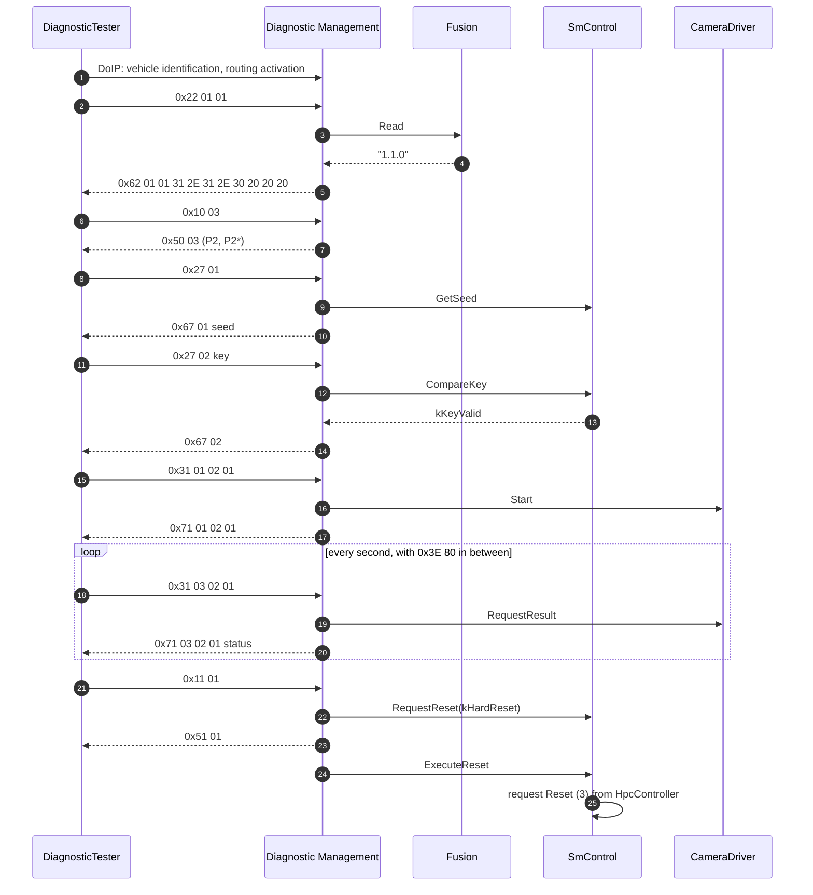

What happens, step by step, with the sections that explain it:

1. **Connect (1).** DM answers vehicle identification with the VIN from `SmControl` and accepts the routing activation; the tester's address gives priority 10 ([Section 5.9](#59-worked-example-diagnostictester-connects-to-hpc)).
2. **Read the version (2-5).** A new conversation starts in the default session. `FusionSoftwareVersion` is allowed there without security, and `Fusion` is running, so the read succeeds ([Section 10.7](#107-worked-example-fusionsoftwareversion)). Had `ADAS` been `Degraded`, the answer would have been `0x7F 22 94`.
3. **Extended session (6-7).** DM switches the conversation; S3 starts with every response ([Section 8.1](#81-diagnosticsessioncontrol-and-the-s3-timer)). From now on, a second tester with a lower priority is refused.
4. **Unlock (8-14).** `SmControl` computes the seed and checks the key ([Section 8.4](#84-worked-example-unlocking-hpc-for-calibration)). DM reports `SEV_UDS_SECURITY_ACCESS_SUCCESSFUL` to the IdsM ([Section 16.1](#161-security-events)).
5. **Calibrate (15-21).** The routine is allowed in the extended session at `Level1`. `CameraDriver` measures and stores the result through `SetCalibration`; the tester polls results and keeps the session alive with TesterPresent ([Section 11.4](#114-worked-example-calibratecamera)). `Storage` syncs `CalibrationKvs` (guide 11).
6. **Reset (22-26).** `SmControl` accepts the reset (vehicle standing, no update session); DM answers `0x51 01` before the reset and calls `ExecuteReset`; State Management restarts the machine ([Section 12.6](#126-worked-example-ecu-reset-through-smcontrol)). At the next ADAS start, `CalibrationCheck` reads the new calibration.

> **Key takeaways**
>
> - A workshop session uses transport, conversation, session, security, DID, routine and reset mechanisms in sequence.
> - Each step depends on configuration (permissions, mappings) and on a running, offered provider.
> - Security-relevant steps are reported to the IdsM; the reset ends in State Management.

---

## 18. Best Practices, Pitfalls and Troubleshooting

> **Why this matters:** Diagnostics is configured by several roles and implemented by several processes. Small mismatches show up as NRCs in the workshop. These habits and the troubleshooting table shorten the hunt.

### 18.1 Best Practices

1. **Start from the DEXT.** Every DID and routine needs the DEXT element, a service instance with an access permission, a port and a mapping ([Section 14.1](#141-minimal-configuration)).
2. **Use typed interfaces** for DIDs and routines with a known layout; keep generic classes for gateways and legacy code ([Section 10.3](#103-four-ways-to-provide-a-did)).
3. **Offer late, stop early.** Call `Offer()` when the object can answer, and `StopOffer()` before the process ends ([Section 13.1](#131-offer-stopoffer-and-nrc-0x94)).
4. **Provide always-needed DIDs from always-running processes**, or accept `0x94` in states where the provider is not running.
5. **Declare `kConcurrent` only for really re-entrant code** ([Section 6.5](#65-pseudo-parallel-processing-and-re-entrant-applications)).
6. **Make long routines asynchronous** and implement cancellation ([Section 11.3](#113-long-running-routines-futures-response-pending-and-cancellation)).
7. **Check vehicle state in the application** where no environmental condition is modeled, for example before a reset ([Section 12.6](#126-worked-example-ecu-reset-through-smcontrol)).
8. **Review access permissions** for every security-relevant service: no permission means no check ([Section 7.3](#73-session-and-security-checks)).
9. **Set tester priorities and limits** deliberately; the defaults allow one tester only ([Sections 5.5](#55-doip-timing-and-limits), [6.3](#63-how-many-testers-at-once)).
10. **Use `DiagUdsNrcErrc` precisely**: the NRC is the tester's only explanation ([Section 7.7](#77-nrcs-from-applications-diagudsnrcerrc)).

### 18.2 Common Pitfalls

| Pitfall | Consequence | Avoid it by |
| --- | --- | --- |
| Expecting `0x2F` IO control | Not supported in R25-11 | Routines ([Section 1.2](#12-what-dm-does-not-do)) |
| Provider not offered | `0x94` | Offer in all needed states |
| Mapping to the wrong process | Violation at construction, or requests never arrive | Check `process` of the mapping |
| Missing access permission | Service allowed everywhere | Explicit permissions |
| `maxTesterConnections`/`maxConversations` at default 1 | Second tester refused | Configure both |
| Long synchronous routine | `0x10` after the response-pending limit | Asynchronous design or a larger limit |
| Storing `MetaInfo` | Undefined behavior | Copy the values |
| Ignoring cancellation | Routine continues after the tester left | `CancellationHandler` |
| Reset accepted during an update | Update session broken | Refuse in `RequestReset` |
| Assuming DM restarts the machine | Nothing happens without an `EcuResetRequest` provider | Implement and map the provider |

### 18.3 Troubleshooting Guide

| Symptom | Likely cause | What to check |
| --- | --- | --- |
| Tester finds no ECU | DoIP not configured, wrong interface, firewall | DoIP configuration, `networkInterfaceId`, firewall rules (guide 16) |
| Routing activation fails | Source address not accepted, too many connections | `maxTesterConnections`, security event `SEV_DOIP_ROUTING_ACTIVATION_CHECK_FAILED` |
| `0x11` for a service | No service instance in the contribution set | Service table |
| `0x7F` | Service not allowed in this session | Access permission, current session |
| `0x31` for a DID or routine | ID not configured, or not allowed in this session | DEXT element, service instance, permission |
| `0x33` | Security level locked | SecurityAccess done? Session changed since? |
| `0x34` | Authentication role missing | `authenticationEnabled`, roles, dynamic access list |
| `0x35`, `0x36`, `0x37` | Wrong key, too many attempts, delay running | Key algorithm, persisted counter, `securityDelayTime` |
| `0x21` | Another tester holds a non-default session, or DM is busy | Conversations, priorities |
| `0x22` | Environmental condition or application condition not met | Condition formula, application checks |
| `0x78` forever, then `0x10` | Application future never completes | Provider code, pending limit |
| `0x94` | Provider not offered | Process state, `Offer()` call, mapping |
| No response at all | Request ignored (busy conversation, refusal without `0x21`, `kNoProcessingNoResponse`) | `responseOnSecondDeclinedRequest`, `ServiceValidation` |
| Process aborts when creating an `ara::diag` object | Specifier, mapping or process mismatch | Violation messages ([Section 16.2](#162-log-messages-and-violations)) |

> **Key takeaways**
>
> - Configure the full chain DEXT, service instance, permission, port and mapping for every function.
> - Offer late, stop early, and design for providers that are not running.
> - Read NRCs with the check order in mind; most of them point to configuration.

---

## 19. Summary and Self-Check Quiz

> **Why this matters:** A short summary and a quiz help you check whether the central ideas have stuck before you write providers or a DEXT.

### 19.1 Summary

1. **DM is a UDS server daemon** configured by the DEXT and the manifest; applications provide functions through `ara::diag`.
2. **One Diagnostic Server instance per contribution set**; Software Clusters may share it, as in `HPC`.
3. **DoIP** is the standard transport; plug-ins use `apext::diag::uds_transport`; several DoIP parameters have defaults.
4. **Conversations** are created at run time; a non-default session is exclusive; priorities decide replacement.
5. **Checks** follow ISO 14229-1; each failure has its NRC; missing permissions mean no checks.
6. **Sessions and security access** are handled by DM, seed and key by an application, with persistent attempt counters.
7. **Authentication** uses certificates, roles and dynamic access lists.
8. **DIDs and routines** are provided through typed or generic classes, mapped to ports and processes.
9. **ECU reset** is a two-step request to an application, with the response before or after the reset.
10. **Not supported:** OBD, `0x2F` and several other services and sub-functions.

### 19.2 Self-Check Quiz

Try to answer each question first, then expand the answer.

<details>
<summary>1. HPC has two Software Clusters. How many Diagnostic Server instances does DM create, and why?</summary>

One, because both Software Clusters reference the same `DiagnosticContributionSet` through their shared `SoftwareClusterDiagnosticDeploymentProps`, and DM creates one server per contribution set ([SWS_DM_00420]; [Section 2.3](#23-diagnostic-server-instances-and-software-clusters)).

</details>

<details>
<summary>2. A tester asks for UDS service 0x2F to move an actuator. What happens?</summary>

DM does not implement `0x2F` (SWS, Section 4.1.1). Without a configured service instance the answer is `0x11` serviceNotSupported ([SWS_DM_00099]). Actuator tests should be routines ([Section 1.2](#12-what-dm-does-not-do)).

</details>

<details>
<summary>3. Which two pieces of information identify a tester to DM?</summary>

The UDS source address and the transport channel (`globalChannelId`) ([SWS_DM_00421]; [Section 6.1](#61-identifying-a-client)).

</details>

<details>
<summary>4. A second tester connects while the first is in the extended session. Both have the default priority. What does the second tester see?</summary>

Its request is refused: with `responseOnSecondDeclinedRequest` `true`, it gets `0x21`, otherwise no response ([SWS_DM_00429], [SWS_DM_00049], [SWS_DM_00290]; [Section 6.4](#64-priorities-replacement-and-refusal)).

</details>

<details>
<summary>5. The tester sends 0x31 01 02 01 in the default session. Which NRC does it get, and why not 0x31?</summary>

`0x7F`, because no routine of the RoutineControl service is allowed in the default session ([SWS_DM_00101]). `0x31` would come if another routine were allowed in that session ([SWS_DM_00448]; [Section 7.8](#78-worked-example-why-the-tester-gets-0x7f)).

</details>

<details>
<summary>6. Who sends the response-pending message 0x78 while CameraDriver is busy?</summary>

DM, when P2 expires; the application only completes its future ([SWS_DM_00368]; [Section 7.6](#76-response-pending-p2-and-p2-and-the-pending-limit)).

</details>

<details>
<summary>7. The tester reads DID 0x0101 while ADAS is Degraded. What is the answer and why?</summary>

`0x7F 22 94`: `Fusion` does not run in `Degraded`, so the provider is not offered ([SWS_DM_01257]; [Section 10.7](#107-worked-example-fusionsoftwareversion)).

</details>

<details>
<summary>8. How long does a silent tester stay in the extended session if s3ServerTimeout is not configured?</summary>

5000 ms ([SWS_DM_01747]; [Section 8.1](#81-diagnosticsessioncontrol-and-the-s3-timer)).

</details>

<details>
<summary>9. Three wrong keys, then an ECU reset. Can the tester immediately try again after the restart?</summary>

No. The attempt counter is persistent, and at power-up DM restarts the delay timer with the larger of `securityDelayTimeOnBoot` and `securityDelayTime` ([SWS_DM_00478], [SWS_DM_00479]; [Section 8.3](#83-failed-attempts-and-the-delay-timer)).

</details>

<details>
<summary>10. What does an application have to implement for UDS 0x29, and what does DM do itself?</summary>

The application verifies certificates and ownership through `ara::diag::Authentication` and sets roles with `ClientAuthentication::Authenticate`; DM runs the protocol, keeps the state per client and checks roles and dynamic access lists ([Chapter 9](#9-authentication-and-dynamic-access-rights)).

</details>

<details>
<summary>11. Name the four ways to provide a DID and the mapping each uses.</summary>

Typed DID class, `GenericDataIdentifier` and per-element classes with `DiagnosticDataPortMapping`; `GenericUDSService` with `DiagnosticServiceGenericMapping` ([Section 10.3](#103-four-ways-to-provide-a-did)).

</details>

<details>
<summary>12. Which mapping connects a routine to the CameraDriver process?</summary>

A `DiagnosticServiceGenericMapping` from the `DiagnosticRoutineControl` service instance to the P-port and the process design ([TPS_MANI_01453]; [Section 14.11](#1411-diagnostic-mappings-ports-and-processes)).

</details>

<details>
<summary>13. respondToReset is not configured. When does the tester get the positive response to 0x11 01?</summary>

Before the reset: DM sends it after a successful `RequestReset` and then calls `ExecuteReset` ([SWS_DM_00268], [SWS_DM_01023]; [Section 12.2](#122-ecuresetrequest-requestreset-executereset-responding-before-or-after-the-reset)).

</details>

<details>
<summary>14. Why may an application not keep the MetaInfo object of a call?</summary>

It is guaranteed to live only during the call ([SWS_DM_01345]; [Section 13.2](#132-metainfo-who-is-asking)).

</details>

<details>
<summary>15. A second process constructs an EcuResetRequest with the port of SmControl. What happens?</summary>

The mapping names `SmControl` as process, so the construction leads to a `ProcessMappingViolation`, and DM would not serve another process anyway ([SWS_DM_02130]; [Sections 3.5](#35-access-control-on-aradiag), [13.1](#131-offer-stopoffer-and-nrc-0x94)).

</details>

<details>
<summary>16. Which DoIP connection limit applies if nothing is configured, and how does it differ from maxConversations?</summary>

`maxTesterConnections` defaults to 1 ([SWS_DM_01985]) and limits TCP connections; `maxConversations` (default 1) limits Diagnostic Conversations of a server ([SWS_DM_02003]; [Sections 5.5](#55-doip-timing-and-limits), [6.3](#63-how-many-testers-at-once)).

</details>

<details>
<summary>17. What does a ServiceValidation callout return to make DM drop a request silently?</summary>

The error `kNoProcessingNoResponse` ([SWS_DM_00860]; [Section 7.4](#74-manufacturer-and-supplier-checks-servicevalidation)).

</details>

<details>
<summary>18. Which security event does DM report after a successful ECU reset request, and when exactly?</summary>

`SEV_UDS_ECU_RESET_SUCCESSFUL`, after `RequestReset` and before `ExecuteReset` (SWS, Section 7.5.1; [Section 16.1](#161-security-events)).

</details>

---

## Appendix A. Glossary and Acronyms

| Term | Meaning |
| --- | --- |
| Access permission | `DiagnosticAccessPermission`: sessions, security levels, environmental condition and roles in which a service, DID or routine may be used. |
| Authentication (UDS `0x29`) | Identification of a tester by certificates; on AP only PKI certificate exchange. |
| DEXT | Diagnostic Extract Template; the model of the diagnostic behavior shared by the Classic and the Adaptive Platform. |
| Diagnostic Contribution Set | `DiagnosticContributionSet`: the diagnostic configuration of one Diagnostic Server instance. |
| Diagnostic Conversation | The state of the exchange between one tester and one Diagnostic Server instance, allocated at run time. |
| Diagnostic mapping | A `DiagnosticSwMapping` subclass that connects a DEXT element to a port of an executable and a process. |
| Diagnostic Server instance | One UDS server inside DM, one per contribution set. |
| DID | Data identifier: a 16-bit identifier of a data record read with `0x22` or written with `0x2E`. |
| DM | Diagnostic Management, the functional cluster. |
| DoIP | Diagnostics over IP (ISO 13400-2), the transport for UDS on Ethernet. |
| Dynamic access list | Request patterns that an application grants to an authenticated tester. |
| Functional address | A target address that addresses several servers at once. |
| MetaInfo | Information about the current request, such as source address and connection. |
| NRC | Negative response code: the reason in a negative response. |
| P2, P2\* | Server response times: until the first response, and between response-pending messages. |
| Physical address | A target address of exactly one server. |
| Response pending | NRC `0x78`: the server needs more time. |
| Routine | A function in the ECU, controlled with RoutineControl `0x31`. |
| S3 timer | Session timeout that returns a silent tester to the default session. |
| Security level | A level unlocked with SecurityAccess `0x27` by seed and key. |
| Session | A mode of the conversation that unlocks services, switched with `0x10`. |
| SID | Service identifier, the first byte of a UDS request. |
| SOVD | Service-Oriented Vehicle Diagnostics (ASAM); covered in [guide 12b](12b_Diagnostics.md#27-sovd-in-one-page). |
| Transport Protocol Handler | A plug-in that implements a UDS transport protocol, such as DoIP. |
| Transport Protocol Manager | The part of DM that dispatches messages between handlers and servers. |
| UDS | Unified Diagnostic Services (ISO 14229-1). |
| VIN | Vehicle identification number, provided by the DID with `representsVin`. |

## Appendix B. Quick Reference Cheat Sheet

**UDS services in DM (R25-11):**

| SID | Service | Processing | Guide |
| --- | --- | --- | --- |
| `0x10` | DiagnosticSessionControl | internal | 8.1 |
| `0x11` | ECUReset | external (`EcuResetRequest`) | 12 |
| `0x14`, `0x19` | ClearDiagnosticInformation, ReadDTCInformation | internal | [12b](12b_Diagnostics.md#10-reading-clearing-and-controlling-the-fault-memory-over-uds) |
| `0x22`, `0x2E` | Read / WriteDataByIdentifier | internal and external / external | 10 |
| `0x27` | SecurityAccess | internal and external (`SecurityAccess`) | 8.2 |
| `0x28` | CommunicationControl | external | 12.4 |
| `0x29` | Authentication (PKI only) | external | 9 |
| `0x2A` | ReadDataByPeriodicIdentifier (scheduler type 1) | internal | 10.6 |
| `0x2C` | DynamicallyDefineDataIdentifier (no defineByMemoryAddress) | internal | 10.6 |
| `0x31` | RoutineControl | external | 11 |
| `0x34` to `0x38` | Download, upload, transfer, file transfer | external | [12b](12b_Diagnostics.md#11-data-transfer-and-file-transfer), 13 |
| `0x3E` | TesterPresent | internal | 8.1 |
| `0x85`, `0x86` | ControlDTCSetting (ON/OFF), ResponseOnEvent | internal | [12b](12b_Diagnostics.md#104-0x85-controldtcsetting) |
| not supported | `0x23`, `0x24`, `0x2F`, `0x3D`, `0x83`, `0x84`, `0x87`, OBD | – | 1.2 |

**NRCs produced by DM checks:** `0x10` pending limit; `0x11` service; `0x12` sub-function; `0x13` length or format; `0x21` busy or refused; `0x22` condition; `0x31` identifier; `0x33` security; `0x34` authentication; `0x35`, `0x36`, `0x37` security access attempts; `0x78` pending; `0x7E`, `0x7F` session; `0x94` provider not offered.

**Specified defaults:** DoIP version 3; `tcpInitialInactivityTime` 2 s; `tcpGeneralInactivityTime` 300 s; `vehicleAnnouncementCount` 3; `vehicleAnnouncementInterval` 0.5 s; `tcpAliveCheckResponseTimeout` 0.5 s; `maxTesterConnections` 1; `maxConversations` 1; `GenericTpConnection` 0 to 65535, priority 255; S3 5000 ms; `respondToReset` before reset; `accessDataRecordSize` 0.

**Provider pattern:** construct with `InstanceSpecifier` (+ `ConcurrencyType`) → `Offer()` → answer with futures (`DiagUdsNrcErrc` for NRCs) → `StopOffer()`.

## Appendix C. Spec Traceability

Use this table to find the normative text in the specifications (R25-11) for each topic of this guide.

| Topic | Guide | Specification section | Key requirement IDs |
| --- | --- | --- | --- |
| Overview, limitations | 1 | SWS 1, 4.1 | – |
| Architecture, interfaces | 3 | SWS 5, 7 intro, 7.6 | [SWS_DM_02130], [SWS_DM_02131] |
| Configuration sources | 4, 14 | TPS Manifest 1.1.2, 4.9, 5, 6.3.1, 16.3.2; DEXT | [TPS_MANI_01242], [TPS_MANI_01326], [TPS_MANI_01453], [constr_10002], [constr_10487] |
| UDS Transport Layer | 5.1, 5.2, 5.8, 15.9 | SWS 7.1.1, App. C | [SWS_DM_00329] to [SWS_DM_00359], [SWS_DM_00385] to [SWS_DM_00389], [SWS_DM_00487] |
| DoIP | 5.3 to 5.6 | SWS 7.1.2 | [SWS_DM_00475], [SWS_DM_00449], [SWS_DM_01568], [SWS_DM_00855], [SWS_DM_01979] to [SWS_DM_01986], [SWS_DM_02002] to [SWS_DM_02010], [SWS_DM_02106], [SWS_DM_02107], [SWS_DM_02111] |
| Dispatching, servers | 2.3, 5.7 | SWS 7.1.3, 7.3 | [SWS_DM_00390], [SWS_DM_00391], [SWS_DM_00420] |
| Conversations | 6 | SWS 7.3.2.1, 7.3.2.2, 7.3.2.9 | [SWS_DM_00421], [SWS_DM_00426] to [SWS_DM_00433], [SWS_DM_00840] to [SWS_DM_00856], [SWS_DM_00940] to [SWS_DM_00944], [SWS_DM_02003] to [SWS_DM_02004], [SWS_DM_02108] to [SWS_DM_02110], [SWS_DM_00277] to [SWS_DM_00280] |
| Validation | 7 | SWS 7.3.2.5, 7.3.2.6 | [SWS_DM_00096] to [SWS_DM_00103], [SWS_DM_00450], [SWS_DM_01951], [SWS_DM_01952], [SWS_DM_01252] to [SWS_DM_01255], [SWS_DM_00859], [SWS_DM_00860], [SWS_DM_00286] to [SWS_DM_00289], [SWS_DM_00368], [SWS_DM_00369], [SWS_DM_01257], [SWS_DM_02059], [SWS_DM_02060] |
| Sessions, S3 | 8.1 | SWS 7.3.2.7, 7.3.2.8.4 | [SWS_DM_00226] to [SWS_DM_00228], [SWS_DM_00380] to [SWS_DM_00383], [SWS_DM_01747] |
| Security access | 8.2, 8.3 | SWS 7.3.2.8.9 | [SWS_DM_00236], [SWS_DM_00863], [SWS_DM_00864], [SWS_DM_00270] to [SWS_DM_00272], [SWS_DM_00478] to [SWS_DM_00480], [SWS_DM_01758] |
| Authentication | 9 | SWS 7.3.2.3, 7.3.2.4, 7.3.2.8.11 | [SWS_DM_01202] to [SWS_DM_01229], [SWS_DM_01739], [SWS_DM_01226] to [SWS_DM_01251] |
| DIDs | 10 | SWS 7.3.2.8.8, 7.3.2.8.12 to 7.3.2.8.14, 7.3.6 | [SWS_DM_00170], [SWS_DM_00409] to [SWS_DM_00417], [SWS_DM_00570], [SWS_DM_00572], [SWS_DM_01565], [SWS_DM_00393], [SWS_DM_00401], [SWS_DM_00848], [SWS_DM_00849], [SWS_DM_00905], [SWS_DM_01038], [SWS_DM_01759], [SWS_DM_01040] to [SWS_DM_01083] |
| Routines | 11 | SWS 7.3.2.8.15 | [SWS_DM_00201] to [SWS_DM_00203], [SWS_DM_00437], [SWS_DM_00448], [SWS_DM_00574] to [SWS_DM_00576], [SWS_DM_01270] to [SWS_DM_01272] |
| ECU reset, ComControl, custom | 12 | SWS 7.3.2.8.5, 7.3.2.8.10, 7.3.2.8.24 | [SWS_DM_00234], [SWS_DM_00235], [SWS_DM_00268], [SWS_DM_00360], [SWS_DM_01020] to [SWS_DM_01023], [SWS_DM_01090], [SWS_DM_01092], [SWS_DM_01309], [SWS_DM_01346], [SWS_DM_01347], [SWS_DM_00865], [SWS_DM_00502] |
| `ara::diag` objects | 13 | SWS 7.3.1, 7.4 | [SWS_DM_02094] to [SWS_DM_02105], [SWS_DM_01345], [SWS_DM_01571] to [SWS_DM_01574] |
| API | 15 | SWS 8, App. C | [SWS_DM_00526], [SWS_DM_00559], [SWS_DM_00601], [SWS_DM_00604], [SWS_DM_00607], [SWS_DM_00693], [SWS_DM_00761], [SWS_DM_00771], [SWS_DM_01009] |
| Reporting | 16 | SWS 7.5 | [SWS_DM_02014] to [SWS_DM_02058], [SWS_DM_02132] to [SWS_DM_02141], [SWS_CORE_13003] to [SWS_CORE_13006] |

## Appendix D. Notable Changes in Recent Releases

This summary is based on the history appendix of the specification (SWS, Appendix E). It lists only the changes that matter most when you port code or material from an older release.

| Release | Change | Specification items |
| --- | --- | --- |
| R25-11 | `MetaInfo` content specified per key (SA, TA, address type, request handle, IP addresses and ports) | [SWS_DM_02094] to [SWS_DM_02105] |
| R25-11 | DoIP: version-specific semantics, range of `maxTesterConnections`, VIN/GID sync status | [SWS_DM_02111], [SWS_DM_02106], [SWS_DM_02107] |
| R25-11 | Defaults for `GenericTpConnection`; access control on `ara::diag` and DoIP security events | [SWS_DM_02108] to [SWS_DM_02110], [SWS_DM_02130] to [SWS_DM_02141] |
| R24-11 | Security events of DM; TLS for DoIP and DoIP defaults; session and security checks skipped without permission | [SWS_DM_02014] to [SWS_DM_02058], [SWS_DM_01979] to [SWS_DM_01986], [SWS_DM_01951], [SWS_DM_01952] |
| R24-11 | EID, GID and VIN retrieval rules; maxConversations default | [SWS_DM_02002] to [SWS_DM_02010], [SWS_DM_02003] |
| R23-11 | Internal data elements, DoIP payload type table, life cycle (persisted data, graceful shutdown) | [SWS_DM_01565], [SWS_DM_01568], [SWS_DM_01571] to [SWS_DM_01574] |
| R22-11 | `ServiceValidation` callouts, NRC `0x94` for providers that are not offered, `ResetRequestType` constants, request file transfer | [SWS_DM_01252] to [SWS_DM_01261], [SWS_DM_01283] to [SWS_DM_01286], [SWS_DM_01310] to [SWS_DM_01319] |
| R21-11 | Authentication `0x29`, client authentication and dynamic access lists | [SWS_DM_01123] onwards, [SWS_DM_01202] to [SWS_DM_01229] |

## Appendix E. References

**AUTOSAR specifications (R25-11):**

- *Specification of Diagnostics* (`AUTOSAR_AP_SWS_Diagnostics`)
- *Specification of Manifest* (`AUTOSAR_AP_TPS_ManifestSpecification`), for the diagnostic port interfaces, mappings, DoIP and Software Cluster configuration
- *Diagnostic Extract Template* (`AUTOSAR_CP_TPS_DiagnosticExtractTemplate`), for the DEXT
- *Requirements on Diagnostics* (`AUTOSAR_FO_RS_Diagnostics`)
- *Specification of Adaptive Platform Core* (`AUTOSAR_AP_SWS_Core`), for `InstanceSpecifier`, `Future`, `ErrorCode` and the violation messages

**Other sources:**

- [EXT-056] *ISO 14229-1:2020 Road vehicles, Unified diagnostic services (UDS), Part 1: Application layer*, ISO. <https://www.iso.org/standard/72439.html> (cited by name; accessed 2026-11-08)
- [EXT-057] *ISO 13400-2:2019 Road vehicles, Diagnostic communication over Internet Protocol (DoIP), Part 2: Transport protocol and network layer services*, ISO. <https://www.iso.org/standard/74785.html> (cited by name; accessed 2026-11-08)
- [EXT-058] *ASAM SOVD (Service-Oriented Vehicle Diagnostics)*, ASAM e.V. <https://www.asam.net/standards/detail/sovd/> (accessed 2026-11-08)

---

*End of the training guide. For normative details, always refer to `AUTOSAR_AP_SWS_Diagnostics` (R25-11) and to the specifications it references, in particular the Manifest Specification and the Diagnostic Extract Template. [Part 2 (guide 12b)](12b_Diagnostics.md) continues with diagnostic events, DTCs, data transfer and SOVD.*
