# AUTOSAR Adaptive Platform: Diagnostics Training Guide, Part 2 (Fault Memory, Data Transfer and SOVD)

<!-- markdownlint-disable MD013 MD033 -->

> **Source specification:** *Specification of Diagnostics* (`AUTOSAR_AP_SWS_Diagnostics`), AUTOSAR Adaptive Platform **R25-11**. Also based on *Diagnostic Extract Template* (`AUTOSAR_CP_TPS_DiagnosticExtractTemplate`, CP R25-11) for diagnostic events, DTCs, event memories and records, on *Specification of Manifest* (`AUTOSAR_AP_TPS_ManifestSpecification`, AP R25-11) for the fault-memory port mappings, clear conditions and the SOVD configuration, on *Explanation of Service-Oriented Vehicle Diagnostics* (`AUTOSAR_AP_EXP_SOVD`, AP R25-11) for the SOVD architecture, on *Specification of Update and Configuration Management* (`AUTOSAR_AP_SWS_UpdateAndConfigurationManagement`, AP R25-11) for the update path through diagnostics, and, for upstream requirements, on *Requirements on Diagnostics* (`AUTOSAR_FO_RS_Diagnostics`, FO R25-11).
>
> **Document type:** training material.
>
> **Author:** Hieu Do Minh/Claude
>
> **Version:** 1.0 (draft, pending review)
>
> **Part of the series:** [AUTOSAR Adaptive Platform Training Guides](00_LearningPath.md). Previous: [12a Diagnostics Part 1](12a_Diagnostics.md). Next: 13 Update and Configuration Management (`13_UpdateAndConfigurationManagement.md`, planned).

## About This Guide

A camera that is covered by snow, a sensor with a broken wire, a process that cannot reach its partner: an ECU must notice such faults, decide when a fault is real, remember it across power cycles together with the circumstances in which it happened, and tell the workshop about it. On the Adaptive Platform this is the job of *Diagnostic Event Management*, the second half of Diagnostic Management (DM). Applications run *monitors* and report their results through `ara::diag`; DM debounces the results, keeps the status of each *diagnostic event*, turns events into *Diagnostic Trouble Codes* (DTCs), stores them in the *event memory* with snapshot and extended data, ages them out, and answers the tester's requests to read and clear them. The same server also moves bulk data and files between tester and ECU, and offers all of this to modern clients through *Service-Oriented Vehicle Diagnostics* (SOVD), a REST API over HTTPS. Questions like "why is my DTC pending but not confirmed?", "why does the tester get NRC `0x22` when it clears the fault memory?", "who restarts the operation cycle?" or "how does an SOVD client read the same fault?" are all answered here. [Guide 12a](12a_Diagnostics.md) covers diagnostic communication: transport, conversations, request validation, sessions, security, DIDs and routines.

### Who This Guide Is For

- **Application developers** who write diagnostic monitors, own operation cycles or conditions, read DTC information, serve files, or provide SOVD data and operations.
- **Integrators and diagnostic authors** who configure events, DTCs, debouncing, event memories, records, aging and the SOVD server.
- **Platform developers** who need the exact rules of the DTC status byte, the event memory and the SOVD mapping.

Assumed background: modern C++ (C++17: futures, `std::function`, `std::variant`), basic Linux/POSIX, the idea of HTTP and JSON, and [guide 12a](12a_Diagnostics.md), at least its Chapters 1 to 4. You do not need to know ISO 14229-1 (UDS); [Section 2.2](#22-event-status-and-the-uds-dtc-status-byte) explains the DTC status bits that matter. Two other guides help: [02 Manifests and Methodology](02_Manifests.md) for ports, processes and Software Clusters, and [03 `ara::core` and General Conventions](03_CoreAndGeneral.md) for `InstanceSpecifier`, `Result`, `Future` and violations.

### Learning Objectives

After working through this guide you will be able to:

1. Explain the chain monitor, diagnostic event, DTC, event memory and tester, and who owns each link.
2. Implement a diagnostic monitor with `ara::diag::Monitor`, choose the right `MonitorAction` and handle `initMonitor`.
3. Configure counter-based, time-based and monitor-internal debouncing and predict when an event is qualified.
4. Own an operation cycle and enable or clear conditions from an application.
5. Read the UDS DTC status byte and predict its bits over operation cycles, including pending, confirmed and the warning indicator.
6. Configure an event memory with snapshot records, extended data records, aging and displacement.
7. Read, clear and control the fault memory with the UDS services `0x19`, `0x14`, `0x85` and `0x86`, and from an application with `DTCInformation`.
8. Provide data download, upload and file transfer (`0x34` to `0x38`) and explain what DM checks and what the application must check.
9. Explain SOVD on the Adaptive Platform: server and gateway, authorization, locks, and how UDS and SOVD clients share one Diagnostic Server.
10. Provide SOVD data and operations, and map DTCs to SOVD faults.
11. Configure the DEXT and manifest elements of fault memory, transfer and SOVD.
12. Recognize the DRAFT APIs and the open points of R25-11, and troubleshoot typical fault-memory problems.

### How to Read This Guide

Chapters 1 and 2 introduce the vocabulary. Chapter 3 places the fault memory and SOVD in the platform, and Chapter 4 gives the big picture of the configuration. Chapters 5 to 9 follow a fault from the monitor to the event memory: events and monitors, debouncing, operation cycles and conditions, DTC status, the event memory. Chapter 10 is the tester's view over UDS. Chapter 11 covers data and file transfer. Chapters 12 and 13 cover SOVD. Chapter 14 lists every configuration setting, Chapter 15 the API, and Chapter 16 what DM reports. Chapters 17 to 19 are practical, and the appendices are for quick reference.

If you write monitors, read Chapters 1, 2, 5 to 8 and 15 first. If you configure the fault memory, read Chapters 2, 4, 6 to 10 and 14. If you work on SOVD, read Chapters 3, 12, 13 and Sections 14.13 and 14.14.

| Convention | Meaning |
| --- | --- |
| `[SWS_DM_00218]` | A requirement ID in the Diagnostics specification. Search for it in the specification to read the exact normative text. |
| `[TPS_MANI_01351]`, `[constr_10048]` | A requirement or constraint of the *Manifest Specification* (TPS). |
| `0x19 02 08` | UDS bytes in hexadecimal: here ReadDTCInformation (`0x19`), sub-function reportDTCByStatusMask (`0x02`), status mask `0x08`. |
| `0x2F` (status byte) | A UDS DTC status byte; [Section 2.2](#22-event-status-and-the-uds-dtc-status-byte) decodes it. |
| DRAFT | An API or requirement marked *DRAFT* in R25-11: it may still change. |
| **Note (implementation example)** | How a typical implementation *might* realize something. This is not mandated by AUTOSAR. |
| **Pitfall** | A common mistake seen in real projects. |
| **Key takeaways** | A short summary at the end of each chapter. |
| Diagrams | Written in Mermaid. They render natively on GitHub and GitLab. In VS Code, install the *Markdown Preview Mermaid Support* extension. |

> **Note:** The code in this guide is illustrative C++17. It follows the R25-11 API tables of the specification, but vendor headers may differ in detail, in particular for the generated typed classes and for the parts that R25-11 leaves open (Sections [11.3](#113-data-transfer-sessions-and-handlers) and [13.3](#133-operations)). UDS (ISO 14229-1), DoIP (ISO 13400-2) and SOVD (ASAM SOVD, ISO 17978-3) are referred to by name only; this guide explains what the AUTOSAR specification requires on top of them. All IDs, addresses and timings of the running example are invented for teaching.

### The Running Example

All guides of the series use the same invented system. A high-performance ECU called **`HPC`** runs an ADAS feature. [Guide 00, Chapter 6](00_LearningPath.md#6-the-running-example-the-hpc-reference-system) defines the complete example; [guide 12a](12a_Diagnostics.md#the-running-example) adds the diagnostic communication. This guide uses:

- **`CameraDriver`** drives the front camera, 30 images per second. Its diagnostic monitor detects a **blocked camera** (dark or frozen image) and reports the diagnostic event **`CameraBlocked`**, which maps to the DTC **`0x9A1011`**.
- **`SmControl`** knows the power mode (`PowerModeService`, values `Off` and `On`) and the vehicle speed (`VehicleDynamicsService`). It owns the operation cycle and two conditions, and provides the vehicle speed for the snapshot record.
- **`Storage`** keeps the object-list recordings ([guide 11](11_Persistency.md)); the workshop can read them as files.
- The **`DiagnosticTester`** (UDS over DoIP, logical address `0x0E80`) and an **SOVD client** in the workshop read and clear the fault.

This guide adds the following elements (guide 00 lists them as well). All values are illustrative.

| Element | What it is | Used in |
| --- | --- | --- |
| Monitor `CameraBlocked` | R-port `CameraBlockedMonitorPort` of `CameraDriverSwc` (`DiagnosticMonitorInterface`); every 100 ms the monitor reports `kPrefailed` (image dark or frozen) or `kPrepassed` | [Section 5.9](#59-worked-example-the-camerablocked-monitor) |
| Debouncing `CameraBlockedDebounce` | Counter-based: step up 2, step down 1, failed threshold 20, passed threshold −20, jump down to 0; failed after about 1 s, healed after at least 2 s | [Section 6.7](#67-worked-example-debouncing-camerablocked) |
| Operation cycle `IgnitionCycle` | Type `ignition`; `SmControl` restarts it when `PowerMode` becomes `On` (R-port `IgnitionCyclePort`) | [Section 7.4](#74-worked-example-smcontrol-owns-the-cycle-and-the-conditions) |
| Enable condition `PowerModeOn` | In group `CameraMonitoringConditions`; initial value false; `SmControl` sets it while `PowerMode` is `On` (R-port `PowerModeOnConditionPort`) | [Section 7.4](#74-worked-example-smcontrol-owns-the-cycle-and-the-conditions) |
| Clear condition `VehicleStandstill` | In group `ClearConditions`, mapped to `0x9A1011`; `SmControl` sets it while the vehicle speed is below 0.5 km/h (R-port `StandstillClearConditionPort`) | [Section 7.4](#74-worked-example-smcontrol-owns-the-cycle-and-the-conditions) |
| DTC `0x9A1011` | `CameraBlockedDtc`, ISO 14229-1 format, severity `checkAtNextHalt`, priority 2, significance `fault`; confirmation threshold 2 | [Section 8.7](#87-worked-example-two-drives-with-a-blocked-camera) |
| Event memory `HpcPrimaryMemory` | Primary memory, 20 entries, displacement `full`, storage trigger `testFailed`, snapshot numbering `calculated`, at most 2 snapshot records per DTC | [Section 9.9](#99-worked-example-the-entry-of-0x9a1011) |
| Snapshot | DID set `CameraBlockedSnapshot` with DID `0x0102` `VehicleSpeed` (2 bytes, 0.01 km/h), provided by `SmControl` (P-port `VehicleSpeedDidPort`) | [Section 9.9](#99-worked-example-the-entry-of-0x9a1011) |
| Extended data | Record `0x01` occurrence counter, `0x02` aging counter (counting up), `0x03` maximum FDC since the last clear; all internal to DM | [Section 9.9](#99-worked-example-the-entry-of-0x9a1011) |
| Aging | On `IgnitionCycle`, threshold 40 cycles | [Section 9.7](#97-aging) |
| DTC information | `SmControl` R-port `PrimaryMemoryPort` (`DiagnosticDTCInformationInterface`); calls `EnableControlDtc` at the start of every drive | [Section 10.4](#104-0x85-controldtcsetting) |
| Fault-memory services | `0x19` sub-functions `0x01`, `0x02`, `0x04`, `0x06`, `0x0A`, `0x14` and `0x14` ClearDiagnosticInformation in both sessions without security; `0x85` in the extended session; no `0x86` | [Chapter 10](#10-reading-clearing-and-controlling-the-fault-memory-over-uds) |
| File transfer | `0x38` ReadFile and ReadDir in the extended session at `Level1`; `Storage` provides `FileTransferService` on the P-port `RecordingsTransferPort` | [Section 11.6](#116-worked-example-reading-a-recording-from-storage) |
| SOVD server | `HpcSovdServer` on `HPC` with component qualifier `hpc`; HTTPS with TLS; the Diagnostic Server of `HpcDiagnostics` is the sub-component `hpcdiag`; no SOVD gateway on `HPC` | [Section 12.2](#122-transport-discovery-server-and-gateway) |
| SOVD security | `SmControl` provides `SovdAuthorization` and `SovdProximityChallenge` | [Section 12.4](#124-authorization) |
| SOVD data `CameraStatus` | Category `CURRENT_DATA`; elements `blocked` (boolean), `brightness` (integer32), `exposureMode` (string); `CameraDriver` | [Section 13.7](#137-worked-example-an-sovd-client-in-the-workshop) |
| SOVD faults | Read and delete through `DiagnosticSovdFaultMemoryAccess`; scope `HpcPrimaryMemory` | [Section 13.2](#132-faults) |
| SOVD operation `CameraCalibration` | Asynchronous (start, terminate, status), proximity proof required; `CameraDriver` | [Section 13.7](#137-worked-example-an-sovd-client-in-the-workshop) |

## Table of Contents

- [1. Introduction to Fault Memory and SOVD](#1-introduction-to-fault-memory-and-sovd)
    - [1.1 What Diagnostic Event Management Does](#11-what-diagnostic-event-management-does)
    - [1.2 What This Guide Covers](#12-what-this-guide-covers)
    - [1.3 Analogies](#13-analogies)
    - [1.4 Fault Memory and ARA](#14-fault-memory-and-ara)
- [2. Core Concepts and Terminology](#2-core-concepts-and-terminology)
    - [2.1 Monitor, Diagnostic Event, DTC](#21-monitor-diagnostic-event-dtc)
    - [2.2 Event Status and the UDS DTC Status Byte](#22-event-status-and-the-uds-dtc-status-byte)
    - [2.3 Debouncing and the Fault Detection Counter](#23-debouncing-and-the-fault-detection-counter)
    - [2.4 Operation Cycles, Enable Conditions and Clear Conditions](#24-operation-cycles-enable-conditions-and-clear-conditions)
    - [2.5 Event Memory, Entries and Records](#25-event-memory-entries-and-records)
    - [2.6 Aging, Healing, Indicators, Displacement and Overflow](#26-aging-healing-indicators-displacement-and-overflow)
    - [2.7 SOVD in One Page](#27-sovd-in-one-page)
    - [2.8 Terms at a Glance](#28-terms-at-a-glance)
- [3. Fault Memory and SOVD in the System Architecture](#3-fault-memory-and-sovd-in-the-system-architecture)
    - [3.1 Fault-Memory Classes and Their Port Interfaces](#31-fault-memory-classes-and-their-port-interfaces)
    - [3.2 Who Calls Whom](#32-who-calls-whom)
    - [3.3 Interfaces DM Requires for the Fault Memory](#33-interfaces-dm-requires-for-the-fault-memory)
    - [3.4 The SOVD Reference Architecture](#34-the-sovd-reference-architecture)
    - [3.5 UDS and SOVD on One Diagnostic Server](#35-uds-and-sovd-on-one-diagnostic-server)
- [4. Configuration Overview](#4-configuration-overview)
    - [4.1 Where the Configuration Lives](#41-where-the-configuration-lives)
    - [4.2 How the Elements Relate](#42-how-the-elements-relate)
    - [4.3 Who Configures What, and When](#43-who-configures-what-and-when)
- [5. Diagnostic Events and Monitors](#5-diagnostic-events-and-monitors)
    - [5.1 One Event, One Reporter](#51-one-event-one-reporter)
    - [5.2 `ara::diag::Monitor`: A Required Port with a Notifier](#52-aradiagmonitor-a-required-port-with-a-notifier)
    - [5.3 Reporting: `ReportMonitorAction` and `MonitorAction`](#53-reporting-reportmonitoraction-and-monitoraction)
    - [5.4 Caching While DM Is Unavailable](#54-caching-while-dm-is-unavailable)
    - [5.5 Event Status Processing](#55-event-status-processing)
    - [5.6 Reading an Event: `ara::diag::Event`](#56-reading-an-event-aradiagevent)
    - [5.7 Many Events in One Port: `MultipleMonitor` and `MultipleEvent`](#57-many-events-in-one-port-multiplemonitor-and-multipleevent)
    - [5.8 The Occurrence Counter](#58-the-occurrence-counter)
    - [5.9 Worked Example: The `CameraBlocked` Monitor](#59-worked-example-the-camerablocked-monitor)
- [6. Debouncing](#6-debouncing)
    - [6.1 Why Debounce](#61-why-debounce)
    - [6.2 Counter-Based Debouncing](#62-counter-based-debouncing)
    - [6.3 Time-Based Debouncing](#63-time-based-debouncing)
    - [6.4 Monitor-Internal Debouncing and Monitors without Debouncing](#64-monitor-internal-debouncing-and-monitors-without-debouncing)
    - [6.5 DEXT Values and Constructor Defaults](#65-dext-values-and-constructor-defaults)
    - [6.6 Resetting the Debouncing](#66-resetting-the-debouncing)
    - [6.7 Worked Example: Debouncing `CameraBlocked`](#67-worked-example-debouncing-camerablocked)
- [7. Operation Cycles and Conditions](#7-operation-cycles-and-conditions)
    - [7.1 Operation Cycles](#71-operation-cycles)
    - [7.2 Enable Conditions](#72-enable-conditions)
    - [7.3 Clear Conditions and `clearEventAllowedBehavior`](#73-clear-conditions-and-cleareventallowedbehavior)
    - [7.4 Worked Example: `SmControl` Owns the Cycle and the Conditions](#74-worked-example-smcontrol-owns-the-cycle-and-the-conditions)
- [8. DTCs and the UDS DTC Status Byte](#8-dtcs-and-the-uds-dtc-status-byte)
    - [8.1 DTC Format and Groups](#81-dtc-format-and-groups)
    - [8.2 Status Bit Processing](#82-status-bit-processing)
    - [8.3 Severity, Priority and Significance](#83-severity-priority-and-significance)
    - [8.4 Event Combination](#84-event-combination)
    - [8.5 Indicators and the WarningIndicatorRequested Bit](#85-indicators-and-the-warningindicatorrequested-bit)
    - [8.6 `ara::diag::DTCInformation`](#86-aradiagdtcinformation)
    - [8.7 Worked Example: Two Drives with a Blocked Camera](#87-worked-example-two-drives-with-a-blocked-camera)
- [9. The Event Memory](#9-the-event-memory)
    - [9.1 Primary and User-Defined Memories](#91-primary-and-user-defined-memories)
    - [9.2 When an Entry Is Created](#92-when-an-entry-is-created)
    - [9.3 Snapshot Records](#93-snapshot-records)
    - [9.4 Extended Data Records](#94-extended-data-records)
    - [9.5 Internal Data Elements](#95-internal-data-elements)
    - [9.6 Overflow and Displacement](#96-overflow-and-displacement)
    - [9.7 Aging](#97-aging)
    - [9.8 Reporting Order](#98-reporting-order)
    - [9.9 Worked Example: The Entry of `0x9A1011`](#99-worked-example-the-entry-of-0x9a1011)
- [10. Reading, Clearing and Controlling the Fault Memory over UDS](#10-reading-clearing-and-controlling-the-fault-memory-over-uds)
    - [10.1 `0x19` ReadDTCInformation](#101-0x19-readdtcinformation)
    - [10.2 `0x14` ClearDiagnosticInformation](#102-0x14-cleardiagnosticinformation)
    - [10.3 Clearing from an Application](#103-clearing-from-an-application)
    - [10.4 `0x85` ControlDTCSetting](#104-0x85-controldtcsetting)
    - [10.5 `0x86` ResponseOnEvent](#105-0x86-responseonevent)
    - [10.6 Worked Example: The Workshop Reads, Inspects and Clears `0x9A1011`](#106-worked-example-the-workshop-reads-inspects-and-clears-0x9a1011)
- [11. Data Transfer and File Transfer](#11-data-transfer-and-file-transfer)
    - [11.1 `0x34` to `0x37`: Download and Upload](#111-0x34-to-0x37-download-and-upload)
    - [11.2 `0x38` RequestFileTransfer](#112-0x38-requestfiletransfer)
    - [11.3 Data Transfer Sessions and Handlers](#113-data-transfer-sessions-and-handlers)
    - [11.4 Access Rights for Files](#114-access-rights-for-files)
    - [11.5 Software Update through Diagnostics](#115-software-update-through-diagnostics)
    - [11.6 Worked Example: Reading a Recording from `Storage`](#116-worked-example-reading-a-recording-from-storage)
- [12. SOVD: Concepts and Server Setup](#12-sovd-concepts-and-server-setup)
    - [12.1 SOVD Entities and DM's Place](#121-sovd-entities-and-dms-place)
    - [12.2 Transport, Discovery, Server and Gateway](#122-transport-discovery-server-and-gateway)
    - [12.3 UDS and SOVD Clients Together](#123-uds-and-sovd-clients-together)
    - [12.4 Authorization](#124-authorization)
    - [12.5 Locks, Environmental Conditions and Service Validation](#125-locks-environmental-conditions-and-service-validation)
    - [12.6 Data Serialization and Conversion](#126-data-serialization-and-conversion)
    - [12.7 Standardized Resources](#127-standardized-resources)
    - [12.8 Limitations in R25-11](#128-limitations-in-r25-11)
- [13. SOVD Resources: Data, Faults, Operations and More](#13-sovd-resources-data-faults-operations-and-more)
    - [13.1 Data](#131-data)
    - [13.2 Faults](#132-faults)
    - [13.3 Operations](#133-operations)
    - [13.4 Proximity Challenge](#134-proximity-challenge)
    - [13.5 Modes](#135-modes)
    - [13.6 Configuration, Bulk Data and Software Update](#136-configuration-bulk-data-and-software-update)
    - [13.7 Worked Example: An SOVD Client in the Workshop](#137-worked-example-an-sovd-client-in-the-workshop)
- [14. Configuration Reference: What to Configure](#14-configuration-reference-what-to-configure)
    - [14.1 Minimal Configuration](#141-minimal-configuration)
    - [14.2 DiagnosticEvent and DiagnosticConnectedIndicator](#142-diagnosticevent-and-diagnosticconnectedindicator)
    - [14.3 Debounce Algorithms](#143-debounce-algorithms)
    - [14.4 DiagnosticOperationCycle, DiagnosticAging, DiagnosticIndicator](#144-diagnosticoperationcycle-diagnosticaging-diagnosticindicator)
    - [14.5 Enable and Clear Conditions](#145-enable-and-clear-conditions)
    - [14.6 DTCs, DTC Groups and DTC Properties](#146-dtcs-dtc-groups-and-dtc-properties)
    - [14.7 DiagnosticMemoryDestination](#147-diagnosticmemorydestination)
    - [14.8 Snapshot and Extended Data Records](#148-snapshot-and-extended-data-records)
    - [14.9 DiagnosticCommonProps for the Fault Memory and SOVD](#149-diagnosticcommonprops-for-the-fault-memory-and-sovd)
    - [14.10 Service Instances for the Fault Memory and Transfer](#1410-service-instances-for-the-fault-memory-and-transfer)
    - [14.11 Fault-Memory Port Interfaces and Port Mappings](#1411-fault-memory-port-interfaces-and-port-mappings)
    - [14.12 SOVD Service Instances, Methods, Locks and Content](#1412-sovd-service-instances-methods-locks-and-content)
    - [14.13 SOVD Addresses and Instantiation](#1413-sovd-addresses-and-instantiation)
    - [14.14 The Running Example: Complete Configuration](#1414-the-running-example-complete-configuration)
- [15. API Reference and Usage Guide (ara::diag, Fault Memory, Transfer and SOVD Part)](#15-api-reference-and-usage-guide-aradiag-fault-memory-transfer-and-sovd-part)
    - [15.1 Headers and Classes Overview](#151-headers-and-classes-overview)
    - [15.2 `Monitor` and `MultipleMonitor`](#152-monitor-and-multiplemonitor)
    - [15.3 `Event`, `MultipleEvent` and Event Types](#153-event-multipleevent-and-event-types)
    - [15.4 `Condition` and `MultipleCondition`](#154-condition-and-multiplecondition)
    - [15.5 `OperationCycle`](#155-operationcycle)
    - [15.6 `Indicator`](#156-indicator)
    - [15.7 `DTCInformation` and Status Types](#157-dtcinformation-and-status-types)
    - [15.8 Typed Extended Data Record Element Interfaces](#158-typed-extended-data-record-element-interfaces)
    - [15.9 Download, Upload, File Transfer and Handlers](#159-download-upload-file-transfer-and-handlers)
    - [15.10 SOVD Classes](#1510-sovd-classes)
    - [15.11 Error Codes](#1511-error-codes)
- [16. Reporting](#16-reporting)
- [17. End-to-End Walkthrough: A Blocked Camera, from Detection to Repair](#17-end-to-end-walkthrough-a-blocked-camera-from-detection-to-repair)
- [18. Best Practices, Pitfalls and Troubleshooting](#18-best-practices-pitfalls-and-troubleshooting)
    - [18.1 Best Practices](#181-best-practices)
    - [18.2 Pitfalls](#182-pitfalls)
    - [18.3 Troubleshooting](#183-troubleshooting)
- [19. Summary and Self-Check Quiz](#19-summary-and-self-check-quiz)
    - [19.1 Summary](#191-summary)
    - [19.2 Quiz](#192-quiz)
- [Appendix A. Glossary and Acronyms](#appendix-a-glossary-and-acronyms)
- [Appendix B. Quick Reference Cheat Sheet](#appendix-b-quick-reference-cheat-sheet)
- [Appendix C. Spec Traceability](#appendix-c-spec-traceability)
- [Appendix D. Notable Changes in Recent Releases](#appendix-d-notable-changes-in-recent-releases)
- [Appendix E. References](#appendix-e-references)

## 1. Introduction to Fault Memory and SOVD

> **Why this matters:** A diagnostic tester can only report what the ECU has remembered. Whether a short glitch becomes a stored DTC, whether the workshop sees the vehicle speed at the moment of the fault, and whether a DTC disappears by itself after forty clean drives are all decisions of Diagnostic Event Management and its configuration. Getting them wrong means either a workshop that hunts ghosts or a real fault that nobody sees.

### 1.1 What Diagnostic Event Management Does

**In plain words:** Diagnostic Event Management is the ECU's fault diary. Applications tell it "this check passed" or "this check failed". It filters out noise, decides when a failure is real, gives the fault a code, writes it into a persistent diary together with some surrounding data, and keeps or forgets the entry according to rules. The workshop reads and erases the diary.

**Formally:** Diagnostic Event Management is one of the two building blocks of DM (SWS, Chapter 7; [guide 12a, Section 1.1](12a_Diagnostics.md#11-what-is-diagnostic-management)). Diagnostic events are the input source of Diagnostic Event Management: applications report the state of a monitored entity, and DM performs defined actions such as DTC status changes and the capture and storage of snapshot and extended data records (SWS, Section 7.3.4.1.1). The *event memory* is the database for detected faults; it corresponds to the "fault memory" of ISO 14229-1 (SWS, Section 7.3.4.4). DM supports a primary event memory and up to 256 user-defined event memories ([SWS_DM_00055]).

### 1.2 What This Guide Covers

Diagnostic Management is split over two guides. The split follows the two building blocks, plus the topics that need both.

| Topic | Guide 12a | Guide 12b (this guide) |
| --- | --- | --- |
| Transport (DoIP), dispatching, conversations | yes | — |
| Request validation, sessions, SecurityAccess, authentication | yes | used |
| DIDs, routines, ECU reset, CommunicationControl, custom services | yes | DIDs used for snapshots |
| Diagnostic events, monitors, debouncing, operation cycles, conditions | — | yes |
| DTCs, status byte, event memory, snapshot and extended data, aging, displacement | — | yes |
| UDS `0x14`, `0x19`, `0x85`, `0x86` | listed | yes |
| Data and file transfer `0x34` to `0x38` | listed | yes (the update path itself is in guide 13) |
| SOVD | orientation | yes |

What DM does **not** do in this area (SWS, Section 4.1): no OBD or WWH-OBD DTCs, no mirror memory, several `0x19` sub-functions are missing, `0x85` supports only ON and OFF, `0x86` has no event queuing, and variant handling of events and DTCs at run time is not supported. [Appendix B](#appendix-b-quick-reference-cheat-sheet) lists the details.

### 1.3 Analogies

- **A smoke detector with a log book.** One puff of smoke does not ring the alarm; smoke for some seconds does (debouncing). The alarm is logged with the time and the room temperature (snapshot). If the detector has been quiet for forty days, the old entry is removed (aging). The analogy breaks because DM does not decide *what* to check: the application's monitor does.
- **The Classic Platform Dem.** The event part of DM resembles the Classic Dem, and both platforms share the DEXT, so events, DTCs, debouncing, memories and records are configured with the same meta-classes. What differs on AP: monitors are C++ objects bound to ports, conditions and operation cycles are owned by applications through `ara::diag`, clear conditions are an AP-only concept (TPS, Section 5.3), and some DEXT attributes are not evaluated by DM ([Section 14.2](#142-diagnosticevent-and-diagnosticconnectedindicator)).
- **SOVD as a REST API for the same server.** UDS is a compact byte protocol interpreted with an external description file (ODX). SOVD is self-describing JSON over HTTPS, with resources such as `faults`, `data` and `operations` (EXP SOVD, Section 1.1.1). Both reach the same Diagnostic Server and the same event memory.

### 1.4 Fault Memory and ARA

The fault-memory part of `ara::diag` is a set of small classes, each bound to one port of the application by an `InstanceSpecifier`, like the classes of [guide 12a](12a_Diagnostics.md#14-dm-and-ara). Most of them are *required* ports: the application uses a function of DM, for example to report a monitor result or to restart an operation cycle. DM is daemon-based and persists the event memory with Persistency (SWS, Table 5.2).

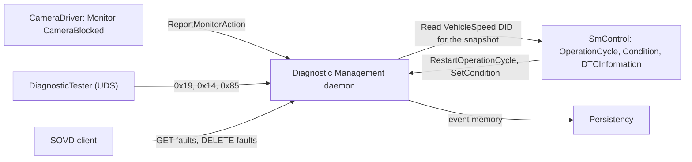

> **Key takeaways**
>
> - Diagnostic Event Management turns monitor results into DTCs in a persistent event memory.
> - The application decides what to check; DM decides when a result counts and what to store.
> - Events, DTCs, memories and records are configured in the DEXT, shared with the Classic Platform.
> - The same Diagnostic Server answers UDS and SOVD clients.

---

## 2. Core Concepts and Terminology

> **Why this matters:** The fault memory has a dense vocabulary: event, DTC, FDC, pending, confirmed, aging, displacement. Most misunderstandings in projects come from mixing two of these terms, for example "the event failed" and "the DTC is confirmed". This chapter fixes the words before the mechanisms.

### 2.1 Monitor, Diagnostic Event, DTC

**In plain words:** A *monitor* is the code that checks something. A *diagnostic event* is DM's record of what that check says. A *DTC* is the code that the workshop sees. Usually one monitor feeds one event, and one event maps to one DTC; several events can share one DTC.

**Formally:**

- A **diagnostic monitor** is a routine in an application that determines the proper functioning of a component for one *monitoring path* (a sensor input, a circuit). Each monitoring path is associated with exactly one diagnostic event (SWS, Section 7.3.4.1.2).
- A **diagnostic event** uniquely identifies the monitored entity in the system. DM accepts reports for an event from one single source only ([Section 5.1](#51-one-event-one-reporter)). Events are configured as `DiagnosticEvent` (SWS, Section 7.3.4.1.1).
- A **Diagnostic Trouble Code (DTC)** is a unique 3-byte identifier mapped to one or more events by `DiagnosticEventToTroubleCodeUdsMapping`; it identifies data in the event memory, for example for a UDS tester (SWS, Section 7.3.4.4.1). Each `DiagnosticTroubleCodeUds` is a DTC that DM supports ([SWS_DM_00060]).

The following diagram shows the chain for the running example.

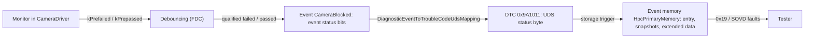

### 2.2 Event Status and the UDS DTC Status Byte

A DTC has the 8-bit *UDS DTC status byte* of ISO 14229-1. `ara::diag::UdsDtcStatusBitType` names its bits ([SWS_DM_00658]):

| Bit | Mask | Name | Meaning in plain words |
| --- | --- | --- | --- |
| 0 | `0x01` | `kTestFailed` | The latest qualified result is "failed". |
| 1 | `0x02` | `kTestFailedThisOperationCycle` | It failed at least once in the current operation cycle. |
| 2 | `0x04` | `kPendingDTC` | It failed in the current or last operation cycle; not yet cleared by a fault-free tested cycle. |
| 3 | `0x08` | `kConfirmedDTC` | The fault is confirmed and stored as such ([Section 8.2](#82-status-bit-processing)). |
| 4 | `0x10` | `kTestNotCompletedSinceLastClear` | The test has not completed since the last clear. |
| 5 | `0x20` | `kTestFailedSinceLastClear` | It failed at least once since the last clear. |
| 6 | `0x40` | `kTestNotCompletedThisOperationCycle` | The test has not completed in the current operation cycle. |
| 7 | `0x80` | `kWarningIndicatorRequested` | A warning indicator is requested for this DTC. |

So the status byte `0x2F` means: test failed (`0x01`), failed this cycle (`0x02`), pending (`0x04`), confirmed (`0x08`) and failed since last clear (`0x20`).

A diagnostic event has a smaller *event status byte* with three bits only: `kTestFailed` (bit 0), `kTestFailedThisOperationCycle` (bit 1) and `kTestNotCompletedThisOperationCycle` (bit 6) (`EventStatusBit`, [SWS_DM_00643]). DM processes these bits like the corresponding UDS DTC status bits ([SWS_DM_01024]) and derives the DTC status byte from them ([SWS_DM_00883]). The event status is what the application sees through `ara::diag::Event`; the DTC status is what the tester sees.

### 2.3 Debouncing and the Fault Detection Counter

**In plain words:** One bad image does not mean the camera is blocked. *Debouncing* lets a fault "mature": only after enough bad reports in a row does DM accept the result as qualified.

**Formally:** Debouncing filters undesirable noise from monitor reports. A report does not change `kTestFailed` immediately; a threshold must be reached first. The progress is expressed as the **Fault Detection Counter (FDC)**, a signed value from −128 to +127: +127 means *finally defective*, −128 *finally healed* (SWS, Section 7.3.4.1.5; [SWS_DM_00645]). DM debounces counter-based or time-based; a monitor can also debounce internally ([Chapter 6](#6-debouncing)).

### 2.4 Operation Cycles, Enable Conditions and Clear Conditions

- An **operation cycle** is a period such as one ignition cycle or one power cycle. It has a direct effect on the status byte and the event memory (SWS, Section 7.3.4.3): bits 1 and 6 restart, pending and confirmation are evaluated per cycle, and aging counts cycles. An application owns the cycle and tells DM when it restarts.
- An **enable condition** is a switch that must be on for monitor reports of an event to count, for example "power mode is on" (SWS, Section 7.3.4.1.4).
- A **clear condition** is a switch that must be on for a DTC to be cleared, for example "vehicle stands still" (SWS, Section 7.3.4.4.5.2). It is an AP-only concept (TPS, Section 5.3).

### 2.5 Event Memory, Entries and Records

An **event memory entry** is the complete data set that belongs to a DTC: counters, cycles, snapshot records and extended data records ([SWS_DM_00920]).

- A **snapshot record** (also *freeze frame*) holds environmental data captured when the fault occurred, for example the vehicle speed. For UDS it is a set of DIDs ([SWS_DM_01087]).
- An **extended data record** holds simple, mostly statistical data for the DTC, such as the occurrence counter or the aging counter ([Section 9.4](#94-extended-data-records)).

### 2.6 Aging, Healing, Indicators, Displacement and Overflow

| Term | One-line meaning | Section |
| --- | --- | --- |
| Aging | A stored DTC that has not failed for a configured number of cycles is deleted. | [9.7](#97-aging) |
| Healing | The warning indicator of a DTC is switched off after a number of good cycles. | [8.5](#85-indicators-and-the-warningindicatorrequested-bit) |
| Indicator | A warning output (lamp, text) linked to events. | [8.5](#85-indicators-and-the-warningindicatorrequested-bit) |
| Overflow | The event memory is full and a new entry must be stored. | [9.6](#96-overflow-and-displacement) |
| Displacement | A less important entry is removed to make room for a new one. | [9.6](#96-overflow-and-displacement) |
| Event combination | Several events share one DTC. | [8.4](#84-event-combination) |

### 2.7 SOVD in One Page

**In plain words:** SOVD is diagnostics as a web API. The tester sends HTTPS requests such as `GET .../faults` and gets JSON back. The ECU describes its own capabilities, so the tester needs no description file.

**Formally:** ASAM SOVD defines a REST API with *entities* (for example components) that offer *resources*: data, faults, operations, configurations, bulk data, modes, locks, logs and software updates (SWS, Section 7.3.3; EXP SOVD, Section 1.1). Version 1.1 of the API is standardized as ISO 17978-3 (SWS, Section 4.1.3). On AP, DM acts as an SOVD server: DM is an SOVD component, and each Diagnostic Server instance is a sub-component ([SWS_DM_01372], [SWS_DM_01373]). An SOVD gateway is the "edge node" that routes requests from outside the vehicle to the SOVD servers inside (EXP SOVD, Section 2.1).

### 2.8 Terms at a Glance

| Term | Meaning | Defined in |
| --- | --- | --- |
| Diagnostic Monitor | Application code that checks one monitoring path and reports the result | SWS 7.3.4.1.2 |
| Diagnostic Event | DM's record of one monitored entity; input of event management | SWS 7.3.4.1.1 |
| DTC | 3-byte code that identifies a fault in the event memory | SWS 7.3.4.4.1 |
| Event status byte | 3 bits per event (`EventStatusBit`) | [SWS_DM_00643] |
| UDS DTC status byte | 8 bits per DTC (`UdsDtcStatusBitType`) | [SWS_DM_00658] |
| Fault Detection Counter (FDC) | −128 to +127 debouncing progress | SWS 7.3.4.1.5 |
| Operation cycle | Period that restarts per-cycle status bits and counts for confirmation and aging | SWS 7.3.4.3 |
| Enable condition | Must be fulfilled for monitor reports to count | SWS 7.3.4.1.4 |
| Clear condition | Must be fulfilled for a DTC to be cleared | SWS 7.3.4.4.5.2 |
| Event memory | Persistent fault database (primary and user-defined) | SWS 7.3.4.4 |
| Snapshot record | Data captured at the time of the fault | SWS 7.3.4.4.4.2 |
| Extended data record | Statistical data for a DTC | SWS 7.3.4.4.4.3 |
| Aging | Deleting an entry after fault-free cycles | SWS 7.3.4.4.6 |
| Displacement | Replacing a less important entry when the memory is full | SWS 7.3.4.4.10 |
| SOVD server, SOVD gateway | DM's REST interface; the vehicle's edge node | SWS 7.2; TPS 12.12 |
| SOVD lock | Exclusive access of one SOVD client to an entity | SWS 7.3.3.2.2 |

> **Key takeaways**
>
> - Monitor (application) → event (3 status bits) → DTC (8 status bits) → event memory entry.
> - Debouncing expresses progress as the FDC from −128 to +127.
> - Operation cycles drive pending, confirmation and aging; conditions gate reports and clears.
> - SOVD is a REST API to the same Diagnostic Server and the same event memory.

---

## 3. Fault Memory and SOVD in the System Architecture

> **Why this matters:** Every fault-memory class needs a port, a port interface and a mapping to a process, and several applications must play together: the monitor, the owner of the operation cycle, the owners of the conditions. Knowing who calls whom avoids the most common integration error: a perfectly working monitor whose results never count.

### 3.1 Fault-Memory Classes and Their Port Interfaces

Each fault-memory class is constructed with the `InstanceSpecifier` of a port whose port interface matches the class, and the port is mapped to the configuration element and to a process by a diagnostic mapping (TPS, Section 5.2.2).

| `ara::diag` class | Port interface | Mapping (TPS 5.2.2) | Port kind in the TPS | Used by |
| --- | --- | --- | --- | --- |
| `Monitor` | `DiagnosticMonitorInterface` | `DiagnosticMonitorPortMapping` | R-port | Monitor owner |
| `MultipleMonitor` | `DiagnosticMultipleMonitorInterface` | `DiagnosticMultipleMonitorPortMapping` | R-port | Monitor owner |
| `Event` | `DiagnosticEventInterface` | `DiagnosticEventPortMapping` | R-port | Any reader |
| `MultipleEvent` | `DiagnosticMultipleEventInterface` | `DiagnosticMultipleEventPortMapping` | R-port | Any reader |
| `Condition` | `DiagnosticConditionInterface` | `DiagnosticEnableConditionPortMapping` or `DiagnosticClearConditionPortMapping` | R-port | Condition owner |
| `MultipleCondition` | `DiagnosticMultipleConditionInterface` | `DiagnosticMultipleConditionPortMapping` | R-port | Condition owner |
| `OperationCycle` | `DiagnosticOperationCycleInterface` | `DiagnosticOperationCyclePortMapping` | R-port | Cycle owner |
| `Indicator` | `DiagnosticIndicatorInterface` | `DiagnosticIndicatorPortMapping` | R-port | Indicator driver |
| `DTCInformation` | `DiagnosticDTCInformationInterface` | `DiagnosticMemoryDestinationPortMapping` | R-port | Fault-memory reader |
| Typed extended data record element | `DiagnosticExtendedDataRecordInterface` | `DiagnosticExtendedDataRecordClientPortMapping` | R-port | Data provider |
| `DownloadService`, `UploadService` | `DiagnosticDownloadInterface`, `DiagnosticUploadInterface` | `DiagnosticServiceGenericMapping` | P-port | Transfer provider |
| `FileTransferService` | `DiagnosticRequestFileTransferInterface` | `DiagnosticServiceGenericMapping` | P-port | File provider |
| SOVD classes | `DiagnosticSovd...Interface` | `DiagnosticSovd...PortMapping` | P-port | SOVD provider |

Two classes look like providers although the TPS uses R-ports: `Monitor` has `Offer()` and `StopOffer()` because DM calls its `initMonitor` notifier (SWS, Section 7.3.4.1.2), and the typed extended data record element has `Offer()`, `StopOffer()` and a pure virtual `Read` (SWS, Section 8.49) while its mapping references an `RPortPrototype` ([TPS_MANI_01484]). This is the same kind of difference as the R-port wording for DIDs that [guide 12a, Section 10.3](12a_Diagnostics.md#103-four-ways-to-provide-a-did) discusses: follow the TPS for the port kind and the API for the code.

### 3.2 Who Calls Whom

Diagnostic Event Management needs several applications at once. The sequence below shows the minimum for one event.

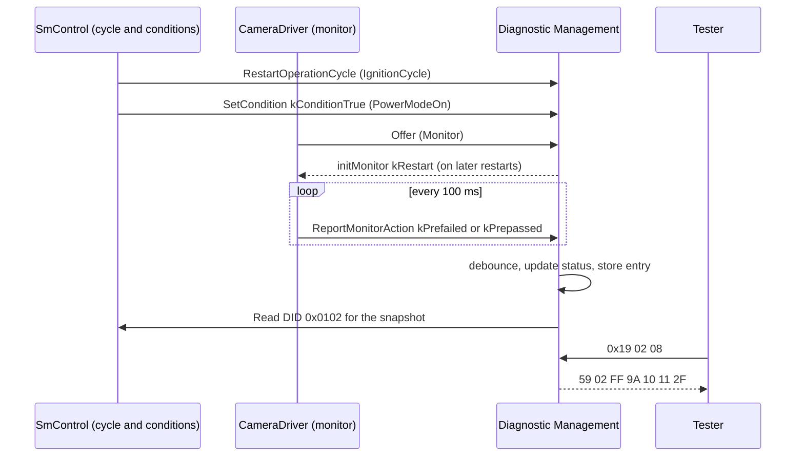

If the cycle is never restarted, status bits 1 and 6 never reset and no DTC ever ages. If the enable condition is never set, DM ignores every report ([SWS_DM_00568]). Both are application responsibilities: DM does not decide when an ignition cycle begins.

### 3.3 Interfaces DM Requires for the Fault Memory

| Functional cluster | Interface | Use in this guide's scope |
| --- | --- | --- |
| Persistency | `FileStorage`, `KeyValueStorage` | Status of all DTCs and the data of up to `maxNumberOfEventEntries` entries per memory are stored persistently ([SWS_DM_00148]); recovered at start-up ([SWS_DM_01571]) |
| Log and Trace | `Logger` | `LogError()` when data capture fails and DM pads with `0xFF` ([SWS_DM_00969]) |
| Intrusion Detection System Manager | `EventReporter` | Security events for `0x14`, `0x85`, `0x34`-`0x37` and `0x38` ([Chapter 16](#16-reporting)) |

### 3.4 The SOVD Reference Architecture

AUTOSAR describes a reference architecture for SOVD in a vehicle with several machines and microcontrollers (EXP SOVD, Chapter 2). The diagram below shows its blocks.

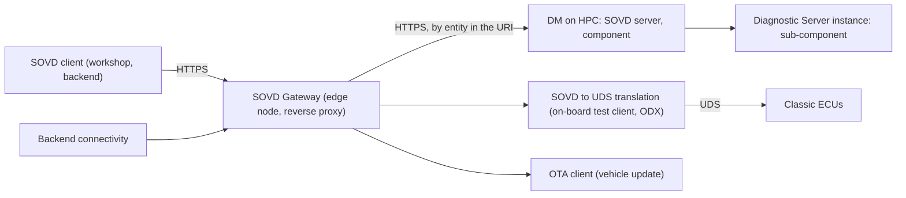

- The **SOVD gateway** routes each request by the entity part of its URI to an internal SOVD endpoint, configured statically or discovered by mDNS. It works as an HTTP reverse proxy. Its configuration is `SovdGatewayInstantiation` (EXP SOVD, Section 2.1; TPS, Section 12.12.3).
- **DM** is an SOVD server. It is one SOVD component, and each Diagnostic Server instance is a sub-component; DM routes to the sub-components itself ([SWS_DM_01372]-[SWS_DM_01374]). Its configuration is `SovdServerInstantiation` (TPS, Section 12.12.2).
- **SOVD-to-UDS translation** translates SOVD requests into UDS requests for microcontrollers. ASAM defines it; AUTOSAR only refers to it (EXP SOVD, Section 2.3).
- **Backend connectivity** routes remote requests to the gateway; AUTOSAR leaves it open (EXP SOVD, Section 2.4).

In the running example, `HPC` runs only an SOVD server; the vehicle's gateway is a black box ([Section 12.2](#122-transport-discovery-server-and-gateway)).

### 3.5 UDS and SOVD on One Diagnostic Server

UDS and SOVD clients reach the same Diagnostic Server instance and therefore the same event memory: each `DiagnosticTroubleCodeUds` is also an SOVD fault ([SWS_DM_01418]). For data and operations, R25-11 uses dedicated SOVD interfaces (`GenericDiagnosticSovdContent`, `GenericDiagnosticSovdOperation`) instead of the UDS DID and routine interfaces, because SOVD differs in authentication granularity and operation timeouts (SWS, Section 7.3.3.5).

> **Note:** The explanatory document *EXP SOVD* still describes an older state, in which SOVD data was derived from `DiagnosticDataIdentifier`, operations from `DiagnosticRoutine`, and an interface `ara::diag::GenericConfiguration` existed (EXP SOVD, Sections 3.1 and 3.2.5). This guide follows the R25-11 SWS and TPS, which define `DiagnosticSovdData`, `DiagnosticSovdOperation` and `SovdConfiguration`.

> **Key takeaways**
>
> - Every fault-memory class needs a matching port interface and a diagnostic mapping to a process.
> - Most fault-memory ports are R-ports; transfer and SOVD providers use P-ports.
> - The monitor, the cycle owner and the condition owners must all play their part.
> - DM is an SOVD server; a gateway (optional on a machine) is the edge node to clients.

---

## 4. Configuration Overview

> **Why this matters:** The fault memory is mostly configuration: thresholds, cycles, memories, records and their links. Before the details of Chapter 14, you need a mental map of which file holds what and who writes it.

### 4.1 Where the Configuration Lives

| Source | What it holds for this guide |
| --- | --- |
| DEXT (*Diagnostic Extract Template*, CP TPS, Chapter 4.4 and 5) | `DiagnosticEvent`, `DiagnosticTroubleCodeUds`, `DiagnosticTroubleCodeProps`, `DiagnosticMemoryDestination`, snapshot and extended data records, operation cycles, enable conditions, debouncing algorithms, aging, indicators, the event mappings, and the service instances `0x14`, `0x19`, `0x85`, `0x86` |
| TPS Manifest, Chapter 5 | AP extensions: `DiagnosticCommonProps` attributes for event combination, occurrence counter, displacement and SOVD; the fault-memory port mappings; clear conditions; transfer service mapping; the SOVD service instances, methods, locks and content |
| TPS Manifest, Section 12.12 | `SovdServerInstantiation`, `SovdGatewayInstantiation` on the machine |
| Application code | Constructor defaults for debouncing, used only when the DEXT has none ([SWS_DM_01101]) |

The SWS itself defines no default values in its configuration chapter (SWS, Section 10.1); the defaults that exist are stated in individual requirements and are collected in [Chapter 14](#14-configuration-reference-what-to-configure).

### 4.2 How the Elements Relate

The DEXT links events to everything else through mapping elements. The diagram shows the main relations for one event.

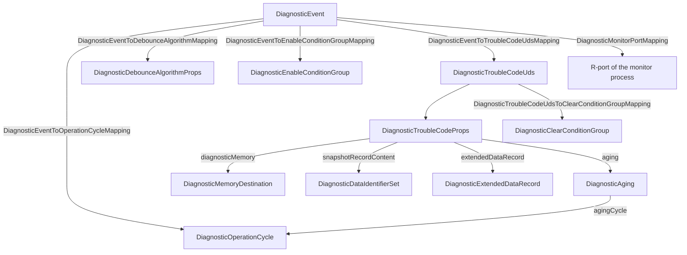

### 4.3 Who Configures What, and When

| Role | Configures | Typical step |
| --- | --- | --- |
| Application developer | Monitor code and constructor defaults; ports typed by the diagnostic port interfaces; SOVD content providers | Application design |
| Diagnostic designer | Events, DTCs, debouncing, cycles, conditions, memories, records, aging, service instances, access permissions, SOVD services and content | DEXT authoring (ECU or system level) |
| Integrator | Diagnostic mappings to processes and ports, the contribution set of the Software Cluster, SOVD server instantiation and network endpoints | Deployment, machine configuration |

> **Key takeaways**
>
> - The DEXT holds the fault-memory semantics; the TPS adds AP mappings, clear conditions and SOVD.
> - Events are linked to cycles, debouncing, conditions and DTCs by separate mapping elements.
> - Defaults exist only where a requirement states them; the SWS configuration chapter defines none.

---

## 5. Diagnostic Events and Monitors

> **Why this matters:** The monitor is the only part of the fault memory that you write in C++. Its few lines decide whether the event is ever reported, whether DM can debounce it, and whether DM can reset it after a clear. A monitor that reports the wrong action, reports before `Offer()` or reports from two processes produces wrong DTCs or a violation that terminates the process.

### 5.1 One Event, One Reporter

An event represents one specific monitoring that is unique in the system, and DM supports notifications for an event from one single source only. Only one application can report a given event, and the reporting interface is explicitly not re-entrant (SWS, Section 7.3.4.1.1). The TPS enforces this in the model: each `DiagnosticEvent` is referenced by exactly one `DiagnosticMonitorPortMapping` or `DiagnosticMultipleMonitorPortMapping` ([constr_10048]).

For each `DiagnosticEvent`, the reporting application creates exactly one `ara::diag::Monitor` (SWS, Section 7.3.4.1.2). Reading the event is different: any application with a port mapped by `DiagnosticEventPortMapping` may create an `ara::diag::Event` for it ([TPS_MANI_01048]).

### 5.2 `ara::diag::Monitor`: A Required Port with a Notifier

**In plain words:** The monitor talks to DM (it reports results), but DM also talks to the monitor: it tells it to start over, for example after the DTC was cleared. Because DM calls back, the monitor must say when it is ready to be called. That is what `Offer()` means here.

**Formally:** From the reporting view, `Monitor` is a required port; because it registers a notifier that DM calls, it is also a provided port, which is why it has `Offer()` and `StopOffer()` (SWS, Section 7.3.4.1.2). These are not the `ara::com` methods of the same name. The object is inactive until `Offer()` ([SWS_DM_01088]) is called, so the application can finish initializing its notifier first. After `StopOffer()` ([SWS_DM_01089]) DM calls neither the notifier nor the FDC callback of the monitor.

The notifier has the type `InitMonitorNotifier = std::function<void(InitMonitorReason)>` ([SWS_DM_02121]). DM calls it to (re-)initialize the monitor:

| `InitMonitorReason` | Value | DM calls `initMonitor` when … | ID |
| --- | --- | --- | --- |
| `kClear` | `0x00` | a DTC of this monitoring path was actually cleared | [SWS_DM_00562] |
| `kRestart` | `0x01` | the event's operation cycle was restarted with `RestartOperationCycle` | [SWS_DM_00563] |
| `kReenabled` | `0x02` | all enable conditions of the event are fulfilled again and DTC setting is on (`0x85` ON) | [SWS_DM_01094] |
| `kDisabled` | `0x03` | an enable condition is no longer fulfilled, or DTC setting was switched off (`0x85` OFF) | [SWS_DM_01095] |
| `kDisabled` | `0x03` | `Offer()` is called while an enable condition of the event is disabled | [SWS_DM_01740] |

The constructors of `Monitor` (all DRAFT in R25-11) select the debouncing ([Chapter 6](#6-debouncing)):

| Constructor | Debouncing | ID |
| --- | --- | --- |
| `Monitor(specifier, initMonitor)` | none: the monitor reports qualified results only | [SWS_DM_01972] |
| `Monitor(specifier, initMonitor, CounterBased defaultValues)` | counter-based in DM | [SWS_DM_00549] |
| `Monitor(specifier, initMonitor, TimeBased defaultValues)` | time-based in DM | [SWS_DM_00550] |
| `Monitor(specifier, initMonitor, std::function<std::int8_t()> getFaultDetectionCounter)` | monitor-internal; DM asks the monitor for its FDC | [SWS_DM_00548] |

The following sequence shows the life of a monitor object.

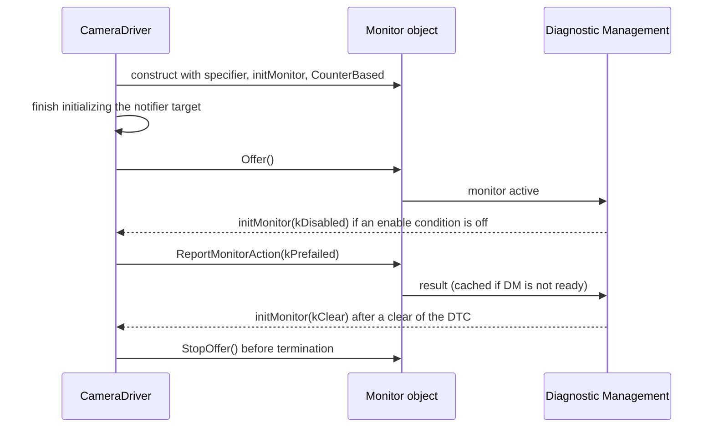

### 5.3 Reporting: `ReportMonitorAction` and `MonitorAction`

`void ReportMonitorAction(MonitorAction action) noexcept` ([SWS_DM_00543]) reports a result. DM then updates the event, the DTC status byte, the event memory and the captured data (SWS, Section 7.3.4.1.2). `MonitorAction` ([SWS_DM_00541]) has eight values; which ones are allowed depends on the debouncing of the event ([SWS_DM_01987]):

| `MonitorAction` | Meaning | Counter-based | Time-based | Monitor-internal |
| --- | --- | --- | --- | --- |
| `kPassed` (`0x00`) | qualified result "passed" | yes | yes | yes |
| `kFailed` (`0x01`) | qualified result "failed" | yes | yes | yes |
| `kPrepassed` (`0x02`) | unqualified "looks good" | yes | yes | no |
| `kPrefailed` (`0x03`) | unqualified "looks bad" | yes | yes | no |
| `kFdcThresholdReached` (`0x04`) | trigger storage of records at the FDC threshold | no | no | yes |
| `kResetTestFailed` (`0x05`) | reset only `kTestFailed` | yes | yes | yes |
| `kFreezeDebouncing` (`0x06`) | freeze the debounce timer | no | yes | no |
| `kResetDebouncing` (`0x07`) | reset the debounce counter or timer | yes | yes | no |

If a monitor reports an action that its debouncing does not support, DM triggers a violation in the process of the monitor ([SWS_DM_01988]): the `UnexpectedMonitorActionHandlingViolation` of [SWS_DM_00543]. A violation terminates the process ([guide 03](03_CoreAndGeneral.md)).

> **Pitfall:** Reporting `kPrefailed` for an event that is configured as monitor-internal in the DEXT is a violation, not a harmless no-op. The DEXT configuration overrides the constructor ([SWS_DM_01099]), so a monitor written for counter-based debouncing breaks when the diagnostic designer switches the event to monitor-internal debouncing.

### 5.4 Caching While DM Is Unavailable

At start-up, the application may run before the DM daemon; a connection can also be lost and re-established. The `ara::diag` library therefore caches (SWS, Sections 7.3.4.1.2, 7.3.4.2, 7.3.4.3):

| Call | What is cached | ID |
| --- | --- | --- |
| `Monitor::ReportMonitorAction` | at least one qualified PASSED and one qualified FAILED result, processed when the connection is (re-)established; debouncing is independent of the cache, and only the qualification trigger is cached, no snapshot data | [SWS_DM_00965] |
| `Condition::SetCondition` | the latest condition value | [SWS_DM_01093] |
| `OperationCycle::RestartOperationCycle` | one restart | [SWS_DM_01103] |

Because the cache holds no snapshot data, a fault that is qualified before DM is up gets its snapshot data from the moment DM processes it, not from the moment it happened.

### 5.5 Event Status Processing

DM processes the event status bits like the corresponding UDS DTC status bits of ISO 14229-1, Annex D ([SWS_DM_01024]). The triggers are:

| Trigger | Effect on the event status bits | ID |
| --- | --- | --- |
| Qualified passed (`kPassed`, or `kFinallyHealed` after debouncing) | "TestResult Passed" of ISO 14229-1: `kTestFailed` = 0, `kTestNotCompletedThisOperationCycle` = 0 | [SWS_DM_01025] |
| Qualified failed (`kFailed`, or `kFinallyDefective`) | "TestResult Failed": `kTestFailed` = 1, `kTestFailedThisOperationCycle` = 1, `kTestNotCompletedThisOperationCycle` = 0 | [SWS_DM_01025] |
| `kPrepassed`, `kPrefailed` | none directly; they feed debouncing | SWS 7.3.4.1.6 |
| `kResetTestFailed` | only `kTestFailed` = 0; an AUTOSAR-specific reset | [SWS_DM_01026] |
| `RestartOperationCycle` | `kTestFailedThisOperationCycle` = 0, `kTestNotCompletedThisOperationCycle` = 1 | [SWS_DM_01027] |
| Clear by `0x14` | `kTestFailed` = 0, `kTestFailedThisOperationCycle` = 0, `kTestNotCompletedThisOperationCycle` = 1 | [SWS_DM_01028] |

The state diagram shows the two most important bits of one event over a cycle.

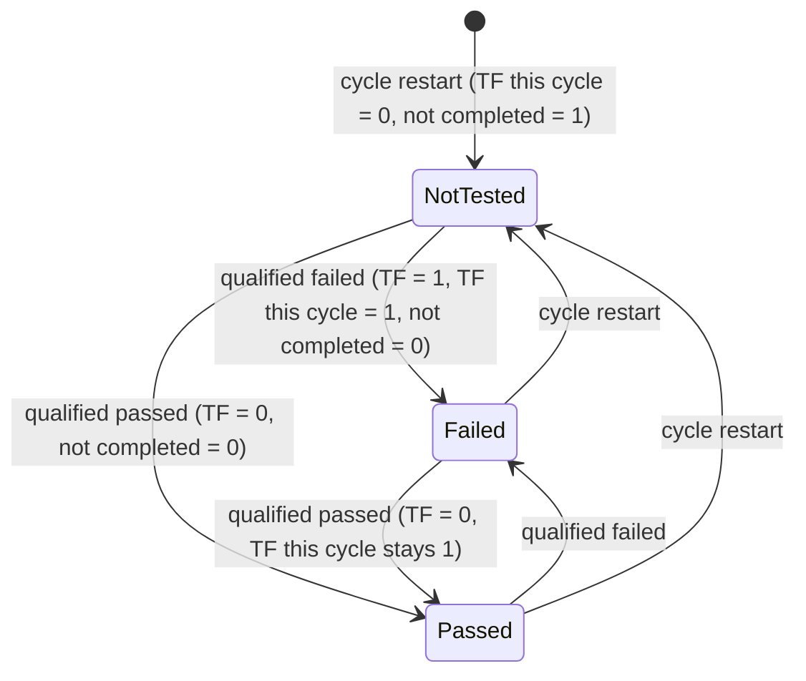

An event is called *active* when `kTestFailed` = 1 and *passive* when it is 0 (SWS, Section 7.3.4.4.8); displacement uses this ([Section 9.6](#96-overflow-and-displacement)).

### 5.6 Reading an Event: `ara::diag::Event`

`ara::diag::Event` ([SWS_DM_00646]) lets an application read one event:

| Method | Returns | ID |
| --- | --- | --- |
| `GetEventStatus()` | `Future<EventStatusByte>`: the current status ([SWS_DM_00886]) | [SWS_DM_00649] |
| `SetEventStatusChangedNotifier(EventStatusByteNotifier)` | called for each status change ([SWS_DM_01029]); a second call overwrites ([SWS_DM_01349]); DRAFT | [SWS_DM_00650] |
| `GetFaultDetectionCounter()` | `Future<std::int8_t>` | [SWS_DM_00656] |
| `GetDebouncingStatus()` | `Future<DebouncingState>` | [SWS_DM_00654] |
| `GetTestComplete()` | `Future<bool>` | [SWS_DM_00655] |
| `GetDTCNumber(DTCFormatType)` | `Future<std::uint32_t>`; `kNoSuchDTC` if no DTC is mapped ([SWS_DM_01269]) | [SWS_DM_00653] |

`EventStatusByte` ([SWS_DM_00644]) offers `IsSet(bits...)`, `IsNotSet(bits...)`, `IsFailedAndTested()` and `IsPassedAndTested()` ([SWS_DM_01755], [SWS_DM_01754], [SWS_DM_01757], [SWS_DM_01756]).

### 5.7 Many Events in One Port: `MultipleMonitor` and `MultipleEvent`

An application with many events would need many ports. `MultipleMonitor`, `MultipleEvent` and `MultipleCondition` handle many elements through one port; each method takes an additional handle (SWS, Sections 7.3.4.1.1, 7.3.4.1.2, 7.3.4.1.4). The handles are numbers generated from the configuration:

- without `overrideId`: in alphabetical order of the short names, starting at `0x010000` and counting up;
- with `overrideId` of the `DiagnosticMultiple...PortMapping`: that value; a generated number that collides with a configured one moves to the next free value ([SWS_DM_01733], [SWS_DM_01731], [SWS_DM_01735]).

Values below `0x010000` are reserved. A handle that the instance does not map gives `kInvalidArgument` ([SWS_DM_01734], [SWS_DM_01732], [SWS_DM_01736]). Because the constructor of `MultipleMonitor` cannot select a debouncing per event, `MultipleMonitor::ConfigureMonitor` (four overloads, DRAFT) does it per handle (SWS, Section 7.3.4.1.2).

> **Pitfall:** Use `overrideId` for every handle your code hard-codes. Generated handles change when a new event with an alphabetically smaller name is added to the DEXT.

> **Note:** `ConditionHandleType` is declared as `std::uint8_t` ([SWS_DM_01726]), but handles are generated from `0x010000` ([SWS_DM_01735]), which does not fit into 8 bits. `EventHandleType` and `MonitorHandleType` are `std::uint32_t` ([SWS_DM_01703], [SWS_DM_01701]). R25-11 is inconsistent here; check your vendor's header.

### 5.8 The Occurrence Counter

The occurrence counter counts the repetitions of the same error. It exists per event memory entry, has one byte, starts at 1 when the entry is created ([SWS_DM_00945]) and latches at 255 ([SWS_DM_00948]). `DiagnosticCommonProps.occurrenceCounterProcessing` selects when it counts:

| Value | Counts each `kTestFailed` 0 → 1 transition … | ID |
| --- | --- | --- |
| `testFailedBit` | regardless of `kConfirmedDTC` | [SWS_DM_00946] |
| `confirmedDtcBit` | only while `kConfirmedDTC` = 1 | [SWS_DM_00947] |

### 5.9 Worked Example: The `CameraBlocked` Monitor

`CameraDriver` checks every third image (every 100 ms at 30 images per second): if the mean brightness is below a limit or the image is identical to the previous one, it reports `kPrefailed`, otherwise `kPrepassed`. The R-port `CameraBlockedMonitorPort` of `CameraDriverSwc` is typed by `DiagnosticMonitorInterface` and mapped to the event `CameraBlocked` and the process `CameraDriver` ([Section 14.11](#1411-fault-memory-port-interfaces-and-port-mappings)).

```cpp
// CameraDriver: diagnostic monitor for the event CameraBlocked (illustrative).
#include "ara/diag/monitor.h"
#include "ara/core/instance_specifier.h"
#include <atomic>

namespace hpc::camera {

class BlockedMonitor final {
public:
    BlockedMonitor()
        : monitor_{*ara::core::InstanceSpecifier::Create("/camera_driver/Root/CameraBlockedMonitorPort"),
                   [this](ara::diag::InitMonitorReason r) { OnInit(r); },
                   DefaultDebouncing()} {}

    void Start() { (void)monitor_.Offer(); }          // only after OnInit() can run safely
    void Stop() { monitor_.StopOffer(); }

    // Called from the image loop every 100 ms.
    void Check(bool dark, bool frozen) {
        if (!enabled_) return;                         // DM ignores reports anyway while disabled
        monitor_.ReportMonitorAction(dark || frozen ? ara::diag::MonitorAction::kPrefailed
                                                    : ara::diag::MonitorAction::kPrepassed);
    }

private:
    static ara::diag::CounterBased DefaultDebouncing() {
        ara::diag::CounterBased d{};                   // used only if the DEXT has no values
        d.failedThreshold = 20;
        d.passedThreshold = -20;
        d.failedStepsize = 2;
        d.passedStepsize = 1;
        d.useJumpToPassed = true;                      // jump down to 0 on the first good image
        d.passedJumpValue = 0;
        d.useJumpToFailed = false;
        return d;
    }

    void OnInit(ara::diag::InitMonitorReason reason) {
        // Called by DM from its own context: keep it short.
        enabled_ = (reason != ara::diag::InitMonitorReason::kDisabled);
        // kClear, kRestart, kReenabled: forget the "frozen image" history of the detector.
        if (reason != ara::diag::InitMonitorReason::kDisabled) resetDetector_ = true;
    }

    std::atomic<bool> enabled_{true};
    std::atomic<bool> resetDetector_{false};
    ara::diag::Monitor monitor_;
};

}  // namespace hpc::camera
```

The member `monitor_` is declared last so that `enabled_` and `resetDetector_` exist before the constructor registers the notifier. `Start()` calls `Offer()` only after the object is complete, as the specification intends (SWS, Section 7.3.4.1.2).

> **Key takeaways**
>
> - One event has one reporter; `Monitor` is created once per event and must be offered before DM calls it back.
> - `initMonitor` tells the monitor to start over after a clear, a cycle restart or a change of the enable conditions.
> - The allowed `MonitorAction` values depend on the debouncing; a wrong one is a violation.
> - DM caches results, conditions and one cycle restart while it is unreachable.

---

## 6. Debouncing

> **Why this matters:** Debouncing decides how fast a fault is reported and how fast it heals. Too sensitive, and every tunnel entrance sets a "camera blocked" DTC; too slow, and the ADAS feature runs on a blind camera. The parameters live in the DEXT, but the monitor must report the actions that fit them.

### 6.1 Why Debounce

A debounced event moves through the `DebouncingState` values ([SWS_DM_00645]):

| `DebouncingState` | Value | FDC |
| --- | --- | --- |
| `kNeutral` | `0x00` | 0 |
| `kTemporarilyDefective` | `0x01` | between 0 and 127 |
| `kFinallyDefective` | `0x02` | 127: the event is qualified failed |
| `kTemporarilyHealed` | `0x04` | between −128 and 0 |
| `kFinallyHealed` | `0x08` | −128: the event is qualified passed |

When the FDC reaches +127 or −128, the result is qualified and has the same effect as `kFailed` or `kPassed` ([Section 5.5](#55-event-status-processing)). Which algorithm applies is configured per event. DM does not debounce an event that has no `DiagnosticEventToDebounceAlgorithmMapping`, or whose algorithm is `DiagEventDebounceMonitorInternal` (SWS, Section 7.3.4.1.5); `DiagnosticDebounceAlgorithmProps.debounceAlgorithm` must exist ([constr_10418]).

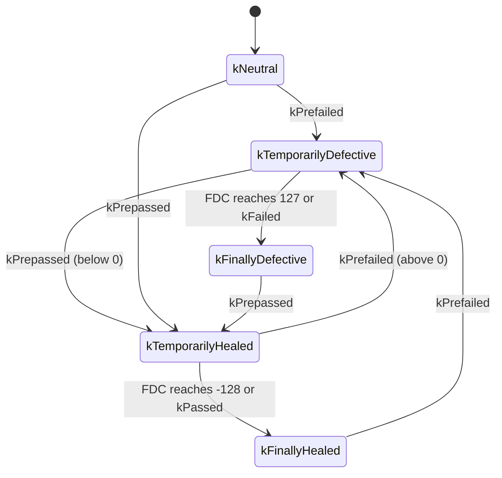

### 6.2 Counter-Based Debouncing

**In plain words:** Each bad report adds points, each good report removes points. At the upper limit the event fails, at the lower limit it heals.

**Formally:** An event uses counter-based debouncing when its debounce algorithm aggregates `DiagEventDebounceCounterBased` ([SWS_DM_00014]). The internal debounce counter starts at 0 at start-up ([SWS_DM_00018]); the FDC is a linear mapping of the counter to −128 … +127 ([SWS_DM_00017]).

| Report | Effect on the counter | ID |
| --- | --- | --- |
| `kPrefailed` | `+ counterIncrementStepSize`, clamped at `counterFailedThreshold` | [SWS_DM_00875] |
| `kPrepassed` | `− counterDecrementStepSize`, clamped at `counterPassedThreshold` | [SWS_DM_00876] |
| counter ≥ `counterFailedThreshold` | event processed as `kFinallyDefective` | [SWS_DM_00024] |
| counter ≤ `counterPassedThreshold` | event processed as `kFinallyHealed` | [SWS_DM_00025] |
| `kFailed` | counter = `counterFailedThreshold`, `kFinallyDefective` | [SWS_DM_00021] |
| `kPassed` | counter = `counterPassedThreshold`, `kFinallyHealed` | [SWS_DM_00029] |
| `kPrefailed` with `counterJumpUp` = true and counter < `counterJumpUpValue` | counter = `counterJumpUpValue`, then increment | [SWS_DM_00022] |
| `kPrepassed` with `counterJumpDown` = true and counter > `counterJumpDownValue` | counter = `counterJumpDownValue`, then decrement | [SWS_DM_00023] |

Jumping lets an event change direction quickly: with *jump down* to 0, a single good report after a long bad phase throws away the accumulated "bad" points.

### 6.3 Time-Based Debouncing

An event uses time-based debouncing when its algorithm aggregates `DiagEventDebounceTimeBased` ([SWS_DM_00015]). The internal timer starts at 0 ([SWS_DM_00085]); the FDC is a linear mapping of the timer ([SWS_DM_00030]).

| Report | Effect | ID |
| --- | --- | --- |
| `kPrefailed` | start the timer towards `kFinallyDefective`, which is reached after `timeFailedThreshold`; only if it is not already running in that direction and the event is not already `kFinallyDefective` | [SWS_DM_00877] |
| `kPrepassed` | start the timer towards `kFinallyHealed` after `timePassedThreshold`, with the same conditions | [SWS_DM_00878] |
| `kFailed` / `kPassed` | timer = threshold; qualified at once | [SWS_DM_00033], [SWS_DM_00036] |
| `kFreezeDebouncing` | freeze the timer | [SWS_DM_00880] |
| next `kPrepassed` or `kPrefailed` after a freeze | continue from the frozen value | [SWS_DM_00038] |

So with time-based debouncing the monitor only reports *changes of direction*; DM measures the time. Freezing is supported only for time-based debouncing. `debounceCounterStorage` is not supported for time-based debouncing (SWS, Section 7.3.4.1.5.2).

### 6.4 Monitor-Internal Debouncing and Monitors without Debouncing

With `DiagEventDebounceMonitorInternal`, the application debounces itself and reports only `kPassed` and `kFailed` (SWS, Section 7.3.4.1.5.3). Two details:

- **FDC.** DM asks the monitor: it uses the value returned by the `getFaultDetectionCounter` callback of the constructor ([SWS_DM_01268]). For a monitor that does not debounce at all, DM derives the FDC from the status: −128 if `kTestFailed` = 0 and the test completed this cycle, 0 if the test has not completed this cycle, 127 if `kTestFailed` = 1 and the test completed ([SWS_DM_01971]).
- **Early data capture.** `kFdcThresholdReached` makes DM allocate an entry and capture snapshot and extended data whose trigger is `fdcThreshold` ([SWS_DM_01267]).

> **Note:** The DEXT also has `counterBasedFdcThresholdStorageValue` and `timeBasedFdcThresholdStorageValue` to trigger storage at an FDC threshold during DM-internal debouncing. The R25-11 SWS does not refer to these attributes; it specifies the `fdcThreshold` trigger only through `kFdcThresholdReached`. Treat their use with DM-internal debouncing as not specified.

### 6.5 DEXT Values and Constructor Defaults

Debouncing parameters can come from two sources: the DEXT and the `Monitor` constructor. The constructor values are defaults:

- If the DEXT contains debouncing parameters and the algorithm fits (counter or time), DM uses the DEXT values and ignores the constructor values ([SWS_DM_01099]).
- If the DEXT contains none, DM uses the constructor values and algorithm ([SWS_DM_01101]).

The `CounterBased` structure ([SWS_DM_00538]) has `failedThreshold`, `passedThreshold`, `failedStepsize`, `passedStepsize`, `failedJumpValue`, `passedJumpValue`, `useJumpToFailed` and `useJumpToPassed` ([SWS_DM_00621]-[SWS_DM_00628]); `TimeBased` ([SWS_DM_00539]) has `failedMs` and `passedMs` ([SWS_DM_00629], [SWS_DM_00630]). They play the same roles as the DEXT attributes of [Section 6.2](#62-counter-based-debouncing) and [Section 6.3](#63-time-based-debouncing).

> **Pitfall:** Since the DEXT wins, "tuning" the constructor values in the code has no effect once the diagnostic designer has entered values in the DEXT. Keep both in sync, or treat the DEXT as the only source.

### 6.6 Resetting the Debouncing

| Situation | Effect | ID |
| --- | --- | --- |
| `kResetDebouncing`, counter-based | counter and FDC = 0 | [SWS_DM_01583] |
| `kResetDebouncing`, time-based | timer stopped, FDC = 0 | [SWS_DM_01584] |
| Operation cycle restarted | counter reset for all events of that cycle | [SWS_DM_00039] |
| DTC cleared | counter reset for all events of the cleared DTCs | [SWS_DM_00086] |
| Enable condition becomes not fulfilled | counter reset | [SWS_DM_00882] |
| DTC setting switched off by `0x85` | counter reset and frozen while DTC setting is off | [SWS_DM_00378] |

### 6.7 Worked Example: Debouncing `CameraBlocked`

The DEXT configures `CameraBlockedDebounce` as counter-based with `counterIncrementStepSize` 2, `counterDecrementStepSize` 1, `counterFailedThreshold` 20, `counterPassedThreshold` −20, `counterJumpDown` true with `counterJumpDownValue` 0, and `counterJumpUp` false. The monitor reports every 100 ms. Snow covers the camera at t = 0 and slides off at t = 2.0 s.

| Time | Report | Counter | FDC (approx.) | `DebouncingState` | Event |
| --- | --- | --- | --- | --- | --- |
| −0.1 s | `kPrepassed` | −20 | −128 | `kFinallyHealed` | passed |
| 0.0 s | `kPrefailed` | −18 | −115 | `kTemporarilyHealed` | passed |
| 0.4 s | `kPrefailed` | −10 | −64 | `kTemporarilyHealed` | passed |
| 0.9 s | `kPrefailed` | 0 | 0 | `kNeutral` | passed |
| 1.9 s | `kPrefailed` | 20 (threshold) | 127 | `kFinallyDefective` | **failed** |
| 2.0 s | `kPrepassed` | 0 (jump), then −1 | −6 | `kTemporarilyHealed` | failed |
| 3.9 s | `kPrepassed` | −20 (threshold) | −128 | `kFinallyHealed` | **passed** |

Without jump up, the first bad image after a long good phase starts from −20, so the fault needs 2 s to qualify from a healed state, and only 1 s from neutral. The exact FDC values depend on the linear mapping, which the SWS does not detail beyond its range ([SWS_DM_00017]).

> **Key takeaways**
>
> - The FDC (−128 … +127) shows debouncing progress; ±limits qualify the result.
> - Counter-based: steps and thresholds, optional jumps. Time-based: thresholds in time, optional freeze.
> - Monitor-internal: the application debounces and reports `kPassed`/`kFailed`; DM can ask for the FDC.
> - DEXT values override constructor defaults; resets happen on cycle restart, clear, disabled conditions and `0x85` OFF.

---

## 7. Operation Cycles and Conditions

> **Why this matters:** DM cannot know when the vehicle's ignition is switched on or whether the vehicle stands still. Applications must tell it. A forgotten cycle restart freezes pending, confirmation and aging; a forgotten condition silently drops every report or blocks every clear.

### 7.1 Operation Cycles

Operation cycles follow ISO 14229-1 and affect the status byte and the event memory; typical cycles are ignition on and off, power up and down, or accumulated operating time (SWS, Section 7.3.4.3). Each event needs exactly one `DiagnosticEventToOperationCycleMapping` ([SWS_DM_CONSTR_00168]). `DiagnosticOperationCycle.type` is `ignition`, `obdDrivingCycle`, `other` or `warmup` (TPS, Table 5.22).

The cycle is managed by an application, which calls `ara::diag::OperationCycle::RestartOperationCycle()` ([SWS_DM_01102]):

- DM restarts a cycle only after the previous restart has been fully processed; there is no restart queue ([SWS_DM_01104]), and a call during the processing of the previous one is ignored ([SWS_DM_01105]).
- A restart resets the per-cycle bits ([SWS_DM_01027]), resets the debouncing ([SWS_DM_00039]), calls `initMonitor(kRestart)` ([SWS_DM_00563]) and is the moment at which healing and aging counters advance ([SWS_DM_01582], [SWS_DM_01265]).
- `SetNotifier` registers a notifier for restarts; a second call overwrites ([SWS_DM_01358]).

Each `DiagnosticOperationCycle` is referenced by exactly one `DiagnosticOperationCyclePortMapping` ([constr_10051]): one application owns each cycle.

### 7.2 Enable Conditions

An enable condition lets DM ignore monitor reports in situations where the monitor would give wrong results. `DiagnosticEnableCondition`s are collected in a `DiagnosticEnableConditionGroup` and mapped to events by `DiagnosticEventToEnableConditionGroupMapping` (SWS, Section 7.3.4.1.4).

- The owner sets the state with `Condition::SetCondition(ConditionType)` ([SWS_DM_00715]) to `kConditionTrue` or `kConditionFalse` ([SWS_DM_00710]) and reads it with `GetCondition()` ([SWS_DM_00714]).
- If any enable condition of an event is not fulfilled, DM ignores the reported result ([SWS_DM_00568]) and resets the event's debounce counter ([SWS_DM_00882]); the monitor gets `initMonitor(kDisabled)` and later `kReenabled` ([SWS_DM_01095], [SWS_DM_01094]).
- `DiagnosticCondition.initValue` is the value after power-up, before the condition is set the first time (DEXT, Table 4.185).

`DiagnosticStorageCondition` exists in the DEXT, but the SWS does not use it; only enable and clear conditions are specified for AP.

### 7.3 Clear Conditions and `clearEventAllowedBehavior`

A clear condition protects a DTC against clearing. Unlike enable conditions, `DiagnosticClearCondition`s are not mapped to events but, through a `DiagnosticClearConditionGroup`, to a `DiagnosticTroubleCodeUds` by `DiagnosticTroubleCodeUdsToClearConditionGroupMapping` (TPS, Section 5.3); at most one such mapping exists per DTC ([constr_1658]). They are set with the same `Condition` class, through a `DiagnosticClearConditionPortMapping` ([TPS_MANI_01259]).

If any clear condition of a DTC is `kConditionFalse`, the clear is *forbidden* ([SWS_DM_00896]). Then:

- snapshot and extended data records stay unchanged ([SWS_DM_00121]);
- the status byte depends on `DiagnosticEvent.clearEventAllowedBehavior` of the mapped event: `noStatusByteChange` keeps it ([SWS_DM_00123]); `onlyThisCycleAndReadiness` sets bit 1 to 0, bit 4 to 1, bit 5 to 0 and bit 6 to 1 ([SWS_DM_00124]);
- the tester gets NRC `0x22` under the rules of [Section 10.2](#102-0x14-cleardiagnosticinformation).

### 7.4 Worked Example: `SmControl` Owns the Cycle and the Conditions

`SmControl` already receives `PowerMode` (values `Off` and `On`) and `VehicleSpeed` ([guide 00, Section 6.6](00_LearningPath.md#66-services-and-their-consumers)). It gets three R-ports for the fault memory: `IgnitionCyclePort` (`DiagnosticOperationCycleInterface`), `PowerModeOnConditionPort` and `StandstillClearConditionPort` (both `DiagnosticConditionInterface`).

```cpp
// SmControl: operation cycle and conditions for Diagnostic Event Management (illustrative).
#include "ara/diag/operation_cycle.h"
#include "ara/diag/condition.h"
#include "ara/diag/dtc_information.h"
#include "ara/core/instance_specifier.h"

namespace hpc::smcontrol {

class DiagnosticSituation final {
public:
    DiagnosticSituation()
        : ignitionCycle_{Spec("/sm_control/Root/IgnitionCyclePort")},
          powerModeOn_{Spec("/sm_control/Root/PowerModeOnConditionPort")},
          standstill_{Spec("/sm_control/Root/StandstillClearConditionPort")},
          primaryMemory_{Spec("/sm_control/Root/PrimaryMemoryPort")} {}

    // Called from the PowerMode field notifier of PowerModeService.
    void OnPowerMode(bool on) {
        if (on && !powerOn_) {
            (void)ignitionCycle_.RestartOperationCycle();   // a new ignition cycle begins
            (void)primaryMemory_.EnableControlDtc();        // undo a 0x85 OFF left over by a tester
        }
        powerOn_ = on;
        (void)powerModeOn_.SetCondition(on ? ara::diag::ConditionType::kConditionTrue
                                           : ara::diag::ConditionType::kConditionFalse);
    }

    // Called from the VehicleSpeed event of VehicleDynamicsService (0.01 km/h per bit).
    void OnVehicleSpeed(std::uint16_t raw) {
        const bool stands = raw < 50;                      // below 0.5 km/h
        if (stands != isStandstill_) {
            isStandstill_ = stands;
            (void)standstill_.SetCondition(stands ? ara::diag::ConditionType::kConditionTrue
                                                  : ara::diag::ConditionType::kConditionFalse);
        }
    }

private:
    static ara::core::InstanceSpecifier Spec(const char* s) { return *ara::core::InstanceSpecifier::Create(s); }

    ara::diag::OperationCycle ignitionCycle_;
    ara::diag::Condition powerModeOn_;
    ara::diag::Condition standstill_;
    ara::diag::DTCInformation primaryMemory_;
    bool powerOn_{false};
    bool isStandstill_{true};
};

}  // namespace hpc::smcontrol
```

The enable condition `PowerModeOn` has `initValue` false, so DM ignores `CameraBlocked` reports until `SmControl` reports power on: the camera image is dark while the vehicle is parked, which is not a fault.

> **Note (implementation example):** Where the cycle restart happens is a project decision; the SWS only says that an application manages operation cycles. Restarting on `PowerMode` `On` fits the cycle type `ignition`. A machine that runs for days without ignition changes, such as a parked vehicle that stays awake for an update, needs a different definition.

> **Key takeaways**
>
> - One application owns each operation cycle and calls `RestartOperationCycle`; there is no restart queue.
> - Enable conditions gate monitor reports per event; clear conditions gate clears per DTC.
> - A forbidden clear keeps the records and changes the status byte according to `clearEventAllowedBehavior`.
> - In `HPC`, `SmControl` owns `IgnitionCycle`, `PowerModeOn` and `VehicleStandstill`.

---

## 8. DTCs and the UDS DTC Status Byte

> **Why this matters:** The status byte is what the workshop tester shows. "Pending" and "confirmed" decide whether a DTC appears in the standard read-out, whether a lamp is requested and when the entry can age. Predicting the byte over several drives is the core skill of fault-memory work.

### 8.1 DTC Format and Groups

A DTC is a 3-byte value (SWS, Section 7.3.4.4.1.1). DM uses one DTC format, defined by `DiagnosticMemoryDestinationPrimary.typeOfDtcSupported` ([SWS_DM_00058]); it supports `iso11992_4`, `iso14229_1` and `saeJ2012_da`, but not `iso15031_6` and `saeJ1939_73` ([SWS_DM_CONSTR_00059]). OBD and J1939 DTCs are not supported (SWS, Section 7.3.4.4.1). In `0x19` responses, the format is sent as the *DTCFormatIdentifier* ([SWS_DM_00062]):

| `typeOfDtcSupported` | DTCFormatIdentifier |
| --- | --- |
| `iso11992_4` | `0x03` |
| `iso14229_1` | `0x01` |
| `saeJ2012_da` | `0x00` |

A **DTC group** addresses several DTCs with one value. Each `DiagnosticTroubleCodeGroup` defines a group with its `groupNumber` ([SWS_DM_00064]). The group of all DTCs, `0xFFFFFF`, always exists and contains all configured DTCs ([SWS_DM_00065]); a configured group with `0xFFFFFF` is ignored ([SWS_DM_CONSTR_00082]). DM resolves a group and applies the operation, for example a clear, to every DTC of the group ([SWS_DM_00116]).

### 8.2 Status Bit Processing

DM processes the UDS DTC status byte as ISO 14229-1 specifies ([SWS_DM_00213]), based on the event status bits ([SWS_DM_00883]) and, for a clear, according to ISO 14229-1 ([SWS_DM_00217]). The ISO rules (Annex D) in short:

| Bit | Set when … | Reset when … |
| --- | --- | --- |
| 0 `kTestFailed` | a qualified failed result arrives | a qualified passed result arrives; a clear; `kResetTestFailed` |
| 1 `kTestFailedThisOperationCycle` | a qualified failed result arrives | the cycle restarts; a clear |
| 2 `kPendingDTC` | a qualified failed result arrives | a cycle ends in which the test completed without failure; a clear |
| 3 `kConfirmedDTC` | the confirmation rule below holds | a clear; aging; optionally displacement |
| 4 `kTestNotCompletedSinceLastClear` | a clear | the test completes (passed or failed) |
| 5 `kTestFailedSinceLastClear` | a qualified failed result arrives | a clear; optionally aging and displacement |
| 6 `kTestNotCompletedThisOperationCycle` | the cycle restarts; a clear | the test completes in this cycle |
| 7 `kWarningIndicatorRequested` | together with bit 3, if an indicator is configured | healing ([Section 8.5](#85-indicators-and-the-warningindicatorrequested-bit)); a clear |

**Confirmation.** When `kTestFailed` changes from 0 to 1, DM sets `kConfirmedDTC` if `DiagnosticEvent.confirmationThreshold` is configured and the *trip counter* equals `confirmationThreshold − 1` ([SWS_DM_00218]). The trip counter is increased by one at the end of every operation cycle in which `kTestFailedThisOperationCycle` was set (SWS, Section 7.3.4.4.2.1). Without a configured threshold, DM uses 1 ([SWS_DM_01037]): the DTC is confirmed together with the first failure, sometimes called a "zero trip DTC" (DEXT, Table 4.149). A threshold of 2 confirms the DTC in the cycle after the first failure.

The following state diagram shows the life of a DTC with confirmation threshold 2 and aging.

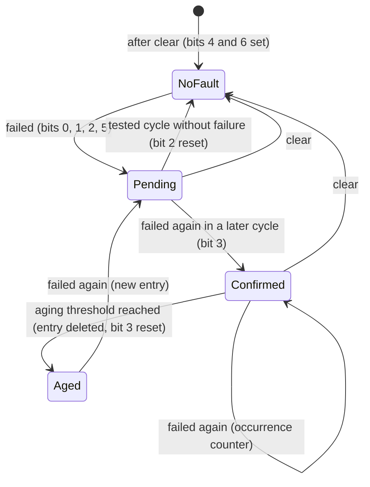

> **Note:** [SWS_DM_00218] ties confirmation to a 0 → 1 transition of `kTestFailed`. A fault that stays failed without a passed result in between does not produce a new transition after a cycle restart, because a restart does not reset bit 0 ([SWS_DM_01027]). The worked example in [Section 8.7](#87-worked-example-two-drives-with-a-blocked-camera) therefore uses a fault that heals and fails again.

### 8.3 Severity, Priority and Significance

`DiagnosticTroubleCodeUds.severity` carries the ISO 14229-1 severity (`checkAtNextHalt`, `immediately`, `maintenanceOnly`, `noSeverity`; DEXT, Table 4.178); it is reported in `0x19` sub-function `0x07` and as the SOVD fault `severity` ([SWS_DM_01567]). `DiagnosticTroubleCodeProps.priority` ranks DTCs for displacement: 1 is the highest priority and higher values are lower ([SWS_DM_00916]); the range is 1..255 ([SWS_DM_CONSTR_00961]). `DiagnosticTroubleCodeProps.significance` is `fault` or `occurence` (spelled so in the DEXT) and can be read as an internal data element ([SWS_DM_00961]).

### 8.4 Event Combination

**In plain words:** Several monitors can point to the same fault from different angles, for example "image dark" and "image frozen". With event combination they share one DTC, and DM merges their status.

**Formally:** DM applies event combination to a DTC when more than one `DiagnosticEventToTroubleCodeUdsMapping` refers to the same `DiagnosticTroubleCodeUds` ([SWS_DM_01106]). `DiagnosticCommonProps.typeOfEventCombinationSupported` selects the type ([SWS_DM_01107]):

| Type | Storage | Reporting |
| --- | --- | --- |
| `eventCombinationOnStorage` | One entry per DTC; the combined status transitions trigger entry allocation and data capture ([SWS_DM_01112]); aging uses the combined status ([SWS_DM_01113]) | As for a single event |
| `eventCombinationOnRetrieval` | Data per event ([SWS_DM_01114]) | `0x19` concatenates the data of all events of the DTC ([SWS_DM_01115]); optionally oldest first with `eventCombinationReportingBehavior` = `reportingInChronologicalOrderOldestFirst` ([SWS_DM_01116]) |

The combined status byte is a bitwise OR over the events, with two exceptions ([SWS_DM_01977]): bit 4 is the OR of bit 4 AND NOT the combined bit 5; bit 6 is the OR of bit 6 AND NOT the combined bit 1. DM recalculates it on every event update ([SWS_DM_01109]) and calls the configured callbacks when it changes ([SWS_DM_01110]). The FDC of a combined DTC is the greatest FDC of its events ([SWS_DM_01111]). A clear clears all events of the DTC ([SWS_DM_01108]). The event status byte of each event is not affected by combination. R25-11 notes that "details for combined events are not specified" (SWS, Section 4.1.1).

### 8.5 Indicators and the WarningIndicatorRequested Bit

An indicator is a warning output (lamp, text). Events are linked to indicators by `DiagnosticEvent.connectedIndicator` (a `DiagnosticConnectedIndicator` with the referenced `DiagnosticIndicator`); an event can have zero or more indicators and an indicator serves many events (SWS, Section 7.3.4.4.2.3).

- **On:** DM sets bit 7 together with bit 3 ([SWS_DM_01266], [SWS_DM_00223]) and sets the healing counter to 0. The failure cycle threshold `indicatorFailureCycleCounterThreshold` is not evaluated, nor is `DiagnosticConnectedIndicator.behavior`.
- **No indicator configured:** bit 7 stays 0, even for a confirmed DTC ([SWS_DM_01032]).
- **Healing:** at a cycle restart in which the event was tested and did not fail, the healing counter increases ([SWS_DM_01582]); at the end of a cycle DM resets bit 7 when every indicator's healing counter has reached its `healingCycleCounterThreshold` ([SWS_DM_00224]).
- **Applications** read the state with `Indicator::GetIndicatorState()` ([SWS_DM_00888]): `kOnDemand` if at least one indicator state of an event of the DTC is `kOnDemand` ([SWS_DM_01974]), `kOff` if all are off ([SWS_DM_01975]); `IndicatorStatusType` has only these two values ([SWS_DM_00740]). An application cannot set bit 7 itself (SWS, Section 7.3.4.4.2.4).

`HPC` configures no indicator: the cockpit is a black box and receives the ADAS state through `AdasStatusService`. `0x9A1011` therefore never sets bit 7.

### 8.6 `ara::diag::DTCInformation`

`DTCInformation` ([SWS_DM_00657]) is the application's view of one event memory: each instance is linked to the `DiagnosticMemoryDestination` of its `DiagnosticMemoryDestinationPortMapping` ([SWS_DM_00911]).

| Method | Purpose | ID |
| --- | --- | --- |
| `GetCurrentStatus(std::uint32_t dtc)` | Status byte of a DTC ([SWS_DM_01030]) | [SWS_DM_00666] |
| `SetDTCStatusChangedNotifier(DtcStatusChangedNotifier)` | Called with DTC, old and new status for every status change of every DTC of the memory ([SWS_DM_01031]); DRAFT | [SWS_DM_00667] |
| `GetNumberOfStoredEntries()`, `SetNumberOfStoredEntriesNotifier` | Number of stored entries and changes ([SWS_DM_00902]); notifier DRAFT | [SWS_DM_00669], [SWS_DM_00670] |
| `SetSnapshotRecordUpdatedNotifier` | Called after a snapshot record was stored or overwritten ([SWS_DM_00894]); DRAFT | [SWS_DM_00668] |
| `GetEventMemoryOverflow()`, `SetEventMemoryOverflowNotifier` | Overflow state ([Section 9.6](#96-overflow-and-displacement)) | [SWS_DM_00919], [SWS_DM_00918] |
| `Clear(std::uint32_t dtcGroup)` | Clear from the application ([Section 10.3](#103-clearing-from-an-application)) | [SWS_DM_00671] |
| `GetControlDTCStatus()`, `EnableControlDtc()`, `SetControlDtcStatusNotifier` | DTC setting state ([Section 10.4](#104-0x85-controldtcsetting)); notifier DRAFT | [SWS_DM_00672], [SWS_DM_00674], [SWS_DM_00673] |

Every `Set...Notifier` overwrites a previously registered notifier ([SWS_DM_01350], [SWS_DM_01351], [SWS_DM_01352], [SWS_DM_01353], [SWS_DM_01354]).

```cpp
// Reading the status of DTC 0x9A1011 (illustrative).
#include "ara/diag/dtc_information.h"

void LogCameraDtc(ara::diag::DTCInformation& memory) {
    auto result = memory.GetCurrentStatus(0x9A1011).GetResult();
    if (!result) return;                                   // e.g. DM not available
    using Bit = ara::diag::UdsDtcStatusBitType;
    const ara::diag::UdsDtcStatusByteType status = result.Value();
    if (status.IsSet(Bit::kConfirmedDTC)) { /* confirmed: log for service */ }
    else if (status.IsSet(Bit::kPendingDTC)) { /* pending: first occurrence */ }
}
```

### 8.7 Worked Example: Two Drives with a Blocked Camera

`0x9A1011` has `confirmationThreshold` 2, no indicator, and the operation cycle `IgnitionCycle`. Snow covers the camera on the first drive and slides off; on the next morning the camera is covered again.

| Step | Event | Status byte | Bits | Notes |
| --- | --- | --- | --- | --- |
| 1 | After the last clear, power on (cycle restart) | `0x50` | 4, 6 | never tested since clear |
| 2 | Drive 1: `CameraBlocked` qualified failed | `0x27` | 0, 1, 2, 5 | pending; trip counter 0, so not confirmed; entry created (trigger `testFailed`), snapshot record 1 |
| 3 | Drive 1: snow gone, qualified passed | `0x26` | 1, 2, 5 | bit 0 reset; pending stays |
| 4 | Power off, power on: cycle restart | `0x64` | 2, 5, 6 | trip counter becomes 1 because drive 1 had bit 1 set |
| 5 | Drive 2: qualified failed again | `0x2F` | 0, 1, 2, 3, 5 | bit 0 goes 0 → 1 with trip counter = threshold − 1: **confirmed**; occurrence counter 2; snapshot record 2 |

With the default threshold 1, step 2 would already give `0x2F`.

> **Key takeaways**
>
> - DM follows ISO 14229-1 Annex D for the status byte; confirmation needs `confirmationThreshold − 1` failed cycles before the failing transition (default 1: immediate).
> - DTC groups, including `0xFFFFFF`, address several DTCs at once.
> - Event combination merges several events into one DTC, on storage or on retrieval.
> - Bit 7 follows bit 3 only if an indicator is configured; healing switches it off.
> - `DTCInformation` gives applications the status, counts, overflow and a clear function; most notifiers are DRAFT.

---

## 9. The Event Memory

> **Why this matters:** The event memory is limited flash, and what it keeps is what the workshop sees. Its configuration decides when an entry is created, which data is frozen with it, what happens when the memory is full, and when an entry disappears by itself.

### 9.1 Primary and User-Defined Memories

DM supports the primary event memory and up to 256 user-defined event memories ([SWS_DM_00055]); all behave identically, with prioritization, aging and displacement ([SWS_DM_01960]). A memory exists when at least one DTC refers to it through `DiagnosticTroubleCodeProps.diagnosticMemory`: `DiagnosticMemoryDestinationPrimary` for the primary memory ([SWS_DM_00056]), `DiagnosticMemoryDestinationUserDefined` with its `memoryId` for a user-defined one ([SWS_DM_00057]). Each DTC must have a memory destination ([SWS_DM_CONSTR_00084], [SWS_DM_00083]). The size is `maxNumberOfEventEntries` entries, each the complete data set of a DTC ([SWS_DM_00920]). DM stores the status of all DTCs and the data of the entries persistently ([SWS_DM_00148]).

User-defined memories are typically used for data that should not appear in the standard read-out, for example security-related faults; `DiagnosticMemoryDestinationUserDefined.authenticationEnabled` indicates that access requires authentication (DEXT, Table 4.174).

### 9.2 When an Entry Is Created

Creating an entry, including the collection of DTC-related data, is triggered by `DiagnosticMemoryDestination.memoryEntryStorageTrigger` ([SWS_DM_00150]), with the default `testFailed` ([SWS_DM_01579]):

| Value | An entry is created when … |
| --- | --- |
| `testFailed` | bit 0 of the status byte is set |
| `confirmed` | bit 3 is set |
| `fdcThreshold` | the FDC threshold is reached ([Section 6.4](#64-monitor-internal-debouncing-and-monitors-without-debouncing)) |

### 9.3 Snapshot Records

Snapshot records hold data from the moment of the fault. Because UDS snapshots consist of DIDs and SOVD snapshots of SOVD data, a DTC has two snapshot definitions (SWS, Section 7.3.4.4.4.2):

- `DiagnosticTroubleCodeProps.snapshotRecordContent`, a `DiagnosticDataIdentifierSet`: DM reads each DID through the port configured for the DID ([SWS_DM_01087]); UDS reports only this content.
- `DiagnosticTroubleCodeProps.sovdSnapshotContent`, a `DiagnosticSovdContentGroup` (TPS, Section 5.7.6; [TPS_MANI_01505]): read through the SOVD content ports ([SWS_DM_02142]). An SOVD snapshot reports both contents; UDS data appears under the short name of the `DiagnosticDataElement`.

**Numbering and triggers** depend on `DiagnosticMemoryDestination.typeOfFreezeFrameRecordNumeration` ([SWS_DM_00151], [SWS_DM_00152]):

| Numbering | How many records | When stored | ID |
| --- | --- | --- | --- |
| `calculated`, `maxNumberFreezeFrameRecords` = 1 | 1 | only at the first `testFailed` 0 → 1 | [SWS_DM_01276] |
| `calculated`, `maxNumberFreezeFrameRecords` > 1 | up to that number, numbered 1, 2, … in time order | at each `testFailed` 0 → 1; when all are used, the most recent is updated | [SWS_DM_01277] |
| `configured`, `DiagnosticFreezeFrame.update` = false | one per configured `DiagnosticFreezeFrame` (`recordNumber`) | when its `trigger` is fulfilled and it is not yet stored | [SWS_DM_01085] |
| `configured`, `update` = true | as above | every time its `trigger` is fulfilled | [SWS_DM_01086] |

If a data provider fails during capture, DM fills the missing data with `0xFF` and writes a `LogError()` message ([SWS_DM_00969]). `DTCInformation::SetSnapshotRecordUpdatedNotifier` reports new or overwritten snapshots ([SWS_DM_00894]), but not deletions, aging or displacement.

### 9.4 Extended Data Records

Extended data holds simple, mostly statistical values; a DTC has zero or one set of extended data, made of extended data records ([SWS_DM_00154]). Record numbers always come from `DiagnosticExtendedDataRecord.recordNumber` ([SWS_DM_00155]). The record's `trigger` starts the capture, `update` decides whether it is captured again after the first storage, and the order of its `element`s defines its layout ([SWS_DM_00895]).

An element gets its value in one of two ways:

- **Internal:** a `DiagnosticEdrDataProviderMapping` with a `dataProvider` name links the element to a value maintained by DM ([Section 9.5](#95-internal-data-elements)).
- **From an application:** DM calls `Read` on the typed class `{<extended-data-record-element-interface-name-x>}` of the mapped port ([SWS_DM_00895], [SWS_DM_02156]); the port is mapped by `DiagnosticExtendedDataRecordClientPortMapping` ([TPS_MANI_01484]). Unlike a DID read, this read cannot return an NRC: extended data must always be available, because UDS has no way to leave a gap in the response (SWS, Section 7.3.4.4.4.3). Use a defined invalid value such as `0xFF` when needed.

[constr_10732] allows `trigger` and `update` on a record only if at least one of its elements is provided by an application.

### 9.5 Internal Data Elements

DM can put its own counters into extended data records. DEM-context internal elements are not frozen at storage time: DM uses the current value at the time of the read-out ([SWS_DM_00949]). The supported data providers ([SWS_DM_02145]):

| `dataProvider` | Content | Size | ID |
| --- | --- | --- | --- |
| `DEM_OCCCTR` | occurrence counter | 1 byte | [SWS_DM_00954] |
| `DEM_AGINGCTR_UPCNT` | aging counter counting up from 0 to `DiagnosticAging.threshold`; 0 if the DTC has no aging | 1 byte | [SWS_DM_00956], [SWS_DM_00958] |
| `DEM_AGINGCTR_DOWNCNT` | aging counter counting down from the threshold to 0; threshold or 255 if the DTC has no aging | 1 byte | [SWS_DM_00957], [SWS_DM_00959] |
| `DEM_CURRENT_FDC` | current FDC | 1 byte | [SWS_DM_00951] |
| `DEM_MAX_FDC_SINCE_LAST_CLEAR` | maximum FDC since the last clear | 1 byte | [SWS_DM_00952] |
| `DEM_MAX_FDC_DURING_CURRENT_CYCLE` | maximum FDC in the current cycle | 1 byte | [SWS_DM_00953] |
| `DEM_FAILED_CYCLES` | failed operation cycles | 1 byte | [SWS_DM_00962] |
| `DEM_CYCLES_SINCE_FIRST_FAILED` | operation cycles since first failed | 1 byte | [SWS_DM_00963] |
| `DEM_CYCLES_SINCE_LAST_FAILED` | operation cycles since last failed | 1 byte | [SWS_DM_00964] |
| `DEM_CYCLES_TESTED_SINCE_FIRST_FAILED` | tested cycles since first failed; latches at 255; stored events only | 1 byte | [SWS_DM_01955], [SWS_DM_01957], [SWS_DM_01959] |
| `DEM_CYCLES_TESTED_SINCE_LAST_FAILED` | tested cycles since last failed; latches at 255; stored events only | 1 byte | [SWS_DM_01954], [SWS_DM_01956], [SWS_DM_01958] |
| `DEM_OVFLIND` | overflow indication of the memory: 0 false, 1 true | 1 byte | [SWS_DM_00921] |
| `DEM_SIGNIFICANCE` | 0 occurrence, 1 fault | 1 byte | [SWS_DM_00961] |
| `DEM_PRIORITY` | DTC priority | 1 byte | [SWS_DM_00950] |
| `DEM_EVENT_ASSOCIATED_IDENTIFICATION` | `DiagnosticEvent.associatedEventIdentification` | 4 bytes | [SWS_DM_02145] |

`DEM_AGINGCTR_UPCNT_FIRST_ACTIVE` is not supported ([SWS_DM_CONSTR_00960]). DEM-exclusive elements must not appear in DIDs read with `0x22` or in routines ([SWS_DM_CONSTR_00395]), and the DCM-exclusive elements `DCM_SESSION` and `DCM_SECURITY_LEVEL` must not appear in snapshots or extended data ([SWS_DM_CONSTR_00396]).

> **Note:** The requirement for the priority element names the data provider `DEM_DTC_PRIORITY` ([SWS_DM_00950]), while the table [SWS_DM_02145] names it `DEM_PRIORITY`. Ask your DM vendor which name its generator accepts.

### 9.6 Overflow and Displacement

The memory is full when `maxNumberOfEventEntries` entries are stored. A further entry causes an *overflow* (SWS, Section 7.3.4.4.9):

- From then on `GetEventMemoryOverflow()` returns true ([SWS_DM_00923]) and the overflow notifier is called with true at each overflow ([SWS_DM_00925]). The indication is persistent per memory ([SWS_DM_00922]) and returns to false only after a clear of all DTCs of that memory ([SWS_DM_00924], [SWS_DM_00926]); aging or clearing single DTCs does not reset it.

`DiagnosticMemoryDestination.eventDisplacementStrategy` decides what happens to the new entry:

| Strategy | Behavior | ID |
| --- | --- | --- |
| `none` | the new event is discarded | [SWS_DM_00927] |
| `prioOcc` | among the entries with the lowest priority, if that priority is lower than the new one's, the oldest is displaced; status bits are not considered | [SWS_DM_00928] |
| `full` | lowest priority first, then passive before active entries, then the oldest | [SWS_DM_00929] |

The flowchart condenses the decision of Figure 7.8 of the SWS.

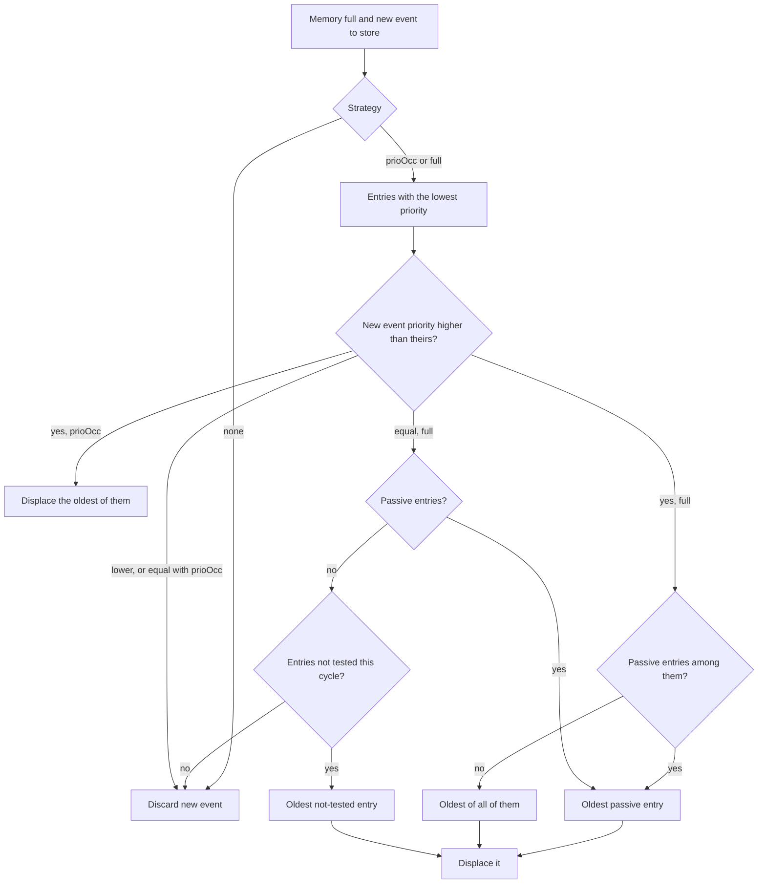

After a displacement ([SWS_DM_00930]), the removed DTC's bit 2 is reset if `DiagnosticCommonProps.resetPendingBitOnOverflow` is true ([SWS_DM_01569]), bit 3 if `resetConfirmedBitOnOverflow` is true ([SWS_DM_00932]), and bit 5 if additionally `statusBitHandlingTestFailedSinceLastClear` is `statusBitAgingAndDisplacement` ([SWS_DM_00933]). If no entry qualifies, the new event is discarded ([SWS_DM_00934]). The TPS notes that ISO 14229-1 compliance requires `resetPendingBitOnOverflow` false (TPS, Table 5.1).

### 9.7 Aging

**In plain words:** A fault that does not come back for a while is forgotten.

**Formally:** If `DiagnosticTroubleCodeProps.aging` exists, DM ages the DTCs that refer to it ([SWS_DM_00237]), with one aging counter per entry ([SWS_DM_00239]):

- The counter is processed only while the DTC is stored, `testFailedThisOperationCycle` is 0, and healing is complete if an indicator is configured ([SWS_DM_00240], [SWS_DM_00238]).
- It counts restarts of `DiagnosticAging.agingCycle` ([SWS_DM_00241]). With `DiagnosticMemoryDestination.agingRequiresTestedCycle` = true, only cycles in which the test completed without failure count ([SWS_DM_01265]); with false (the default, [SWS_DM_01576]), every cycle without failure counts ([SWS_DM_01953]).
- At `DiagnosticAging.threshold`, the entry is deleted with its snapshot and extended data ([SWS_DM_01264]); bit 3 is reset, and bit 5 too if `statusBitHandlingTestFailedSinceLastClear` is `statusBitAgingAndDisplacement` ([SWS_DM_00243]; default `statusBitNormal`, [SWS_DM_01577]). A new failure creates a new entry with initial values.

### 9.8 Reporting Order

For `0x19` sub-functions `0x02` and `0x17` ([SWS_DM_01566]), DM reports DTCs in chronological order of storage, most recent first, if the request mask has only the pending and/or confirmed bits set and `resetConfirmedBitOnOverflow` is true ([SWS_DM_00981], [SWS_DM_00982]). Otherwise the order is not specified; for `0x0A` it is explicitly "no fixed and specified order" ([SWS_DM_00968]).

### 9.9 Worked Example: The Entry of `0x9A1011`

`HpcPrimaryMemory` is the primary memory with 20 entries, displacement `full`, storage trigger `testFailed`, numbering `calculated`; `0x9A1011` allows 2 snapshot records. The snapshot content `CameraBlockedSnapshot` holds the DID `0x0102` `VehicleSpeed` (2 bytes, unsigned, 0.01 km/h per bit), which `SmControl` provides through the typed DID interface on its P-port `VehicleSpeedDidPort` like the DIDs of [guide 12a, Section 10.7](12a_Diagnostics.md#107-worked-example-fusionsoftwareversion). The extended data records are internal:

| Record | Element | `dataProvider` |
| --- | --- | --- |
| `0x01` | `OccurrenceCounter` | `DEM_OCCCTR` |
| `0x02` | `AgingCounter` | `DEM_AGINGCTR_UPCNT` |
| `0x03` | `MaxFdcSinceClear` | `DEM_MAX_FDC_SINCE_LAST_CLEAR` |

After the two drives of [Section 8.7](#87-worked-example-two-drives-with-a-blocked-camera), the entry contains:

| Content | Value | Bytes in a `0x19` response |
| --- | --- | --- |
| Status | `0x2F` | `2F` |
| Snapshot record 1 (drive 1, 50.00 km/h) | DID `0x0102` = 5000 | `01 01 01 02 13 88` |
| Snapshot record 2 (drive 2, 80.00 km/h) | DID `0x0102` = 8000 | `02 01 01 02 1F 40` |
| Record `0x01` | occurrence counter 2 (`occurrenceCounterProcessing` = `testFailedBit`) | `01 02` |
| Record `0x02` | aging counter 0 (failed in the current cycle) | `02 00` |
| Record `0x03` | 127 | `03 7F` |

A snapshot record in a UDS response is: record number, number of DIDs, then each DID with its data (ISO 14229-1). Forty ignition cycles without a failure after drive 2 would age the entry out ([Section 9.7](#97-aging)).

> **Key takeaways**
>
> - A DTC lives in exactly one memory; the primary and up to 256 user-defined memories behave the same.
> - `memoryEntryStorageTrigger` creates the entry; snapshot numbering and triggers decide which snapshots are kept.
> - Extended data comes from DM's internal counters or from applications, and must always be readable.
> - When the memory is full, the displacement strategy decides; the overflow flag stays until a clear of all DTCs.
> - Aging deletes an entry after a threshold of fault-free cycles of the aging cycle.

---

## 10. Reading, Clearing and Controlling the Fault Memory over UDS

> **Why this matters:** The workshop meets the fault memory through four UDS services. Which sub-functions exist, which NRC a refused clear produces and how a forgotten "DTC setting off" disables the whole fault memory are questions that every diagnostic integrator gets asked.

All four services are processed internally by DM (SWS, Table 7.2): no application code is needed, only configuration. The general checks of [guide 12a, Chapter 7](12a_Diagnostics.md#7-request-validation-and-response-handling) (service support, session, security, environmental conditions) apply first.

### 10.1 `0x19` ReadDTCInformation

DM supports a sub-function only if the configuration contains a `DiagnosticReadDTCInformation` with the matching `category`:

| Sub-function | Name | `category` | ID |
| --- | --- | --- | --- |
| `0x01` | reportNumberOfDTCByStatusMask | `REPORT_NUMBER_OF_DTC_BY_STATUS_MASK` | [SWS_DM_00244] |
| `0x02` | reportDTCByStatusMask | `REPORT_DTC_BY_STATUS_MASK` | [SWS_DM_00245] |
| `0x03` | reportDTCSnapshotIdentification | `REPORT_DTC_SNAPSHOT_IDENTIFICATION` | [SWS_DM_01256] |
| `0x04` | reportDTCSnapshotRecordByDTCNumber | `REPORT_DTC_SNAPSHOT_RECORD_BY_DTC_NUMBER` | [SWS_DM_00246] |
| `0x06` | reportDTCExtDataRecordByDTCNumber | `REPORT_DTC_EXT_DATA_RECORD_BY_DTC_NUMBER` | [SWS_DM_00370] |
| `0x07` | reportNumberOfDTCBySeverityMaskRecord | `REPORT_NUMBER_OF_DTC_BY_SEVERITY_MASK_RECORD` | [SWS_DM_00247] |
| `0x0A` | reportSupportedDTC | `REPORT_SUPPORTED_DTC` | [SWS_DM_00967] |
| `0x14` | reportDTCFaultDetectionCounter | `REPORT_DTC_FAULT_DETECTION_COUNTER` | [SWS_DM_00371] |
| `0x17` | reportUserDefMemoryDTCByStatusMask | `REPORT_USER_DEF_MEMORY_DTC_BY_STATUS_MASK` | [SWS_DM_00372] |
| `0x18` | reportUserDefMemoryDTCSnapshotRecordByDTCNumber | `REPORT_USER_DEF_MEMORY_DTC_SNAPSHOT_RECORD_BY_DTC_NUMBER` | [SWS_DM_00373] |
| `0x19` | reportUserDefMemoryDTCExtDataRecordByDTCNumber | `REPORT_USER_DEF_MEMORY_DTC_EXT_DATA_RECORD_BY_DTC_NUMBER` | [SWS_DM_00374] |

Further rules: responses that contain the DTCFormatIdentifier use the mapping of [Section 8.1](#81-dtc-format-and-groups) ([SWS_DM_00061], [SWS_DM_00063]); every response with a DTCStatusAvailabilityMask uses the configured `dtcStatusAvailabilityMask` ([SWS_DM_00966]); `0x0A` reports all supported DTCs of the primary memory in no fixed order ([SWS_DM_00968]). The sub-functions `0x05`, `0x08`, `0x09`, `0x0B` to `0x13`, `0x15`, `0x16`, `0x42` and `0x55` are not supported (SWS, Table 4.1): no OBD, no mirror memory, and no "first/most recent failed DTC" reports.

### 10.2 `0x14` ClearDiagnosticInformation

DM implements `0x14` according to ISO 14229-1 ([SWS_DM_00090]). It takes the DTC or group from the parameter *groupOfDTC* ([SWS_DM_00091]) and clears as described in [Section 8.1](#81-dtc-format-and-groups): status reset, snapshot and extended data deleted ([SWS_DM_00117]). The positive response is sent only after all memory is cleared, whatever the memory organization ([SWS_DM_00113], [SWS_DM_00162]).

| Situation | Response | ID |
| --- | --- | --- |
| groupOfDTC is neither a configured group nor a configured DTC | NRC `0x31` (`kRequestOutOfRange`) | [SWS_DM_00092] |
| `clearDtcLimitation` = `clearAllDtcs` and groupOfDTC is not `0xFFFFFF` | NRC `0x31` | [SWS_DM_00159] |
| `clearDtcLimitation` = `allSupportedDtcs` (default, [SWS_DM_01578]) | single DTCs and groups allowed | [SWS_DM_00160] |
| Single DTC whose clear condition is not fulfilled | NRC `0x22` (`kConditionsNotCorrect`) | [SWS_DM_00163], [SWS_DM_00122] |
| Group in which **all** DTCs forbid the clear | NRC `0x22`; if at least one DTC may be cleared, it is cleared and the response is positive | [SWS_DM_00164], [SWS_DM_00122] |
| Another client is clearing the same memory | NRC `0x22`; clears of different memories run in parallel | [SWS_DM_00145], [SWS_DM_00147], [SWS_DM_00144] |
| Non-volatile memory error | NRC `0x72` (`kGeneralProgrammingFailure`) | [SWS_DM_00115] |

**User-defined memories.** A `0x14` request of 5 bytes clears a user-defined memory; the fifth byte is its number ([SWS_DM_00193], [SWS_DM_00194]). DM clears the memory with that `memoryId` ([SWS_DM_00195]) or answers NRC `0x31` if none exists ([SWS_DM_00208]).

After a clear, DM resets the debounce counters of the cleared events ([SWS_DM_00086]), calls `initMonitor(kClear)` ([SWS_DM_00562]) and, for a clear of all DTCs, resets the overflow flag ([SWS_DM_00924]). It reports a security event ([Chapter 16](#16-reporting)).

### 10.3 Clearing from an Application

`DTCInformation::Clear(std::uint32_t dtcGroup)` ([SWS_DM_00671]) clears a DTC or group in the memory of that `DTCInformation` instance only ([SWS_DM_00897]); a typical use is a routine that clears a user-defined memory. The operation is the same as `0x14`. Errors: `kWrongDtc` for an unknown DTC or group ([SWS_DM_00898]), `kBusy` while another clear runs ([SWS_DM_00899]), `kMemoryError` on a non-volatile memory error ([SWS_DM_00900]), `kFailed` when clear conditions forbid it ([SWS_DM_00901]), and `kServiceNotAvailable` when DM is not available.

### 10.4 `0x85` ControlDTCSetting

`0x85` lets a tester stop the updating of DTC status bits, for example during a flash session in which many monitors would otherwise report errors ([SWS_DM_00229]). DM supports only the sub-functions ON (`0x01`) and OFF (`0x02`) (SWS, Section 4.1.1). The optional *DTCSettingControlOptionRecord* is accepted only as `0xFFFFFF`; any other value gives NRC `0x31` ([SWS_DM_00231]).

| Request | Effect | ID |
| --- | --- | --- |
| ON | enable status updates and storage; `ControlDtcStatusType` = `kDTCSettingOn` | [SWS_DM_00909] |
| OFF | disable status updates and storage in the primary memory and in every user-defined memory with `affectedByControlDTCSetting` true or not configured; `kDTCSettingOff` | [SWS_DM_00910] |
| Return to the default session | DTC setting is enabled again | [SWS_DM_00812] |
| `DTCInformation::EnableControlDtc()` from an application | same as ON | [SWS_DM_00811], [SWS_DM_00674] |

While DTC setting is off, DM-internal debouncing is reset and frozen ([SWS_DM_00378]) and monitors get `initMonitor(kDisabled)`; switching it on again sends `kReenabled` when all enable conditions are fulfilled ([SWS_DM_01095], [SWS_DM_01094]). SOVD offers the same function as the mode `dtcsetting` ([Section 13.5](#135-modes)).

The SWS gives a hint: the monitoring application is responsible for re-enabling DTC setting when conditions demand it (SWS, Section 7.3.2.8.22). In `HPC`, `SmControl` calls `EnableControlDtc()` at the start of every drive ([Section 7.4](#74-worked-example-smcontrol-owns-the-cycle-and-the-conditions)), so a tester that leaves the ECU with DTC setting off cannot disable fault detection for the next drive.

### 10.5 `0x86` ResponseOnEvent

With `0x86`, a tester asks the ECU to send responses on its own when an event happens, for example when the status of a DTC changes; at setup the tester names the service to respond with, such as `0x22` (SWS, Section 7.3.2.8.23). DM implements it according to ISO 14229-1:2020 ([SWS_DM_00491]) with these sub-functions ([SWS_DM_01978], [SWS_DM_00494]):

| Sub-function | Name | Kind | `DiagnosticResponseOnEventActionEnum` |
| --- | --- | --- | --- |
| `0x00` | stopResponseOnEvent | control | `stop` |
| `0x01` | onDTCStatusChange | setup | `onDTCStatusChange` |
| `0x03` | onChangeOfDataIdentifier | setup | `onChangeOfDataIdentifier` |
| `0x04` | reportActivatedEvents | control | `report` |
| `0x05` | startResponseOnEvent | control | `start` |
| `0x06` | clearResponseOnEvent | control | `clear` |
| `0x07` | onComparisonOfValues | setup | `onComparisonOfValues` |
| `0x08` | reportMostRecentDtcOnStatusChange | control | `reportMostRecentDtcOnStatusChange` |
| `0x09` | reportDTCRecordInformationOnDtcStatusChange | control | `reportDTCRecordInformationOnDtcStatusChange` |

Rules: one ResponseOnEvent logic is active per session; the client that starts it owns it and receives the responses on its channel, even if another client set it up ([SWS_DM_01098]); after a cancelled conversation is re-established, the client receives the responses again ([SWS_DM_00493]). The limits of `DiagnosticResponseOnEventClass` map to the ISO parameters ([SWS_DM_01117]-[SWS_DM_01122]); `storeEventEnabled` decides whether the storeState bit is accepted ([SWS_DM_01262], [SWS_DM_01263]). Event queuing is not supported, and the only supported *eventWindowTime* values are infiniteTimeToResponse and powerWindowTime (SWS, Section 4.1.1). `HPC` does not configure `0x86`.

### 10.6 Worked Example: The Workshop Reads, Inspects and Clears `0x9A1011`

The `DiagnosticTester` (`0x0E80`) is connected over DoIP to `HPC` (`0x1010`) as in [guide 12a, Section 5.9](12a_Diagnostics.md#59-worked-example-diagnostictester-connects-to-hpc). `0x19` and `0x14` are allowed in both sessions without security; `dtcStatusAvailabilityMask` is `0xFF`. The vehicle stands still.

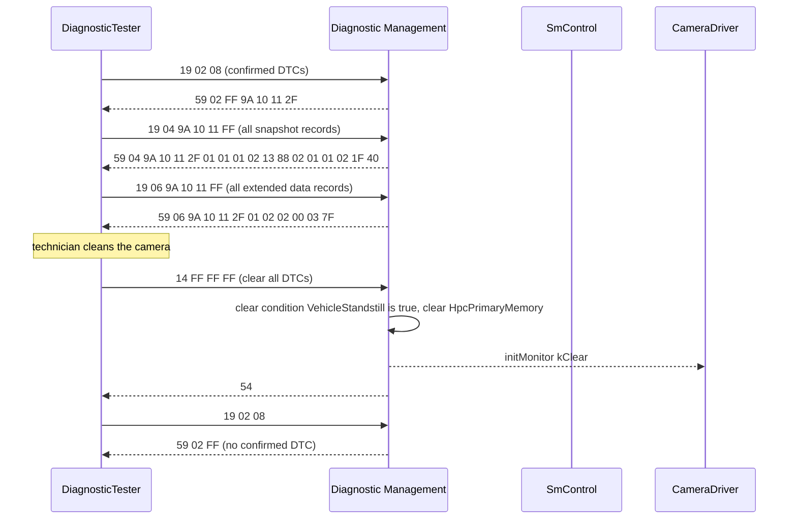

If the technician had sent `14 FF FF FF` while the vehicle was rolling, `VehicleStandstill` would be false. `HPC` configures only this one DTC, so every DTC of the group forbids the clear and DM answers `7F 14 22`; `0x9A1011` keeps its status and records ([SWS_DM_00164], [SWS_DM_00121]). In an ECU with further DTCs without this clear condition, DM would clear those, answer positively and keep `0x9A1011` ([SWS_DM_00122]). A request `14 9A 10 11` for the single DTC gets `7F 14 22` in any case ([SWS_DM_00163]).

> **Key takeaways**
>
> - `0x19` sub-functions exist only if configured as `DiagnosticReadDTCInformation` categories; several ISO sub-functions are not supported.
> - `0x14` clears DTCs or groups; NRC `0x22` means clear conditions or a parallel clear, `0x31` an unknown DTC or a `clearAllDtcs` limitation.
> - `0x85` OFF stops status updates and storage; the default session or `EnableControlDtc` switches it back on.
> - `0x86` supports nine sub-functions, one logic per session, owned by the starting client.

---

## 11. Data Transfer and File Transfer

> **Why this matters:** Moving large data, such as a software package, a log file or a recording, is a different problem from reading a DID. DM only frames the UDS protocol; the application must check almost everything itself, and R25-11 leaves one important piece of the file transfer API to the vendor.

### 11.1 `0x34` to `0x37`: Download and Upload

DM implements RequestDownload (`0x34`), RequestUpload (`0x35`), TransferData (`0x36`) and RequestTransferExit (`0x37`) according to ISO 14229-1 ([SWS_DM_00128], [SWS_DM_00134], [SWS_DM_00137], [SWS_DM_00141]), and delegates them to two classes:

| UDS request | Download: `ara::diag::DownloadService` | Upload: `ara::diag::UploadService` |
| --- | --- | --- |
| `0x34` / `0x35` | `RequestDownload(dataFormatIdentifier, addressAndLengthFormatIdentifier, memoryAddressAndSize, metaInfo, cancellationHandler)` ([SWS_DM_00867], [SWS_DM_00789]) | `RequestUpload(...)` ([SWS_DM_00868], [SWS_DM_00799]) |
| `0x36` | `DownloadData(transferRequestParameterRecord, ...)` ([SWS_DM_00869], [SWS_DM_00790]) | `UploadData(numBytesToReturn, ...)` ([SWS_DM_01096], [SWS_DM_00800]) |
| `0x37` | `RequestDownloadExit(transferRequestParameterRecord, ...)` ([SWS_DM_00871], [SWS_DM_00791]) | `RequestUploadExit(...)` ([SWS_DM_01097], [SWS_DM_00801]) |

The data methods return `ara::core::Future<OperationOutput>`, whose `responseData` is the response payload ([SWS_DM_00785]). Each nibble of the addressAndLengthFormatIdentifier must be between 1 and 8, otherwise DM answers NRC `0x31` ([SWS_DM_00129], [SWS_DM_00130]); internally all addresses and lengths are `uint64` (SWS, Section 7.3.2.8.2).

**Who checks what.** Besides the session and security checks ([SWS_DM_00101], [SWS_DM_00103]), DM does no further validation for `0x36` and `0x37`; all other ISO 14229-1 NRC checks, such as the block sequence counter or the transfer length, must be implemented by the application (SWS, Sections 7.3.2.8.18 and 7.3.2.8.19). For the same reason, `0x36` cannot be implemented with `GenericUDSService`: its ISO evaluation sequence alternates between server and service processor, which one `HandleMessage` call cannot express. The services are mapped by `DiagnosticServiceGenericMapping`; `DiagnosticDataTransfer` and `DiagnosticTransferExit` are mapped dynamically according to the preceding `0x34` or `0x35` ([TPS_MANI_01453]).

### 11.2 `0x38` RequestFileTransfer

`0x38` transfers files instead of memory ranges. DM implements it according to ISO 14229-1; again DM checks only session and security, and the application must do all other ISO checks ([SWS_DM_01310]). Each *modeOfOperation* maps to one method of `ara::diag::FileTransferService` ([SWS_DM_01320]):

| modeOfOperation | `FileTransferService` method | Returns | ID |
| --- | --- | --- | --- |
| AddFile (`0x01`) | `RequestWriteFile(..., WriteFileMode::kAdd, ...)` | `Future<DataTransferWriteSession>` | [SWS_DM_01311], [SWS_DM_01333] |
| DeleteFile (`0x02`) | `DeleteFile(fileName, ...)` | `Future<void>` | [SWS_DM_01312], [SWS_DM_01335] |
| ReplaceFile (`0x03`) | `RequestWriteFile(..., WriteFileMode::kReplace, ...)` | `Future<DataTransferWriteSession>` | [SWS_DM_01313] |
| ReadFile (`0x04`) | `RequestReadFile(fileName, dataFormatIdentifier, ...)` | `Future<std::tuple<DataTransferReadSession, FileSizes>>` | [SWS_DM_01314], [SWS_DM_01331] |
| ReadDir (`0x05`) | `RequestReadDirectory(directoryName, ...)` | `Future<std::tuple<DataTransferReadSession, std::uint64_t>>` | [SWS_DM_01315], [SWS_DM_01332] |
| ResumeFile (`0x06`) | `RequestResumeWriteFile(...)` | `Future<std::tuple<DataTransferWriteSession, std::uint64_t>>` | [SWS_DM_01316], [SWS_DM_01334] |

`WriteFileMode` is `kAdd` (only if the file does not exist) or `kReplace` ([SWS_DM_01324]); `FileSizes` holds `uncompressed_size` and `compressed_size` ([SWS_DM_01321]).

### 11.3 Data Transfer Sessions and Handlers

The session object that `FileTransferService` returns connects the `0x38` request with the following `0x36` and `0x37` requests (SWS, Section 7.3.2.8.20). DM calls the `Read` or `Write` method of the handler inside the session for each `0x36` ([SWS_DM_01317]) and its exit method for `0x37` ([SWS_DM_01318]). The handlers let the application choose the copy strategy:

| Handler (`ara/diag/data_transfer.h`) | Strategy | Key method |
| --- | --- | --- |
| `DataTransferReadByPullHandler` | DM provides a buffer; the application fills it (copy) | `Read(ara::core::Span<const ara::core::Byte> response_data, ...)` → `Future<std::uint32_t>` ([SWS_DM_01513]) |
| `DataTransferReadByPushHandler` | The application returns a chunk of about the recommended size | `Read(std::size_t recommended_number_bytes_to_return, ...)` → `Future<ara::core::Vector<ara::core::Byte>>` ([SWS_DM_01522]) |
| `DataTransferReadSharedDataHandler` | Zero copy: the application returns a view into shared data and keeps it until the `ReleaseHandler` says it may release it | `Read(ReleaseHandler release_handler, ...)` → `Future<ara::core::Span<ara::core::Byte>>` ([SWS_DM_01504]) |
| `DataTransferWriteHandler` | Each received chunk is passed to the application | `Write(ara::core::Span<ara::core::Byte> requestData, ...)` ([SWS_DM_01546]) |

Every read handler has `ExitRead(DataTransferExitType, ...)` and the write handler `ExitWrite`; `DataTransferExitType` is `kAcknowledge` (transfer finished) or `kAbort` ([SWS_DM_01538]). `ReleaseHandler::MayRelease()` and its notifier ([SWS_DM_01536], [SWS_DM_01537]; [SWS_DM_01319]) tell the application when a shared buffer is free. The SWS also names passing an operating-system file handle as a possible strategy and keeps the design open for further handlers; R25-11 defines no handler class for it (SWS, Section 7.3.2.8.20).

> **Note:** The SWS explains that `DataTransferReadSession` and `DataTransferWriteSession` have "overloaded template constructors" that take the handler objects (SWS, Section 7.3.2.8.20). Chapter 8 of R25-11, however, specifies for both classes only a deleted default constructor, a move constructor and a deleted copy constructor ([SWS_DM_01549], [SWS_DM_01551], [SWS_DM_01553]; [SWS_DM_01339], [SWS_DM_01557], [SWS_DM_01559]). How an application creates a session with its handler is therefore vendor-specific in R25-11.

### 11.4 Access Rights for Files

The DEXT allows an access permission only on the level of the `DiagnosticRequestFileTransfer` service, not per file, because file names are dynamic. File-level rights are the job of the operating system and of the application that implements `FileTransferService` (SWS, Section 7.3.2.8.20). In practice, the application must check the path: no `..`, only the directories it is meant to serve, only the operations it supports.

### 11.5 Software Update through Diagnostics

UCM does not expose diagnostic services; a *UCM client* forwards the data stream and the control commands (SWS UCM, Section 7.2). For a workshop update over UDS, a *diagnostic application* implements `DownloadService` (or `FileTransferService`) and routines, and calls the `PackageManagement` service of UCM, or of V-UCM for a vehicle update (SWS UCM, Table 7.1). For SOVD, the same role is played by the implementer of `SovdSwUpdate` ([Section 13.6](#136-configuration-bulk-data-and-software-update)). Guide 13 describes the update itself; `HPC` receives its updates from V-UCM ([guide 00, Section 6.11](00_LearningPath.md#611-software-updates)).

### 11.6 Worked Example: Reading a Recording from `Storage`

`Storage` keeps object-list recordings in the File Storage `Recordings` ([guide 11](11_Persistency.md)). For the workshop, it provides `FileTransferService` on the P-port `RecordingsTransferPort` of `StorageSwc`, mapped by a `DiagnosticServiceGenericMapping` to the `DiagnosticRequestFileTransfer` instance. Only ReadFile and ReadDir are supported, in the extended session at `Level1`.

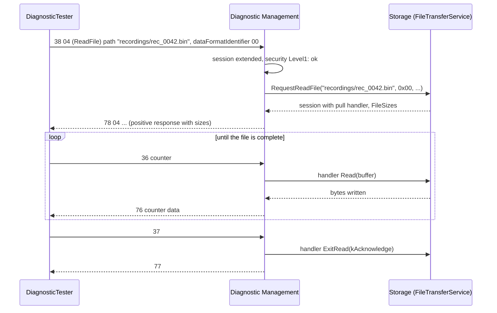

```cpp
// Storage: read-only file transfer for recordings (illustrative).
#include "ara/diag/file_transfer.h"
#include "ara/diag/data_transfer.h"
#include <fstream>

namespace hpc::storage {

class RecordingReader final : public ara::diag::DataTransferReadByPullHandler {
public:
    explicit RecordingReader(std::ifstream file) : file_{std::move(file)} {}

    auto Read(ara::core::Span<const ara::core::Byte> response_data, ara::diag::MetaInfo const&,
              ara::diag::CancellationHandler) noexcept -> ara::core::Future<std::uint32_t> override {
        ara::core::Promise<std::uint32_t> p;
        // Span<const Byte> as declared in [SWS_DM_01513]; the buffer is pre-allocated by DM.
        file_.read(reinterpret_cast<char*>(const_cast<ara::core::Byte*>(response_data.data())),
                   static_cast<std::streamsize>(response_data.size()));
        p.set_value(static_cast<std::uint32_t>(file_.gcount()));
        return p.get_future();
    }

    auto ExitRead(ara::diag::DataTransferExitType, ara::core::Span<const ara::core::Byte>,
                  ara::diag::MetaInfo const&, ara::diag::CancellationHandler) noexcept
        -> ara::core::Future<ara::core::Vector<ara::core::Byte>> override {
        file_.close();
        ara::core::Promise<ara::core::Vector<ara::core::Byte>> p;
        p.set_value({});                                // no transferResponseParameterRecord
        return p.get_future();
    }

private:
    std::ifstream file_;
};

class RecordingTransfer final : public ara::diag::FileTransferService {
public:
    using FileTransferService::FileTransferService;

    auto RequestReadFile(ara::core::String fileName, ara::core::Byte dataFormatIdentifier,
                         ara::diag::MetaInfo const&, ara::diag::CancellationHandler) noexcept
        -> ara::core::Future<std::tuple<ara::diag::DataTransferReadSession, ara::diag::FileSizes>> override;
    // Checks: path below "recordings/", no "..", dataFormatIdentifier 0x00 (no compression),
    // otherwise an NRC through DiagUdsNrcErrc (see guide 12a, Section 7.7).
    // Creating the DataTransferReadSession from a RecordingReader is vendor-specific in R25-11.
    // RequestWriteFile, RequestResumeWriteFile, DeleteFile: answer NRC 0x31 (not supported here).
};

}  // namespace hpc::storage
```

The `FileTransferService` object is constructed with the specifier `/storage/Root/RecordingsTransferPort` and `ConcurrencyType::kNotConcurrent`, and offered like any provider ([guide 12a, Section 13.1](12a_Diagnostics.md#131-offer-stopoffer-and-nrc-0x94)).

> **Key takeaways**
>
> - `0x34`-`0x37` go to `DownloadService` or `UploadService`; `0x38` goes to `FileTransferService`, which returns a transfer session.
> - DM checks only session and security; the application implements all other ISO checks.
> - Handlers choose the copy strategy: pull, push, shared data, write.
> - File-level access rights are the application's and the OS's job.
> - The creation of transfer sessions is not specified in R25-11.

---

## 12. SOVD: Concepts and Server Setup

> **Why this matters:** SOVD lets a laptop, a backend or an in-vehicle client diagnose `HPC` with HTTPS and JSON instead of UDS bytes and ODX files. It also brings web security (tokens, TLS) and new resources such as logs and software updates. Integrators must set up the server, decide who authorizes clients, and understand how SOVD clients and UDS testers share one Diagnostic Server.

### 12.1 SOVD Entities and DM's Place

SOVD organizes a vehicle into *entities*, each with resources. DM is one SOVD *component*, and each Diagnostic Server instance is a *sub-component* of it, identified by the `componentQualifier` of its `SoftwareClusterSovdAddress` ([SWS_DM_01372], [SWS_DM_01373]). DM dispatches each request to the Diagnostic Server instance that the request path names ([SWS_DM_01374]). The SOVD server itself is identified by `SovdServerInstantiation.componentQualifier`, which the client puts into the component-identifier part of the URL ([TPS_MANI_01402]).

The entities *area*, *app* and *function* of ASAM SOVD are not supported (SWS, Section 4.1.3).

### 12.2 Transport, Discovery, Server and Gateway

| Aspect | Rule | ID |
| --- | --- | --- |
| Server | DM acts as SOVD server on the `communicationConnector`s of its `SovdModuleInstantiation` | [SWS_DM_01369] |
| Discovery | DNS-SD (RFC 6763) over mDNS (RFC 6762), with the host name `SovdModuleInstantiation.nodeIdentifier` | [SWS_DM_01370], [TPS_MANI_01403] |
| Security | TLS, configured by `securePropsForTcp`; TLS over UDP is not applicable to SOVD | [SWS_DM_01371], [TPS_MANI_01401] |
| Gateway | `SovdGatewayInstantiation`: `unicastCredentials` (`SovdGatewayLocalEndpointTcpConfig` with `tcpPort`, IPv4 or IPv6 address, `udpPort`) and `securePropsForExternalComm` for the client side | [TPS_MANI_01403], [TPS_MANI_01404] |

`SovdModuleInstantiation` is abstract; `SovdServerInstantiation` and `SovdGatewayInstantiation` are its subclasses, and a machine may host both: the gateway is a logical role ([TPS_MANI_01399]). mDNS uses the IANA multicast address `224.0.0.251` (IPv4) or `FF02::FB` (IPv6), port 5353 (TPS, Section 12.12.3).

In the running example, `HPC` hosts the SOVD server `HpcSovdServer` with component qualifier `hpc`, HTTPS with TLS on TCP port 443 (illustrative). The shared contribution set `HpcDiagnostics` forms one Diagnostic Server instance, so `HPC` has one sub-component, `hpcdiag`. There is no gateway on `HPC`: the vehicle's SOVD gateway is a black box elsewhere in the vehicle.

> **Note:** `SoftwareClusterSovdAddress` carries the tag *candidate* in R25-11 (TPS, Table 5.6): it may still change.

### 12.3 UDS and SOVD Clients Together

UDS uses the extended session for exclusive access, SOVD uses *locks*. Only one client of either kind can have exclusive access at a time (SWS, Section 7.3.3.1):

- A UDS client in a non-default session blocks SOVD locks: a lock can be acquired only if no UDS client is in the extended session ([SWS_DM_01477]).
- An SOVD lock blocks UDS: a UDS request then gets NRC `0x21` ([SWS_DM_01375]).
- An SOVD client without a lock is handled like a UDS client in the default session ([SWS_DM_01476]); the rules of [guide 12a, Chapter 6](12a_Diagnostics.md#6-diagnostic-conversations) apply.
- If a resource cannot be served because the implementation is not re-entrant, DM returns the SOVD error "Conflicted state" ([SWS_DM_01929]).

### 12.4 Authorization

**In plain words:** An SOVD client proves its rights with a token from an authorization server, as on the web with OAuth 2.0 (RFC 6749). DM does not know the authorization server; an application does. DM only redirects the client and asks the application whether a token is valid and which roles it grants.

**Formally:** The interface `ara::diag::SovdAuthorization` ([SWS_DM_01490]) is implemented on the port mapped to the Software Cluster with the category PLATFORM:

| Client request | DM action | ID |
| --- | --- | --- |
| "Verifying SOVD Client Credentials at the Vehicle" | calls `GetAuthorizationUrl(queryParameters, metaInfo)` and answers HTTP `307 Temporary Redirect` with the returned URL as `Location` | [SWS_DM_01472], [SWS_DM_01485] |
| "Requesting a Token" | calls `GetTokenUrl(...)`, answers `307` | [SWS_DM_01471], [SWS_DM_01484] |
| Any request with an `Authorization` header whose token is not yet validated | calls `ValidateAuthorization(token, metaInfo, clientAuthentication)` | [SWS_DM_01470], [SWS_DM_01483] |

`ValidateAuthorization` returns `ValidateAuthorizationOutput` ([SWS_DM_01927]) with an optional `identity` ([SWS_DM_01819]) and `validUntil` ([SWS_DM_01820]). The roles that the application sets on the `ClientAuthentication` object (the same class as for UDS authentication, [guide 12a, Section 9.2](12a_Diagnostics.md#92-roles-and-authentication-state-per-client)) count as authenticated for all requests with the identical token until `validUntil` ([SWS_DM_01469]). DM considers requests with the same token, or with the same returned identity, as coming from the same client ([SWS_DM_01781], [SWS_DM_01782]); this matters for locks and for operations that the client started. Access to each SOVD method is then checked against the `DiagnosticAccessPermission` of the method's primitive, which can name authentication roles (TPS, Sections 5.7.2 and 5.7.3).

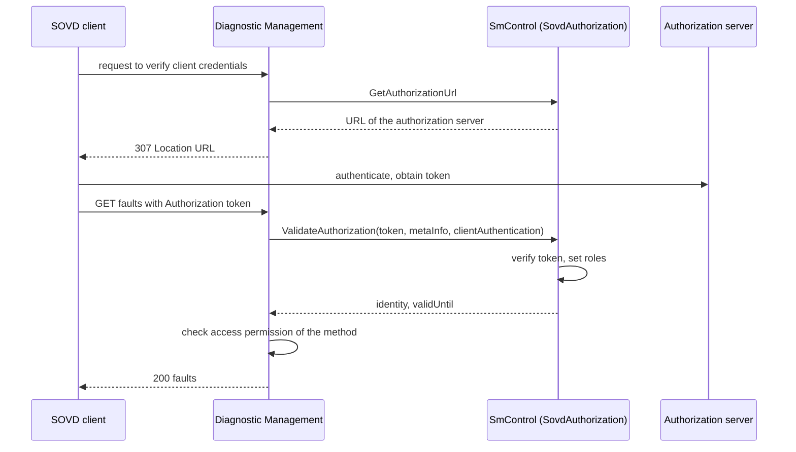

> **Note:** The SWS requires the authorization port to be mapped to "the SoftwareCluster with category PLATFORM" ([SWS_DM_01472]). `HPC` has the categories `PLATFORM_CORE` and `APPLICATION_LAYER` ([guide 00, Section 6.3](00_LearningPath.md#63-the-hpc-machine)). This guide lets `SmControl` in `HpcPlatformCore` provide `SovdAuthorization`; whether `PLATFORM_CORE` satisfies the wording is not stated in R25-11.

### 12.5 Locks, Environmental Conditions and Service Validation

**Locks.** A lock gives one client exclusive access to an entity:

- only authenticated clients can acquire a lock, otherwise HTTP `401` ([SWS_DM_01783]), because DM must be able to recognize the client again;
- one lock per entity; a second client gets an error ([SWS_DM_01475]);
- accessing an entity that requires a lock without holding it gives `409` ([SWS_DM_01474]);
- when the lock expires, DM terminates all resources associated with it, including temporary ones such as running operations, and answers `409` afterwards ([SWS_DM_01473]);
- DM supports locks on Diagnostic Server instance level ([SWS_DM_01443]); locks on the component (machine) level are not possible (SWS, Section 4.1.3).

`DiagnosticSovdLock` is referenced by `DiagnosticAccessPermission` as an additional criterion: a method can require that the client holds the lock ([TPS_MANI_01396]).

**Environmental conditions.** Before executing an SOVD method, DM evaluates its environmental condition like for UDS ([guide 12a, Section 7.5](12a_Diagnostics.md#75-environmental-conditions)), with `DiagnosticEnvSovdDataCondition` comparing an SOVD content element with a constant ([SWS_DM_01468], [TPS_MANI_01504]); if the condition is false, DM answers `503` ([SWS_DM_01466]).

**Service validation.** On each SOVD request, DM calls `SovdServiceValidation::Validate(requestMethod, metaInfo)` for each `DiagnosticSovdServiceValidationPortMapping` in the configured order and stops at the first error ([SWS_DM_01784]); for a resource collection it validates each contained resource as well ([SWS_DM_01785]). This is the SOVD counterpart of `ServiceValidation` ([guide 12a, Section 7.4](12a_Diagnostics.md#74-manufacturer-and-supplier-checks-servicevalidation)).

### 12.6 Data Serialization and Conversion

UDS transports raw bytes that the tester interprets with ODX. SOVD transports physical values in JSON, so DM must convert. The content is described by `DiagnosticSovdContent` and its `DiagnosticSovdContentElement`s; the JSON schema of a primitive element is derived from its `swDataDefProps` (SWS, Section 7.3.3.3):

| `swDataDefProps` of the primitive element | JSON | ID |
| --- | --- | --- |
| encoding `NONE` or `2C`, compu method `IDENTICAL`, `LINEAR`, `SCALE_LINEAR`, `RAT_FUNC`, `SCALE_RAT_FUNC` | `integer` or `number`, with `minimum`, `maximum`, `multipleOf` | [SWS_DM_01465] |
| compu method `TEXTTABLE` | `string` with `enum` from the texts | [SWS_DM_01464] |
| `SCALE_LINEAR_AND_TEXTTABLE`, `SCALE_RAT_AND_TEXTTABLE` | number or string, with a `pattern` for the texts | [SWS_DM_01463] |
| `TAB_NOINTP` | number or integer with `enum` | [SWS_DM_01462] |
| `BITFIELD_TEXTTABLE` | `object`, one string `enum` per interval | [SWS_DM_01461] |
| encoding `IEEE754` | `number` | [SWS_DM_01460] |
| text encodings (`ISO-8859-1`, `UTF-8`, `UTF-16`, …) | `string`, converted to the SOVD charset | [SWS_DM_01459] |
| unit referenced | unit included in the schema | [SWS_DM_01458] |
| `DiagnosticSovdArrayContentElement` | `array`; `maxItems` from `maxNumberOfElements` | [SWS_DM_01457] |

`DiagnosticSovdProps.singleElementSerialization` decides whether content with a single element is wrapped in an object (`object`) or not (`plain`) ([TPS_MANI_01514]); DM does not support `plain` (SWS, Section 4.1.3).

### 12.7 Standardized Resources

| Resource | What DM provides | ID |
| --- | --- | --- |
| `docs` | Online capability description as an OpenAPI document (OpenAPI Specification), for each entity; only the resources accessible to the requesting client | [SWS_DM_01456], [SWS_DM_01786] |
| `version-info` | Only at the SOVD server level; type `SOVDInfo` with `base_uri` and `version`; the path never changes; unsupported version → `404` | [SWS_DM_01455], [SWS_DM_01454], [SWS_DM_01453], [SWS_DM_01452], [SWS_DM_01451], [SWS_DM_01450] |
| data categories | one item per `DiagnosticSovdDataCategory.category` | [SWS_DM_01449], [SWS_DM_01448] |
| data groups | one item per `DiagnosticSovdGroup` referenced by a category | [SWS_DM_01446], [SWS_DM_02160] |
| entity data list | one item per `DiagnosticSovdData`: `id` = short name, `name` = long name of the content, `category`, `group`; filters by category and group | [SWS_DM_01442], [SWS_DM_02161], [SWS_DM_02162], [SWS_DM_02163] |
| locks | on Diagnostic Server instance level | [SWS_DM_01443] |
| logs | supported if a `DiagnosticSovdMethod` is configured for the `DiagnosticSovdLog` | [SWS_DM_01928] |

Translation IDs are not supported, because the manifest has no such information (SWS, Section 7.3.3.4.3). The logging content itself is platform vendor-specific: `ara::log` defines no log file retrieval (EXP SOVD, Section 3.2.3), and the TPS defines no port interface for SOVD logs, so only DM can serve them (TPS, Section 5.7.1.2).

> **Note:** The TPS standardizes the values `IDENT_DATA`, `CURRENT_DATA`, `STORED_DATA` and `SYS_INFO` for `DiagnosticSovdDataCategory.category` ([TPS_MANI_01492]). The SWS names the ASAM categories *identifications*, *measurements*, *parameters* and *system information* (SWS, Section 7.3.3.4.3), and DM reports `category` as configured ([SWS_DM_01448]). How the TPS values map to the ASAM names is not stated in R25-11.

### 12.8 Limitations in R25-11

R25-11 supports ASAM SOVD 1.0 with these limitations (SWS, Section 4.1.3): no entities area, app and function; only the standardized modes; no custom capabilities for operations; no operation attribute `modes` ([SWS_DM_01397]); locks only on the sub-component level; no fault attribute `symptom`; no `plain` serialization. SOVD 1.1, which is ISO 17978-3 (dated 2025 in the references of the SWS and 2026 in its Section 4.1.3), is not yet fully supported; some bug fixes from it are already included.

> **Key takeaways**
>
> - DM is the SOVD component; each Diagnostic Server instance is a sub-component; configuration is `SovdServerInstantiation` and `SoftwareClusterSovdAddress`.
> - An SOVD lock and a UDS extended session exclude each other.
> - Authorization is delegated to an application through `SovdAuthorization`; DM redirects and validates tokens.
> - DM converts between internal values and JSON using the `swDataDefProps` of the content elements.

---

## 13. SOVD Resources: Data, Faults, Operations and More

> **Why this matters:** These are the resources that SOVD clients actually use. Faults come for free from the event memory; data and operations need dedicated SOVD providers in the applications; updates, bulk data and configurations are delegated almost entirely to applications.

### 13.1 Data

Each `DiagnosticSovdData` service instance is one SOVD data resource ([SWS_DM_01433]). Its payload is a `DiagnosticSovdContent` made of `DiagnosticSovdContentElement`s, which can nest as records and arrays ([TPS_MANI_01493], [TPS_MANI_01495]). Each `DiagnosticSovdData` must reference a `DiagnosticSovdDataCategory` ([constr_10706]) and may reference groups that the category also references ([constr_10705]).

- **Read:** DM calls `GenericDiagnosticSovdContent::Read(sovd_content_name, meta_info, cancellation_handler)` ([SWS_DM_02191]) of the port mapped by `DiagnosticSovdContentPortMapping` ([SWS_DM_02164]) and answers with `id` = short name of the content and `data` = one value per content element ([SWS_DM_01432]). It finds the value of each element by matching `DiagnosticSovdContentElementDataWithKey::GetName()` with the element's short name ([SWS_DM_02165]).
- **Write:** optional, only if the method has a `put` primitive ([SWS_DM_01431]); DM calls `Write` with data built by `SetName` and `SetContent` ([SWS_DM_02166], [SWS_DM_02192]).
- **Data lists:** clients can define lists to read several data values at once ([SWS_DM_01420], [SWS_DM_01419]).

The value model is `DiagnosticSovdContentElementData` ([SWS_DM_02307]): primitives are created with `CreatePrimitiveContentBool`, `...SignedInt`, `...UnsignedInt`, `...Double`, `...String`; records with `CreateRecordContentElement` and `Add(key, value)`; arrays with `CreateArrayContentElement` and `PushBack` ([SWS_DM_02308]-[SWS_DM_02315], [SWS_DM_02368]-[SWS_DM_02373]). `DiagnosticSovdContentData` holds a vector `elements` of such values ([SWS_DM_02385]).

> **Note:** The SWS describes element names through `DiagnosticSovdContentElementDataWithKey` ([SWS_DM_02165]), but `DiagnosticSovdContentData::elements` is declared as a vector of `DiagnosticSovdContentElementData` without key ([SWS_DM_02385]). R25-11 does not say clearly how the names are attached; the example in [Section 13.7](#137-worked-example-an-sovd-client-in-the-workshop) uses one record element with keys. Also, the constructor documentation of `GenericDiagnosticSovdContent` and `GenericDiagnosticSovdOperation` names a "DiagnosticDataIdentifierGenericInterface" port ([SWS_DM_02187], [SWS_DM_02204]), while the TPS defines `DiagnosticSovdContentInterface` and `DiagnosticSovdOperationInterface` (TPS, Section 4.9.4). Follow the TPS.

### 13.2 Faults

Every `DiagnosticTroubleCodeUds` is an SOVD fault ([SWS_DM_01418]). "Read faults" and "Read details for a fault" are supported if a `DiagnosticSovdFaultMemoryAccess` references a `DiagnosticSovdMethod` with a `get` primitive ([SWS_DM_01417], [SWS_DM_01416]); "Delete all faults" and "Delete single fault" need a `delete` primitive ([SWS_DM_01409], [SWS_DM_01406]). For fault memory access, the method may have at most one `get` and one `delete` and no `put` or `post` ([constr_10567]). The query parameter `scope` selects the memory by the short name of the `DiagnosticMemoryDestination` ([SWS_DM_02000]); without `scope`, the primary memory is used ([SWS_DM_02001]). Deleting faults clears them in the event memory; the clear operation is the same whatever triggers it (SWS, Section 7.3.4.4.5.3), so clear conditions apply as for `0x14`.

| SOVD fault attribute | Derived from | ID |
| --- | --- | --- |
| `code` | `udsDtcValue` of the `DiagnosticTroubleCodeUds` | [SWS_DM_01567] |
| `scope` | short name of the `DiagnosticMemoryDestination` | [SWS_DM_01567] |
| `display_code` | short name of the `DiagnosticTroubleCodeUds` | [SWS_DM_01567] |
| `fault_name` | long name of the `DiagnosticTroubleCodeUds` | [SWS_DM_01567] |
| `severity` | `severity` of the `DiagnosticTroubleCodeUds` | [SWS_DM_01567] |
| `status` | JSON object with entries according to the ISO 14229-1 DTC status mask | [SWS_DM_01414] |
| `environment_data` (details only) | `extended_data_records` by record short name; `snapshots` array with `name` and `data` | [SWS_DM_01412], [SWS_DM_01561] |

Snapshot names are the short names of the `DiagnosticFreezeFrame`s for `configured` numbering. For `calculated` numbering they follow the pattern `occurrence_{occ}`, except that the first is always `first_occurrence` and the last always `last_occurrence`. The `data` of a snapshot combines UDS data (key: short name of the `DiagnosticDataElement`) and SOVD data (key: short name of the `DiagnosticSovdContentElement`), each represented like a single data value ([SWS_DM_01561]). The SOVD attribute `symptom` is not supported (SWS, Section 4.1.3).

### 13.3 Operations

An SOVD operation executes diagnostic code in an application, like a UDS routine (TPS, Section 5.7.1.6). Each `DiagnosticSovdOperation` is one SOVD operation ([SWS_DM_01405]); it has a mandatory `start` primitive ([constr_10716]) and optional `terminate` and `readStatus` primitives, each with its own access permission and request and response content ([TPS_MANI_01502], [TPS_MANI_01503]). An operation does not use `DiagnosticSovdMethod` ([constr_10715]).

| SOVD method | DM behavior | ID |
| --- | --- | --- |
| Query operations | one `OperationDescription` per operation: `id` (short name), `name` (long name), `proximity_proof_required`, `asynchronous_execution` | [SWS_DM_01404], [SWS_DM_02167], [SWS_DM_01402], [SWS_DM_01401], [SWS_DM_01400] |
| Asynchronous? | FALSE if the operation has only a `start` primitive, otherwise TRUE | [SWS_DM_01399] |
| Details of an operation | description and, if needed, the proximity challenge | [SWS_DM_01403], [SWS_DM_02175] |
| Start execution | calls `GenericDiagnosticSovdOperation::StartExecution(name, content, metaInfo, cancellationHandler)` | [SWS_DM_01396], [SWS_DM_02174], [SWS_DM_02210] |
| Start response, synchronous | parameters from the returned `StartSynchronousExecutionResponse` | [SWS_DM_02176] |
| Start response, asynchronous | `id` = execution ID chosen by DM (implementation-specific), `status` from `SovdOperationExecution::ExecuteCapability` | [SWS_DM_02177] |
| Query executions | the active execution IDs | [SWS_DM_01394], [SWS_DM_02170] |
| Terminate execution | calls `SovdOperationExecution::Terminate`; the execution is discarded | [SWS_DM_01392], [SWS_DM_02179], [SWS_DM_02202] |
| Read status | calls `SovdOperationExecution::GetStatus`; `status`, `capability` = execute, `parameters` | [SWS_DM_01393], [SWS_DM_02180], [SWS_DM_02181] |

Request and response parameters are JSON objects keyed by the short names of the content elements ([SWS_DM_01390]). `OperationExecutionStatus` is `kRunning`, `kCompleted`, `kFailed` or `kStopped` ([SWS_DM_02195]); `TerminateOperationExecutionReason` is `kClientRequest`, `kTimeout` or `kStateChange` ([SWS_DM_02196]). SOVD allows several simultaneous executions of the same operation; whether that is possible is the application's decision (SWS, Section 7.3.3.5.5.5).

> **Note:** In R25-11, chapter 8 declares `StartSynchronousExecutionResponse`, `StartAsynchronousExecutionResponse` and `GetStatusResponse` without members ([SWS_DM_02208], [SWS_DM_02209], [SWS_DM_02200]), although Section 7.3.3.5.5 says what they carry (content data, an `SovdOperationExecution`, a status). Expect vendor-specific members.

### 13.4 Proximity Challenge

Some operations may only run while a technician is physically at the vehicle. They have `proximityProofRequired` = true (mandatory attribute, [constr_10717]). The application implements `SovdProximityChallenge` ([SWS_DM_01481]):

- DM puts the value of `GetChallenge(metaInfo)` into every response that needs a `proximity_challenge` ([SWS_DM_01398], [SWS_DM_01494]).
- When a request carries a `proximity_response`, DM calls `ValidateResponse(proximityResponse, metaInfo)` and accepts it on `kProximityChallengeValidationSuccessful` ([SWS_DM_01395], [SWS_DM_02382]).
- Starting such an operation without a response, or with a wrong one, gives `400 Bad Request` ([SWS_DM_02171], [SWS_DM_02172]); only a successful validation lets it run ([SWS_DM_02173]). Terminating also validates the response ([SWS_DM_01391]).

Typically there is one challenge for all clients and operations at a time, valid for a fixed time such as 2 minutes; the application may use `MetaInfo` for client-specific challenges (SWS, Section 7.3.3.5.5.3). How the technician learns the answer, for example from a display in the vehicle, is a project decision.

### 13.5 Modes

Only two SOVD modes exist on AP ([SWS_DM_01389]):

| Mode | Offered if … | Value | Behaves like | ID |
| --- | --- | --- | --- | --- |
| `commctrl` | a `DiagnosticComControl` is configured | enum of the `category` values of the `DiagnosticComControl`s | `0x28` CommunicationControl, same processing instance | [SWS_DM_01388]-[SWS_DM_01384] |
| `dtcsetting` | a `DiagnosticControlDTCSetting` is configured | `off`, `on` | `0x85` ControlDTCSetting | [SWS_DM_01383]-[SWS_DM_01379] |

### 13.6 Configuration, Bulk Data and Software Update

These resources are mostly handled by applications; DM provides the SOVD protocol and calls the interface.

| Resource | DM calls | ID |
| --- | --- | --- |
| Configurations list | provided if at least one SOVD configuration exists | [SWS_DM_01429] |
| Configuration as parameter | derived from a `DiagnosticSovdContent` with `DiagnosticSovdConfigContentMapping` | SWS 7.3.3.5.2 |
| Read / write configuration (explicit) | `SovdConfiguration::RequestGetConfiguration`, `RequestPutConfiguration` (with transfer sessions) | [SWS_DM_01787], [SWS_DM_01788] |
| Bulk data categories | all configured categories (`DiagnosticSovdBulkData.bulkDataCategory`) | [SWS_DM_01790] |
| Bulk data meta data, download, upload, delete | `SovdBulkData::GetBulkDataMetaData`, `RequestBulkDataDownload`, `RequestBulkDataUpload`, `DeleteAllBulkData`, `DeleteSpecificBulkData` | [SWS_DM_01791]-[SWS_DM_01795] |
| Software update | `SovdSwUpdate::GetAllUpdates`, `GetUpdatePackageDetails`, `PutUpdatePackageAutomated`, `PrepareUpdatePackage`, `ExecuteUpdatePackage`, `GetUpdatePackageStatus`, `DeleteUpdatePackage`, `RequestUpdatePackageRegistration` | [SWS_DM_01796]-[SWS_DM_01804] |

Bulk data, configuration and update use the same transfer sessions and handlers as `0x38` ([Section 11.3](#113-data-transfer-sessions-and-handlers)). The SOVD software update in DM is a *component update*: DM → diagnostic application (implementing `SovdSwUpdate`) → UCM `PackageManagement`. A *vehicle update* goes from the SOVD gateway to an OTA client and V-UCM without DM (SWS, Figure 7.4; EXP SOVD, Section 3.2.2). A contribution set has at most one `DiagnosticSovdLog` and one `DiagnosticSovdUpdate` ([constr_10477], [constr_10478]). Errors of these interfaces use `DiagSovdErrc`, for example `kUpdateProcessInProgress` ([SWS_DM_01806]).

### 13.7 Worked Example: An SOVD Client in the Workshop

**Configuration.** `CameraDriver` provides the SOVD data `CameraStatus` (category `CURRENT_DATA`) with three primitive elements: `blocked` (boolean), `brightness` (integer32, unit percent) and `exposureMode` (string), and the asynchronous operation `CameraCalibration` with `start`, `terminate` and `readStatus` and `proximityProofRequired` = true. Its ports are `CameraStatusSovdPort` (`DiagnosticSovdContentInterface`) and `CalibrateCameraSovdPort` (`DiagnosticSovdOperationInterface`). `SmControl` provides `SovdAuthorization` and `SovdProximityChallenge`. The fault memory access allows `get` for the role of any authenticated client and `delete` only with a lock.

The client has a token ([Section 12.4](#124-authorization)). The URI structure is defined by ASAM SOVD; the sequence abbreviates the paths below the sub-component `hpcdiag`.

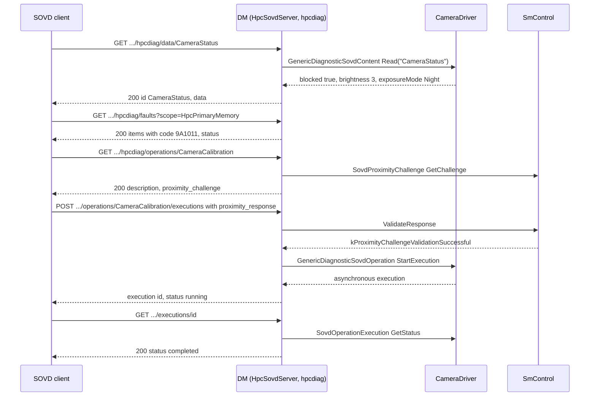

A fault detail response for `0x9A1011` contains, among others (illustrative JSON; the exact attribute formats are defined by ASAM SOVD):

```json
{
  "item": {
    "code": "9A1011",
    "scope": "HpcPrimaryMemory",
    "display_code": "CameraBlockedDtc",
    "fault_name": "Front camera blocked",
    "status": { "testFailed": 1, "pendingDTC": 1, "confirmedDTC": 1 }
  },
  "environment_data": {
    "extended_data_records": {
      "OccurrenceRecord": { "OccurrenceCounter": 2 },
      "MaxFdcRecord": { "MaxFdcSinceClear": 127 }
    },
    "snapshots": [
      { "name": "first_occurrence", "data": { "VehicleSpeed": 50.0 } },
      { "name": "last_occurrence", "data": { "VehicleSpeed": 80.0 } }
    ]
  }
}
```

`VehicleSpeed` appears as 50.0 rather than 5000 because DM applies the `LINEAR` compu method (0.01 km/h per bit) of the data element ([SWS_DM_01465]).

The data provider in `CameraDriver`:

```cpp
// CameraDriver: SOVD data CameraStatus (illustrative; see the note in Section 13.1 on element names).
#include "ara/diag/generic_diagnostic_sovd_content.h"

namespace hpc::camera {

class CameraStatusSovd final : public ara::diag::GenericDiagnosticSovdContent {
public:
    using GenericDiagnosticSovdContent::GenericDiagnosticSovdContent;

    ara::core::Future<ara::diag::DiagnosticSovdContentData> Read(
            ara::core::StringView /*sovd_content_name*/, ara::diag::MetaInfo const& /*meta_info*/,
            ara::diag::CancellationHandler /*cancellation_handler*/) noexcept override {
        using Element = ara::diag::DiagnosticSovdContentElementData;
        Element record = Element::CreateRecordContentElement();
        (void)record.Add("blocked", blocked_.load());
        (void)record.Add("brightness", static_cast<std::int64_t>(brightness_.load()));
        (void)record.Add("exposureMode", ara::core::StringView{nightMode_ ? "Night" : "Day"});

        ara::diag::DiagnosticSovdContentData data;
        data.elements.push_back(std::move(record));
        ara::core::Promise<ara::diag::DiagnosticSovdContentData> p;
        p.set_value(std::move(data));
        return p.get_future();
    }

    ara::core::Future<void> Write(ara::core::StringView, ara::diag::DiagnosticSovdContentData const&,
                                  ara::diag::MetaInfo const&, ara::diag::CancellationHandler) noexcept override {
        ara::core::Promise<void> p;                    // no put primitive configured: never called
        p.SetError(ara::diag::DiagSovdErrc::kPreconditionNotFulfilled);
        return p.get_future();
    }

    std::atomic<bool> blocked_{false};
    std::atomic<int> brightness_{0};
    std::atomic<bool> nightMode_{false};
};

}  // namespace hpc::camera

// Construction: CameraStatusSovd status{*ara::core::InstanceSpecifier::Create("/camera_driver/Root/CameraStatusSovdPort"),
//                                       ara::diag::SovdContentConcurrencyType{}};   // read, write, readWrite: kNotConcurrent
//               status.Offer();
```

`SovdContentConcurrencyType` holds one `ConcurrencyType` each for `read`, `write` and `readWrite`, all `kNotConcurrent` by default ([SWS_DM_02182]-[SWS_DM_02185]). The operation provider `CameraCalibration` derives from `GenericDiagnosticSovdOperation` and returns, for each start, an object derived from `SovdOperationExecution` that implements `ExecuteCapability`, `GetStatus` and `Terminate`; it reuses the calibration code of the UDS routine `0x0201` ([guide 12a, Section 11.4](12a_Diagnostics.md#114-worked-example-calibratecamera)). Because the response structures have no specified members ([Section 13.3](#133-operations)), this guide does not show its code.

> **Key takeaways**
>
> - SOVD data and operations have their own interfaces (`GenericDiagnosticSovdContent`, `GenericDiagnosticSovdOperation`), not the UDS DID and routine classes.
> - Faults come directly from the event memory; `scope` selects the memory, and details include extended data and snapshots.
> - Operations can be synchronous or asynchronous; proximity proof is delegated to `SovdProximityChallenge`.
> - Configuration, bulk data and software update are delegated to applications; the update in DM is a component update through UCM.

---

## 14. Configuration Reference: What to Configure

> **Why this matters:** Almost all fault-memory behavior is configured, not coded. This chapter answers the question "what do I have to configure, and what does each setting mean?" for events, DTCs, memories, records, the fault-memory services, transfer and SOVD. The configuration of the server itself (contribution set, sessions, security, DoIP) is in [guide 12a, Chapter 14](12a_Diagnostics.md#14-configuration-reference-what-to-configure).

Conventions: "DEXT" refers to the *Diagnostic Extract Template* (CP TPS), "TPS" to the *Manifest Specification*. A default is given only where a requirement states it; otherwise the column says "not specified". Attributes that DM does not evaluate are marked "not used by DM".

### 14.1 Minimal Configuration

To get `CameraBlocked` working end to end in `HPC`, the configuration needs:

1. A `DiagnosticEvent` `CameraBlocked`.
2. A `DiagnosticMonitorPortMapping` from the event to the R-port `CameraBlockedMonitorPort` of `camera_driver` and the process `CameraDriver` ([constr_10048]).
3. A `DiagnosticOperationCycle` `IgnitionCycle`, a `DiagnosticEventToOperationCycleMapping` ([SWS_DM_CONSTR_00168]) and a `DiagnosticOperationCyclePortMapping` to `SmControl` ([constr_10051]).
4. A `DiagnosticDebounceAlgorithmProps` with `DiagEventDebounceCounterBased` in `DiagnosticCommonProps.debounceAlgorithmProps`, and a `DiagnosticEventToDebounceAlgorithmMapping`.
5. A `DiagnosticEnableCondition` `PowerModeOn` in a group, the event-to-group mapping and a `DiagnosticEnableConditionPortMapping` to `SmControl`.
6. A `DiagnosticTroubleCodeUds` `0x9A1011`, a `DiagnosticEventToTroubleCodeUdsMapping` and a `DiagnosticTroubleCodeProps` with `diagnosticMemory` ([SWS_DM_CONSTR_00084]).
7. A `DiagnosticMemoryDestinationPrimary` `HpcPrimaryMemory` with `typeOfDtcSupported` and `maxNumberOfEventEntries`.
8. Service instances `DiagnosticReadDTCInformation` (one per sub-function) and `DiagnosticClearDiagnosticInformation`, with access permissions.
9. Optionally: snapshot and extended data records, aging, clear conditions, `0x85`, a `DiagnosticMemoryDestinationPortMapping` for `DTCInformation`.
10. For SOVD: `SovdServerInstantiation` on the machine, a `SoftwareClusterSovdAddress`, a `DiagnosticSovdFaultMemoryAccess` with a `DiagnosticSovdMethod`, and the authorization provider with its `DiagnosticSovdAuthorizationPortMapping`.

### 14.2 DiagnosticEvent and DiagnosticConnectedIndicator

| Attribute | Meaning | Type | Mult. | Default | Rules | Effect at run time |
| --- | --- | --- | --- | --- | --- | --- |
| `DiagnosticEvent.confirmationThreshold` | Number of failed cycles until confirmation, as "trip counter + 1" | `PositiveInteger` | `0..1` | 1 ([SWS_DM_01037]) | – | Bit 3 ([SWS_DM_00218]) |
| `DiagnosticEvent.clearEventAllowedBehavior` | Status byte change when a clear is forbidden | `noStatusByteChange`, `onlyThisCycleAndReadiness` | `0..1` | not specified | – | [SWS_DM_00123], [SWS_DM_00124] |
| `DiagnosticEvent.associatedEventIdentification` | Number identifying the event in records | `PositiveInteger` | `0..1` | not specified | – | `DEM_EVENT_ASSOCIATED_IDENTIFICATION` ([SWS_DM_02145]) |
| `DiagnosticEvent.connectedIndicator` | Indicators of the event | `DiagnosticConnectedIndicator` | `*` | none | – | Bit 7 and healing ([Section 8.5](#85-indicators-and-the-warningindicatorrequested-bit)) |
| `DiagnosticConnectedIndicator.indicator` | The indicator | ref `DiagnosticIndicator` | `0..1` | – | – | [SWS_DM_00888] |
| `DiagnosticConnectedIndicator.healingCycleCounterThreshold` | Good cycles until bit 7 is reset | `PositiveInteger` | `0..1` | not specified | – | [SWS_DM_00224] |
| `DiagnosticConnectedIndicator.behavior`, `indicatorFailureCycleCounterThreshold` | Lamp behavior; failure cycles | enum; `PositiveInteger` | `0..1` | – | – | not used by DM (SWS, Section 7.3.4.4.2.3) |
| `prestorageFreezeFrame`, `prestoredFreezeframeStoredInNvm`, `recoverableInSameOperationCycle`, `eventClearAllowed`, `eventKind` | Classic Platform features | – | `0..1` | – | – | not used by DM |

### 14.3 Debounce Algorithms

`DiagnosticCommonProps.debounceAlgorithmProps` (`*`) holds `DiagnosticDebounceAlgorithmProps` elements; each has one `debounceAlgorithm` ([constr_10418]). A `DiagnosticEventToDebounceAlgorithmMapping` (`diagnosticEvent`, `debounceAlgorithm`) assigns one to an event; without it, DM does not debounce the event (SWS, Section 7.3.4.1.5).

| Attribute | Meaning | Type | Mult. | Default | Effect at run time |
| --- | --- | --- | --- | --- | --- |
| `DiagEventDebounceCounterBased.counterIncrementStepSize` | Step per `kPrefailed` | `Integer` | `0..1` | not specified | [SWS_DM_00875] |
| `.counterDecrementStepSize` | Step per `kPrepassed` | `Integer` | `0..1` | not specified | [SWS_DM_00876] |
| `.counterFailedThreshold` | Counter value for `kFinallyDefective` | `Integer` | `0..1` | not specified | [SWS_DM_00024] |
| `.counterPassedThreshold` | Counter value for `kFinallyHealed` | `Integer` | `0..1` | not specified | [SWS_DM_00025] |
| `.counterJumpUp`, `.counterJumpUpValue` | Jump on the first `kPrefailed` below the value | `Boolean`, `Integer` | `0..1` | not specified | [SWS_DM_00022] |
| `.counterJumpDown`, `.counterJumpDownValue` | Jump on the first `kPrepassed` above the value | `Boolean`, `Integer` | `0..1` | not specified | [SWS_DM_00023] |
| `.counterBasedFdcThresholdStorageValue` | FDC threshold for storage | `Integer` | `0..1` | – | not specified for DM ([Section 6.4](#64-monitor-internal-debouncing-and-monitors-without-debouncing)) |
| `DiagEventDebounceTimeBased.timeFailedThreshold` | Time until `kFinallyDefective` | `TimeValue` | `0..1` | not specified | [SWS_DM_00877] |
| `.timePassedThreshold` | Time until `kFinallyHealed` | `TimeValue` | `0..1` | not specified | [SWS_DM_00878] |
| `.timeBasedFdcThresholdStorageValue` | FDC threshold for storage | `TimeValue` | `0..1` | – | not specified for DM |
| `DiagEventDebounceMonitorInternal` | No DM debouncing; the monitor debounces | – | – | – | [Section 6.4](#64-monitor-internal-debouncing-and-monitors-without-debouncing) |

DEXT values override the constructor defaults of `Monitor` ([SWS_DM_01099]). The DEXT restriction [TPS_DEXT_03004] on debouncing configuration does not apply on AP ([TPS_MANI_01358]).

### 14.4 DiagnosticOperationCycle, DiagnosticAging, DiagnosticIndicator

| Attribute | Meaning | Type | Mult. | Default | Rules | Effect at run time |
| --- | --- | --- | --- | --- | --- | --- |
| `DiagnosticOperationCycle.type` | Kind of cycle | `ignition`, `obdDrivingCycle`, `other`, `warmup` | `0..1` | not specified | each cycle has exactly one port mapping ([constr_10051]) | informative; the restart comes from the owner ([SWS_DM_01102]) |
| `DiagnosticEventToOperationCycleMapping.diagnosticEvent`, `.diagnosticOperationCycle` | Cycle of an event | refs | `0..1` | – | exactly one per event ([SWS_DM_CONSTR_00168]) | [SWS_DM_01027] |
| `DiagnosticAging.agingCycle` | Cycle that counts for aging | ref | `0..1` | – | – | [SWS_DM_00241] |
| `DiagnosticAging.threshold` | Aging cycles until deletion | `PositiveInteger` | `0..1` | not specified | – | [SWS_DM_01264] |
| `DiagnosticIndicator.type` | Kind of indicator | `amberWarning`, `malfunction`, `protectLamp`, `redStopLamp`, `warning` | `0..1` | not specified | – | informative |

### 14.5 Enable and Clear Conditions

| Attribute | Meaning | Type | Mult. | Default | Rules | Effect at run time |
| --- | --- | --- | --- | --- | --- | --- |
| `DiagnosticCondition.initValue` | State after power-up, before the first `SetCondition` | `Boolean` | `0..1` | not specified | inherited by enable and clear conditions | gates reports or clears until set |
| `DiagnosticEnableConditionGroup.enableCondition` | Conditions of the group | refs | `*` | – | – | all must be fulfilled ([SWS_DM_00568]) |
| `DiagnosticEventToEnableConditionGroupMapping.diagnosticEvent`, `.enableConditionGroup` | Group of an event | refs | `0..1` | – | – | [SWS_DM_00568] |
| `DiagnosticClearConditionGroup.clearCondition` (TPS) | Conditions of the group | refs | `*` | – | – | all must be fulfilled ([SWS_DM_00896]) |
| `DiagnosticTroubleCodeUdsToClearConditionGroupMapping.troubleCodeUds`, `.clearConditionGroup` (TPS) | Group of a DTC | refs | `0..1` | – | at most one per DTC ([constr_1658]) | [SWS_DM_00896] |
| `DiagnosticStorageCondition` | Storage condition | – | – | – | – | not used by DM |

### 14.6 DTCs, DTC Groups and DTC Properties

| Attribute | Meaning | Type | Mult. | Default | Rules | Effect at run time |
| --- | --- | --- | --- | --- | --- | --- |
| `DiagnosticTroubleCodeUds.udsDtcValue` | The 3-byte DTC | `PositiveInteger` | `0..1` | – | – | [SWS_DM_00060]; SOVD `code` |
| `.severity` | ISO severity | `checkAtNextHalt`, `immediately`, `maintenanceOnly`, `noSeverity` | `0..1` | not specified | – | `0x19 07`; SOVD `severity` ([SWS_DM_01567]) |
| `.functionalUnit` | ISO functional unit | `PositiveInteger` | `0..1` | not specified | – | severity reports (ISO) |
| `.troubleCodeProps` | Shared properties | ref | `0..1` | – | – | below |
| `DiagnosticEventToTroubleCodeUdsMapping.diagnosticEvent`, `.troubleCodeUds` | Event-to-DTC link | refs | `0..1` | – | more than one per DTC = combination ([SWS_DM_01106]) | [Section 8.4](#84-event-combination) |
| `DiagnosticTroubleCodeGroup.groupNumber`, `.dtc` | A DTC group | `PositiveInteger`, refs | `0..1`, `*` | `0xFFFFFF` always exists ([SWS_DM_00065]) | `0xFFFFFF` ignored ([SWS_DM_CONSTR_00082]) | [SWS_DM_00064] |
| `DiagnosticTroubleCodeProps.diagnosticMemory` | Memory of the DTC | ref | `0..1` | – | required ([SWS_DM_CONSTR_00084]) | [SWS_DM_00083] |
| `.priority` | Displacement priority (1 highest) | `PositiveInteger` | `0..1` | not specified | 1..255 ([SWS_DM_CONSTR_00961]) | [SWS_DM_00916] |
| `.significance` | `fault` or `occurence` | enum | `0..1` | not specified | – | `DEM_SIGNIFICANCE` ([SWS_DM_00961]) |
| `.aging` | Aging algorithm | ref `DiagnosticAging` | `0..1` | no aging | – | [SWS_DM_00237] |
| `.snapshotRecordContent` | UDS snapshot layout | ref `DiagnosticDataIdentifierSet` | `0..1` | – | no DCM-exclusive elements ([SWS_DM_CONSTR_00396]) | [SWS_DM_01087] |
| `.sovdSnapshotContent` (TPS) | SOVD snapshot layout | ref `DiagnosticSovdContentGroup` | `0..1` | – | – | [SWS_DM_02142], [TPS_MANI_01505] |
| `.freezeFrame` | Configured snapshot records | refs `DiagnosticFreezeFrame` | `*` | – | for `configured` numbering | [SWS_DM_01085] |
| `.maxNumberFreezeFrameRecords` | Records for `calculated` numbering | `PositiveInteger` | `0..1` | not specified | – | [SWS_DM_00152] |
| `.extendedDataRecord` | Extended data records | refs | `*` | – | – | [SWS_DM_00154] |
| `.immediateNvDataStorage`, `.legislatedFreezeFrameContentUdsObd`, `.obdRelevance` | Classic Platform / OBD features | – | `0..1` | – | – | not used by DM |

### 14.7 DiagnosticMemoryDestination

| Attribute | Meaning | Type | Mult. | Default | Effect at run time |
| --- | --- | --- | --- | --- | --- |
| `maxNumberOfEventEntries` | Entries in the memory | `PositiveInteger` | `0..1` | not specified | [SWS_DM_00920], overflow ([SWS_DM_00923]) |
| `memoryEntryStorageTrigger` | When an entry is created | `confirmed`, `fdcThreshold`, `testFailed` | `0..1` | `testFailed` ([SWS_DM_01579]) | [SWS_DM_00150] |
| `typeOfFreezeFrameRecordNumeration` | Snapshot numbering | `calculated`, `configured` | `0..1` | not specified | [SWS_DM_00151] |
| `eventDisplacementStrategy` | Behavior when full | `full`, `none`, `prioOcc` | `0..1` | not specified | [SWS_DM_00927]-[SWS_DM_00929] |
| `agingRequiresTestedCycle` | Count only tested cycles for aging | `Boolean` | `0..1` | FALSE ([SWS_DM_01576]) | [SWS_DM_01265], [SWS_DM_01953] |
| `statusBitHandlingTestFailedSinceLastClear` | Reset bit 5 on aging and displacement | `statusBitAgingAndDisplacement`, `statusBitNormal` | `0..1` | `statusBitNormal` ([SWS_DM_01577]) | [SWS_DM_00243], [SWS_DM_00933] |
| `clearDtcLimitation` | Which `0x14` requests are accepted | `allSupportedDtcs`, `clearAllDtcs` | `0..1` | `allSupportedDtcs` ([SWS_DM_01578]) | [SWS_DM_00159], [SWS_DM_00160] |
| `dtcStatusAvailabilityMask` | Supported status bits | `PositiveInteger` | `0..1` | not specified | `0x19` responses ([SWS_DM_00966]) |
| `statusBitStorageTestFailed` | Classic Platform | `Boolean` | `0..1` | – | not used by DM |
| `DiagnosticMemoryDestinationPrimary.typeOfDtcSupported` | DTC format | `iso11992_4`, `iso14229_1`, `saeJ2012_da` (also `iso15031_6`, `saeJ1939_73`: not supported) | `0..1` | not specified | [SWS_DM_00058], [SWS_DM_CONSTR_00059], [SWS_DM_00062] |
| `DiagnosticMemoryDestinationUserDefined.memoryId` | Number of the user-defined memory | `PositiveInteger` | `0..1` | – | [SWS_DM_00057], `0x14` with 5 bytes ([SWS_DM_00195]) |
| `DiagnosticMemoryDestinationUserDefined.affectedByControlDTCSetting` | Stopped by `0x85` OFF | `Boolean` | `0..1` | not configured behaves as true ([SWS_DM_00910]) | [SWS_DM_00910] |
| `DiagnosticMemoryDestinationUserDefined.authenticationEnabled` | Authentication foreseen | `DiagnosticAuthRoleProxy` | `0..1` | – | access permission |

### 14.8 Snapshot and Extended Data Records

| Attribute | Meaning | Type | Mult. | Default | Rules | Effect at run time |
| --- | --- | --- | --- | --- | --- | --- |
| `DiagnosticDataIdentifierSet.dataIdentifier` | Ordered DIDs of a snapshot | refs | `*` | – | – | [SWS_DM_01087] |
| `DiagnosticFreezeFrame.recordNumber` | Record number (`configured`) | `PositiveInteger` | `0..1` | – | – | [SWS_DM_00151] |
| `DiagnosticFreezeFrame.trigger` | Capture trigger | `confirmed`, `custom`, `fdcThreshold`, `pending`, `testFailed` (`testFailedThisOperationCycle`, `testPassed`: Classic only) | `0..1` | not specified | – | [SWS_DM_01085], [SWS_DM_01086] |
| `DiagnosticFreezeFrame.update` | Capture again on each trigger | `Boolean` | `0..1` | not specified | – | [SWS_DM_01086] |
| `DiagnosticFreezeFrame.customTrigger` | Text describing a custom trigger | `String` | `0..1` | – | – | informative |
| `DiagnosticExtendedDataRecord.recordNumber` | Record number | `PositiveInteger` | `0..1` | – | – | [SWS_DM_00155] |
| `DiagnosticExtendedDataRecord.element` | Ordered elements | `DiagnosticExtendedDataRecordElement` | `*` | – | – | layout ([SWS_DM_00895]) |
| `DiagnosticExtendedDataRecord.trigger`, `.update` | Capture trigger, recapture | as above | `0..1` | not specified | only with an application-provided element ([constr_10732]) | [SWS_DM_00895] |
| `DiagnosticExtendedDataRecordElement.swDataDefProps`, `.numberOfElements` | Data type; fixed-size array | – | `0..1` | – | primitive or array, no structure | serialization |
| `DiagnosticEdrDataProviderMapping.extendedDataRecordElement`, `.dataProvider` | Internal data source | ref, `NameToken` | `0..1` | – | values of [SWS_DM_02145] | [Section 9.5](#95-internal-data-elements) |

### 14.9 DiagnosticCommonProps for the Fault Memory and SOVD

| Attribute (TPS, Table 5.1) | Meaning | Type | Mult. | Default | Effect at run time |
| --- | --- | --- | --- | --- | --- |
| `debounceAlgorithmProps` | Debounce algorithms | `DiagnosticDebounceAlgorithmProps` | `*` | – | [Section 14.3](#143-debounce-algorithms) |
| `typeOfEventCombinationSupported` | Event combination type | `eventCombinationOnStorage`, `eventCombinationOnRetrieval` | `0..1` | not specified | [SWS_DM_01107], [SWS_DM_01112], [SWS_DM_01114] |
| `eventCombinationReportingBehavior` | Order for combination on retrieval | `reportingInChronologicalOrderOldestFirst` | `0..1` | not specified | [SWS_DM_01116] |
| `occurrenceCounterProcessing` | When the occurrence counter counts | `testFailedBit`, `confirmedDtcBit` | `0..1` | not specified | [SWS_DM_00946], [SWS_DM_00947] |
| `resetConfirmedBitOnOverflow` | Reset bit 3 on displacement | `Boolean` | `0..1` | not specified | [SWS_DM_00932], [SWS_DM_00981] |
| `resetPendingBitOnOverflow` | Reset bit 2 on displacement; "false" for ISO compliance | `Boolean` | `0..1` | not specified | [SWS_DM_01569] |
| `sovdProperties.singleElementSerialization` | Wrap single elements | `object`, `plain` (not supported by DM) | `1`, `0..1` | not specified | [TPS_MANI_01514] |

### 14.10 Service Instances for the Fault Memory and Transfer

Every service instance has an `accessPermission` and a `serviceClass` like the services of [guide 12a, Section 14.3](12a_Diagnostics.md#143-service-tables-and-service-instances).

| Service instance (class) | Configures | Notes |
| --- | --- | --- |
| `DiagnosticReadDTCInformation` (`DiagnosticReadDTCInformationClass`) | one sub-function of `0x19`, by `category` | [Section 10.1](#101-0x19-readdtcinformation) |
| `DiagnosticClearDiagnosticInformation` (`...Class`) | `0x14` | [SWS_DM_00090] |
| `DiagnosticControlDTCSetting` (`...Class`) | `0x85`; also enables the SOVD mode `dtcsetting` | [SWS_DM_01383] |
| `DiagnosticResponseOnEvent` | `0x86`: `responseOnEventAction`, `eventWindow` | [SWS_DM_01978], [SWS_DM_01117] |
| `DiagnosticResponseOnEventClass` | `maxNumberOfStoredDTCStatusChangedEvents`, `maxNumChangeOfDataIdentfierEvents`, `maxNumComparisionOfValueEvents`, `maxSupportedDIDLength`, `responseOnEventSchedulerRate`, `storeEventEnabled` | spelling as in the DEXT; [SWS_DM_01118]-[SWS_DM_01122], [SWS_DM_01262], [SWS_DM_01263] |
| `DiagnosticRequestDownload`, `DiagnosticRequestUpload`, `DiagnosticDataTransfer`, `DiagnosticTransferExit` | `0x34`-`0x37` | `DiagnosticServiceGenericMapping` to the provider ([TPS_MANI_01453]) |
| `DiagnosticRequestFileTransfer` (`...Class`) | `0x38` | `DiagnosticServiceGenericMapping`; access permission only per service |

### 14.11 Fault-Memory Port Interfaces and Port Mappings

All fault-memory mappings of the TPS (Section 5.2.2) have the attributes `process` (ref `ProcessDesign`, `0..1`) and `rPortPrototypeInExecutable` (iref `RPortPrototype`, `0..1`), plus the reference to the DEXT element below. The referenced port must be typed by the matching port interface.

| Mapping | DEXT reference | Port interface | Rules |
| --- | --- | --- | --- |
| `DiagnosticMonitorPortMapping` | `diagnosticEvent` | `DiagnosticMonitorInterface` | [TPS_MANI_01351], [constr_10047]; one per event ([constr_10048]) |
| `DiagnosticMultipleMonitorPortMapping` | `diagnosticEvent`; `overrideId` | `DiagnosticMultipleMonitorInterface` | [TPS_MANI_01416], [constr_10436] |
| `DiagnosticEventPortMapping` | `diagnosticEvent` | `DiagnosticEventInterface` | [TPS_MANI_01048], [constr_10049] |
| `DiagnosticMultipleEventPortMapping` | `diagnosticEvent`; `overrideId` | `DiagnosticMultipleEventInterface` | [TPS_MANI_01417], [constr_10437] |
| `DiagnosticOperationCyclePortMapping` | `operationCycle` | `DiagnosticOperationCycleInterface` | [TPS_MANI_01049], [constr_10050]; one per cycle ([constr_10051]) |
| `DiagnosticEnableConditionPortMapping` | `enableCondition` | `DiagnosticConditionInterface` | [TPS_MANI_01050], [constr_10052], [constr_10053] |
| `DiagnosticClearConditionPortMapping` | `clearCondition` (required, [constr_10162]) | `DiagnosticConditionInterface` | [TPS_MANI_01259], [constr_10054]; at most one per condition ([constr_10055]) |
| `DiagnosticMultipleConditionPortMapping` | `diagnosticCondition`; `overrideId` | `DiagnosticMultipleConditionInterface` | [TPS_MANI_01418], [constr_10438] |
| `DiagnosticIndicatorPortMapping` | `indicator` (required, [constr_10163]) | `DiagnosticIndicatorInterface` | [TPS_MANI_01260], [constr_10056] |
| `DiagnosticMemoryDestinationPortMapping` | `memoryDestination` (required, [constr_10164]) | `DiagnosticDTCInformationInterface` | [TPS_MANI_01261], [constr_10057] |
| `DiagnosticExtendedDataRecordClientPortMapping` | `recordElement` (required, [constr_10686]) | `DiagnosticExtendedDataRecordInterface` | [TPS_MANI_01484], [constr_10684], [constr_10685]; one argument of primitive or array type ([constr_10682], [constr_10683]) |

The three `DiagnosticMultiple...PortMapping`s map one resource each; several of them refer to the same port, and `overrideId` (from the base class `DiagnosticMultipleResourcePortMapping`) fixes the handle of that resource ([TPS_MANI_01415]). The port interfaces themselves carry no further attributes for the fault memory ([TPS_MANI_01246]-[TPS_MANI_01250], [TPS_MANI_01253]). Transfer providers are mapped with `DiagnosticServiceGenericMapping` (`diagnosticServiceInstance`, P-port, `process`) to ports typed by `DiagnosticDownloadInterface`, `DiagnosticUploadInterface` ([TPS_MANI_01265]) or `DiagnosticRequestFileTransferInterface` ([TPS_MANI_01373]).

### 14.12 SOVD Service Instances, Methods, Locks and Content

| Element (TPS 5.7) | Attributes | Rules |
| --- | --- | --- |
| `DiagnosticSovdServiceInstance` (abstract) | `method` (ref `DiagnosticSovdMethod`, `0..1`) | [TPS_MANI_01431] |
| `DiagnosticSovdData` | `sovdDataCategory` (`0..1`), `sovdGroup` (`*`), `target` (ref `DiagnosticSovdContent`, `0..1`) | category required ([constr_10706]); groups also in the category ([constr_10705]) |
| `DiagnosticSovdDataCategory` | `category` (standardized values `IDENT_DATA`, `CURRENT_DATA`, `STORED_DATA`, `SYS_INFO`, or with a custom prefix), `group` (`*`) | [TPS_MANI_01492] |
| `DiagnosticSovdGroup` | short name only | – |
| `DiagnosticSovdFaultMemoryAccess` | `method` | `get` `0..1`, `delete` `0..1`, no `put`/`post` ([constr_10567]) |
| `DiagnosticSovdOperation` | `proximityProofRequired` (`Boolean`, required [constr_10717]), `start` (required [constr_10716]), `terminate`, `readStatus` | no `method` ([constr_10715]) |
| `DiagnosticSovdOperationStart`, `...Stop`, `...GetStatus` | `accessPermission`, `requestArgument`, `responseArgument` | [TPS_MANI_01502], [TPS_MANI_01503] |
| `DiagnosticSovdConfigurationParameter`, `DiagnosticSovdConfigurationBulkData` (`contentType`, `version`) | configuration resources | – |
| `DiagnosticSovdBulkData` | `bulkDataCategory` (`String`) | – |
| `DiagnosticSovdLog`, `DiagnosticSovdUpdate` | – | at most one per contribution set ([constr_10477], [constr_10478]) |
| `DiagnosticSovdMethod` | `get`, `put`, `post`, `delete` (`DiagnosticSovdMethodPrimitive`, `*`) | [TPS_MANI_01432]; categories `PREPARE`, `EXECUTE`, `AUTOMATED` (update `put`), `STATUS` (update `get`), `CONFIG`, `ENTRIES` (log) ([constr_10479]-[constr_10482]) |
| `DiagnosticSovdMethodPrimitive` | `accessPermission` | – |
| `DiagnosticAccessPermission.sovdLock` | ref `DiagnosticSovdLock`, `0..1` | [TPS_MANI_01396] |
| `DiagnosticSovdContent` | `element` (`*`) | [TPS_MANI_01493] |
| `DiagnosticSovdContentElement` (abstract) | `isOptional` (`Boolean`) | [TPS_MANI_01497]; not in arrays ([constr_10708]) |
| `DiagnosticSovdRecordContentElement` | `element` (`*`) | [advisory_01021] |
| `DiagnosticSovdArrayContentElement` | `element` (`0..1`), `minNumberOfElements`, `maxNumberOfElements` | `maxNumberOfElements` required ([constr_10711]); min ≤ max ([constr_10707]); [TPS_MANI_01496] |
| `DiagnosticSovdPrimitiveContentElement` | `type` (`boolean`, `float32`, `float64`, `integer32`, `integer64`, `string`), `swDataDefProps` (only `dataConstr` and `unit`, [constr_10712]) | [TPS_MANI_01501], [TPS_MANI_01498]-[TPS_MANI_01500] |
| `DiagnosticEnvSovdDataCondition` | `contentElement`, `compareValue`, `compareType` | both required ([constr_10718], [constr_10719]); [TPS_MANI_01504] |
| `DiagnosticSovdContentGroup` | `sovdContent` (`*`) | SOVD snapshots ([TPS_MANI_01505], [TPS_MANI_01506]) |
| `DiagnosticSovdConfigContentMapping` | `serviceInstance`, `content` | configuration as parameter |
| `DiagnosticSovd...PortMapping` (authorization, proximity challenge, bulk data, update, service validation, configuration, content, operation) | `pPortPrototypeInExecutable`, `process`, and the reference to the service element (`content`, `sovdOperation`, …) | TPS 5.2.4; ports typed by `DiagnosticSovd...Interface` ([TPS_MANI_01394], [TPS_MANI_01395], [TPS_MANI_01420]) |

### 14.13 SOVD Addresses and Instantiation

| Attribute | Meaning | Type | Mult. | Default | Rules | Effect at run time |
| --- | --- | --- | --- | --- | --- | --- |
| `SoftwareClusterSovdAddress.componentQualifier` | Sub-component name of the Diagnostic Server | `String` | `0..1` | – | required ([constr_10404]); *candidate* | [SWS_DM_01373] |
| `SovdModuleInstantiation.communicationConnector` | Connectors for internal SOVD | refs | `*` | – | – | [SWS_DM_01369], [TPS_MANI_01400] |
| `SovdModuleInstantiation.nodeIdentifier` | Host name for DNS-SD | `String` | `0..1` | not specified | – | [SWS_DM_01370] |
| `SovdModuleInstantiation.securePropsForTcp`, `.securePropsForUdp` | TLS settings | refs | `0..1` | – | – | [SWS_DM_01371], [TPS_MANI_01401] |
| `SovdServerInstantiation.componentQualifier` | Component name in the URL | `String` | `0..1` | – | required ([constr_10400]) | [TPS_MANI_01402] |
| `SovdGatewayInstantiation.unicastCredentials` | External TCP endpoint | `SovdGatewayLocalEndpointTcpConfig` (`tcpPort`; `ipv4Address`/`ipv6Address`, `udpPort`) | `0..1` | – | `tcpPort`, `udpPort`, one address required ([constr_10401]-[constr_10403]) | [TPS_MANI_01403] |
| `SovdGatewayInstantiation.securePropsForExternalComm` | TLS towards clients | ref | `0..1` | – | – | [TPS_MANI_01404] |

### 14.14 The Running Example: Complete Configuration

The fault-memory, transfer and SOVD configuration of `HPC`, as an addition to the tree of [guide 12a, Section 14.14](12a_Diagnostics.md#1414-the-running-example-complete-configuration). All values are illustrative.

```yaml
# Conceptual view of the fault-memory, transfer and SOVD configuration of HPC. NOT real ARXML syntax.
DiagnosticContributionSet HpcDiagnostics:
  commonProperties:
    diagnosticAddress:
      - SoftwareClusterSovdAddress: { componentQualifier: hpcdiag }
    occurrenceCounterProcessing: testFailedBit
    resetConfirmedBitOnOverflow: true
    resetPendingBitOnOverflow: false              # ISO 14229-1 compliant
    debounceAlgorithmProps:
      - DiagnosticDebounceAlgorithmProps CameraBlockedDebounce:
          debounceAlgorithm: DiagEventDebounceCounterBased {
            counterIncrementStepSize: 2, counterDecrementStepSize: 1,
            counterFailedThreshold: 20, counterPassedThreshold: -20,
            counterJumpUp: false, counterJumpDown: true, counterJumpDownValue: 0 }
    sovdProperties: { singleElementSerialization: object }

DiagnosticEvent CameraBlocked: { confirmationThreshold: 2, clearEventAllowedBehavior: noStatusByteChange }
DiagnosticOperationCycle IgnitionCycle: { type: ignition }
DiagnosticEnableCondition PowerModeOn: { initValue: false }
DiagnosticEnableConditionGroup CameraMonitoringConditions: { enableCondition: [PowerModeOn] }
DiagnosticClearCondition VehicleStandstill: { initValue: true }
DiagnosticClearConditionGroup ClearConditions: { clearCondition: [VehicleStandstill] }
DiagnosticAging CameraAging: { agingCycle: IgnitionCycle, threshold: 40 }

DiagnosticMemoryDestinationPrimary HpcPrimaryMemory:
  typeOfDtcSupported: iso14229_1
  maxNumberOfEventEntries: 20
  eventDisplacementStrategy: full
  memoryEntryStorageTrigger: testFailed
  typeOfFreezeFrameRecordNumeration: calculated
  dtcStatusAvailabilityMask: 0xFF
  clearDtcLimitation: allSupportedDtcs
DiagnosticDataIdentifier VehicleSpeed: { id: 0x0102, dataElement: [ speed: uint16, LINEAR 0.01 km/h ] }
DiagnosticDataIdentifierSet CameraBlockedSnapshot: { dataIdentifier: [VehicleSpeed] }
DiagnosticExtendedDataRecord OccurrenceRecord: { recordNumber: 0x01, element: [OccurrenceCounter: uint8] }
DiagnosticExtendedDataRecord AgingRecord:      { recordNumber: 0x02, element: [AgingCounter: uint8] }
DiagnosticExtendedDataRecord MaxFdcRecord:     { recordNumber: 0x03, element: [MaxFdcSinceClear: uint8] }
DiagnosticEdrDataProviderMapping: { extendedDataRecordElement: OccurrenceCounter, dataProvider: DEM_OCCCTR }
DiagnosticEdrDataProviderMapping: { extendedDataRecordElement: AgingCounter,      dataProvider: DEM_AGINGCTR_UPCNT }
DiagnosticEdrDataProviderMapping: { extendedDataRecordElement: MaxFdcSinceClear,  dataProvider: DEM_MAX_FDC_SINCE_LAST_CLEAR }
DiagnosticTroubleCodeProps CameraBlockedProps:
  diagnosticMemory: HpcPrimaryMemory
  priority: 2
  significance: fault
  aging: CameraAging
  snapshotRecordContent: CameraBlockedSnapshot
  maxNumberFreezeFrameRecords: 2
  extendedDataRecord: [OccurrenceRecord, AgingRecord, MaxFdcRecord]
DiagnosticTroubleCodeUds CameraBlockedDtc:      # longName "Front camera blocked"
  udsDtcValue: 0x9A1011
  severity: checkAtNextHalt
  troubleCodeProps: CameraBlockedProps

# DEXT mappings
DiagnosticEventToOperationCycleMapping:         { diagnosticEvent: CameraBlocked, diagnosticOperationCycle: IgnitionCycle }
DiagnosticEventToDebounceAlgorithmMapping:      { diagnosticEvent: CameraBlocked, debounceAlgorithm: CameraBlockedDebounce }
DiagnosticEventToEnableConditionGroupMapping:   { diagnosticEvent: CameraBlocked, enableConditionGroup: CameraMonitoringConditions }
DiagnosticEventToTroubleCodeUdsMapping:         { diagnosticEvent: CameraBlocked, troubleCodeUds: CameraBlockedDtc }
DiagnosticTroubleCodeUdsToClearConditionGroupMapping: { troubleCodeUds: CameraBlockedDtc, clearConditionGroup: ClearConditions }

# Services (added to HpcServiceTable)
- DiagnosticReadDTCInformation: { category: [REPORT_NUMBER_OF_DTC_BY_STATUS_MASK, REPORT_DTC_BY_STATUS_MASK,
    REPORT_DTC_SNAPSHOT_RECORD_BY_DTC_NUMBER, REPORT_DTC_EXT_DATA_RECORD_BY_DTC_NUMBER,
    REPORT_SUPPORTED_DTC, REPORT_DTC_FAULT_DETECTION_COUNTER], accessPermission: AnySession }   # one instance per category
- DiagnosticClearDiagnosticInformation: { accessPermission: AnySession }
- DiagnosticControlDTCSetting:          { accessPermission: ExtendedOnly }
- DiagnosticReadDataByIdentifier:       { dataIdentifier: VehicleSpeed, accessPermission: AnySession }
- DiagnosticRequestFileTransfer:        { accessPermission: ExtendedLevel1 }

# Port mappings (TPS): DEXT element -> port of an executable, process
DiagnosticMonitorPortMapping:            { diagnosticEvent: CameraBlocked,       port: camera_driver/Root/CameraBlockedMonitorPort, process: CameraDriver }
DiagnosticOperationCyclePortMapping:     { operationCycle: IgnitionCycle,        port: sm_control/Root/IgnitionCyclePort,           process: SmControl }
DiagnosticEnableConditionPortMapping:    { enableCondition: PowerModeOn,         port: sm_control/Root/PowerModeOnConditionPort,    process: SmControl }
DiagnosticClearConditionPortMapping:     { clearCondition: VehicleStandstill,    port: sm_control/Root/StandstillClearConditionPort, process: SmControl }
DiagnosticMemoryDestinationPortMapping:  { memoryDestination: HpcPrimaryMemory,  port: sm_control/Root/PrimaryMemoryPort,           process: SmControl }
DiagnosticDataPortMapping:               { diagnosticDataIdentifier: VehicleSpeed, port: sm_control/Root/VehicleSpeedDidPort,      process: SmControl }
DiagnosticServiceGenericMapping:         { diagnosticServiceInstance: RequestFileTransfer, port: storage/Root/RecordingsTransferPort, process: Storage }

# SOVD (TPS 5.7, 12.12)
SovdServerInstantiation HpcSovdServer: { componentQualifier: hpc, nodeIdentifier: hpc, securePropsForTcp: HpcSovdTls }   # on Machine HPC
DiagnosticSovdMethod FaultAccessMethod:
  get:    [ { accessPermission: SovdAuthenticated } ]
  delete: [ { accessPermission: SovdAuthenticatedWithLock } ]   # DiagnosticAccessPermission.sovdLock: HpcDiagLock
DiagnosticSovdFaultMemoryAccess HpcFaults: { method: FaultAccessMethod }
DiagnosticSovdDataCategory CurrentData: { category: CURRENT_DATA }
DiagnosticSovdContent CameraStatus:
  element:
    - DiagnosticSovdPrimitiveContentElement blocked:      { type: boolean }
    - DiagnosticSovdPrimitiveContentElement brightness:   { type: integer32, swDataDefProps: { unit: Percent } }
    - DiagnosticSovdPrimitiveContentElement exposureMode: { type: string }
DiagnosticSovdData CameraStatusData: { sovdDataCategory: CurrentData, target: CameraStatus, method: { get: [ { accessPermission: SovdAuthenticated } ] } }
DiagnosticSovdOperation CameraCalibration:
  proximityProofRequired: true
  start:      { accessPermission: SovdAuthenticatedWithLock }
  terminate:  { accessPermission: SovdAuthenticatedWithLock }
  readStatus: { accessPermission: SovdAuthenticated, responseArgument: CalibrationStatus }
DiagnosticSovdContentPortMapping:        { content: CameraStatus,             port: camera_driver/Root/CameraStatusSovdPort,    process: CameraDriver }
DiagnosticSovdOperationPortMapping:      { sovdOperation: CameraCalibration,   port: camera_driver/Root/CalibrateCameraSovdPort, process: CameraDriver }
DiagnosticSovdAuthorizationPortMapping:  { port: sm_control/Root/SovdAuthorizationPort,     process: SmControl }
DiagnosticSovdProximityChallengePortMapping: { port: sm_control/Root/SovdProximityChallengePort, process: SmControl }
```

> **Key takeaways**
>
> - Minimal fault memory: event, monitor mapping, cycle with mapping, DTC with props and memory, read and clear services.
> - Specified defaults are few: confirmation threshold 1, storage trigger `testFailed`, `allSupportedDtcs`, aging on untested cycles allowed, `statusBitNormal`.
> - All fault-memory port mappings use R-ports with `process`; transfer and SOVD providers use P-ports.
> - SOVD needs a server instantiation, a sub-component address, service instances with methods, and an authorization provider.

---

## 15. API Reference and Usage Guide (ara::diag, Fault Memory, Transfer and SOVD Part)

> **Why this matters:** This chapter is the lookup table for the classes used in this guide: exact names, signatures in short form, error codes and the DRAFT status. The general rules for all `ara::diag` classes (construction with an `InstanceSpecifier`, constructor violations, `Offer`/`StopOffer`, `MetaInfo`, `CancellationHandler`, concurrency types) are in [guide 12a, Chapter 15](12a_Diagnostics.md#15-api-reference-and-usage-guide-aradiag-communication-part).

### 15.1 Headers and Classes Overview

| Header | Classes and types | Role of the application | DRAFT in R25-11 |
| --- | --- | --- | --- |
| `ara/diag/monitor.h`, `ara/diag/monitor_types.h` | `Monitor`; `InitMonitorReason`, `MonitorAction`, `CounterBased`, `TimeBased`, `InitMonitorNotifier` | reports results | all four `Monitor` constructors |
| `ara/diag/multiple_monitor.h` | `MultipleMonitor`, `MonitorHandleType` | reports results for many events | all `ConfigureMonitor` overloads |
| `ara/diag/event.h`, `ara/diag/event_types.h` | `Event`; `EventStatusByte`, `EventStatusBit`, `DebouncingState`, `DTCFormatType` | reads an event | `SetEventStatusChangedNotifier` |
| `ara/diag/multiple_event.h` | `MultipleEvent`, `EventHandleType` | reads many events | `SetEventStatusChangedNotifier` |
| `ara/diag/condition.h`, `ara/diag/multiple_condition.h` | `Condition`, `MultipleCondition`; `ConditionType`, `ConditionHandleType` | sets enable and clear conditions | – |
| `ara/diag/operation_cycle.h` | `OperationCycle` | restarts a cycle | – |
| `ara/diag/indicator.h` | `Indicator`; `IndicatorStatusType` | reads an indicator | `SetNotifier` |
| `ara/diag/dtc_information.h` | `DTCInformation`; `UdsDtcStatusByteType`, `UdsDtcStatusBitType`, `ControlDtcStatusType`, snapshot types | reads, clears, controls a memory | all notifier setters except the overflow notifier |
| generated: `{<extended-data-record-element-...>}` | typed extended data record element class | provides an EDR element | – |
| `ara/diag/download.h`, `ara/diag/upload.h` | `DownloadService`, `UploadService`, `OperationOutput` | provides `0x34`-`0x37` | – |
| `ara/diag/file_transfer.h`, `ara/diag/data_transfer.h`, `ara/diag/release_handler.h` | `FileTransferService`, `FileSizes`, `WriteFileMode`; sessions and handlers; `ReleaseHandler` | provides `0x38` | – |
| `ara/diag/diag_sovd_error_domain.h` | `DiagSovdErrc`, `DiagSovdErrorDomain`, `DiagSovdException` | – | – |
| `ara/diag/sovd_authorization.h`, `sovd_proximity_challenge.h`, `sovd_service_validation.h` | `SovdAuthorization`, `SovdProximityChallenge`, `SovdServiceValidation` | SOVD security | – |
| `ara/diag/sovd_bulk_data.h`, `sovd_configuration.h`, `sovd_sw_update.h`, `sovd_http_redirect.h` | `SovdBulkData`, `SovdConfiguration`, `SovdSwUpdate`, `HttpRedirect` | SOVD resources | – |
| `ara/diag/diagnostic_sovd_content_data.h`, `diagnostic_sovd_content_element_data.h`, `generic_diagnostic_sovd_content.h`, `generic_diagnostic_sovd_operation.h` | content model; `GenericDiagnosticSovdContent`; `GenericDiagnosticSovdOperation`, `SovdOperationExecution` | SOVD data and operations | – |

All classes in this table that bind to a port take the `InstanceSpecifier` of a port typed by the matching interface ([Section 3.1](#31-fault-memory-classes-and-their-port-interfaces)); the constructor detects specifier and mapping errors as violations, as described in [guide 12a, Section 13.1](12a_Diagnostics.md#131-offer-stopoffer-and-nrc-0x94). They are not copyable.

### 15.2 `Monitor` and `MultipleMonitor`

| Member | Signature (short) | ID |
| --- | --- | --- |
| Constructors (DRAFT) | `Monitor(const InstanceSpecifier&, InitMonitorNotifier)`; `+ CounterBased`; `+ TimeBased`; `+ std::function<std::int8_t()> getFaultDetectionCounter` | [SWS_DM_01972], [SWS_DM_00549], [SWS_DM_00550], [SWS_DM_00548] |
| `Offer` | `ara::core::Result<void> Offer() noexcept`; error `DiagOfferErrc::kAlreadyOffered` | [SWS_DM_01088] |
| `ReportMonitorAction` | `void ReportMonitorAction(MonitorAction action) noexcept`; violation for unsupported actions | [SWS_DM_00543] |
| `StopOffer` | `void StopOffer() noexcept` | [SWS_DM_01089] |
| `MultipleMonitor` | constructor with specifier ([SWS_DM_01695]); `ConfigureMonitor(MonitorHandleType, InitMonitorNotifier[, CounterBased / TimeBased / FDC callback])` (DRAFT); `ReportMonitorAction(MonitorHandleType, MonitorAction)`; `Offer`, `StopOffer` | [SWS_DM_01694], [SWS_DM_01702], [SWS_DM_01697], [SWS_DM_01973], [SWS_DM_01696], [SWS_DM_01698], [SWS_DM_01699], [SWS_DM_01700] |
| Types | `InitMonitorNotifier` ([SWS_DM_02121]); `InitMonitorReason` ([SWS_DM_00540]); `MonitorAction` ([SWS_DM_00541]); `CounterBased` ([SWS_DM_00538]); `TimeBased` ([SWS_DM_00539]); `MonitorHandleType = std::uint32_t` ([SWS_DM_01701]) | |

### 15.3 `Event`, `MultipleEvent` and Event Types

| Member | Signature (short) | ID |
| --- | --- | --- |
| Constructor | `explicit Event(const InstanceSpecifier&) noexcept` | [SWS_DM_00647] |
| `GetEventStatus` | `Future<EventStatusByte>` | [SWS_DM_00649] |
| `SetEventStatusChangedNotifier` (DRAFT) | `Result<void>(EventStatusByteNotifier)`; `EventStatusByteNotifier = std::function<void(EventStatusByte)>` | [SWS_DM_00650], [SWS_DM_02118] |
| `GetDTCNumber` | `Future<std::uint32_t>(DTCFormatType)`; `kNoSuchDTC` | [SWS_DM_00653] |
| `GetDebouncingStatus`, `GetFaultDetectionCounter`, `GetTestComplete` | `Future<DebouncingState>`, `Future<std::int8_t>`, `Future<bool>` | [SWS_DM_00654], [SWS_DM_00656], [SWS_DM_00655] |
| `MultipleEvent` | the same methods with an `EventHandleType` (`std::uint32_t`) first parameter | [SWS_DM_01704], [SWS_DM_01703], [SWS_DM_01705]-[SWS_DM_01711] |
| `DTCFormatType` | `kDTCFormatOBD` 0, `kDTCFormatUDS` 1, `kDTCFormatJ1939` 2 | [SWS_DM_00642] |
| `EventStatusByte` | constructors from bits ([SWS_DM_01753]); `IsSet`, `IsNotSet`, `IsFailedAndTested`, `IsPassedAndTested` | [SWS_DM_00644], [SWS_DM_01754]-[SWS_DM_01757] |

### 15.4 `Condition` and `MultipleCondition`

| Member | Signature (short) | ID |
| --- | --- | --- |
| Constructor | `explicit Condition(const InstanceSpecifier&) noexcept`; port mapped by an enable or a clear condition mapping | [SWS_DM_00712] |
| `GetCondition` | `Future<ConditionType>`; `kServiceNotAvailable` | [SWS_DM_00714] |
| `SetCondition` | `Result<void>(ConditionType)`; no standardized errors; cached ([SWS_DM_01093]) | [SWS_DM_00715] |
| `ConditionType` | `kConditionFalse` 0x00, `kConditionTrue` 0x01 | [SWS_DM_00710] |
| `MultipleCondition` | `GetCondition(ConditionHandleType)`, `SetCondition(ConditionHandleType, ConditionType)`; `ConditionHandleType = std::uint8_t` (see [Section 5.7](#57-many-events-in-one-port-multiplemonitor-and-multipleevent)) | [SWS_DM_01730], [SWS_DM_01727]-[SWS_DM_01729], [SWS_DM_01726] |

### 15.5 `OperationCycle`

| Member | Signature (short) | ID |
| --- | --- | --- |
| Constructor | `explicit OperationCycle(const InstanceSpecifier&) noexcept` | [SWS_DM_00752] |
| `RestartOperationCycle` | `Result<void>()`; no standardized errors; one restart cached | [SWS_DM_01102] |
| `SetNotifier` | `Result<void>(OperationCycleSetNotifier)`; `std::function<void(void)>` | [SWS_DM_00755], [SWS_DM_02078] |

### 15.6 `Indicator`

| Member | Signature (short) | ID |
| --- | --- | --- |
| Constructor | `explicit Indicator(const InstanceSpecifier&) noexcept` | [SWS_DM_00742] |
| `GetIndicatorState` | `Future<IndicatorStatusType>` | [SWS_DM_00744] |
| `SetNotifier` (DRAFT) | `Result<void>(IndicatorStatusTypeNotifier)` | [SWS_DM_00745], [SWS_DM_02129] |
| `IndicatorStatusType` | `kOff` 0x00, `kOnDemand` 0x06 | [SWS_DM_00740] |

### 15.7 `DTCInformation` and Status Types

| Member | Signature (short) | ID |
| --- | --- | --- |
| Constructor | `explicit DTCInformation(const InstanceSpecifier&) noexcept` | [SWS_DM_00664] |
| `GetCurrentStatus` | `Future<UdsDtcStatusByteType>(std::uint32_t dtc)` | [SWS_DM_00666] |
| `SetDTCStatusChangedNotifier` (DRAFT) | `std::function<void(std::uint32_t dtc, UdsDtcStatusByteType old, UdsDtcStatusByteType new)>` | [SWS_DM_00667], [SWS_DM_02122] |
| `GetNumberOfStoredEntries`, `SetNumberOfStoredEntriesNotifier` (DRAFT) | `Future<std::uint32_t>`; `std::function<void(std::uint32_t)>` | [SWS_DM_00669], [SWS_DM_00670], [SWS_DM_02124] |
| `SetSnapshotRecordUpdatedNotifier` (DRAFT) | `std::function<void(SnapshotRecordUpdatedType)>` | [SWS_DM_00668], [SWS_DM_02123] |
| `GetEventMemoryOverflow`, `SetEventMemoryOverflowNotifier` | `Result<bool>` (thread-safe); `std::function<void(bool)>` | [SWS_DM_00919], [SWS_DM_00918], [SWS_DM_02076] |
| `Clear` | `Future<void>(std::uint32_t dtcGroup)`; `kServiceNotAvailable`, `kBusy`, `kFailed`, `kMemoryError`, `kWrongDtc` | [SWS_DM_00671] |
| `GetControlDTCStatus`, `EnableControlDtc`, `SetControlDtcStatusNotifier` (DRAFT) | `Future<ControlDtcStatusType>`; `Result<void>()`; `std::function<void(ControlDtcStatusType)>` | [SWS_DM_00672], [SWS_DM_00674], [SWS_DM_00673], [SWS_DM_02125] |
| `ControlDtcStatusType` | `kDTCSettingOn` 0x00, `kDTCSettingOff` 0x01 | [SWS_DM_00663] |
| `UdsDtcStatusBitType`, `UdsDtcStatusByteType` | bits `0x01`…`0x80`; `IsSet`, `IsNotSet`, `IsFailedAndTested`, `IsPassedAndTested` | [SWS_DM_00658], [SWS_DM_00659], [SWS_DM_02080]-[SWS_DM_02084] |
| `SnapshotRecordUpdatedType`, `SnapshotDataRecordType`, `SnapshotDataIdentifierType` | `DTC`, `snapshotDataRecords`; `snapshotRecordNumber`, `snapshotDataIdentifiers`; `dataIdentifier`, `data` | [SWS_DM_00662], [SWS_DM_00661], [SWS_DM_00660], [SWS_DM_02112]-[SWS_DM_02117] |

### 15.8 Typed Extended Data Record Element Interfaces

For each application-provided element, the generator creates a class `{<extended-data-record-element-interface-name-x>}` in the namespace of the port interface ([SWS_DM_02146]). The application derives from it:

| Member | Signature (short) | ID |
| --- | --- | --- |
| Constructor | `(ara::core::InstanceSpecifier, ara::diag::ConcurrencyType) noexcept` | [SWS_DM_02158] |
| `Read` | `virtual Future<{...}ReadOutput> Read(const MetaInfo&, CancellationHandler) noexcept = 0` | [SWS_DM_02156] |
| `Offer`, `StopOffer` | `Result<void>`, `void` | [SWS_DM_02152], [SWS_DM_02153] |
| `{...}ReadOutput` | structure with the element as member | [SWS_DM_02154], [SWS_DM_02155] |

### 15.9 Download, Upload, File Transfer and Handlers

| Class | Members | ID |
| --- | --- | --- |
| `DownloadService` | `DownloadService(specifier, ConcurrencyType)`; pure virtual `RequestDownload`, `DownloadData`, `RequestDownloadExit`; `Offer`, `StopOffer` | [SWS_DM_00784], [SWS_DM_00787], [SWS_DM_00789]-[SWS_DM_00793] |
| `UploadService` | same pattern: `RequestUpload`, `UploadData`, `RequestUploadExit` | [SWS_DM_00794], [SWS_DM_00797], [SWS_DM_00799]-[SWS_DM_00803] |
| `OperationOutput` | `ara::core::Vector<std::uint8_t> responseData` | [SWS_DM_00785], [SWS_DM_00786], [SWS_DM_00795], [SWS_DM_00796] |
| `FileTransferService` | `FileTransferService(specifier, ConcurrencyType)`; `RequestReadFile`, `RequestReadDirectory`, `RequestWriteFile`, `RequestResumeWriteFile`, `DeleteFile`; `Offer`, `StopOffer() const` | [SWS_DM_01320], [SWS_DM_01325], [SWS_DM_01331]-[SWS_DM_01337] |
| `FileSizes`, `WriteFileMode` | `uncompressed_size`, `compressed_size`; `kAdd`, `kReplace` | [SWS_DM_01321]-[SWS_DM_01324] |
| `DataTransferReadSession`, `DataTransferWriteSession` | move-only; no specified constructor from a handler | [SWS_DM_01548], [SWS_DM_01555] |
| Handlers | `DataTransferReadByPullHandler`, `DataTransferReadByPushHandler`, `DataTransferReadSharedDataHandler` (`Read`, `ExitRead`), `DataTransferWriteHandler` (`Write`, `ExitWrite`); `DataTransferExitType` | [SWS_DM_01506], [SWS_DM_01515], [SWS_DM_01497], [SWS_DM_01539], [SWS_DM_01538] |
| `ReleaseHandler` | `MayRelease() const`, `SetNotifier(ReleaseHandlerSetNotifier)` | [SWS_DM_01340], [SWS_DM_01536], [SWS_DM_01537], [SWS_DM_02079] |

### 15.10 SOVD Classes

| Class | Members (short) | ID |
| --- | --- | --- |
| `SovdAuthorization` | `(InstanceSpecifier, ConcurrencyType)`; pure virtual `GetAuthorizationUrl`, `GetTokenUrl`, `ValidateAuthorization`; `ValidateAuthorizationOutput {identity, validUntil}`; `Offer`, `StopOffer` | [SWS_DM_01490], [SWS_DM_01489], [SWS_DM_01483]-[SWS_DM_01487], [SWS_DM_01927] |
| `SovdProximityChallenge` | `(InstanceSpecifier, ConcurrencyType)`; `GetChallenge` → `SovdProximityChallengeType {challenge}`; `ValidateResponse` → `ProximityChallengeValidationResultType` | [SWS_DM_01481], [SWS_DM_01480], [SWS_DM_01494], [SWS_DM_01493], [SWS_DM_01482], [SWS_DM_02382], [SWS_DM_02387] |
| `SovdServiceValidation` | `Validate(SovdRequestMethod, const MetaInfo&)`; `SovdRequestMethod {kGet, kPut, kPost, kDelete}` | [SWS_DM_01822], [SWS_DM_01827], [SWS_DM_01821] |
| `SovdBulkData` | `GetBulkDataMetaData`, `RequestBulkDataDownload` (may return `HttpRedirect`), `RequestBulkDataUpload`, `DeleteAllBulkData`, `DeleteSpecificBulkData` | [SWS_DM_01841], [SWS_DM_01853]-[SWS_DM_01856], [SWS_DM_01873], [SWS_DM_01828] |
| `SovdConfiguration` | `RequestGetConfiguration`, `RequestPutConfiguration` with transfer sessions | [SWS_DM_01860], [SWS_DM_01870], [SWS_DM_01871] |
| `SovdSwUpdate` | `GetAllUpdates`, `GetUpdatePackageDetails`, `PutUpdatePackageAutomated`, `PrepareUpdatePackage`, `ExecuteUpdatePackage`, `GetUpdatePackageStatus`, `DeleteUpdatePackage`, `RequestUpdatePackageRegistration`; `SovdUpdatePhase`, `SovdUpdateStatus` | [SWS_DM_01874], [SWS_DM_01916]-[SWS_DM_01923], [SWS_DM_01875], [SWS_DM_01876] |
| `GenericDiagnosticSovdContent` | `(const InstanceSpecifier&, SovdContentConcurrencyType)`; pure virtual `Read`, `Write`; `Offer`, `StopOffer` | [SWS_DM_02186], [SWS_DM_02187], [SWS_DM_02191]-[SWS_DM_02194], [SWS_DM_02182] |
| Content model | `DiagnosticSovdContentData {elements}`; `DiagnosticSovdContentElementData` (create, get, set, add, push back, views); `DiagnosticSovdContentElementDataWithKey` | [SWS_DM_02385], [SWS_DM_02307], [SWS_DM_02375] |
| `GenericDiagnosticSovdOperation` | `(const InstanceSpecifier&, ConcurrencyType)`; pure virtual `StartExecution`; `Offer`, `StopOffer` | [SWS_DM_02203], [SWS_DM_02204], [SWS_DM_02210]-[SWS_DM_02212] |
| `SovdOperationExecution` | protected pure virtual `ExecuteCapability`, `GetStatus`, `Terminate` | [SWS_DM_02197], [SWS_DM_02384], [SWS_DM_02201], [SWS_DM_02202] |
| Operation enums | `OperationExecutionCapability`, `OperationExecutionStatus`, `TerminateOperationExecutionReason` | [SWS_DM_02383], [SWS_DM_02195], [SWS_DM_02196] |

### 15.11 Error Codes

| Domain | Codes relevant here | Used by |
| --- | --- | --- |
| `DiagErrc` | `kServiceNotAvailable`, `kInvalidArgument`, `kNoSuchDTC`, `kBusy`, `kFailed`, `kMemoryError`, `kWrongDtc` | fault-memory getters, `Clear`, Multiple* handles |
| `DiagOfferErrc` | `kAlreadyOffered` 101, `kConfigurationMismatch` 102, `kDebouncingConfigurationInconsistent` 103 ([SWS_DM_00559]) | `Offer()` |
| `DiagReportingErrc` | `kAlreadyOffered` 101, `kConfigurationMismatch` 102, `kDebouncingConfigurationInconsistent` 103, `kReportIgnored` 104, `kInvalidArgument` 105, `kNotOffered` 106, `kNoSuchDTC` 108 ([SWS_DM_00560]) | event reporting; the R25-11 API tables do not assign them to individual functions |
| `DiagSovdErrc` | `kInvalidSignature` 1 … `kUpdateExecutionInProgress` 10 ([SWS_DM_01806]) | SOVD providers |
| `DiagUdsNrcErrc` | NRCs from providers ([guide 12a, Section 7.7](12a_Diagnostics.md#77-nrcs-from-applications-diagudsnrcerrc)) | download, upload, file transfer |

> **Key takeaways**
>
> - Fault-memory classes are small and port-bound; many of their notifiers and the `Monitor` constructors are DRAFT.
> - Transfer and SOVD providers derive from abstract classes and implement pure virtual methods.
> - Errors come from four domains: `DiagErrc`, `DiagOfferErrc`, `DiagReportingErrc` and `DiagSovdErrc`, plus NRCs.

---

## 16. Reporting

> **Why this matters:** Clearing the fault memory, switching off DTC setting and moving data are security-relevant: an attacker could hide faults or extract data. DM reports these actions to the Intrusion Detection System Manager.

DM defines no modeled log messages and no production errors ([guide 12a, Chapter 16](12a_Diagnostics.md#16-reporting)). For the services of this guide it reports these security events to IdsM; all their context data definitions are DRAFT:

| Security event | Reported when | ID |
| --- | --- | --- |
| `SEV_UDS_CLEAR_DTC_SUCCESSFUL`, `SEV_UDS_CLEAR_DTC_FAILED` | `0x14` with a positive or negative response | [SWS_DM_02043], [SWS_DM_02044], [SWS_DM_02045], [SWS_DM_02046] |
| `SEV_UDS_CONTROL_DTC_SETTING_SUCCESSFUL`, `SEV_UDS_CONTROL_DTC_SETTING_FAILED` | `0x85` | [SWS_DM_02047], [SWS_DM_02048], [SWS_DM_02049], [SWS_DM_02050] |
| `SEV_UDS_REQUEST_UP_DOWNLOAD_SUCCESSFUL`, `SEV_UDS_REQUEST_UP_DOWNLOAD_FAILED` | `0x34` or `0x35` | [SWS_DM_02031], [SWS_DM_02032], [SWS_DM_02033], [SWS_DM_02034] |
| `SEV_UDS_REQUEST_FILE_TRANSFER_SUCCESSFUL`, `SEV_UDS_REQUEST_FILE_TRANSFER_FAILED` | `0x38` | [SWS_DM_02035], [SWS_DM_02036], [SWS_DM_02037], [SWS_DM_02038] |

Other reporting in this guide's scope:

- When the capture of snapshot or extended data fails, DM pads with `0xFF` and writes a Log and Trace `LogError()` message ([SWS_DM_00969]).
- An unsupported `MonitorAction` causes a violation in the monitor's process ([SWS_DM_01988]).
- R25-11 defines no security events for SOVD requests.

Guide 16 describes how IdsM qualifies and forwards security events.

> **Key takeaways**
>
> - DM reports security events for clear, DTC setting, up/download and file transfer (DRAFT).
> - Failed data capture is padded and logged; wrong monitor actions are violations.

---

## 17. End-to-End Walkthrough: A Blocked Camera, from Detection to Repair

> **Why this matters:** The mechanisms of the previous chapters work together over several days and several clients. This walkthrough follows one fault through its whole life, so that you can check your understanding of the order of events.

**Day 1, morning.** The driver switches the vehicle on. `PowerModeService` reports `On`; `SmControl` restarts `IgnitionCycle`, sets `PowerModeOn` true and calls `EnableControlDtc()` ([Section 7.4](#74-worked-example-smcontrol-owns-the-cycle-and-the-conditions)). The status of `0x9A1011` is `0x50`. `CameraDriver` has offered its monitor and reports `kPrepassed` every 100 ms; the counter sits at −20.

**Day 1, 08:12.** Wet snow covers the camera. After 2 s of `kPrefailed`, the counter reaches 20 and `CameraBlocked` is qualified failed ([Section 6.7](#67-worked-example-debouncing-camerablocked)). DM sets the event bits and the DTC bits to `0x27` (pending), creates an entry in `HpcPrimaryMemory` with occurrence counter 1, reads DID `0x0102` from `SmControl` (50.00 km/h) for snapshot record 1, and persists the entry. In parallel, Platform Health Management and State Management may switch `ADAS` to `Degraded`, where `FusionLite` works without the camera ([guide 05](05_StateManagement.md)); that path is independent of the fault memory.

**Day 1, 08:40.** The snow slides off; `kPrepassed` reports heal the event after 2 s. Status `0x26`: still pending, because the cycle had a failure.

**Day 1, evening.** Power off. Before the next restart, nothing changes in the fault memory.

**Day 2, morning.** Power on: cycle restart. The trip counter becomes 1, the per-cycle bits restart, status `0x64`. `initMonitor(kRestart)` lets the monitor reset its frozen-image history.

**Day 2, 07:55.** The camera is covered again at 80 km/h. `kTestFailed` goes from 0 to 1 with the trip counter at `confirmationThreshold − 1`: the DTC is **confirmed**, status `0x2F`, occurrence counter 2, snapshot record 2 ([Section 8.7](#87-worked-example-two-drives-with-a-blocked-camera)).

**Day 3, workshop.** The vehicle stands still in the workshop.

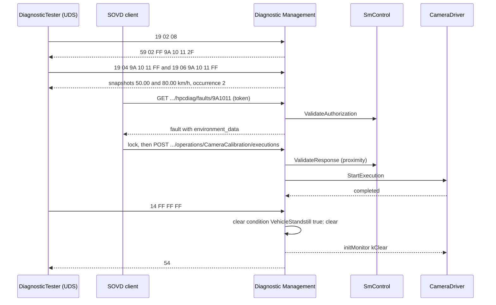

Two details: while the SOVD client holds its lock, the UDS tester's requests to the same Diagnostic Server get NRC `0x21` ([SWS_DM_01375]), so the technician releases the lock before clearing over UDS, or deletes the fault over SOVD instead ([Section 13.2](#132-faults)). And DM reports `SEV_UDS_CLEAR_DTC_SUCCESSFUL` to IdsM ([SWS_DM_02043]).

**The following weeks.** Suppose the camera is blocked once more in week 5 and then never again. The DTC is confirmed and stored again; from the first cycle without a failure, the aging counter counts every `IgnitionCycle` restart in which `kTestFailedThisOperationCycle` stayed 0 (aging does not require tested cycles here). After 40 such cycles, DM deletes the entry and resets bit 3 ([Section 9.7](#97-aging)). The workshop no longer sees the DTC as confirmed.

> **Key takeaways**
>
> - The cycle owner, the monitor and DM together produce pending (day 1), confirmed (day 2) and the snapshots.
> - UDS and SOVD read the same entry; an SOVD lock blocks UDS requests on the same server.
> - Clear conditions protect the clear; aging removes the entry after 40 fault-free cycles.

---

## 18. Best Practices, Pitfalls and Troubleshooting

> **Why this matters:** Most fault-memory problems are not bugs in DM but missing links in the configuration or in the application. This chapter collects the ones that appear again and again.

### 18.1 Best Practices

1. **One owner per cycle, condition and event.** Decide early which process restarts each operation cycle and sets each condition; write it into the design. The model enforces one monitor mapping per event and one port mapping per cycle ([constr_10048], [constr_10051]).
2. **Offer the monitor only when the notifier can run.** Construct, finish initializing, then `Offer()` ([Section 5.2](#52-aradiagmonitor-a-required-port-with-a-notifier)).
3. **Keep DEXT and code consistent.** The DEXT debouncing overrides the constructor ([SWS_DM_01099]); the DEXT algorithm decides which `MonitorAction`s are legal ([SWS_DM_01987]).
4. **Pin generated handles.** Use `overrideId` for every `Multiple*` handle your code hard-codes ([SWS_DM_01733]).
5. **Re-enable DTC setting from the application.** Call `EnableControlDtc()` at the start of a drive, as the SWS recommends ([SWS_DM_00811]).
6. **Size the memory and choose displacement deliberately.** With `none`, new faults are lost when the memory is full ([SWS_DM_00927]); watch the overflow flag.
7. **Keep extended data always readable.** An application-provided element cannot return an NRC; use a defined invalid value (SWS, Section 7.3.4.4.4.3).
8. **Validate every path in `FileTransferService`.** DM checks only session and security; the file system rights are yours ([Section 11.4](#114-access-rights-for-files)).
9. **Mark DRAFT APIs in your code reviews.** `Monitor` constructors and most notifiers may change in a later release ([Section 15.1](#151-headers-and-classes-overview)).

### 18.2 Pitfalls

> **Pitfall: the operation cycle is never restarted.** Nothing restarts it automatically. Without restarts, bit 6 stays 0 after the first test, pending is never cleared, a confirmation threshold above 1 is never reached, and nothing ages ([Section 7.1](#71-operation-cycles)).

> **Pitfall: the enable condition starts false and nobody sets it.** With `initValue` false, DM ignores every report of the event until the owner calls `SetCondition(kConditionTrue)` ([SWS_DM_00568]). The monitor looks healthy, but the DTC never appears.

> **Pitfall: two processes report the same event.** DM supports one source per event (SWS, Section 7.3.4.1.1). A second `Monitor` for the same event is a mapping error ([constr_10048]); a "shared" monitor across threads violates the non-re-entrancy of the reporting interface.

> **Pitfall: confirmation with a fault that never heals.** With a confirmation threshold above 1, confirmation needs a `kTestFailed` 0 → 1 transition in a later cycle ([SWS_DM_00218]). A permanent fault that is never reported as passed stays pending in R25-11's wording ([Section 8.2](#82-status-bit-processing)).

> **Pitfall: `0x85` OFF left behind.** A tester that switches DTC setting off and leaves in the extended session without a session timeout disables storage until the default session returns ([SWS_DM_00812]). An application call to `EnableControlDtc()` is the safety net.

> **Pitfall: NRC `0x22` on `0x14`.** It means either a clear condition forbids the clear ([SWS_DM_00163], [SWS_DM_00164]) or another client is clearing the same memory ([SWS_DM_00147]). Check the condition owner first.

> **Pitfall: snapshot DID provider not running.** If the process that provides a snapshot DID is not running when the fault occurs, DM pads with `0xFF` ([SWS_DM_00969]). Snapshot DIDs should come from processes that run in every Function Group State in which the monitor can fail.

> **Pitfall: SOVD lock versus extended session.** An SOVD client cannot acquire a lock while a UDS tester is in the extended session ([SWS_DM_01477]), and a held lock makes UDS requests fail with `0x21` ([SWS_DM_01375]).

### 18.3 Troubleshooting

| Symptom | Likely cause | Check |
| --- | --- | --- |
| DTC never appears | enable condition false; cycle not started; monitor not offered; DTC setting off | `GetCondition`; owner of the cycle; `Offer()` result; `GetControlDTCStatus` |
| Process terminated right after a report | unsupported `MonitorAction` for the configured debouncing | DEXT algorithm vs. reported actions ([SWS_DM_01987]) |
| DTC stays pending, never confirmed | threshold above 1 with a permanent fault; cycle never restarts | [Section 8.2](#82-status-bit-processing) |
| Snapshot contains `FF FF` | DID provider not offered or failed | provider process state; DM log |
| `0x19` sub-function rejected | no `DiagnosticReadDTCInformation` with that category, or not supported by DM | [Section 10.1](#101-0x19-readdtcinformation) |
| `14 xx xx xx` gives `0x31` | unknown DTC or group, or `clearDtcLimitation` = `clearAllDtcs` | [Section 10.2](#102-0x14-cleardiagnosticinformation) |
| New faults lost, overflow true | memory full with `none` or no lower-priority entry | `maxNumberOfEventEntries`, priorities, strategy |
| DTC disappears by itself | aging threshold reached | `DiagnosticAging`, extended data `DEM_AGINGCTR_UPCNT` |
| `Multiple*` call returns `kInvalidArgument` | handle not mapped to this port | generated handles, `overrideId` |
| SOVD `401` on lock | client not authenticated | `ValidateAuthorization`, token |
| SOVD `409` | lock required but not held, or lock expired | lock life cycle ([SWS_DM_01473]) |
| SOVD `503` | environmental condition false | `DiagnosticEnvSovdDataCondition` |
| SOVD `400` on an operation | proximity response missing or wrong | `SovdProximityChallenge` |

> **Key takeaways**
>
> - Assign owners for cycles, conditions and events; offer monitors only when ready.
> - Most "missing DTC" problems are conditions, cycles or DTC setting, not DM.
> - Use the status byte, the conditions and the DTC setting state as the first diagnostics of the diagnostics.

---

## 19. Summary and Self-Check Quiz

> **Why this matters:** A short repetition and a self-check show whether the chain from monitor to tester is clear, before you configure a real ECU.

### 19.1 Summary

- Applications run **monitors** and report through `ara::diag::Monitor`; DM **debounces** (counter-based, time-based or in the monitor) and keeps the **event status**.
- Events map to **DTCs**; DM computes the **UDS DTC status byte** per ISO 14229-1, with confirmation after `confirmationThreshold − 1` failed cycles.
- Applications own **operation cycles**, **enable conditions** and **clear conditions**.
- The **event memory** stores entries with **snapshot** and **extended data** records; **displacement** handles a full memory and **aging** removes old entries.
- The tester uses `0x19`, `0x14`, `0x85` and `0x86`; applications can read and clear through `DTCInformation`.
- `0x34`-`0x38` are delegated to transfer providers, which must do most ISO checks themselves.
- **SOVD** makes the same Diagnostic Server reachable over HTTPS: faults come from the event memory, data and operations from dedicated providers, security from `SovdAuthorization` and locks.

### 19.2 Quiz

1. What is the difference between a diagnostic event and a DTC?
2. Why does `ara::diag::Monitor` have `Offer()` although it is mapped to an R-port?
3. A monitor of an event with monitor-internal debouncing reports `kPrefailed`. What happens?
4. With counter-based debouncing, step up 2, failed threshold 20, and the counter at −20: how many consecutive `kPrefailed` reports are needed until the event fails, without jump up?
5. Which application tells DM that a new ignition cycle has started, and what happens if nobody does?
6. An event has an enable condition with `initValue` false. The monitor reports `kFailed`. What does DM do?
7. Decode the status byte `0x64`.
8. `confirmationThreshold` is not configured. When is the DTC confirmed?
9. What is the difference between event combination on storage and on retrieval?
10. `0x9A1011` has no connected indicator. Can bit 7 ever be 1?
11. `memoryEntryStorageTrigger` is not configured. When is an entry created?
12. Name two internal data elements that can appear in an extended data record, and say why they are not frozen at storage time.
13. The memory is full, the strategy is `prioOcc`, and a new event has the same priority as all stored entries. What happens?
14. A tester sends `14 9A 10 11` while the vehicle is moving. What is the response in `HPC`, and why?
15. A tester switched DTC setting off and disconnected. What switches it on again?
16. Which checks does DM perform for `0x36` TransferData, and which must the application do?
17. An SOVD client wants to lock `hpcdiag` while a UDS tester is in the extended session. What happens?
18. Where does the SOVD fault attribute `scope` come from, and what does DM use if a request has no `scope`?

<details>
<summary>Answers</summary>

1. The event is DM's record of one monitored entity, fed by one monitor; the DTC is the code in the event memory that the tester sees. Several events can map to one DTC. [Section 2.1](#21-monitor-diagnostic-event-dtc)
2. Because DM calls back the monitor through the `initMonitor` notifier; `Offer()` says the notifier is ready. [Section 5.2](#52-aradiagmonitor-a-required-port-with-a-notifier)
3. It is not supported for monitor-internal debouncing; DM triggers a violation in the monitor's process. [Section 5.3](#53-reporting-reportmonitoraction-and-monitoraction)
4. 20 reports: from −20 to +20 in steps of 2. [Section 6.7](#67-worked-example-debouncing-camerablocked)
5. The owner of the operation cycle, through `RestartOperationCycle`; without restarts, per-cycle bits, pending, confirmation and aging do not advance. [Section 7.1](#71-operation-cycles), [Section 18.2](#182-pitfalls)
6. It ignores the report until the condition is set to true. [Section 7.2](#72-enable-conditions)
7. `0x40` + `0x20` + `0x04`: not completed this cycle, failed since last clear, pending. [Section 8.7](#87-worked-example-two-drives-with-a-blocked-camera)
8. DM uses 1: the DTC is confirmed together with the first failure. [Section 8.2](#82-status-bit-processing)
9. On storage: one entry per DTC, data of one event. On retrieval: data per event, concatenated in responses. [Section 8.4](#84-event-combination)
10. No; without a connected indicator, bit 7 stays 0. [Section 8.5](#85-indicators-and-the-warningindicatorrequested-bit)
11. At the transition of `testFailed` (default `testFailed`). [Section 9.2](#92-when-an-entry-is-created)
12. For example `DEM_OCCCTR` and `DEM_AGINGCTR_UPCNT`; DM uses the current value at read-out time. [Section 9.5](#95-internal-data-elements)
13. Nothing is displaced: `prioOcc` displaces only lower-priority entries, so the new event is discarded. [Section 9.6](#96-overflow-and-displacement)
14. `7F 14 22`: the clear condition `VehicleStandstill` is false. [Section 10.6](#106-worked-example-the-workshop-reads-inspects-and-clears-0x9a1011)
15. The return to the default session, a later `0x85` ON, or `EnableControlDtc()` from an application, which `SmControl` calls at the start of every drive. [Section 10.4](#104-0x85-controldtcsetting)
16. DM checks only session and security; all other ISO checks are done by the application. [Section 11.1](#111-0x34-to-0x37-download-and-upload)
17. The lock is refused: a lock can only be acquired if no UDS client is in the extended session. [Section 12.3](#123-uds-and-sovd-clients-together)
18. From the short name of the `DiagnosticMemoryDestination`; without `scope`, the primary memory. [Section 13.2](#132-faults)

</details>

> **Key takeaways**
>
> - If you can answer the quiz, you can follow a DTC through its whole life.
> - Revisit the sections linked from the answers you missed.

---

## Appendix A. Glossary and Acronyms

| Term | Meaning |
| --- | --- |
| Aging | Deleting an event memory entry after a configured number of fault-free aging cycles. |
| Clear Condition | A condition that must be fulfilled for a DTC to be cleared; AP-only (`DiagnosticClearCondition`). |
| Confirmed DTC | A DTC whose status bit 3 is set: the fault is confirmed after the configured number of failed operation cycles. |
| Debouncing | Filtering of monitor reports until a result is qualified as failed or passed. |
| Diagnostic Event | DM's record of one monitored entity; the input of Diagnostic Event Management. |
| Diagnostic Monitor | Application code that checks one monitoring path and reports the result to a diagnostic event. |
| Displacement | Replacing a less important event memory entry by a new one when the memory is full. |
| DTC | Diagnostic Trouble Code: 3-byte code of a fault in the event memory. |
| DTC Group | A DTC value that addresses several DTCs; `0xFFFFFF` addresses all. |
| Enable Condition | A condition that must be fulfilled for the reports of a diagnostic event to count. |
| Event Combination | Mapping several diagnostic events to one DTC, combined on storage or on retrieval. |
| Event Memory | DM's persistent database of faults (ISO "fault memory"); primary and user-defined memories. |
| Event Status Byte | Three status bits of a diagnostic event: test failed, test failed this operation cycle, test not completed this operation cycle. |
| Extended Data Record | A record of mostly statistical data stored with a DTC, for example the occurrence counter. |
| Fault Detection Counter (FDC) | Debouncing progress from −128 (finally healed) to +127 (finally defective). |
| File Transfer | Transfer of files between tester and ECU with UDS `0x38` and `0x36`/`0x37`. |
| Healing | Switching off the warning indicator request of a DTC after a number of good cycles. |
| Indicator (diagnostic) | A warning output such as a lamp, linked to diagnostic events. |
| Occurrence Counter | Count of the repetitions of a fault in an event memory entry. |
| Operation Cycle | A period, such as an ignition cycle, that restarts per-cycle status bits and counts for confirmation and aging; owned by an application. |
| Overflow | The state of an event memory that was full when a new entry had to be stored. |
| Pending DTC | A DTC whose status bit 2 is set: it failed in the current or the last operation cycle. |
| Proximity Challenge | An SOVD mechanism that proves that a person is physically at the vehicle before an operation runs. |
| Snapshot Record | Data captured when a DTC occurs (freeze frame), for UDS a set of DIDs. |
| SOVD | Service-Oriented Vehicle Diagnostics (ASAM SOVD, ISO 17978-3): diagnostics as a REST API over HTTPS. |
| SOVD Gateway | The edge node that routes SOVD requests from clients to the SOVD servers in the vehicle. |
| SOVD Lock | Exclusive access of one SOVD client to an SOVD entity. |
| SOVD Operation | An SOVD resource that executes diagnostic code, synchronously or asynchronously. |
| SOVD Server | An SOVD endpoint in the vehicle; on AP, DM is the SOVD server and each Diagnostic Server instance a sub-component. |
| Trip Counter | Counter of failed operation cycles used for confirmation (ISO 14229-1, Annex D). |
| UDS DTC Status Byte | The 8 status bits of a DTC defined by ISO 14229-1. |

| Acronym | Expansion |
| --- | --- |
| DEM | Diagnostic Event Management (prefix of internal data providers) |
| DEXT | Diagnostic Extract Template |
| EDR | Extended Data Record |
| FDC | Fault Detection Counter |
| mDNS, DNS-SD | Multicast DNS, DNS-Based Service Discovery |
| NRC | Negative Response Code |
| ODX | Open Diagnostic Data Exchange |
| RoE | ResponseOnEvent (`0x86`) |
| WIR | WarningIndicatorRequested (status bit 7) |

## Appendix B. Quick Reference Cheat Sheet

**UDS DTC status byte** ([SWS_DM_00658]):

| Bit | 7 | 6 | 5 | 4 | 3 | 2 | 1 | 0 |
| --- | --- | --- | --- | --- | --- | --- | --- | --- |
| Mask | `0x80` | `0x40` | `0x20` | `0x10` | `0x08` | `0x04` | `0x02` | `0x01` |
| Name | WIR | not completed this cycle | failed since clear | not completed since clear | confirmed | pending | failed this cycle | test failed |

**`MonitorAction` by debouncing** ([SWS_DM_01987]): counter-based: all except `kFdcThresholdReached`, `kFreezeDebouncing`; time-based: all except `kFdcThresholdReached`; monitor-internal: `kPassed`, `kFailed`, `kFdcThresholdReached`, `kResetTestFailed`.

**`0x19` sub-functions supported:** `0x01`, `0x02`, `0x03`, `0x04`, `0x06`, `0x07`, `0x0A`, `0x14`, `0x17`, `0x18`, `0x19`. Not supported: `0x05`, `0x08`, `0x09`, `0x0B`-`0x13`, `0x15`, `0x16`, `0x42`, `0x55`.

**Other limitations (SWS 4.1):** `0x85` only ON/OFF; `0x86` no queuing, only infiniteTimeToResponse and powerWindowTime; no OBD/WWH-OBD; no mirror memory; no run-time variant handling of events and DTCs; SOVD 1.0 with limitations, 1.1 not fully supported.

**Specified defaults:** confirmation threshold 1; `memoryEntryStorageTrigger` `testFailed`; `clearDtcLimitation` `allSupportedDtcs`; `agingRequiresTestedCycle` FALSE; `statusBitHandlingTestFailedSinceLastClear` `statusBitNormal`; occurrence counter starts at 1, latches at 255; `SovdContentConcurrencyType` all `kNotConcurrent`.

**NRCs of the fault-memory services:** `0x31` unknown DTC/group, `clearAllDtcs` limitation, bad option record of `0x85`, unknown user-defined memory; `0x22` clear forbidden or memory locked by another clear; `0x72` non-volatile memory error.

**SOVD resource → DM call:**

| Resource | Application interface |
| --- | --- |
| data | `GenericDiagnosticSovdContent::Read`/`Write` |
| faults | none (event memory) |
| operations | `GenericDiagnosticSovdOperation::StartExecution`, `SovdOperationExecution` |
| configurations | `SovdConfiguration` or content mapping |
| bulk-data | `SovdBulkData` |
| updates | `SovdSwUpdate` |
| modes | none (`0x28`, `0x85` logic) |
| authorization | `SovdAuthorization`; proximity: `SovdProximityChallenge`; validation: `SovdServiceValidation` |

## Appendix C. Spec Traceability

Use this table to find the normative text in the specifications (R25-11) for each topic of this guide.

| Topic | Guide | Specification section | Key requirement IDs |
| --- | --- | --- | --- |
| Overview, limitations | 1 | SWS 1, 4.1, 7.3.4 | [SWS_DM_00055] |
| Concepts | 2 | SWS 7.3.4.1, 7.3.4.4; DEXT 4.4 | [SWS_DM_00643], [SWS_DM_00658], [SWS_DM_00645] |
| Architecture, port mappings | 3, 14.11 | SWS 5, 7.2; TPS 4.9.3, 5.2.2; EXP SOVD 2 | [TPS_MANI_01351], [TPS_MANI_01048] to [TPS_MANI_01050], [TPS_MANI_01259] to [TPS_MANI_01261], [TPS_MANI_01484], [constr_10047] to [constr_10057] |
| Events and monitors | 5 | SWS 7.3.4.1.1, 7.3.4.1.2, 7.3.4.1.6 to 7.3.4.1.8 | [SWS_DM_01733], [SWS_DM_01731], [SWS_DM_01740], [SWS_DM_00562], [SWS_DM_00563], [SWS_DM_01094], [SWS_DM_01095], [SWS_DM_00965], [SWS_DM_01987], [SWS_DM_01988], [SWS_DM_01024] to [SWS_DM_01029], [SWS_DM_00945] to [SWS_DM_00948] |
| Debouncing | 6 | SWS 7.3.4.1.5 | [SWS_DM_00014] to [SWS_DM_00039], [SWS_DM_00875] to [SWS_DM_00882], [SWS_DM_00085], [SWS_DM_00086], [SWS_DM_00378], [SWS_DM_01099], [SWS_DM_01101], [SWS_DM_01267], [SWS_DM_01268], [SWS_DM_01583], [SWS_DM_01584], [SWS_DM_01971] |
| Operation cycles, conditions | 7 | SWS 7.3.4.1.4, 7.3.4.2, 7.3.4.3, 7.3.4.4.5.2; TPS 5.3 | [SWS_DM_00568], [SWS_DM_01093], [SWS_DM_01102] to [SWS_DM_01105], [SWS_DM_00896], [SWS_DM_00121], [SWS_DM_00123], [SWS_DM_00124], [SWS_DM_CONSTR_00168], [constr_1658] |
| DTC status, combination, indicators | 8 | SWS 7.3.4.1.3, 7.3.4.4.1, 7.3.4.4.2 | [SWS_DM_00058] to [SWS_DM_00065], [SWS_DM_00213] to [SWS_DM_00224], [SWS_DM_01037], [SWS_DM_01106] to [SWS_DM_01116], [SWS_DM_01976], [SWS_DM_01977], [SWS_DM_01974], [SWS_DM_01975], [SWS_DM_01266], [SWS_DM_01582] |
| Event memory | 9 | SWS 7.3.4.4.3 to 7.3.4.4.11, 7.3.6.1 | [SWS_DM_00148] to [SWS_DM_00155], [SWS_DM_01085] to [SWS_DM_01087], [SWS_DM_01276], [SWS_DM_01277], [SWS_DM_02142], [SWS_DM_00895], [SWS_DM_00949] to [SWS_DM_00964], [SWS_DM_02145], [SWS_DM_00920] to [SWS_DM_00934], [SWS_DM_00237] to [SWS_DM_00243], [SWS_DM_01264], [SWS_DM_01265], [SWS_DM_00981], [SWS_DM_00982] |
| UDS fault-memory services | 10 | SWS 7.3.2.8.6, 7.3.2.8.7, 7.3.2.8.22, 7.3.2.8.23, 7.3.4.4.5 | [SWS_DM_00090] to [SWS_DM_00092], [SWS_DM_00113] to [SWS_DM_00117], [SWS_DM_00122], [SWS_DM_00144] to [SWS_DM_00164], [SWS_DM_00193] to [SWS_DM_00208], [SWS_DM_00244] to [SWS_DM_00247], [SWS_DM_00370] to [SWS_DM_00374], [SWS_DM_00967], [SWS_DM_00229], [SWS_DM_00231], [SWS_DM_00909] to [SWS_DM_00911], [SWS_DM_00491] to [SWS_DM_00494], [SWS_DM_01978], [SWS_DM_01117] to [SWS_DM_01122], [SWS_DM_00897] to [SWS_DM_00901] |
| Data and file transfer | 11 | SWS 7.3.2.8.2, 7.3.2.8.16 to 7.3.2.8.20; TPS 4.9.2.6, 4.9.2.11, 5.2.3.3; SWS UCM 7.2 | [SWS_DM_00128] to [SWS_DM_00141], [SWS_DM_00867] to [SWS_DM_00871], [SWS_DM_01096], [SWS_DM_01097], [SWS_DM_01310] to [SWS_DM_01319], [TPS_MANI_01453] |
| SOVD server, security | 12 | SWS 4.1.3, 7.2, 7.3.3.1 to 7.3.3.4; TPS 5.1.1, 5.7.3, 12.12 | [SWS_DM_01369] to [SWS_DM_01375], [SWS_DM_01476], [SWS_DM_01477], [SWS_DM_01929], [SWS_DM_01466] to [SWS_DM_01475], [SWS_DM_01781] to [SWS_DM_01786], [SWS_DM_01442] to [SWS_DM_01465], [TPS_MANI_01399] to [TPS_MANI_01404] |
| SOVD resources | 13 | SWS 7.3.3.5; TPS 5.7 | [SWS_DM_01379] to [SWS_DM_01433], [SWS_DM_01561], [SWS_DM_01567], [SWS_DM_01787] to [SWS_DM_01804], [SWS_DM_02000], [SWS_DM_02001], [SWS_DM_02119], [SWS_DM_02120], [SWS_DM_02160] to [SWS_DM_02181], [TPS_MANI_01431], [TPS_MANI_01492] to [TPS_MANI_01506] |
| Configuration | 4, 14 | DEXT 4.4, 5; TPS 5.1 to 5.3, 5.7, 12.12; SWS 7.3.5, 10 | [SWS_DM_CONSTR_00059], [SWS_DM_CONSTR_00084], [SWS_DM_CONSTR_00168], [SWS_DM_CONSTR_00394] to [SWS_DM_CONSTR_00396], [SWS_DM_CONSTR_00961], [SWS_DM_01576] to [SWS_DM_01579], [constr_10567], [constr_10705] to [constr_10719] |
| API | 15 | SWS 8.10, 8.11, 8.14, 8.18, 8.23, 8.27, 8.37 to 8.62 | [SWS_DM_00542], [SWS_DM_00646], [SWS_DM_00657], [SWS_DM_00711], [SWS_DM_00751], [SWS_DM_00741], [SWS_DM_00784], [SWS_DM_01320], [SWS_DM_01490], [SWS_DM_02186], [SWS_DM_02203], [SWS_DM_00559], [SWS_DM_00560], [SWS_DM_01806] |
| Reporting | 16 | SWS 7.5 | [SWS_DM_02031] to [SWS_DM_02038], [SWS_DM_02043] to [SWS_DM_02050], [SWS_DM_00969] |

## Appendix D. Notable Changes in Recent Releases

This summary is based on the change history and the history appendix of the specification (SWS, Appendix E). It lists only the changes that matter most when you port code or material from an older release.

| Release | Change | Specification items |
| --- | --- | --- |
| R25-11 | Native handling of SOVD data and operations: `GenericDiagnosticSovdContent`, `GenericDiagnosticSovdOperation`, the content model, data categories and groups | [SWS_DM_02160] to [SWS_DM_02181], [SWS_DM_02182] to [SWS_DM_02387] |
| R25-11 | SOVD snapshots and harmonized UDS/SOVD extended data: SOVD snapshot content, fault `environment_data`, typed extended data record element interfaces, internal EDR table | [SWS_DM_02142], [SWS_DM_02119], [SWS_DM_02145] to [SWS_DM_02158] |
| R25-11 | Snapshot record types and notifier types in `DTCInformation` | [SWS_DM_02112] to [SWS_DM_02125] |
| R24-11 | Explicit no-debouncing for `ara::diag::Monitor`; supported monitor actions per debouncing; FDC for monitors without debouncing | [SWS_DM_01971] to [SWS_DM_01973], [SWS_DM_01987], [SWS_DM_01988] |
| R24-11 | Combined DTC status table and example; indicator reporting; tested-cycles internal elements; aging for untested cycles; identical behavior of user-defined memories | [SWS_DM_01976], [SWS_DM_01977], [SWS_DM_01974], [SWS_DM_01975], [SWS_DM_01954] to [SWS_DM_01960], [SWS_DM_01953] |
| R24-11 | ResponseOnEvent sub-function table; SOVD fault memory `scope`; security events | [SWS_DM_01978], [SWS_DM_02000], [SWS_DM_02001], [SWS_DM_02014] to [SWS_DM_02058] |
| R23-11 | SOVD concept part 2: authorization, locks, service validation, bulk data, configuration, software update, SOVD error domain | [SWS_DM_01781] to [SWS_DM_01804], [SWS_DM_01806] to [SWS_DM_01930] |
| R23-11 | `Multiple*` interfaces and handle generation; default values of memory attributes; debounce reset actions | [SWS_DM_01694] to [SWS_DM_01736], [SWS_DM_01576] to [SWS_DM_01579], [SWS_DM_01583], [SWS_DM_01584] |

## Appendix E. References

**AUTOSAR specifications (R25-11):**

- *Specification of Diagnostics* (`AUTOSAR_AP_SWS_Diagnostics`)
- *Diagnostic Extract Template* (`AUTOSAR_CP_TPS_DiagnosticExtractTemplate`), for events, DTCs, memories, records and the event mappings
- *Specification of Manifest* (`AUTOSAR_AP_TPS_ManifestSpecification`), for the fault-memory port interfaces and mappings, clear conditions, `DiagnosticCommonProps` extensions and the SOVD configuration
- *Explanation of Service-Oriented Vehicle Diagnostics* (`AUTOSAR_AP_EXP_SOVD`)
- *Specification of Update and Configuration Management* (`AUTOSAR_AP_SWS_UpdateAndConfigurationManagement`), for the diagnostic application as UCM client
- *Requirements on Diagnostics* (`AUTOSAR_FO_RS_Diagnostics`)
- *Specification of Adaptive Platform Core* (`AUTOSAR_AP_SWS_Core`), for `InstanceSpecifier`, `Future`, `ErrorCode` and violations

**Other sources:**

- [EXT-056] *ISO 14229-1:2020 Road vehicles, Unified diagnostic services (UDS), Part 1: Application layer*, ISO. <https://www.iso.org/standard/72439.html> (cited by name; accessed 2026-11-08)
- [EXT-058] *ASAM SOVD (Service-Oriented Vehicle Diagnostics)*, ASAM e.V. <https://www.asam.net/standards/detail/sovd/> (accessed 2026-11-08)
- [EXT-059] *ISO 17978-3 Road vehicles, Service-oriented vehicle diagnostics (SOVD), Part 3: Application programming interface (API)*, ISO. <https://www.iso.org> (cited by name; the SWS cites it as 2025 in its references and as 2026 in Section 4.1.3; accessed 2026-11-09)
- [EXT-060] *RFC 6762: Multicast DNS*, IETF. <https://www.rfc-editor.org/rfc/rfc6762> (accessed 2026-11-09)
- [EXT-061] *RFC 6763: DNS-Based Service Discovery*, IETF. <https://www.rfc-editor.org/rfc/rfc6763> (accessed 2026-11-09)
- [EXT-062] *RFC 6749: The OAuth 2.0 Authorization Framework*, IETF. <https://www.rfc-editor.org/rfc/rfc6749> (accessed 2026-11-09)
- [EXT-063] *OpenAPI Specification, Version 3.1.0*, OpenAPI Initiative. <https://spec.openapis.org/oas/v3.1.0> (accessed 2026-11-09)

---

*End of the training guide. For normative details, always refer to `AUTOSAR_AP_SWS_Diagnostics` (R25-11) and to the specifications it references, in particular the Diagnostic Extract Template and the Manifest Specification. The update path through diagnostics continues in guide 13.*
